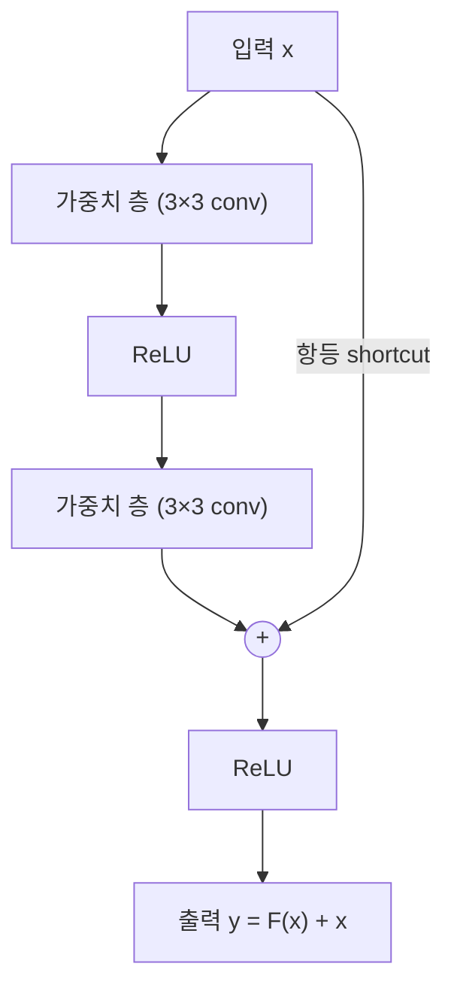
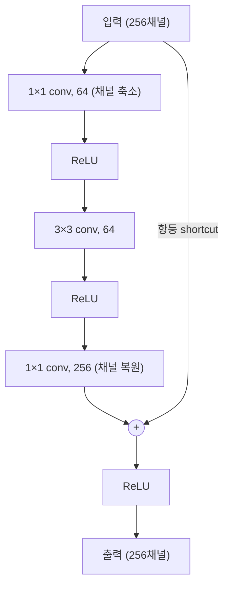
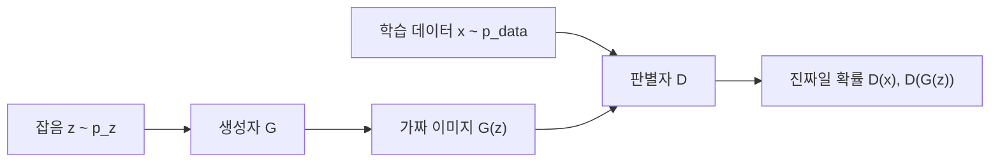
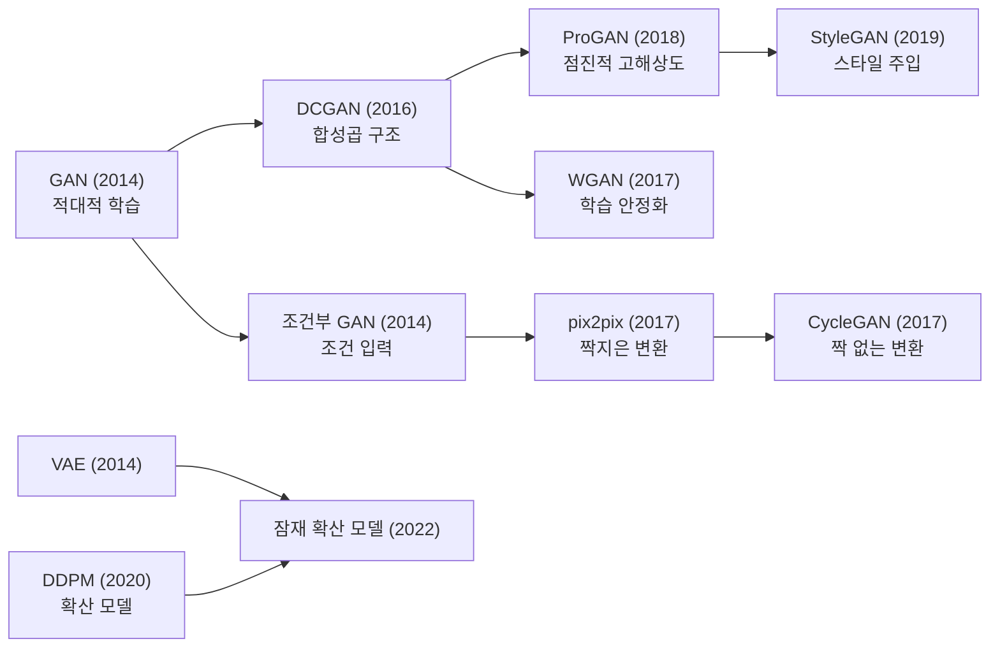

# HW1 과제 해설 — 영상처리 논문 조사: ResNet과 GAN 기반 이미지 생성

[레포지토리 안내](../../README.ko.md) | [English](Assignment-Explanation.md) | [한국어](Assignment-Explanation.ko.md)

> **최종 수정일:** 2026-11-04

> **학습 목표:**
> 1. 깊은 신경망에서 나타나는 성능 저하 문제를 과적합, 기울기 소실과 구분하여 설명할 수 있다
> 2. 잔차 학습과 shortcut 연결이 깊은 신경망의 최적화를 돕는 원리를 수식으로 설명할 수 있다
> 3. ResNet의 기본 블록, 병목 블록, 차원 맞춤 방식과 주요 실험 결과를 정리할 수 있다
> 4. 이미지 생성 태스크의 입력과 출력, 생성 모델의 종류, 활용 사례를 설명할 수 있다
> 5. GAN의 미니맥스 목적 함수, 최적 판별자, 전역 최적해, 학습 알고리즘을 유도하고 설명할 수 있다
> 6. GAN 이후의 이미지 생성 모델을 비교하고, 논문 조사 보고서를 IEEE 형식의 참고 문헌과 함께 구성할 수 있다

---

## 목차

- [1. 과제 요구사항](#1-과제-요구사항)
  - [1.1 과제 구성](#11-과제-구성)
  - [1.2 보고서의 구성](#12-보고서의-구성)
- [2. ResNet 논문 정리](#2-resnet-논문-정리)
  - [2.1 연구 배경: 깊이의 중요성](#21-연구-배경-깊이의-중요성)
  - [2.2 성능 저하 문제](#22-성능-저하-문제)
  - [2.3 잔차 학습](#23-잔차-학습)
  - [2.4 shortcut 연결과 차원 맞춤](#24-shortcut-연결과-차원-맞춤)
  - [2.5 네트워크 구조](#25-네트워크-구조)
  - [2.6 학습 설정](#26-학습-설정)
  - [2.7 실험 결과](#27-실험-결과)
  - [2.8 기여와 의의](#28-기여와-의의)
- [3. 이미지 생성 태스크](#3-이미지-생성-태스크)
  - [3.1 정의와 입력, 출력](#31-정의와-입력-출력)
  - [3.2 생성 모델의 종류](#32-생성-모델의-종류)
  - [3.3 활용 사례](#33-활용-사례)
- [4. GAN 논문 정리](#4-gan-논문-정리)
  - [4.1 생성자와 판별자](#41-생성자와-판별자)
  - [4.2 미니맥스 목적 함수](#42-미니맥스-목적-함수)
  - [4.3 최적 판별자와 전역 최적해](#43-최적-판별자와-전역-최적해)
  - [4.4 학습 알고리즘](#44-학습-알고리즘)
  - [4.5 실험과 한계](#45-실험과-한계)
  - [4.6 기여](#46-기여)
- [5. GAN 이후의 이미지 생성 모델](#5-gan-이후의-이미지-생성-모델)
  - [5.1 DCGAN](#51-dcgan)
  - [5.2 조건부 GAN과 이미지 변환](#52-조건부-gan과-이미지-변환)
  - [5.3 학습 안정화: WGAN](#53-학습-안정화-wgan)
  - [5.4 고해상도 생성: ProGAN과 StyleGAN](#54-고해상도-생성-progan과-stylegan)
  - [5.5 확산 모델](#55-확산-모델)
- [6. 논문 선정과 인용](#6-논문-선정과-인용)
  - [6.1 인용 수 확인](#61-인용-수-확인)
  - [6.2 IEEE 참고 문헌 형식](#62-ieee-참고-문헌-형식)
- [요약](#요약)
- [점검 문제](#점검-문제)
- [참고 문헌](#참고-문헌)

---

<br>

## 1. 과제 요구사항

### 1.1 과제 구성

영상처리 분야의 딥러닝 연구 논문을 조사하는 과제이다. 과제는 두 부분으로 이루어진다.

| 부분 | 요구사항 |
|:-----|:-----|
| ResNet 논문 정리 | K. He 외의 "Deep Residual Learning for Image Recognition"(CVPR 2016) [1]을 정리한다 |
| 다른 영상처리 태스크 조사 | 이미지 분류(image classification)를 제외한 영상처리 태스크 하나를 고르고, 입력과 출력을 포함하여 태스크를 설명한다 |
| | 그 태스크가 활용되는 예시를 간략히 든다(예: 자율주행 자동차의 도로 영역 탐지) |
| | 그 태스크의 해외 논문 한 편을 골라 연구의 기여(contribution)를 서술한다. 논문은 인용 수가 100 이상이어야 하며, 인용 수 스크린샷을 함께 넣는다 |
| 공통 | 참고 문헌을 반드시 적고, 분량은 4쪽 안팎(Word 또는 PDF)이며 양식은 자유이다 |

*표 1. HW1의 요구사항*

이 해설은 두 번째 부분의 태스크로 **이미지 생성(image generation)** 을 고르고, 논문으로 I. J. Goodfellow 외의 "Generative Adversarial Nets"(NIPS 2014) [2]를 고른 경우를 다룬다. 영상처리 태스크의 전체 분류(분류, 객체 탐지, 분할, OCR, 초해상도, 이미지 생성)는 3강에서, ResNet의 구조와 기여는 3강과 4강에서 다룬다.

### 1.2 보고서의 구성

4쪽 안팎의 보고서에서 ResNet 정리와 태스크 조사의 비중을 비슷하게 두면 다음과 같이 구성할 수 있다.

```text
1. ResNet 논문 정리
   1.1 대상 논문의 서지 정보
   1.2 배경과 문제 정의 (성능 저하 문제)
   1.3 제안 방법 (잔차 학습, shortcut 연결, 네트워크 구조)
   1.4 실험 결과 (ImageNet, CIFAR-10, COCO)
   1.5 기여
2. 영상처리 태스크 조사
   2.1 선정한 태스크와 입력, 출력
   2.2 활용 예시
   2.3 선정한 논문의 서지 정보와 인용 수 스크린샷
   2.4 논문의 기여
참고 문헌
```

논문 정리는 논문의 문장을 옮기는 것이 아니라 **문제, 방법, 근거, 기여**의 흐름으로 재구성하는 것이 핵심이다. 수치는 논문의 표에서 직접 가져오고, 어느 실험 조건(데이터셋, 평가 방식)의 수치인지 함께 적는다.

---

<br>

## 2. ResNet 논문 정리

### 2.1 연구 배경: 깊이의 중요성

**합성곱 신경망(convolutional neural network, CNN)** 은 층을 쌓을수록 낮은 수준의 특징(모서리, 색)에서 높은 수준의 특징(물체의 부분, 물체 전체)까지 계층적으로 학습한다. 2014년의 VGGNet [3]은 3×3 합성곱을 16\~19층까지 쌓아 깊이가 성능에 중요하다는 것을 보였고, ImageNet에서 최고 성능을 낸 모델은 모두 16\~30층의 매우 깊은 모델이었다 [1].

그렇다면 층을 더 많이 쌓기만 하면 더 좋은 네트워크가 되는가? 이 질문의 첫 장애물은 **기울기 소실과 폭주(vanishing and exploding gradients)** 였다. 역전파에서 기울기는 층마다 곱해지므로 깊은 네트워크에서는 앞쪽 층의 기울기가 0에 가까워지거나 지나치게 커진다. 이 문제는 정규화된 가중치 초기화와 **배치 정규화(batch normalization, BN)** [4] 같은 중간 정규화 층으로 상당 부분 해결되어, 수십 층의 네트워크도 확률적 경사하강법(SGD)으로 수렴을 시작할 수 있게 되었다.

> **참고:** **배치 정규화**는 미니배치마다 각 채널의 평균과 분산으로 활성값을 정규화한 뒤, 학습 가능한 배율과 이동량으로 다시 조정하는 층이다. 층의 입력 분포가 학습 중에 크게 흔들리지 않게 하여 깊은 네트워크의 학습을 안정시킨다(3강 5.2절).

### 2.2 성능 저하 문제

수렴이 가능해지자 새로운 문제가 드러났다. 네트워크가 깊어지면 정확도가 포화되었다가 급격히 떨어지는 **성능 저하 문제(degradation problem)** 이다. CIFAR-10에서 20층과 56층의 일반 네트워크(plain network, shortcut이 없는 네트워크)를 비교하면, 56층 네트워크가 테스트 오류뿐 아니라 **학습 오류**도 더 높다 [1].

> **용어 정의:** **성능 저하 문제(degradation problem)** 는 적당히 깊은 모델에 층을 더 쌓았을 때 학습 오류가 오히려 커지는 현상이다. 학습 오류가 커지므로 과적합(overfitting, 학습 오류는 작고 테스트 오류만 큰 현상)과는 다르다.

이 현상이 이상한 이유는 다음 **구성에 의한 해(solution by construction)** 로 설명된다. 얕은 모델을 학습시킨 뒤, 그 위에 층을 더 쌓은 깊은 모델을 생각한다. 추가한 층이 입력을 그대로 내보내는 **항등 사상(identity mapping)** 이 되고 나머지 층이 얕은 모델의 가중치를 그대로 쓰면, 깊은 모델은 얕은 모델과 똑같은 출력을 낸다. 따라서 깊은 모델의 학습 오류는 이론상 얕은 모델보다 클 수 없다. 그런데 실제 실험에서는 더 크므로, 문제는 표현력이 아니라 **최적화**에 있다. 이는 SGD 같은 현재의 최적화 기법이 여러 비선형 층으로 항등 사상을 근사하기 어렵다는 것을 시사한다.

> **주의:** ResNet은 흔히 기울기 소실 문제를 해결한 모델로 소개되지만, 논문은 성능 저하의 원인이 기울기 소실일 가능성은 낮다고 밝힌다. 실험의 일반 네트워크는 BN으로 학습되어 순전파 신호의 분산이 0이 아니고, 역전파 기울기의 노름도 정상 범위였기 때문이다 [1]. 논문은 깊은 일반 네트워크의 수렴 속도가 지수적으로 느려져 학습 오류가 줄어들지 않는 것으로 추측하고, 원인 규명은 이후 연구로 남겼다. 2.3절의 기울기 경로 해석은 후속 연구 [5]가 제시한 보완적 관점이다.

### 2.3 잔차 학습

몇 개의 층이 학습해야 할 이상적인 함수를 $\mathcal{H}(\mathbf{x})$라 하자($\mathbf{x}$는 그 층들의 입력이다). ResNet은 층들이 $\mathcal{H}(\mathbf{x})$를 직접 근사하게 하지 않고, 입력과의 차이인 **잔차 함수(residual function)** 를 근사하게 한다.

$$\mathcal{F}(\mathbf{x}) := \mathcal{H}(\mathbf{x}) - \mathbf{x} \quad\Longrightarrow\quad \mathcal{H}(\mathbf{x}) = \mathcal{F}(\mathbf{x}) + \mathbf{x}$$

여러 비선형 층이 복잡한 함수를 점근적으로 근사할 수 있다고 가정하면, 입력과 출력의 차원이 같을 때 잔차 함수도 근사할 수 있으므로 두 형식의 표현력은 같다. 차이는 **학습의 쉬움**에 있다. 최적 함수가 항등 사상이라면, 일반 네트워크는 비선형 층의 조합으로 $\mathcal{H}(\mathbf{x}) = \mathbf{x}$를 정확히 만들어야 하지만, 잔차 네트워크는 가중치를 0 쪽으로 보내 $\mathcal{F}(\mathbf{x}) = \mathbf{0}$으로 만들면 된다.

수치 예로 확인한다. 블록의 입력이 이전 ReLU의 출력인 $\mathbf{x} = (2, 1)$이고, 블록의 두 가중치 층이 모두 0으로 학습되었다고 하자. 그러면 $\mathcal{F}(\mathbf{x}) = W_2\,\sigma(W_1\mathbf{x}) = \mathbf{0}$이고, 덧셈 뒤의 ReLU를 거친 출력은 다음과 같다.

$$\mathbf{y} = \sigma(\mathcal{F}(\mathbf{x}) + \mathbf{x}) = \sigma((0, 0) + (2, 1)) = (2, 1) = \mathbf{x}$$

같은 두 층에서 shortcut을 없애면 출력은 $\sigma(\mathbf{0}) = (0, 0)$이 되어 입력 정보가 모두 사라진다. 일반 네트워크가 항등 사상을 내려면 $W_2\,\sigma(W_1\mathbf{x}) = \mathbf{x}$를 만족하는 특정한 가중치를 찾아야 한다.

실제 문제에서 최적 함수가 정확히 항등 사상일 가능성은 낮다. 논문은 최적 함수가 영 사상보다 항등 사상에 가깝다면, 항등 사상을 기준으로 작은 변화(perturbation)를 찾는 편이 함수를 처음부터 새로 배우는 것보다 쉬우므로, 잔차 형식이 최적화 문제를 **전조건화(preconditioning)** 한다고 해석한다 [1]. 2.7절의 층 응답 분석은 이 해석을 실험으로 뒷받침한다.

**기울기 경로 관점.** 블록의 출력을 $\mathbf{y} = \mathbf{x} + \mathcal{F}(\mathbf{x})$로 단순화하면(덧셈 뒤의 ReLU를 생략한 경우) 연쇄 법칙에 따라 다음이 성립한다.

$$\frac{\partial \mathbf{y}}{\partial \mathbf{x}} = I + \frac{\partial \mathcal{F}}{\partial \mathbf{x}}$$

항등 행렬 $I$ 항 덕분에 손실의 기울기는 잔차 가지를 거치지 않고 shortcut을 따라 앞쪽 층으로 그대로 전달되는 경로를 갖는다 [5]. 스칼라로 단순화한 예에서, 일반 네트워크의 각 층 미분이 0.5이면 10층을 거친 기울기는 $0.5^{10} \approx 0.00098$로 줄어든다. 잔차 블록에서 잔차 가지의 미분이 0.05라면 블록 하나의 미분은 $1 + 0.05 = 1.05$이고 10블록을 거쳐도 $1.05^{10} \approx 1.63$이며, $-0.05$라면 $0.95^{10} \approx 0.60$이다. 잔차 가지의 미분이 작을 때 기울기의 크기가 1 근처에 머문다는 것이 핵심이다.

> **참고:** 이 스칼라 예는 실제 네트워크의 행렬 연쇄를 단순화한 것이다. 실제 기울기는 야코비 행렬의 곱으로 전달되며, 덧셈 뒤의 ReLU, BN, 가중치의 분포에 따라 크기가 달라진다.

### 2.4 shortcut 연결과 차원 맞춤

잔차 형식은 하나 이상의 층을 건너뛰는 **shortcut 연결(shortcut connection)** 로 구현한다. 3강의 스킵 연결과 같은 구조이다. 논문의 기본 블록은 다음과 같다 [1].

$$\mathbf{y} = \mathcal{F}(\mathbf{x}, \lbrace W_i\rbrace) + \mathbf{x}$$

두 층짜리 블록에서 $\mathcal{F} = W_2\,\sigma(W_1\mathbf{x})$이며 $\sigma$는 ReLU이다(편향은 표기에서 생략한다). $\mathcal{F} + \mathbf{x}$는 원소별 덧셈으로 계산하고, 덧셈 뒤에 두 번째 ReLU를 적용한다. 항등 shortcut은 **추가 파라미터도 추가 연산도 없으므로** (무시할 만한 원소별 덧셈 제외), 깊이, 너비, 파라미터 수, 연산량이 같은 일반 네트워크와 잔차 네트워크를 공정하게 비교할 수 있다.



*그림 1. 두 층으로 이루어진 잔차 블록*

$\mathbf{x}$와 $\mathcal{F}$의 차원이 다르면(채널 수가 늘어날 때) 덧셈을 할 수 없으므로, shortcut에서 선형 사영 $W_s$로 차원을 맞춘다.

$$\mathbf{y} = \mathcal{F}(\mathbf{x}, \lbrace W_i\rbrace) + W_s\mathbf{x}$$

논문은 차원이 늘어나는 shortcut을 다루는 세 가지 방식을 비교했다. 특징 맵의 크기가 절반이 되는 곳에서는 shortcut도 stride 2로 적용한다.

| 방식 | 차원이 늘어나는 shortcut | 나머지 shortcut | 추가 파라미터 | ResNet-34의 top-1 오류 (%) |
|:-----|:-----|:-----|:-----|-----:|
| A | 0을 채운 항등 사상(zero-padding) | 항등 사상 | 없음 | 25.03 |
| B | 1×1 합성곱 사영 | 항등 사상 | 차원이 바뀌는 곳에만 | 24.52 |
| C | 1×1 합성곱 사영 | 1×1 합성곱 사영 | 모든 shortcut | 24.19 |

*표 2. 차원 맞춤 방식의 비교 (ImageNet 검증 세트, 10-crop 평가)*

세 방식 모두 같은 깊이의 일반 네트워크(28.54%)보다 훨씬 낫다. B가 A보다 조금 나은 것은 A에서 0으로 채운 차원은 잔차 학습을 하지 않기 때문이고, C가 B보다 조금 나은 것은 13개 사영 shortcut이 더한 파라미터 때문이라고 논문은 해석한다. 차이가 작으므로 **사영은 성능 저하 해결의 본질이 아니며**, 이후 실험은 메모리와 연산을 줄이기 위해 C를 쓰지 않는다 [1].

예를 들어 채널이 64에서 128로 늘어나는 곳의 1×1 사영 shortcut은 $64 \times 128 = 8{,}192$개의 가중치를 더하고, 공간 크기는 stride 2로 56×56에서 28×28로 줄인다.

**관련 연구와의 비교.** 잔차를 다루는 발상은 이전에도 있었다. 영상 검색과 분류에서 VLAD와 Fisher Vector는 사전(dictionary)에 대한 잔차 벡터로 이미지를 표현했고, 편미분 방정식을 푸는 멀티그리드(multigrid) 방법과 계층적 기저 전조건화(hierarchical basis preconditioning)는 두 척도 사이의 잔차를 변수로 삼아 잔차 구조를 고려하지 않는 일반 풀이법보다 훨씬 빨리 수렴했다. 논문은 이 사례들을 좋은 재구성이나 전조건화가 최적화를 단순하게 만든다는 근거로 든다 [1].

shortcut 연결도 오래 연구되었다. 초기의 MLP 학습에서는 입력에서 출력으로 바로 가는 선형 층을 더했고, GoogLeNet 등은 중간 층을 보조 분류기에 직접 연결하여 기울기 소실과 폭주에 대처했다. ResNet과 같은 시기에 나온 **하이웨이 네트워크(highway network)** 는 데이터에 따라 열리고 닫히는, 파라미터가 있는 게이트를 shortcut에 두었다. 게이트가 닫히면(0에 가까워지면) 그 층들은 잔차가 아닌 함수를 표현한다. 반면 ResNet의 항등 shortcut은 파라미터가 없고 닫히지 않으므로, 모든 정보를 항상 통과시키면서 잔차 함수만 학습한다. 또한 하이웨이 네트워크는 100층을 넘는 깊이에서 정확도 향상을 보이지 못했다 [1].

### 2.5 네트워크 구조

**일반 네트워크.** VGGNet의 설계 원칙을 따르되 더 단순하게 만든다. 합성곱은 주로 3×3이고, (i) 출력 특징 맵의 크기가 같으면 필터 수도 같게, (ii) 특징 맵의 크기가 절반이 되면 필터 수를 두 배로 하여 층마다의 연산량을 유지한다. 다운샘플링은 stride 2 합성곱으로 하고, 끝에 전역 평균 풀링(global average pooling)과 1000개 출력의 완전 연결 층(softmax)을 둔다. 34층 일반 네트워크의 연산량은 36억 FLOPs(곱셈-덧셈)로 VGG-19(196억 FLOPs)의 18%이다.

**잔차 네트워크.** 일반 네트워크의 3×3 층 두 개마다 shortcut을 넣는다.

**병목 블록(bottleneck block) 설계.** 50층 이상에서는 학습 시간을 고려하여 잔차 함수를 두 층 대신 1×1, 3×3, 1×1 합성곱의 세 층으로 만든다. 첫 1×1 층이 채널을 줄이고, 3×3 층이 줄어든 채널에서 연산하며, 마지막 1×1 층이 채널을 복원한다. 가운데 3×3 층의 입출력 차원이 작아 병목(bottleneck)처럼 보인다는 데서 이름이 왔다.



*그림 2. ResNet-50/101/152의 병목 블록*

가중치 수(편향 제외)로 두 설계를 비교한다. 합성곱 층의 가중치 수는 (커널 높이)×(커널 너비)×(입력 채널)×(출력 채널)이다.

| 블록 | 계산 | 가중치 수 |
|:-----|:-----|-----:|
| 기본 블록, 64채널 | $2 \times (3 \cdot 3 \cdot 64 \cdot 64) = 2 \times 36{,}864$ | 73,728 |
| 병목 블록, 256채널 입출력 | $1 \cdot 1 \cdot 256 \cdot 64 + 3 \cdot 3 \cdot 64 \cdot 64 + 1 \cdot 1 \cdot 64 \cdot 256 = 16{,}384 + 36{,}864 + 16{,}384$ | 69,632 |
| 기본 블록, 256채널 | $2 \times (3 \cdot 3 \cdot 256 \cdot 256) = 2 \times 589{,}824$ | 1,179,648 |

*표 3. 기본 블록과 병목 블록의 가중치 수*

병목 블록은 네 배 넓은 256채널을 다루면서도 64채널 기본 블록과 비슷한 가중치 수(따라서 비슷한 연산량)를 가진다. 같은 256채널을 기본 블록으로 처리하면 약 17배($1{,}179{,}648 / 69{,}632 \approx 16.9$)가 필요하다. 이 블록에서는 **항등 shortcut이 특히 중요하다.** shortcut을 사영으로 바꾸면 고차원(256채널) 양 끝을 잇게 되어 블록의 연산량과 크기가 두 배가 된다 [1]. 1×1 합성곱을 이용한 경량화는 9강에서 다시 다룬다.

| 모델 | conv2_x | conv3_x | conv4_x | conv5_x | 블록 | 연산량 (FLOPs) |
|:-----|-----:|-----:|-----:|-----:|:-----|-----:|
| ResNet-18 | 2 | 2 | 2 | 2 | 기본 | $1.8 \times 10^9$ |
| ResNet-34 | 3 | 4 | 6 | 3 | 기본 | $3.6 \times 10^9$ |
| ResNet-50 | 3 | 4 | 6 | 3 | 병목 | $3.8 \times 10^9$ |
| ResNet-101 | 3 | 4 | 23 | 3 | 병목 | $7.6 \times 10^9$ |
| ResNet-152 | 3 | 8 | 36 | 3 | 병목 | $11.3 \times 10^9$ |

*표 4. ImageNet용 ResNet의 단계별 블록 수와 연산량*

층 수는 블록 수와 블록당 층 수로 계산한다. 예를 들어 ResNet-34는 $(3 + 4 + 6 + 3) \times 2 = 32$개 합성곱 층에 첫 7×7 합성곱과 마지막 완전 연결 층을 더해 34층이고, ResNet-152는 $(3 + 8 + 36 + 3) \times 3 = 150$에 2를 더해 152층이다. ResNet-152는 VGGNet보다 8배 깊지만 연산량(113억 FLOPs)은 VGG-16/19(153억, 196억 FLOPs)보다 적다.

### 2.6 학습 설정

| 항목 | 설정 |
|:-----|:-----|
| 데이터 증강 | 짧은 변을 [256, 480]에서 무작위로 정해 크기를 바꾸고(scale augmentation), 224×224 영역을 무작위로 자르며 좌우 반전, 픽셀 평균 빼기, 표준 색 증강을 적용한다 |
| 정규화 | 모든 합성곱 직후, 활성화 함수 이전에 BN을 적용하고, dropout은 쓰지 않는다 |
| 초기화 | He 등이 ReLU 신경망을 위해 제안한 방법으로 가중치를 초기화하고, 모든 일반 네트워크와 잔차 네트워크를 처음부터 학습한다 |
| 최적화 | SGD, 미니배치 256, 모멘텀 0.9, 가중치 감쇠 0.0001 |
| 학습률 | 0.1에서 시작하여 오차가 정체할 때마다 10으로 나누고, 최대 $60 \times 10^4$회 반복한다 |
| 평가 | 비교 실험은 표준 10-crop 평가, 최고 성능은 여러 크기(짧은 변 224, 256, 384, 480, 640)의 점수를 평균한다 |

*표 5. ImageNet 학습 설정*

### 2.7 실험 결과

**ImageNet 분류.** 1000개 클래스, 훈련 이미지 128만 장, 검증 이미지 5만 장의 ImageNet 2012 데이터셋에서 평가했다.

| 깊이 | 일반 네트워크 | ResNet |
|:-----|-----:|-----:|
| 18층 | 27.94 | 27.88 |
| 34층 | 28.54 | 25.03 |

*표 6. 일반 네트워크와 ResNet의 top-1 오류 (%, ImageNet 검증 세트, 10-crop 평가)*

이 표에서 세 가지를 읽을 수 있다.

1. 일반 네트워크는 34층이 18층보다 오류가 크다(28.54 > 27.94). 성능 저하 문제이다.
2. ResNet은 반대로 34층이 18층보다 오류가 $27.88 - 25.03 = 2.85$%p 낮다. 논문은 이를 2.8%로 적는다. 깊이를 늘려 정확도를 얻은 것이다.
3. 18층에서는 두 네트워크의 정확도가 비슷하지만 ResNet이 초기에 더 빨리 수렴한다. 지나치게 깊지 않으면 SGD가 일반 네트워크에서도 좋은 해를 찾고, ResNet은 수렴을 빠르게 한다.

ResNet-34의 오류는 같은 깊이의 일반 네트워크보다 $28.54 - 25.03 = 3.51$%p 낮다(논문의 "3.5%"). 더 깊은 ResNet-50/101/152(방식 B)는 34층보다 더 정확하며(top-1 오류 22.85, 21.75, 21.43%), 성능 저하가 나타나지 않는다. ResNet-152의 단일 모델 top-5 검증 오류는 4.49%로 이전의 모든 앙상블보다 낮고, 깊이가 다른 6개 모델의 앙상블은 ImageNet 테스트 세트에서 **top-5 오류 3.57%** 로 ILSVRC 2015 분류 부문 1위를 차지했다 [1].

**CIFAR-10.** 훈련 이미지 5만 장과 테스트 이미지 1만 장, 10개 클래스로 이루어진 32×32 이미지 데이터셋 CIFAR-10에서는 깊이 자체의 영향을 보려고 일부러 단순한 구조를 썼다. 첫 3×3 합성곱 뒤에 특징 맵 크기 32, 16, 8마다 3×3 합성곱을 $2n$개씩(필터 수 16, 32, 64) 쌓고, 전역 평균 풀링과 10개 출력의 완전 연결 층을 두어 가중치 층이 모두 $6n + 2$개이다. $n = 3, 5, 7, 9$(20, 32, 44, 56층)로 비교하면 일반 네트워크는 깊을수록 학습 오류가 커졌지만 ResNet은 깊을수록 정확해져, ImageNet과 같은 현상이 나타났다. 110층 ResNet($n = 18$)은 테스트 오류 6.43%(5회 중 최고, 평균 6.61±0.16%)를 기록했다. 1202층 네트워크($n = 200$)도 최적화에 어려움 없이 학습 오류 0.1% 미만에 도달했지만, 테스트 오류는 7.93%로 110층보다 나빴다. 논문은 작은 데이터셋에 비해 지나치게 큰 모델(1,940만 파라미터)의 과적합으로 해석한다.

**층 응답 분석.** 각 3×3 층의 출력(BN 뒤, 비선형 함수 앞)의 표준편차를 비교하면 ResNet이 일반 네트워크보다 대체로 작고, 더 깊은 ResNet일수록 작다. 잔차 함수가 0에 가까운 값을 학습하는 경향이 있다는 2.3절의 동기를 뒷받침한다.

**객체 탐지.** Faster R-CNN의 백본을 VGG-16에서 ResNet-101로 바꾸기만 해도 COCO 검증 세트의 표준 지표 mAP@[.5, .95]가 21.2%에서 27.2%로 6.0%p 올랐다. 상대적으로는 $6.0 / 21.2 \approx 0.28$, 즉 **28% 향상**이며, 탐지 구현이 같으므로 이 향상은 더 나은 표현 학습에서 온 것이다. 같은 교체로 COCO의 mAP@.5는 41.5%에서 48.4%로, PASCAL VOC 2007과 2012 테스트 세트의 mAP는 각각 73.2%에서 76.4%로, 70.4%에서 73.8%로 올랐다. ResNet 기반 모델은 ILSVRC & COCO 2015의 ImageNet 탐지, ImageNet 위치 추정, COCO 탐지, COCO 분할 부문에서도 1위를 차지했다 [1]. 객체 탐지와 mAP는 5강에서 다룬다.

### 2.8 기여와 의의

1. 깊은 네트워크의 **성능 저하 문제**를 과적합과 구분되는 최적화 문제로 명확히 정의했다.
2. 층이 잔차 함수를 학습하게 하는 **잔차 학습(residual learning)** 프레임워크를 제안했다.
3. 파라미터가 없는 **항등 shortcut**으로 100층 이상, 실험적으로는 1000층 이상의 네트워크를 학습할 수 있음을 보였다.
4. 분류뿐 아니라 탐지와 분할에서도 성능을 크게 높여, ResNet이 다양한 시각 인식 작업의 **백본(backbone)** 으로 쓰일 수 있음을 보였다. 잔차 연결은 이후 Transformer(8강) 같은 영상 밖의 모델에도 기본 구성 요소로 쓰인다.

---

<br>

## 3. 이미지 생성 태스크

### 3.1 정의와 입력, 출력

**이미지 생성(image generation)** 은 학습 데이터의 분포를 배운 모델이 학습 데이터에 없던 새로운 이미지를 만들어 내는 태스크이다. 이미지 분류가 이미지를 받아 레이블을 내는 것과 반대로, 이미지 생성은 레이블, 문장, 무작위 벡터 같은 입력을 받아 이미지를 출력한다.

| 종류 | 입력 | 출력 |
|:-----|:-----|:-----|
| 무조건부 생성 | 무작위 잡음 벡터 $\mathbf{z}$ (예: 100차원 균등 분포나 정규 분포 표본) | 학습 데이터와 비슷한 임의의 이미지 |
| 클래스 조건부 생성 | 잡음 벡터와 클래스 레이블 (예: 숫자 7) | 그 클래스의 이미지 |
| 텍스트 조건부 생성 (text-to-image) | 잡음과 문장 (예: 숲속 왕좌에 앉은 고양이) | 문장의 내용을 담은 이미지 |
| 이미지 변환 (image-to-image) | 다른 영역의 이미지 (예: 스케치, 낮 사진, 분할 지도) | 대응하는 이미지 (예: 사진, 밤 사진, 실제 장면) |

*표 7. 이미지 생성 태스크의 입력과 출력*

출력 이미지는 보통 $H \times W \times 3$ 크기의 RGB 텐서이며, 생성 모델의 마지막 층은 픽셀값의 범위(예: Tanh로 $[-1, 1]$)에 맞춘다. 같은 입력 조건에서도 잡음 $\mathbf{z}$를 바꾸면 다른 이미지가 나온다는 점이 결정적인 출력을 내는 분류, 탐지와 다르다.

### 3.2 생성 모델의 종류

이미지 생성 모델은 데이터 분포 $p_{\text{data}}(\mathbf{x})$를 배우는 방식에 따라 나뉜다.

| 모델 | 핵심 아이디어 | 특징 |
|:-----|:-----|:-----|
| VAE (변분 오토인코더) [6] | 인코더가 이미지를 잠재 분포로, 디코더가 잠재 벡터를 이미지로 바꾸고, 가능도의 하한을 최대화한다 | 학습이 안정적이지만 이미지가 흐릿해지기 쉽다 |
| GAN (생성적 적대 신경망) [2] | 생성자와 판별자가 경쟁하며 학습한다 | 선명한 이미지를 빠르게(한 번의 순전파로) 생성하지만 학습이 불안정할 수 있다 |
| 확산 모델 [7] | 이미지에 잡음을 단계적으로 더하는 과정을 거꾸로 되돌리는 잡음 제거를 학습한다 | 품질과 다양성이 높지만 생성에 여러 단계가 필요하다 |

*표 8. 대표적인 이미지 생성 모델*

### 3.3 활용 사례

- **가상 인물과 콘텐츠 제작:** 존재하지 않는 사람의 얼굴, 게임과 광고의 이미지, 디지털 아트를 만든다.
- **텍스트 기반 이미지 생성:** 문장만으로 고해상도 이미지를 만드는 서비스(예: DALL-E 2 [8], Stable Diffusion [9])가 디자인과 콘텐츠 제작에 쓰인다.
- **이미지 변환과 편집:** 스케치를 사진으로, 낮 장면을 밤 장면으로, 사진을 화풍이 다른 그림으로 바꾸고, 지워진 영역을 채운다(inpainting).
- **데이터 증강:** 수집이 어려운 데이터(희귀 질환 영상, 드문 주행 상황)를 생성하여 학습 데이터를 보충한다. 데이터 증강은 4강에서 다룬다.

---

<br>

## 4. GAN 논문 정리

### 4.1 생성자와 판별자

Goodfellow 외 [2]는 두 모델을 동시에 학습시키는 **적대적 과정(adversarial process)** 으로 생성 모델을 추정하는 프레임워크를 제안했다.

- **생성자(generator) $G$:** 사전 분포 $p_{\mathbf{z}}(\mathbf{z})$에서 뽑은 잡음 $\mathbf{z}$를 데이터 공간으로 보내는 미분 가능한 함수 $G(\mathbf{z}; \theta_g)$이다. 생성자가 만드는 표본의 분포를 $p_g$라 한다.
- **판별자(discriminator) $D$:** 입력 $\mathbf{x}$가 $p_g$가 아니라 학습 데이터에서 왔을 확률 $D(\mathbf{x}; \theta_d) \in [0, 1]$을 출력한다.

논문은 이를 위조지폐범과 경찰에 비유한다. 위조지폐범(생성자)은 들키지 않는 가짜 지폐를 만들려 하고, 경찰(판별자)은 가짜를 가려내려 한다. 이 경쟁이 두 쪽을 모두 발전시켜 결국 가짜가 진짜와 구별되지 않게 된다.



*그림 3. GAN의 구성: 생성자가 만든 표본과 학습 데이터를 판별자가 구별*

논문은 $G$와 $D$가 모두 다층 퍼셉트론(MLP)인 경우를 **적대적 신경망(adversarial nets)** 이라 부른다. 이 경우 두 모델을 역전파와 dropout만으로 학습할 수 있고, 표본은 $G$의 순전파 한 번으로 얻는다. 기존의 심층 생성 모델(볼츠만 머신 계열 등)과 달리 마르코프 연쇄나 근사 추론이 필요 없다는 것이 큰 장점이다.

### 4.2 미니맥스 목적 함수

$D$는 학습 데이터와 $G$의 표본 모두에 올바른 레이블을 붙일 확률을 최대화하고, $G$는 $\log(1 - D(G(\mathbf{z})))$를 최소화한다. 두 모델은 가치 함수 $V(D, G)$에 대한 **2인 미니맥스 게임(two-player minimax game)** 을 한다.

$$\min_G \max_D V(D, G) = \mathbb{E}_{\mathbf{x} \sim p_{\text{data}}(\mathbf{x})}[\log D(\mathbf{x})] + \mathbb{E}_{\mathbf{z} \sim p_{\mathbf{z}}(\mathbf{z})}[\log(1 - D(G(\mathbf{z})))]$$

- 첫째 항: 진짜 데이터 $\mathbf{x}$에 대해 $D(\mathbf{x})$가 1에 가까울수록 $\log D(\mathbf{x})$가 0에 가까워져 커진다.
- 둘째 항: 가짜 $G(\mathbf{z})$에 대해 $D(G(\mathbf{z}))$가 0에 가까울수록 $\log(1 - D(G(\mathbf{z})))$가 커진다.
- $D$는 두 항의 합을 키우려 하고, $G$는 둘째 항을 줄이려($D(G(\mathbf{z}))$를 키우려) 한다.

> **[확률및통계]** $\mathbb{E}_{\mathbf{x} \sim p}[f(\mathbf{x})]$는 $\mathbf{x}$를 분포 $p$에서 뽑을 때 $f(\mathbf{x})$의 **기댓값**으로, 연속 분포에서는 $\int p(\mathbf{x}) f(\mathbf{x})\,d\mathbf{x}$이다. 학습에서는 미니배치 $m$개의 평균 $\frac{1}{m}\sum_i f(\mathbf{x}^{(i)})$로 근사한다. 두 분포 사이의 **KL 발산** $\mathrm{KL}(p \Vert q) = \mathbb{E}_{\mathbf{x} \sim p}[\log (p(\mathbf{x}) / q(\mathbf{x}))]$은 0 이상이며 $p = q$일 때만 0이다.

### 4.3 최적 판별자와 전역 최적해

**명제 1 (최적 판별자).** $G$를 고정하면 최적 판별자는 다음과 같다.

$$D_G^*(\mathbf{x}) = \frac{p_{\text{data}}(\mathbf{x})}{p_{\text{data}}(\mathbf{x}) + p_g(\mathbf{x})}$$

**유도.** $\mathbf{x} = G(\mathbf{z})$로 바꾸어 쓰면 둘째 항의 기댓값은 $p_g$에 대한 기댓값이 되므로, 가치 함수는 하나의 적분으로 쓸 수 있다.

$$V(G, D) = \int_{\mathbf{x}} \big[\, p_{\text{data}}(\mathbf{x}) \log D(\mathbf{x}) + p_g(\mathbf{x}) \log(1 - D(\mathbf{x})) \,\big] d\mathbf{x}$$

각 $\mathbf{x}$에서 $a = p_{\text{data}}(\mathbf{x})$, $b = p_g(\mathbf{x})$, $y = D(\mathbf{x})$라 하면 적분 안의 함수는 $f(y) = a \log y + b \log(1 - y)$이다. $(a, b) \neq (0, 0)$일 때 $y$로 미분하여 0으로 놓으면 다음과 같다.

$$f'(y) = \frac{a}{y} - \frac{b}{1 - y} = 0 \quad\Longrightarrow\quad a(1 - y) = b\,y \quad\Longrightarrow\quad y = \frac{a}{a + b}$$

$f''(y) = -a/y^2 - b/(1-y)^2 < 0$이므로 이 점이 $[0, 1]$에서의 최댓값이다. 각 점에서 적분 안의 값을 최대화하면 적분 전체가 최대가 되므로 명제가 성립한다.

수치 예로, 어떤 이미지 $\mathbf{x}$에서 $p_{\text{data}}(\mathbf{x}) = 0.3$, $p_g(\mathbf{x}) = 0.1$이면 $D^*(\mathbf{x}) = 0.3 / (0.3 + 0.1) = 0.75$이다. 진짜 데이터가 나올 가능성이 생성자보다 세 배 높으므로 판별자는 진짜일 확률을 0.75로 본다. 두 밀도가 같아지면 $D^* = 0.5$가 되어 판별자는 동전 던지기보다 나을 수 없다.

**정리 1 (전역 최적해).** 최적 판별자를 대입한 목적 $C(G) = \max_D V(G, D)$의 전역 최솟값은 $p_g = p_{\text{data}}$일 때, 그리고 그때에만 얻어지며, 그 값은 $-\log 4$이다.

**유도.** $D_G^*$를 대입하면 다음과 같다.

$$C(G) = \mathbb{E}_{\mathbf{x} \sim p_{\text{data}}}\left[\log \frac{p_{\text{data}}(\mathbf{x})}{p_{\text{data}}(\mathbf{x}) + p_g(\mathbf{x})}\right] + \mathbb{E}_{\mathbf{x} \sim p_g}\left[\log \frac{p_g(\mathbf{x})}{p_{\text{data}}(\mathbf{x}) + p_g(\mathbf{x})}\right]$$

각 로그 안의 분모를 $2 \cdot \frac{p_{\text{data}} + p_g}{2}$로 쓰면 각 항에서 $-\log 2$가 분리되고, 남은 부분은 두 분포의 평균 $m = \frac{p_{\text{data}} + p_g}{2}$에 대한 KL 발산이 된다.

$$C(G) = -\log 4 + \mathrm{KL}\!\left(p_{\text{data}} \,\Big\Vert\, m\right) + \mathrm{KL}\!\left(p_g \,\Big\Vert\, m\right) = -\log 4 + 2 \cdot \mathrm{JSD}(p_{\text{data}} \Vert p_g)$$

**옌센-섀넌 발산(Jensen-Shannon divergence, JSD)** 은 0 이상이고 두 분포가 같을 때만 0이므로, $C(G)$의 최솟값은 $-\log 4 \approx -1.386$이며 $p_g = p_{\text{data}}$일 때만 얻어진다. 실제로 $p_g = p_{\text{data}}$이면 $D^* = 1/2$이므로 $C(G) = \log \frac{1}{2} + \log \frac{1}{2} = -\log 4$로 맞아떨어진다. 즉 임의의 함수를 표현할 수 있는 생성자와 판별자의 공간에서 **게임의 유일한 해는 생성자가 데이터 분포를 정확히 재현하고 판별자가 모든 곳에서 1/2을 출력하는 상태이다.** 논문의 명제 2는 수렴도 보인다. $G$와 $D$의 용량이 충분하고, 알고리즘의 각 단계에서 판별자가 주어진 $G$에 대한 최적에 도달하며, 기준 $C(G)$가 개선되도록 $p_g$를 갱신하면 $p_g$는 $p_{\text{data}}$로 수렴한다. $C(G)$가 $p_g$에 대해 볼록하고 유일한 전역 최적해를 가지므로, $p_g$를 충분히 작게 갱신하면 그 최적해에 도달한다는 논증이다.

> **주의:** 이 결과는 $G$와 $D$가 임의의 함수를 표현할 수 있는 비모수적 설정(무한한 용량)에서 성립한다. 실제 신경망은 용량이 유한하고 파라미터 공간에서 최적화하므로, 논문은 이론적 보장이 그대로 적용되지 않는다고 밝히면서도 MLP의 뛰어난 성능이 합리적인 모델임을 시사한다고 본다 [2].

### 4.4 학습 알고리즘

안쪽 루프에서 $D$를 끝까지 최적화하는 것은 계산량이 크고 유한한 데이터에 과적합되므로, $D$를 $k$단계 갱신하고 $G$를 1단계 갱신하기를 번갈아 반복한다. 이렇게 하면 $G$가 충분히 천천히 변하는 한 $D$가 최적해 근처에 머문다. 논문은 실험에서 가장 저렴한 $k = 1$을 썼고, 갱신에는 모멘텀을 썼다.

```text
반복 (학습 반복 횟수만큼):
    k번 반복:
        잡음 사전 분포 p_z에서 잡음 미니배치 {z(1), ..., z(m)}를 뽑는다
        데이터 분포 p_data에서 데이터 미니배치 {x(1), ..., x(m)}를 뽑는다
        판별자를 다음 확률적 기울기 방향으로 올라가며(ascend) 갱신한다:
            ∇θd (1/m) Σ_i [ log D(x(i)) + log(1 − D(G(z(i)))) ]
    잡음 미니배치 {z(1), ..., z(m)}를 뽑는다
    생성자를 다음 확률적 기울기 방향으로 내려가며(descend) 갱신한다:
        ∇θg (1/m) Σ_i log(1 − D(G(z(i))))
```

- 판별자 갱신은 진짜 표본의 $\log D$와 가짜 표본의 $\log(1 - D)$를 함께 키우므로, 진짜는 1로, 가짜는 0으로 분류하는 이진 분류기의 학습과 같다.
- 생성자 갱신에는 학습 데이터가 필요 없고, 판별자를 거쳐 들어오는 기울기만으로 $\theta_g$를 바꾼다.

**포화 문제와 비포화 손실.** 학습 초기에는 $G$가 서툴러 $D$가 가짜를 높은 확신으로 거부하므로 $D(G(\mathbf{z}))$가 0에 가깝다. 이때 $\log(1 - D(G(\mathbf{z})))$는 **포화(saturation)** 되어 기울기가 작다. 논문은 $G$가 $\log(1 - D(G(\mathbf{z})))$를 최소화하는 대신 $\log D(G(\mathbf{z}))$를 **최대화** 하게 하면, 동역학의 고정점은 같으면서 초기 기울기가 훨씬 커진다고 제안한다.

수치로 확인한다. 판별자의 출력이 시그모이드 $D = \sigma(a)$이고 가짜 표본에서 $a = -4.6$이면 $D = 1 / (1 + e^{4.6}) \approx 0.01$이다. 로짓 $a$에 대한 미분은 다음과 같다.

$$\frac{\partial}{\partial a}\log(1 - \sigma(a)) = -\sigma(a) \approx -0.01, \qquad \frac{\partial}{\partial a}\log \sigma(a) = 1 - \sigma(a) \approx 0.99$$

원래 목적은 생성자에게 약 0.01 크기의 기울기만 주지만, 비포화 목적은 약 0.99로 거의 100배 큰 기울기를 준다. 이 비포화 손실은 이후의 GAN 구현에서 널리 쓰인다.

### 4.5 실험과 한계

**실험.** MNIST(손글씨 숫자), TFD(Toronto Face Database, 얼굴), CIFAR-10(자연 이미지)으로 학습했다. 생성자는 ReLU와 시그모이드를 섞어 썼고, 판별자는 maxout 활성화와 dropout을 썼다. 잡음은 생성자의 맨 아래 층에만 입력했다. GAN은 가능도를 직접 계산할 수 없으므로, 생성한 표본에 가우스 Parzen 창(Parzen window)을 맞춘 뒤 테스트 데이터의 로그 가능도를 추정했다.

| 모델 | MNIST | TFD |
|:-----|-----:|-----:|
| DBN | 138 ± 2 | 1909 ± 66 |
| Stacked CAE | 121 ± 1.6 | 2110 ± 50 |
| Deep GSN | 214 ± 1.1 | 1890 ± 29 |
| 적대적 신경망 | 225 ± 2 | 2057 ± 26 |

*표 9. Parzen 창 기반 로그 가능도 추정 (클수록 좋음)*

GAN은 MNIST에서 가장 높았고 TFD에서는 Stacked CAE 다음이었다. 논문은 이 추정 방법이 분산이 크고 고차원에서 잘 작동하지 않는다는 한계를 스스로 밝힌다. 생성 표본의 옆에는 가장 가까운 학습 이미지를 함께 보여 모델이 학습 데이터를 외운 것이 아님을 확인하고, 잡음 공간에서 두 점 사이를 선형 보간하면 숫자가 자연스럽게 바뀌는 모습도 보였다.

**한계.** 논문이 밝힌 단점은 두 가지이다.

- $p_g$를 명시적으로 표현하지 않으므로 가능도를 직접 계산할 수 없다.
- 학습 중에 $D$와 $G$를 잘 맞춰 갱신해야 한다. 특히 $D$를 갱신하지 않은 채 $G$만 지나치게 학습하면, 여러 $\mathbf{z}$가 같은 $\mathbf{x}$로 모여 다양성을 잃는다(논문의 "Helvetica scenario"). 이 현상은 이후 **모드 붕괴(mode collapse)** 라 불린다.

### 4.6 기여

1. 생성 모델을 판별 모델과의 **미니맥스 게임**으로 학습하는 새로운 프레임워크를 제시했다.
2. 비모수 설정에서 게임의 유일한 전역 최적해가 $p_g = p_{\text{data}}$임을 **이론적으로 증명** 했다.
3. 마르코프 연쇄나 근사 추론 없이 **역전파만으로** 학습하고 순전파 한 번으로 표본을 만드는 생성 모델을 보였다.
4. 이후 DCGAN, 조건부 GAN, CycleGAN, StyleGAN 등으로 이어지는 GAN 연구의 출발점이 되었다. 이 논문의 인용 수는 과제가 요구한 100회를 크게 넘는다.

논문은 계산상의 장점 외에, 생성자가 데이터 표본으로 직접 갱신되지 않고 판별자를 거친 기울기로만 갱신되므로 입력의 구성 요소가 생성자의 파라미터에 그대로 복사되지 않는다는 통계적 장점과, 마르코프 연쇄 기반 방법과 달리 매우 날카로운 분포도 표현할 수 있다는 장점을 든다. 또한 후속 과제로 조건 $c$를 $G$와 $D$에 함께 입력하는 조건부 생성 모델 $p(\mathbf{x} \mid c)$, $\mathbf{x}$에서 $\mathbf{z}$를 예측하는 보조 네트워크를 이용한 근사 추론, 판별자의 특징을 이용한 반지도학습, $G$와 $D$의 조율 방법 개선을 통한 학습 가속을 제시했다 [2]. 첫째 방향은 5.2절의 조건부 GAN에서 구현되었다.

---

<br>

## 5. GAN 이후의 이미지 생성 모델

### 5.1 DCGAN

원래 GAN 논문의 실험은 주로 MLP를 썼다(CIFAR-10에서는 합성곱 판별자와 전치 합성곱 생성자도 시험했다). **DCGAN(deep convolutional GAN)** [10]은 생성자와 판별자를 합성곱 신경망으로 만들어 학습을 안정시키는 구조 지침을 제시했다.

- 풀링 층을 없애고, 판별자는 stride 합성곱, 생성자는 분수 stride 합성곱(전치 합성곱)으로 크기를 바꾼다.
- 생성자와 판별자 모두에 배치 정규화를 쓴다.
- 깊은 구조에서 완전 연결 은닉층을 없앤다.
- 생성자는 출력층(Tanh)을 뺀 모든 층에 ReLU를, 판별자는 모든 층에 LeakyReLU를 쓴다.

DCGAN은 잡음 벡터의 산술(예: 안경 쓴 남자 - 안경 쓰지 않은 남자 + 안경 쓰지 않은 여자 → 안경 쓴 여자)이 이미지의 의미 변화로 나타난다는 것도 보였다.

### 5.2 조건부 GAN과 이미지 변환

- **조건부 GAN(conditional GAN)** [11]: 생성자와 판별자에 클래스 레이블 같은 조건 $\mathbf{y}$를 함께 입력하여, 원하는 종류의 이미지를 생성한다.
- **pix2pix** [12]: 입력 이미지를 조건으로 하는 조건부 GAN에 출력과 정답 사이의 L1 손실을 더하여, 짝지은 데이터(스케치와 사진처럼 입력과 정답이 쌍으로 있는 데이터)로 이미지 변환을 학습한다. 생성자는 U-Net, 판별자는 이미지의 작은 패치 단위로 진위를 판별하는 PatchGAN이다.
- **CycleGAN** [13]: 짝지은 데이터가 없는 두 영역(말과 얼룩말, 사진과 모네 그림) 사이의 변환을 학습한다. $X \to Y \to X$로 다시 변환한 결과가 원래 이미지와 같아야 한다는 **순환 일관성 손실(cycle-consistency loss)** 을 더한다.

### 5.3 학습 안정화: WGAN

판별자가 최적일 때 원래 GAN의 목적은 4.3절처럼 JSD를 줄이는 것과 같은데, 두 분포의 받침(support)이 서로 겹치지 않으면 JSD가 상수($\log 2$)에 머물러 생성자에 쓸모 있는 기울기를 주지 못한다. **WGAN** [14]은 한 분포를 다른 분포로 옮기는 최소 비용인 **Wasserstein-1 거리(earth mover's distance)** 를 쓴다. 판별자 대신 실수 점수를 내는 **비평자(critic)** 를 두고, 비평자가 립시츠 함수(어떤 상수 K에 대한 K-립시츠 함수)가 되도록 가중치를 일정 범위로 자른다(weight clipping). 이 거리는 분포가 겹치지 않아도 연속적으로 변하므로 학습이 안정되고, 손실값이 생성 품질과 함께 움직인다.

### 5.4 고해상도 생성: ProGAN과 StyleGAN

- **ProGAN** [15]: 4×4 같은 낮은 해상도에서 시작하여 학습 중에 생성자와 판별자에 층을 점진적으로 더해 1024×1024까지 해상도를 높인다. 쉬운 큰 구조를 먼저 배우고 세부를 나중에 배우므로 안정적이다.
- **StyleGAN** [16]: 잡음 $\mathbf{z}$를 매핑 네트워크로 중간 잠재 공간 $\mathbf{w}$로 바꾼 뒤, 합성 네트워크의 각 해상도에 **AdaIN(adaptive instance normalization)** 으로 스타일을 주입한다. 낮은 해상도의 스타일은 자세와 얼굴형을, 높은 해상도의 스타일은 색과 미세한 질감을 조절한다. 고품질 얼굴 데이터셋 FFHQ도 함께 공개했으며, 실존하지 않는 사람의 사실적인 얼굴 생성으로 널리 알려졌다.

### 5.5 확산 모델

**확산 모델(diffusion model)** 은 GAN과 다른 원리로 이미지를 생성한다. DDPM [7]은 이미지에 가우스 잡음을 $T$단계에 걸쳐 조금씩 더해 순수한 잡음으로 만드는 **전방 과정**을 정하고, 각 단계에서 더해진 잡음을 예측해 빼는 신경망을 학습하여 **역방향 과정**으로 잡음에서 이미지를 복원한다. 판별자와의 경쟁이 없어 학습이 안정적이고 다양성이 높지만, 생성에 여러 단계의 순전파가 필요하다. **잠재 확산 모델(latent diffusion model)** [9]은 오토인코더의 저차원 잠재 공간에서 확산을 수행하여 계산량을 줄이고, 교차 어텐션으로 문장 같은 조건을 넣는다. Stable Diffusion이 이 구조를 따른다.



*그림 4. 이미지 생성 모델의 발전 흐름*

---

<br>

## 6. 논문 선정과 인용

### 6.1 인용 수 확인

과제는 인용 수 100 이상인 해외 논문을 요구한다. 인용 수는 [Google Scholar](https://scholar.google.co.kr/)에서 논문 제목을 검색하면 검색 결과 아래의 "N회 인용"(영어 화면에서는 "Cited by N") 표시로 확인할 수 있다. 보고서에는 논문 제목과 인용 수가 함께 보이도록 검색 결과를 캡처하여 넣는다. 인용 수는 시간이 지나며 늘어나므로 캡처한 날짜를 함께 적으면 좋다.

논문을 고를 때는 다음을 확인한다.

- **학회와 학술지:** CVPR, ICCV, ECCV(컴퓨터 비전), NeurIPS(2017년까지의 이름은 NIPS), ICML, ICLR(기계학습) 같은 주요 학회의 논문은 심사를 거쳐 신뢰도가 높다.
- **원 논문 여부:** 태스크를 처음 제안했거나 방향을 바꾼 논문을 고르면 기여를 서술하기 쉽다. GAN 논문은 이미지 생성 분야의 대표적인 원 논문이다.
- **arXiv 판과 학회 판:** arXiv의 사전 공개본과 학회 출판본은 내용과 쪽 번호가 다를 수 있으므로, 참고 문헌에는 학회 판의 서지 정보를 쓴다.

### 6.2 IEEE 참고 문헌 형식

IEEE 형식은 본문에서 처음 인용한 순서대로 `[1]`, `[2]`처럼 번호를 붙이고, 참고 문헌 목록에 같은 번호로 적는다.

| 종류 | 형식 |
|:-----|:-----|
| 학회 논문 | 저자, "논문 제목," in *학회 논문집 이름*, 도시, 연도, pp. 시작-끝쪽. |
| 학술지 논문 | 저자, "논문 제목," *학술지 이름*, vol. 권, no. 호, pp. 시작-끝쪽, 연도. |
| arXiv 사전 공개본 | 저자, "논문 제목," arXiv:번호, 연도. |

*표 10. IEEE 참고 문헌 형식*

저자는 이름의 머리글자와 성으로 쓰고(예: K. He), 저자가 많으면 첫 저자 뒤에 "et al."을 쓸 수 있다. 예를 들어 이 과제의 두 논문은 다음과 같이 적는다.

```text
[1] K. He, X. Zhang, S. Ren, and J. Sun, "Deep residual learning for image recognition," in Proc. IEEE Conf. Comput. Vis. Pattern Recognit. (CVPR), Las Vegas, NV, USA, 2016, pp. 770-778.
[2] I. J. Goodfellow et al., "Generative adversarial nets," in Advances in Neural Information Processing Systems 27 (NIPS 2014), 2014, pp. 2672-2680.
```

Google Scholar의 인용 버튼은 여러 인용 형식을 제공하지만 학회 이름이 축약되거나 쪽 번호가 빠진 경우가 있으므로, 출판사 페이지(IEEE Xplore, 학회 논문집)의 정보로 확인하고 한 보고서 안에서는 한 형식으로 통일한다.

---

<br>

## 요약

| 개념 | 핵심 요약 |
|:-----|:----------|
| HW1 요구사항 | ResNet 논문을 정리하고, 이미지 분류가 아닌 영상처리 태스크 하나와 그 태스크의 논문(인용 수 100 이상) 한 편의 기여를 4쪽 안팎으로 조사한다. |
| 성능 저하 문제 | 층을 더 쌓았을 때 학습 오류가 오히려 커지는 현상으로, 과적합이 아닌 최적화의 어려움이다. |
| 잔차 학습 | 층이 $\mathcal{H}(\mathbf{x})$ 대신 $\mathcal{F}(\mathbf{x}) = \mathcal{H}(\mathbf{x}) - \mathbf{x}$를 학습하게 하여, 항등 사상에 가까운 해를 쉽게 찾게 한다. |
| shortcut 연결 | 항등 shortcut은 파라미터와 연산을 더하지 않으며, 차원이 늘 때는 0 채우기(A)나 1×1 사영(B)으로 맞춘다. |
| 병목 블록 | 1×1, 3×3, 1×1 합성곱으로 채널을 줄였다가 복원하여, 깊은 ResNet의 연산량을 줄인다. |
| ResNet 결과 | 34층 ResNet은 18층보다 정확하고(top-1 오류 25.03% 대 27.88%), 앙상블은 ImageNet top-5 오류 3.57%로 ILSVRC 2015에서 1위를 했으며, COCO 탐지에서 28% 상대 향상을 보였다. |
| 이미지 생성 | 잡음, 레이블, 문장, 다른 이미지를 입력으로 받아 학습 데이터에 없던 새 이미지를 출력하는 태스크이다. |
| GAN의 목적 함수 | $\min_G \max_D \mathbb{E}[\log D(\mathbf{x})] + \mathbb{E}[\log(1 - D(G(\mathbf{z})))]$의 미니맥스 게임이다. |
| 최적 판별자와 최적해 | $D^* = p_{\text{data}} / (p_{\text{data}} + p_g)$이고, $C(G) = -\log 4 + 2\,\mathrm{JSD}$이므로 전역 최적해는 $p_g = p_{\text{data}}$이다. |
| GAN의 학습 | $D$를 $k$단계, $G$를 1단계 번갈아 갱신하며, 초기 포화를 피하려고 $G$는 $\log D(G(\mathbf{z}))$를 최대화한다. |
| GAN 이후의 모델 | DCGAN(합성곱 구조), 조건부 GAN과 pix2pix, CycleGAN(이미지 변환), WGAN(학습 안정화), ProGAN과 StyleGAN(고해상도), 확산 모델로 발전했다. |
| 인용 | 인용 수는 Google Scholar에서 확인하고, 참고 문헌은 IEEE 형식으로 인용 순서대로 번호를 붙여 적는다. |

---

<br>

## 점검 문제

1. **성능 저하와 과적합:** 56층 일반 네트워크가 20층 일반 네트워크보다 테스트 오류가 높다는 사실만으로 과적합이라고 판단할 수 없는 이유는 무엇인가?

   <details>
   <summary>정답</summary>

   과적합은 학습 오류는 낮은데 테스트 오류만 높은 현상이다. 56층 네트워크는 학습 오류도 20층보다 높으므로, 학습 데이터조차 잘 맞추지 못하는 최적화의 문제이다. 이것이 성능 저하 문제이다.

   </details>

2. **구성에 의한 해:** 깊은 모델의 학습 오류가 얕은 모델보다 클 수 없다는 논증을 설명하라.

   <details>
   <summary>정답</summary>

   얕은 모델 위에 층을 더 쌓은 깊은 모델에서, 추가한 층을 항등 사상으로 두고 나머지 층에 얕은 모델의 가중치를 복사하면 두 모델의 출력이 같다. 깊은 모델의 해 공간에 얕은 모델과 같은 성능의 해가 있으므로, 이론상 학습 오류는 더 클 수 없다. 실험에서 더 크게 나온다면 최적화 기법이 그 해를 찾지 못한다는 뜻이다.

   </details>

3. **잔차 블록 계산:** 블록의 입력이 $\mathbf{x} = (3, 0, 1)$이고 잔차 가지의 출력이 $\mathcal{F}(\mathbf{x}) = (-1, 2, -4)$일 때, 덧셈 뒤에 ReLU를 적용한 블록의 출력은?

   <details>
   <summary>정답</summary>

   $\mathcal{F}(\mathbf{x}) + \mathbf{x} = (-1 + 3, 2 + 0, -4 + 1) = (2, 2, -3)$이고, ReLU를 적용하면 $(2, 2, 0)$이다.

   </details>

4. **병목 블록의 가중치 수:** 입출력이 512채널이고 가운데 채널이 128인 병목 블록(1×1, 3×3, 1×1)의 가중치 수(편향 제외)를 구하라.

   <details>
   <summary>정답</summary>

   $1 \cdot 1 \cdot 512 \cdot 128 + 3 \cdot 3 \cdot 128 \cdot 128 + 1 \cdot 1 \cdot 128 \cdot 512 = 65{,}536 + 147{,}456 + 65{,}536 = 278{,}528$개이다.

   </details>

5. **방식 A와 B:** 차원이 늘어나는 shortcut에서 0 채우기(A)와 1×1 사영(B)의 차이와, 논문이 B를 기본으로 쓴 깊은 모델에서도 나머지 shortcut은 항등 사상으로 둔 이유를 설명하라.

   <details>
   <summary>정답</summary>

   A는 늘어난 채널을 0으로 채워 파라미터가 없지만 그 채널은 잔차 학습을 하지 않고, B는 1×1 합성곱으로 차원을 맞춰 파라미터가 조금 늘지만 정확도가 약간 높다. 모든 shortcut을 사영으로 바꾸는 C는 개선이 미미하고, 병목 블록에서는 고차원 양 끝을 잇는 사영이 연산량과 모델 크기를 두 배로 만들므로 나머지 shortcut은 항등 사상으로 둔다.

   </details>

6. **최적 판별자:** 어떤 $\mathbf{x}$에서 $p_{\text{data}}(\mathbf{x}) = 0.2$, $p_g(\mathbf{x}) = 0.6$일 때 최적 판별자의 출력은? 이 값이 0.5보다 작은 의미는?

   <details>
   <summary>정답</summary>

   $D^*(\mathbf{x}) = 0.2 / (0.2 + 0.6) = 0.25$이다. 그 지점에서는 생성자의 표본이 진짜 데이터보다 세 배 자주 나오므로, 판별자는 진짜일 확률을 낮게 본다. 생성자는 이런 영역의 밀도를 줄이는 방향으로 학습된다.

   </details>

7. **전역 최적해:** $p_g = p_{\text{data}}$일 때 $C(G)$의 값을 계산하고, 이것이 최솟값인 이유를 설명하라.

   <details>
   <summary>정답</summary>

   $D^* = 1/2$이므로 $C(G) = \log \frac{1}{2} + \log \frac{1}{2} = -\log 4 \approx -1.386$이다. $C(G) = -\log 4 + 2\,\mathrm{JSD}(p_{\text{data}} \Vert p_g)$이고 JSD는 0 이상이며 두 분포가 같을 때만 0이므로, 이 값이 유일한 최솟값이다.

   </details>

8. **비포화 손실:** 학습 초기에 생성자가 $\log(1 - D(G(\mathbf{z})))$를 최소화하는 대신 $\log D(G(\mathbf{z}))$를 최대화하는 이유를 판별자의 로짓 $a$에 대한 기울기로 설명하라.

   <details>
   <summary>정답</summary>

   $D = \sigma(a)$일 때 $\partial \log(1 - \sigma(a)) / \partial a = -\sigma(a)$, $\partial \log \sigma(a) / \partial a = 1 - \sigma(a)$이다. 초기에는 판별자가 가짜를 확신하여 $\sigma(a) \approx 0$이므로 앞의 기울기는 0에 가깝고 뒤의 기울기는 1에 가깝다. 두 목적의 고정점은 같으면서 뒤의 목적이 훨씬 강한 학습 신호를 준다.

   </details>

9. **이미지 생성 모델 비교:** GAN, VAE, 확산 모델을 생성 품질과 생성 속도의 관점에서 비교하라.

   <details>
   <summary>정답</summary>

   GAN은 선명한 이미지를 순전파 한 번으로 빠르게 만들지만 학습이 불안정하고 모드 붕괴가 생길 수 있다. VAE는 학습이 안정적이지만 이미지가 흐릿해지기 쉽다. 확산 모델은 품질과 다양성이 높고 학습이 안정적이지만 여러 단계의 잡음 제거가 필요하여 생성이 느리다.

   </details>

10. **IEEE 형식:** 다음 정보를 IEEE 형식의 참고 문헌으로 쓰라. 저자 Jun-Yan Zhu, Taesung Park, Phillip Isola, Alexei A. Efros, 제목 "Unpaired Image-to-Image Translation Using Cycle-Consistent Adversarial Networks", 2017 IEEE International Conference on Computer Vision (ICCV), 2223-2232쪽.

    <details>
    <summary>정답</summary>

    J.-Y. Zhu, T. Park, P. Isola, and A. A. Efros, "Unpaired image-to-image translation using cycle-consistent adversarial networks," in *Proc. IEEE Int. Conf. Comput. Vis. (ICCV)*, 2017, pp. 2223-2232.

    </details>

---

<br>

## 참고 문헌

1. K. He, X. Zhang, S. Ren, and J. Sun, "Deep residual learning for image recognition," in *Proc. IEEE Conf. Comput. Vis. Pattern Recognit. (CVPR)*, Las Vegas, NV, USA, 2016, pp. 770-778.
2. I. J. Goodfellow, J. Pouget-Abadie, M. Mirza, B. Xu, D. Warde-Farley, S. Ozair, A. Courville, and Y. Bengio, "Generative adversarial nets," in *Advances in Neural Information Processing Systems 27 (NIPS 2014)*, 2014, pp. 2672-2680.
3. K. Simonyan and A. Zisserman, "Very deep convolutional networks for large-scale image recognition," in *Proc. Int. Conf. Learn. Represent. (ICLR)*, 2015.
4. S. Ioffe and C. Szegedy, "Batch normalization: Accelerating deep network training by reducing internal covariate shift," in *Proc. 32nd Int. Conf. Mach. Learn. (ICML)*, 2015, pp. 448-456.
5. K. He, X. Zhang, S. Ren, and J. Sun, "Identity mappings in deep residual networks," in *Proc. Eur. Conf. Comput. Vis. (ECCV)*, 2016, pp. 630-645.
6. D. P. Kingma and M. Welling, "Auto-encoding variational Bayes," in *Proc. Int. Conf. Learn. Represent. (ICLR)*, 2014.
7. J. Ho, A. Jain, and P. Abbeel, "Denoising diffusion probabilistic models," in *Advances in Neural Information Processing Systems 33 (NeurIPS 2020)*, 2020, pp. 6840-6851.
8. A. Ramesh, P. Dhariwal, A. Nichol, C. Chu, and M. Chen, "Hierarchical text-conditional image generation with CLIP latents," arXiv:2204.06125, 2022.
9. R. Rombach, A. Blattmann, D. Lorenz, P. Esser, and B. Ommer, "High-resolution image synthesis with latent diffusion models," in *Proc. IEEE/CVF Conf. Comput. Vis. Pattern Recognit. (CVPR)*, 2022, pp. 10684-10695.
10. A. Radford, L. Metz, and S. Chintala, "Unsupervised representation learning with deep convolutional generative adversarial networks," in *Proc. Int. Conf. Learn. Represent. (ICLR)*, 2016.
11. M. Mirza and S. Osindero, "Conditional generative adversarial nets," arXiv:1411.1784, 2014.
12. P. Isola, J.-Y. Zhu, T. Zhou, and A. A. Efros, "Image-to-image translation with conditional adversarial networks," in *Proc. IEEE Conf. Comput. Vis. Pattern Recognit. (CVPR)*, 2017, pp. 1125-1134.
13. J.-Y. Zhu, T. Park, P. Isola, and A. A. Efros, "Unpaired image-to-image translation using cycle-consistent adversarial networks," in *Proc. IEEE Int. Conf. Comput. Vis. (ICCV)*, 2017, pp. 2223-2232.
14. M. Arjovsky, S. Chintala, and L. Bottou, "Wasserstein generative adversarial networks," in *Proc. 34th Int. Conf. Mach. Learn. (ICML)*, 2017, pp. 214-223.
15. T. Karras, T. Aila, S. Laine, and J. Lehtinen, "Progressive growing of GANs for improved quality, stability, and variation," in *Proc. Int. Conf. Learn. Represent. (ICLR)*, 2018.
16. T. Karras, S. Laine, and T. Aila, "A style-based generator architecture for generative adversarial networks," in *Proc. IEEE/CVF Conf. Comput. Vis. Pattern Recognit. (CVPR)*, 2019, pp. 4401-4410.
