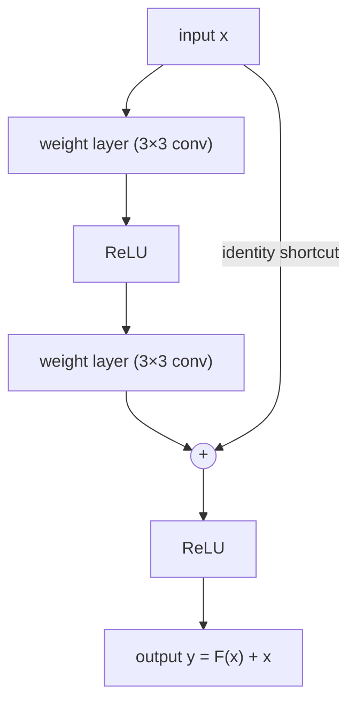
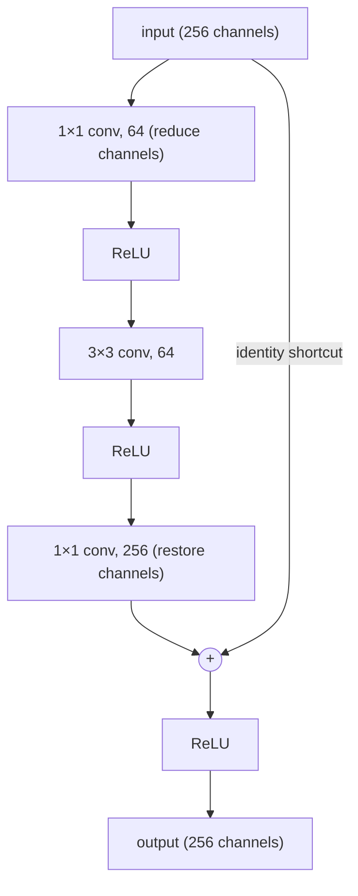
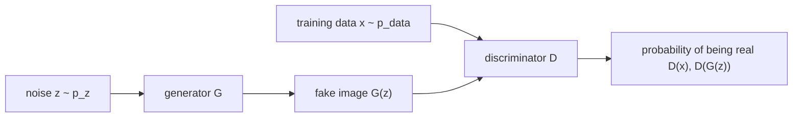
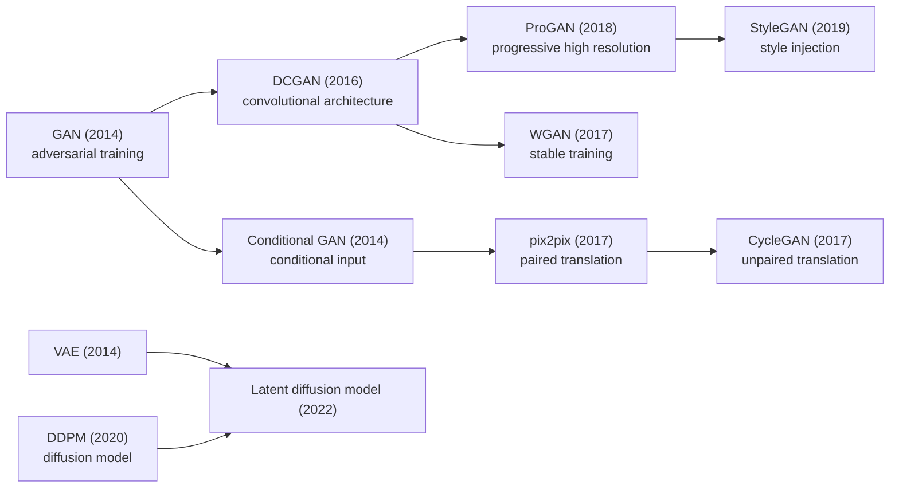

# HW1 Assignment Explanation — Image Processing Paper Survey: ResNet and GAN-Based Image Generation

[Repository Guide](../../README.md) | [English](Assignment-Explanation.md) | [한국어](Assignment-Explanation.ko.md)

> **Last Updated:** 2026-11-04

> **Learning Objectives:**
> 1. Explain the degradation problem of deep neural networks and distinguish it from overfitting and vanishing gradients
> 2. Explain with equations how residual learning and shortcut connections help optimize deep neural networks
> 3. Summarize the basic block, the bottleneck block, the dimension-matching options, and the main experimental results of ResNet
> 4. Explain the input and output of the image generation task, the kinds of generative models, and their applications
> 5. Derive and explain the minimax objective, the optimal discriminator, the global optimum, and the training algorithm of GANs
> 6. Compare image generation models that came after GANs and organize a paper survey report with references in IEEE format

---

## Table of Contents

- [1. Assignment Requirements](#1-assignment-requirements)
  - [1.1 Structure of the Assignment](#11-structure-of-the-assignment)
  - [1.2 Structure of the Report](#12-structure-of-the-report)
- [2. Summary of the ResNet Paper](#2-summary-of-the-resnet-paper)
  - [2.1 Background: The Importance of Depth](#21-background-the-importance-of-depth)
  - [2.2 The Degradation Problem](#22-the-degradation-problem)
  - [2.3 Residual Learning](#23-residual-learning)
  - [2.4 Shortcut Connections and Dimension Matching](#24-shortcut-connections-and-dimension-matching)
  - [2.5 Network Architectures](#25-network-architectures)
  - [2.6 Training Setup](#26-training-setup)
  - [2.7 Experimental Results](#27-experimental-results)
  - [2.8 Contributions and Significance](#28-contributions-and-significance)
- [3. The Image Generation Task](#3-the-image-generation-task)
  - [3.1 Definition, Input, and Output](#31-definition-input-and-output)
  - [3.2 Kinds of Generative Models](#32-kinds-of-generative-models)
  - [3.3 Applications](#33-applications)
- [4. Summary of the GAN Paper](#4-summary-of-the-gan-paper)
  - [4.1 Generator and Discriminator](#41-generator-and-discriminator)
  - [4.2 The Minimax Objective](#42-the-minimax-objective)
  - [4.3 Optimal Discriminator and Global Optimum](#43-optimal-discriminator-and-global-optimum)
  - [4.4 Training Algorithm](#44-training-algorithm)
  - [4.5 Experiments and Limitations](#45-experiments-and-limitations)
  - [4.6 Contributions](#46-contributions)
- [5. Image Generation Models After GANs](#5-image-generation-models-after-gans)
  - [5.1 DCGAN](#51-dcgan)
  - [5.2 Conditional GANs and Image Translation](#52-conditional-gans-and-image-translation)
  - [5.3 Stabilizing Training: WGAN](#53-stabilizing-training-wgan)
  - [5.4 High-Resolution Generation: ProGAN and StyleGAN](#54-high-resolution-generation-progan-and-stylegan)
  - [5.5 Diffusion Models](#55-diffusion-models)
- [6. Choosing and Citing Papers](#6-choosing-and-citing-papers)
  - [6.1 Checking the Citation Count](#61-checking-the-citation-count)
  - [6.2 IEEE Reference Format](#62-ieee-reference-format)
- [Summary](#summary)
- [Self-Check Questions](#self-check-questions)
- [References](#references)

---

<br>

## 1. Assignment Requirements

### 1.1 Structure of the Assignment

This assignment surveys deep learning research papers in image processing. It has two parts.

| Part | Requirement |
|:-----|:-----|
| Summary of the ResNet paper | Summarize "Deep Residual Learning for Image Recognition" by K. He et al. (CVPR 2016) [1] |
| Survey of another image processing task | Choose one image processing task other than image classification and describe it, including its input and output |
| | Briefly give an example of where the task is used (e.g., road area detection in self-driving cars) |
| | Choose one international paper on the task and describe the contribution of the research. The paper must be cited 100 times or more, and a screenshot of the citation count must be included |
| Common | References must be included, the length is about 4 pages (Word or PDF), and the format is free |

*Table 1. Requirements of HW1*

This explanation covers the case in which **image generation** is chosen as the task of the second part and "Generative Adversarial Nets" by I. J. Goodfellow et al. (NIPS 2014) [2] is chosen as the paper. The full classification of image processing tasks (classification, object detection, segmentation, OCR, super-resolution, image generation) is covered in Lecture 3, and the structure and contributions of ResNet in Lectures 3 and 4.

### 1.2 Structure of the Report

If the ResNet summary and the task survey are given similar weight in a report of about 4 pages, it can be organized as follows.

```text
1. Summary of the ResNet paper
   1.1 Bibliographic information of the paper
   1.2 Background and problem definition (the degradation problem)
   1.3 Proposed method (residual learning, shortcut connections, network architectures)
   1.4 Experimental results (ImageNet, CIFAR-10, COCO)
   1.5 Contributions
2. Survey of an image processing task
   2.1 The chosen task and its input and output
   2.2 Examples of use
   2.3 Bibliographic information of the chosen paper and a screenshot of its citation count
   2.4 Contributions of the paper
References
```

The key to summarizing a paper is not to copy its sentences but to reorganize it into the flow of **problem, method, evidence, and contribution**. Take the numbers directly from the tables of the paper and state the experimental condition (dataset, evaluation protocol) they belong to.

---

<br>

## 2. Summary of the ResNet Paper

### 2.1 Background: The Importance of Depth

A **convolutional neural network (CNN)** learns features hierarchically as layers are stacked, from low-level features (edges, colors) to high-level features (object parts, whole objects). VGGNet [3] in 2014 stacked 3×3 convolutions to 16-19 layers and showed that depth matters for performance, and the leading models in the ImageNet challenge were all very deep models of 16 to 30 layers [1].

Then, is learning a better network as easy as stacking more layers? The first obstacle to this question was **vanishing and exploding gradients**. In backpropagation the gradient is multiplied layer by layer, so in a deep network the gradients of the early layers approach zero or become too large. This problem has been largely addressed by normalized weight initialization and intermediate normalization layers such as **batch normalization (BN)** [4], which let networks with tens of layers start converging with stochastic gradient descent (SGD).

> **Note:** **Batch normalization** is a layer that normalizes the activations of each channel with the mean and variance of the mini-batch and then rescales and shifts them with a learnable scale and shift. It keeps the input distribution of each layer from fluctuating strongly during training and thus stabilizes the training of deep networks (Section 5.2 of Lecture 3).

### 2.2 The Degradation Problem

Once convergence became possible, a new problem was exposed: as the network gets deeper, accuracy saturates and then degrades rapidly. This is the **degradation problem**. When plain networks (networks without shortcuts) of 20 and 56 layers are compared on CIFAR-10, the 56-layer network has a higher **training error** as well as a higher test error [1].

> **Definition:** The **degradation problem** is the phenomenon in which adding more layers to a suitably deep model makes its training error larger. Because the training error grows, it differs from overfitting (a small training error with only a large test error).

Why this phenomenon is strange is explained by the following **solution by construction**. Consider a shallower model that has been trained and a deeper model that adds more layers on top of it. If the added layers become an **identity mapping** that passes the input through unchanged and the other layers reuse the weights of the shallower model, the deeper model produces exactly the same output as the shallower one. Therefore the training error of the deeper model cannot, in theory, be larger than that of the shallower model. Yet it is larger in actual experiments, so the problem lies not in representational power but in **optimization**. In other words, current optimization methods such as SGD have difficulty finding a solution that approximates an identity mapping with several nonlinear layers.

> **Caution:** ResNet is often introduced as the model that solved the vanishing gradient problem, but the paper states that the degradation is unlikely to be caused by vanishing gradients. The plain networks in the experiments were trained with BN, so the forward signals had nonzero variances, and the norms of the backward gradients were also healthy [1]. The paper conjectures that deep plain networks may have exponentially low convergence rates that keep the training error from decreasing, and leaves the cause to future study. The gradient-path interpretation in Section 2.3 is a complementary view proposed by a follow-up study [5].

### 2.3 Residual Learning

Let $\mathcal{H}(\mathbf{x})$ be the ideal function that a few layers should learn ($\mathbf{x}$ is the input to those layers). Instead of letting the layers approximate $\mathcal{H}(\mathbf{x})$ directly, ResNet lets them approximate the difference from the input, the **residual function**.

$$\mathcal{F}(\mathbf{x}) := \mathcal{H}(\mathbf{x}) - \mathbf{x} \quad\Longrightarrow\quad \mathcal{H}(\mathbf{x}) = \mathcal{F}(\mathbf{x}) + \mathbf{x}$$

If several nonlinear layers can approximate complicated functions, they can also approximate the residual function, so the two forms have the same representational power. The difference lies in the **ease of learning**. If the optimal function is an identity mapping, a plain network must build $\mathcal{H}(\mathbf{x}) = \mathbf{x}$ exactly from a combination of nonlinear layers, whereas a residual network only needs to drive its weights toward zero to make $\mathcal{F}(\mathbf{x}) = \mathbf{0}$.

Let us check this with numbers. Suppose the input to a block is $\mathbf{x} = (2, 1)$, the output of a previous ReLU, and both weight layers of the block have been learned as zero. Then $\mathcal{F}(\mathbf{x}) = W_2\,\sigma(W_1\mathbf{x}) = \mathbf{0}$, and the output after the ReLU that follows the addition is as follows.

$$\mathbf{y} = \sigma(\mathcal{F}(\mathbf{x}) + \mathbf{x}) = \sigma((0, 0) + (2, 1)) = (2, 1) = \mathbf{x}$$

If the shortcut is removed from the same two layers, the output becomes $\sigma(\mathbf{0}) = (0, 0)$, and all information in the input is lost. For a plain network to output an identity mapping, it must find specific weights that satisfy $W_2\,\sigma(W_1\mathbf{x}) = \mathbf{x}$.

In real problems the optimal function is unlikely to be exactly an identity mapping. The paper interprets that if the optimal function is closer to an identity mapping than to a zero mapping, finding small perturbations with reference to the identity mapping is easier than learning the function anew, so the residual form **preconditions** the optimization problem [1]. The analysis of layer responses in Section 2.7 supports this interpretation experimentally.

**Gradient path view.** If the output of a block is simplified to $\mathbf{y} = \mathbf{x} + \mathcal{F}(\mathbf{x})$ (omitting the ReLU after the addition), the chain rule gives the following.

$$\frac{\partial \mathbf{y}}{\partial \mathbf{x}} = I + \frac{\partial \mathcal{F}}{\partial \mathbf{x}}$$

Because of the identity matrix $I$, the gradient of the loss has a path along the shortcut that reaches the earlier layers directly without passing through the residual branch [5]. In a scalar simplification, if the derivative of each layer of a plain network is 0.5, the gradient after 10 layers shrinks to $0.5^{10} \approx 0.00098$. If the derivative of the residual branch in a residual block is 0.05, the derivative of one block is $1 + 0.05 = 1.05$, and after 10 blocks it is still $1.05^{10} \approx 1.63$; if it is $-0.05$, it is $0.95^{10} \approx 0.60$. The key point is that the magnitude of the gradient stays near 1 when the derivative of the residual branch is small.

> **Note:** This scalar example simplifies the chain of matrices in a real network. The actual gradient is propagated as a product of Jacobian matrices, and its magnitude depends on the ReLU after the addition, BN, and the distribution of the weights.

### 2.4 Shortcut Connections and Dimension Matching

The residual form is implemented with **shortcut connections** that skip one or more layers. This is the same structure as the skip connection of Lecture 3. The basic building block of the paper is as follows [1].

$$\mathbf{y} = \mathcal{F}(\mathbf{x}, \{W_i\}) + \mathbf{x}$$

In a two-layer block, $\mathcal{F} = W_2\,\sigma(W_1\mathbf{x})$, where $\sigma$ is ReLU (biases are omitted from the notation). $\mathcal{F} + \mathbf{x}$ is computed by element-wise addition, and the second ReLU is applied after the addition. Identity shortcuts **add neither parameters nor computation** (except for the negligible element-wise addition), so plain and residual networks with the same depth, width, number of parameters, and computational cost can be compared fairly.



*Figure 1. A residual block with two layers*

If the dimensions of $\mathbf{x}$ and $\mathcal{F}$ differ (when the number of channels increases), the addition is impossible, so a linear projection $W_s$ on the shortcut matches the dimensions.

$$\mathbf{y} = \mathcal{F}(\mathbf{x}, \{W_i\}) + W_s\mathbf{x}$$

The paper compared three options for the shortcuts that increase dimensions. Where the feature map size is halved, the shortcut is also applied with a stride of 2.

| Option | Shortcuts that increase dimensions | Other shortcuts | Extra parameters | Top-1 error of ResNet-34 (%) |
|:-----|:-----|:-----|:-----|-----:|
| A | Identity with zero-padding | Identity | None | 25.03 |
| B | 1×1 convolution projection | Identity | Only where dimensions change | 24.52 |
| C | 1×1 convolution projection | 1×1 convolution projection | Every shortcut | 24.19 |

*Table 2. Comparison of the dimension-matching options (ImageNet validation set, 10-crop testing)*

All three options are much better than the plain network of the same depth (28.54%). The paper attributes B being slightly better than A to the zero-padded dimensions in A having no residual learning, and C being slightly better than B to the extra parameters of the thirteen projection shortcuts. Because the differences are small, **projection is not essential for addressing the degradation problem**, and the later experiments do not use C to reduce memory and computation [1].

For example, a 1×1 projection shortcut where the channels increase from 64 to 128 adds $64 \times 128 = 8{,}192$ weights, and its stride of 2 reduces the spatial size from 56×56 to 28×28.

### 2.5 Network Architectures

**Plain network.** It follows the design philosophy of VGGNet but is simpler. The convolutions are mostly 3×3, and (i) layers with the same output feature map size have the same number of filters, and (ii) when the feature map size is halved, the number of filters is doubled so as to preserve the computation per layer. Downsampling is done by convolutions with a stride of 2, and the network ends with global average pooling and a 1000-way fully connected layer with softmax. The 34-layer plain network has 3.6 billion FLOPs (multiply-adds), only 18% of VGG-19 (19.6 billion FLOPs).

**Residual network.** A shortcut is inserted for every two 3×3 layers of the plain network.

**Bottleneck design.** For 50 layers or more, in consideration of training time, the residual function is built from three layers of 1×1, 3×3, and 1×1 convolutions instead of two layers. The first 1×1 layer reduces the channels, the 3×3 layer computes on the reduced channels, and the last 1×1 layer restores the channels. The name comes from the 3×3 layer in the middle, whose small input and output dimensions look like a bottleneck.



*Figure 2. The bottleneck block of ResNet-50/101/152*

The two designs are compared by the number of weights (excluding biases). The number of weights in a convolution layer is (kernel height) × (kernel width) × (input channels) × (output channels).

| Block | Computation | Weights |
|:-----|:-----|-----:|
| Basic block, 64 channels | $2 \times (3 \cdot 3 \cdot 64 \cdot 64) = 2 \times 36{,}864$ | 73,728 |
| Bottleneck block, 256-channel input and output | $1 \cdot 1 \cdot 256 \cdot 64 + 3 \cdot 3 \cdot 64 \cdot 64 + 1 \cdot 1 \cdot 64 \cdot 256 = 16{,}384 + 36{,}864 + 16{,}384$ | 69,632 |
| Basic block, 256 channels | $2 \times (3 \cdot 3 \cdot 256 \cdot 256) = 2 \times 589{,}824$ | 1,179,648 |

*Table 3. Number of weights in the basic block and the bottleneck block*

The bottleneck block handles 256 channels, four times as wide, yet has a number of weights (and hence a computational cost) similar to the 64-channel basic block. Processing the same 256 channels with a basic block would require about 17 times as many ($1{,}179{,}648 / 69{,}632 \approx 16.9$). **Identity shortcuts are particularly important** in this block. Replacing the shortcut with a projection would connect the two high-dimensional (256-channel) ends and double the computation and size of the block [1]. Lightweight design with 1×1 convolutions is revisited in Lecture 9.

| Model | conv2_x | conv3_x | conv4_x | conv5_x | Block | Computation (FLOPs) |
|:-----|-----:|-----:|-----:|-----:|:-----|-----:|
| ResNet-18 | 2 | 2 | 2 | 2 | Basic | $1.8 \times 10^9$ |
| ResNet-34 | 3 | 4 | 6 | 3 | Basic | $3.6 \times 10^9$ |
| ResNet-50 | 3 | 4 | 6 | 3 | Bottleneck | $3.8 \times 10^9$ |
| ResNet-101 | 3 | 4 | 23 | 3 | Bottleneck | $7.6 \times 10^9$ |
| ResNet-152 | 3 | 8 | 36 | 3 | Bottleneck | $11.3 \times 10^9$ |

*Table 4. Number of blocks per stage and computation of the ResNets for ImageNet*

The number of layers is computed from the number of blocks and the layers per block. For example, ResNet-34 has $(3 + 4 + 6 + 3) \times 2 = 32$ convolution layers, plus the first 7×7 convolution and the final fully connected layer, for 34 layers, and ResNet-152 has $(3 + 8 + 36 + 3) \times 3 = 150$ plus 2, for 152 layers. ResNet-152 is 8 times deeper than VGGNet, but its computation (11.3 billion FLOPs) is still lower than that of VGG-16/19 (15.3 and 19.6 billion FLOPs).

### 2.6 Training Setup

| Item | Setting |
|:-----|:-----|
| Data augmentation | Resize with the shorter side randomly sampled in [256, 480] (scale augmentation), randomly crop a 224×224 region, and apply horizontal flips, per-pixel mean subtraction, and standard color augmentation |
| Normalization | BN right after each convolution and before activation, and no dropout |
| Optimization | SGD, mini-batch of 256, momentum 0.9, weight decay 0.0001 |
| Learning rate | Starts from 0.1 and is divided by 10 when the error plateaus, for up to $60 \times 10^4$ iterations |
| Evaluation | Standard 10-crop testing for comparisons, and scores averaged over multiple scales (shorter side 224, 256, 384, 480, 640) for the best results |

*Table 5. Training setup on ImageNet*

### 2.7 Experimental Results

**ImageNet classification.** Evaluation was done on the ImageNet 2012 dataset with 1000 classes, 1.28 million training images, and 50,000 validation images.

| Depth | Plain network | ResNet |
|:-----|-----:|-----:|
| 18 layers | 27.94 | 27.88 |
| 34 layers | 28.54 | 25.03 |

*Table 6. Top-1 error of plain networks and ResNets (%, ImageNet validation set, 10-crop testing)*

Three things can be read from this table.

1. For plain networks, the 34-layer network has a higher error than the 18-layer one (28.54 > 27.94). This is the degradation problem.
2. For ResNets, the situation is reversed: the 34-layer network has an error $27.88 - 25.03 = 2.85$ percentage points lower than the 18-layer one. The paper reports this as 2.8%. Accuracy is gained from increased depth.
3. At 18 layers the two networks are comparably accurate, but the ResNet converges faster in the early stage. When the network is not overly deep, SGD finds good solutions for the plain network as well, and ResNet speeds up convergence.

The error of ResNet-34 is $28.54 - 25.03 = 3.51$ percentage points lower than the plain network of the same depth (the "3.5%" of the paper). The deeper ResNet-50/101/152 (option B) are more accurate than the 34-layer ones (top-1 errors of 22.85, 21.75, and 21.43%), and no degradation appears. The single-model top-5 validation error of ResNet-152 is 4.49%, lower than all previous ensembles, and an ensemble of six models of different depths achieved a **top-5 error of 3.57%** on the ImageNet test set, winning first place in the ILSVRC 2015 classification task [1].

**CIFAR-10.** The same phenomenon appeared on CIFAR-10, which has 10 classes of 32×32 images. The 110-layer ResNet achieved a test error of 6.43% (the best of 5 runs, with a mean of 6.61±0.16%). A 1202-layer network also reached a training error below 0.1% without optimization difficulty, but its test error of 7.93% was worse than that of the 110-layer network. The paper attributes this to overfitting by a model (19.4 million parameters) that is unnecessarily large for the small dataset.

**Analysis of layer responses.** Comparing the standard deviations of the outputs of each 3×3 layer (after BN and before the nonlinearity), ResNets have generally smaller responses than plain networks, and deeper ResNets have smaller ones. This supports the motivation of Section 2.3 that the residual functions tend to learn values close to zero.

**Object detection.** Simply replacing the backbone of Faster R-CNN from VGG-16 with ResNet-101 raised COCO's standard metric mAP@[.5, .95] on the validation set from 21.2% to 27.2%, by 6.0 percentage points. Relatively, this is $6.0 / 21.2 \approx 0.28$, a **28% improvement**, and since the detection implementation is the same, the gain comes from better representation learning. ResNet-based models also won first place in ImageNet detection, ImageNet localization, COCO detection, and COCO segmentation at ILSVRC & COCO 2015 [1]. Object detection and mAP are covered in Lecture 5.

### 2.8 Contributions and Significance

1. It clearly defined the **degradation problem** of deep networks as an optimization problem distinct from overfitting.
2. It proposed the **residual learning** framework, in which layers learn residual functions.
3. It showed with parameter-free **identity shortcuts** that networks of over 100 layers, and experimentally over 1000 layers, can be trained.
4. It greatly improved performance not only in classification but also in detection and segmentation, showing that ResNet can serve as a **backbone** for a variety of visual recognition tasks. Residual connections later became a basic component of models beyond vision as well, such as the Transformer (Lecture 8).

---

<br>

## 3. The Image Generation Task

### 3.1 Definition, Input, and Output

**Image generation** is the task in which a model that has learned the distribution of the training data creates new images that were not in the training data. Whereas image classification takes an image and outputs a label, image generation conversely takes inputs such as labels, sentences, or random vectors and outputs an image.

| Kind | Input | Output |
|:-----|:-----|:-----|
| Unconditional generation | A random noise vector $\mathbf{z}$ (e.g., a 100-dimensional sample from a uniform or normal distribution) | An arbitrary image similar to the training data |
| Class-conditional generation | A noise vector and a class label (e.g., the digit 7) | An image of that class |
| Text-conditional generation (text-to-image) | Noise and a sentence (e.g., a cat sitting on a throne in a forest) | An image showing the content of the sentence |
| Image translation (image-to-image) | An image from another domain (e.g., a sketch, a daytime photo, a segmentation map) | The corresponding image (e.g., a photo, a night photo, a real scene) |

*Table 7. Input and output of image generation tasks*

The output image is usually an RGB tensor of size $H \times W \times 3$, and the last layer of the generative model matches the range of pixel values (e.g., $[-1, 1]$ with Tanh). Unlike classification and detection, which produce deterministic outputs, a different image comes out when the noise $\mathbf{z}$ is changed even under the same input condition.

### 3.2 Kinds of Generative Models

Image generation models are divided by how they learn the data distribution $p_{\text{data}}(\mathbf{x})$.

| Model | Key idea | Characteristics |
|:-----|:-----|:-----|
| VAE (variational autoencoder) [6] | An encoder maps an image to a latent distribution, a decoder maps a latent vector to an image, and a lower bound on the likelihood is maximized | Training is stable, but images tend to be blurry |
| GAN (generative adversarial network) [2] | A generator and a discriminator are trained in competition | Generates sharp images quickly (in one forward pass), but training can be unstable |
| Diffusion model [7] | Learns denoising that reverses a process of gradually adding noise to an image | High quality and diversity, but generation needs many steps |

*Table 8. Representative image generation models*

### 3.3 Applications

- **Virtual people and content creation:** Faces of people who do not exist, images for games and advertising, and digital art are created.
- **Text-based image generation:** Services that create high-resolution images from sentences alone (e.g., DALL-E 2 [8], Stable Diffusion [9]) are used in design and content creation.
- **Image translation and editing:** Sketches are turned into photos, day scenes into night scenes, and photos into paintings of a different style, and erased regions are filled in (inpainting).
- **Data augmentation:** Data that is hard to collect (images of rare diseases, rare driving situations) is generated to supplement the training data. Data augmentation is covered in Lecture 4.

---

<br>

## 4. Summary of the GAN Paper

### 4.1 Generator and Discriminator

Goodfellow et al. [2] proposed a framework for estimating generative models via an **adversarial process** in which two models are trained simultaneously.

- **Generator $G$:** A differentiable function $G(\mathbf{z}; \theta_g)$ that maps noise $\mathbf{z}$ drawn from a prior $p_{\mathbf{z}}(\mathbf{z})$ to the data space. The distribution of the samples produced by the generator is denoted $p_g$.
- **Discriminator $D$:** Outputs the probability $D(\mathbf{x}; \theta_d) \in [0, 1]$ that the input $\mathbf{x}$ came from the training data rather than from $p_g$.

The paper compares this to counterfeiters and the police. The counterfeiters (generator) try to produce fake currency that goes undetected, and the police (discriminator) try to detect the counterfeits. This competition drives both sides to improve until the counterfeits are indistinguishable from the genuine articles.



*Figure 3. Structure of a GAN: the discriminator distinguishes the generator's samples from the training data*

The paper calls the case in which both $G$ and $D$ are multilayer perceptrons (MLPs) **adversarial nets**. In this case both models can be trained with only backpropagation and dropout, and a sample is obtained with one forward pass of $G$. A major advantage is that, unlike earlier deep generative models (such as the Boltzmann machine family), no Markov chains or approximate inference are needed.

### 4.2 The Minimax Objective

$D$ maximizes the probability of assigning the correct label to both training examples and samples from $G$, and $G$ minimizes $\log(1 - D(G(\mathbf{z})))$. The two models play a **two-player minimax game** with the value function $V(D, G)$.

$$\min_G \max_D V(D, G) = \mathbb{E}_{\mathbf{x} \sim p_{\text{data}}(\mathbf{x})}[\log D(\mathbf{x})] + \mathbb{E}_{\mathbf{z} \sim p_{\mathbf{z}}(\mathbf{z})}[\log(1 - D(G(\mathbf{z})))]$$

- First term: for real data $\mathbf{x}$, the closer $D(\mathbf{x})$ is to 1, the closer $\log D(\mathbf{x})$ is to 0, so the term grows.
- Second term: for a fake $G(\mathbf{z})$, the closer $D(G(\mathbf{z}))$ is to 0, the larger $\log(1 - D(G(\mathbf{z})))$ becomes.
- $D$ tries to increase the sum of the two terms, and $G$ tries to decrease the second term (to increase $D(G(\mathbf{z}))$).

> **[Probability and Statistics]** $\mathbb{E}_{\mathbf{x} \sim p}[f(\mathbf{x})]$ is the **expected value** of $f(\mathbf{x})$ when $\mathbf{x}$ is drawn from the distribution $p$, which is $\int p(\mathbf{x}) f(\mathbf{x})\,d\mathbf{x}$ for a continuous distribution. In training it is approximated by the average over a mini-batch of $m$ samples, $\frac{1}{m}\sum_i f(\mathbf{x}^{(i)})$. The **KL divergence** between two distributions, $\mathrm{KL}(p \Vert q) = \mathbb{E}_{\mathbf{x} \sim p}[\log (p(\mathbf{x}) / q(\mathbf{x}))]$, is nonnegative and is zero only when $p = q$.

### 4.3 Optimal Discriminator and Global Optimum

**Proposition 1 (optimal discriminator).** For a fixed $G$, the optimal discriminator is as follows.

$$D_G^*(\mathbf{x}) = \frac{p_{\text{data}}(\mathbf{x})}{p_{\text{data}}(\mathbf{x}) + p_g(\mathbf{x})}$$

**Derivation.** Rewriting with $\mathbf{x} = G(\mathbf{z})$ turns the expectation of the second term into an expectation over $p_g$, so the value function can be written as a single integral.

$$V(G, D) = \int_{\mathbf{x}} \big[\, p_{\text{data}}(\mathbf{x}) \log D(\mathbf{x}) + p_g(\mathbf{x}) \log(1 - D(\mathbf{x})) \,\big] d\mathbf{x}$$

At each $\mathbf{x}$, let $a = p_{\text{data}}(\mathbf{x})$, $b = p_g(\mathbf{x})$, and $y = D(\mathbf{x})$; then the integrand is $f(y) = a \log y + b \log(1 - y)$. For $(a, b) \neq (0, 0)$, differentiating with respect to $y$ and setting the result to zero gives the following.

$$f'(y) = \frac{a}{y} - \frac{b}{1 - y} = 0 \quad\Longrightarrow\quad a(1 - y) = b\,y \quad\Longrightarrow\quad y = \frac{a}{a + b}$$

Since $f''(y) = -a/y^2 - b/(1-y)^2 < 0$, this point is the maximum on $[0, 1]$. Maximizing the integrand at every point maximizes the whole integral, so the proposition holds.

As a numerical example, if $p_{\text{data}}(\mathbf{x}) = 0.3$ and $p_g(\mathbf{x}) = 0.1$ at some image $\mathbf{x}$, then $D^*(\mathbf{x}) = 0.3 / (0.3 + 0.1) = 0.75$. Real data is three times as likely as the generator to produce this point, so the discriminator assigns a probability of 0.75 to it being real. When the two densities become equal, $D^* = 0.5$, and the discriminator can do no better than a coin flip.

**Theorem 1 (global optimum).** The global minimum of $C(G) = \max_D V(G, D)$, the objective with the optimal discriminator substituted, is achieved if and only if $p_g = p_{\text{data}}$, and its value is $-\log 4$.

**Derivation.** Substituting $D_G^*$ gives the following.

$$C(G) = \mathbb{E}_{\mathbf{x} \sim p_{\text{data}}}\left[\log \frac{p_{\text{data}}(\mathbf{x})}{p_{\text{data}}(\mathbf{x}) + p_g(\mathbf{x})}\right] + \mathbb{E}_{\mathbf{x} \sim p_g}\left[\log \frac{p_g(\mathbf{x})}{p_{\text{data}}(\mathbf{x}) + p_g(\mathbf{x})}\right]$$

Writing each denominator inside the logarithms as $2 \cdot \frac{p_{\text{data}} + p_g}{2}$ separates $-\log 2$ from each term, and what remains are KL divergences to the mixture of the two distributions, $m = \frac{p_{\text{data}} + p_g}{2}$.

$$C(G) = -\log 4 + \mathrm{KL}\!\left(p_{\text{data}} \,\Big\Vert\, m\right) + \mathrm{KL}\!\left(p_g \,\Big\Vert\, m\right) = -\log 4 + 2 \cdot \mathrm{JSD}(p_{\text{data}} \Vert p_g)$$

The **Jensen-Shannon divergence (JSD)** is nonnegative and is zero only when the two distributions are equal, so the minimum of $C(G)$ is $-\log 4 \approx -1.386$, achieved only when $p_g = p_{\text{data}}$. Indeed, if $p_g = p_{\text{data}}$, then $D^* = 1/2$, so $C(G) = \log \frac{1}{2} + \log \frac{1}{2} = -\log 4$, which agrees. In other words, **given enough capacity and training time, the generator reproduces the data distribution exactly, and the discriminator outputs 1/2 everywhere.**

> **Caution:** This result holds in a nonparametric setting (infinite capacity) in which $G$ and $D$ can represent arbitrary functions. Real neural networks have finite capacity and are optimized in parameter space, so the paper notes that the theoretical guarantees do not apply directly, while considering that the excellent performance of MLPs suggests they are a reasonable model to use [2].

### 4.4 Training Algorithm

Optimizing $D$ to completion in the inner loop is computationally prohibitive and would overfit a finite dataset, so the algorithm alternates between $k$ steps of updating $D$ and one step of updating $G$. In the experiments the paper used $k = 1$, the least expensive option, and used momentum in the updates.

```text
repeat (for the number of training iterations):
    repeat k times:
        sample a mini-batch of noise {z(1), ..., z(m)} from the noise prior p_z
        sample a mini-batch of data {x(1), ..., x(m)} from the data distribution p_data
        update the discriminator by ascending its stochastic gradient:
            ∇θd (1/m) Σ_i [ log D(x(i)) + log(1 − D(G(z(i)))) ]
    sample a mini-batch of noise {z(1), ..., z(m)}
    update the generator by descending its stochastic gradient:
        ∇θg (1/m) Σ_i log(1 − D(G(z(i))))
```

- The discriminator update increases $\log D$ for real samples and $\log(1 - D)$ for fake samples together, so it is the same as training a binary classifier that labels real samples 1 and fake samples 0.
- The generator update needs no training data and changes $\theta_g$ only through the gradient that flows back through the discriminator.

**Saturation and the non-saturating loss.** Early in training, $G$ is poor, so $D$ rejects the fakes with high confidence and $D(G(\mathbf{z}))$ is close to 0. Then $\log(1 - D(G(\mathbf{z})))$ **saturates** and its gradient is small. The paper proposes that $G$ **maximize** $\log D(G(\mathbf{z}))$ instead of minimizing $\log(1 - D(G(\mathbf{z})))$, which keeps the same fixed point of the dynamics while giving much stronger gradients early in training.

Let us check this with numbers. If the output of the discriminator is a sigmoid $D = \sigma(a)$ and $a = -4.6$ for a fake sample, then $D = 1 / (1 + e^{4.6}) \approx 0.01$. The derivatives with respect to the logit $a$ are as follows.

$$\frac{\partial}{\partial a}\log(1 - \sigma(a)) = -\sigma(a) \approx -0.01, \qquad \frac{\partial}{\partial a}\log \sigma(a) = 1 - \sigma(a) \approx 0.99$$

The original objective gives the generator a gradient of only about 0.01 in magnitude, whereas the non-saturating objective gives about 0.99, nearly 100 times larger. This non-saturating loss became the default in most later GAN implementations.

### 4.5 Experiments and Limitations

**Experiments.** The models were trained on MNIST (handwritten digits), TFD (the Toronto Face Database, faces), and CIFAR-10 (natural images). The generator used a mixture of ReLU and sigmoid activations, and the discriminator used maxout activations and dropout. Noise was fed only into the bottommost layer of the generator. Because the likelihood of a GAN cannot be computed directly, a Gaussian Parzen window was fitted to the generated samples and the log-likelihood of the test data under it was estimated.

| Model | MNIST | TFD |
|:-----|-----:|-----:|
| DBN | 138 ± 2 | 1909 ± 66 |
| Stacked CAE | 121 ± 1.6 | 2110 ± 50 |
| Deep GSN | 214 ± 1.1 | 1890 ± 29 |
| Adversarial nets | 225 ± 2 | 2057 ± 26 |

*Table 9. Parzen window-based log-likelihood estimates (higher is better)*

The GAN scored highest on MNIST and second to the Stacked CAE on TFD. The paper itself notes that this estimation method has high variance and does not work well in high-dimensional spaces. Next to the generated samples, the nearest training images were shown to confirm that the model had not memorized the training data, and linear interpolation between two points in the noise space was shown to change the digits smoothly.

**Limitations.** The paper states two disadvantages.

- There is no explicit representation of $p_g$, so the likelihood cannot be computed directly.
- $D$ and $G$ must be well synchronized during training. In particular, if $G$ is trained too much without updating $D$, many values of $\mathbf{z}$ collapse to the same $\mathbf{x}$ and diversity is lost (the "Helvetica scenario" of the paper). This phenomenon was later called **mode collapse**.

### 4.6 Contributions

1. It presented a new framework that trains a generative model through a **minimax game** with a discriminative model.
2. It **proved theoretically** that, in the nonparametric setting, the unique global optimum of the game is $p_g = p_{\text{data}}$.
3. It showed a generative model trained **with backpropagation alone**, without Markov chains or approximate inference, that produces samples in one forward pass.
4. It became the starting point of GAN research that led to DCGAN, conditional GANs, CycleGAN, StyleGAN, and others. The citation count of this paper far exceeds the 100 required by the assignment.

---

<br>

## 5. Image Generation Models After GANs

### 5.1 DCGAN

The original GAN used MLPs. **DCGAN (deep convolutional GAN)** [10] built the generator and the discriminator as convolutional neural networks and presented architectural guidelines for stable training.

- Pooling layers are removed, and the size is changed by strided convolutions in the discriminator and fractionally strided convolutions (transposed convolutions) in the generator.
- Batch normalization is used in both the generator and the discriminator.
- Fully connected hidden layers are removed in deeper architectures.
- The generator uses ReLU in all layers except the output layer (Tanh), and the discriminator uses LeakyReLU in all layers.

DCGAN also showed that arithmetic on noise vectors (e.g., man with glasses - man without glasses + woman without glasses → woman with glasses) appears as semantic changes in the images.

### 5.2 Conditional GANs and Image Translation

- **Conditional GAN** [11]: A condition $\mathbf{y}$ such as a class label is fed to both the generator and the discriminator, so that images of a desired kind are generated.
- **pix2pix** [12]: Adds an L1 loss between the output and the ground truth to a conditional GAN conditioned on an input image, and learns image translation from paired data (data in which inputs and ground truths come in pairs, such as sketches and photos). The generator is a U-Net, and the discriminator is a PatchGAN that judges real or fake on small patches of the image.
- **CycleGAN** [13]: Learns translation between two domains without paired data (horses and zebras, photos and Monet paintings). It adds a **cycle-consistency loss** requiring that translating $X \to Y \to X$ returns the original image.

### 5.3 Stabilizing Training: WGAN

As in Section 4.3, the original GAN objective amounts to reducing the JSD, but when the supports of the two distributions barely overlap, the JSD stays at a constant ($\log 2$) and gives the generator no useful gradient. **WGAN** [14] uses the **Wasserstein-1 distance (earth mover's distance)**, the minimum cost of moving one distribution onto the other. Instead of a discriminator it has a **critic** that outputs a real-valued score, and it clips the weights to a fixed range (weight clipping) so that the critic is K-Lipschitz for some constant K. This distance changes continuously even when the distributions do not overlap, so training is stable and the loss value moves together with the quality of the samples.

### 5.4 High-Resolution Generation: ProGAN and StyleGAN

- **ProGAN** [15]: Starts from a low resolution such as 4×4 and progressively adds layers to the generator and the discriminator during training, raising the resolution up to 1024×1024. Because it learns the easy large-scale structure first and the details later, training is stable.
- **StyleGAN** [16]: Maps the noise $\mathbf{z}$ to an intermediate latent space $\mathbf{w}$ with a mapping network and then injects styles into each resolution of the synthesis network with **AdaIN (adaptive instance normalization)**. Styles at low resolutions control the pose and face shape, and styles at high resolutions control colors and fine textures. It also released FFHQ, a high-quality face dataset, and became widely known for generating realistic faces of people who do not exist.

### 5.5 Diffusion Models

A **diffusion model** generates images on a principle different from GANs. DDPM [7] defines a **forward process** that adds Gaussian noise to an image little by little over $T$ steps until it becomes pure noise, and trains a neural network that predicts and removes the noise added at each step, so that a **reverse process** restores an image from noise. Without competition against a discriminator, training is stable and diversity is high, but generation needs forward passes over many steps. The **latent diffusion model** [9] performs diffusion in the low-dimensional latent space of an autoencoder to reduce computation and injects conditions such as sentences through cross-attention. Stable Diffusion follows this architecture.



*Figure 4. The evolution of image generation models*

---

<br>

## 6. Choosing and Citing Papers

### 6.1 Checking the Citation Count

The assignment requires an international paper cited 100 times or more. The citation count can be checked on [Google Scholar](https://scholar.google.co.kr/) by searching for the paper title and reading the "Cited by N" label (shown as "N회 인용" on the Korean interface) below the search result. In the report, include a capture of the search result in which the paper title and the citation count are both visible. Citation counts increase over time, so it is good to note the date of the capture as well.

When choosing a paper, check the following.

- **Conferences and journals:** Papers from major venues such as CVPR, ICCV, and ECCV (computer vision) and NeurIPS (named NIPS through 2017), ICML, and ICLR (machine learning) are peer reviewed and highly reliable.
- **Original papers:** Choosing the paper that first proposed a task or changed its direction makes the contribution easy to describe. The GAN paper is a representative original paper in image generation.
- **arXiv and conference versions:** The arXiv preprint and the published conference version can differ in content and page numbers, so the references should use the bibliographic data of the conference version.

### 6.2 IEEE Reference Format

The IEEE format numbers sources as `[1]`, `[2]`, and so on in the order they are first cited in the text and lists them with the same numbers in the reference list.

| Kind | Format |
|:-----|:-----|
| Conference paper | Authors, "Paper title," in *Name of the Proceedings*, City, Year, pp. first-last page. |
| Journal article | Authors, "Paper title," *Journal Name*, vol. volume, no. issue, pp. first-last page, Year. |
| arXiv preprint | Authors, "Paper title," arXiv:number, Year. |

*Table 10. IEEE reference format*

Authors are written with the initials of the given names and the family name (e.g., K. He), and "et al." may be used after the first author when there are many authors. For example, the two papers of this assignment are written as follows.

```text
[1] K. He, X. Zhang, S. Ren, and J. Sun, "Deep residual learning for image recognition," in Proc. IEEE Conf. Comput. Vis. Pattern Recognit. (CVPR), Las Vegas, NV, USA, 2016, pp. 770-778.
[2] I. J. Goodfellow et al., "Generative adversarial nets," in Advances in Neural Information Processing Systems 27 (NIPS 2014), 2014, pp. 2672-2680.
```

The cite button of Google Scholar offers several citation styles, but the conference name is sometimes abbreviated or the page numbers are missing, so verify the data on the publisher's page (IEEE Xplore, the conference proceedings) and use one style consistently within a report.

---

<br>

## Summary

| Concept | Key Summary |
|:-----|:----------|
| HW1 requirements | Summarize the ResNet paper and survey, in about 4 pages, one image processing task other than image classification and the contribution of one paper on that task (cited 100 times or more). |
| Degradation problem | The phenomenon in which the training error grows when more layers are stacked; it is a difficulty of optimization, not overfitting. |
| Residual learning | Layers learn $\mathcal{F}(\mathbf{x}) = \mathcal{H}(\mathbf{x}) - \mathbf{x}$ instead of $\mathcal{H}(\mathbf{x})$, which makes solutions close to an identity mapping easy to find. |
| Shortcut connections | Identity shortcuts add no parameters or computation, and when dimensions increase they are matched by zero-padding (A) or a 1×1 projection (B). |
| Bottleneck block | 1×1, 3×3, and 1×1 convolutions reduce and then restore the channels, reducing the computation of deep ResNets. |
| ResNet results | The 34-layer ResNet is more accurate than the 18-layer one (top-1 error 25.03% vs. 27.88%), the ensemble won ILSVRC 2015 with a 3.57% ImageNet top-5 error, and COCO detection improved by 28% relatively. |
| Image generation | The task that takes noise, labels, sentences, or other images as input and outputs new images that were not in the training data. |
| GAN objective | A minimax game $\min_G \max_D \mathbb{E}[\log D(\mathbf{x})] + \mathbb{E}[\log(1 - D(G(\mathbf{z})))]$. |
| Optimal discriminator and optimum | $D^* = p_{\text{data}} / (p_{\text{data}} + p_g)$, and since $C(G) = -\log 4 + 2\,\mathrm{JSD}$, the global optimum is $p_g = p_{\text{data}}$. |
| GAN training | $D$ is updated for $k$ steps and $G$ for one step alternately, and $G$ maximizes $\log D(G(\mathbf{z}))$ to avoid saturation early in training. |
| Models after GANs | They evolved into DCGAN (convolutional architecture), conditional GANs, pix2pix, and CycleGAN (image translation), WGAN (stable training), ProGAN and StyleGAN (high resolution), and diffusion models. |
| Citation | Check the citation count on Google Scholar, and number the references in IEEE format in the order of citation. |

---

<br>

## Self-Check Questions

1. **Degradation and overfitting:** Why can one not conclude that it is overfitting merely from the fact that a 56-layer plain network has a higher test error than a 20-layer plain network?

   <details>
   <summary>Answer</summary>

   Overfitting is a low training error with only a high test error. The 56-layer network also has a higher training error than the 20-layer one, so it is a problem of optimization in which even the training data is not fitted well. This is the degradation problem.

   </details>

2. **Solution by construction:** Explain the argument that the training error of a deeper model cannot be larger than that of a shallower model.

   <details>
   <summary>Answer</summary>

   In a deeper model that adds layers on top of a shallower model, if the added layers are set to identity mappings and the other layers copy the weights of the shallower model, the two models produce the same output. Since the solution space of the deeper model contains a solution as good as the shallower model, its training error cannot be larger in theory. If experiments show a larger error, the optimizer fails to find that solution.

   </details>

3. **Residual block computation:** If the input to a block is $\mathbf{x} = (3, 0, 1)$ and the output of the residual branch is $\mathcal{F}(\mathbf{x}) = (-1, 2, -4)$, what is the output of the block with ReLU applied after the addition?

   <details>
   <summary>Answer</summary>

   $\mathcal{F}(\mathbf{x}) + \mathbf{x} = (-1 + 3, 2 + 0, -4 + 1) = (2, 2, -3)$, and applying ReLU gives $(2, 2, 0)$.

   </details>

4. **Bottleneck weights:** Find the number of weights (excluding biases) of a bottleneck block (1×1, 3×3, 1×1) with 512-channel input and output and 128 channels in the middle.

   <details>
   <summary>Answer</summary>

   $1 \cdot 1 \cdot 512 \cdot 128 + 3 \cdot 3 \cdot 128 \cdot 128 + 1 \cdot 1 \cdot 128 \cdot 512 = 65{,}536 + 147{,}456 + 65{,}536 = 278{,}528$.

   </details>

5. **Options A and B:** Explain the difference between zero-padding (A) and 1×1 projection (B) for shortcuts that increase dimensions, and why the other shortcuts remain identity mappings even in the deep models where the paper uses B by default.

   <details>
   <summary>Answer</summary>

   A pads the added channels with zeros and has no parameters, but those channels do not perform residual learning; B matches the dimensions with a 1×1 convolution, adding a few parameters for slightly higher accuracy. Option C, which turns every shortcut into a projection, gives only marginal improvement, and in the bottleneck block a projection connecting the two high-dimensional ends doubles the computation and model size, so the other shortcuts remain identity mappings.

   </details>

6. **Optimal discriminator:** What does the optimal discriminator output at an $\mathbf{x}$ where $p_{\text{data}}(\mathbf{x}) = 0.2$ and $p_g(\mathbf{x}) = 0.6$? What does it mean that this value is less than 0.5?

   <details>
   <summary>Answer</summary>

   $D^*(\mathbf{x}) = 0.2 / (0.2 + 0.6) = 0.25$. At that point the generator's samples appear three times as often as real data, so the discriminator assigns a low probability of being real. The generator is trained in the direction of reducing its density in such regions.

   </details>

7. **Global optimum:** Compute the value of $C(G)$ when $p_g = p_{\text{data}}$ and explain why it is the minimum.

   <details>
   <summary>Answer</summary>

   Since $D^* = 1/2$, $C(G) = \log \frac{1}{2} + \log \frac{1}{2} = -\log 4 \approx -1.386$. Because $C(G) = -\log 4 + 2\,\mathrm{JSD}(p_{\text{data}} \Vert p_g)$ and the JSD is nonnegative and zero only when the two distributions are equal, this value is the unique minimum.

   </details>

8. **Non-saturating loss:** Explain with the gradient with respect to the discriminator's logit $a$ why, early in training, the generator maximizes $\log D(G(\mathbf{z}))$ instead of minimizing $\log(1 - D(G(\mathbf{z})))$.

   <details>
   <summary>Answer</summary>

   With $D = \sigma(a)$, $\partial \log(1 - \sigma(a)) / \partial a = -\sigma(a)$ and $\partial \log \sigma(a) / \partial a = 1 - \sigma(a)$. Early on the discriminator is confident that the samples are fake, so $\sigma(a) \approx 0$, making the former gradient close to 0 and the latter close to 1. The two objectives have the same fixed point, but the latter gives a much stronger learning signal.

   </details>

9. **Comparing image generation models:** Compare GANs, VAEs, and diffusion models in terms of generation quality and generation speed.

   <details>
   <summary>Answer</summary>

   GANs generate sharp images quickly in one forward pass, but training is unstable and mode collapse can occur. VAEs train stably, but their images tend to be blurry. Diffusion models offer high quality and diversity with stable training, but they need many denoising steps, so generation is slow.

   </details>

10. **IEEE format:** Write the following information as a reference in IEEE format: authors Jun-Yan Zhu, Taesung Park, Phillip Isola, and Alexei A. Efros, title "Unpaired Image-to-Image Translation Using Cycle-Consistent Adversarial Networks", 2017 IEEE International Conference on Computer Vision (ICCV), pages 2223-2232.

    <details>
    <summary>Answer</summary>

    J.-Y. Zhu, T. Park, P. Isola, and A. A. Efros, "Unpaired image-to-image translation using cycle-consistent adversarial networks," in *Proc. IEEE Int. Conf. Comput. Vis. (ICCV)*, 2017, pp. 2223-2232.

    </details>

---

<br>

## References

1. K. He, X. Zhang, S. Ren, and J. Sun, "Deep residual learning for image recognition," in *Proc. IEEE Conf. Comput. Vis. Pattern Recognit. (CVPR)*, Las Vegas, NV, USA, 2016, pp. 770-778.
2. I. J. Goodfellow, J. Pouget-Abadie, M. Mirza, B. Xu, D. Warde-Farley, S. Ozair, A. Courville, and Y. Bengio, "Generative adversarial nets," in *Advances in Neural Information Processing Systems 27 (NIPS 2014)*, 2014, pp. 2672-2680.
3. K. Simonyan and A. Zisserman, "Very deep convolutional networks for large-scale image recognition," in *Proc. Int. Conf. Learn. Represent. (ICLR)*, 2015.
4. S. Ioffe and C. Szegedy, "Batch normalization: Accelerating deep network training by reducing internal covariate shift," in *Proc. 32nd Int. Conf. Mach. Learn. (ICML)*, 2015, pp. 448-456.
5. K. He, X. Zhang, S. Ren, and J. Sun, "Identity mappings in deep residual networks," in *Proc. Eur. Conf. Comput. Vis. (ECCV)*, 2016, pp. 630-645.
6. D. P. Kingma and M. Welling, "Auto-encoding variational Bayes," in *Proc. Int. Conf. Learn. Represent. (ICLR)*, 2014.
7. J. Ho, A. Jain, and P. Abbeel, "Denoising diffusion probabilistic models," in *Advances in Neural Information Processing Systems 33 (NeurIPS 2020)*, 2020, pp. 6840-6851.
8. A. Ramesh, P. Dhariwal, A. Nichol, C. Chu, and M. Chen, "Hierarchical text-conditional image generation with CLIP latents," arXiv:2204.06125, 2022.
9. R. Rombach, A. Blattmann, D. Lorenz, P. Esser, and B. Ommer, "High-resolution image synthesis with latent diffusion models," in *Proc. IEEE/CVF Conf. Comput. Vis. Pattern Recognit. (CVPR)*, 2022, pp. 10684-10695.
10. A. Radford, L. Metz, and S. Chintala, "Unsupervised representation learning with deep convolutional generative adversarial networks," in *Proc. Int. Conf. Learn. Represent. (ICLR)*, 2016.
11. M. Mirza and S. Osindero, "Conditional generative adversarial nets," arXiv:1411.1784, 2014.
12. P. Isola, J.-Y. Zhu, T. Zhou, and A. A. Efros, "Image-to-image translation with conditional adversarial networks," in *Proc. IEEE Conf. Comput. Vis. Pattern Recognit. (CVPR)*, 2017, pp. 1125-1134.
13. J.-Y. Zhu, T. Park, P. Isola, and A. A. Efros, "Unpaired image-to-image translation using cycle-consistent adversarial networks," in *Proc. IEEE Int. Conf. Comput. Vis. (ICCV)*, 2017, pp. 2223-2232.
14. M. Arjovsky, S. Chintala, and L. Bottou, "Wasserstein generative adversarial networks," in *Proc. 34th Int. Conf. Mach. Learn. (ICML)*, 2017, pp. 214-223.
15. T. Karras, T. Aila, S. Laine, and J. Lehtinen, "Progressive growing of GANs for improved quality, stability, and variation," in *Proc. Int. Conf. Learn. Represent. (ICLR)*, 2018.
16. T. Karras, S. Laine, and T. Aila, "A style-based generator architecture for generative adversarial networks," in *Proc. IEEE/CVF Conf. Comput. Vis. Pattern Recognit. (CVPR)*, 2019, pp. 4401-4410.
