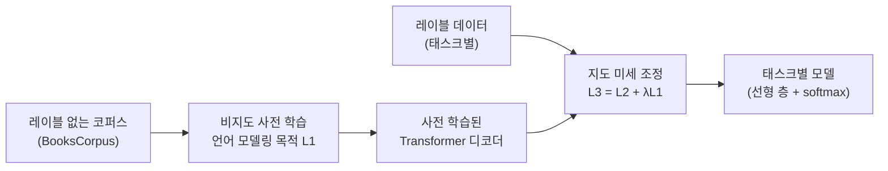
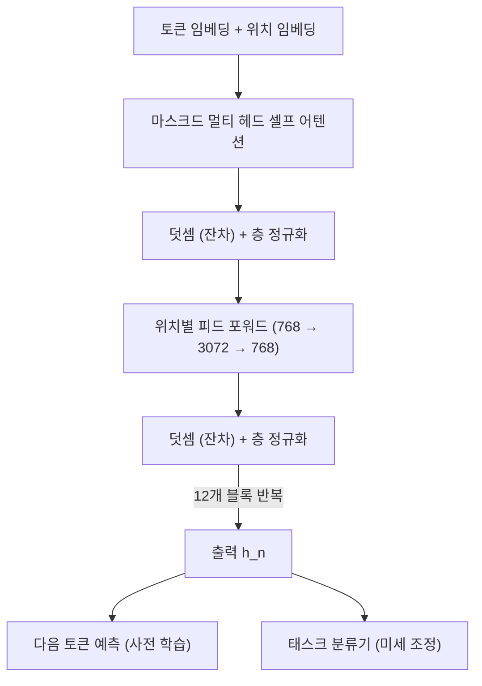

# HW2 과제 해설 — GPT 논문 정리: 생성적 사전 학습을 통한 언어 이해

[레포지토리 안내](../../README.ko.md) | [English](Assignment-Explanation.md) | [한국어](Assignment-Explanation.ko.md)

> **최종 수정일:** 2026-11-04

> **학습 목표:**
> 1. 자연어 이해에서 레이블 없는 텍스트를 활용하는 반지도학습의 동기와 기존 방법의 한계를 설명할 수 있다
> 2. 언어 모델링 목적 함수와 Transformer 디코더로 이루어진 비지도 사전 학습 단계를 수식으로 설명할 수 있다
> 3. 지도 미세 조정의 목적 함수와 보조 언어 모델링 목적의 역할을 설명할 수 있다
> 4. 태스크별 입력 변환으로 함의, 유사도, 질의응답 태스크를 하나의 사전 학습 모델에 적용하는 방법을 설명할 수 있다
> 5. 실험 설정, 주요 결과, 분석(전이한 층 수, 제로샷 동작, 제거 연구)을 해석할 수 있다
> 6. GPT와 후속 모델(BERT, GPT-2, GPT-3)의 관계를 설명하고 논문 정리 보고서를 구성할 수 있다

---

## 목차

- [1. 과제 요구사항](#1-과제-요구사항)
  - [1.1 과제 구성](#11-과제-구성)
  - [1.2 보고서의 구성](#12-보고서의-구성)
- [2. 연구 배경](#2-연구-배경)
  - [2.1 레이블 데이터의 부족](#21-레이블-데이터의-부족)
  - [2.2 단어 수준을 넘는 전이의 어려움](#22-단어-수준을-넘는-전이의-어려움)
  - [2.3 관련 연구](#23-관련-연구)
- [3. 프레임워크](#3-프레임워크)
  - [3.1 비지도 사전 학습: 언어 모델링](#31-비지도-사전-학습-언어-모델링)
  - [3.2 Transformer 디코더](#32-transformer-디코더)
  - [3.3 지도 미세 조정](#33-지도-미세-조정)
  - [3.4 보조 언어 모델링 목적](#34-보조-언어-모델링-목적)
  - [3.5 태스크별 입력 변환](#35-태스크별-입력-변환)
- [4. 실험 설정](#4-실험-설정)
  - [4.1 사전 학습 데이터](#41-사전-학습-데이터)
  - [4.2 모델 명세와 사전 학습 설정](#42-모델-명세와-사전-학습-설정)
  - [4.3 미세 조정 설정](#43-미세-조정-설정)
- [5. 실험 결과](#5-실험-결과)
  - [5.1 평가 태스크](#51-평가-태스크)
  - [5.2 자연어 추론](#52-자연어-추론)
  - [5.3 질의응답과 상식 추론](#53-질의응답과-상식-추론)
  - [5.4 의미 유사도와 분류](#54-의미-유사도와-분류)
- [6. 분석](#6-분석)
  - [6.1 전이한 층 수의 영향](#61-전이한-층-수의-영향)
  - [6.2 제로샷 동작](#62-제로샷-동작)
  - [6.3 제거 연구](#63-제거-연구)
- [7. 의의와 후속 연구](#7-의의와-후속-연구)
  - [7.1 기여](#71-기여)
  - [7.2 BERT, GPT-2, GPT-3](#72-bert-gpt-2-gpt-3)
- [요약](#요약)
- [점검 문제](#점검-문제)
- [참고 문헌](#참고-문헌)

---

<br>

## 1. 과제 요구사항

### 1.1 과제 구성

A. Radford, K. Narasimhan, T. Salimans, I. Sutskever의 "Improving Language Understanding by Generative Pre-Training"(OpenAI, 2018) [1]을 정리하는 과제이다. 이 논문이 제안한 모델이 이후 **GPT(Generative Pre-trained Transformer)** 로 불리는 계열의 첫 모델이다. 논문은 OpenAI가 공개한 [PDF](https://cdn.openai.com/research-covers/language-unsupervised/language_understanding_paper.pdf)로 볼 수 있다.

| 항목 | 요구사항 |
|:-----|:-----|
| 대상 | GPT 논문 [1] |
| 분량 | 4쪽 안팎 (Word 또는 PDF) |
| 양식 | 자유 |

*표 1. HW2의 요구사항*

제출 보고서는 [`Solution/Assignment-Report.pdf`](Solution/Assignment-Report.pdf)에 있다. 논문이 바탕으로 하는 Transformer, 셀프 어텐션, BPE, 위치 인코딩, 마스크드 멀티 헤드 어텐션, BERT와 GPT의 구조는 8강에서, 단어 임베딩은 7강에서, 전이 학습과 미세 조정은 3강과 4강에서 다룬다.

### 1.2 보고서의 구성

논문의 구성(서론, 관련 연구, 프레임워크, 실험, 분석, 결론)을 따르되, 4쪽 안에서 핵심이 드러나도록 다음과 같이 재구성할 수 있다.

```text
1. 대상 논문의 서지 정보
2. 개요와 배경 (레이블 데이터의 부족, 기존 연구의 한계)
3. 프레임워크
   3.1 비지도 사전 학습 (언어 모델링 목적, Transformer 디코더)
   3.2 지도 미세 조정 (분류 목적, 보조 언어 모델링 목적)
   3.3 태스크별 입력 변환
4. 실험 설정 (데이터, 모델 명세, 사전 학습과 미세 조정의 하이퍼파라미터)
5. 결과와 분석 (주요 수치, 전이한 층 수, 제로샷, 제거 연구)
6. 결론과 의의
참고 문헌
```

수식은 논문의 식 번호(1)~(5)와 대응시키고, 기호(예: $k$는 문맥 창 크기, $n$은 층 수)를 처음 쓸 때 정의한다. 수치는 어느 데이터셋과 지표의 값인지 함께 적는다.

---

<br>

## 2. 연구 배경

### 2.1 레이블 데이터의 부족

**자연어 이해(natural language understanding, NLU)** 는 텍스트 함의(textual entailment), 질의응답, 의미 유사도 평가, 문서 분류처럼 문장의 의미를 파악해야 하는 다양한 태스크를 아우른다. 레이블 없는 텍스트는 매우 많지만 특정 태스크를 위한 레이블 데이터는 적어서, 레이블 데이터만으로 학습하는 **판별 모델(discriminative model)** 은 충분한 성능을 내기 어렵다. 레이블을 더 모으는 것은 시간과 비용이 많이 들므로, 레이블 없는 데이터에서 언어 정보를 배우는 모델이 좋은 대안이 된다 [1].

> **용어 정의:** **반지도학습(semi-supervised learning)** 은 소량의 레이블 데이터와 대량의 레이블 없는 데이터를 함께 써서 학습하는 방법이다. **비지도 사전 학습(unsupervised pre-training)** 은 그 특수한 경우로, 지도학습의 목적 함수를 바꾸는 대신 레이블 없는 데이터로 좋은 초기 파라미터를 찾는 것을 목표로 한다.

비지도 사전 학습은 이미지 분류와 회귀 태스크에서 먼저 쓰였고, 사전 학습이 정규화처럼 작용하여 깊은 신경망의 일반화를 돕는다는 연구도 나왔다. 이후 음성 인식, 개체 명확화(entity disambiguation), 기계 번역 같은 태스크의 학습에도 쓰였다 [1].

### 2.2 단어 수준을 넘는 전이의 어려움

레이블 없는 텍스트를 쓰는 가장 성공적인 방법은 Word2Vec 같은 **사전 학습된 단어 임베딩(pre-trained word embedding)** 이었다(7강). 그러나 단어 임베딩은 주로 단어 수준의 정보만 전달한다. 단어 수준을 넘는 정보를 배워 전이하는 데에는 두 가지 어려움이 있었다 [1].

1. **어떤 최적화 목적이 좋은가:** 언어 모델링, 기계 번역, 담화 일관성(discourse coherence) 같은 목적이 연구되었지만, 태스크마다 우세한 방법이 달라 무엇이 전이에 유용한 표현을 배우는지 분명하지 않았다.
2. **어떻게 전이할 것인가:** 태스크마다 모델 구조를 바꾸거나, 복잡한 학습 기법을 쓰거나, 보조 목적을 더하는 방법이 섞여 있었고, 가장 효과적인 방법에 대한 합의가 없었다.

### 2.3 관련 연구

| 연구 흐름 | 내용 | GPT와의 차이 |
|:-----|:-----|:-----|
| 단어와 문장 임베딩 | 레이블 없는 코퍼스로 단어, 구, 문장의 벡터 표현을 학습하여 태스크의 특징으로 쓴다 | GPT는 단어 수준을 넘는 고수준의 의미를 모델 전체로 전이한다 |
| LSTM 언어 모델 사전 학습 후 미세 조정 | Dai와 Le [2], ULMFiT [3]은 언어 모델로 사전 학습한 LSTM을 텍스트 분류에 미세 조정한다 | LSTM은 예측 능력이 짧은 범위에 한정되지만, GPT의 Transformer는 더 긴 범위의 언어 구조를 포착한다 |
| 사전 학습 모델의 은닉 표현을 보조 특징으로 사용 | ELMo [4] 등은 사전 학습한 언어 모델이나 번역 모델의 은닉 표현을 태스크 모델의 특징으로 더한다 | 태스크마다 새 파라미터가 많이 필요하지만, GPT는 전이할 때 구조를 거의 바꾸지 않는다 |
| 보조 학습 목적 | 태스크의 목적에 언어 모델링 같은 비지도 목적을 더한다 | GPT도 보조 목적을 쓰지만, 사전 학습만으로 이미 목표 태스크에 관련된 여러 언어적 특성을 배운다 |

*표 2. GPT와 관련 연구의 비교*

---

<br>

## 3. 프레임워크

학습은 두 단계로 이루어진다. 먼저 대규모 텍스트 코퍼스에서 큰 용량의 언어 모델을 학습하고(비지도 사전 학습), 이어서 레이블 데이터로 판별 태스크에 맞게 조정한다(지도 미세 조정). 목표는 **적은 조정만으로 다양한 태스크에 전이되는 범용 표현**을 배우는 것이며, 사전 학습 코퍼스와 목표 태스크가 같은 도메인일 필요는 없다.



*그림 1. GPT의 2단계 학습 절차*

### 3.1 비지도 사전 학습: 언어 모델링

레이블 없는 토큰 코퍼스 $\mathcal{U} = \lbrace u_1, \ldots, u_n\rbrace$이 주어지면, 표준 **언어 모델링(language modeling)** 목적의 가능도를 최대화한다.

```math
L_1(\mathcal{U}) = \sum_i \log P(u_i \mid u_{i-k}, \ldots, u_{i-1}; \Theta) \qquad (1)
```

- $k$: **문맥 창(context window)** 의 크기, 즉 다음 토큰을 예측할 때 볼 수 있는 이전 토큰의 수이다.
- $P$: 파라미터 $\Theta$를 가진 신경망이 계산하는 조건부 확률이다. 파라미터는 확률적 경사하강법으로 학습한다.

즉 모델은 앞의 $k$개 토큰을 보고 다음 토큰을 맞히도록 학습된다. 레이블이 따로 필요 없고, 텍스트 자체의 다음 토큰이 정답이 된다.

수치 예로 확인한다. 세 토큰 "the cat sat"에서 모델이 각 토큰에 준 조건부 확률이 $P(\text{the}) = 0.2$, $P(\text{cat} \mid \text{the}) = 0.5$, $P(\text{sat} \mid \text{the cat}) = 0.4$라 하자. 로그 가능도는 다음과 같다.

```math
\ln 0.2 + \ln 0.5 + \ln 0.4 = -1.609 - 0.693 - 0.916 = -3.219
```

학습은 이 값을 0에 가깝게(확률을 1에 가깝게) 만든다. 언어 모델의 성능은 흔히 **퍼플렉서티(perplexity)** $`\exp\!\left(-\frac{1}{N}\sum_i \log P(u_i \mid \cdot)\right)`$로 나타내며, 이 예에서는 $\exp(3.219 / 3) \approx 2.92$이다. 퍼플렉서티는 모델이 매 단계에서 평균적으로 몇 개의 후보 사이에서 망설이는지로 해석할 수 있고, 낮을수록 좋다. 논문의 언어 모델은 BooksCorpus에서 토큰 수준 퍼플렉서티 18.4를 기록했다 [1].

### 3.2 Transformer 디코더

언어 모델로는 Transformer [5]의 변형인 **다층 Transformer 디코더(multi-layer Transformer decoder)** 를 쓴다. 입력 문맥 토큰에 멀티 헤드 셀프 어텐션을 적용하고 위치별 피드 포워드 층을 거쳐, 목표 토큰에 대한 출력 분포를 만든다.

```math
h_0 = U W_e + W_p, \qquad h_l = \texttt{transformer\_block}(h_{l-1}) \;\; \forall l \in [1, n], \qquad P(u) = \mathrm{softmax}(h_n W_e^{T}) \qquad (2)
```

- $U = (u_{-k}, \ldots, u_{-1})$: 문맥 토큰의 (원-핫) 벡터들이다.
- $W_e$: 토큰 임베딩 행렬, $W_p$: 위치 임베딩 행렬, $n$: 층(블록)의 수이다.
- 마지막 층의 출력 $h_n$에 토큰 임베딩 행렬의 전치 $W_e^T$를 곱해 어휘 전체에 대한 점수를 만든다. 입력 임베딩과 출력층이 같은 행렬을 공유하므로(weight tying) 출력층을 위한 별도의 큰 행렬이 필요 없다.



*그림 2. GPT의 Transformer 디코더 블록과 두 출력*

**마스크드 셀프 어텐션.** 언어 모델은 다음 토큰을 예측해야 하므로, 위치 $t$의 토큰은 $t$ 이후의 토큰을 보면 안 된다. 그래서 어텐션 점수 행렬에서 현재 위치보다 뒤에 있는 칸을 $-\infty$로 가린 뒤 softmax를 적용한다. 세 토큰에서 (스케일링한) 어텐션 점수가 다음과 같다고 하자.

| 쿼리 토큰 | 키 1 | 키 2 | 키 3 | softmax 결과 (어텐션 가중치) |
|:-----|-----:|-----:|-----:|:-----|
| 1 | 0.8 | $-\infty$ | $-\infty$ | (1, 0, 0) |
| 2 | 1.0 | 2.0 | $-\infty$ | (0.269, 0.731, 0) |
| 3 | 0.5 | 1.5 | 1.0 | (0.186, 0.507, 0.307) |

*표 3. 마스크를 적용한 어텐션 점수와 가중치의 예*

$e^{-\infty} = 0$이므로 가린 칸의 가중치는 0이 된다. 둘째 행은 $e^{1.0} / (e^{1.0} + e^{2.0}) = 2.718 / (2.718 + 7.389) \approx 0.269$로 계산한다. 이렇게 하면 모든 위치의 다음 토큰 예측을 한 번의 순전파로 병렬 계산하면서도 미래 정보가 새지 않는다. 마스크드 멀티 헤드 어텐션의 자세한 구조는 8강에서 다룬다.

### 3.3 지도 미세 조정

사전 학습이 끝나면 파라미터를 목표 태스크에 맞게 조정한다. 레이블 데이터셋 $\mathcal{C}$의 각 사례는 입력 토큰열 $x^1, \ldots, x^m$과 레이블 $y$로 이루어진다. 입력을 사전 학습 모델에 통과시켜 **마지막 Transformer 블록의 마지막 토큰 위치의 활성값** $h_l^m$을 얻고, 새로 더한 선형 출력층 $W_y$로 $y$를 예측한다.

```math
P(y \mid x^1, \ldots, x^m) = \mathrm{softmax}(h_l^m W_y) \qquad (3)
```

```math
L_2(\mathcal{C}) = \sum_{(x, y)} \log P(y \mid x^1, \ldots, x^m) \qquad (4)
```

수치 예로, 함의 판단의 세 클래스(함의, 중립, 모순)에 대한 $h_l^m W_y$가 $(2.0, 0.5, -1.0)$이면 softmax 결과는 $(0.786, 0.175, 0.039)$이다. 정답이 함의라면 이 사례가 $L_2$에 더하는 값은 $\ln 0.786 \approx -0.241$이고, 학습은 이 확률을 1에 가깝게 키운다.

마지막 토큰 위치의 표현을 쓰는 이유는 마스크드 셀프 어텐션 때문이다. 마지막 위치만 입력 전체를 볼 수 있으므로, 그 위치의 표현이 입력 전체를 요약한다.

### 3.4 보조 언어 모델링 목적

미세 조정 중에 언어 모델링을 **보조 목적(auxiliary objective)** 으로 함께 최적화하면 (a) 지도 모델의 일반화가 좋아지고 (b) 수렴이 빨라진다. 가중치 $\lambda$로 다음 목적을 최대화한다.

```math
L_3(\mathcal{C}) = L_2(\mathcal{C}) + \lambda \cdot L_1(\mathcal{C}) \qquad (5)
```

여기서 $L_1(\mathcal{C})$는 레이블 데이터의 입력 텍스트에 대한 언어 모델링 목적이다. 실험에서는 $\lambda = 0.5$를 썼다. 구현에서는 최대화할 로그 가능도 대신 최소화할 교차 엔트로피 손실로 쓰는 경우가 많다. 예를 들어 어느 미니배치에서 분류 손실이 0.35, 언어 모델링 손실이 2.80이면 전체 손실은 $0.35 + 0.5 \times 2.80 = 1.75$이다.

미세 조정에서 새로 필요한 파라미터는 출력층 $W_y$와 구분자 토큰의 임베딩(3.5절)뿐이다. 태스크마다 큰 구조를 새로 설계하던 이전 방법과 대비되는 점이다.

### 3.5 태스크별 입력 변환

텍스트 분류는 위의 방법으로 바로 미세 조정할 수 있다. 그러나 함의 판단(문장 쌍)이나 질의응답(문서, 질문, 답의 세 쌍)처럼 **구조화된 입력**은 연속 텍스트로 사전 학습한 모델에 그대로 넣을 수 없다. 이전 연구는 전이한 표현 위에 태스크별 구조를 학습했지만, 그러면 태스크별 설계가 다시 많아지고 그 추가 구조에는 전이 학습이 적용되지 않는다. GPT는 구조화된 입력을 순서 있는 하나의 토큰열로 바꾸는 **순회식 접근(traversal-style approach)** 을 쓴다. 모든 변환에는 무작위로 초기화한 시작 토큰 $\langle s \rangle$과 끝 토큰 $\langle e \rangle$을 더한다.

```text
분류         ⟨s⟩ 텍스트 ⟨e⟩                          → Transformer → 선형 층
함의         ⟨s⟩ 전제 $ 가설 ⟨e⟩                      → Transformer → 선형 층
유사도       ⟨s⟩ 텍스트 1 $ 텍스트 2 ⟨e⟩  → Transformer ─┐
             ⟨s⟩ 텍스트 2 $ 텍스트 1 ⟨e⟩  → Transformer ─┴→ 원소별 덧셈 → 선형 층
다지선다     ⟨s⟩ 문맥 $ 답 1 ⟨e⟩          → Transformer → 선형 층 ─┐
             ⟨s⟩ 문맥 $ 답 2 ⟨e⟩          → Transformer → 선형 층 ─┼→ softmax
             ⟨s⟩ 문맥 $ 답 3 ⟨e⟩          → Transformer → 선형 층 ─┘
```

*그림 3. 태스크별 입력 변환 (`$`는 구분자 토큰, 다지선다의 문맥은 문서와 질문)*

- **텍스트 함의:** 전제 $p$와 가설 $h$의 토큰열을 구분자 토큰(`$`)을 사이에 두고 이어 붙인다.
- **유사도:** 비교하는 두 문장에는 본래 순서가 없으므로, 두 순서를 모두 만든 뒤 각각 독립적으로 처리하여 얻은 두 표현 $h_l^m$을 원소별로 더해 선형 출력층에 넣는다.
- **질의응답과 상식 추론:** 문맥 문서 $z$, 질문 $q$, 가능한 답의 집합 $\lbrace a_k\rbrace$가 주어지면, 각 답마다 `[z; q; $; a_k]`를 만든다. 각 열을 독립적으로 처리하여 얻은 점수를 softmax로 정규화하여 답들에 대한 확률 분포를 얻는다.

이 변환 덕분에 태스크마다 구조를 크게 바꾸지 않고도 하나의 사전 학습 모델로 다양한 태스크를 미세 조정할 수 있다.

---

<br>

## 4. 실험 설정

### 4.1 사전 학습 데이터

언어 모델은 모험, 판타지, 로맨스 등 다양한 장르의 미출간 도서 7,000권 이상으로 이루어진 **BooksCorpus** [6]로 학습했다. 이 데이터는 **긴 연속 텍스트**를 담고 있어 생성 모델이 먼 거리의 정보에 조건화하는 법을 배울 수 있다. 비슷한 접근인 ELMo가 쓴 1B Word Benchmark는 크기는 비슷하지만 문장 단위로 섞여 있어 긴 범위의 구조가 사라진다. 원문은 ftfy 라이브러리로 정리하여 일부 문장 부호와 공백을 표준화하고, spaCy 토크나이저로 나눈 뒤 BPE를 적용했다.

### 4.2 모델 명세와 사전 학습 설정

| 항목 | 설정 |
|:-----|:-----|
| 구조 | 12층 디코더 전용 Transformer, 마스크드 셀프 어텐션 |
| 은닉 상태 차원과 헤드 수 | 768차원, 어텐션 헤드 12개 |
| 위치별 피드 포워드 내부 차원 | 3072 |
| 활성화 함수 | GELU(Gaussian Error Linear Unit) [7] |
| 위치 임베딩 | 원래 Transformer의 사인 함수 방식 대신 학습되는 위치 임베딩 |
| 어휘 | 병합 40,000회의 BPE(byte pair encoding) [8] 어휘 |
| 최적화 | Adam [9], 최대 학습률 $2.5 \times 10^{-4}$ |
| 학습률 일정 | 처음 2,000회 갱신 동안 0에서 선형으로 증가시킨 뒤 코사인 일정으로 0까지 감소 |
| 학습량 | 무작위로 뽑은 512토큰 연속 열 64개의 미니배치로 100 에포크 |
| 초기화 | 층 정규화 [10]를 모델 전체에 쓰므로 단순한 $N(0, 0.02)$ 초기화로 충분 |
| 정규화 | 잔차, 임베딩, 어텐션에 비율 0.1의 dropout, 편향과 이득(gain)을 뺀 가중치에 $w = 0.01$의 수정된 L2 정규화 |

*표 4. 모델 명세와 비지도 사전 학습 설정*

**파라미터 수.** 표의 명세로 파라미터 수를 대략 계산한다(어휘 크기는 40,000으로 근사한다). 한 블록의 파라미터는 다음과 같다.

| 구성 요소 | 계산 | 파라미터 수 |
|:-----|:-----|-----:|
| Q, K, V 사영 | $768 \times (3 \times 768) + 3 \times 768$ | 1,771,776 |
| 어텐션 출력 사영 | $768 \times 768 + 768$ | 590,592 |
| 피드 포워드 1층 | $768 \times 3072 + 3072$ | 2,362,368 |
| 피드 포워드 2층 | $3072 \times 768 + 768$ | 2,360,064 |
| 층 정규화 2개 | $2 \times (768 + 768)$ | 3,072 |
| 블록 하나의 합 | | 7,087,872 |

*표 5. Transformer 블록 하나의 파라미터 수*

12개 블록은 $12 \times 7{,}087{,}872 = 85{,}054{,}464$개, 토큰 임베딩은 $40{,}000 \times 768 = 30{,}720{,}000$개, 위치 임베딩은 $512 \times 768 = 393{,}216$개이고, 출력층은 토큰 임베딩을 공유하므로 더하지 않는다. 합은 약 $1.16 \times 10^8$개로, GPT-2 논문이 원래 GPT와 같은 크기라고 밝힌 1.17억 개(117M) [11]와 거의 같다. 차이는 실제 어휘 크기와 특수 토큰에서 온다.

### 4.3 미세 조정 설정

| 항목 | 설정 |
|:-----|:-----|
| 기본값 | 따로 밝히지 않은 하이퍼파라미터는 사전 학습 설정을 그대로 쓴다 |
| 분류기 dropout | 0.1 |
| 학습률과 배치 크기 | 대부분의 태스크에서 $6.25 \times 10^{-5}$, 32 |
| 학습량 | 대부분 3 에포크로 충분 |
| 학습률 일정 | 학습량의 0.2% 동안 워밍업한 뒤 선형 감소 |
| 보조 목적 가중치 | $\lambda = 0.5$ |

*표 6. 지도 미세 조정 설정*

> **주의:** 512토큰 열, 미니배치 64, 100 에포크, 최대 학습률 $2.5 \times 10^{-4}$, 2,000회 워밍업과 코사인 일정은 **사전 학습**의 설정이고, 미세 조정은 학습률 $6.25 \times 10^{-5}$, 배치 32, 3 에포크로 훨씬 짧고 작은 학습률을 쓴다. 논문의 "Model specifications"와 "Fine-tuning details" 문단이 각각 두 단계에 해당하므로 정리할 때 섞지 않도록 주의한다.

---

<br>

## 5. 실험 결과

### 5.1 평가 태스크

| 태스크 | 데이터셋 |
|:-----|:-----|
| 자연어 추론 | SNLI, MultiNLI, Question NLI, RTE, SciTail |
| 질의응답 | RACE, Story Cloze |
| 문장 유사도 | MSR Paraphrase Corpus (MRPC), Quora Question Pairs (QQP), STS Benchmark (STS-B) |
| 분류 | Stanford Sentiment Treebank-2 (SST-2), CoLA |

*표 7. 실험에 쓴 태스크와 데이터셋*

이 중 여러 태스크는 다중 태스크 벤치마크인 **GLUE** [12]에 포함되어 있다. 데이터셋 크기는 STS-B(훈련 사례 약 5,700개)부터 SNLI(약 55만 개)까지 다양하다.

### 5.2 자연어 추론

**자연어 추론(natural language inference, NLI)** 은 두 문장을 읽고 관계를 함의(entailment), 모순(contradiction), 중립(neutral) 중 하나로 판단하는 태스크이다. 어휘 함의, 상호 참조, 어휘적, 구문적 모호성 같은 다양한 현상을 다루어야 하므로 어렵다. 평가에 쓴 다섯 데이터셋은 출처가 다양하여, SNLI는 이미지 캡션, MNLI는 전사한 음성, 대중 소설, 정부 보고서, QNLI는 위키백과 문서, SciTail은 과학 시험, RTE는 뉴스 기사에서 왔다.

| 데이터셋 | 이전 최고 | GPT | 차이 |
|:-----|-----:|-----:|-----:|
| MNLI-m | 80.6 | 82.1 | +1.5 |
| MNLI-mm | 80.1 | 81.4 | +1.3 |
| SNLI | 89.3 | 89.9 | +0.6 |
| SciTail | 83.3 | 88.3 | +5.0 |
| QNLI | 82.3 | 88.1 | +5.8 |
| RTE | 61.7 | 56.0 | -5.7 |

*표 8. 자연어 추론 결과 (정확도, %)*

다섯 데이터셋 중 네 개에서 이전 최고 결과(앙상블 포함)를 넘었다. 작은 데이터셋인 RTE(2,490개)에서는 다중 태스크 biLSTM 모델(61.7%)보다 낮았는데, 논문은 다중 태스크 학습을 더하면 나아질 수 있다고 보았다.

### 5.3 질의응답과 상식 추론

RACE는 중학교와 고등학교 영어 시험의 지문과 질문으로 이루어져 추론형 질문이 많고, Story Cloze Test는 여러 문장으로 된 이야기의 올바른 결말을 두 후보 중에서 고르는 태스크이다.

| 데이터셋 | 이전 최고 | GPT | 차이 |
|:-----|-----:|-----:|-----:|
| Story Cloze | 77.6 | 86.5 | +8.9 |
| RACE-m | 60.2 | 62.9 | +2.7 |
| RACE-h | 50.3 | 57.4 | +7.1 |
| RACE (전체) | 53.3 | 59.0 | +5.7 |

*표 9. 질의응답과 상식 추론 결과 (정확도, %)*

긴 문맥을 다뤄야 하는 태스크에서 향상이 특히 크며, 긴 연속 텍스트로 사전 학습한 효과를 보여 준다.

### 5.4 의미 유사도와 분류

**의미 유사도(semantic similarity)** 또는 패러프레이즈 탐지(paraphrase detection) 태스크는 두 문장이 의미상 같은지 예측하는 태스크로, 개념을 다르게 표현한 문장을 알아보고 부정을 이해하며 구문적 모호성을 처리해야 한다. 평가에는 MRPC(뉴스에서 모은 문장 쌍), QQP, STS-B를 썼다. 분류 태스크로는 문장이 문법적으로 올바른지에 대한 전문가 판단을 담은 CoLA와 표준 이진 감성 분류 태스크인 SST-2를 썼다.

| 데이터셋 (지표) | 이전 최고 | GPT | 차이 |
|:-----|-----:|-----:|-----:|
| CoLA (매튜스 상관계수) | 35.0 | 45.4 | +10.4 |
| SST-2 (정확도) | 93.2 | 91.3 | -1.9 |
| MRPC (F1) | 86.0 | 82.3 | -3.7 |
| STS-B (피어슨 상관계수) | 81.0 | 82.0 | +1.0 |
| QQP (F1) | 66.1 | 70.3 | +4.2 |
| GLUE (전체 점수) | 68.9 | 72.8 | +3.9 |

*표 10. 의미 유사도와 분류 결과*

CoLA에서의 큰 향상은 모델이 언어의 내재적 편향(문법성)을 배웠음을 보여 준다. SST-2와 MRPC에서는 이전 최고보다 낮았다. 전체적으로 12개 데이터셋 중 9개에서 새로운 최고 성능을 기록했고, 여러 경우 앙상블보다도 나았다.

> **참고:** 논문의 서론은 GLUE에서 5.5%의 절대 향상을 얻었다고 쓰지만, 표 4의 수치는 72.8과 이전 최고 68.9로 차이가 3.9이다. 보고서에 GLUE 향상을 쓸 때는 표의 수치와 비교 대상을 함께 적는다.

---

<br>

## 6. 분석

### 6.1 전이한 층 수의 영향

사전 학습한 층 가운데 몇 개를 목표 태스크로 전이할지를 0개(임베딩만)에서 12개(전체)까지 바꾸며 MultiNLI와 RACE의 성능을 측정했다. 임베딩만 전이해도 성능이 오르고, 층을 하나 더할 때마다 성능이 계속 올라 MultiNLI에서는 전체 전이로 최대 9%의 이득을 얻었다. **사전 학습 모델의 모든 층이 목표 태스크에 유용한 기능을 담고 있다**는 뜻이다.

### 6.2 제로샷 동작

언어 모델 사전 학습이 왜 효과적인지 이해하기 위해, 논문은 미세 조정 없이 생성 모델만으로 태스크를 수행하는 휴리스틱을 설계하고 사전 학습이 진행됨에 따른 성능 변화를 관찰했다. 이를 **제로샷(zero-shot)** 평가라 한다. 논문의 가설은 생성 모델이 언어 모델링 능력을 높이는 과정에서 평가 태스크의 상당수를 수행하는 법을 배우고, Transformer의 더 구조화된 어텐션 메모리가 LSTM보다 전이에 유리하다는 것이다.

| 태스크 | 휴리스틱 |
|:-----|:-----|
| CoLA (문법성) | 생성 모델이 문장에 준 토큰 로그 확률의 평균을 점수로 하여 임계값으로 판정한다 |
| SST-2 (감성) | 문장 뒤에 very를 붙이고, 다음 토큰의 분포를 positive와 negative 두 단어로 제한하여 확률이 높은 쪽을 예측으로 한다 |
| RACE (질의응답) | 문서와 질문을 조건으로 했을 때 평균 토큰 로그 확률이 가장 높은 답을 고른다 |
| DPRD (위노그라드 스키마) | 대명사를 두 후보 지시 대상으로 각각 바꾸고, 바꾼 뒤의 나머지 열에 더 높은 평균 로그 확률을 주는 쪽을 고른다 |

*표 11. 제로샷 평가의 휴리스틱*

무작위 추측과 단일 모델의 최고 성능 사이로 정규화한 휴리스틱의 성능은 사전 학습 동안 안정적으로 꾸준히 올랐다. 생성적 사전 학습이 태스크에 관련된 다양한 기능을 배우게 한다는 근거이다. 같은 실험에서 LSTM은 제로샷 성능의 변동이 더 컸으며, 논문은 Transformer 구조의 귀납적 편향(inductive bias)이 전이에 도움이 된다고 해석한다.

### 6.3 제거 연구

**제거 연구(ablation study)** 는 모델의 구성 요소를 하나씩 빼거나 바꾸어 각 요소의 기여를 확인하는 실험이다. 논문은 GLUE의 8개 태스크에서 세 가지 제거 연구를 했다.

| 방법 | 평균 | CoLA | SST2 | MRPC | STSB | QQP | MNLI | QNLI | RTE |
|:-----|-----:|-----:|-----:|-----:|-----:|-----:|-----:|-----:|-----:|
| Transformer, 보조 LM 사용 (전체 모델) | 74.7 | 45.4 | 91.3 | 82.3 | 82.0 | 70.3 | 81.8 | 88.1 | 56.0 |
| Transformer, 사전 학습 없음 | 59.9 | 18.9 | 84.0 | 79.4 | 30.9 | 65.5 | 75.7 | 71.2 | 53.8 |
| Transformer, 보조 LM 없음 | 75.0 | 47.9 | 92.0 | 84.9 | 83.2 | 69.8 | 81.1 | 86.9 | 54.4 |
| LSTM, 보조 LM 사용 | 69.1 | 30.3 | 90.5 | 83.2 | 71.8 | 68.1 | 73.7 | 81.1 | 54.6 |

*표 12. 제거 연구 결과 (평균은 모든 결과의 가중치 없는 평균)*

1. **사전 학습의 효과:** 사전 학습 없이 같은 Transformer를 목표 태스크로 직접 학습하면 모든 태스크에서 성능이 떨어지고, 평균 점수가 $74.7 - 59.9 = 14.8$ 낮아진다. 논문의 "14.8% decrease"는 이 평균 점수의 차이이다.
2. **보조 목적의 효과:** 보조 언어 모델링 목적은 NLI 태스크(MNLI, QNLI, RTE)와 QQP에서 도움이 되었고, CoLA, SST-2, MRPC, STS-B에서는 보조 목적이 없을 때 점수가 더 높았다. 논문은 이를 큰 데이터셋은 보조 목적의 덕을 보지만 작은 데이터셋은 그렇지 않은 경향으로 정리하며, 평균 점수는 보조 목적이 없을 때 오히려 0.3 높다.
3. **Transformer와 LSTM:** 같은 프레임워크에서 Transformer 대신 2048유닛 단층 LSTM을 쓰면 평균 점수가 $74.7 - 69.1 = 5.6$ 떨어진다. LSTM이 Transformer보다 나은 데이터셋은 MRPC 하나뿐이다.

---

<br>

## 7. 의의와 후속 연구

### 7.1 기여

1. 생성적 사전 학습과 판별적 미세 조정을 결합하여, **태스크에 무관한(task-agnostic) 하나의 모델**로 강한 자연어 이해 성능을 얻는 프레임워크를 제시했다.
2. 태스크별 입력 변환으로 **구조를 거의 바꾸지 않고** 다양한 태스크에 전이하는 방법을 보였다.
3. 12개 데이터셋 중 9개에서 최고 성능을 기록하여, 태스크마다 특별히 설계한 판별 모델보다 범용 모델이 나을 수 있음을 보였다.
4. 사전 학습에 적합한 모델(Transformer)과 데이터(긴 범위의 의존성이 있는 텍스트)에 대한 실마리를 주었다. 논문은 이 결과가 비지도학습이 언제, 어떻게 작동하는지에 대한 이해를 넓히는 새 연구의 계기가 되기를 기대한다고 맺는다.

### 7.2 BERT, GPT-2, GPT-3

| 모델 | 구조 | 사전 학습 목적 | 파라미터 수 | 특징 |
|:-----|:-----|:-----|:-----|:-----|
| GPT (2018) [1] | Transformer 디코더 12층 | 왼쪽에서 오른쪽으로의 언어 모델링 | 약 1.17억 | 사전 학습 후 태스크별 미세 조정 |
| BERT (2018) [13] | Transformer 인코더 | 마스크드 언어 모델링과 다음 문장 예측 | BASE 1.1억, LARGE 3.4억 | 양방향 문맥을 사용하며, BASE는 GPT와 비교하려고 크기를 맞췄다 |
| GPT-2 (2019) [11] | Transformer 디코더 최대 48층 | 언어 모델링 (WebText) | 최대 약 15억 | 미세 조정 없이 제로샷으로 여러 태스크를 수행 |
| GPT-3 (2020) [14] | Transformer 디코더 96층 | 언어 모델링 | 약 1,750억 | 프롬프트에 예시 몇 개를 넣는 문맥 내 학습(few-shot) |

*표 13. GPT와 후속 사전 학습 언어 모델*

BERT는 GPT의 단방향 언어 모델링이 문맥의 한쪽만 본다는 한계를 지적하고, 입력의 일부 토큰을 가린 뒤 양쪽 문맥으로 맞히는 목적으로 인코더를 사전 학습했다. GPT 계열은 디코더 구조와 언어 모델링 목적을 유지하면서 모델과 데이터의 규모를 키워, 미세 조정 없이도 태스크를 수행하는 방향으로 발전했다. GPT의 제로샷 실험(6.2절)은 이 방향을 미리 보여 준 결과로 볼 수 있다. BERT와 GPT의 비교는 8강에서도 다룬다.

---

<br>

## 요약

| 개념 | 핵심 요약 |
|:-----|:----------|
| HW2 요구사항 | GPT 논문 "Improving Language Understanding by Generative Pre-Training"을 4쪽 안팎, 자유 양식으로 정리한다. |
| 동기 | 레이블 없는 텍스트는 많고 레이블 데이터는 적으며, 단어 임베딩을 넘는 수준의 정보를 전이하는 방법에 합의가 없었다. |
| 2단계 학습 | 레이블 없는 코퍼스로 언어 모델을 사전 학습한 뒤, 레이블 데이터로 판별 태스크에 미세 조정한다. |
| 언어 모델링 목적 | $L_1 = \sum_i \log P(u_i \mid u_{i-k}, \ldots, u_{i-1})$로, 앞의 $k$개 토큰으로 다음 토큰을 예측한다. |
| Transformer 디코더 | 12층, 768차원, 헤드 12개의 마스크드 셀프 어텐션 블록이며, 출력층은 토큰 임베딩 행렬을 공유한다. |
| 미세 조정 | 마지막 토큰 위치의 표현 $h_l^m$에 선형 층 $W_y$와 softmax를 더하고, $L_3 = L_2 + \lambda L_1$($`\lambda = 0.5`$)을 최대화한다. |
| 입력 변환 | 함의는 전제와 가설을 구분자로 잇고, 유사도는 두 순서의 표현을 더하며, 다지선다는 답마다 열을 만들어 softmax로 정규화한다. |
| 설정 | 사전 학습은 BooksCorpus, 512토큰, 배치 64, 100 에포크, 학습률 $2.5 \times 10^{-4}$이고, 미세 조정은 학습률 $6.25 \times 10^{-5}$, 배치 32, 3 에포크이다. |
| 결과 | 12개 데이터셋 중 9개에서 최고 성능을 기록했으며, Story Cloze +8.9, RACE +5.7, MNLI +1.5, GLUE 72.8(이전 68.9)이다. |
| 분석 | 전이하는 층이 많을수록 성능이 오르고, 제로샷 성능이 사전 학습과 함께 오르며, 사전 학습을 빼면 평균 14.8, LSTM으로 바꾸면 5.6 떨어진다. |
| 후속 연구 | 후속 모델로 양방향 인코더인 BERT와 규모를 키운 디코더인 GPT-2, GPT-3가 나왔다. |

---

<br>

## 점검 문제

1. **언어 모델링 목적:** 식 (1)에서 문맥 창 크기 $k$를 키우면 모델이 무엇을 더 활용할 수 있는가? 사전 학습 데이터로 문장 단위로 섞인 코퍼스보다 BooksCorpus가 유리한 이유와 연결하여 설명하라.

   <details>
   <summary>정답</summary>

   $k$가 크면 다음 토큰을 예측할 때 더 먼 앞의 토큰까지 조건으로 쓸 수 있다. BooksCorpus는 긴 연속 텍스트를 담고 있어 이런 장거리 의존성을 학습할 수 있지만, 문장 단위로 섞인 1B Word Benchmark는 문장 사이의 긴 범위 구조가 사라져 큰 문맥 창의 이점을 살리기 어렵다.

   </details>

2. **로그 가능도와 퍼플렉서티:** 네 토큰에 대한 조건부 확률이 0.5, 0.25, 0.5, 0.25일 때 로그 가능도(자연로그)와 퍼플렉서티를 구하라.

   <details>
   <summary>정답</summary>

   로그 가능도는 $2\ln 0.5 + 2\ln 0.25 = 2(-0.693) + 2(-1.386) = -4.159$이다. 퍼플렉서티는 $\exp(4.159 / 4) = \exp(1.040) \approx 2.83$이며, 확률의 기하 평균 $(0.5 \cdot 0.25 \cdot 0.5 \cdot 0.25)^{1/4} \approx 0.354$의 역수와 같다.

   </details>

3. **마스크:** 마스크드 셀프 어텐션에서 위치 3의 점수가 $(0.0, 0.0, \ln 2)$일 때 어텐션 가중치를 구하라. 마스크가 없다면 위치 2의 가중치는 무엇이 달라지는가?

   <details>
   <summary>정답</summary>

   $e^0 = 1$, $e^0 = 1$, $e^{\ln 2} = 2$이므로 가중치는 $(1/4, 1/4, 2/4) = (0.25, 0.25, 0.5)$이다. 위치 3은 마지막 위치라 가려지는 칸이 없다. 마스크가 없으면 위치 2가 위치 3의 키에도 가중치를 주게 되어, 예측해야 할 미래 토큰의 정보를 보게 된다.

   </details>

4. **미세 조정의 표현:** 미세 조정에서 마지막 토큰 위치의 표현 $h_l^m$을 선형 층에 넣는 이유는 무엇인가?

   <details>
   <summary>정답</summary>

   마스크드 셀프 어텐션에서 각 위치는 자신과 그 앞의 토큰만 볼 수 있으므로, 입력 전체를 볼 수 있는 위치는 마지막 위치뿐이다. 따라서 마지막 위치(끝 토큰)의 표현이 입력 전체를 요약한다.

   </details>

5. **보조 목적:** 분류 손실이 0.6, 언어 모델링 손실이 3.0이고 $\lambda = 0.5$일 때 전체 손실은? 제거 연구에 따르면 보조 목적은 어떤 데이터셋에서 도움이 되었는가?

   <details>
   <summary>정답</summary>

   $0.6 + 0.5 \times 3.0 = 2.1$이다. 보조 목적은 NLI 태스크(MNLI, QNLI, RTE)와 QQP에서 도움이 되었다. 논문은 큰 데이터셋이 보조 목적의 덕을 보는 경향으로 정리하지만, 작은 데이터셋인 RTE도 보조 목적이 있을 때 점수가 더 높다(56.0 대 54.4).

   </details>

6. **유사도 변환:** 유사도 태스크에서 두 문장을 두 순서로 모두 처리하는 이유는 무엇인가?

   <details>
   <summary>정답</summary>

   두 문장의 유사도에는 본래 순서가 없지만, 단방향 언어 모델의 표현은 입력 순서에 따라 달라진다. 두 순서의 표현을 원소별로 더하면 순서에 무관한 표현이 되어 태스크의 성질과 맞는다.

   </details>

7. **다지선다 변환:** 문맥 $z$, 질문 $q$, 답 후보 4개가 주어진 RACE 문제를 GPT에 넣는 방법을 설명하라.

   <details>
   <summary>정답</summary>

   답마다 `[z; q; $; a_k]` 형태의 열을 하나씩, 모두 4개 만든다. 각 열을 모델로 독립적으로 처리하여 선형 층에서 점수 하나씩을 얻고, 네 점수를 softmax로 정규화하여 답 후보에 대한 확률 분포를 만든다. 확률이 가장 큰 답을 고른다.

   </details>

8. **설정 구분:** 다음 중 미세 조정의 설정을 고르라: (가) 학습률 $2.5 \times 10^{-4}$, (나) 배치 32, (다) 100 에포크, (라) $\lambda = 0.5$, (마) 512토큰 연속 열의 미니배치 64.

   <details>
   <summary>정답</summary>

   (나)와 (라)이다. (가), (다), (마)는 비지도 사전 학습의 설정이며, 미세 조정은 학습률 $6.25 \times 10^{-5}$, 배치 32, 3 에포크, $\lambda = 0.5$를 쓴다.

   </details>

9. **제거 연구 해석:** 보조 LM이 없는 모델의 평균 점수(75.0)가 전체 모델(74.7)보다 높은데도 논문이 보조 목적을 쓰는 이유를 표 12로 설명하라.

   <details>
   <summary>정답</summary>

   평균은 CoLA, SST-2, MRPC, STS-B에서 보조 목적이 없을 때의 높은 점수 때문에 올라갔다. 큰 데이터셋인 MNLI(81.8 대 81.1), QNLI(88.1 대 86.9), QQP(70.3 대 69.8)에서는 보조 목적이 성능을 높였으므로, 데이터셋이 클 때 보조 목적이 유리하다는 것이 논문의 결론이다. 또한 논문은 보조 목적이 지도 모델의 일반화를 돕고 수렴을 빠르게 한다고 밝힌다(3.4절).

   </details>

10. **후속 모델:** GPT와 BERT의 사전 학습 목적의 차이와, 그 차이가 문맥 활용에 주는 영향을 설명하라.

    <details>
    <summary>정답</summary>

    GPT는 왼쪽에서 오른쪽으로 다음 토큰을 예측하는 언어 모델링으로 사전 학습하므로 각 위치가 앞의 문맥만 본다. BERT는 일부 토큰을 가린 뒤 양쪽 문맥으로 맞히는 마스크드 언어 모델링을 쓰므로 각 위치가 앞뒤 문맥을 모두 본다. 그 대신 GPT는 생성에 자연스럽게 쓸 수 있다.

    </details>

---

<br>

## 참고 문헌

1. A. Radford, K. Narasimhan, T. Salimans, and I. Sutskever, "Improving language understanding by generative pre-training," OpenAI, San Francisco, CA, USA, Tech. Rep., 2018. [Online]. Available: https://cdn.openai.com/research-covers/language-unsupervised/language_understanding_paper.pdf
2. A. M. Dai and Q. V. Le, "Semi-supervised sequence learning," in *Advances in Neural Information Processing Systems 28 (NIPS 2015)*, 2015, pp. 3079-3087.
3. J. Howard and S. Ruder, "Universal language model fine-tuning for text classification," in *Proc. 56th Annu. Meeting Assoc. Comput. Linguistics (ACL)*, 2018, pp. 328-339.
4. M. E. Peters, M. Neumann, M. Iyyer, M. Gardner, C. Clark, K. Lee, and L. Zettlemoyer, "Deep contextualized word representations," in *Proc. Conf. North Amer. Chapter Assoc. Comput. Linguistics (NAACL-HLT)*, 2018, pp. 2227-2237.
5. A. Vaswani, N. Shazeer, N. Parmar, J. Uszkoreit, L. Jones, A. N. Gomez, Ł. Kaiser, and I. Polosukhin, "Attention is all you need," in *Advances in Neural Information Processing Systems 30 (NIPS 2017)*, 2017, pp. 5998-6008.
6. Y. Zhu, R. Kiros, R. Zemel, R. Salakhutdinov, R. Urtasun, A. Torralba, and S. Fidler, "Aligning books and movies: Towards story-like visual explanations by watching movies and reading books," in *Proc. IEEE Int. Conf. Comput. Vis. (ICCV)*, 2015, pp. 19-27.
7. D. Hendrycks and K. Gimpel, "Gaussian error linear units (GELUs)," arXiv:1606.08415, 2016.
8. R. Sennrich, B. Haddow, and A. Birch, "Neural machine translation of rare words with subword units," in *Proc. 54th Annu. Meeting Assoc. Comput. Linguistics (ACL)*, 2016, pp. 1715-1725.
9. D. P. Kingma and J. Ba, "Adam: A method for stochastic optimization," in *Proc. Int. Conf. Learn. Represent. (ICLR)*, 2015.
10. J. L. Ba, J. R. Kiros, and G. E. Hinton, "Layer normalization," arXiv:1607.06450, 2016.
11. A. Radford, J. Wu, R. Child, D. Luan, D. Amodei, and I. Sutskever, "Language models are unsupervised multitask learners," OpenAI, San Francisco, CA, USA, Tech. Rep., 2019. [Online]. Available: https://cdn.openai.com/better-language-models/language_models_are_unsupervised_multitask_learners.pdf
12. A. Wang, A. Singh, J. Michael, F. Hill, O. Levy, and S. R. Bowman, "GLUE: A multi-task benchmark and analysis platform for natural language understanding," in *Proc. Int. Conf. Learn. Represent. (ICLR)*, 2019.
13. J. Devlin, M.-W. Chang, K. Lee, and K. Toutanova, "BERT: Pre-training of deep bidirectional transformers for language understanding," in *Proc. Conf. North Amer. Chapter Assoc. Comput. Linguistics (NAACL-HLT)*, 2019, pp. 4171-4186.
14. T. B. Brown et al., "Language models are few-shot learners," in *Advances in Neural Information Processing Systems 33 (NeurIPS 2020)*, 2020, pp. 1877-1901.
