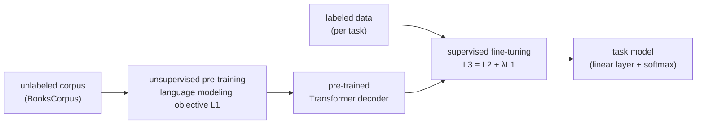
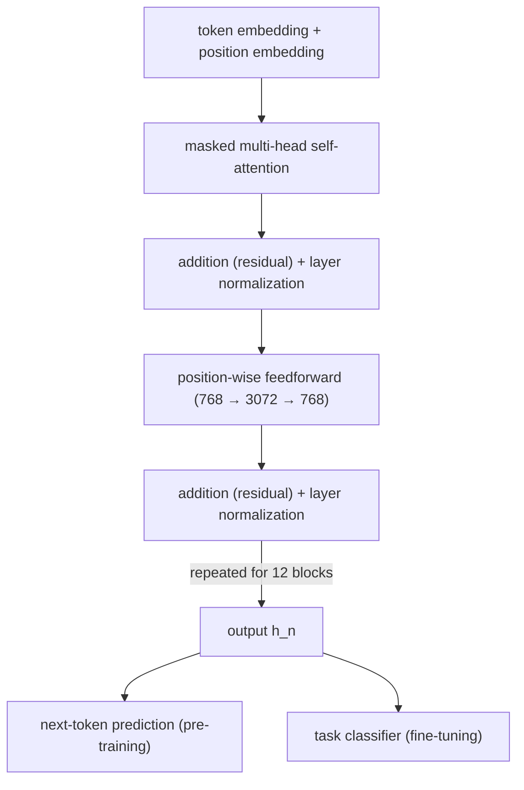

# HW2 Assignment Explanation — GPT Paper Review: Language Understanding Through Generative Pre-Training

[Repository Guide](../../README.md) | [English](Assignment-Explanation.md) | [한국어](Assignment-Explanation.ko.md)

> **Last Updated:** 2026-11-04

> **Learning Objectives:**
> 1. Explain the motivation for semi-supervised learning that uses unlabeled text in natural language understanding and the limitations of earlier methods
> 2. Explain with equations the unsupervised pre-training stage made of a language modeling objective and a Transformer decoder
> 3. Explain the objective of supervised fine-tuning and the role of the auxiliary language modeling objective
> 4. Explain how task-specific input transformations apply entailment, similarity, and question answering tasks to a single pre-trained model
> 5. Interpret the experimental setup, the main results, and the analyses (number of layers transferred, zero-shot behaviors, ablation studies)
> 6. Explain the relation between GPT and its successors (BERT, GPT-2, GPT-3) and organize a paper review report

---

## Table of Contents

- [1. Assignment Requirements](#1-assignment-requirements)
  - [1.1 Structure of the Assignment](#11-structure-of-the-assignment)
  - [1.2 Structure of the Report](#12-structure-of-the-report)
- [2. Research Background](#2-research-background)
  - [2.1 Scarcity of Labeled Data](#21-scarcity-of-labeled-data)
  - [2.2 Difficulty of Transfer Beyond the Word Level](#22-difficulty-of-transfer-beyond-the-word-level)
  - [2.3 Related Work](#23-related-work)
- [3. Framework](#3-framework)
  - [3.1 Unsupervised Pre-Training: Language Modeling](#31-unsupervised-pre-training-language-modeling)
  - [3.2 Transformer Decoder](#32-transformer-decoder)
  - [3.3 Supervised Fine-Tuning](#33-supervised-fine-tuning)
  - [3.4 Auxiliary Language Modeling Objective](#34-auxiliary-language-modeling-objective)
  - [3.5 Task-Specific Input Transformations](#35-task-specific-input-transformations)
- [4. Experimental Setup](#4-experimental-setup)
  - [4.1 Pre-Training Data](#41-pre-training-data)
  - [4.2 Model Specifications and Pre-Training Settings](#42-model-specifications-and-pre-training-settings)
  - [4.3 Fine-Tuning Settings](#43-fine-tuning-settings)
- [5. Experimental Results](#5-experimental-results)
  - [5.1 Evaluation Tasks](#51-evaluation-tasks)
  - [5.2 Natural Language Inference](#52-natural-language-inference)
  - [5.3 Question Answering and Commonsense Reasoning](#53-question-answering-and-commonsense-reasoning)
  - [5.4 Semantic Similarity and Classification](#54-semantic-similarity-and-classification)
- [6. Analysis](#6-analysis)
  - [6.1 Impact of the Number of Layers Transferred](#61-impact-of-the-number-of-layers-transferred)
  - [6.2 Zero-Shot Behaviors](#62-zero-shot-behaviors)
  - [6.3 Ablation Studies](#63-ablation-studies)
- [7. Significance and Follow-Up Work](#7-significance-and-follow-up-work)
  - [7.1 Contributions](#71-contributions)
  - [7.2 BERT, GPT-2, GPT-3](#72-bert-gpt-2-gpt-3)
- [Summary](#summary)
- [Self-Check Questions](#self-check-questions)
- [References](#references)

---

<br>

## 1. Assignment Requirements

### 1.1 Structure of the Assignment

This assignment summarizes "Improving Language Understanding by Generative Pre-Training" (OpenAI, 2018) by A. Radford, K. Narasimhan, T. Salimans, and I. Sutskever [1]. The model proposed in this paper is the first of the family later called **GPT (Generative Pre-trained Transformer)**. The paper is available as a [PDF](https://cdn.openai.com/research-covers/language-unsupervised/language_understanding_paper.pdf) released by OpenAI.

| Item | Requirement |
|:-----|:-----|
| Subject | The GPT paper [1] |
| Length | About 4 pages (Word or PDF) |
| Format | Free |

*Table 1. Requirements of HW2*

The submitted report is in [`Solution/Assignment-Report.pdf`](Solution/Assignment-Report.pdf). The Transformer, self-attention, BPE, positional encoding, masked multi-head attention, and the architectures of BERT and GPT on which the paper builds are covered in Lecture 8, word embeddings in Lecture 7, and transfer learning and fine-tuning in Lectures 3 and 4.

### 1.2 Structure of the Report

Following the structure of the paper (introduction, related work, framework, experiments, analysis, conclusion), the report can be reorganized as follows so that the core stands out within 4 pages.

```text
1. Bibliographic information of the paper
2. Overview and background (scarcity of labeled data, limitations of earlier work)
3. Framework
   3.1 Unsupervised pre-training (language modeling objective, Transformer decoder)
   3.2 Supervised fine-tuning (classification objective, auxiliary language modeling objective)
   3.3 Task-specific input transformations
4. Experimental setup (data, model specifications, hyperparameters of pre-training and fine-tuning)
5. Results and analysis (main numbers, layers transferred, zero-shot, ablations)
6. Conclusion and significance
References
```

Match the equations to the paper's equation numbers (1)-(5), and define each symbol (e.g., $k$ for the context window size, $n$ for the number of layers) at first use. State which dataset and metric each number belongs to.

---

<br>

## 2. Research Background

### 2.1 Scarcity of Labeled Data

**Natural language understanding (NLU)** covers a variety of tasks that require grasping the meaning of sentences, such as textual entailment, question answering, semantic similarity assessment, and document classification. Unlabeled text is abundant, but labeled data for specific tasks is scarce, so a **discriminative model** trained only on labeled data struggles to perform adequately. Collecting more labels is time-consuming and expensive, so models that learn linguistic information from unlabeled data are a valuable alternative [1].

> **Definition:** **Semi-supervised learning** trains with a small amount of labeled data together with a large amount of unlabeled data. **Unsupervised pre-training** is a special case whose goal is to find good initial parameters from unlabeled data instead of modifying the supervised learning objective.

Unsupervised pre-training was first used in image classification and regression tasks, and research also showed that pre-training acts as a regularization scheme that helps deep neural networks generalize. It was later used to help train models for tasks such as speech recognition, entity disambiguation, and machine translation [1].

### 2.2 Difficulty of Transfer Beyond the Word Level

The most successful way of using unlabeled text had been **pre-trained word embeddings** such as Word2Vec (Lecture 7). However, word embeddings mainly carry word-level information. Learning and transferring information beyond the word level faced two difficulties [1].

1. **Which optimization objective is good:** Objectives such as language modeling, machine translation, and discourse coherence had been studied, but a different method prevailed on each task, so it was unclear which one learned representations useful for transfer.
2. **How to transfer:** Methods that changed the model architecture for each task, used intricate learning schemes, or added auxiliary objectives were mixed, and there was no consensus on the most effective way.

### 2.3 Related Work

| Line of work | Content | Difference from GPT |
|:-----|:-----|:-----|
| Word and sentence embeddings | Learn vector representations of words, phrases, and sentences from an unlabeled corpus and use them as features for tasks | GPT transfers higher-level semantics beyond the word level through the whole model |
| Fine-tuning after LSTM language model pre-training | Dai and Le [2] and ULMFiT [3] fine-tune an LSTM pre-trained as a language model for text classification | LSTMs restrict prediction ability to a short range, whereas GPT's Transformer captures longer-range linguistic structure |
| Hidden representations of pre-trained models as auxiliary features | ELMo [4] and others add the hidden representations of a pre-trained language or translation model as features of the task model | Many new parameters are needed for each task, whereas GPT barely changes its architecture during transfer |
| Auxiliary training objectives | Add an unsupervised objective such as language modeling to the task objective | GPT also uses an auxiliary objective, but pre-training alone already learns several linguistic aspects relevant to the target tasks |

*Table 2. Comparison of GPT with related work*

---

<br>

## 3. Framework

Training consists of two stages. First, a high-capacity language model is learned on a large text corpus (unsupervised pre-training), and then it is adapted to a discriminative task with labeled data (supervised fine-tuning). The goal is to learn a **universal representation that transfers to a wide range of tasks with little adaptation**, and the target tasks need not be in the same domain as the pre-training corpus.



*Figure 1. The two-stage training procedure of GPT*

### 3.1 Unsupervised Pre-Training: Language Modeling

Given an unlabeled corpus of tokens $\mathcal{U} = \lbrace u_1, \ldots, u_n\rbrace$, the likelihood of the standard **language modeling** objective is maximized.

```math
L_1(\mathcal{U}) = \sum_i \log P(u_i \mid u_{i-k}, \ldots, u_{i-1}; \Theta) \qquad (1)
```

- $k$: the size of the **context window**, that is, the number of previous tokens that can be seen when predicting the next token.
- $P$: the conditional probability computed by a neural network with parameters $\Theta$. The parameters are trained with stochastic gradient descent.

In other words, the model is trained to predict the next token from the previous $k$ tokens. No separate labels are needed, because the next token of the text itself is the answer.

A numerical example illustrates this. Suppose that for the three tokens "the cat sat" the model assigns the conditional probabilities $P(\text{the}) = 0.2$, $P(\text{cat} \mid \text{the}) = 0.5$, and $P(\text{sat} \mid \text{the cat}) = 0.4$. The log-likelihood is as follows.

```math
\ln 0.2 + \ln 0.5 + \ln 0.4 = -1.609 - 0.693 - 0.916 = -3.219
```

Training pushes this value toward 0 (the probabilities toward 1). The performance of a language model is often expressed as **perplexity**, $`\exp\!\left(-\frac{1}{N}\sum_i \log P(u_i \mid \cdot)\right)`$, which is $\exp(3.219 / 3) \approx 2.92$ in this example. Perplexity can be read as the average number of candidates among which the model hesitates at each step, and lower is better. The paper's language model achieved a token-level perplexity of 18.4 on BooksCorpus [1].

### 3.2 Transformer Decoder

The language model is a **multi-layer Transformer decoder**, a variant of the Transformer [5]. It applies multi-head self-attention over the input context tokens followed by position-wise feedforward layers to produce an output distribution over target tokens.

```math
h_0 = U W_e + W_p, \qquad h_l = \texttt{transformer\_block}(h_{l-1}) \;\; \forall l \in [1, n], \qquad P(u) = \mathrm{softmax}(h_n W_e^{T}) \qquad (2)
```

- $U = (u_{-k}, \ldots, u_{-1})$: the (one-hot) vectors of the context tokens.
- $W_e$: the token embedding matrix, $W_p$: the position embedding matrix, $n$: the number of layers (blocks).
- The output of the last layer $h_n$ is multiplied by the transpose of the token embedding matrix $W_e^T$ to produce scores over the whole vocabulary. Because the input embedding and the output layer share the same matrix (weight tying), no separate large matrix is needed for the output layer.



*Figure 2. The Transformer decoder block of GPT and its two outputs*

**Masked self-attention.** Because the language model must predict the next token, the token at position $t$ must not see the tokens after $t$. Therefore the cells after the current position in the attention score matrix are masked with $-\infty$ before softmax is applied. Suppose the (scaled) attention scores for three tokens are as follows.

| Query token | Key 1 | Key 2 | Key 3 | Softmax result (attention weights) |
|:-----|-----:|-----:|-----:|:-----|
| 1 | 0.8 | $-\infty$ | $-\infty$ | (1, 0, 0) |
| 2 | 1.0 | 2.0 | $-\infty$ | (0.269, 0.731, 0) |
| 3 | 0.5 | 1.5 | 1.0 | (0.186, 0.507, 0.307) |

*Table 3. Example of masked attention scores and weights*

Since $e^{-\infty} = 0$, the masked cells get a weight of 0. The second row is computed as $e^{1.0} / (e^{1.0} + e^{2.0}) = 2.718 / (2.718 + 7.389) \approx 0.269$. In this way the next-token predictions of all positions are computed in parallel in one forward pass without leaking future information. The detailed structure of masked multi-head attention is covered in Lecture 8.

### 3.3 Supervised Fine-Tuning

After pre-training, the parameters are adapted to the target task. Each instance of the labeled dataset $\mathcal{C}$ consists of a sequence of input tokens $x^1, \ldots, x^m$ and a label $y$. The input is passed through the pre-trained model to obtain **the activation of the final Transformer block at the last token position** $h_l^m$, and a newly added linear output layer $W_y$ predicts $y$.

```math
P(y \mid x^1, \ldots, x^m) = \mathrm{softmax}(h_l^m W_y) \qquad (3)
```

```math
L_2(\mathcal{C}) = \sum_{(x, y)} \log P(y \mid x^1, \ldots, x^m) \qquad (4)
```

As a numerical example, if $h_l^m W_y$ for the three classes of an entailment judgment (entailment, neutral, contradiction) is $(2.0, 0.5, -1.0)$, the softmax result is $(0.786, 0.175, 0.039)$. If the correct answer is entailment, this instance adds $\ln 0.786 \approx -0.241$ to $L_2$, and training pushes this probability toward 1.

The representation at the last token position is used because of masked self-attention. Only the last position can see the whole input, so its representation summarizes the entire input.

### 3.4 Auxiliary Language Modeling Objective

Optimizing language modeling together as an **auxiliary objective** during fine-tuning (a) improves the generalization of the supervised model and (b) accelerates convergence. The following objective is maximized with a weight $\lambda$.

```math
L_3(\mathcal{C}) = L_2(\mathcal{C}) + \lambda \cdot L_1(\mathcal{C}) \qquad (5)
```

Here $L_1(\mathcal{C})$ is the language modeling objective on the input text of the labeled data. The experiments used $\lambda = 0.5$. Implementations often write it as cross-entropy losses to be minimized instead of log-likelihoods to be maximized. For example, if the classification loss of a mini-batch is 0.35 and the language modeling loss is 2.80, the total loss is $0.35 + 0.5 \times 2.80 = 1.75$.

The only new parameters needed for fine-tuning are the output layer $W_y$ and the embeddings of the delimiter tokens (Section 3.5). This contrasts with earlier methods that designed a large new architecture for each task.

### 3.5 Task-Specific Input Transformations

Text classification can be fine-tuned directly as described above. However, **structured inputs** such as entailment (sentence pairs) or question answering (triplets of document, question, and answers) cannot be fed as they are into a model pre-trained on contiguous text. Earlier work learned task-specific architectures on top of the transferred representations, but that reintroduces much task-specific design, and transfer learning does not apply to the added components. GPT uses a **traversal-style approach** that converts structured inputs into a single ordered token sequence. Every transformation adds randomly initialized start and end tokens $\langle s \rangle$ and $\langle e \rangle$.

```text
Classification  ⟨s⟩ text ⟨e⟩                         → Transformer → linear
Entailment      ⟨s⟩ premise $ hypothesis ⟨e⟩         → Transformer → linear
Similarity      ⟨s⟩ text 1 $ text 2 ⟨e⟩  → Transformer ─┐
                ⟨s⟩ text 2 $ text 1 ⟨e⟩  → Transformer ─┴→ element-wise add → linear
Multiple choice ⟨s⟩ context $ answer 1 ⟨e⟩ → Transformer → linear ─┐
                ⟨s⟩ context $ answer 2 ⟨e⟩ → Transformer → linear ─┼→ softmax
                ⟨s⟩ context $ answer 3 ⟨e⟩ → Transformer → linear ─┘
```

*Figure 3. Task-specific input transformations (`$` is the delimiter token, and the context of multiple choice is the document and the question)*

- **Textual entailment:** The token sequences of the premise $p$ and the hypothesis $h$ are concatenated with a delimiter token (`$`) in between.
- **Similarity:** There is no inherent ordering of the two sentences being compared, so both orderings are built and processed independently, and the two resulting representations $h_l^m$ are added element-wise before being fed into the linear output layer.
- **Question answering and commonsense reasoning:** Given a context document $z$, a question $q$, and a set of possible answers $\lbrace a_k\rbrace$, `[z; q; $; a_k]` is built for each answer. The scores obtained by processing each sequence independently are normalized with softmax to produce a probability distribution over the answers.

These transformations let a single pre-trained model be fine-tuned on a variety of tasks without large changes to the architecture for each task.

---

<br>

## 4. Experimental Setup

### 4.1 Pre-Training Data

The language model was trained on **BooksCorpus** [6], which consists of over 7,000 unpublished books from a variety of genres including adventure, fantasy, and romance. This data contains **long stretches of contiguous text**, which lets the generative model learn to condition on long-range information. The 1B Word Benchmark used by ELMo, a similar approach, is about the same size but is shuffled at the sentence level, which destroys long-range structure. The raw text was cleaned with the ftfy library to standardize some punctuation and whitespace, split with the spaCy tokenizer, and then encoded with BPE.

### 4.2 Model Specifications and Pre-Training Settings

| Item | Setting |
|:-----|:-----|
| Architecture | 12-layer decoder-only Transformer with masked self-attention |
| Hidden state dimension and heads | 768 dimensions, 12 attention heads |
| Inner dimension of the position-wise feedforward | 3072 |
| Activation function | GELU (Gaussian Error Linear Unit) [7] |
| Position embedding | Learned position embeddings instead of the sinusoidal version of the original Transformer |
| Vocabulary | BPE (byte pair encoding) [8] vocabulary with 40,000 merges |
| Optimization | Adam [9] with a maximum learning rate of $2.5 \times 10^{-4}$ |
| Learning rate schedule | Increased linearly from 0 over the first 2,000 updates and then annealed to 0 with a cosine schedule |
| Amount of training | 100 epochs on mini-batches of 64 randomly sampled contiguous sequences of 512 tokens |
| Initialization | A simple $N(0, 0.02)$ initialization suffices because layer normalization [10] is used throughout the model |
| Regularization | Dropout with a rate of 0.1 on residuals, embeddings, and attention, and a modified L2 regularization with $w = 0.01$ on all weights except biases and gains |

*Table 4. Model specifications and unsupervised pre-training settings*

**Number of parameters.** The number of parameters can be estimated from the specifications in the table (approximating the vocabulary size as 40,000). The parameters of one block are as follows.

| Component | Computation | Parameters |
|:-----|:-----|-----:|
| Q, K, V projections | $768 \times (3 \times 768) + 3 \times 768$ | 1,771,776 |
| Attention output projection | $768 \times 768 + 768$ | 590,592 |
| Feedforward layer 1 | $768 \times 3072 + 3072$ | 2,362,368 |
| Feedforward layer 2 | $3072 \times 768 + 768$ | 2,360,064 |
| Two layer normalizations | $2 \times (768 + 768)$ | 3,072 |
| Total for one block | | 7,087,872 |

*Table 5. Number of parameters in one Transformer block*

The 12 blocks have $12 \times 7{,}087{,}872 = 85{,}054{,}464$ parameters, the token embedding $40{,}000 \times 768 = 30{,}720{,}000$, and the position embedding $512 \times 768 = 393{,}216$, and the output layer shares the token embedding, so it adds nothing. The total is about $1.16 \times 10^8$, nearly the same as the 117 million (117M) that the GPT-2 paper gives as the size of the original GPT [11]. The difference comes from the actual vocabulary size and the special tokens.

### 4.3 Fine-Tuning Settings

| Item | Setting |
|:-----|:-----|
| Defaults | Hyperparameters not otherwise specified reuse the pre-training settings |
| Classifier dropout | 0.1 |
| Learning rate and batch size | $6.25 \times 10^{-5}$ and 32 for most tasks |
| Amount of training | 3 epochs suffice in most cases |
| Learning rate schedule | Linear decay after a warmup over 0.2% of training |
| Weight of the auxiliary objective | $\lambda = 0.5$ |

*Table 6. Supervised fine-tuning settings*

> **Caution:** Sequences of 512 tokens, mini-batches of 64, 100 epochs, a maximum learning rate of $2.5 \times 10^{-4}$, and 2,000 warmup updates with a cosine schedule are the settings of **pre-training**, whereas fine-tuning is much shorter and uses a smaller learning rate: $6.25 \times 10^{-5}$, a batch size of 32, and 3 epochs. The "Model specifications" and "Fine-tuning details" paragraphs of the paper correspond to the two stages respectively, so take care not to mix them up in a summary.

---

<br>

## 5. Experimental Results

### 5.1 Evaluation Tasks

| Task | Datasets |
|:-----|:-----|
| Natural language inference | SNLI, MultiNLI, Question NLI, RTE, SciTail |
| Question answering | RACE, Story Cloze |
| Sentence similarity | MSR Paraphrase Corpus (MRPC), Quora Question Pairs (QQP), STS Benchmark (STS-B) |
| Classification | Stanford Sentiment Treebank-2 (SST-2), CoLA |

*Table 7. Tasks and datasets used in the experiments*

Several of these tasks are part of the multi-task benchmark **GLUE** [12]. The dataset sizes range from STS-B (about 5,700 training examples) to SNLI (about 550,000).

### 5.2 Natural Language Inference

**Natural language inference (NLI)** is the task of reading a pair of sentences and judging their relationship as one of entailment, contradiction, or neutral. It is challenging because it involves a wide variety of phenomena such as lexical entailment, coreference, and lexical and syntactic ambiguity. The five evaluation datasets come from diverse sources: image captions (SNLI), transcribed speech, popular fiction, and government reports (MNLI), Wikipedia articles (QNLI), science exams (SciTail), and news articles (RTE).

| Dataset | Previous best | GPT | Difference |
|:-----|-----:|-----:|-----:|
| MNLI-m | 80.6 | 82.1 | +1.5 |
| MNLI-mm | 80.1 | 81.4 | +1.3 |
| SNLI | 89.3 | 89.9 | +0.6 |
| SciTail | 83.3 | 88.3 | +5.0 |
| QNLI | 82.3 | 88.1 | +5.8 |
| RTE | 61.7 | 56.0 | -5.7 |

*Table 8. Natural language inference results (accuracy, %)*

The model surpassed the previous best results (including ensembles) on four of the five datasets. On RTE (2,490 examples), one of the smaller datasets, it was below a multi-task biLSTM model (61.7%), and the paper considered that adding multi-task training could help.

### 5.3 Question Answering and Commonsense Reasoning

RACE consists of passages and questions from middle and high school English exams and contains many reasoning-type questions, and the Story Cloze Test asks for the correct ending of a multi-sentence story to be chosen from two options.

| Dataset | Previous best | GPT | Difference |
|:-----|-----:|-----:|-----:|
| Story Cloze | 77.6 | 86.5 | +8.9 |
| RACE-m | 60.2 | 62.9 | +2.7 |
| RACE-h | 50.3 | 57.4 | +7.1 |
| RACE (overall) | 53.3 | 59.0 | +5.7 |

*Table 9. Question answering and commonsense reasoning results (accuracy, %)*

The gains are especially large on tasks that require handling long contexts, which shows the effect of pre-training on long contiguous text.

### 5.4 Semantic Similarity and Classification

**Semantic similarity** (or paraphrase detection) tasks predict whether two sentences are semantically equivalent, which requires recognizing the rephrasing of concepts, understanding negation, and handling syntactic ambiguity. The evaluation used MRPC (sentence pairs collected from news sources), QQP, and STS-B. For classification, it used CoLA, which contains expert judgments on whether a sentence is grammatical, and SST-2, a standard binary sentiment classification task.

| Dataset (metric) | Previous best | GPT | Difference |
|:-----|-----:|-----:|-----:|
| CoLA (Matthews correlation) | 35.0 | 45.4 | +10.4 |
| SST-2 (accuracy) | 93.2 | 91.3 | -1.9 |
| MRPC (F1) | 86.0 | 82.3 | -3.7 |
| STS-B (Pearson correlation) | 81.0 | 82.0 | +1.0 |
| QQP (F1) | 66.1 | 70.3 | +4.2 |
| GLUE (overall score) | 68.9 | 72.8 | +3.9 |

*Table 10. Semantic similarity and classification results*

The large gain on CoLA shows that the model learned an innate linguistic bias (grammaticality). On SST-2 and MRPC it was below the previous best. Overall, it set new state-of-the-art results on 9 of the 12 datasets, outperforming ensembles in many cases.

> **Note:** The introduction of the paper states an absolute improvement of 5.5% on GLUE, but the numbers in Table 4 of the paper are 72.8 and a previous best of 68.9, a difference of 3.9. When reporting the GLUE improvement, state the numbers in the table together with the baseline.

---

<br>

## 6. Analysis

### 6.1 Impact of the Number of Layers Transferred

The number of pre-trained layers transferred to the target task was varied from 0 (embeddings only) to 12 (all), and the performance on MultiNLI and RACE was measured. Transferring the embeddings alone improves performance, and each added layer improves it further, up to a 9% gain for full transfer on MultiNLI. This means that **every layer of the pre-trained model contains functionality useful for the target tasks**.

### 6.2 Zero-Shot Behaviors

To understand why language model pre-training is effective, the paper designed heuristics that perform tasks with the generative model alone, without fine-tuning, and observed how their performance changed as pre-training progressed. This is called **zero-shot** evaluation. The paper's hypothesis is that the underlying generative model learns to perform many of the evaluated tasks in order to improve its language modeling capability, and that the more structured attentional memory of the Transformer assists transfer compared to LSTMs.

| Task | Heuristic |
|:-----|:-----|
| CoLA (grammaticality) | Score a sentence by the average token log-probability the generative model assigns and decide by a threshold |
| SST-2 (sentiment) | Append the token very to the sentence, restrict the distribution of the next token to the two words positive and negative, and predict the one with the higher probability |
| RACE (question answering) | Choose the answer with the highest average token log-probability conditioned on the document and the question |
| DPRD (Winograd schemas) | Replace the pronoun with each of the two candidate referents and choose the one for which the rest of the sequence receives the higher average log-probability |

*Table 11. Heuristics of the zero-shot evaluation*

The performance of the heuristics, normalized between a random-guess baseline and the state of the art with a single model, increased stably and steadily during pre-training. This is evidence that generative pre-training learns a wide variety of task-relevant functionality. In the same experiment the LSTM showed higher variance in its zero-shot performance, which the paper interprets as the inductive bias of the Transformer architecture assisting transfer.

### 6.3 Ablation Studies

An **ablation study** is an experiment that removes or replaces the components of a model one at a time to confirm the contribution of each component. The paper performed three ablation studies on eight GLUE tasks.

| Method | Avg. | CoLA | SST2 | MRPC | STSB | QQP | MNLI | QNLI | RTE |
|:-----|-----:|-----:|-----:|-----:|-----:|-----:|-----:|-----:|-----:|
| Transformer with aux LM (full model) | 74.7 | 45.4 | 91.3 | 82.3 | 82.0 | 70.3 | 81.8 | 88.1 | 56.0 |
| Transformer without pre-training | 59.9 | 18.9 | 84.0 | 79.4 | 30.9 | 65.5 | 75.7 | 71.2 | 53.8 |
| Transformer without aux LM | 75.0 | 47.9 | 92.0 | 84.9 | 83.2 | 69.8 | 81.1 | 86.9 | 54.4 |
| LSTM with aux LM | 69.1 | 30.3 | 90.5 | 83.2 | 71.8 | 68.1 | 73.7 | 81.1 | 54.6 |

*Table 12. Ablation study results (the average is an unweighted average of all results)*

1. **Effect of pre-training:** Training the same Transformer directly on the target tasks without pre-training hurts performance on every task and lowers the average score by $74.7 - 59.9 = 14.8$. The "14.8% decrease" of the paper is this difference in average score.
2. **Effect of the auxiliary objective:** The auxiliary language modeling objective helped on the NLI tasks (MNLI, QNLI, RTE) and QQP, while CoLA, SST-2, MRPC, and STS-B scored higher without it. The paper summarizes this as a trend in which larger datasets benefit from the auxiliary objective but smaller datasets do not, and the average score is in fact 0.3 higher without the auxiliary objective.
3. **Transformer versus LSTM:** Using a single-layer 2048-unit LSTM instead of the Transformer in the same framework lowers the average score by $74.7 - 69.1 = 5.6$. MRPC is the only dataset on which the LSTM outperforms the Transformer.

---

<br>

## 7. Significance and Follow-Up Work

### 7.1 Contributions

1. It presented a framework that combines generative pre-training and discriminative fine-tuning to achieve strong natural language understanding with **a single task-agnostic model**.
2. It showed how task-specific input transformations transfer to a variety of tasks **with minimal changes to the architecture**.
3. It achieved state-of-the-art results on 9 of the 12 datasets, showing that a general model can outperform discriminative models designed specifically for each task.
4. It offered hints about which models (Transformers) and data (text with long-range dependencies) work best for pre-training. The paper concludes with the hope that the results will enable new research that improves the understanding of how and when unsupervised learning works.

### 7.2 BERT, GPT-2, GPT-3

| Model | Architecture | Pre-training objective | Parameters | Characteristics |
|:-----|:-----|:-----|:-----|:-----|
| GPT (2018) [1] | 12-layer Transformer decoder | Left-to-right language modeling | About 117 million | Task-specific fine-tuning after pre-training |
| BERT (2018) [13] | Transformer encoder | Masked language modeling and next sentence prediction | BASE 110 million, LARGE 340 million | Uses bidirectional context, and BASE was sized to match GPT for comparison |
| GPT-2 (2019) [11] | Transformer decoder with up to 48 layers | Language modeling (WebText) | Up to about 1.5 billion | Performs many tasks zero-shot without fine-tuning |
| GPT-3 (2020) [14] | 96-layer Transformer decoder | Language modeling | About 175 billion | In-context learning with a few examples in the prompt (few-shot) |

*Table 13. GPT and the pre-trained language models that followed*

BERT pointed out the limitation that GPT's unidirectional language modeling sees only one side of the context, and pre-trained an encoder with an objective that masks some input tokens and predicts them from the context on both sides. The GPT family kept the decoder architecture and the language modeling objective and scaled up the model and the data, evolving toward performing tasks without fine-tuning. The zero-shot experiments of GPT (Section 6.2) can be seen as an early sign of this direction. The comparison of BERT and GPT is also covered in Lecture 8.

---

<br>

## Summary

| Concept | Key Summary |
|:-----|:----------|
| HW2 requirements | Summarize the GPT paper "Improving Language Understanding by Generative Pre-Training" in about 4 pages in a free format. |
| Motivation | Unlabeled text is abundant and labeled data is scarce, and there was no consensus on how to transfer information beyond the level of word embeddings. |
| Two-stage training | A language model is pre-trained on an unlabeled corpus and then fine-tuned on discriminative tasks with labeled data. |
| Language modeling objective | $L_1 = \sum_i \log P(u_i \mid u_{i-k}, \ldots, u_{i-1})$, which predicts the next token from the previous $k$ tokens. |
| Transformer decoder | Masked self-attention blocks with 12 layers, 768 dimensions, and 12 heads, whose output layer shares the token embedding matrix. |
| Fine-tuning | A linear layer $W_y$ and softmax are added on the representation $h_l^m$ at the last token position, and $L_3 = L_2 + \lambda L_1$ ($`\lambda = 0.5`$) is maximized. |
| Input transformations | Entailment joins the premise and hypothesis with a delimiter, similarity adds the representations of both orderings, and multiple choice builds a sequence per answer and normalizes with softmax. |
| Settings | Pre-training uses BooksCorpus, 512 tokens, a batch of 64, 100 epochs, and a learning rate of $2.5 \times 10^{-4}$; fine-tuning uses a learning rate of $6.25 \times 10^{-5}$, a batch of 32, and 3 epochs. |
| Results | State-of-the-art on 9 of 12 datasets, with Story Cloze +8.9, RACE +5.7, MNLI +1.5, and GLUE 72.8 (previously 68.9). |
| Analysis | More transferred layers improve performance, zero-shot performance rises with pre-training, and removing pre-training costs 14.8 on average while switching to an LSTM costs 5.6. |
| Follow-up work | The follow-up models include BERT, a bidirectional encoder, and GPT-2 and GPT-3, scaled-up decoders. |

---

<br>

## Self-Check Questions

1. **Language modeling objective:** In Equation (1), what more can the model use when the context window size $k$ is increased? Explain in connection with why BooksCorpus is better pre-training data than a corpus shuffled at the sentence level.

   <details>
   <summary>Answer</summary>

   A larger $k$ lets the model condition on tokens further back when predicting the next token. BooksCorpus contains long stretches of contiguous text, so such long-range dependencies can be learned, whereas the 1B Word Benchmark, shuffled at the sentence level, loses the long-range structure across sentences and can hardly exploit a large context window.

   </details>

2. **Log-likelihood and perplexity:** If the conditional probabilities of four tokens are 0.5, 0.25, 0.5, and 0.25, find the log-likelihood (natural logarithm) and the perplexity.

   <details>
   <summary>Answer</summary>

   The log-likelihood is $2\ln 0.5 + 2\ln 0.25 = 2(-0.693) + 2(-1.386) = -4.159$. The perplexity is $\exp(4.159 / 4) = \exp(1.040) \approx 2.83$, which equals the reciprocal of the geometric mean of the probabilities, $(0.5 \cdot 0.25 \cdot 0.5 \cdot 0.25)^{1/4} \approx 0.354$.

   </details>

3. **Masking:** In masked self-attention, find the attention weights when the scores of position 3 are $(0.0, 0.0, \ln 2)$. Without the mask, what would change for the weights of position 2?

   <details>
   <summary>Answer</summary>

   Since $e^0 = 1$, $e^0 = 1$, and $e^{\ln 2} = 2$, the weights are $(1/4, 1/4, 2/4) = (0.25, 0.25, 0.5)$. Position 3 is the last position, so no cell is masked. Without the mask, position 2 would also give weight to the key of position 3 and see information about the future token it must predict.

   </details>

4. **Representation in fine-tuning:** Why is the representation $h_l^m$ at the last token position fed into the linear layer in fine-tuning?

   <details>
   <summary>Answer</summary>

   In masked self-attention each position can see only itself and the tokens before it, so the last position is the only one that can see the whole input. Therefore the representation at the last position (the end token) summarizes the entire input.

   </details>

5. **Auxiliary objective:** If the classification loss is 0.6, the language modeling loss is 3.0, and $\lambda = 0.5$, what is the total loss? According to the ablation study, on which datasets did the auxiliary objective help?

   <details>
   <summary>Answer</summary>

   $0.6 + 0.5 \times 3.0 = 2.1$. The auxiliary objective helped on the NLI tasks (MNLI, QNLI, RTE) and QQP. The paper summarizes this as a trend in which larger datasets benefit, although the small RTE also scores higher with it (56.0 vs. 54.4).

   </details>

6. **Similarity transformation:** Why are the two sentences processed in both orderings for the similarity task?

   <details>
   <summary>Answer</summary>

   The similarity of two sentences has no inherent ordering, but the representation of a unidirectional language model depends on the order of the input. Adding the representations of both orderings element-wise gives an order-independent representation that matches the nature of the task.

   </details>

7. **Multiple-choice transformation:** Explain how a RACE problem with a context $z$, a question $q$, and four candidate answers is fed into GPT.

   <details>
   <summary>Answer</summary>

   One sequence of the form `[z; q; $; a_k]` is built for each answer, four in total. Each sequence is processed independently by the model to obtain one score from the linear layer, and the four scores are normalized with softmax into a probability distribution over the candidate answers. The answer with the highest probability is chosen.

   </details>

8. **Distinguishing settings:** Which of the following are fine-tuning settings? (a) a learning rate of $2.5 \times 10^{-4}$, (b) a batch size of 32, (c) 100 epochs, (d) $\lambda = 0.5$, (e) mini-batches of 64 contiguous sequences of 512 tokens.

   <details>
   <summary>Answer</summary>

   (b) and (d). (a), (c), and (e) are settings of unsupervised pre-training, whereas fine-tuning uses a learning rate of $6.25 \times 10^{-5}$, a batch size of 32, 3 epochs, and $\lambda = 0.5$.

   </details>

9. **Interpreting the ablation:** Using Table 12, explain why the paper uses the auxiliary objective even though the model without the auxiliary LM has a higher average score (75.0) than the full model (74.7).

   <details>
   <summary>Answer</summary>

   The average was raised by the higher scores without the auxiliary objective on CoLA, SST-2, MRPC, and STS-B. On the large datasets MNLI (81.8 vs. 81.1), QNLI (88.1 vs. 86.9), and QQP (70.3 vs. 69.8), the auxiliary objective improved performance, so the paper concludes that the auxiliary objective helps when datasets are large. The paper also states that the auxiliary objective improves the generalization of the supervised model and accelerates convergence (Section 3.4).

   </details>

10. **Successor models:** Explain the difference between the pre-training objectives of GPT and BERT and its effect on the use of context.

    <details>
    <summary>Answer</summary>

    GPT is pre-trained with language modeling that predicts the next token from left to right, so each position sees only the preceding context. BERT uses masked language modeling, which masks some tokens and predicts them from the context on both sides, so each position sees the context before and after it. In exchange, GPT can be used naturally for generation.

    </details>

---

<br>

## References

1. A. Radford, K. Narasimhan, T. Salimans, and I. Sutskever, "Improving language understanding by generative pre-training," OpenAI, San Francisco, CA, USA, Tech. Rep., 2018. [Online]. Available: https://cdn.openai.com/research-covers/language-unsupervised/language_understanding_paper.pdf
2. A. M. Dai and Q. V. Le, "Semi-supervised sequence learning," in *Advances in Neural Information Processing Systems 28 (NIPS 2015)*, 2015, pp. 3079-3087.
3. J. Howard and S. Ruder, "Universal language model fine-tuning for text classification," in *Proc. 56th Annu. Meeting Assoc. Comput. Linguistics (ACL)*, 2018, pp. 328-339.
4. M. E. Peters, M. Neumann, M. Iyyer, M. Gardner, C. Clark, K. Lee, and L. Zettlemoyer, "Deep contextualized word representations," in *Proc. Conf. North Amer. Chapter Assoc. Comput. Linguistics (NAACL-HLT)*, 2018, pp. 2227-2237.
5. A. Vaswani, N. Shazeer, N. Parmar, J. Uszkoreit, L. Jones, A. N. Gomez, Ł. Kaiser, and I. Polosukhin, "Attention is all you need," in *Advances in Neural Information Processing Systems 30 (NIPS 2017)*, 2017, pp. 5998-6008.
6. Y. Zhu, R. Kiros, R. Zemel, R. Salakhutdinov, R. Urtasun, A. Torralba, and S. Fidler, "Aligning books and movies: Towards story-like visual explanations by watching movies and reading books," in *Proc. IEEE Int. Conf. Comput. Vis. (ICCV)*, 2015, pp. 19-27.
7. D. Hendrycks and K. Gimpel, "Gaussian error linear units (GELUs)," arXiv:1606.08415, 2016.
8. R. Sennrich, B. Haddow, and A. Birch, "Neural machine translation of rare words with subword units," in *Proc. 54th Annu. Meeting Assoc. Comput. Linguistics (ACL)*, 2016, pp. 1715-1725.
9. D. P. Kingma and J. Ba, "Adam: A method for stochastic optimization," in *Proc. Int. Conf. Learn. Represent. (ICLR)*, 2015.
10. J. L. Ba, J. R. Kiros, and G. E. Hinton, "Layer normalization," arXiv:1607.06450, 2016.
11. A. Radford, J. Wu, R. Child, D. Luan, D. Amodei, and I. Sutskever, "Language models are unsupervised multitask learners," OpenAI, San Francisco, CA, USA, Tech. Rep., 2019. [Online]. Available: https://cdn.openai.com/better-language-models/language_models_are_unsupervised_multitask_learners.pdf
12. A. Wang, A. Singh, J. Michael, F. Hill, O. Levy, and S. R. Bowman, "GLUE: A multi-task benchmark and analysis platform for natural language understanding," in *Proc. Int. Conf. Learn. Represent. (ICLR)*, 2019.
13. J. Devlin, M.-W. Chang, K. Lee, and K. Toutanova, "BERT: Pre-training of deep bidirectional transformers for language understanding," in *Proc. Conf. North Amer. Chapter Assoc. Comput. Linguistics (NAACL-HLT)*, 2019, pp. 4171-4186.
14. T. B. Brown et al., "Language models are few-shot learners," in *Advances in Neural Information Processing Systems 33 (NeurIPS 2020)*, 2020, pp. 1877-1901.
