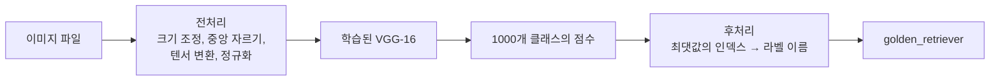
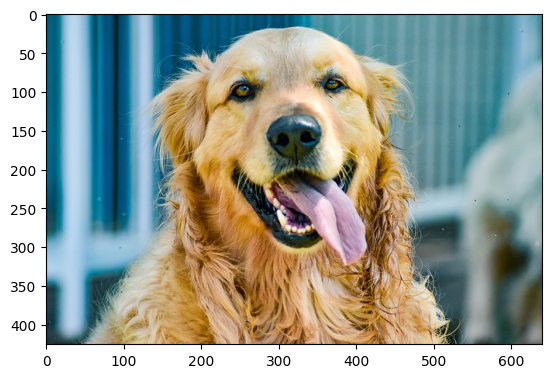
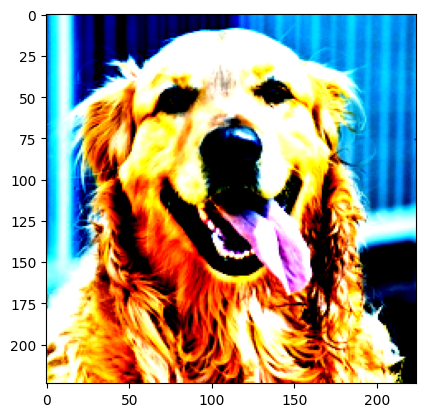

# 1강 실습 — 학습된 VGG-16으로 이미지 분류하기

[레포지토리 안내](../../README.ko.md) | [English](Concepts_Lab.md) | [한국어](Concepts_Lab.ko.md)

> **최종 수정일:** 2026-11-04

> **학습 목표:**
> 1. Colab과 로컬 컴퓨터에서 실습 노트북과 데이터를 준비하고, Google Drive 경로와 상대 경로의 차이를 설명할 수 있다
> 2. torchvision으로 ImageNet에서 학습된 VGG-16을 불러오고, 출력된 구조에서 각 층을 지난 텐서의 크기를 계산할 수 있다
> 3. 크기 조정, 중앙 자르기, 텐서 변환, 정규화로 이루어진 전처리의 각 단계가 이미지를 어떻게 바꾸는지 설명할 수 있다
> 4. 모델의 1000차원 출력을 ImageNet 클래스 인덱스로 라벨 이름에 대응시키고, 소프트맥스로 상위 클래스의 확률을 구할 수 있다

---

## 목차

- [1. 실습 개요와 준비](#1-실습-개요와-준비)
  - [1.1 실습의 흐름](#11-실습의-흐름)
  - [1.2 파일 구성](#12-파일-구성)
  - [1.3 실행 환경 준비](#13-실행-환경-준비)
- [2. 패키지 가져오기와 버전 확인](#2-패키지-가져오기와-버전-확인)
- [3. 학습된 VGG-16 불러오기](#3-학습된-vgg-16-불러오기)
  - [3.1 모델 생성과 평가 모드](#31-모델-생성과-평가-모드)
  - [3.2 VGG-16의 구조와 텐서 크기](#32-vgg-16의-구조와-텐서-크기)
- [4. 입력 이미지의 전처리](#4-입력-이미지의-전처리)
  - [4.1 전처리 클래스](#41-전처리-클래스)
  - [4.2 각 단계에서 이미지가 바뀌는 모습](#42-각-단계에서-이미지가-바뀌는-모습)
  - [4.3 전처리 결과 확인](#43-전처리-결과-확인)
- [5. ImageNet 클래스 인덱스](#5-imagenet-클래스-인덱스)
- [6. 출력을 라벨로 바꾸는 후처리 클래스](#6-출력을-라벨로-바꾸는-후처리-클래스)
- [7. 학습된 VGG-16으로 예측하기](#7-학습된-vgg-16으로-예측하기)
  - [7.1 예측 코드](#71-예측-코드)
  - [7.2 확률과 상위 5개 클래스 구하기](#72-확률과-상위-5개-클래스-구하기)
- [요약](#요약)
- [점검 문제](#점검-문제)
- [참고 문헌](#참고-문헌)

---

<br>

## 1. 실습 개요와 준비

### 1.1 실습의 흐름

이 실습은 대규모 이미지 데이터셋 **ImageNet**에서 미리 학습된 **VGG-16** 모델을 불러와, 처음 보는 사진(골든 리트리버)이 1,000개 클래스 중 무엇인지 분류한다. 모델을 직접 학습시키지 않고 이미 학습된 가중치를 그대로 쓰므로, 1강의 세 단계 중 전방 계산(순전파)만 수행한다.



*그림 1. 학습된 VGG-16으로 이미지를 분류하는 실습의 처리 흐름*

> **용어 정의:** **사전 학습된 모델(pretrained model)** 은 큰 데이터셋으로 미리 학습시켜 가중치를 저장해 둔 모델이다. 같은 종류의 태스크에는 그대로 쓰고, 다른 태스크에는 출발점으로 삼아 추가 학습(전이 학습, 3\~4강)한다.

**ImageNet**은 WordNet의 명사 체계에 따라 수백만 장의 이미지를 분류해 놓은 데이터셋이다 [1]. 이미지 분류 대회 ILSVRC(ImageNet Large Scale Visual Recognition Challenge)는 그중 1,000개 클래스와 약 128만 장의 훈련 이미지를 사용하며 [2], torchvision이 제공하는 학습된 VGG-16도 이 1,000개 클래스로 학습되었다. **VGG-16**은 3×3 합성곱을 깊게 쌓은 CNN으로, 가중치가 있는 층이 16개라서 이런 이름이 붙었다 [3].

### 1.2 파일 구성

실습에 쓰는 파일은 이 단원 폴더에 다음과 같이 들어 있다.

```text
Lec01_Deep-Learning-Fundamentals/
├── Example_Load-VGG.ipynb               실습 노트북
└── data/
    ├── goldenretriever-3724972_640.jpg  분류할 골든 리트리버 사진 (640×426)
    ├── imagenet_class_index.json        ImageNet 1,000개 클래스의 인덱스와 이름
    └── white_rabbit.png                 추가로 분류해 볼 흰 토끼 사진 (707×560)
```

노트북은 파일을 `data/goldenretriever-3724972_640.jpg`처럼 **상대 경로**로 연다. 상대 경로는 현재 작업 디렉토리를 기준으로 해석되므로, 노트북을 실행하는 디렉토리 아래에 `data/` 폴더가 있어야 한다. 반대로 `/content/drive/MyDrive/...`처럼 루트(`/`)부터 적는 **절대 경로**는 특정 컴퓨터의 폴더 구조에 묶여 다른 환경에서는 동작하지 않는다.

### 1.3 실행 환경 준비

**Colab에서 실행하기.** 1강 8.1절의 방법으로 Colab에 접속하여 노트북을 연다. 학습된 가중치로 추론만 하므로 CPU 런타임으로도 실행할 수 있으며, GPU 런타임을 쓰면 더 빠르다. 데이터는 다음 두 가지 중 하나로 준비한다.

1. 왼쪽 파일 창에서 `data` 폴더를 만들고 세 파일을 세션 저장소 `/content/data/`에 업로드한다. Colab의 기본 작업 디렉토리는 `/content`이므로 `data/...` 경로가 그대로 동작한다.
2. 단원 폴더를 Google Drive에 올려 두었다면, 노트북의 Drive 연결 셀을 실행한 뒤 단원 폴더로 작업 디렉토리를 옮긴다.

```python
%cd /content/drive/MyDrive/Lec01_Deep-Learning-Fundamentals
```

`%cd`는 Jupyter의 매직 명령으로, 커널의 작업 디렉토리를 바꾼다. 경로는 Drive에 올린 위치에 맞게 고친다.

**로컬 컴퓨터에서 실행하기.** 필요한 패키지를 설치하고 단원 폴더에서 JupyterLab을 실행한다.

```bash
pip install torch torchvision matplotlib pillow jupyterlab
cd Lecture-Notes/Lec01_Deep-Learning-Fundamentals
jupyter lab
```

> **주의:** 노트북의 `from google.colab import drive` 셀은 Colab 전용이다. 로컬 컴퓨터에서 실행하면 `ModuleNotFoundError`가 나므로 이 셀은 건너뛴다. 처음 실행할 때는 VGG-16의 학습된 가중치(약 528 MB)를 내려받으므로 인터넷 연결과 시간이 필요하다.

> **참고:** 노트북 첫머리의 사전 준비 셀은 원서 예제 저장소의 `make_folders_and_data_downloads.ipynb`로 데이터를 내려받고 conda로 PyTorch 1.0과 Matplotlib을 설치하라고 안내한다. 이 안내는 PyTorch 1.0 시기의 설치 방법이므로, 지금은 위의 pip 명령이나 PyTorch 홈페이지(https://pytorch.org/get-started/locally/)의 설치 안내를 따르고, 데이터는 1.2절의 `data/` 폴더에 있는 세 파일을 쓴다.

---

<br>

## 2. 패키지 가져오기와 버전 확인

```python
# 패키지 import
import numpy as np
import json
from PIL import Image
import matplotlib.pyplot as plt
%matplotlib inline

import torch
import torchvision
from torchvision import models, transforms
```

| 줄 | 하는 일 |
|:-----|:-----|
| `import numpy as np` | 배열 계산 라이브러리 NumPy를 `np`라는 이름으로 가져온다. 모델 출력에서 최댓값의 위치를 찾을 때 쓴다. |
| `import json` | JSON 형식의 클래스 인덱스 파일을 읽는 데 쓴다. |
| `from PIL import Image` | 이미지 파일을 여는 Pillow 라이브러리의 `Image` 모듈을 가져온다. |
| `import matplotlib.pyplot as plt` | 이미지를 화면에 그리는 Matplotlib을 가져온다. |
| `%matplotlib inline` | Jupyter의 매직 명령으로, 그림을 셀 출력 아래에 바로 표시한다. |
| `import torch`, `import torchvision` | 딥러닝 프레임워크 PyTorch와 그 컴퓨터 비전용 확장 torchvision을 가져온다. |
| `from torchvision import models, transforms` | 학습된 모델을 제공하는 `models`와 이미지 전처리 도구 `transforms`를 가져온다. |

*표 1. 패키지를 가져오는 셀의 각 줄이 하는 일*

```python
# PyTorch 버전 확인
print("PyTorch Version: ",torch.__version__)
print("Torchvision Version: ",torchvision.__version__)
```

```text
PyTorch Version:  2.5.1+cu124
Torchvision Version:  0.20.1+cu124
```

`+cu124`는 CUDA 12.4용으로 빌드된 GPU 버전이라는 뜻이다. 실행 환경에 따라 버전 번호는 달라질 수 있다. 다음 셀은 Google Drive를 연결하며(1.3절), 실행하면 `Mounted at /content/drive`가 출력된다.

```python
# 구글 드라이브 연동
from google.colab import drive
drive.mount('/content/drive')
```

---

<br>

## 3. 학습된 VGG-16 불러오기

### 3.1 모델 생성과 평가 모드

```python
# 학습된 VGG-16 모델을 읽기
# 처음 실행할 때에는 학습된 파라미터를 다운로드하므로 실행에 시간이 걸립니다

# VGG-16 모델의 인스턴스를 생성
use_pretrained = True  # 학습된 파라미터를 사용
net = models.vgg16(pretrained=use_pretrained)
net.eval()  # 추론 모드(평가 모드)로 설정

# 모델의 네트워크 구성을 출력
print(net)
```

- `models.vgg16(pretrained=True)`는 VGG-16의 구조를 만들고 ImageNet에서 학습된 가중치를 채운다. 가중치 파일은 처음 한 번만 내려받아 캐시 폴더(`~/.cache/torch/hub/checkpoints/vgg16-397923af.pth`)에 저장하고, 다음부터는 캐시에서 읽는다. `pretrained=False`이면 가중치가 무작위 값인, 학습되지 않은 모델이 만들어진다.
- `net.eval()`은 모델을 **평가 모드(evaluation mode)** 로 바꾼다. 드롭아웃(1강 7.3절)처럼 학습할 때와 추론할 때 동작이 다른 층이 추론용으로 동작하게 한다. 평가 모드에서는 드롭아웃이 노드를 끄지 않으므로 같은 입력에 항상 같은 출력이 나온다. 학습할 때는 `net.train()`으로 되돌린다.
- `print(net)`은 모델을 이루는 층을 순서대로 출력한다.

torchvision 0.13 이후 버전에서는 이 셀을 실행하면 다음 경고가 함께 출력된다. 마지막 두 줄은 가중치 파일을 처음 내려받을 때의 진행 표시이다.

```text
UserWarning: The parameter 'pretrained' is deprecated since 0.13 and may be removed in the future, please use 'weights' instead.
UserWarning: Arguments other than a weight enum or `None` for 'weights' are deprecated since 0.13 and may be removed in the future. The current behavior is equivalent to passing `weights=VGG16_Weights.IMAGENET1K_V1`. You can also use `weights=VGG16_Weights.DEFAULT` to get the most up-to-date weights.
Downloading: "https://download.pytorch.org/models/vgg16-397923af.pth" to /root/.cache/torch/hub/checkpoints/vgg16-397923af.pth
100%|██████████| 528M/528M [00:06<00:00, 88.4MB/s]
```

torchvision 0.13부터 `pretrained` 인자 대신 어떤 가중치를 쓸지 이름으로 고르는 `weights` 인자를 쓴다 [4]. 경고 문구대로 다음 코드는 위 코드와 같은 모델을 만든다.

```python
from torchvision.models import VGG16_Weights

net = models.vgg16(weights=VGG16_Weights.IMAGENET1K_V1)  # pretrained=True와 같은 가중치
net.eval()
```

### 3.2 VGG-16의 구조와 텐서 크기

`print(net)`의 출력은 세 부분으로 이루어진다(가운데 일부를 생략했다).

```text
VGG(
  (features): Sequential(
    (0): Conv2d(3, 64, kernel_size=(3, 3), stride=(1, 1), padding=(1, 1))
    (1): ReLU(inplace=True)
    (2): Conv2d(64, 64, kernel_size=(3, 3), stride=(1, 1), padding=(1, 1))
    (3): ReLU(inplace=True)
    (4): MaxPool2d(kernel_size=2, stride=2, padding=0, dilation=1, ceil_mode=False)
    (5): Conv2d(64, 128, kernel_size=(3, 3), stride=(1, 1), padding=(1, 1))
    ...
    (28): Conv2d(512, 512, kernel_size=(3, 3), stride=(1, 1), padding=(1, 1))
    (29): ReLU(inplace=True)
    (30): MaxPool2d(kernel_size=2, stride=2, padding=0, dilation=1, ceil_mode=False)
  )
  (avgpool): AdaptiveAvgPool2d(output_size=(7, 7))
  (classifier): Sequential(
    (0): Linear(in_features=25088, out_features=4096, bias=True)
    (1): ReLU(inplace=True)
    (2): Dropout(p=0.5, inplace=False)
    (3): Linear(in_features=4096, out_features=4096, bias=True)
    (4): ReLU(inplace=True)
    (5): Dropout(p=0.5, inplace=False)
    (6): Linear(in_features=4096, out_features=1000, bias=True)
  )
)
```

- **`features`:** 특징을 추출하는 부분이다. `Conv2d(입력 채널, 출력 채널, ...)`는 2차원 합성곱 층, `ReLU`는 활성화 함수, `MaxPool2d`는 최대 풀링 층이다(합성곱과 풀링은 2강에서 자세히 다룬다). `inplace=True`는 메모리를 아끼려고 입력 텐서를 덮어써서 결과를 저장한다는 뜻이다.
- **`avgpool`:** 입력의 가로세로 크기가 무엇이든 출력이 $7 \times 7$이 되도록 평균을 내는 적응형 평균 풀링이다. 입력이 $224 \times 224$이면 `features`의 출력이 이미 $7 \times 7$이므로 값이 그대로 통과한다.
- **`classifier`:** 분류를 담당하는 완전 연결 층(`Linear`) 3개이다. 마지막 층의 출력이 1,000개이며, 각각이 ImageNet 클래스 하나의 점수(로짓)이다. 두 번의 `Dropout(p=0.5)`는 학습할 때 노드의 절반을 끈다.

합성곱 층은 모두 커널 $3 \times 3$, 스트라이드 1, 패딩 1이므로 가로세로 크기가 유지된다. 출력 크기 공식(2강) $\lfloor (n + 2p - f)/s \rfloor + 1$에 넣으면 $(224 + 2 - 3)/1 + 1 = 224$이다. 최대 풀링은 커널 $2 \times 2$, 스트라이드 2이므로 크기가 절반이 된다: $(224 - 2)/2 + 1 = 112$. $224 \times 224$ RGB 이미지 한 장(배치 크기 1)이 지나가며 바뀌는 크기는 다음과 같다.

| 블록 | 층 번호 | 구성 | 출력 크기 (채널 × 높이 × 너비) |
|:-----|:-----|:-----|:-----|
| 입력 | | RGB 이미지 | 3 × 224 × 224 |
| 블록 1 | 0\~4 | 합성곱 2개(64채널), 최대 풀링 | 64 × 112 × 112 |
| 블록 2 | 5\~9 | 합성곱 2개(128채널), 최대 풀링 | 128 × 56 × 56 |
| 블록 3 | 10\~16 | 합성곱 3개(256채널), 최대 풀링 | 256 × 28 × 28 |
| 블록 4 | 17\~23 | 합성곱 3개(512채널), 최대 풀링 | 512 × 14 × 14 |
| 블록 5 | 24\~30 | 합성곱 3개(512채널), 최대 풀링 | 512 × 7 × 7 |
| avgpool | | 적응형 평균 풀링 | 512 × 7 × 7 |
| 펼치기 | | 1차원으로 펼침 | 25088 |
| classifier | 0\~6 | 완전 연결 층 3개 | 4096 → 4096 → 1000 |

*표 2. VGG-16에서 224×224 이미지가 각 블록을 지날 때의 텐서 크기*

$512 \times 7 \times 7 = 25088$이 첫 완전 연결 층의 `in_features=25088`과 일치한다. 가중치가 있는 층은 합성곱 13개와 완전 연결 층 3개, 모두 16개이다. 파라미터 수는 합성곱 층이 14,714,688개, 완전 연결 층이 123,642,856개로 합계 138,357,544개(약 1억 3,800만 개)이며, 대부분이 첫 완전 연결 층($25088 \times 4096$)에 몰려 있다.

---

<br>

## 4. 입력 이미지의 전처리

### 4.1 전처리 클래스

학습된 모델은 학습할 때와 같은 형식의 입력을 받아야 제대로 동작한다. VGG-16은 $224 \times 224$ 크기로 자르고 ImageNet의 평균과 표준편차로 정규화한 이미지로 학습되었으므로, 새 이미지도 같은 방식으로 바꾼다.

```python
# 입력 이미지의 전처리 클래스
class BaseTransform():
    """
    화상의 크기를 리사이즈하고 색상을 표준화한다.

    Attributes
    ----------
    resize : int
        리사이즈 대상 이미지의 크기.
    mean : (R, G, B)
        각 색상 채널의 평균 값.
    std : (R, G, B)
        각 색상 채널의 표준 편차.
    """

    def __init__(self, resize, mean, std):
        self.base_transform = transforms.Compose([
            transforms.Resize(resize),  # 짧은 변의 길이가 resize의 크기가 된다
            transforms.CenterCrop(resize),  # 이미지 중앙을 resize × resize으로 자르기
            transforms.ToTensor(),  # Torch 텐서로 변환
            transforms.Normalize(mean, std)  # 색상 정보의 표준화
        ])

    def __call__(self, img):
        return self.base_transform(img)
```

- `transforms.Compose([...])`는 여러 변환을 목록의 순서대로 차례로 적용하는 하나의 변환을 만든다.
- `transforms.Resize(resize)`는 가로세로 비율을 유지한 채 **짧은 변**의 길이가 `resize`가 되도록 이미지 크기를 바꾼다. 정수 하나를 주면 짧은 변 기준이고, `(높이, 너비)` 튜플을 주면 그 크기로 바꾼다.
- `transforms.CenterCrop(resize)`는 이미지 가운데에서 `resize × resize` 정사각형을 잘라 낸다.
- `transforms.ToTensor()`는 PIL 이미지(높이 × 너비 × 채널, 0\~255의 정수)를 PyTorch 텐서(채널 × 높이 × 너비, 0.0\~1.0의 실수)로 바꾼다. 축의 순서가 바뀌고 값이 255로 나뉜다.
- `transforms.Normalize(mean, std)`는 채널마다 $x' = (x - \text{mean})/\text{std}$를 계산한다.
- `__call__` 메서드를 정의했으므로 객체를 함수처럼 `transform(img)`로 호출할 수 있다.

### 4.2 각 단계에서 이미지가 바뀌는 모습

골든 리트리버 사진(너비 640, 높이 426)이 각 단계를 지나는 모습은 다음과 같다.

| 단계 | 결과 | 계산 |
|:-----|:-----|:-----|
| 원본 | PIL 이미지 640 × 426 (너비 × 높이), RGB | |
| `Resize(224)` | PIL 이미지 336 × 224 | 짧은 변 426 → 224, 긴 변 $\lfloor 640 \times 224/426 \rfloor = \lfloor 336.5 \rfloor = 336$ |
| `CenterCrop(224)` | PIL 이미지 224 × 224 | 가로에서 양쪽으로 $(336 - 224)/2 = 56$픽셀씩 잘라 냄 |
| `ToTensor()` | 텐서 `[3, 224, 224]`, 값 0.0\~1.0 | 각 값 ÷ 255, 축 순서를 (채널, 높이, 너비)로 |
| `Normalize(mean, std)` | 텐서 `[3, 224, 224]`, 값 약 −2.1\~2.6 | 채널마다 $(x - \text{mean})/\text{std}$ |

*표 3. 골든 리트리버 사진에 적용한 전처리 단계별 결과*

`mean = (0.485, 0.456, 0.406)`과 `std = (0.229, 0.224, 0.225)`는 ImageNet 훈련 이미지에서 R, G, B 채널별로 구한 평균과 표준편차로, torchvision의 학습된 모델이 공통으로 쓰는 값이다 [5]. 예를 들어 색이 (255, 128, 0)인 주황색 픽셀은 다음과 같이 바뀐다.

$$
\text{ToTensor: } \left(\frac{255}{255}, \frac{128}{255}, \frac{0}{255}\right) = (1.000, 0.502, 0.000)
$$

$$
\text{Normalize: } \left(\frac{1.000 - 0.485}{0.229}, \frac{0.502 - 0.456}{0.224}, \frac{0.000 - 0.406}{0.225}\right) \approx (2.249, 0.205, -1.804)
$$

정규화된 값의 범위는 R 채널이 $(0 - 0.485)/0.229 \approx -2.118$부터 $(1 - 0.485)/0.229 \approx 2.249$까지, B 채널이 $-1.804$부터 $2.640$까지이다. 정규화는 각 채널의 값이 평균 0, 표준편차 1 근처에 오게 하여 학습을 안정시키며, 학습된 모델에는 학습 때와 똑같은 값으로 정규화한 입력을 넣어야 한다.

> **참고:** torchvision 문서가 안내하는 VGG-16의 표준 전처리는 짧은 변을 256으로 줄인 뒤 가운데 224×224를 자르는 방식이다 [5]. 노트북처럼 짧은 변을 224로 줄인 뒤 224×224를 자르면 원본의 더 넓은 영역이 남는다. 두 방식 모두 쓰이며, 예측 클래스는 대개 같지만 확률값은 조금 달라질 수 있다.

### 4.3 전처리 결과 확인

```python
# 이미지 전처리 동작 확인

# 1. 화상 읽기
image_file_path = 'data/goldenretriever-3724972_640.jpg'
img = Image.open(image_file_path)  # [높이][너비][색RGB]

# 2. 원본 화상 표시
plt.imshow(img)
plt.show()

# 3. 화상 전처리 및 처리된 이미지의 표시
resize = 224
mean = (0.485, 0.456, 0.406)
std = (0.229, 0.224, 0.225)
transform = BaseTransform(resize, mean, std)
img_transformed = transform(img)  # torch.Size([3, 224, 224])

# (색상, 높이, 너비)을(높이, 너비, 색상)으로 변환하고 0-1로 값을 제한하여 표시
img_transformed = img_transformed.numpy().transpose((1, 2, 0))
img_transformed = np.clip(img_transformed, 0, 1)
plt.imshow(img_transformed)
plt.show()
```

- `Image.open(image_file_path)`는 이미지 파일을 PIL 이미지로 연다. 이 객체를 배열로 바꾸면 높이 × 너비 × 색(RGB) 순서가 된다.
- `plt.imshow(img)`와 `plt.show()`는 이미지를 축 눈금과 함께 표시한다.
- `img_transformed.numpy()`는 텐서를 NumPy 배열로 바꾸고, `.transpose((1, 2, 0))`은 축 순서를 (채널, 높이, 너비)에서 Matplotlib이 요구하는 (높이, 너비, 채널)로 바꾼다. 새 배열의 0번 축은 원래의 1번 축(높이), 1번 축은 원래의 2번 축(너비), 2번 축은 원래의 0번 축(채널)이다.
- `np.clip(img_transformed, 0, 1)`은 0보다 작은 값을 0으로, 1보다 큰 값을 1로 바꾼다. 정규화된 값은 음수나 1보다 큰 값을 포함하는데, Matplotlib은 실수 이미지를 0\~1 범위로 표시하기 때문이다.



*그림 2. 원본 골든 리트리버 사진 (640×426)*



*그림 3. 224×224로 자르고 정규화한 뒤 0~1로 잘라 표시한 사진*

그림 3은 그림 2의 가운데 부분을 정사각형으로 잘라 낸 것이다. 색이 지나치게 밝고 대비가 강해 보이는 것은 정규화로 값의 범위가 바뀐 상태를 그대로 표시했기 때문이며, 모델에 들어가는 실제 값은 잘라 내기 전의 정규화된 값이다.

---

<br>

## 5. ImageNet 클래스 인덱스

```python
# ILSVRC 라벨 정보를 읽어 사전형 변수를 생성합니다
ILSVRC_class_index = json.load(open('data/imagenet_class_index.json', 'r'))
ILSVRC_class_index
```

`json.load`는 JSON 파일을 Python 딕셔너리로 읽는다. 마지막 줄처럼 변수 이름만 쓰면 Jupyter가 그 값을 셀의 결과로 표시한다. 내용은 다음과 같은 형식이다.

```text
{'0': ['n01440764', 'tench'],
 '1': ['n01443537', 'goldfish'],
 '2': ['n01484850', 'great_white_shark'],
 ...
 '207': ['n02099601', 'golden_retriever'],
 ...
 '999': ['n15075141', 'toilet_tissue']}
```

- 키는 0\~999의 클래스 번호를 **문자열**로 쓴 것이다. 모델 출력의 몇 번째 값이 어느 클래스인지를 나타낸다.
- 값은 `[WordNet ID, 라벨 이름]`의 리스트이다. WordNet ID(`n02099601` 등)는 ImageNet이 클래스를 정의할 때 쓴 WordNet 명사 체계의 식별자이다.
- 1,000개 클래스 중 상당수가 동물의 세부 품종이며(예: 개 품종만 100개가 넘는다), 토끼에 해당하는 클래스는 `'330': wood_rabbit`, `'331': hare`, `'332': Angora`이다.

---

<br>

## 6. 출력을 라벨로 바꾸는 후처리 클래스

```python
# 출력 결과에서 라벨을 예측하는 후처리 클래스
class ILSVRCPredictor():
    """
    ILSVRC 데이터에 대한 모델의 출력에서 라벨을 구한다.

    Attributes
    ----------
    class_index : dictionary
            클래스 index와 라벨명을 대응시킨 사전형 변수.
    """

    def __init__(self, class_index):
        self.class_index = class_index

    def predict_max(self, out):
        """
        최대 확률의 ILSVRC 라벨명을 가져옵니다.

        Parameters
        ----------
        out : torch.Size([1, 1000])
            Net에서의 출력.

        Returns
        -------
        predicted_label_name : str
            가장 예측 확률이 높은 라벨명
        """
        maxid = np.argmax(out.detach().numpy())
        predicted_label_name = self.class_index[str(maxid)][1]

        return predicted_label_name
```

- `__init__`은 5절의 클래스 인덱스 딕셔너리를 객체에 저장한다.
- `out.detach()`는 출력 텐서를 기울기 계산 기록에서 떼어 낸다. 기울기를 추적하는 텐서는 바로 NumPy 배열로 바꿀 수 없기 때문이다. `.numpy()`는 그 텐서를 NumPy 배열로 바꾼다.
- `np.argmax(...)`는 배열에서 가장 큰 값의 위치(인덱스)를 돌려준다. 크기 `[1, 1000]`인 배열은 펼쳐서 보므로 0\~999 중 하나가 나온다.
- `self.class_index[str(maxid)][1]`은 인덱스를 문자열로 바꾸어 딕셔너리의 키로 쓰고, `[WordNet ID, 라벨 이름]` 중 두 번째 원소인 라벨 이름을 꺼낸다.

모델의 마지막 층에는 소프트맥스가 없으므로 출력은 확률이 아닌 로짓이다. 그러나 소프트맥스는 크기 순서를 바꾸지 않으므로(1강 3.3절) 로짓이 가장 큰 클래스가 곧 확률이 가장 큰 클래스이다. 그래서 함수 이름과 설명에는 "최대 확률"이라고 적혀 있다.

---

<br>

## 7. 학습된 VGG-16으로 예측하기

### 7.1 예측 코드

```python
# ILSVRC 라벨 정보를 읽어 사전형 변수를 생성
ILSVRC_class_index = json.load(open('data/imagenet_class_index.json', 'r'))

# ILSVRCPredictor 인스턴스 생성
predictor = ILSVRCPredictor(ILSVRC_class_index)

# 입력 화상 읽기
image_file_path = 'data/goldenretriever-3724972_640.jpg'
img = Image.open(image_file_path)  # [높이][너비][색RGB]

# 전처리 후, 배치 크기의 차원을 추가
transform = BaseTransform(resize, mean, std)  # 전처리 클래스 작성
img_transformed = transform(img)  # torch.Size([3, 224, 224])
inputs = img_transformed.unsqueeze_(0)  # torch.Size([1, 3, 224, 224])

# 모델에 입력하고, 모델 출력을 라벨로 변환
out = net(inputs)  # torch.Size([1, 1000])
print(out)
max_index = out.argmax(dim=1).item()  # max값을 가지는 수의 index 반환
result = predictor.predict_max(out)

# 예측 결과와 최대값 인덱스를 출력
print(f"입력 화상의 예측 결과: {result} (index: {max_index})")
```

- `img_transformed.unsqueeze_(0)`은 0번 위치에 크기 1인 축을 추가하여 `[3, 224, 224]`를 `[1, 3, 224, 224]`로 만든다. PyTorch의 모델은 여러 이미지를 한꺼번에 처리하도록 (배치, 채널, 높이, 너비)의 4차원 입력을 받으므로, 한 장이라도 배치 축이 있어야 한다. 이름 끝의 `_`는 원래 텐서를 직접 바꾸는(in-place) 연산이라는 뜻이다.
- `net(inputs)`는 순전파를 수행하여 크기 `[1, 1000]`의 로짓을 돌려준다.
- `out.argmax(dim=1)`은 1번 축(클래스 축)을 따라 최댓값의 인덱스를 구하고, `.item()`은 원소가 하나인 텐서를 Python 정수로 바꾼다. `predictor.predict_max(out)`과 같은 인덱스를 다른 방법으로 구한 것이다.

출력은 다음과 같다(1,000개의 로짓 대부분을 생략했다).

```text
tensor([[-1.5478e+00, -1.0093e+00, -2.8853e+00, -3.0570e+00, -3.2550e+00,
         ...
         -3.4034e-01,  2.6514e-01, -8.0120e-01,  4.8085e+00,  2.1334e+00]],
       grad_fn=<AddmmBackward0>)
입력 화상의 예측 결과: golden_retriever (index: 207)
```

인덱스 207의 로짓이 가장 크며, 클래스 인덱스의 `'207'`이 `golden_retriever`이므로 모델은 사진을 골든 리트리버로 올바르게 분류한다. `grad_fn=<AddmmBackward0>`는 이 텐서가 기울기 계산을 위해 연산 기록을 유지하고 있다는 표시이다(마지막 완전 연결 층의 행렬 곱셈과 덧셈 `addmm`에서 나왔다).

> **참고:** 노트북에 저장된 출력의 마지막 줄은 `(인덱스: 207)`이지만, 셀의 코드는 `index`라는 문구를 출력하므로 지금의 코드를 실행하면 `(index: 207)`이 출력된다.

### 7.2 확률과 상위 5개 클래스 구하기

예측만 할 때는 기울기가 필요 없으므로 `torch.no_grad()` 안에서 순전파하면 연산 기록을 남기지 않아 메모리와 시간을 아낄 수 있다. 또한 로짓에 소프트맥스를 적용하면 클래스별 확률을 얻고, `torch.topk`로 확률이 큰 상위 몇 개 클래스를 볼 수 있다. 다음 코드는 노트북의 예측 코드 뒤에 이어서 실행할 수 있다.

```python
with torch.no_grad():                         # 기울기 기록 없이 순전파
    out = net(inputs)                         # [1, 1000] 로짓

probs = torch.softmax(out, dim=1)             # 클래스 축으로 소프트맥스: 합이 1인 확률
top5 = torch.topk(probs, 5, dim=1)            # 확률이 큰 5개의 값과 인덱스
for p, i in zip(top5.values[0], top5.indices[0]):
    print(f"{ILSVRC_class_index[str(i.item())][1]}: {p.item():.4f}")
```

같은 방법으로 `image_file_path`를 `'data/white_rabbit.png'`로 바꾸면 흰 토끼 사진을 분류해 볼 수 있다. ImageNet에는 "흰 토끼"라는 클래스가 따로 없으므로, 모델은 토끼에 해당하는 `wood_rabbit`, `hare`, `Angora` 중 하나나 생김새가 비슷한 다른 클래스를 고르게 된다. 상위 5개 클래스와 확률을 함께 보면 모델이 어떤 클래스들 사이에서 망설이는지 알 수 있다.

> **주의:** PNG 파일은 투명도 채널을 포함한 RGBA(4채널) 이미지일 수 있다. 그런 이미지에 3채널용 `Normalize`를 적용하면 채널 수가 맞지 않아 오류가 나므로, `Image.open(path).convert('RGB')`로 3채널로 바꾼 뒤 전처리한다. 이 실습의 `white_rabbit.png`는 RGB 이미지이다.

---

<br>

## 요약

| 개념 | 핵심 요약 |
|:-----|:----------|
| 사전 학습된 모델 | ImageNet 1,000개 클래스로 학습된 가중치를 내려받아, 학습 없이 순전파만으로 새 이미지를 분류한다. |
| 경로 준비 | 노트북은 `data/...` 상대 경로를 쓰므로, 작업 디렉토리 아래에 `data/` 폴더를 둔다. Colab은 `/content`에 업로드하거나 Drive 연결 후 `%cd`로 이동한다. |
| `models.vgg16` | `pretrained=True`(또는 `weights=VGG16_Weights.IMAGENET1K_V1`)로 학습된 가중치를 불러오고, `eval()`로 드롭아웃을 끈 평가 모드로 바꾼다. |
| VGG-16의 구조 | 3×3 합성곱(패딩 1)이 크기를 유지하고 2×2 최대 풀링이 크기를 절반으로 줄여 224 → 7이 되며, $512 \times 7 \times 7 = 25088$개의 값이 완전 연결 층 3개를 지나 1,000개의 로짓이 된다. 파라미터는 약 1억 3,800만 개이다. |
| 전처리 | 짧은 변을 224로 맞추고, 가운데 224×224를 자르고, (채널, 높이, 너비)의 0\~1 텐서로 바꾼 뒤, ImageNet의 채널별 평균과 표준편차로 정규화한다. |
| 배치 축 | 모델은 (배치, 채널, 높이, 너비) 입력을 받으므로 `unsqueeze_(0)`으로 `[1, 3, 224, 224]`를 만든다. |
| 후처리 | 로짓의 최댓값 인덱스를 문자열 키로 바꾸어 클래스 인덱스 딕셔너리에서 라벨 이름을 찾는다. 골든 리트리버 사진은 207번 `golden_retriever`로 분류된다. |
| 확률 | 소프트맥스는 순서를 바꾸지 않으므로 최대 로짓이 최대 확률이며, 확률이 필요하면 `torch.softmax`와 `torch.topk`를 쓴다. |

---

<br>

## 점검 문제

1. **상대 경로:** 노트북의 경로를 `/content/drive/MyDrive/.../data/...`에서 `data/...`로 바꾸면 어떤 점이 좋으며, 실행 전에 무엇을 확인해야 하는가?

   <details>
   <summary>정답</summary>

   절대 경로는 특정 Drive 계정의 폴더 구조에 묶여 다른 사람이나 로컬 컴퓨터에서는 동작하지 않지만, 상대 경로는 노트북과 `data/` 폴더를 함께 옮기기만 하면 어디서나 동작한다. 실행 전에 커널의 작업 디렉토리 아래에 `data/` 폴더와 세 파일이 있는지 확인해야 한다.

   </details>

2. **평가 모드:** `net.eval()`을 호출하지 않고 같은 이미지로 예측을 두 번 하면 어떤 일이 생길 수 있는가?

   <details>
   <summary>정답</summary>

   모델이 학습 모드로 남아 `classifier`의 두 `Dropout(p=0.5)` 층이 매번 무작위로 노드의 절반을 끈다. 그래서 같은 입력에도 출력 로짓이 실행마다 달라지고, 예측 클래스가 바뀔 수도 있다.

   </details>

3. **텐서 크기:** VGG-16에 $224 \times 224$ 대신 $256 \times 256$ 이미지를 넣으면 `features`의 출력과 `avgpool`의 출력 크기는 각각 얼마인가?

   <details>
   <summary>정답</summary>

   합성곱은 크기를 유지하고 최대 풀링 5번이 크기를 절반씩 줄이므로 $256 \to 128 \to 64 \to 32 \to 16 \to 8$이 되어 `features`의 출력은 $512 \times 8 \times 8$이다. `avgpool`은 출력을 $7 \times 7$로 맞추므로 $512 \times 7 \times 7$이 되어, 완전 연결 층은 그대로 동작한다.

   </details>

4. **Resize와 CenterCrop:** 너비 300, 높이 600인 세로 사진에 `Resize(224)`와 `CenterCrop(224)`를 차례로 적용하면 각 단계의 크기는 얼마이고, 위아래로 몇 픽셀씩 잘리는가?

   <details>
   <summary>정답</summary>

   짧은 변(너비 300)이 224가 되므로 높이는 $\lfloor 600 \times 224/300 \rfloor = 448$이 되어 크기는 너비 224, 높이 448이다. `CenterCrop(224)`는 높이에서 $(448 - 224)/2 = 112$픽셀씩 위아래를 잘라 $224 \times 224$를 남긴다.

   </details>

5. **정규화:** 색이 (0, 0, 0)인 검은 픽셀과 (255, 255, 255)인 흰 픽셀은 `ToTensor`와 `Normalize`를 거친 뒤 G 채널 값이 각각 얼마인가?

   <details>
   <summary>정답</summary>

   `ToTensor` 후 G 값은 0과 1이다. G 채널의 평균 0.456, 표준편차 0.224로 정규화하면 $(0 - 0.456)/0.224 \approx -2.036$, $(1 - 0.456)/0.224 \approx 2.429$이다.

   </details>

6. **배치 축과 후처리:** `unsqueeze_(0)`을 빼고 `[3, 224, 224]` 텐서를 그대로 모델에 넣으면 어떻게 되는가? 또 `predict_max`에서 `str(maxid)`가 필요한 이유는 무엇인가?

   <details>
   <summary>정답</summary>

   `Conv2d`는 배치 축이 없는 3차원 입력을 이미지 한 장으로 처리할 수 있지만, `features` 뒤에서 `torch.flatten(x, 1)`이 1번 축부터 펼치므로 채널 축이 배치 축처럼 취급되어 완전 연결 층의 입력 크기가 25088과 맞지 않아 오류가 난다. 모델의 입력은 항상 (배치, 채널, 높이, 너비)로 맞춘다. `str(maxid)`는 JSON에서 읽은 딕셔너리의 키가 `'207'`처럼 문자열이므로, 정수 207로는 키를 찾을 수 없기 때문에 필요하다.

   </details>

---

<br>

## 참고 문헌

1. J. Deng, W. Dong, R. Socher, L.-J. Li, K. Li, and L. Fei-Fei, "ImageNet: A Large-Scale Hierarchical Image Database," in *Proc. IEEE Conf. Computer Vision and Pattern Recognition (CVPR)*, pp. 248-255, 2009.
2. O. Russakovsky et al., "ImageNet Large Scale Visual Recognition Challenge," *International Journal of Computer Vision*, vol. 115, no. 3, pp. 211-252, 2015.
3. K. Simonyan and A. Zisserman, "Very Deep Convolutional Networks for Large-Scale Image Recognition," in *Proc. Int. Conf. Learning Representations (ICLR)*, 2015.
4. PyTorch, "Models and pre-trained weights," *Torchvision Documentation*, accessed Nov. 4, 2026. https://docs.pytorch.org/vision/stable/models.html
5. PyTorch, "vgg16," *Torchvision Documentation*, accessed Nov. 4, 2026. https://docs.pytorch.org/vision/stable/models/generated/torchvision.models.vgg16.html
