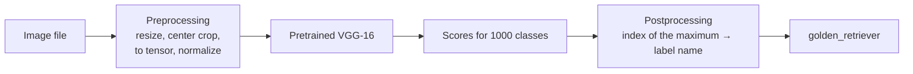
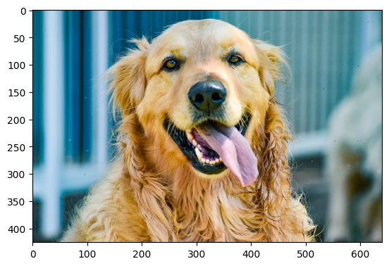
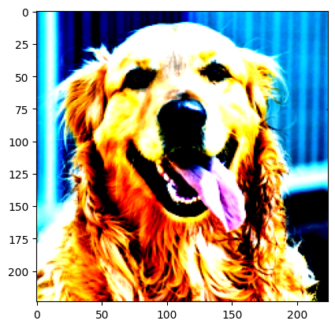

# Lecture 1 Lab — Image Classification with a Pretrained VGG-16

[Repository Guide](../../README.md) | [English](Concepts_Lab.md) | [한국어](Concepts_Lab.ko.md)

> **Last Updated:** 2026-11-04

> **Learning Objectives:**
> 1. Prepare the lab notebook and data on Colab and on a local computer, and explain the difference between a Google Drive path and a relative path
> 2. Load a VGG-16 trained on ImageNet with torchvision, and compute from the printed structure the size of the tensor after each layer
> 3. Explain how each preprocessing step (resizing, center cropping, tensor conversion, and normalization) changes the image
> 4. Map the model's 1000-dimensional output to label names with the ImageNet class index, and compute the probabilities of the top classes with softmax

---

## Table of Contents

- [1. Lab Overview and Preparation](#1-lab-overview-and-preparation)
  - [1.1 Flow of the Lab](#11-flow-of-the-lab)
  - [1.2 Files](#12-files)
  - [1.3 Preparing the Runtime Environment](#13-preparing-the-runtime-environment)
- [2. Importing Packages and Checking Versions](#2-importing-packages-and-checking-versions)
- [3. Loading the Pretrained VGG-16](#3-loading-the-pretrained-vgg-16)
  - [3.1 Creating the Model and Evaluation Mode](#31-creating-the-model-and-evaluation-mode)
  - [3.2 Structure of VGG-16 and Tensor Sizes](#32-structure-of-vgg-16-and-tensor-sizes)
- [4. Preprocessing the Input Image](#4-preprocessing-the-input-image)
  - [4.1 The Preprocessing Class](#41-the-preprocessing-class)
  - [4.2 How the Image Changes at Each Step](#42-how-the-image-changes-at-each-step)
  - [4.3 Checking the Preprocessing Result](#43-checking-the-preprocessing-result)
- [5. The ImageNet Class Index](#5-the-imagenet-class-index)
- [6. A Postprocessing Class That Turns Outputs into Labels](#6-a-postprocessing-class-that-turns-outputs-into-labels)
- [7. Predicting with the Pretrained VGG-16](#7-predicting-with-the-pretrained-vgg-16)
  - [7.1 Prediction Code](#71-prediction-code)
  - [7.2 Probabilities and the Top Five Classes](#72-probabilities-and-the-top-five-classes)
- [Summary](#summary)
- [Self-Check Questions](#self-check-questions)
- [References](#references)

---

<br>

## 1. Lab Overview and Preparation

### 1.1 Flow of the Lab

This lab loads a **VGG-16** model pretrained on the large image dataset **ImageNet** and classifies an unseen photo (a golden retriever) into one of 1,000 classes. Because the model is not trained here and the already trained weights are used as they are, only the forward computation (forward propagation) of the three steps in Lecture 1 is performed.



*Figure 1. Processing flow of the lab that classifies an image with a pretrained VGG-16*

> **Definition:** A **pretrained model** is a model trained in advance on a large dataset with its weights saved. It is used as it is for the same kind of task and serves as a starting point for further training on other tasks (transfer learning, Lectures 3-4).

**ImageNet** is a dataset that organizes millions of images according to the noun hierarchy of WordNet [1]. The image classification competition ILSVRC (ImageNet Large Scale Visual Recognition Challenge) uses 1,000 of its classes and about 1.28 million training images [2], and the pretrained VGG-16 provided by torchvision was trained on these 1,000 classes. **VGG-16** is a CNN that stacks 3×3 convolutions deeply, and it is named for its 16 layers with weights [3].

### 1.2 Files

The files used in the lab are in this unit folder as follows.

```text
Lec01_Deep-Learning-Fundamentals/
├── Example_Load-VGG.ipynb               lab notebook
└── data/
    ├── goldenretriever-3724972_640.jpg  golden retriever photo to classify (640×426)
    ├── imagenet_class_index.json        indices and names of the 1,000 ImageNet classes
    └── white_rabbit.png                 additional white rabbit photo to classify (707×560)
```

The notebook opens files with **relative paths** such as `data/goldenretriever-3724972_640.jpg`. A relative path is interpreted with respect to the current working directory, so the `data/` folder must be under the directory in which the notebook runs. In contrast, an **absolute path** written from the root (`/`), such as `/content/drive/MyDrive/...`, is tied to the folder structure of a particular computer and does not work in other environments.

### 1.3 Preparing the Runtime Environment

**Running on Colab.** Open Colab as in Section 8.1 of Lecture 1 and open the notebook. Since only inference with pretrained weights is done, a CPU runtime is enough, and a GPU runtime is faster. Prepare the data in one of the following two ways.

1. In the Files pane on the left, create a `data` folder and upload the three files to the session storage `/content/data/`. Colab's default working directory is `/content`, so the `data/...` paths work as they are.
2. If the unit folder has been uploaded to Google Drive, run the notebook's Drive connection cell and then move the working directory to the unit folder.

```python
%cd /content/drive/MyDrive/Lec01_Deep-Learning-Fundamentals
```

`%cd` is a Jupyter magic command that changes the kernel's working directory. Adjust the path to where the folder was uploaded on Drive.

**Running on a local computer.** Install the required packages and start JupyterLab in the unit folder.

```bash
pip install torch torchvision matplotlib pillow jupyterlab
cd Lecture-Notes/Lec01_Deep-Learning-Fundamentals
jupyter lab
```

> **Caution:** The notebook's `from google.colab import drive` cell works only on Colab. On a local computer it raises `ModuleNotFoundError`, so skip that cell. The first run downloads the pretrained weights of VGG-16 (about 528 MB), which requires an internet connection and some time.

> **Note:** The preparation cell at the top of the notebook says to download the data with `make_folders_and_data_downloads.ipynb` from the original book's example repository and to install PyTorch 1.0 and Matplotlib with conda. These instructions date from the PyTorch 1.0 era, so today follow the pip commands above or the installation guide on the PyTorch website (https://pytorch.org/get-started/locally/), and use the three files in the `data/` folder of Section 1.2.

---

<br>

## 2. Importing Packages and Checking Versions

```python
# import packages
import numpy as np
import json
from PIL import Image
import matplotlib.pyplot as plt
%matplotlib inline

import torch
import torchvision
from torchvision import models, transforms
```

| Line | What it does |
|:-----|:-----|
| `import numpy as np` | Imports the array library NumPy under the name `np`. It is used to find the position of the maximum in the model output. |
| `import json` | Used to read the class index file in JSON format. |
| `from PIL import Image` | Imports the `Image` module of the Pillow library, which opens image files. |
| `import matplotlib.pyplot as plt` | Imports Matplotlib, which draws images on screen. |
| `%matplotlib inline` | A Jupyter magic command that shows plots directly below the cell output. |
| `import torch`, `import torchvision` | Imports the deep learning framework PyTorch and its computer vision extension torchvision. |
| `from torchvision import models, transforms` | Imports `models`, which provides pretrained models, and `transforms`, the image preprocessing tools. |

*Table 1. What each line of the import cell does*

```python
# check the PyTorch version
print("PyTorch Version: ",torch.__version__)
print("Torchvision Version: ",torchvision.__version__)
```

```text
PyTorch Version:  2.5.1+cu124
Torchvision Version:  0.20.1+cu124
```

`+cu124` means a GPU build made for CUDA 12.4. The version numbers can differ depending on the environment. The next cell connects Google Drive (Section 1.3), and running it prints `Mounted at /content/drive`.

```python
# connect Google Drive
from google.colab import drive
drive.mount('/content/drive')
```

---

<br>

## 3. Loading the Pretrained VGG-16

### 3.1 Creating the Model and Evaluation Mode

```python
# load the pretrained VGG-16 model
# the first run downloads the pretrained parameters, so it takes time

# create an instance of the VGG-16 model
use_pretrained = True  # use the pretrained parameters
net = models.vgg16(pretrained=use_pretrained)
net.eval()  # set to inference mode (evaluation mode)

# print the network structure of the model
print(net)
```

- `models.vgg16(pretrained=True)` builds the VGG-16 structure and fills it with weights trained on ImageNet. The weight file is downloaded only once and stored in a cache folder (`~/.cache/torch/hub/checkpoints/vgg16-397923af.pth`), and later runs read it from the cache. With `pretrained=False`, an untrained model with random weights is created.
- `net.eval()` switches the model to **evaluation mode**. Layers that behave differently in training and inference, such as dropout (Section 7.3 of Lecture 1), then behave as in inference. In evaluation mode dropout does not switch nodes off, so the same input always gives the same output. Use `net.train()` to switch back for training.
- `print(net)` prints the layers that make up the model in order.

With torchvision 0.13 or later, running this cell also prints the following warnings. The last two lines are the progress display of the first download of the weight file.

```text
UserWarning: The parameter 'pretrained' is deprecated since 0.13 and may be removed in the future, please use 'weights' instead.
UserWarning: Arguments other than a weight enum or `None` for 'weights' are deprecated since 0.13 and may be removed in the future. The current behavior is equivalent to passing `weights=VGG16_Weights.IMAGENET1K_V1`. You can also use `weights=VGG16_Weights.DEFAULT` to get the most up-to-date weights.
Downloading: "https://download.pytorch.org/models/vgg16-397923af.pth" to /root/.cache/torch/hub/checkpoints/vgg16-397923af.pth
100%|██████████| 528M/528M [00:06<00:00, 88.4MB/s]
```

Since torchvision 0.13, the `weights` argument, which selects the weights by name, is used instead of the `pretrained` argument [4]. As the warning says, the following code creates the same model as the code above.

```python
from torchvision.models import VGG16_Weights

net = models.vgg16(weights=VGG16_Weights.IMAGENET1K_V1)  # same weights as pretrained=True
net.eval()
```

### 3.2 Structure of VGG-16 and Tensor Sizes

The output of `print(net)` consists of three parts (part of the middle is omitted).

```text
VGG(
  (features): Sequential(
    (0): Conv2d(3, 64, kernel_size=(3, 3), stride=(1, 1), padding=(1, 1))
    (1): ReLU(inplace=True)
    (2): Conv2d(64, 64, kernel_size=(3, 3), stride=(1, 1), padding=(1, 1))
    (3): ReLU(inplace=True)
    (4): MaxPool2d(kernel_size=2, stride=2, padding=0, dilation=1, ceil_mode=False)
    (5): Conv2d(64, 128, kernel_size=(3, 3), stride=(1, 1), padding=(1, 1))
    ...
    (28): Conv2d(512, 512, kernel_size=(3, 3), stride=(1, 1), padding=(1, 1))
    (29): ReLU(inplace=True)
    (30): MaxPool2d(kernel_size=2, stride=2, padding=0, dilation=1, ceil_mode=False)
  )
  (avgpool): AdaptiveAvgPool2d(output_size=(7, 7))
  (classifier): Sequential(
    (0): Linear(in_features=25088, out_features=4096, bias=True)
    (1): ReLU(inplace=True)
    (2): Dropout(p=0.5, inplace=False)
    (3): Linear(in_features=4096, out_features=4096, bias=True)
    (4): ReLU(inplace=True)
    (5): Dropout(p=0.5, inplace=False)
    (6): Linear(in_features=4096, out_features=1000, bias=True)
  )
)
```

- **`features`:** the part that extracts features. `Conv2d(input channels, output channels, ...)` is a two-dimensional convolution layer, `ReLU` is the activation function, and `MaxPool2d` is a max pooling layer (convolution and pooling are covered in detail in Lecture 2). `inplace=True` means the result overwrites the input tensor to save memory.
- **`avgpool`:** adaptive average pooling, which averages so that the output is $7 \times 7$ whatever the height and width of the input. For a $224 \times 224$ input, the output of `features` is already $7 \times 7$, so the values pass through unchanged.
- **`classifier`:** three fully connected layers (`Linear`) responsible for classification. The last layer has 1,000 outputs, each the score (logit) of one ImageNet class. The two `Dropout(p=0.5)` layers switch off half of the nodes during training.

Every convolution layer has a $3 \times 3$ kernel, stride 1, and padding 1, so it preserves the height and width. Plugging into the output-size formula (Lecture 2) $\lfloor (n + 2p - f)/s \rfloor + 1$ gives $(224 + 2 - 3)/1 + 1 = 224$. Max pooling has a $2 \times 2$ kernel and stride 2, so it halves the size: $(224 - 2)/2 + 1 = 112$. The sizes as one $224 \times 224$ RGB image (batch size 1) passes through are as follows.

| Block | Layer indices | Composition | Output size (channels × height × width) |
|:-----|:-----|:-----|:-----|
| Input | | RGB image | 3 × 224 × 224 |
| Block 1 | 0-4 | 2 convolutions (64 channels), max pooling | 64 × 112 × 112 |
| Block 2 | 5-9 | 2 convolutions (128 channels), max pooling | 128 × 56 × 56 |
| Block 3 | 10-16 | 3 convolutions (256 channels), max pooling | 256 × 28 × 28 |
| Block 4 | 17-23 | 3 convolutions (512 channels), max pooling | 512 × 14 × 14 |
| Block 5 | 24-30 | 3 convolutions (512 channels), max pooling | 512 × 7 × 7 |
| avgpool | | Adaptive average pooling | 512 × 7 × 7 |
| Flatten | | Flattened to one dimension | 25088 |
| classifier | 0-6 | 3 fully connected layers | 4096 → 4096 → 1000 |

*Table 2. Tensor sizes as a 224×224 image passes through each block of VGG-16*

$512 \times 7 \times 7 = 25088$ matches `in_features=25088` of the first fully connected layer. The layers with weights are 13 convolutions and 3 fully connected layers, 16 in total. The convolution layers have 14,714,688 parameters and the fully connected layers 123,642,856, for a total of 138,357,544 (about 138 million), most of them concentrated in the first fully connected layer ($25088 \times 4096$).

---

<br>

## 4. Preprocessing the Input Image

### 4.1 The Preprocessing Class

A pretrained model works properly only when it receives input in the same format as during training. VGG-16 was trained on images cropped to $224 \times 224$ and normalized with the mean and standard deviation of ImageNet, so a new image is transformed the same way.

```python
# preprocessing class for the input image
class BaseTransform():
    """
    Resizes the image and standardizes its colors.

    Attributes
    ----------
    resize : int
        Target size of the resized image.
    mean : (R, G, B)
        Mean of each color channel.
    std : (R, G, B)
        Standard deviation of each color channel.
    """

    def __init__(self, resize, mean, std):
        self.base_transform = transforms.Compose([
            transforms.Resize(resize),  # the shorter side becomes resize long
            transforms.CenterCrop(resize),  # crop the center to resize × resize
            transforms.ToTensor(),  # convert to a Torch tensor
            transforms.Normalize(mean, std)  # standardize the color values
        ])

    def __call__(self, img):
        return self.base_transform(img)
```

- `transforms.Compose([...])` creates a single transform that applies several transforms one after another in the order of the list.
- `transforms.Resize(resize)` resizes the image, keeping its aspect ratio, so that the **shorter side** becomes `resize` long. Given a single integer it works on the shorter side; given a `(height, width)` tuple it resizes to exactly that size.
- `transforms.CenterCrop(resize)` cuts a `resize × resize` square out of the center of the image.
- `transforms.ToTensor()` converts a PIL image (height × width × channels, integers 0-255) into a PyTorch tensor (channels × height × width, real numbers 0.0-1.0). The order of the axes changes and the values are divided by 255.
- `transforms.Normalize(mean, std)` computes $x' = (x - \text{mean})/\text{std}$ for each channel.
- Because the `__call__` method is defined, the object can be called like a function: `transform(img)`.

### 4.2 How the Image Changes at Each Step

The golden retriever photo (width 640, height 426) goes through the steps as follows.

| Step | Result | Computation |
|:-----|:-----|:-----|
| Original | PIL image 640 × 426 (width × height), RGB | |
| `Resize(224)` | PIL image 336 × 224 | Shorter side 426 → 224, longer side $\lfloor 640 \times 224/426 \rfloor = \lfloor 336.5 \rfloor = 336$ |
| `CenterCrop(224)` | PIL image 224 × 224 | $(336 - 224)/2 = 56$ pixels cut from each side horizontally |
| `ToTensor()` | Tensor `[3, 224, 224]`, values 0.0-1.0 | Each value ÷ 255, axes reordered to (channels, height, width) |
| `Normalize(mean, std)` | Tensor `[3, 224, 224]`, values from about −2.1 to 2.6 | $(x - \text{mean})/\text{std}$ per channel |

*Table 3. Results of each preprocessing step applied to the golden retriever photo*

`mean = (0.485, 0.456, 0.406)` and `std = (0.229, 0.224, 0.225)` are the per-channel means and standard deviations of R, G, and B computed over the ImageNet training images, the values shared by the pretrained models of torchvision [5]. For example, an orange pixel with color (255, 128, 0) changes as follows.

$$
\text{ToTensor: } \left(\frac{255}{255}, \frac{128}{255}, \frac{0}{255}\right) = (1.000, 0.502, 0.000)
$$

$$
\text{Normalize: } \left(\frac{1.000 - 0.485}{0.229}, \frac{0.502 - 0.456}{0.224}, \frac{0.000 - 0.406}{0.225}\right) \approx (2.249, 0.205, -1.804)
$$

The normalized values range from $(0 - 0.485)/0.229 \approx -2.118$ to $(1 - 0.485)/0.229 \approx 2.249$ in the R channel and from $-1.804$ to $2.640$ in the B channel. Normalization stabilizes training by bringing the values of each channel near mean 0 and standard deviation 1, and a pretrained model must receive input normalized with exactly the same values as during training.

> **Note:** The standard preprocessing for VGG-16 given in the torchvision documentation resizes the shorter side to 256 and then crops the central 224×224 region [5]. Resizing the shorter side to 224 and then cropping 224×224, as the notebook does, keeps a wider region of the original. Both approaches are used; the predicted class is usually the same, but the probabilities can differ slightly.

### 4.3 Checking the Preprocessing Result

```python
# check how image preprocessing works

# 1. read the image
image_file_path = 'data/goldenretriever-3724972_640.jpg'
img = Image.open(image_file_path)  # [height][width][color RGB]

# 2. show the original image
plt.imshow(img)
plt.show()

# 3. preprocess the image and show the processed image
resize = 224
mean = (0.485, 0.456, 0.406)
std = (0.229, 0.224, 0.225)
transform = BaseTransform(resize, mean, std)
img_transformed = transform(img)  # torch.Size([3, 224, 224])

# convert (color, height, width) to (height, width, color), clip the values to 0-1, and show
img_transformed = img_transformed.numpy().transpose((1, 2, 0))
img_transformed = np.clip(img_transformed, 0, 1)
plt.imshow(img_transformed)
plt.show()
```

- `Image.open(image_file_path)` opens the image file as a PIL image. Converted to an array, it is in height × width × color (RGB) order.
- `plt.imshow(img)` and `plt.show()` display the image with axis ticks.
- `img_transformed.numpy()` converts the tensor to a NumPy array, and `.transpose((1, 2, 0))` reorders the axes from (channels, height, width) to the (height, width, channels) that Matplotlib requires. Axis 0 of the new array is original axis 1 (height), axis 1 is original axis 2 (width), and axis 2 is original axis 0 (channels).
- `np.clip(img_transformed, 0, 1)` replaces values below 0 with 0 and values above 1 with 1. The normalized values include negative values and values above 1, but Matplotlib displays real-valued images in the 0-1 range.



*Figure 2. The original golden retriever photo (640×426)*



*Figure 3. The photo cropped to 224×224, normalized, and clipped to 0-1 for display*

Figure 3 is the central part of Figure 2 cut out as a square. The colors look too bright and too contrasty because the image is shown with its value range changed by normalization; the values actually fed to the model are the normalized values before clipping.

---

<br>

## 5. The ImageNet Class Index

```python
# read the ILSVRC label information into a dictionary
ILSVRC_class_index = json.load(open('data/imagenet_class_index.json', 'r'))
ILSVRC_class_index
```

`json.load` reads a JSON file into a Python dictionary. Writing only a variable name on the last line, as here, makes Jupyter show its value as the cell's result. The content has the following form.

```text
{'0': ['n01440764', 'tench'],
 '1': ['n01443537', 'goldfish'],
 '2': ['n01484850', 'great_white_shark'],
 ...
 '207': ['n02099601', 'golden_retriever'],
 ...
 '999': ['n15075141', 'toilet_tissue']}
```

- The keys are the class numbers 0-999 written as **strings**. They tell which class each position of the model output stands for.
- The values are lists `[WordNet ID, label name]`. A WordNet ID (such as `n02099601`) is an identifier in the WordNet noun hierarchy that ImageNet used to define its classes.
- Many of the 1,000 classes are fine-grained animal breeds (for example, there are more than 100 dog breeds alone), and the classes corresponding to rabbits are `'330': wood_rabbit`, `'331': hare`, and `'332': Angora`.

---

<br>

## 6. A Postprocessing Class That Turns Outputs into Labels

```python
# postprocessing class that predicts a label from the output
class ILSVRCPredictor():
    """
    Obtains a label from the model's output for ILSVRC data.

    Attributes
    ----------
    class_index : dictionary
            Dictionary mapping class indices to label names.
    """

    def __init__(self, class_index):
        self.class_index = class_index

    def predict_max(self, out):
        """
        Gets the ILSVRC label name with the highest probability.

        Parameters
        ----------
        out : torch.Size([1, 1000])
            Output of the network.

        Returns
        -------
        predicted_label_name : str
            Label name with the highest predicted probability
        """
        maxid = np.argmax(out.detach().numpy())
        predicted_label_name = self.class_index[str(maxid)][1]

        return predicted_label_name
```

- `__init__` stores the class index dictionary of Section 5 in the object.
- `out.detach()` detaches the output tensor from the gradient computation record, because a tensor that tracks gradients cannot be converted to a NumPy array directly. `.numpy()` then converts it to a NumPy array.
- `np.argmax(...)` returns the position (index) of the largest value in the array. An array of size `[1, 1000]` is treated as flattened, so the result is one of 0-999.
- `self.class_index[str(maxid)][1]` converts the index to a string to use as a dictionary key and takes the second element of `[WordNet ID, label name]`, the label name.

The last layer of the model has no softmax, so the output is logits, not probabilities. However, softmax does not change the order of magnitudes (Section 3.3 of Lecture 1), so the class with the largest logit is also the class with the largest probability. That is why the function name and its description say "highest probability".

---

<br>

## 7. Predicting with the Pretrained VGG-16

### 7.1 Prediction Code

```python
# read the ILSVRC label information into a dictionary
ILSVRC_class_index = json.load(open('data/imagenet_class_index.json', 'r'))

# create an ILSVRCPredictor instance
predictor = ILSVRCPredictor(ILSVRC_class_index)

# read the input image
image_file_path = 'data/goldenretriever-3724972_640.jpg'
img = Image.open(image_file_path)  # [height][width][color RGB]

# after preprocessing, add the batch-size dimension
transform = BaseTransform(resize, mean, std)  # create the preprocessing object
img_transformed = transform(img)  # torch.Size([3, 224, 224])
inputs = img_transformed.unsqueeze_(0)  # torch.Size([1, 3, 224, 224])

# feed the model and convert its output to a label
out = net(inputs)  # torch.Size([1, 1000])
print(out)
max_index = out.argmax(dim=1).item()  # return the index of the maximum value
result = predictor.predict_max(out)

# print the prediction and the index of the maximum
print(f"입력 화상의 예측 결과: {result} (index: {max_index})")
```

- `img_transformed.unsqueeze_(0)` adds an axis of size 1 at position 0, turning `[3, 224, 224]` into `[1, 3, 224, 224]`. PyTorch models take four-dimensional input (batch, channels, height, width) so that they can process several images at once, so even a single image needs a batch axis. The trailing `_` in the name marks an in-place operation that modifies the original tensor.
- `net(inputs)` performs forward propagation and returns logits of size `[1, 1000]`.
- `out.argmax(dim=1)` finds the index of the maximum along axis 1 (the class axis), and `.item()` converts a one-element tensor to a Python integer. It obtains the same index as `predictor.predict_max(out)` in another way.

The output is as follows (most of the 1,000 logits are omitted). The Korean text in the last line means "prediction for the input image".

```text
tensor([[-1.5478e+00, -1.0093e+00, -2.8853e+00, -3.0570e+00, -3.2550e+00,
         ...
         -3.4034e-01,  2.6514e-01, -8.0120e-01,  4.8085e+00,  2.1334e+00]],
       grad_fn=<AddmmBackward0>)
입력 화상의 예측 결과: golden_retriever (index: 207)
```

The logit at index 207 is the largest, and `'207'` in the class index is `golden_retriever`, so the model correctly classifies the photo as a golden retriever. `grad_fn=<AddmmBackward0>` indicates that this tensor keeps an operation record for gradient computation (it comes from `addmm`, the matrix multiplication and addition of the last fully connected layer).

> **Note:** The last line of the output stored in the notebook is `(인덱스: 207)` ("index" in Korean), but the cell's code prints the word `index`, so running the current code prints `(index: 207)`.

### 7.2 Probabilities and the Top Five Classes

Prediction needs no gradients, so running forward propagation inside `torch.no_grad()` keeps no operation record and saves memory and time. Applying softmax to the logits gives the probability of each class, and `torch.topk` shows the few classes with the largest probabilities. The following code can be run right after the notebook's prediction code.

```python
with torch.no_grad():                         # forward pass without recording gradients
    out = net(inputs)                         # [1, 1000] logits

probs = torch.softmax(out, dim=1)             # softmax over the class axis: probabilities summing to 1
top5 = torch.topk(probs, 5, dim=1)            # the 5 largest probabilities and their indices
for p, i in zip(top5.values[0], top5.indices[0]):
    print(f"{ILSVRC_class_index[str(i.item())][1]}: {p.item():.4f}")
```

In the same way, changing `image_file_path` to `'data/white_rabbit.png'` classifies the white rabbit photo. ImageNet has no separate "white rabbit" class, so the model picks one of the rabbit classes `wood_rabbit`, `hare`, and `Angora` or another class that looks similar. Viewing the top five classes with their probabilities shows which classes the model hesitates between.

> **Caution:** A PNG file can be an RGBA (four-channel) image that includes a transparency channel. Applying the three-channel `Normalize` to such an image fails because the numbers of channels do not match, so convert it to three channels with `Image.open(path).convert('RGB')` before preprocessing. The `white_rabbit.png` of this lab is an RGB image.

---

<br>

## Summary

| Concept | Key Summary |
|:-----|:----------|
| Pretrained model | Weights trained on the 1,000 ImageNet classes are downloaded, and new images are classified by forward propagation alone, without training. |
| Path preparation | The notebook uses relative paths `data/...`, so a `data/` folder must be under the working directory. On Colab, upload to `/content` or connect Drive and move with `%cd`. |
| `models.vgg16` | `pretrained=True` (or `weights=VGG16_Weights.IMAGENET1K_V1`) loads the pretrained weights, and `eval()` switches to evaluation mode with dropout off. |
| Structure of VGG-16 | 3×3 convolutions (padding 1) keep the size and 2×2 max pooling halves it, taking 224 down to 7, and the $512 \times 7 \times 7 = 25088$ values pass through three fully connected layers to become 1,000 logits. There are about 138 million parameters. |
| Preprocessing | Set the shorter side to 224, crop the central 224×224, convert to a (channels, height, width) tensor in 0-1, and normalize with the per-channel ImageNet mean and standard deviation. |
| Batch axis | The model takes (batch, channels, height, width) input, so `unsqueeze_(0)` makes `[1, 3, 224, 224]`. |
| Postprocessing | The index of the maximum logit is turned into a string key to look up the label name in the class index dictionary. The golden retriever photo is classified as class 207, `golden_retriever`. |
| Probabilities | Softmax does not change the order, so the maximum logit is the maximum probability; when probabilities are needed, use `torch.softmax` and `torch.topk`. |

---

<br>

## Self-Check Questions

1. **Relative paths:** What is gained by changing the notebook's paths from `/content/drive/MyDrive/.../data/...` to `data/...`, and what must be checked before running?

   <details>
   <summary>Answer</summary>

   An absolute path is tied to the folder structure of a particular Drive account and does not work for other people or on a local computer, whereas a relative path works anywhere as long as the notebook and the `data/` folder are moved together. Before running, check that the `data/` folder with its three files is under the kernel's working directory.

   </details>

2. **Evaluation mode:** What can happen if the same image is predicted twice without calling `net.eval()`?

   <details>
   <summary>Answer</summary>

   The model stays in training mode, so the two `Dropout(p=0.5)` layers of `classifier` randomly switch off half of the nodes each time. The output logits then differ from run to run for the same input, and the predicted class may even change.

   </details>

3. **Tensor sizes:** If a $256 \times 256$ image is fed to VGG-16 instead of $224 \times 224$, what are the output sizes of `features` and `avgpool`?

   <details>
   <summary>Answer</summary>

   The convolutions keep the size and the five max poolings halve it each time, $256 \to 128 \to 64 \to 32 \to 16 \to 8$, so the output of `features` is $512 \times 8 \times 8$. `avgpool` adjusts its output to $7 \times 7$, giving $512 \times 7 \times 7$, so the fully connected layers still work.

   </details>

4. **Resize and CenterCrop:** For a portrait photo of width 300 and height 600, what are the sizes after `Resize(224)` and then `CenterCrop(224)`, and how many pixels are cut from the top and bottom?

   <details>
   <summary>Answer</summary>

   The shorter side (width 300) becomes 224, so the height becomes $\lfloor 600 \times 224/300 \rfloor = 448$, giving width 224 and height 448. `CenterCrop(224)` cuts $(448 - 224)/2 = 112$ pixels from both the top and the bottom, leaving $224 \times 224$.

   </details>

5. **Normalization:** What are the G-channel values of a black pixel (0, 0, 0) and a white pixel (255, 255, 255) after `ToTensor` and `Normalize`?

   <details>
   <summary>Answer</summary>

   After `ToTensor`, the G values are 0 and 1. Normalizing with the G-channel mean 0.456 and standard deviation 0.224 gives $(0 - 0.456)/0.224 \approx -2.036$ and $(1 - 0.456)/0.224 \approx 2.429$.

   </details>

6. **Batch axis and postprocessing:** What happens if `unsqueeze_(0)` is removed and the `[3, 224, 224]` tensor is fed to the model as it is? And why is `str(maxid)` needed in `predict_max`?

   <details>
   <summary>Answer</summary>

   `Conv2d` can treat a three-dimensional input without a batch axis as a single image, but after `features`, `torch.flatten(x, 1)` flattens from axis 1, so the channel axis is treated like a batch axis and the input size of the fully connected layer no longer matches 25088, causing an error. Model input should always be shaped (batch, channels, height, width). `str(maxid)` is needed because the keys of the dictionary read from JSON are strings such as `'207'`, so the integer 207 cannot find the key.

   </details>

---

<br>

## References

1. J. Deng, W. Dong, R. Socher, L.-J. Li, K. Li, and L. Fei-Fei, "ImageNet: A Large-Scale Hierarchical Image Database," in *Proc. IEEE Conf. Computer Vision and Pattern Recognition (CVPR)*, pp. 248-255, 2009.
2. O. Russakovsky et al., "ImageNet Large Scale Visual Recognition Challenge," *International Journal of Computer Vision*, vol. 115, no. 3, pp. 211-252, 2015.
3. K. Simonyan and A. Zisserman, "Very Deep Convolutional Networks for Large-Scale Image Recognition," in *Proc. Int. Conf. Learning Representations (ICLR)*, 2015.
4. PyTorch, "Models and pre-trained weights," *Torchvision Documentation*, accessed Nov. 4, 2026. https://docs.pytorch.org/vision/stable/models.html
5. PyTorch, "vgg16," *Torchvision Documentation*, accessed Nov. 4, 2026. https://docs.pytorch.org/vision/stable/models/generated/torchvision.models.vgg16.html
