# 1강 — 딥러닝 기초

[레포지토리 안내](../../README.ko.md) | [English](Concepts_Lecture.md) | [한국어](Concepts_Lecture.ko.md)

> **최종 수정일:** 2026-11-04

> **학습 목표:**
> 1. 인공지능, 기계학습, 딥러닝의 포함 관계와 지도학습, 비지도학습, 강화학습의 차이를 설명하고, 영상, 소리, 텍스트 응용을 태스크와 모델로 나누어 설명할 수 있다
> 2. 인공 뉴런의 가중합과 편향, 주요 활성화 함수의 식과 도함수를 쓰고, 활성화 함수가 비선형이어야 하는 이유를 수식으로 보일 수 있다
> 3. 시그모이드와 소프트맥스 출력에 대해 평균 제곱 오차와 교차 엔트로피 손실을 계산할 수 있다
> 4. 경사하강법의 갱신 규칙과 학습률의 영향을 설명하고, 연쇄 법칙으로 작은 신경망의 역전파를 끝까지 계산할 수 있다
> 5. 훈련, 검증, 테스트 데이터셋의 역할, 과적합을 줄이는 방법, 배치 크기, 에포크, 이터레이션, 하이퍼파라미터를 구분하여 설명할 수 있다
> 6. Colab, Jupyter, PyTorch, Docker가 딥러닝 개발 환경에서 맡는 역할을 설명할 수 있다

---

## 목차

- [1. 인공지능 응용](#1-인공지능-응용)
  - [1.1 4차 산업혁명과 인공지능](#11-4차-산업혁명과-인공지능)
  - [1.2 영상, 소리, 텍스트의 응용 사례](#12-영상-소리-텍스트의-응용-사례)
  - [1.3 응용, 태스크, 모델, 네트워크](#13-응용-태스크-모델-네트워크)
  - [1.4 인공지능, 기계학습, 딥러닝](#14-인공지능-기계학습-딥러닝)
  - [1.5 지도학습, 비지도학습, 강화학습](#15-지도학습-비지도학습-강화학습)
- [2. 신경망](#2-신경망)
  - [2.1 생물학적 뉴런과 인공 뉴런](#21-생물학적-뉴런과-인공-뉴런)
  - [2.2 입력층, 은닉층, 출력층](#22-입력층-은닉층-출력층)
  - [2.3 신경망의 입력과 출력: 개와 고양이 분류](#23-신경망의-입력과-출력-개와-고양이-분류)
  - [2.4 학습의 세 단계](#24-학습의-세-단계)
- [3. 활성화 함수](#3-활성화-함수)
  - [3.1 편향과 활성화 함수](#31-편향과-활성화-함수)
  - [3.2 활성화 함수의 종류](#32-활성화-함수의-종류)
  - [3.3 출력층의 활성화 함수: 시그모이드와 소프트맥스](#33-출력층의-활성화-함수-시그모이드와-소프트맥스)
  - [3.4 비선형성이 필요한 이유: 수식적 검증](#34-비선형성이-필요한-이유-수식적-검증)
  - [3.5 비선형성이 필요한 이유: 개념적 검증](#35-비선형성이-필요한-이유-개념적-검증)
- [4. 손실 함수](#4-손실-함수)
  - [4.1 오차 계산](#41-오차-계산)
  - [4.2 평균 제곱 오차](#42-평균-제곱-오차)
  - [4.3 교차 엔트로피와 focal loss](#43-교차-엔트로피와-focal-loss)
- [5. 경사하강법](#5-경사하강법)
  - [5.1 미분을 이용한 최적화](#51-미분을-이용한-최적화)
  - [5.2 학습률](#52-학습률)
  - [5.3 옵티마이저](#53-옵티마이저)
- [6. 오류 역전파](#6-오류-역전파)
  - [6.1 역전파의 아이디어](#61-역전파의-아이디어)
  - [6.2 예제 신경망의 순전파](#62-예제-신경망의-순전파)
  - [6.3 연쇄 법칙으로 기울기 분해하기](#63-연쇄-법칙으로-기울기-분해하기)
  - [6.4 출력층 가중치 하나의 갱신](#64-출력층-가중치-하나의-갱신)
  - [6.5 모든 가중치의 갱신과 역전파 1회의 결과](#65-모든-가중치의-갱신과-역전파-1회의-결과)
- [7. 학습 기초](#7-학습-기초)
  - [7.1 훈련, 검증, 테스트 데이터셋](#71-훈련-검증-테스트-데이터셋)
  - [7.2 과적합과 과소적합](#72-과적합과-과소적합)
  - [7.3 과적합을 줄이는 방법](#73-과적합을-줄이는-방법)
  - [7.4 배치 크기](#74-배치-크기)
  - [7.5 에포크와 이터레이션](#75-에포크와-이터레이션)
  - [7.6 파라미터와 하이퍼파라미터](#76-파라미터와-하이퍼파라미터)
- [8. 딥러닝 개발 환경](#8-딥러닝-개발-환경)
  - [8.1 Google Colab](#81-google-colab)
  - [8.2 Jupyter Notebook과 JupyterLab](#82-jupyter-notebook과-jupyterlab)
  - [8.3 딥러닝 프레임워크: PyTorch와 Keras](#83-딥러닝-프레임워크-pytorch와-keras)
  - [8.4 Docker](#84-docker)
- [개념 적용](#개념-적용)
- [요약](#요약)
- [점검 문제](#점검-문제)
- [참고 문헌](#참고-문헌)

---

<br>

## 1. 인공지능 응용

### 1.1 4차 산업혁명과 인공지능

산업혁명은 생산 방식을 근본적으로 바꾼 기술 변화를 말한다. 네 차례의 산업혁명은 다음과 같이 정리된다.

| 구분 | 시기 | 핵심 기술과 변화 |
|:-----|:-----|:-----|
| 1차 산업혁명 | 18세기 | 증기기관을 이용한 기계화 |
| 2차 산업혁명 | 19세기 ~ 20세기 초 | 전기 에너지를 이용한 대량 생산 |
| 3차 산업혁명 | 20세기 후반 | 컴퓨터와 인터넷을 이용한 정보화 |
| 4차 산업혁명 | 21세기 초반 | 인공지능, 빅데이터, 초연결을 이용한 지능화 |

*표 1. 네 차례의 산업혁명과 핵심 기술*

뒤의 산업혁명일수록 다음 혁명까지의 주기는 짧아지고, 기술이 미치는 범위와 영향력은 커진다. 4차 산업혁명의 중심에 있는 기술이 인공지능이며, 그중에서도 대량의 데이터로부터 스스로 특징을 학습하는 **딥러닝(deep learning)** 이 영상, 소리, 텍스트를 다루는 소프트웨어의 핵심 부품이 되었다. 이 과목은 딥러닝을 소프트웨어에 응용하는 방법을 다루며, 1강은 그 바탕이 되는 기초 개념을 정리한다.

### 1.2 영상, 소리, 텍스트의 응용 사례

인공지능의 응용은 다루는 데이터의 종류에 따라 영상, 소리, 텍스트로 나눌 수 있다. 하나의 응용은 여러 개의 태스크(task)를 조합하여 만들어진다.

| 분야 | 응용 예 | 응용을 이루는 태스크 |
|:-----|:-----|:-----|
| 영상 | 자율주행, 얼굴 인식 | 이미지 분류(image classification), 객체 탐지(object detection), 의미론적 분할(semantic segmentation) |
| 소리 | 스마트 스피커, TTS(text to speech) | 소리 분류(sound classification), 음성 인식(speech recognition), 소리 이벤트 탐지(sound event detection) |
| 텍스트 | 챗봇, 번역 | 텍스트 생성(text generation), 감성 분석(sentiment analysis), 질의응답(question answering) |

*표 2. 영상, 소리, 텍스트 분야의 응용과 태스크*

각 태스크는 입력과 출력의 형태로 정의된다.

| 태스크 | 입력 | 출력 |
|:-----|:-----|:-----|
| 이미지 분류 | 이미지 한 장 | 이미지 전체에 대한 클래스 하나 (예: 개) |
| 객체 탐지 | 이미지 한 장 | 이미지 안의 각 객체를 둘러싼 사각형(바운딩 박스)과 그 클래스 |
| 의미론적 분할 | 이미지 한 장 | 픽셀마다의 클래스 (예: 도로, 사람, 하늘) |
| 소리 분류 | 오디오 클립 | 클립 전체에 대한 클래스 하나 (예: 개 짖는 소리) |
| 음성 인식 | 음성 | 말한 내용의 텍스트 |
| 소리 이벤트 탐지 | 오디오 | 각 소리 이벤트의 클래스와 시작, 끝 시각 |
| 텍스트 생성 | 앞의 문맥 | 이어지는 텍스트 |
| 감성 분석 | 문장이나 문서 | 긍정, 부정 같은 감성 클래스 |
| 질의응답 | 질문 (필요하면 근거 문서) | 질문에 대한 답 |

*표 3. 대표적인 태스크의 입력과 출력*

여기서 **클래스(class)** 는 분류 결과로 나올 수 있는 범주 하나하나를 말한다. 영상 태스크는 3\~5강, 소리 태스크는 6강, 텍스트 태스크는 7\~8강에서 자세히 다룬다.

### 1.3 응용, 태스크, 모델, 네트워크

딥러닝 응용을 개발하는 과정은 네 단계의 선택으로 정리할 수 있다.


*그림 1. 응용에서 태스크, 모델, 네트워크로 이어지는 선택의 단계*

- **응용(application):** 사용자가 쓰는 서비스나 제품이다. 자율주행 자동차, 얼굴 인식 출입 시스템 등이 있다.
- **태스크(task):** 응용이 풀어야 하는 구체적인 문제이다. 자율주행은 보행자와 차량을 찾는 객체 탐지, 차선과 도로를 구분하는 의미론적 분할 등 여러 태스크로 나뉜다.
- **모델(model):** 태스크를 푸는 구체적인 신경망 설계이다. VGG, GoogLeNet, ResNet은 이미지 분류에서 좋은 성능을 보인 대표적인 모델이다(VGG는 1강 실습과 3강, ResNet은 3\~4강에서 다룬다).
- **네트워크(network):** 모델을 이루는 신경망의 기본 형식이다. **DNN(deep neural network)** 은 완전 연결층을 깊게 쌓은 신경망, **CNN(convolutional neural network)** 은 합성곱 연산을 쓰는 신경망, **RNN(recurrent neural network)** 은 순환 구조로 순서 있는 데이터를 처리하는 신경망이다. CNN과 RNN은 2강에서 다룬다.

> **핵심:** 응용 개발자는 응용을 태스크로 분해하고, 태스크에 맞는 모델을 고른다. 이 과목은 그중 가운데 두 단계, 즉 태스크를 정의하고 그에 맞는 모델을 이해하고 사용하는 방법에 초점을 둔다.

### 1.4 인공지능, 기계학습, 딥러닝

**인공지능(artificial intelligence, AI)** 은 인간의 지적 능력을 컴퓨터로 구현하는 기술 전체를 말한다. **기계학습(machine learning)** 은 그 일부로, 사람이 규칙을 직접 작성하는 대신 컴퓨터가 데이터로부터 스스로 학습하여 예측이나 판단을 하는 기술이다. **딥러닝**은 기계학습의 일부로, 층을 깊게 쌓은 인공 신경망을 사용하는 기계학습이다.

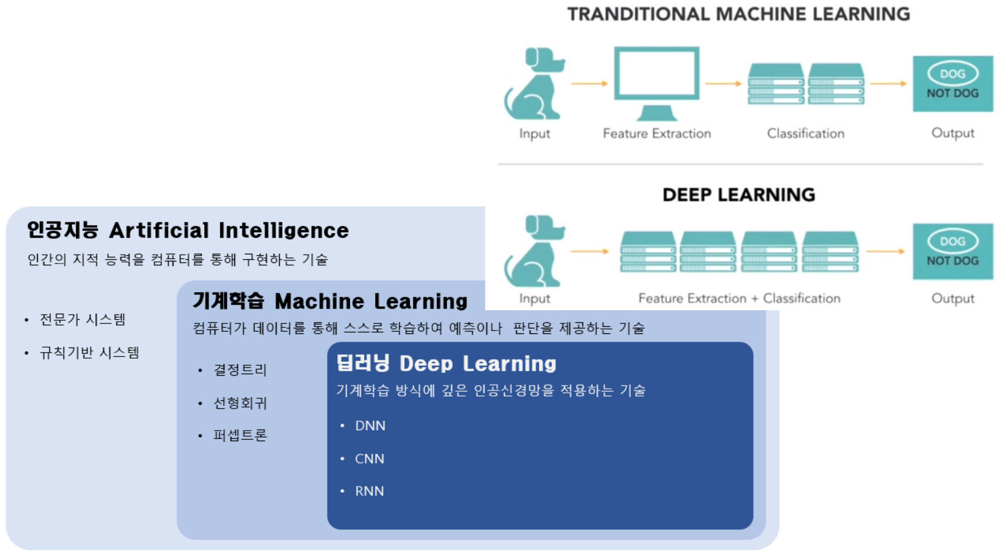

*그림 2. 인공지능, 기계학습, 딥러닝의 포함 관계와 전통적 기계학습과 딥러닝의 처리 과정 비교*

| 범주 | 정의 | 예 |
|:-----|:-----|:-----|
| 인공지능 | 인간의 지적 능력을 컴퓨터로 구현하는 기술 | 전문가 시스템, 규칙 기반 시스템 |
| 기계학습 | 컴퓨터가 데이터로 스스로 학습하여 예측이나 판단을 하는 기술 | 결정 트리, 선형 회귀, 퍼셉트론 |
| 딥러닝 | 기계학습 방식에 깊은 인공 신경망을 적용하는 기술 | DNN, CNN, RNN |

*표 4. 인공지능, 기계학습, 딥러닝의 정의와 예*

전통적 기계학습과 딥러닝은 **특징(feature)** 을 누가 만드는지에서 가장 크게 다르다. 특징은 입력에서 뽑아낸, 분류에 쓸모 있는 수치이다(예: 귀의 모양, 털의 색). 개 사진을 받아 "DOG"와 "NOT DOG" 중 하나를 출력하는 문제에서 두 방식의 처리 과정은 다음과 같다.

- **전통적 기계학습:** 입력 → 특징 추출 → 분류 → 출력. 사람이 어떤 특징을 쓸지 설계하고(특징 공학), 기계학습 모델은 주어진 특징으로 분류만 학습한다.
- **딥러닝:** 입력 → 특징 추출과 분류 → 출력. 하나의 깊은 신경망이 원시 입력(픽셀 값)에서 특징 추출과 분류를 함께 학습한다.

최근에는 이 구분이 덜 엄격하다. 큰 데이터셋으로 미리 학습한 딥러닝 모델이 뽑은 특징을 다른 모델의 입력으로 다시 쓰는 전이 학습(transfer learning, 3\~4강)이 보편화되었기 때문이다. 또한 은닉층(2.2절)이 하나 이하인 얕은 신경망은 복잡한 특징을 스스로 학습하기 어렵고, 은닉층이 둘 이상인 깊은 신경망은 데이터를 계층적으로 학습할 수 있다는 점에서 "깊다"는 말의 의미를 찾는 관점도 있다.

> **[기계학습]** 기계학습에서 배우는 결정 트리는 특성에 관한 질문을 차례로 적용하여 클래스를 예측하는 모델이고, 선형 회귀는 입력의 가중합으로 연속적인 값을 예측하는 모델이며, 퍼셉트론은 가중합에 계단 함수를 적용하여 두 클래스를 나누는 가장 단순한 신경망이다. 세 모델 모두 입력으로 쓸 특징이 미리 주어진다고 가정한다는 점에서 전통적 기계학습의 처리 과정에 속한다.

### 1.5 지도학습, 비지도학습, 강화학습

기계학습은 학습에 쓰는 신호의 종류에 따라 세 가지로 나뉜다.

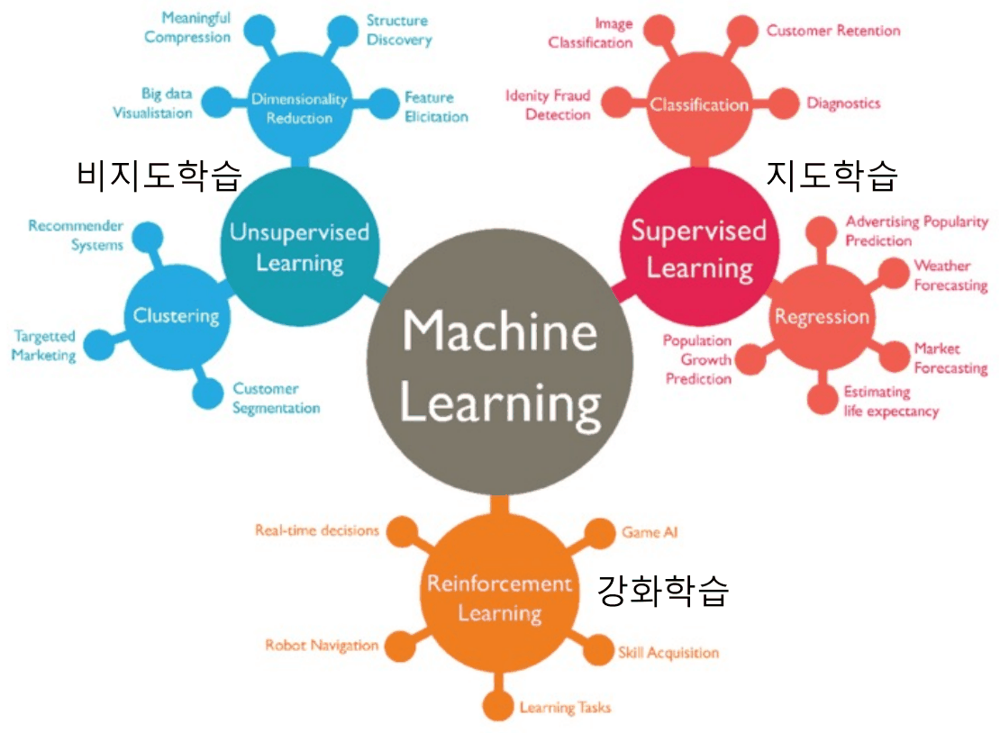

*그림 3. 비지도학습, 지도학습, 강화학습과 각각의 대표 태스크와 응용*

| 학습 방식 | 학습에 쓰는 신호 | 목표 | 대표 태스크와 응용 |
|:-----|:-----|:-----|:-----|
| **지도학습(supervised learning)** | 입력과 정답(레이블)의 쌍 | 입력에서 정답을 예측하는 함수 | 분류(이미지 분류, 고객 이탈 방지, 신원 사기 탐지, 진단), 회귀(광고 인기도 예측, 날씨 예보, 시장 예측, 기대 수명 추정, 인구 증가 예측) |
| **비지도학습(unsupervised learning)** | 정답이 없는 입력 | 데이터에 숨은 구조나 패턴 | 차원 축소(의미 있는 압축, 구조 발견, 빅데이터 시각화, 특징 추출), 군집화(추천 시스템, 표적 마케팅, 고객 세분화) |
| **강화학습(reinforcement learning)** | 환경과 상호작용하며 받는 보상과 벌점 | 누적 보상을 최대화하는 행동 | 실시간 의사결정, 게임 AI, 로봇 내비게이션, 기술 습득 |

*표 5. 세 가지 학습 방식의 비교*

**분류(classification)** 는 정해진 클래스 중 하나를 고르는 지도학습 태스크이고, **회귀(regression)** 는 기온이나 가격처럼 연속적인 수치를 예측하는 지도학습 태스크이다. **군집화(clustering)** 는 정답 없이 비슷한 데이터끼리 묶는 태스크이고, **차원 축소(dimensionality reduction)** 는 정보를 최대한 보존하면서 데이터를 더 적은 수의 변수로 표현하는 태스크이다.

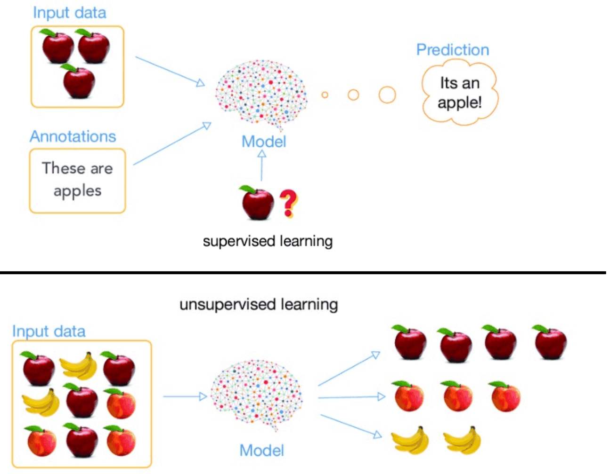

*그림 4. 사과 사진과 정답으로 학습하는 지도학습과 정답 없이 과일을 묶는 비지도학습*

그림 4의 위쪽은 지도학습이다. 사과 사진(입력 데이터)과 "These are apples"라는 정답(annotation)을 함께 주어 모델을 학습시키면, 모델은 처음 보는 사과 사진도 사과라고 예측한다. 아래쪽은 비지도학습이다. 사과, 복숭아, 바나나가 섞인 사진을 정답 없이 주면, 모델은 생김새가 비슷한 것끼리 사과 무리, 복숭아 무리, 바나나 무리로 묶는다. 모델은 각 무리의 이름은 모르고, 무리가 서로 다르다는 사실만 찾아낸다.

이후의 내용은 지도학습을 기준으로 한다.

---

<br>

## 2. 신경망

### 2.1 생물학적 뉴런과 인공 뉴런

딥러닝은 인간 뇌의 신경망 원리를 모방한 심층 신경망 이론에 기반을 둔 기계학습 방법이다. 인간의 뇌는 엄청난 수의 **뉴런(neuron)** 과 뉴런 사이의 연결인 **시냅스(synapse)** 로 이루어져 있으며, 인공 신경망은 이 두 개념을 컴퓨터에 옮긴 것이다.

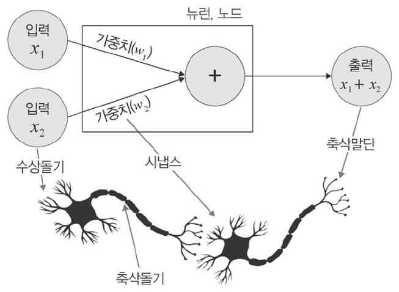

*그림 5. 생물학적 뉴런의 구조와 이를 본뜬 인공 뉴런*

| 생물학적 뉴런 | 하는 일 | 인공 뉴런의 대응 요소 |
|:-----|:-----|:-----|
| 수상돌기(dendrite) | 다른 뉴런이 보낸 신호를 받는다 | 입력 $x_1, x_2$ |
| 시냅스 | 신호가 전달되는 세기를 조절한다 | 가중치 $w_1, w_2$ |
| 세포체 | 받은 신호를 모으고, 일정 수준을 넘으면 발화한다 | 가중합과 활성화 함수 (3절) |
| 축삭돌기(axon)와 축삭말단 | 출력 신호를 다음 뉴런으로 보낸다 | 출력 |

*표 6. 생물학적 뉴런과 인공 뉴런의 대응*

그림 5의 인공 뉴런은 두 입력을 더해 $x_1 + x_2$를 출력하는 가장 단순한 경우를 그린 것이다. 일반적인 인공 뉴런은 각 입력에 가중치를 곱한 뒤 더한 **가중합(weighted sum)** $w_1x_1 + w_2x_2$를 계산한다. 가중치가 크면 그 입력이 출력에 크게 영향을 주고, 가중치가 음수이면 그 입력이 출력을 억제한다.

### 2.2 입력층, 은닉층, 출력층

인공 뉴런 하나를 **노드(node)** 라고도 한다. 신경망은 노드를 층(layer)으로 배열하고 이웃한 층의 노드를 연결선으로 이은 구조이며, 각 연결선에는 가중치가 하나씩 붙어 있다. 연결선의 가중치가 입력 노드의 값과 연산되어 결과 노드의 값을 만든다.

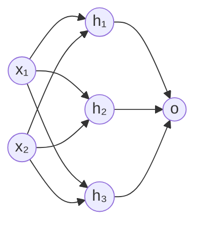

*그림 6. 입력층 노드 2개, 은닉층 노드 3개, 출력층 노드 1개로 이루어진 신경망*

- **입력층(input layer):** 데이터를 받아들이는 층이다. 입력 특징의 개수만큼 노드가 있다.
- **은닉층(hidden layer):** 입력층과 출력층 사이의 층으로, 바깥에서 값이 직접 보이지 않아 은닉층이라 부른다. 특징을 학습하는 층이며 여러 개를 둘 수 있다.
- **출력층(output layer):** 최종 결과를 내는 층이다. 이진 분류는 노드 1개, 다중 분류는 클래스 수만큼의 노드를 둔다(3.3절).

그림 6의 신경망에서 은닉층 노드 하나, 예를 들어 $h_1$은 입력 두 개를 받아 $w_1x_1 + w_2x_2$를 계산한다. 연결선은 입력층과 은닉층 사이에 $2 \times 3 = 6$개, 은닉층과 출력층 사이에 $3 \times 1 = 3$개이므로 가중치는 모두 9개이다. 은닉층이 2개 이상인 신경망을 딥러닝으로 보는 관점이 일반적이다.

### 2.3 신경망의 입력과 출력: 개와 고양이 분류

입력 사진이 개인지 고양이인지 분류하는 신경망을 생각한다. 개 사진이 입력되면 0, 고양이 사진이 입력되면 1을 출력하도록 정한다.

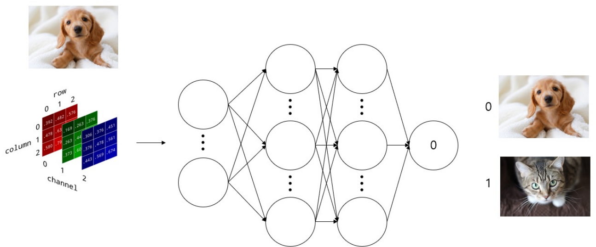

*그림 7. 이미지를 행, 열, 채널의 배열로 바꾸어 신경망에 넣고 개는 0, 고양이는 1을 출력하는 분류 모델*

컴퓨터는 모든 데이터를 숫자의 배열, 즉 **텐서(tensor)** 로 처리한다. 컬러 이미지는 행(row), 열(column), 채널(channel)의 3차원 배열이다. 채널은 빨강(R), 초록(G), 파랑(B)의 세 가지이고, 각 원소는 그 위치와 색의 밝기를 0\~255의 정수로 나타낸다. 그림 7의 작은 예는 행 3개, 열 3개, 채널 3개인 $3 \times 3 \times 3$ 배열이다. 이 배열의 값이 입력층으로 들어가 은닉층을 거치고, 출력층에서 0 또는 1에 가까운 값이 나온다.

학습 전의 신경망은 가중치가 임의의 값이라서 개 사진에도 0과 거리가 먼 값을 낼 수 있다. 수많은 개와 고양이 사진을 대상으로 개는 0, 고양이는 1이 나오도록 가중치를 조정하는 과정이 **학습(training)** 이다.

### 2.4 학습의 세 단계

기계적 관점에서 학습이란, 일련의 반복적인 과정을 통해 신경망의 출력이 원하는 기댓값에 점진적으로 수렴하도록 가중치를 바꾸어 가는 것을 의미한다. 신경망의 학습은 다음 세 과정의 반복으로 이루어진다.


*그림 8. 전방 계산, 오차 계산, 후방 가중치 갱신의 반복으로 이루어진 신경망 학습*

1. **전방 계산(forward computation):** 입력 $x_1, x_2$에서 출발하여 첫 번째 층의 가중치 $w_1^{(1)}, \dots, w_6^{(1)}$로 은닉 노드 $a_1, a_2, a_3$를 계산하고, 두 번째 층의 가중치 $w_1^{(2)}, w_2^{(2)}, w_3^{(2)}$로 출력 $out$(예측값)을 계산한다. 입력에서 출력 방향으로 진행하므로 **순전파(forward propagation)** 라고도 한다(3절, 6.2절).
2. **오차 계산(error computation):** 예측값 $out$과 정답 $y$(기댓값)의 차이를 손실 함수로 측정한다(4절).
3. **후방 가중치 갱신(backward weight update):** 오차를 줄이는 방향으로 출력층 쪽 가중치부터 입력층 쪽 가중치까지 거슬러 올라가며 가중치를 고친다. 각 가중치가 오차에 미친 영향을 계산하는 방법이 오류 역전파(6절)이고, 그 영향을 이용해 가중치를 고치는 방법이 경사하강법(5절)이다.

위첨자 $(1), (2)$는 몇 번째 층의 가중치인지를 나타낸다.

---

<br>

## 3. 활성화 함수

### 3.1 편향과 활성화 함수

인공 뉴런은 가중합에 **편향(bias)** $b$를 더한 값을 **활성화 함수(activation function)** $h$에 통과시켜 출력을 만든다.

$$
y = h(w_1x_1 + w_2x_2 + b)
$$

- **편향**은 뉴런이 얼마나 쉽게 활성화되는지를 조절한다. 직선의 절편처럼 작용하여, 모든 입력이 0이어도 뉴런이 0이 아닌 값을 낼 수 있게 하고, 모델이 데이터에 더 유연하게 맞추어지게 한다. 그림에서는 값이 항상 1인 입력에 가중치 $b$가 붙은 것으로 그리기도 한다.
- **활성화 함수**는 입력 신호의 총합 $a = w_1x_1 + w_2x_2 + b$를 출력 신호로 변환한다. 입력 신호의 총합이 뉴런의 활성화를 일으키는지를 정하는 역할을 한다.

예를 들어 $x_1 = 1$, $x_2 = 0.5$, $w_1 = 0.4$, $w_2 = -0.2$, $b = 0.1$이면 총합은 다음과 같다.

$$
a = 0.4 \times 1 + (-0.2) \times 0.5 + 0.1 = 0.4 - 0.1 + 0.1 = 0.4
$$

활성화 함수가 시그모이드 $\sigma(a) = 1/(1+e^{-a})$이면 출력은 $\sigma(0.4) \approx 0.599$이다. 같은 입력과 가중치에서 편향만 $b = -1$로 바꾸면 $a = -0.7$이 되어 출력이 $\sigma(-0.7) \approx 0.332$로 내려간다. 편향이 작을수록(음수로 클수록) 뉴런을 활성화하려면 더 큰 입력 신호가 필요하다.

### 3.2 활성화 함수의 종류

대표적인 활성화 함수는 다음과 같다. 입력 신호의 총합을 $s$, 활성화 함수를 $\tau(s)$로 쓴다.

| 함수 | 식 $\tau(s)$ | 1차 도함수 $\tau'(s)$ | 출력 범위 |
|:-----|:-----|:-----|:-----|
| 계단 함수(step) | $s \ge 0$이면 $1$, $s < 0$이면 $-1$ | $s \ne 0$이면 $0$, $s = 0$에서 미분 불가 | $-1$과 $1$ |
| 로지스틱 시그모이드(logistic sigmoid) | $\dfrac{1}{1 + e^{-as}}$ | $a\tau(s)(1 - \tau(s))$ | $(0, 1)$ |
| 하이퍼볼릭 탄젠트 시그모이드(tanh) | $\dfrac{2}{1 + e^{-as}} - 1$ | $\dfrac{a}{2}(1 - \tau(s)^2)$ | $(-1, 1)$ |
| 소프트플러스(softplus) | $\log_e(1 + e^{s})$ | $\dfrac{1}{1 + e^{-s}}$ | $(0, \infty)$ |
| ReLU(rectified linear unit) | $\max(0, s)$ | $s < 0$이면 $0$, $s > 0$이면 $1$, $s = 0$에서 미분 불가 | $[0, \infty)$ |

*표 7. 대표적인 활성화 함수의 식, 도함수, 출력 범위*

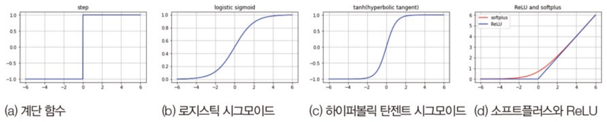

*그림 9. 계단 함수, 로지스틱 시그모이드, 하이퍼볼릭 탄젠트 시그모이드, 소프트플러스와 ReLU의 그래프*

$a$는 곡선의 기울기를 정하는 상수이며, 보통 $a = 1$을 쓴다. 이때 로지스틱 시그모이드를 $\sigma(s)$로 쓰고, 도함수 $\sigma'(s) = \sigma(s)(1 - \sigma(s))$를 다음과 같이 유도한다.

$$
\sigma(s) = (1 + e^{-s})^{-1} \quad\Rightarrow\quad \sigma'(s) = -(1 + e^{-s})^{-2} \cdot (-e^{-s}) = \frac{e^{-s}}{(1 + e^{-s})^2} = \frac{1}{1 + e^{-s}} \cdot \frac{e^{-s}}{1 + e^{-s}} = \sigma(s)\,(1 - \sigma(s))
$$

마지막 등호는 $\dfrac{e^{-s}}{1 + e^{-s}} = 1 - \dfrac{1}{1 + e^{-s}} = 1 - \sigma(s)$이기 때문이다. 이 도함수는 $s = 0$에서 최댓값 $0.5 \times 0.5 = 0.25$를 가지며, 이 성질은 깊은 신경망에서 기울기가 점점 작아지는 문제(2강 3.6절과 3강 5절의 기울기 소실)와 관련된다. 하이퍼볼릭 탄젠트 시그모이드는 $\dfrac{2}{1 + e^{-as}} - 1 = \tanh(as/2)$이므로, $a = 2$일 때 보통의 $\tanh(s)$와 같다.

몇 개의 입력에서 함수값을 계산하면 다음과 같다($a = 1$이고, tanh는 보통의 $\tanh(s)$이다).

| $s$ | 시그모이드 | tanh | 소프트플러스 | ReLU |
|:-----:|:-----:|:-----:|:-----:|:-----:|
| $-2$ | 0.119 | −0.964 | 0.127 | 0 |
| $0$ | 0.5 | 0 | 0.693 | 0 |
| $2$ | 0.881 | 0.964 | 2.127 | 2 |

*표 8. 세 입력값에서 계산한 활성화 함수의 값*

시그모이드는 출력이 0과 1 사이이므로 이진 분류 문제의 최종 출력층에 많이 쓰인다. 예를 들어 최종 출력값이 0.5 미만이면 개, 0.5 이상이면 고양이로 분류할 수 있다. ReLU는 계산이 간단하고 양수 구간의 도함수가 1이어서 기울기가 작아지지 않으므로, 깊은 신경망의 은닉층에 널리 쓰인다 [1].

### 3.3 출력층의 활성화 함수: 시그모이드와 소프트맥스

최종 출력층에는 문제의 종류에 따라 다음 두 함수가 많이 쓰인다.

- **시그모이드(sigmoid):** 출력이 0과 1 사이가 되게 한다. **이진 분류(binary classification)** 에서 출력 노드 1개에 쓰며, 출력값을 한쪽 클래스일 확률로 해석하고 보통 0.5를 임계값으로 둔다.
- **소프트맥스(softmax):** 출력 노드 $K$개의 값을 모두 0과 1 사이로 정규화하며, 출력값의 총합은 항상 1이다. **다중 분류(multi-class classification)** 에서 클래스 수만큼의 출력 노드에 쓰며, 가장 큰 확률의 클래스를 예측값으로 고른다.

소프트맥스는 출력층의 값 $z_1, \dots, z_K$를 다음과 같이 변환한다.

$$
\text{softmax}(z)_i = \frac{e^{z_i}}{\sum_{j=1}^{K} e^{z_j}}, \qquad i = 1, \dots, K
$$

활성화 함수를 적용하기 전의 출력층 값 $z_i$를 **로짓(logit)** 이라고 한다. 예를 들어 개, 고양이, 닭의 세 클래스에 대한 로짓이 $z = (2.0, 1.0, 0.1)$이면 다음과 같이 계산한다.

| 단계 | 개 | 고양이 | 닭 | 합 |
|:-----|:-----:|:-----:|:-----:|:-----:|
| 로짓 $z_i$ | 2.0 | 1.0 | 0.1 | |
| $e^{z_i}$ | 7.389 | 2.718 | 1.105 | 11.213 |
| $e^{z_i} / 11.213$ | 0.659 | 0.242 | 0.099 | 1.000 |

*표 9. 로짓 (2.0, 1.0, 0.1)에 소프트맥스를 적용하는 과정*

지수 함수는 항상 양수이므로 모든 출력이 양수이고, 분모가 분자들의 합이므로 출력의 합은 1이다. 또한 지수 함수는 증가 함수이므로 로짓의 크기 순서가 확률의 크기 순서로 그대로 유지된다.

| 문제 | 출력 노드 | 출력층 함수 | 출력의 예 |
|:-----|:-----|:-----|:-----|
| 이진 분류 (개 또는 고양이) | 1개 | 시그모이드 | 0.07 (고양이일 확률, 즉 개일 확률 0.93) |
| 다중 분류 (개, 고양이, 닭) | 3개 | 소프트맥스 | 개일 확률 0.73, 고양이일 확률 0.19, 닭일 확률 0.08 |

*표 10. 강아지 사진을 입력했을 때 출력층 함수에 따른 출력의 예*

> **참고:** 표 10과 같은 출력을 설명하면서 활성화 함수에 들어가는 값을 22.5와 (32.8, 12.3, −1.2)처럼 크게 적기도 하지만, 이 값에 시그모이드와 소프트맥스를 실제로 적용하면 각각 1.0000과 (1.0000, 0.0000, 0.0000)에 가까워져 표 10의 확률과 맞지 않는다. 0.07을 주는 로짓은 약 −2.59이고, (0.73, 0.19, 0.08)을 주는 로짓의 예는 (2.21, 0.86, 0)이다.

> **참고:** 소프트맥스는 모든 로짓에 같은 상수를 더해도 결과가 변하지 않는다. 분자와 분모에 같은 $e^{c}$가 곱해지기 때문이다. 실제 구현은 이 성질을 이용해 가장 큰 로짓을 뺀 뒤 지수를 계산하여 수치가 넘치는 것을 막는다. 또한 클래스가 두 개인 소프트맥스는 두 로짓의 차이에 시그모이드를 적용한 것과 같다.

### 3.4 비선형성이 필요한 이유: 수식적 검증

**선형 함수(linear function)** 는 직선 하나로 표현할 수 있는 함수 $f(x) = ax + b$이고, **비선형 함수(nonlinear function)** 는 직선 하나로는 표현할 수 없는 함수이다. 신경망의 활성화 함수로는 비선형 함수를 사용해야 한다. 활성화 함수로 선형 함수를 쓰면 신경망의 층을 깊게 하는 의미가 없어지기 때문이다. 활성화 함수가 없거나 선형 함수이면 은닉층을 몇 층 거쳐도 결과가 하나의 선형 변환과 같아진다.

입력 $x_1$ 하나, 은닉 노드 둘($a_1, a_2$), 그다음 층의 노드 $b_1$으로 이루어진 신경망에서 활성화 함수가 선형 함수 $h(x) = cx$라고 하자.

$$
a_1 = h(w_1^{(1)}x_1) = cw_1^{(1)}x_1, \qquad a_2 = h(w_2^{(1)}x_1) = cw_2^{(1)}x_1
$$

$$
\begin{aligned}
b_1 &= h(w_1^{(2)}a_1 + w_2^{(2)}a_2) = cw_1^{(2)}a_1 + cw_2^{(2)}a_2 \\
&= c^2w_1^{(1)}w_1^{(2)}x_1 + c^2w_2^{(1)}w_2^{(2)}x_1 \\
&= \left(c^2w_1^{(1)}w_1^{(2)} + c^2w_2^{(1)}w_2^{(2)}\right)x_1
\end{aligned}
$$

괄호 안은 $x_1$과 무관한 상수이다. 따라서 이 두 층짜리 신경망은 가중치를 $w_1^{(1)} \to cw_1^{(1)}w_1^{(2)} + cw_2^{(1)}w_2^{(2)}$로 바꾼 한 층짜리 신경망 $b_1 = h\left((cw_1^{(1)}w_1^{(2)} + cw_2^{(1)}w_2^{(2)})x_1\right)$과 같은 함수를 계산한다. 예를 들어 $c = 1$, $w_1^{(1)} = 2$, $w_2^{(1)} = 3$, $w_1^{(2)} = 4$, $w_2^{(2)} = 5$이면 $b_1 = (2 \cdot 4 + 3 \cdot 5)x_1 = 23x_1$로, 가중치 23인 연결선 하나와 구별할 수 없다.

같은 논리는 노드와 층이 많아도 성립한다. 층 $l$의 가중치를 행렬 $W_l$, 편향을 벡터 $\mathbf{b}_l$로 쓰면 활성화 함수가 없는 두 층의 계산은 다음과 같다.

$$
W_2(W_1\mathbf{x} + \mathbf{b}_1) + \mathbf{b}_2 = (W_2W_1)\mathbf{x} + (W_2\mathbf{b}_1 + \mathbf{b}_2) = W'\mathbf{x} + \mathbf{b}'
$$

층을 아무리 쌓아도 하나의 행렬 $W'$과 벡터 $\mathbf{b}'$으로 된 한 층과 같다. 비선형 활성화 함수를 층 사이에 넣어야 이 합쳐짐이 일어나지 않고, 층을 쌓을수록 더 복잡한 함수를 표현할 수 있다.

> **[선형대수학]** 선형대수학에서 배우는 선형 변환의 합성은 다시 선형 변환이며, 그 행렬은 두 행렬의 곱 $W_2W_1$이다. 행렬 곱은 결합 법칙을 만족하므로 선형 변환을 $n$번 합성해도 행렬 하나 $W_n \cdots W_2W_1$로 표현된다. 위의 식은 신경망의 층이 선형이면 이 성질 때문에 깊이가 의미를 잃는다는 것을 보인다.

### 3.5 비선형성이 필요한 이유: 개념적 검증

개념적으로는 데이터를 나누는 경계의 모양으로 비선형성의 필요성을 이해할 수 있다.

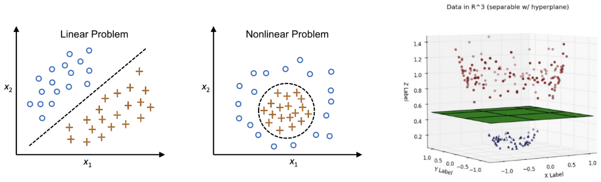

*그림 10. 직선으로 나뉘는 선형 문제, 원으로 나뉘는 비선형 문제, 3차원으로 옮기면 평면으로 나뉘는 데이터*

- **선형 문제(linear problem):** 왼쪽 그림의 원(○)과 십자(+)는 점선 하나로 나뉜다. 선형 모델로 충분하다.
- **비선형 문제(nonlinear problem):** 가운데 그림에서는 십자 표시가 원 모양 경계의 안쪽에, 원 표시가 바깥쪽에 있다. 어떤 직선도 두 무리를 나눌 수 없다.
- **고차원으로의 변환:** 오른쪽 그림처럼 데이터를 3차원 공간으로 옮기면 두 무리가 높이로 갈라져 초평면(초록색 평면) 하나로 나뉜다. 예를 들어 각 점 $(x_1, x_2)$에 세 번째 좌표 $x_1^2 + x_2^2$을 덧붙이면 원 안쪽의 점은 높이가 낮고 바깥쪽의 점은 높이가 높으므로, 높이 $r^2$의 평면이 둘을 나눈다($r$은 원 경계의 반지름).

현실의 데이터는 직선으로 깔끔하게 나뉘지 않는 경우가 대부분이다. 비선형 활성화 함수를 가진 은닉층은 입력을 이처럼 분리하기 쉬운 공간으로 옮기는 변환을 데이터로부터 학습한다.

고전적인 예는 두 입력이 서로 다를 때만 1인 XOR 문제이다. 네 점 (0, 0), (1, 1)은 0이고 (0, 1), (1, 0)은 1이어서 직선 하나로 나눌 수 없지만, 비선형 함수(여기서는 $s \ge 0$이면 1, $s < 0$이면 0을 내는 계단 함수 $u$)를 쓴 은닉층 하나로 풀린다. 은닉 노드를 $h_1 = u(x_1 + x_2 - 0.5)$, $h_2 = u(x_1 + x_2 - 1.5)$, 출력을 $y = u(h_1 - h_2 - 0.5)$로 두면 다음과 같다.

| $x_1$ | $x_2$ | $h_1$ | $h_2$ | $y$ |
|:-----:|:-----:|:-----:|:-----:|:-----:|
| 0 | 0 | $u(-0.5) = 0$ | $u(-1.5) = 0$ | $u(-0.5) = 0$ |
| 0 | 1 | $u(0.5) = 1$ | $u(-0.5) = 0$ | $u(0.5) = 1$ |
| 1 | 0 | $u(0.5) = 1$ | $u(-0.5) = 0$ | $u(0.5) = 1$ |
| 1 | 1 | $u(1.5) = 1$ | $u(0.5) = 1$ | $u(-0.5) = 0$ |

*표 11. 비선형 은닉층 하나로 XOR을 계산하는 과정*

$h_1$은 "적어도 하나가 1", $h_2$는 "둘 다 1"을 뜻하므로, $y$는 "적어도 하나가 1이지만 둘 다 1은 아님", 즉 XOR이다.

---

<br>

## 4. 손실 함수

### 4.1 오차 계산

학습의 두 번째 단계는 오차 계산이다. 신경망의 출력 벡터(예측값) $\mathbf{o}$가 정답 벡터(참값) $\mathbf{y}$와 같을수록 모델이 데이터를 잘 인식한 것이다. 둘이 다르면 $\mathbf{o}$와 $\mathbf{y}$가 가까워지도록 모델의 가중치를 갱신해야 하며, 오차가 클수록 갱신하는 양도 크다.

- **이진 분류:** 입력 벡터 $x_1, \dots, x_n$을 받은 모델이 출력값 $o$ 하나를 낸다. $o < 0.5$이면 개, 그렇지 않으면 고양이로 판단한다.
- **다중 분류:** 모델이 클래스 수 $c$만큼의 출력 $o_1, \dots, o_c$로 이루어진 예측 벡터를 낸다. 정답은 정답 클래스의 자리만 1이고 나머지는 0인 정답 벡터(label vector) $y_1, \dots, y_c$로 나타낸다.

| 출력 노드 | 예측 벡터 $\mathbf{o}$ | 정답 벡터 $\mathbf{y}$ (개가 정답일 때) |
|:-----|:-----:|:-----:|
| $o_1$: 개일 확률 | 0.8 | 1 |
| $o_k$: 고양이일 확률 | 0.1 | 0 |
| $o_c$: 닭일 확률 | 0.1 | 0 |

*표 12. 개 사진에 대한 다중 분류의 예측 벡터와 정답 벡터*

> **용어 정의:** 한 자리만 1이고 나머지가 모두 0인 벡터를 **원-핫 벡터(one-hot vector)** 라고 한다. 다중 분류의 정답 벡터는 정답 클래스의 자리만 1인 원-핫 벡터이다.

### 4.2 평균 제곱 오차

**손실 함수(loss function)** 는 딥러닝 모델의 출력값과 정답 사이의 오차(loss)를 하나의 수로 나타내는 함수이다. 손실 값을 최소화하는 가중치와 편향을 찾는 것이 딥러닝 학습의 목표이다. 대표적인 손실 함수로 평균 제곱 오차(MSE), 교차 엔트로피(cross-entropy), focal loss 등이 있다.

**평균 제곱 오차(mean squared error, MSE)** 는 정답 $y_i$와 예측값 $\hat{y}_i$의 차이를 제곱하여 평균한 값이다.

$$
\text{MSE} = \frac{1}{N}\sum_{i=1}^{N}\left(y_i - \hat{y}_i\right)^2
$$

4.1절의 예에서 예측 $\hat{\mathbf{y}} = (0.8, 0.1, 0.1)$과 정답 $\mathbf{y} = (1, 0, 0)$의 MSE는 다음과 같다($N = 3$).

$$
\text{MSE} = \frac{(1 - 0.8)^2 + (0 - 0.1)^2 + (0 - 0.1)^2}{3} = \frac{0.04 + 0.01 + 0.01}{3} = 0.02
$$

예측이 $(0.3, 0.4, 0.3)$으로 나빠지면 $\text{MSE} = (0.49 + 0.16 + 0.09)/3 \approx 0.247$로 커진다. 차이를 제곱하므로 큰 오차에 더 큰 벌점을 주고, 오차의 부호와 관계없이 손실은 0 이상이다. 6절처럼 $1/N$ 대신 $1/2$을 곱한 제곱 오차 합을 쓰기도 하는데, 미분했을 때 지수 2와 $1/2$이 상쇄되어 식이 간단해지기 때문이다. MSE는 주로 연속적인 값을 예측하는 회귀에 쓰인다.

### 4.3 교차 엔트로피와 focal loss

**교차 엔트로피(cross-entropy)** 는 분류에 가장 널리 쓰이는 손실 함수이다. 정답 벡터 $\mathbf{y}$와 예측 확률 벡터 $\mathbf{o}$에 대해 다음과 같이 정의한다.

$$
L_{\text{CE}} = -\sum_{k=1}^{c} y_k \log o_k
$$

정답 벡터가 원-핫 벡터이면 정답 클래스 $t$의 항만 남아 $L_{\text{CE}} = -\log o_t$가 된다. 위의 예에서 정답(개)의 예측 확률이 0.8이면 $-\ln 0.8 \approx 0.223$이고, 0.3이면 $-\ln 0.3 \approx 1.204$이다. 정답 확률이 1에 가까우면 손실이 0에 가깝고, 0에 가까우면 손실이 한없이 커진다. 따라서 확신을 가지고 틀린 예측에 매우 큰 벌점을 준다.

이진 분류에서 출력 $o$를 클래스 1의 확률로 보면, 교차 엔트로피는 다음 **이진 교차 엔트로피(binary cross-entropy)** 가 된다.

$$
L_{\text{BCE}} = -\left[y\log o + (1 - y)\log(1 - o)\right]
$$

정답이 $y = 1$이면 $-\log o$, $y = 0$이면 $-\log(1 - o)$만 남는다. 예를 들어 개(0)와 고양이(1)를 가르는 시그모이드 출력이 개 사진에 대해 $o = 0.07$이면 $L_{\text{BCE}} = -\ln(1 - 0.07) = -\ln 0.93 \approx 0.073$이다.

**focal loss**는 교차 엔트로피에 $(1 - p_t)^{\gamma}$를 곱하여, 이미 잘 맞히는 쉬운 예제의 손실을 줄이고 어려운 예제에 학습을 집중시킨다 [2]. 여기서 $p_t$는 정답 클래스의 예측 확률이고 $\gamma \ge 0$은 조절 계수이다.

$$
L_{\text{FL}} = -(1 - p_t)^{\gamma}\log p_t
$$

$\gamma = 2$일 때, $p_t = 0.8$인 쉬운 예제는 $(0.2)^2 \times 0.223 \approx 0.0089$로 교차 엔트로피의 1/25이 되지만, $p_t = 0.3$인 어려운 예제는 $(0.7)^2 \times 1.204 \approx 0.590$으로 절반 정도만 줄어든다. $\gamma = 0$이면 교차 엔트로피와 같다. focal loss는 배경처럼 쉬운 예제가 압도적으로 많은 객체 탐지(5강)를 위해 제안되었다.

| 손실 함수 | 식 | 주된 용도 |
|:-----|:-----|:-----|
| 평균 제곱 오차 | $\frac{1}{N}\sum (y_i - \hat{y}_i)^2$ | 회귀 |
| 교차 엔트로피 | $-\sum y_k \log o_k$ | 분류 (소프트맥스, 시그모이드 출력과 함께) |
| focal loss | $-(1 - p_t)^{\gamma}\log p_t$ | 클래스 불균형이 심한 분류, 객체 탐지 |

*표 13. 대표적인 손실 함수의 식과 용도*

---

<br>

## 5. 경사하강법

### 5.1 미분을 이용한 최적화

손실을 가중치의 함수 $J(\theta)$로 보면, 학습은 $J(\theta)$를 최소로 만드는 $\theta$를 찾는 **최적화(optimization)** 문제이다. 접선의 기울기, 즉 미분값은 그 점에서 함수가 어느 방향으로 얼마나 빨리 변하는지에 관한 정보를 담고 있다.

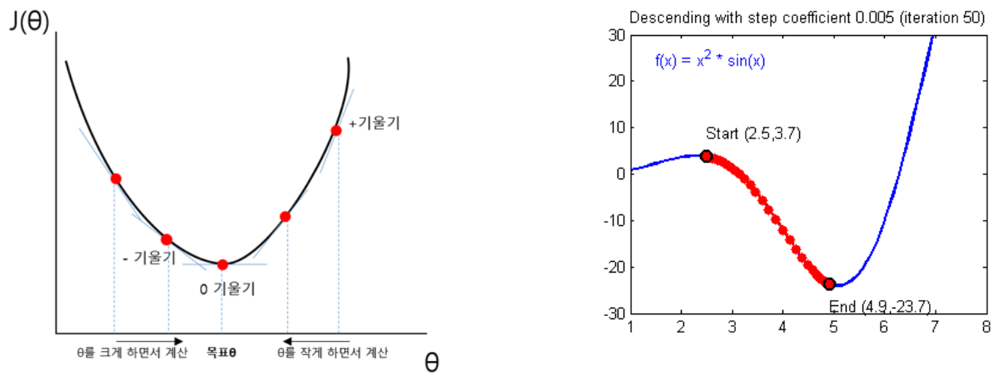

*그림 11. 접선의 기울기로 최솟값의 방향을 찾는 원리와 함수 x² sin x에서 경사하강법이 극솟값으로 내려가는 경로*

- 왼쪽 그래프에서 최솟값의 왼쪽은 기울기가 음수이고 오른쪽은 양수이며, 최솟값(목표 $\theta$)에서는 기울기가 0이다. 기울기가 음수이면 $\theta$를 크게 하고, 양수이면 $\theta$를 작게 하는 방향으로 이동하면 최솟값에 다가간다.
- 함수의 최솟값을 구하려면 미분하여 기울기가 0인 지점을 찾으면 된다. 그러나 신경망의 손실 함수는 가중치가 수백만 개인 복잡한 함수라서 기울기가 0이 되는 식을 한 번에 풀 수 없다. 또한 기울기가 0인 지점이 여러 개이고, 그중 극솟값이 최솟값이라는 보장도 없다.
- 그래서 현재 위치의 기울기를 계산하고 기울기의 반대 방향으로 조금씩 이동하기를 반복한다. 이 방법이 **경사하강법(gradient descent)** 이다. 접선의 기울기가 크면 더 크게 갱신한다.

$$
\theta \leftarrow \theta - \eta\,\frac{\partial J}{\partial \theta}
$$

$\eta$는 한 번에 이동하는 정도를 정하는 양수이다(5.2절). 오른쪽 그래프는 $f(x) = x^2\sin x$에 경사하강법을 적용한 예이다. 시작점 $(2.5, 3.7)$에서 출발하여 골짜기를 따라 내려가며(그래프에는 50번 반복한 뒤의 위치가 $x = 4.9$ 부근으로 표시되어 있다), 반복을 계속하면 $x \approx 5.09$의 극소점 $(5.09, -24.08)$로 수렴한다. $x^2\sin x$는 $x$가 커질수록 더 깊은 골짜기가 계속 나타나므로, 이 점은 극솟값일 뿐 함수 전체의 최솟값이 아니다. 경사하강법은 출발점 근처의 극솟값으로 수렴할 수 있다.

**계산 예.** $J(w) = (w - 3)^2$에서 $w_0 = 0$, $\eta = 0.1$로 시작한다. 도함수는 $J'(w) = 2(w - 3)$이다.

| 반복 $k$ | $w_k$ | 기울기 $2(w_k - 3)$ | $w_{k+1} = w_k - 0.1 \times$ 기울기 |
|:-----:|:-----:|:-----:|:-----:|
| 0 | 0 | −6 | 0.6 |
| 1 | 0.6 | −4.8 | 1.08 |
| 2 | 1.08 | −3.84 | 1.464 |
| 3 | 1.464 | −3.072 | 1.7712 |
| 4 | 1.7712 | −2.4576 | 2.0170 |

*표 14. J(w) = (w − 3)²에 학습률 0.1로 경사하강법을 적용한 과정*

기울기가 음수이므로 $w$가 커지는 방향으로 움직이고, 최솟값 $w = 3$에 가까워질수록 기울기의 크기가 줄어 보폭도 줄어든다. 일반적으로 $w_{k+1} - 3 = (1 - 0.2)(w_k - 3)$이므로 $w_k = 3 - 3 \times 0.8^k$이며, $k$가 커지면 $w_k \to 3$이다.

> **[미적분학]** 미적분학에서 배우는 기울기(gradient) $\nabla J = \left(\frac{\partial J}{\partial \theta_1}, \dots, \frac{\partial J}{\partial \theta_n}\right)$는 각 변수에 대한 편미분을 모은 벡터이며, 함수값이 가장 빠르게 증가하는 방향을 가리킨다. 따라서 $-\nabla J$는 가장 빠르게 감소하는 방향이고, 경사하강법 $\boldsymbol{\theta} \leftarrow \boldsymbol{\theta} - \eta\nabla J$는 모든 가중치를 이 방향으로 동시에 조금 옮긴다.

### 5.2 학습률

최솟값으로 원활하게 수렴하려면 적절한 보폭(step size), 즉 **학습률(learning rate)** $\eta$가 필요하다.

$$
w \leftarrow w - \eta\,\frac{\partial L}{\partial w}
$$

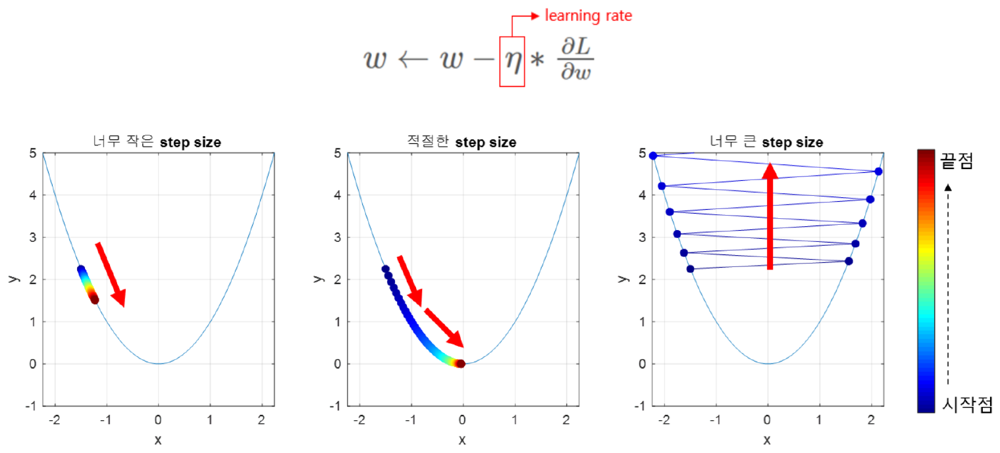

*그림 12. 학습률이 너무 작을 때, 적절할 때, 너무 클 때 y = x²에서 이동하는 경로*

그림 12의 점 색은 시작점(파랑)에서 끝점(빨강)으로 갈수록 변한다. 학습률이 너무 작으면 같은 횟수를 반복해도 최솟값까지 가지 못하고, 적절하면 최솟값에 도달하며, 너무 크면 최솟값을 지나쳐 골짜기의 양쪽을 오가며 점점 위로 튕겨 나간다(발산).

$f(w) = w^2$에서 이를 계산으로 확인할 수 있다. $f'(w) = 2w$이므로 갱신식은 $w \leftarrow w - \eta \cdot 2w = (1 - 2\eta)w$이다. $w_0 = 2$에서 다섯 번 갱신하면 다음과 같다.

| 학습률 $\eta$ | $1 - 2\eta$ | $w_1, w_2, \dots, w_5$ | 결과 |
|:-----:|:-----:|:-----|:-----|
| 0.01 | 0.98 | 1.96, 1.9208, 1.8824, 1.8447, 1.8078 | 너무 느리다 |
| 0.3 | 0.4 | 0.8, 0.32, 0.128, 0.0512, 0.0205 | 빠르게 수렴한다 |
| 0.9 | −0.8 | −1.6, 1.28, −1.024, 0.8192, −0.6554 | 양쪽을 오가며 수렴한다 |
| 1.1 | −1.2 | −2.4, 2.88, −3.456, 4.1472, −4.9766 | 발산한다 |

*표 15. f(w) = w²에서 학습률에 따른 경사하강법의 진행*

$w_k = (1 - 2\eta)^k w_0$이므로 $\lvert 1 - 2\eta \rvert < 1$, 즉 $0 < \eta < 1$일 때만 수렴한다. 이 범위는 $w^2$에 대한 것이며, 일반적인 손실 함수에서 허용되는 학습률의 크기는 함수가 얼마나 가파르게 휘는지(곡률)에 따라 달라진다.

### 5.3 옵티마이저

손실 함수의 최솟값을 찾아가는 구체적인 알고리즘을 **옵티마이저(optimizer)** 라고 하며, 여러 가지가 있다. 고전적인 확률적 경사하강법(SGD)과 모멘텀을 적용한 SGD의 갱신식은 다음과 같다($\rho$는 학습률, $\alpha$는 모멘텀 계수이다).

$$
\text{고전적 SGD: } \mathbf{w} \leftarrow \mathbf{w} - \rho\frac{\partial J}{\partial \mathbf{w}} \qquad\qquad \text{모멘텀 SGD: } \mathbf{v} \leftarrow \alpha\mathbf{v} - \rho\frac{\partial J}{\partial \mathbf{w}}, \quad \mathbf{w} \leftarrow \mathbf{w} + \mathbf{v}
$$

모멘텀의 $\mathbf{v}$는 이전 이동량을 $\alpha$(보통 0.9)만큼 남겨 둔 속도 벡터이다. 기울기의 방향이 계속 같으면 이동이 가속되고, 방향이 번갈아 바뀌면 서로 상쇄되어 진동이 줄어든다. 옵티마이저는 산을 내려오는 작은 오솔길을 잘 찾는 방법에 비유할 수 있으며, 다음과 같이 발전해 왔다.

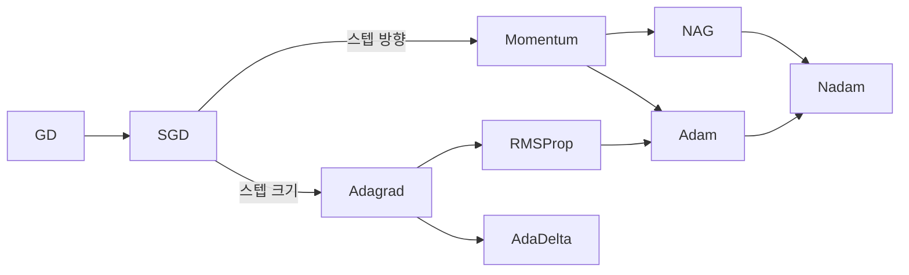

*그림 13. 이동 방향을 개선한 계열과 보폭을 개선한 계열로 나뉘는 옵티마이저의 발달 계보*

| 옵티마이저 | 아이디어 |
|:-----|:-----|
| GD (gradient descent) | 모든 학습 데이터를 다 검토하여 현재 위치의 기울기를 계산하고 갈 방향을 정한다. |
| SGD (stochastic gradient descent) | 전부 다 보고 한 걸음 가기는 너무 오래 걸리므로, 일부 데이터(미니 배치, 7.4절)만 보고 빨리 판단한다. 같은 시간에 더 많이 이동한다. |
| Momentum | 기울기로 계산한 걸음에 직전까지 내려오던 관성 방향을 더해 이동한다. |
| NAG (Nesterov accelerated gradient) | 관성 방향으로 먼저 움직인 뒤 그 자리에서 기울기를 계산하여, 지나치게 내달리는 것을 미리 바로잡는다. |
| Adagrad | 가중치마다 지금까지의 기울기 제곱을 누적하여, 많이 갱신된 가중치는 보폭을 줄여 세밀히 탐색하고 적게 갱신된 가중치는 크게 움직인다. |
| RMSProp | Adagrad처럼 보폭을 줄이되, 누적합 대신 최근 기울기 제곱의 지수 이동 평균을 써서 최근 상황에 맞게 조절한다. |
| AdaDelta | Adagrad의 보폭이 지나치게 작아져 학습이 멈추는 것을 막는다. |
| Adam | Momentum(방향)과 RMSProp(보폭)을 결합하여 방향과 보폭을 모두 적절히 조절한다. |
| Nadam | Adam에서 Momentum 대신 NAG를 사용한다. |

*표 16. 주요 옵티마이저의 아이디어*

안장점(saddle point)처럼 한 방향으로는 내려가고 다른 방향으로는 올라가는 곡면에서 여러 옵티마이저의 경로를 비교하면, SGD는 안장점 근처에서 오래 머무르고, Adagrad, AdaDelta, RMSProp처럼 가중치마다 보폭을 조절하는 방법은 빨리 벗어나며, Momentum과 NAG는 관성 때문에 크게 돌아서 벗어나는 경향을 보인다 [3].

현재 가장 널리 쓰이는 Adam은 기울기 $g_t$의 이동 평균 $m_t$(방향)와 기울기 제곱의 이동 평균 $v_t$(보폭)를 함께 유지한다 [4].

$$
m_t = \beta_1 m_{t-1} + (1 - \beta_1)g_t, \quad v_t = \beta_2 v_{t-1} + (1 - \beta_2)g_t^2, \quad \hat{m}_t = \frac{m_t}{1 - \beta_1^t}, \quad \hat{v}_t = \frac{v_t}{1 - \beta_2^t}, \quad w_t = w_{t-1} - \eta\frac{\hat{m}_t}{\sqrt{\hat{v}_t} + \epsilon}
$$

$\hat{m}_t, \hat{v}_t$는 0에서 시작한 이동 평균이 초기에 작게 치우치는 것을 보정한 값이며, 기본값은 $\beta_1 = 0.9$, $\beta_2 = 0.999$, $\epsilon = 10^{-8}$이다. $\sqrt{\hat{v}_t}$로 나누므로 기울기가 크게 출렁이는 가중치는 보폭이 줄어든다.

---

<br>

## 6. 오류 역전파

### 6.1 역전파의 아이디어

경사하강법을 쓰려면 모든 가중치 $w$에 대해 손실의 편미분 $\partial L/\partial w$를 알아야 한다. **오류 역전파(error backpropagation)** 는 이 편미분을 출력층에 가까운 가중치부터 입력층 쪽으로 거슬러 올라가며 차례로 계산하는 방법이다 [5]. 출력층 쪽에서 계산한 미분값을 그 앞층의 미분을 계산할 때 다시 쓰므로, 모든 가중치의 기울기를 순전파 한 번과 비슷한 계산량으로 구할 수 있다. 각 가중치는 구한 기울기로 다음과 같이 조금씩 변한다.

$$
w \leftarrow w - \eta\,\frac{\partial L}{\partial w}
$$

역전파는 다음 순서로 진행된다. 출력층에 직접 연결된 가중치가 오차에 미친 영향을 먼저 계산하고, 바로 앞 은닉층의 책임을 연쇄적으로 계산하며, 첫 번째 층까지 반복한다. 계산이 끝나면 모든 가중치가 최종 오차에 얼마나, 어떤 방향(부호)으로 기여했는지를 알게 된다.

### 6.2 예제 신경망의 순전파

다음 신경망으로 역전파를 처음부터 끝까지 계산한다. 입력은 $x_1 = 0.5$ 하나이고, 은닉층과 출력층에 노드가 2개씩 있으며, 출력 $y_1, y_2$의 목표값(정답)은 0.3과 0.9이다. 계산을 단순하게 하기 위해 편향은 두지 않는다.

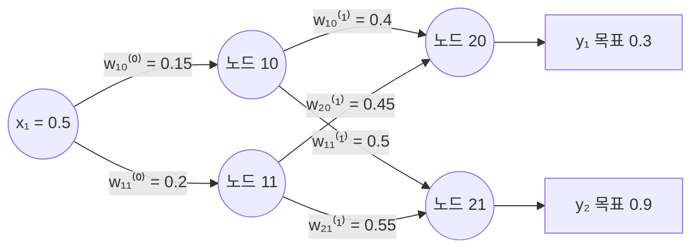

*그림 14. 입력 1개, 은닉 노드 2개, 출력 노드 2개로 이루어진 역전파 예제 신경망과 초기 가중치*

**표기.** 노드 $ij$는 $i$번째 층의 $j$번째 노드이다(은닉층은 노드 10, 11, 출력층은 노드 20, 21). 각 노드의 $z$는 들어오는 값의 가중합이고, $a = \sigma(z)$는 그 가중합에 시그모이드를 적용한 출력이다. 가중치 $w_{ij}^{(l)}$의 위첨자 $l$은 몇 번째 가중치 층인지, 아래첨자 $i$는 출발 노드가 그 층의 몇 번째(1이 위, 2가 아래)인지, $j$는 도착 노드의 번호(0이 위, 1이 아래)를 뜻한다. 예를 들어 $w_{20}^{(1)}$은 아래 은닉 노드(노드 11)에서 위 출력 노드(노드 20)로 가는 가중치이다.

순전파로 각 노드의 값을 계산하면 다음과 같다(소수 넷째 자리까지 반올림).

| 노드 | 가중합 $z$ | 출력 $a = \sigma(z)$ |
|:-----|:-----|:-----:|
| 10 | $z_{10} = 0.15 \times 0.5 = 0.075$ | $a_{10} = 0.5187$ |
| 11 | $z_{11} = 0.2 \times 0.5 = 0.1$ | $a_{11} = 0.5250$ |
| 20 | $z_{20} = 0.4 \times 0.5187 + 0.45 \times 0.5250 = 0.2075 + 0.2362 = 0.4437$ | $a_{20} = 0.6091$ |
| 21 | $z_{21} = 0.5 \times 0.5187 + 0.55 \times 0.5250 = 0.2594 + 0.2887 = 0.5481$ | $a_{21} = 0.6337$ |

*표 17. 예제 신경망의 순전파 결과*

출력 $y_1 = a_{20} = 0.6091$은 목표 0.3보다 크고, $y_2 = a_{21} = 0.6337$은 목표 0.9보다 작다. 전체 오차를 제곱 오차의 합에 $1/2$을 곱한 값으로 정의하면 다음과 같다.

$$
E_{tot} = \frac{1}{2}\left((target_{y1} - a_{20})^2 + (target_{y2} - a_{21})^2\right) = \frac{1}{2}\left((0.3 - 0.6091)^2 + (0.9 - 0.6337)^2\right) = \frac{1}{2}(0.0956 + 0.0709) \approx 0.0832
$$

### 6.3 연쇄 법칙으로 기울기 분해하기

가중치 $w_{10}^{(1)}$(노드 10에서 노드 20으로 가는 가중치)을 학습시키려면 $\partial E_{tot}/\partial w_{10}^{(1)}$이 필요하다. $w_{10}^{(1)}$은 $z_{20}$을 바꾸고, $z_{20}$은 $a_{20}$을 바꾸며, $a_{20}$은 $E_{tot}$을 바꾼다. 이 영향의 사슬을 따라 미분을 세 부분으로 나누는 것이 **연쇄 법칙(chain rule)** 이다.

$$
\frac{\partial E_{tot}}{\partial w_{10}^{(1)}} = \underbrace{\frac{\partial E_{tot}}{\partial a_{20}}}_{①} \cdot \underbrace{\frac{\partial a_{20}}{\partial z_{20}}}_{②} \cdot \underbrace{\frac{\partial z_{20}}{\partial w_{10}^{(1)}}}_{③}
$$

① **출력에 대한 오차의 변화율.** $E_{tot}$의 두 번째 항은 $a_{20}$을 포함하지 않으므로 미분하면 0이다. 첫 번째 항은 $\frac{1}{2}u^2$($u = target_{y1} - a_{20}$)의 미분 $u \cdot \frac{\partial u}{\partial a_{20}} = u \cdot (-1)$이다.

$$
\frac{\partial E_{tot}}{\partial a_{20}} = (target_{y1} - a_{20}) \cdot (-1) + 0 = -(target_{y1} - a_{20})
$$

② **가중합에 대한 출력의 변화율.** $a_{20} = \text{sigmoid}(z_{20})$이므로 3.2절의 시그모이드 도함수를 쓴다.

$$
\frac{\partial a_{20}}{\partial z_{20}} = \text{sigmoid}(z_{20}) \cdot (1 - \text{sigmoid}(z_{20})) = a_{20}(1 - a_{20})
$$

③ **가중치에 대한 가중합의 변화율.** $z_{20} = w_{10}^{(1)}a_{10} + w_{20}^{(1)}a_{11}$이고 두 번째 항은 $w_{10}^{(1)}$과 무관하다.

$$
\frac{\partial z_{20}}{\partial w_{10}^{(1)}} = a_{10} + 0 = a_{10}
$$

세 부분을 곱하면 다음 식을 얻는다.

$$
\frac{\partial E_{tot}}{\partial w_{10}^{(1)}} = -(target_{y1} - a_{20}) \cdot \text{sigmoid}(z_{20}) \cdot (1 - \text{sigmoid}(z_{20})) \cdot a_{10}
$$

> **[미적분학]** 미적분학에서 배우는 연쇄 법칙은 $y = f(u)$, $u = g(x)$일 때 $\frac{dy}{dx} = \frac{dy}{du}\cdot\frac{du}{dx}$라는 합성 함수의 미분 법칙이다. 변수가 여럿이면 $x$가 여러 경로로 $y$에 영향을 줄 때 경로마다의 곱을 모두 더한다. 6.5절에서 은닉 노드의 출력이 두 출력 노드에 동시에 영향을 주므로 두 경로의 기여를 더하는 것이 이 다변수 연쇄 법칙이다.

### 6.4 출력층 가중치 하나의 갱신

표 17의 값을 대입한다.

$$
\frac{\partial E_{tot}}{\partial w_{10}^{(1)}} = -(0.3 - 0.6091) \times 0.6091 \times (1 - 0.6091) \times 0.5187 = 0.3091 \times 0.2381 \times 0.5187 \approx 0.0382
$$

학습률을 $\eta = 0.5$로 두고 경사하강법으로 갱신하면 다음과 같다.

$$
w_{10}^{(1)+} = w_{10}^{(1)} - \eta\,\frac{\partial E_{tot}}{\partial w_{10}^{(1)}} = 0.4 - 0.5 \times 0.0382 = 0.3809
$$

$w_{10}^{(1)}$이 전체 오차에 미치는 영향은 0.0382이고, 갱신한 $w_{10}^{(1)+}$의 값은 0.3809이다. 기울기가 양수라는 것은 $w_{10}^{(1)}$을 늘리면 오차가 늘어난다는 뜻이다. 실제로 출력 $a_{20} = 0.6091$이 목표 0.3보다 크므로, 이 가중치를 줄여 $a_{20}$을 낮추는 것이 맞는 방향이다.

> **참고:** 중간값을 소수 셋째 자리에서 끊어($a_{20} = 0.609$, $a_{10} = 0.518$) 계산하면 기울기는 $0.309 \times 0.609 \times 0.391 \times 0.518 \approx 0.0381$이 되고, 갱신값은 $0.4 - 0.5 \times 0.0381 \approx 0.381$이다. 끊는 위치에 따라 마지막 자리가 조금 달라질 뿐 결과는 같다.

### 6.5 모든 가중치의 갱신과 역전파 1회의 결과

나머지 가중치도 같은 방법으로 계산한다. 식을 간단히 하기 위해 출력 노드의 **오차 신호(error signal)** $\delta$를 ①과 ②의 곱으로 정의한다.

$$
\delta_{20} = (a_{20} - target_{y1})\,a_{20}(1 - a_{20}) = 0.3091 \times 0.2381 \approx 0.0736, \qquad \delta_{21} = (a_{21} - target_{y2})\,a_{21}(1 - a_{21}) = (-0.2663) \times 0.2321 \approx -0.0618
$$

그러면 출력층 가중치의 기울기는 "도착 노드의 $\delta$ × 출발 노드의 출력"이다.

| 가중치 | 연결 | 기울기 $\partial E_{tot}/\partial w$ | 갱신 후 ($\eta = 0.5$) |
|:-----|:-----|:-----|:-----|
| $w_{10}^{(1)}$ | 노드 10 → 노드 20 | $\delta_{20}a_{10} = 0.0736 \times 0.5187 = 0.0382$ | $0.4 - 0.5 \times 0.0382 = 0.3809$ |
| $w_{20}^{(1)}$ | 노드 11 → 노드 20 | $\delta_{20}a_{11} = 0.0736 \times 0.5250 = 0.0386$ | $0.45 - 0.5 \times 0.0386 = 0.4307$ |
| $w_{11}^{(1)}$ | 노드 10 → 노드 21 | $\delta_{21}a_{10} = -0.0618 \times 0.5187 = -0.0321$ | $0.5 + 0.5 \times 0.0321 = 0.5160$ |
| $w_{21}^{(1)}$ | 노드 11 → 노드 21 | $\delta_{21}a_{11} = -0.0618 \times 0.5250 = -0.0325$ | $0.55 + 0.5 \times 0.0325 = 0.5662$ |

*표 18. 출력층 가중치 네 개의 기울기와 갱신값*

$y_2$는 목표보다 작으므로 노드 21로 들어가는 가중치의 기울기는 음수이고, 갱신하면 가중치가 커진다.

**은닉층으로 거슬러 올라가기.** 은닉 노드 10의 출력 $a_{10}$은 $z_{20}$과 $z_{21}$ 두 곳에 영향을 주므로, 두 경로의 기여를 더한다(다변수 연쇄 법칙).

$$
\frac{\partial E_{tot}}{\partial a_{10}} = \delta_{20}w_{10}^{(1)} + \delta_{21}w_{11}^{(1)} = 0.0736 \times 0.4 + (-0.0618) \times 0.5 = 0.0294 - 0.0309 \approx -0.00147
$$

여기에 시그모이드의 도함수 $a_{10}(1 - a_{10}) = 0.5187 \times 0.4813 \approx 0.2496$을 곱하면 은닉 노드 10의 오차 신호 $\delta_{10} \approx -0.000366$을 얻고, 입력 $x_1 = 0.5$를 곱하면 기울기가 된다.

$$
\frac{\partial E_{tot}}{\partial w_{10}^{(0)}} = \delta_{10}\,x_1 \approx -0.000366 \times 0.5 \approx -0.000183, \qquad w_{10}^{(0)+} = 0.15 + 0.5 \times 0.000183 \approx 0.1501
$$

은닉 노드 11도 같은 방법으로 $\delta_{20}w_{20}^{(1)} + \delta_{21}w_{21}^{(1)} = 0.0331 - 0.0340 \approx -0.00088$, $\delta_{11} \approx -0.00088 \times 0.2494 \approx -0.000219$, 기울기 $\approx -0.000109$이므로 $w_{11}^{(0)+} \approx 0.2001$이다. 은닉층의 기울기를 계산할 때는 갱신하기 전의 출력층 가중치(0.4, 0.5, 0.45, 0.55)를 쓴다. 역전파는 모든 기울기를 먼저 계산한 뒤 가중치를 한꺼번에 갱신하기 때문이다.

> **핵심:** 역전파의 일반 규칙은 세 줄로 요약된다. 출력 노드의 오차 신호는 $\delta = (a - target)\,\sigma'(z)$, 은닉 노드의 오차 신호는 $\delta_j = \left(\sum_k \delta_k w_{jk}\right)\sigma'(z_j)$(다음 층의 오차 신호를 가중치로 거꾸로 모은 값), 가중치의 기울기는 "도착 노드의 $\delta$ × 출발 노드의 출력"이다. 출력층에서 시작하여 $\delta$를 한 층씩 뒤로 전달하므로 역전파라고 부른다.

갱신한 가중치로 다시 순전파하면 출력은 다음과 같이 바뀐다.

| 구분 | $y_1$ (목표 0.3) | $y_2$ (목표 0.9) | 전체 오차 $E_{tot}$ |
|:-----|:-----:|:-----:|:-----:|
| 학습 전 | 0.6091 | 0.6337 | 0.0832 |
| 역전파 1회 후 | 0.6044 | 0.6376 | 0.0807 |
| 10회 후 | 0.5632 | 0.6691 | 0.0613 |
| 100회 후 | 0.3560 | 0.8092 | 0.0057 |
| 1,000회 후 | 0.2999 | 0.8977 | 0.000003 |

*표 19. 역전파와 갱신을 반복할 때 출력과 전체 오차의 변화*

한 번의 갱신으로는 출력이 조금만 움직이지만, 순전파, 오차 계산, 역전파와 갱신을 반복하면 두 출력이 목표값에 수렴한다. 2.4절의 세 단계 학습이 바로 이 반복이다.

> **참고:** 이 예제의 학습 후 상태를 $w_{20}^{(1)} = 0.250$, $w_{11}^{(0)} = 0.1909$, $w_{10}^{(0)} = 0.1502$와 출력 $y_1 = 0.581$, $y_2 = 0.638$로 적은 자료도 있지만, 위의 역전파 식을 따르면 갱신값은 0.4307, 0.2001, 0.1501이고 출력은 0.6044와 0.6376이다. 나머지 값 0.380, 0.516, 0.567은 위의 0.3809, 0.5160, 0.5662와 마지막 자리에서만 차이가 난다.

---

<br>

## 7. 학습 기초

### 7.1 훈련, 검증, 테스트 데이터셋

데이터셋은 **훈련(training)**, **검증(validation)**, **테스트(testing)** 데이터셋으로 나누어 쓴다. 세 데이터셋은 서로 겹치지 않는다.

```text
[ ORIGINAL SET                                      ]
[ TRAINING                            ][ TESTING    ]
[ TRAINING            ][ VALIDATION   ][ TESTING    ]
```

*그림 15. 원래 데이터셋을 훈련, 검증, 테스트 데이터셋으로 나누는 방식*

| 데이터셋 | 용도 | 일반적인 비율 |
|:-----|:-----|:-----|
| 훈련 데이터셋 (train set) | 모델을 학습시키는 데, 즉 가중치를 갱신하는 데 사용한다. | 60\~80% |
| 검증 데이터셋 (valid set) | 훈련 데이터셋으로 학습된 모델의 성능을 측정하여, 여러 모델이나 하이퍼파라미터 중 하나를 고르는 데 사용한다. | 10\~20% |
| 테스트 데이터셋 (test set) | 사용할 모델이 결정된 후, 마지막에 한 번만 그 모델의 예상 성능을 측정하는 데 사용한다. | 10\~20% |

*표 20. 훈련, 검증, 테스트 데이터셋의 용도와 비율*

예를 들어 구조가 다른 모델 1, 2, 3을 훈련 데이터셋으로 학습시킨 뒤 검증 데이터셋에서 정확도를 재었더니 각각 85%, 92%, 87%였다고 가정한다. 검증 정확도가 가장 높은 모델 2를 고르고, 테스트 데이터셋으로 측정한 정확도 90%를 이 모델의 최종 성능으로 보고한다.

테스트 데이터셋이 따로 필요한 이유는 다음과 같다. 검증 데이터셋은 여러 모델에 반복적으로 사용되었고, 그중 운 좋게 성능이 더 좋게 측정된 모델이 선택되었을 가능성이 있다. 따라서 검증 정확도 92%는 실제 성능보다 낙관적일 수 있다. 이 오차를 줄이기 위해 선택 과정에 한 번도 쓰지 않은 테스트 데이터셋으로 최종 성능을 측정한다. 테스트 결과를 보고 다시 모델을 고치면 테스트 데이터셋도 검증 데이터셋처럼 오염되므로, 테스트는 마지막에 한 번만 한다.

### 7.2 과적합과 과소적합

**과적합(overfitting)** 은 모델이 훈련 데이터는 거의 완벽하게 예측하지만, 학습 때 보지 못한 새로운 데이터에서는 성능이 크게 떨어지는 현상이다. 시험공부를 하면서 문제집의 문제와 답을 통째로 외워 버린 학생이 새로운 문제를 풀지 못하는 상황과 같다.

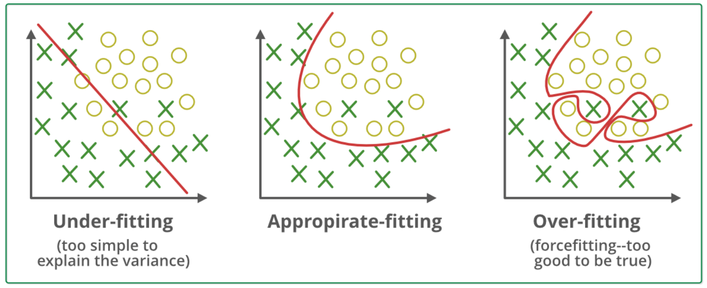

*그림 16. 과소적합, 적절한 적합, 과적합 상태의 결정 경계*

| 상태 | 결정 경계 | 설명 |
|:-----|:-----|:-----|
| **과소적합(underfitting)** | 직선 하나 | 모델이 너무 단순하여 데이터의 패턴을 거의 학습하지 못한 상태이다. 직선 하나로는 두 클래스를 제대로 나눌 수 없어 훈련 데이터에서도 오류가 많다. |
| 적절한 적합(appropriate fitting) | 완만한 곡선 | 데이터의 전반적인 경향을 잘 파악하여, 일부 예외를 틀리더라도 새로운 데이터를 잘 예측하는 이상적인 상태이다. |
| **과적합** | 예외 점까지 감싸는 복잡한 곡선 | 모델이 너무 복잡하여 주요 경향뿐 아니라 사소한 잡음(noise)과 이상치(outlier)까지 외운 상태이다. 훈련 데이터는 완벽히 분류하지만 새로운 데이터는 잘못 분류할 확률이 높다. |

*표 21. 과소적합, 적절한 적합, 과적합의 비교*

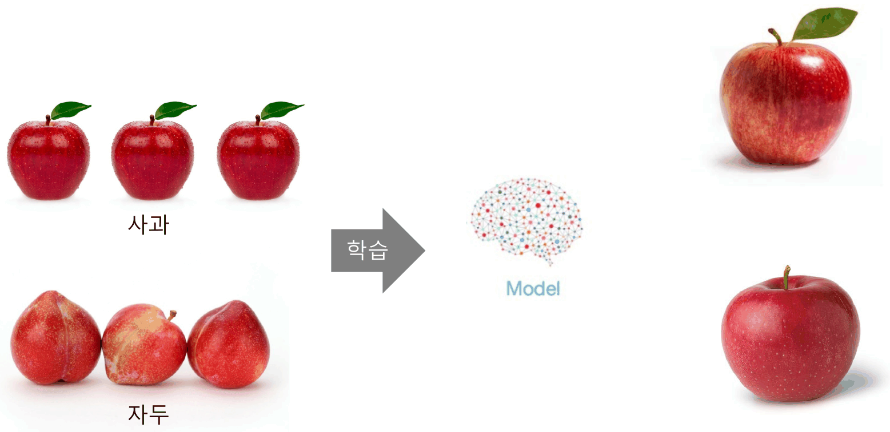

*그림 17. 잎이 달린 사과와 자두로 학습한 모델이 새로운 사과 사진을 분류하는 상황*

그림 17의 훈련 데이터에서 사과 사진은 모두 잎이 달린 새빨간 사과이고, 자두 사진은 잎이 없는 붉은 과일이다. 모델이 "잎이 있으면 사과"처럼 훈련 데이터에만 우연히 들어 있는 성질을 외우면, 잎이 달린 새 사과는 맞히지만 잎이 없는 사과는 자두로 잘못 분류할 수 있다. 같은 이유로 빨간 사과만으로 학습한 모델은 노란빛이 섞인 사과를 다른 과일로 분류할 수 있다. 적절한 학습이 되려면 모델이 데이터를 "암기"하지 않고 데이터 전반의 특징을 "이해"하도록 유도해야 한다.

### 7.3 과적합을 줄이는 방법

1. **데이터 다양화:** 모델이 암기할 수 없을 만큼 많고 다양한 데이터를 보여 주면, 모델은 데이터의 핵심적인 공통 패턴을 학습할 수밖에 없다. 데이터를 더 모으거나, 가진 이미지를 뒤집기, 자르기, 색 바꾸기 등으로 변형하여 늘리는 데이터 증강(data augmentation, 4강)을 쓴다.
2. **모델의 복잡도 줄이기:** 신경망의 층이나 각 층의 뉴런 개수를 줄여 모델을 의도적으로 단순하게 만든다. 또는 손실 함수에 가중치가 너무 커지지 않도록 하는 벌점 항(예: $L + \lambda\sum w^2$)을 추가하여 가중치를 규제(regularization)한다. 큰 가중치는 입력의 작은 변화에 출력이 크게 반응하게 하므로, 가중치를 작게 유지하면 더 일반적인 패턴을 학습하게 된다.
3. **드롭아웃(dropout, 노드 삭제):** 학습하는 매 단계마다 은닉층 뉴런의 일부를 무작위로 비활성화한다 [6]. 특정 뉴런에 의존할 수 없으므로 각 뉴런이 혼자서도 쓸모 있는 특징을 학습하게 된다.

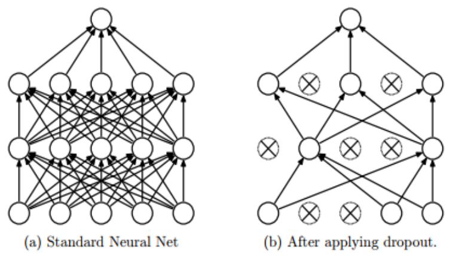

*그림 18. 일반 신경망과 드롭아웃을 적용한 신경망*

그림 18의 오른쪽에서 ⊗ 표시한 노드는 해당 학습 단계에서 삭제된 노드이며, 그 노드에 연결된 선도 함께 사라진다. 삭제할 노드는 단계마다 새로 뽑는다. 예를 들어 삭제 확률이 $p = 0.5$이면 매 단계 은닉 노드의 절반 정도가 꺼진다. 추론(예측)할 때는 모든 노드를 사용하며, 학습 때와 출력의 크기가 맞도록 값을 보정한다. 이 밖에도 검증 손실이 더 이상 줄지 않으면 학습을 멈추는 조기 종료(early stopping) 등이 쓰인다.

### 7.4 배치 크기

이미지 한 장마다 계산한 기울기를 일일이 역전파하여 가중치를 갱신할 수도 있지만, 이 방법은 갱신 횟수가 많아 연산량이 크고, 한 장의 기울기는 잡음이 커서 학습이 불안정할 수 있다. 그래서 여러 이미지에 대한 기울기를 모아 평균을 낸 뒤 가중치를 한 번만 갱신한다. 이때 한 번의 갱신에서 기울기를 모을 데이터의 개수를 **배치 크기(batch size)** 라 하고, 그 크기로 나눈 데이터 묶음 하나를 **미니 배치(mini-batch)** 라 한다.

$$
\mathbf{g} = \frac{1}{B}\sum_{i=1}^{B}\nabla_{\mathbf{w}} L_i, \qquad \mathbf{w} \leftarrow \mathbf{w} - \eta\,\mathbf{g}
$$

$B$는 배치 크기, $L_i$는 미니 배치의 $i$번째 데이터에 대한 손실이다.

```text
|<──────────────────── 전체 데이터셋 ────────────────────>|
[    ][    ][    ][    ][    ][    ][    ][    ][    ][    ]
|<─>|                                               └ 미니 배치
배치 크기
```

*그림 19. 전체 데이터셋을 배치 크기만큼의 미니 배치로 나눈 모습*

- 배치 크기는 보통 2의 거듭제곱(8, 16, 32, 64, 128 등)으로 정한다. CPU와 GPU의 메모리 구조가 2의 거듭제곱 단위로 되어 있어, 배치 크기가 2의 거듭제곱일 때 데이터 전송과 연산의 효율을 높이기 쉽다.
- NVIDIA GPU는 스레드를 32개씩 묶은 워프(warp) 단위로 실행하므로 [7], GPU 메모리에 적재할 수 있는 범위에서 32의 약수나 배수가 효율이 좋다.

> **주의:** 2의 거듭제곱은 효율을 위한 관례이지 필수 조건이 아니다. 배치 크기 100도 학습에는 문제가 없다. 배치 크기가 크면 기울기 추정은 안정되지만 메모리를 많이 쓰고, 작으면 갱신이 잦고 기울기에 잡음이 섞인다.

### 7.5 에포크와 이터레이션

- **에포크(epoch):** 학습의 한 단위로, 훈련 데이터를 모두 한 번씩 사용했을 때를 1 에포크라 한다.
- **이터레이션(iteration):** 미니 배치 하나를 학습하는 것을 1 이터레이션이라 한다. 1 이터레이션마다 가중치 갱신이 한 번 일어난다.

```text
|<──────────────────── 전체 데이터셋 ────────────────────>|
[128개][128개][     ][     ][ ... ][     ][     ][128개]
 1 iter 1 iter                                   1 iter
|<──────────────────────── 1 epoch ─────────────────────>|
```

*그림 20. 배치 크기 128에서 이터레이션과 에포크의 관계*

데이터가 $N$개이고 배치 크기가 $B$이면 1 에포크의 이터레이션 수는 $\lceil N/B \rceil$이다. 예를 들어 1,280장을 배치 크기 128로 학습하면 1 에포크는 $1280/128 = 10$ 이터레이션이고, 20 에포크 학습하면 가중치는 $10 \times 20 = 200$번 갱신된다. 1,000장이면 $1000/128 = 7.8125$이므로 128장짜리 미니 배치 7개와 104장짜리 마지막 미니 배치 1개, 즉 8 이터레이션이 된다(구현에 따라 마지막의 작은 배치를 버릴 수도 있다).

이 용어들은 1만 문제가 실린 문제집을 공부하는 상황에 비유할 수 있다.

| 용어 | 문제집 공부에 비유하면 |
|:-----|:-----|
| 가중치 | 문제 풀이에 필요한 개념별 중요도 |
| 편향 | 아무것도 모르는 상태의 기본적인 풀이 성향 |
| 배치 크기 100 | 한 번에 100문제씩 풀겠다는 계획 |
| 미니 배치 | 배치 크기만큼의 문제 묶음 (1\~100번, 101\~200번, …) |
| 1 이터레이션 | 100문제 한 묶음을 풀고 오답 노트까지 정리하는 것 |
| 1 에포크 | 문제집 전체를 한 번 다 푸는 것 |

*표 22. 학습 용어를 문제집 공부에 비유한 대응*

### 7.6 파라미터와 하이퍼파라미터

| 구분 | 정의 | 예 | 정해지는 방법 |
|:-----|:-----|:-----|:-----|
| **파라미터(parameter)** | 모델 내부에서 결정되는 변수 | 가중치 계수(weight coefficient), 편향(bias) | 학습 과정에서 데이터를 통해 구해진다. |
| **하이퍼파라미터(hyperparameter)** | 모델링할 때 사용자가 직접 정하는 값 | 학습률, 에포크 수, 이터레이션 수, 배치 크기, 층의 수, 드롭아웃 확률 | 사람이 정하며, 정해진 최적값이 없어 여러 번의 실험으로 경험적(휴리스틱)으로 정하는 경우가 많다. |

*표 23. 파라미터와 하이퍼파라미터의 비교*

모델링할 때 사용자가 직접 정해야 하는 값은 상당히 많으며, 그 모든 값이 하이퍼파라미터이다. 하이퍼파라미터의 후보를 정해 두고 각 조합으로 학습한 모델을 검증 데이터셋으로 비교하여 고르는 것이 일반적이다(7.1절). 1 에포크의 이터레이션 수는 데이터 수와 배치 크기로 정해지므로, 사용자는 보통 에포크 수나 전체 이터레이션 수를 정한다.

---

<br>

## 8. 딥러닝 개발 환경

### 8.1 Google Colab

**Google Colab(Colaboratory)** 은 Google이 제공하는 클라우드 기반 개발 환경이다 [8].

- 웹 브라우저에서 Jupyter 노트북(8.2절)과 같은 환경을 클라우드 서비스로 제공하며, Google의 CPU, GPU, TPU와 메모리를 사용한다.
- Google Drive를 연결하여 데이터를 읽고 쓸 수 있다.
- 본인 컴퓨터의 사양에 구애받지 않고 작업할 수 있어 간단한 실습을 하기 좋은 환경이다. 무료 사용에는 실행 시간과 GPU 종류의 제한이 있다.

Colab에서 딥러닝 실습 환경을 준비하는 순서는 다음과 같다.

1. https://colab.research.google.com/ 에 접속하여 Google 계정으로 로그인한다.
2. 새 노트를 만들거나, 파일 메뉴에서 노트북(`.ipynb`)을 업로드하거나 Google Drive 또는 GitHub에 있는 노트북을 연다.
3. GPU가 필요하면 런타임 메뉴의 런타임 유형 변경에서 하드웨어 가속기를 GPU(예: T4)로 바꾼다.
4. 코드 셀을 선택하고 Shift+Enter를 눌러 실행한다. 셀 앞에 `!`를 붙이면 셸 명령을 실행한다(예: `!nvidia-smi`로 GPU 확인, `!pip install 패키지`로 설치).
5. 데이터 파일은 왼쪽의 파일 창에서 세션 저장소(`/content`)에 업로드하거나, 다음 코드로 Google Drive를 연결하여 `/content/drive/MyDrive/` 아래의 파일을 쓴다.

```python
from google.colab import drive
drive.mount('/content/drive')   # 권한을 허용하면 Drive가 /content/drive에 연결된다

import torch
print(torch.cuda.is_available())  # GPU 런타임이면 True
```

> **주의:** 세션 저장소에 업로드한 파일과 설치한 패키지는 런타임이 끝나면 사라진다. 계속 쓸 파일은 Google Drive에 두고, 런타임을 새로 시작할 때마다 설치 셀을 다시 실행한다.

### 8.2 Jupyter Notebook과 JupyterLab

**Jupyter Notebook**은 웹 브라우저에서 동작하는 개발 환경으로, Python을 비롯한 다양한 프로그래밍 언어로 코드를 작성하고 실행할 수 있다. **JupyterLab**은 그 차세대 인터페이스로, 파일 탐색기와 여러 노트북, 터미널을 한 화면에서 쓸 수 있다.

- 노트북(`.ipynb`)은 **셀(cell)** 의 목록이다. 코드 셀은 실행 결과(출력, 그래프)를 바로 아래에 저장하고, 마크다운 셀은 설명을 담는다.
- 셀을 실행하는 프로그램을 **커널(kernel)** 이라 하며, 커널은 셀 사이에서 변수를 계속 기억한다. 그래서 데이터를 한 번 읽어 두고 여러 셀에서 나누어 실험하기 편하다.
- 로컬 컴퓨터에서는 `pip install jupyterlab`으로 설치하고 `jupyter lab` 명령으로 실행한다.

| Python IDE와 편집기 | 사용 비율 |
|:-----|:-----:|
| Jupyter | 57% |
| PyCharm | 35% |
| Spyder | 27% |
| Visual Studio Code | 21% |
| Sublime Text | 12% |
| Atom | 10% |
| Vim | 8.5% |
| 기타 IDE | 3.1% |
| Eclipse | 3.0% |
| 기타 텍스트 편집기 | 2.5% |
| Emacs | 2.2% |
| gedit | 1.3% |
| Rodeo | 1.2% |

*표 24. Python 개발자를 대상으로 한 설문에서 가장 많이 쓰이는 Python IDE와 편집기*

> **주의:** 노트북은 셀을 아무 순서로나 실행할 수 있으므로, 화면에 보이는 코드 순서와 커널의 실제 상태가 달라질 수 있다. 결과를 다른 사람이 재현할 수 있도록 마지막에는 커널을 재시작하고 모든 셀을 위에서부터 다시 실행해 확인하는 것이 좋다.

### 8.3 딥러닝 프레임워크: PyTorch와 Keras

**프레임워크(framework)** 는 응용 프로그램을 개발하기 위한 여러 라이브러리와 모듈을 효율적으로 사용할 수 있도록 하나로 묶어 놓은 일종의 패키지이다. Keras와 PyTorch는 널리 쓰이는 딥러닝용 오픈 소스 프레임워크이다.

| 프레임워크 | 개발 주체 | 특징 |
|:-----|:-----|:-----|
| Keras | Google | 층을 블록처럼 쌓는 간결한 고수준 API를 제공하며, TensorFlow와 함께 쓰인다. |
| PyTorch | Facebook(현재 Meta) | Python 코드를 실행하는 순서대로 계산 그래프가 만들어져 디버깅이 쉽고, 연구와 실무에서 널리 쓰인다. 이 과목의 실습은 PyTorch를 쓴다. |

*표 25. Keras와 PyTorch의 비교*

PyTorch의 핵심 기능 중 하나는 6절의 역전파를 자동으로 수행하는 **자동 미분(autograd)** 이다. 다음 코드는 6.2절의 예제 신경망을 PyTorch로 계산한 것이다. `requires_grad=True`로 만든 텐서는 연산 기록이 남고, `E.backward()`가 출력에서 입력 쪽으로 연쇄 법칙을 적용하여 각 가중치의 기울기를 `.grad`에 저장한다.

```python
import torch
torch.set_printoptions(precision=6)

x = torch.tensor(0.5)
w0 = torch.tensor([0.15, 0.2], requires_grad=True)                   # x1 → 노드 10, 노드 11
w1 = torch.tensor([[0.4, 0.45], [0.5, 0.55]], requires_grad=True)    # 행: 노드 20, 21 / 열: a10, a11
t = torch.tensor([0.3, 0.9])                                          # 목표값

a1 = torch.sigmoid(w0 * x)          # 은닉층 출력 [a10, a11]
a2 = torch.sigmoid(w1 @ a1)         # 출력층 출력 [a20, a21]
E = 0.5 * ((t - a2) ** 2).sum()     # 전체 오차
E.backward()                        # 역전파: 모든 기울기 계산

print(a2)
print(E.item())
print(w1.grad)
print(w0.grad)
```

```text
tensor([0.609149, 0.633697], grad_fn=<SigmoidBackward0>)
0.08324529230594635
tensor([[ 0.038182,  0.038641],
        [-0.032066, -0.032452]])
tensor([-0.000183, -0.000109])
```

`w1.grad`의 첫 행은 노드 20으로 들어가는 가중치 $w_{10}^{(1)}, w_{20}^{(1)}$의 기울기(0.0382, 0.0386), 둘째 행은 노드 21로 들어가는 $w_{11}^{(1)}, w_{21}^{(1)}$의 기울기(−0.0321, −0.0325)이며, 표 18과 같다. `w0.grad`도 6.5절의 은닉층 기울기와 같다. 로컬 컴퓨터에는 `pip install torch torchvision`으로 설치한다(GPU 버전은 PyTorch 홈페이지의 설치 안내에서 운영체제와 CUDA 버전에 맞는 명령을 고른다).

### 8.4 Docker

**Docker**는 응용 프로그램과 그 실행에 필요한 라이브러리, 설정을 **컨테이너(container)** 라는 격리된 단위로 묶어 어디서나 같은 방식으로 실행하게 하는 도구이다 [9]. 딥러닝에서는 Python, CUDA, PyTorch의 버전 조합처럼 맞추기 까다로운 환경을 그대로 재현하는 데 쓰인다.


*그림 21. Docker 컨테이너 구조와 가상 머신 구조의 비교*

- **컨테이너 방식(왼쪽):** 인프라(하드웨어) 위에 호스트 운영체제가 하나 있고, 그 위의 Docker가 여러 응용(App A\~F)을 컨테이너로 실행한다. 컨테이너들은 호스트 운영체제의 커널을 공유하므로 가볍고 빨리 시작한다.
- **가상 머신 방식(오른쪽):** 인프라 위의 하이퍼바이저(hypervisor)가 여러 가상 머신을 만들고, 가상 머신마다 게스트 운영체제 전체가 따로 들어간다. 격리는 강하지만 운영체제를 통째로 실행하므로 무겁다.

```bash
docker pull pytorch/pytorch                                              # PyTorch가 설치된 이미지 받기
docker run -it pytorch/pytorch python -c "import torch; print(torch.__version__)"   # 컨테이너에서 실행
```

---

<br>

## 개념 적용

**T/F 점검:**

| 문장 | 판단과 근거 |
|:-----|:------------|
| 은닉층을 10개 쌓아도 활성화 함수가 모두 선형이면 은닉층이 없는 신경망과 표현력이 같다. | **T.** 선형 변환의 합성은 하나의 선형 변환이므로 $W'\mathbf{x} + \mathbf{b}'$ 하나로 줄어든다(3.4절). |
| 소프트맥스 출력의 합은 로짓의 값에 따라 1보다 클 수 있다. | **F.** 분모가 모든 분자의 합이므로 출력의 합은 항상 1이다. |
| 학습률을 크게 할수록 항상 더 빨리 최솟값에 도달한다. | **F.** $w^2$의 예에서 $\eta > 1$이면 최솟값을 지나쳐 발산하고, $\eta = 1$이면 $\pm w_0$ 사이를 끝없이 오간다(5.2절). |
| 역전파에서 기울기가 양수인 가중치는 경사하강법으로 갱신하면 작아진다. | **T.** $w \leftarrow w - \eta\,\partial L/\partial w$에서 $\eta > 0$이고 기울기가 양수이면 $w$가 줄어든다. |
| 검증 데이터셋으로 모델을 골랐다면 검증 정확도를 그대로 최종 성능으로 보고해도 된다. | **F.** 선택 과정에서 검증 데이터셋에 맞추어진 낙관적인 값일 수 있으므로, 선택에 쓰지 않은 테스트 데이터셋으로 측정한다. |
| 데이터 1,000개를 배치 크기 100으로 학습하면 1 에포크에 가중치가 10번 갱신된다. | **T.** $1000/100 = 10$ 이터레이션이고, 이터레이션마다 한 번 갱신된다. |

---

<br>

## 요약

| 개념 | 핵심 요약 |
|:-----|:----------|
| 응용과 태스크 | 영상, 소리, 텍스트 응용은 분류, 탐지, 분할, 인식, 생성 같은 태스크로 나뉘고, 태스크마다 알맞은 모델과 네트워크(DNN, CNN, RNN)를 고른다. |
| 인공지능, 기계학습, 딥러닝 | 딥러닝 ⊂ 기계학습 ⊂ 인공지능이다. 전통적 기계학습은 사람이 특징을 설계하고, 딥러닝은 특징 추출과 분류를 하나의 깊은 신경망이 함께 학습한다. |
| 학습 방식 | 지도학습은 입력과 정답의 쌍, 비지도학습은 정답 없는 입력, 강화학습은 환경의 보상으로 학습한다. |
| 신경망 | 입력층, 은닉층, 출력층으로 이루어지며, 각 연결선의 가중치와 노드의 편향이 학습 대상이다. 은닉층이 2개 이상이면 깊은 신경망으로 본다. |
| 학습의 세 단계 | 전방 계산(예측), 오차 계산(손실), 후방 가중치 갱신(역전파와 경사하강법)을 반복한다. |
| 활성화 함수 | 계단, 시그모이드, tanh, 소프트플러스, ReLU 등이 있다. 비선형이어야 층을 쌓는 의미가 있다. 시그모이드의 도함수는 $\sigma(1 - \sigma)$이다. |
| 출력층 함수 | 이진 분류는 시그모이드(출력 1개), 다중 분류는 소프트맥스(출력의 합이 1)를 쓴다. |
| 손실 함수 | MSE는 제곱 오차의 평균이며 주로 회귀에, 교차 엔트로피 $-\log o_t$는 분류에 쓴다. focal loss는 쉬운 예제의 손실을 $(1 - p_t)^{\gamma}$배로 줄인다. |
| 경사하강법 | $w \leftarrow w - \eta\,\partial L/\partial w$로 기울기의 반대 방향으로 조금씩 이동한다. 학습률이 너무 작으면 느리고, 너무 크면 발산한다. |
| 옵티마이저 | Momentum과 NAG는 이동 방향을, Adagrad, RMSProp, AdaDelta는 보폭을 개선했으며, Adam은 둘을 결합한다. |
| 오류 역전파 | 연쇄 법칙으로 출력층부터 오차 신호 $\delta$를 뒤로 전달하며 기울기를 구한다. 가중치의 기울기는 도착 노드의 $\delta$와 출발 노드 출력의 곱이다. |
| 데이터셋 분할 | 훈련 데이터셋은 학습, 검증 데이터셋은 모델 선택, 테스트 데이터셋은 마지막 한 번의 성능 측정에 쓴다. |
| 과적합 | 훈련 데이터는 잘 맞히지만 새 데이터에서 성능이 떨어지는 현상이다. 데이터 다양화, 복잡도 줄이기와 규제, 드롭아웃으로 줄인다. |
| 배치, 에포크, 이터레이션 | 미니 배치 하나의 평균 기울기로 한 번 갱신하는 것이 1 이터레이션, 훈련 데이터 전체를 한 번 쓰는 것이 1 에포크이다. 1 에포크의 이터레이션 수는 $\lceil N/B \rceil$이다. |
| 하이퍼파라미터 | 학습률, 에포크 수, 배치 크기처럼 사용자가 정하는 값이다. 가중치와 편향 같은 파라미터는 학습으로 구해진다. |
| 개발 환경 | Colab은 클라우드 GPU에서 노트북을 실행하고, Jupyter는 셀 단위로 실행하는 노트북 환경이며, PyTorch는 자동 미분을 제공하는 프레임워크이고, Docker는 실행 환경을 컨테이너로 재현한다. |

---

<br>

## 점검 문제

1. **기계학습과 딥러닝:** 전통적 기계학습과 딥러닝의 처리 과정을 "특징"이라는 낱말을 써서 비교하라.

   <details>
   <summary>정답</summary>

   전통적 기계학습은 입력 → 특징 추출 → 분류 → 출력의 순서이며, 어떤 특징을 쓸지 사람이 설계하고 모델은 그 특징으로 분류만 학습한다. 딥러닝은 입력 → 특징 추출과 분류 → 출력의 순서이며, 하나의 깊은 신경망이 원시 입력에서 특징 추출과 분류를 함께 학습한다.

   </details>

2. **뉴런의 계산:** $x_1 = 2$, $x_2 = -1$, $w_1 = 0.5$, $w_2 = 1$, $b = 0.5$인 뉴런의 활성화 함수가 ReLU일 때와 시그모이드일 때의 출력을 구하라.

   <details>
   <summary>정답</summary>

   총합은 $a = 0.5 \times 2 + 1 \times (-1) + 0.5 = 0.5$이다. ReLU는 $\max(0, 0.5) = 0.5$, 시그모이드는 $1/(1 + e^{-0.5}) \approx 0.622$이다.

   </details>

3. **비선형성:** 활성화 함수가 $h(x) = 2x$인 신경망에서 $x_1 \to$ 은닉 노드 2개(가중치 1, 3) $\to$ 출력 노드(가중치 2, −1)로 계산할 때, 이 신경망과 같은 한 층짜리 신경망의 식을 구하라.

   <details>
   <summary>정답</summary>

   $a_1 = 2 \cdot 1 \cdot x_1 = 2x_1$, $a_2 = 2 \cdot 3 \cdot x_1 = 6x_1$이다. 출력은 $h(2a_1 - a_2) = 2(4x_1 - 6x_1) = -4x_1$이다. 따라서 가중치 $-2$인 연결선 하나에 $h$를 적용한 $h(-2x_1) = -4x_1$과 같다. 층이 둘이어도 선형 함수 하나만 표현한다.

   </details>

4. **소프트맥스:** 로짓 $(1, 1, \ln 2)$에 소프트맥스를 적용한 결과를 구하라.

   <details>
   <summary>정답</summary>

   $e^1 = e$, $e^1 = e$, $e^{\ln 2} = 2$이므로 합은 $2e + 2 \approx 7.437$이다. 결과는 $(e/7.437, e/7.437, 2/7.437) \approx (0.366, 0.366, 0.269)$이며, 합은 1이다.

   </details>

5. **손실 계산:** 정답이 고양이(두 번째 클래스)인 데이터에 대해 예측 확률이 $(0.2, 0.7, 0.1)$이다. MSE와 교차 엔트로피를 구하라.

   <details>
   <summary>정답</summary>

   정답 벡터는 $(0, 1, 0)$이다. MSE $= (0.2^2 + 0.3^2 + 0.1^2)/3 = (0.04 + 0.09 + 0.01)/3 \approx 0.0467$이다. 교차 엔트로피는 정답 클래스 항만 남아 $-\ln 0.7 \approx 0.357$이다.

   </details>

6. **경사하강법:** $J(w) = (w + 1)^2$에서 $w_0 = 1$, $\eta = 0.25$로 두 번 갱신한 $w_2$를 구하라.

   <details>
   <summary>정답</summary>

   $J'(w) = 2(w + 1)$이다. $w_1 = 1 - 0.25 \times 2(1 + 1) = 1 - 1 = 0$, $w_2 = 0 - 0.25 \times 2(0 + 1) = -0.5$이다. 갱신마다 최솟값 $-1$까지의 거리가 절반으로 줄어든다.

   </details>

7. **학습률:** $f(w) = w^2$에서 학습률이 $\eta = 0.5$이면 경사하강법은 어떻게 움직이는가?

   <details>
   <summary>정답</summary>

   갱신식이 $w \leftarrow (1 - 2 \times 0.5)w = 0$이므로, 어떤 점에서 출발하든 한 번의 갱신으로 최솟값 0에 도달한다. 이 함수에서는 $0 < \eta < 1$이면 수렴하고 $\eta = 0.5$가 가장 빠르다.

   </details>

8. **역전파:** 6.2절의 신경망에서 $\partial E_{tot}/\partial w_{21}^{(1)}$을 연쇄 법칙의 세 인자로 나누어 쓰고 값을 구하라.

   <details>
   <summary>정답</summary>

   $\frac{\partial E_{tot}}{\partial w_{21}^{(1)}} = \frac{\partial E_{tot}}{\partial a_{21}} \cdot \frac{\partial a_{21}}{\partial z_{21}} \cdot \frac{\partial z_{21}}{\partial w_{21}^{(1)}} = -(0.9 - 0.6337) \times 0.6337 \times (1 - 0.6337) \times a_{11}$이다. $-0.2663 \times 0.2321 \times 0.5250 \approx -0.0325$이며, 갱신값은 $0.55 + 0.5 \times 0.0325 \approx 0.5662$이다.

   </details>

9. **데이터셋:** 검증 데이터셋과 테스트 데이터셋을 하나로 합쳐 모델 선택과 최종 성능 보고에 함께 쓰면 어떤 문제가 생기는가?

   <details>
   <summary>정답</summary>

   여러 모델 중 그 데이터셋에서 우연히 성능이 좋게 나온 모델이 선택되므로, 같은 데이터셋에서 잰 성능은 실제 성능보다 낙관적이다. 선택에 한 번도 쓰지 않은 테스트 데이터셋이 있어야 처음 보는 데이터에 대한 성능을 편향 없이 추정할 수 있다.

   </details>

10. **에포크와 이터레이션:** 훈련 데이터 50,000장을 배치 크기 64로 30 에포크 학습한다. 마지막 미니 배치를 버리지 않을 때 1 에포크의 이터레이션 수와 전체 가중치 갱신 횟수를 구하라.

    <details>
    <summary>정답</summary>

    $50000/64 = 781.25$이므로 64장짜리 미니 배치 781개와 16장짜리 미니 배치 1개, 즉 1 에포크는 782 이터레이션이다. 전체 갱신 횟수는 $782 \times 30 = 23460$번이다.

    </details>

---

<br>

## 참고 문헌

1. I. Goodfellow, Y. Bengio, and A. Courville, *Deep Learning*. Cambridge, MA, USA: MIT Press, 2016.
2. T.-Y. Lin, P. Goyal, R. Girshick, K. He, and P. Dollár, "Focal Loss for Dense Object Detection," in *Proc. IEEE Int. Conf. Computer Vision (ICCV)*, pp. 2980-2988, 2017.
3. S. Ruder, "An overview of gradient descent optimization algorithms," arXiv:1609.04747, 2016.
4. D. P. Kingma and J. Ba, "Adam: A Method for Stochastic Optimization," in *Proc. Int. Conf. Learning Representations (ICLR)*, 2015.
5. D. E. Rumelhart, G. E. Hinton, and R. J. Williams, "Learning representations by back-propagating errors," *Nature*, vol. 323, pp. 533-536, 1986.
6. N. Srivastava, G. Hinton, A. Krizhevsky, I. Sutskever, and R. Salakhutdinov, "Dropout: A Simple Way to Prevent Neural Networks from Overfitting," *Journal of Machine Learning Research*, vol. 15, pp. 1929-1958, 2014.
7. NVIDIA, "CUDA C++ Programming Guide," accessed Nov. 4, 2026. https://docs.nvidia.com/cuda/cuda-c-programming-guide/
8. Google, "Colaboratory Frequently Asked Questions," accessed Nov. 4, 2026. https://research.google.com/colaboratory/faq.html
9. Docker, "What is a Container?," accessed Nov. 4, 2026. https://www.docker.com/resources/what-container/
