# Lecture 1 — Deep Learning Fundamentals

[Repository Guide](../../README.md) | [English](Concepts_Lecture.md) | [한국어](Concepts_Lecture.ko.md)

> **Last Updated:** 2026-11-04

> **Learning Objectives:**
> 1. Explain how artificial intelligence, machine learning, and deep learning contain one another and how supervised, unsupervised, and reinforcement learning differ, and break image, sound, and text applications down into tasks and models
> 2. Write the weighted sum and bias of an artificial neuron and the formulas and derivatives of the main activation functions, and show with equations why activation functions must be nonlinear
> 3. Compute the mean squared error and cross-entropy losses for sigmoid and softmax outputs
> 4. Explain the gradient descent update rule and the effect of the learning rate, and carry backpropagation through a small neural network to the end with the chain rule
> 5. Distinguish the roles of the training, validation, and test sets, the ways to reduce overfitting, and the batch size, epoch, iteration, and hyperparameters
> 6. Explain the roles that Colab, Jupyter, PyTorch, and Docker play in a deep learning development environment

---

## Table of Contents

- [1. Applications of Artificial Intelligence](#1-applications-of-artificial-intelligence)
  - [1.1 The Fourth Industrial Revolution and AI](#11-the-fourth-industrial-revolution-and-ai)
  - [1.2 Applications in Image, Sound, and Text](#12-applications-in-image-sound-and-text)
  - [1.3 Application, Task, Model, and Network](#13-application-task-model-and-network)
  - [1.4 Artificial Intelligence, Machine Learning, and Deep Learning](#14-artificial-intelligence-machine-learning-and-deep-learning)
  - [1.5 Supervised, Unsupervised, and Reinforcement Learning](#15-supervised-unsupervised-and-reinforcement-learning)
- [2. Neural Networks](#2-neural-networks)
  - [2.1 Biological Neurons and Artificial Neurons](#21-biological-neurons-and-artificial-neurons)
  - [2.2 Input, Hidden, and Output Layers](#22-input-hidden-and-output-layers)
  - [2.3 Input and Output of a Neural Network: Dog and Cat Classification](#23-input-and-output-of-a-neural-network-dog-and-cat-classification)
  - [2.4 The Three Steps of Training](#24-the-three-steps-of-training)
- [3. Activation Functions](#3-activation-functions)
  - [3.1 Bias and Activation Functions](#31-bias-and-activation-functions)
  - [3.2 Types of Activation Functions](#32-types-of-activation-functions)
  - [3.3 Output-Layer Activation Functions: Sigmoid and Softmax](#33-output-layer-activation-functions-sigmoid-and-softmax)
  - [3.4 Why Nonlinearity Is Needed: An Algebraic Check](#34-why-nonlinearity-is-needed-an-algebraic-check)
  - [3.5 Why Nonlinearity Is Needed: A Conceptual Check](#35-why-nonlinearity-is-needed-a-conceptual-check)
- [4. Loss Functions](#4-loss-functions)
  - [4.1 Computing the Error](#41-computing-the-error)
  - [4.2 Mean Squared Error](#42-mean-squared-error)
  - [4.3 Cross-Entropy and Focal Loss](#43-cross-entropy-and-focal-loss)
- [5. Gradient Descent](#5-gradient-descent)
  - [5.1 Optimization with Derivatives](#51-optimization-with-derivatives)
  - [5.2 Learning Rate](#52-learning-rate)
  - [5.3 Optimizers](#53-optimizers)
- [6. Error Backpropagation](#6-error-backpropagation)
  - [6.1 The Idea of Backpropagation](#61-the-idea-of-backpropagation)
  - [6.2 Forward Propagation in the Example Network](#62-forward-propagation-in-the-example-network)
  - [6.3 Decomposing the Gradient with the Chain Rule](#63-decomposing-the-gradient-with-the-chain-rule)
  - [6.4 Updating One Output-Layer Weight](#64-updating-one-output-layer-weight)
  - [6.5 Updating All Weights and the Result of One Backpropagation Pass](#65-updating-all-weights-and-the-result-of-one-backpropagation-pass)
- [7. Training Basics](#7-training-basics)
  - [7.1 Training, Validation, and Test Sets](#71-training-validation-and-test-sets)
  - [7.2 Overfitting and Underfitting](#72-overfitting-and-underfitting)
  - [7.3 Ways to Reduce Overfitting](#73-ways-to-reduce-overfitting)
  - [7.4 Batch Size](#74-batch-size)
  - [7.5 Epochs and Iterations](#75-epochs-and-iterations)
  - [7.6 Parameters and Hyperparameters](#76-parameters-and-hyperparameters)
- [8. Deep Learning Development Environment](#8-deep-learning-development-environment)
  - [8.1 Google Colab](#81-google-colab)
  - [8.2 Jupyter Notebook and JupyterLab](#82-jupyter-notebook-and-jupyterlab)
  - [8.3 Deep Learning Frameworks: PyTorch and Keras](#83-deep-learning-frameworks-pytorch-and-keras)
  - [8.4 Docker](#84-docker)
- [Concept Applications](#concept-applications)
- [Summary](#summary)
- [Self-Check Questions](#self-check-questions)
- [References](#references)

---

<br>

## 1. Applications of Artificial Intelligence

### 1.1 The Fourth Industrial Revolution and AI

An industrial revolution is a technological change that fundamentally transforms the way goods are produced. The four industrial revolutions are summarized as follows.

| Revolution | Period | Key technology and change |
|:-----|:-----|:-----|
| First industrial revolution | 18th century | Mechanization with the steam engine |
| Second industrial revolution | 19th century - early 20th century | Mass production with electric power |
| Third industrial revolution | Late 20th century | Informatization with computers and the internet |
| Fourth industrial revolution | Early 21st century | Intelligence with AI, big data, and hyper-connectivity |

*Table 1. The four industrial revolutions and their key technologies*

Each later revolution arrived after a shorter interval than the one before, and its technology reached further and had a larger impact. The central technology of the fourth industrial revolution is artificial intelligence, and in particular **deep learning**, which learns features on its own from large amounts of data, has become a core component of software that handles images, sound, and text. This course covers how to apply deep learning in software, and Lecture 1 organizes the fundamental concepts underlying it.

### 1.2 Applications in Image, Sound, and Text

Applications of artificial intelligence can be grouped by the kind of data they handle: image, sound, and text. One application is built by combining several tasks.

| Domain | Example applications | Tasks that make up the applications |
|:-----|:-----|:-----|
| Image | Self-driving, face recognition | Image classification, object detection, semantic segmentation |
| Sound | Smart speakers, TTS (text to speech) | Sound classification, speech recognition, sound event detection |
| Text | Chatbots, translation | Text generation, sentiment analysis, question answering |

*Table 2. Applications and tasks in the image, sound, and text domains*

Each task is defined by the form of its input and output.

| Task | Input | Output |
|:-----|:-----|:-----|
| Image classification | One image | One class for the whole image (for example, dog) |
| Object detection | One image | A rectangle (bounding box) around each object in the image and its class |
| Semantic segmentation | One image | A class for every pixel (for example, road, person, sky) |
| Sound classification | An audio clip | One class for the whole clip (for example, a dog barking) |
| Speech recognition | Speech | The text of what was said |
| Sound event detection | Audio | The class and the start and end times of each sound event |
| Text generation | Preceding context | The text that follows |
| Sentiment analysis | A sentence or document | A sentiment class such as positive or negative |
| Question answering | A question (with a supporting document if needed) | The answer to the question |

*Table 3. Inputs and outputs of representative tasks*

Here a **class** is each of the categories that a classification can produce. Image tasks are covered in detail in Lectures 3-5, sound tasks in Lecture 6, and text tasks in Lectures 7-8.

### 1.3 Application, Task, Model, and Network

Developing a deep learning application can be organized as four levels of choices.


*Figure 1. The levels of choice leading from application to task, model, and network*

- **Application:** the service or product that users use, such as a self-driving car or a face-recognition entry system.
- **Task:** a concrete problem the application must solve. Self-driving splits into several tasks, such as object detection to find pedestrians and vehicles and semantic segmentation to separate lanes and roads.
- **Model:** a concrete neural network design that solves a task. VGG, GoogLeNet, and ResNet are representative models that performed well in image classification (VGG appears in the Lecture 1 lab and Lecture 3, and ResNet in Lectures 3-4).
- **Network:** the basic form of neural network that a model is built from. A **DNN (deep neural network)** stacks fully connected layers deeply, a **CNN (convolutional neural network)** uses the convolution operation, and an **RNN (recurrent neural network)** processes ordered data with a recurrent structure. CNNs and RNNs are covered in Lecture 2.

> **Key Point:** An application developer breaks the application into tasks and chooses a model suited to each task. This course focuses on the middle two levels: defining the task and understanding and using a model that fits it.

### 1.4 Artificial Intelligence, Machine Learning, and Deep Learning

**Artificial intelligence (AI)** is the whole set of technologies that implement human intellectual abilities on computers. **Machine learning** is a part of it in which the computer learns from data by itself to make predictions or decisions, instead of a person writing the rules directly. **Deep learning** is a part of machine learning that uses artificial neural networks with many stacked layers.

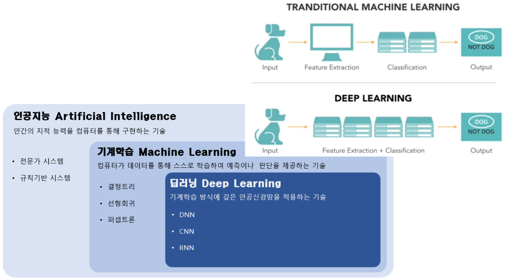

*Figure 2. How artificial intelligence, machine learning, and deep learning contain one another, and a comparison of the traditional machine learning and deep learning pipelines*

| Category | Definition | Examples |
|:-----|:-----|:-----|
| Artificial intelligence | Technology that implements human intellectual abilities on computers | Expert systems, rule-based systems |
| Machine learning | Technology in which computers learn from data by themselves to make predictions or decisions | Decision trees, linear regression, perceptrons |
| Deep learning | Technology that applies deep artificial neural networks to machine learning | DNN, CNN, RNN |

*Table 4. Definitions and examples of artificial intelligence, machine learning, and deep learning*

Traditional machine learning and deep learning differ most in who creates the **features**. A feature is a number extracted from the input that is useful for classification (for example, the shape of the ears or the color of the fur). For a problem that takes a dog photo and outputs either "DOG" or "NOT DOG", the two pipelines are as follows.

- **Traditional machine learning:** input → feature extraction → classification → output. A person designs which features to use (feature engineering), and the machine learning model learns only the classification from the given features.
- **Deep learning:** input → feature extraction and classification → output. A single deep neural network learns feature extraction and classification together from the raw input (pixel values).

Today this distinction is less strict, because transfer learning (Lectures 3-4), which reuses the features extracted by a deep learning model pretrained on a large dataset as the input of another model, has become common. There is also a view that finds the meaning of "deep" in the fact that a shallow network with at most one hidden layer (Section 2.2) has difficulty learning complex features by itself, whereas a deep network with two or more hidden layers can learn data hierarchically.

> **[Machine Learning]** In machine learning, a decision tree predicts a class by applying questions about the features in order, linear regression predicts a continuous value from a weighted sum of the inputs, and the perceptron is the simplest neural network, which separates two classes by applying a step function to a weighted sum. All three assume that the features to use as input are given in advance, so they belong to the traditional machine learning pipeline.

### 1.5 Supervised, Unsupervised, and Reinforcement Learning

Machine learning is divided into three kinds according to the signal used for learning.

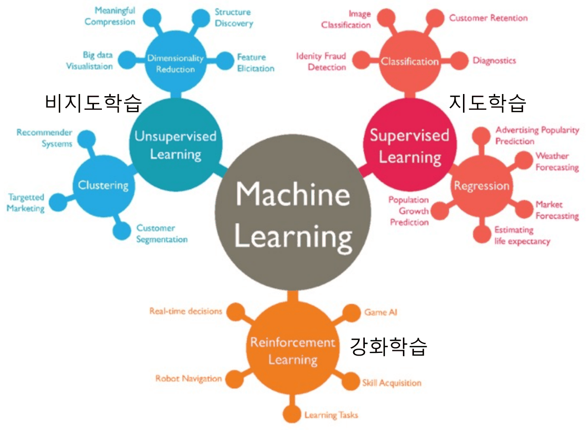

*Figure 3. Unsupervised, supervised, and reinforcement learning with their representative tasks and applications*

| Learning type | Signal used for learning | Goal | Representative tasks and applications |
|:-----|:-----|:-----|:-----|
| **Supervised learning** | Pairs of inputs and correct answers (labels) | A function that predicts the answer from the input | Classification (image classification, customer retention, identity fraud detection, diagnostics), regression (advertising popularity prediction, weather forecasting, market forecasting, life expectancy estimation, population growth prediction) |
| **Unsupervised learning** | Inputs without answers | Structure or patterns hidden in the data | Dimensionality reduction (meaningful compression, structure discovery, big data visualization, feature elicitation), clustering (recommender systems, targeted marketing, customer segmentation) |
| **Reinforcement learning** | Rewards and penalties received while interacting with an environment | Actions that maximize the cumulative reward | Real-time decisions, game AI, robot navigation, skill acquisition |

*Table 5. Comparison of the three learning types*

**Classification** is a supervised task that chooses one of a fixed set of classes, and **regression** is a supervised task that predicts a continuous number such as a temperature or a price. **Clustering** groups similar data together without answers, and **dimensionality reduction** represents data with fewer variables while preserving as much information as possible.

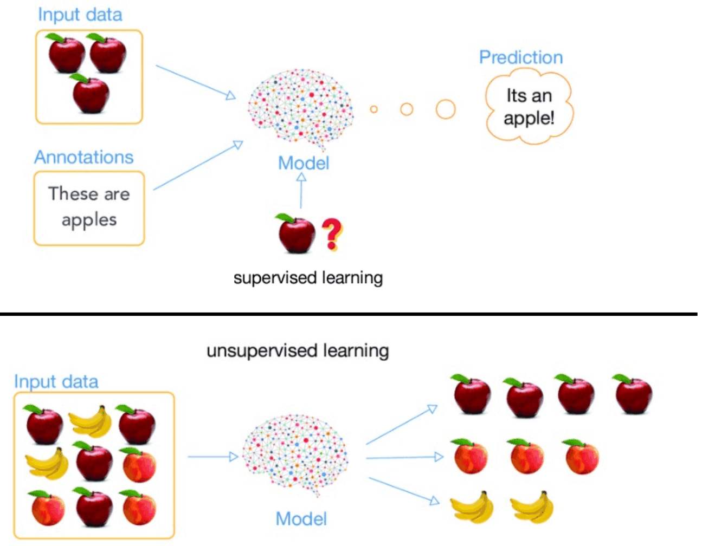

*Figure 4. Supervised learning from apple photos with answers and unsupervised learning that groups fruits without answers*

The upper half of Figure 4 is supervised learning. When a model is trained on apple photos (input data) together with the answer (annotation) "These are apples", it predicts that an apple photo it has never seen is an apple. The lower half is unsupervised learning. When photos of mixed apples, peaches, and bananas are given without answers, the model groups similar-looking items into an apple group, a peach group, and a banana group. The model does not know the name of each group; it only finds that the groups differ from one another.

The rest of this note assumes supervised learning.

---

<br>

## 2. Neural Networks

### 2.1 Biological Neurons and Artificial Neurons

Deep learning is a machine learning method based on the theory of deep neural networks, which imitate the principles of the neural networks in the human brain. The human brain consists of an enormous number of **neurons** and **synapses**, the connections between neurons, and an artificial neural network carries these two concepts over to the computer.

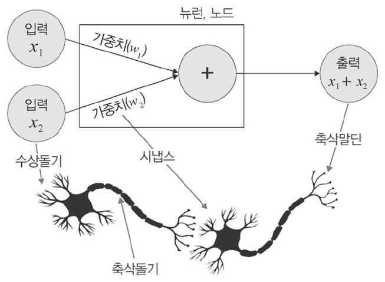

*Figure 5. The structure of a biological neuron and the artificial neuron modeled on it*

| Biological neuron | What it does | Corresponding element of an artificial neuron |
|:-----|:-----|:-----|
| Dendrite | Receives signals sent by other neurons | Inputs $x_1, x_2$ |
| Synapse | Adjusts the strength with which a signal is transmitted | Weights $w_1, w_2$ |
| Cell body | Collects the received signals and fires when they exceed a certain level | Weighted sum and activation function (Section 3) |
| Axon and axon terminal | Send the output signal to the next neuron | Output |

*Table 6. Correspondence between a biological neuron and an artificial neuron*

The artificial neuron in Figure 5 shows the simplest case, which adds the two inputs and outputs $x_1 + x_2$. A general artificial neuron multiplies each input by a weight and adds the products, computing the **weighted sum** $w_1x_1 + w_2x_2$. An input with a large weight strongly affects the output, and an input with a negative weight suppresses the output.

### 2.2 Input, Hidden, and Output Layers

One artificial neuron is also called a **node**. A neural network arranges nodes into layers and links the nodes of neighboring layers with connections, and each connection carries one weight. The weight of a connection is combined with the value of the input node to produce the value of the result node.

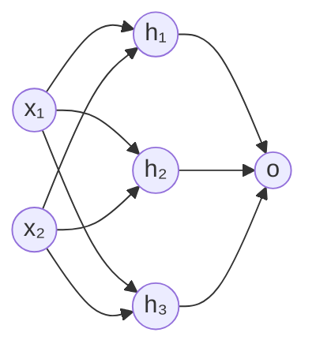

*Figure 6. A neural network with two input nodes, three hidden nodes, and one output node*

- **Input layer:** the layer that receives the data. It has as many nodes as there are input features.
- **Hidden layer:** a layer between the input and output layers, called hidden because its values are not directly visible from outside. It learns features, and there can be several of them.
- **Output layer:** the layer that produces the final result. Binary classification uses one node, and multi-class classification uses as many nodes as there are classes (Section 3.3).

In the network of Figure 6, a hidden node such as $h_1$ receives the two inputs and computes $w_1x_1 + w_2x_2$. There are $2 \times 3 = 6$ connections between the input and hidden layers and $3 \times 1 = 3$ between the hidden and output layers, so there are 9 weights in total. A common view regards a network with two or more hidden layers as deep learning.

### 2.3 Input and Output of a Neural Network: Dog and Cat Classification

Consider a neural network that classifies whether an input photo shows a dog or a cat. We decide that it should output 0 for a dog photo and 1 for a cat photo.

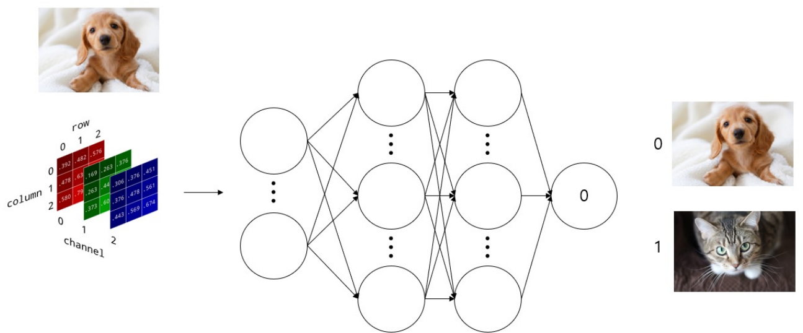

*Figure 7. A classification model that turns an image into an array of rows, columns, and channels, feeds it to a neural network, and outputs 0 for a dog and 1 for a cat*

Computers process all data as arrays of numbers, that is, **tensors**. A color image is a three-dimensional array of rows, columns, and channels. There are three channels, red (R), green (G), and blue (B), and each element gives the brightness of that color at that position as an integer from 0 to 255. The small example in Figure 7 is a $3 \times 3 \times 3$ array with 3 rows, 3 columns, and 3 channels. The values of this array enter the input layer, pass through the hidden layers, and produce a value close to 0 or 1 at the output layer.

Before training, the weights are arbitrary values, so the network can produce a value far from 0 even for a dog photo. The process of adjusting the weights over many dog and cat photos so that dogs give 0 and cats give 1 is **training**.

### 2.4 The Three Steps of Training

From a mechanical point of view, learning means changing the weights through a series of repeated steps so that the network's output gradually converges to the desired expected value. Training a neural network consists of repeating the following three steps.

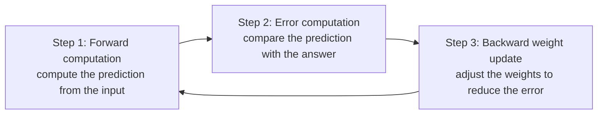

*Figure 8. Neural network training as a repetition of forward computation, error computation, and backward weight update*

1. **Forward computation:** starting from the inputs $x_1, x_2$, compute the hidden nodes $a_1, a_2, a_3$ with the first-layer weights $w_1^{(1)}, \dots, w_6^{(1)}$, and then compute the output $out$ (the prediction) with the second-layer weights $w_1^{(2)}, w_2^{(2)}, w_3^{(2)}$. Because it proceeds from input to output, it is also called **forward propagation** (Sections 3 and 6.2).
2. **Error computation:** measure the difference between the prediction $out$ and the answer $y$ (the expected value) with a loss function (Section 4).
3. **Backward weight update:** correct the weights in the direction that reduces the error, going back from the weights near the output layer to those near the input layer. Error backpropagation (Section 6) computes how much each weight contributed to the error, and gradient descent (Section 5) uses that contribution to correct the weights.

The superscripts $(1), (2)$ indicate which layer a weight belongs to.

---

<br>

## 3. Activation Functions

### 3.1 Bias and Activation Functions

An artificial neuron adds a **bias** $b$ to the weighted sum and passes the result through an **activation function** $h$ to produce its output.

$$
y = h(w_1x_1 + w_2x_2 + b)
$$

- The **bias** controls how easily the neuron is activated. It acts like the intercept of a line, allowing the neuron to output a nonzero value even when all inputs are 0 and letting the model fit the data more flexibly. In diagrams it is sometimes drawn as a weight $b$ on an input whose value is always 1.
- The **activation function** converts the total input signal $a = w_1x_1 + w_2x_2 + b$ into the output signal. It decides whether the total input signal activates the neuron.

For example, if $x_1 = 1$, $x_2 = 0.5$, $w_1 = 0.4$, $w_2 = -0.2$, and $b = 0.1$, the total is as follows.

$$
a = 0.4 \times 1 + (-0.2) \times 0.5 + 0.1 = 0.4 - 0.1 + 0.1 = 0.4
$$

If the activation function is the sigmoid $\sigma(a) = 1/(1+e^{-a})$, the output is $\sigma(0.4) \approx 0.599$. With the same inputs and weights, changing only the bias to $b = -1$ gives $a = -0.7$, and the output drops to $\sigma(-0.7) \approx 0.332$. The smaller the bias (the more negative it is), the larger the input signal needed to activate the neuron.

### 3.2 Types of Activation Functions

The representative activation functions are as follows. The total input signal is written $s$ and the activation function $\tau(s)$.

| Function | Formula $\tau(s)$ | First derivative $\tau'(s)$ | Output range |
|:-----|:-----|:-----|:-----|
| Step function | $1$ if $s \ge 0$, $-1$ if $s < 0$ | $0$ if $s \ne 0$, not differentiable at $s = 0$ | $-1$ and $1$ |
| Logistic sigmoid | $\dfrac{1}{1 + e^{-as}}$ | $a\tau(s)(1 - \tau(s))$ | $(0, 1)$ |
| Hyperbolic tangent sigmoid (tanh) | $\dfrac{2}{1 + e^{-as}} - 1$ | $\dfrac{a}{2}(1 - \tau(s)^2)$ | $(-1, 1)$ |
| Softplus | $\log_e(1 + e^{s})$ | $\dfrac{1}{1 + e^{-s}}$ | $(0, \infty)$ |
| ReLU (rectified linear unit) | $\max(0, s)$ | $0$ if $s < 0$, $1$ if $s > 0$, not differentiable at $s = 0$ | $[0, \infty)$ |

*Table 7. Formulas, derivatives, and output ranges of representative activation functions*

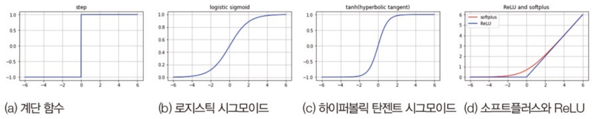

*Figure 9. Graphs of the step function, logistic sigmoid, hyperbolic tangent sigmoid, softplus, and ReLU*

$a$ is a constant that sets the steepness of the curve, and $a = 1$ is usual. In that case the logistic sigmoid is written $\sigma(s)$, and its derivative $\sigma'(s) = \sigma(s)(1 - \sigma(s))$ is derived as follows.

$$
\sigma(s) = (1 + e^{-s})^{-1} \quad\Rightarrow\quad \sigma'(s) = -(1 + e^{-s})^{-2} \cdot (-e^{-s}) = \frac{e^{-s}}{(1 + e^{-s})^2} = \frac{1}{1 + e^{-s}} \cdot \frac{e^{-s}}{1 + e^{-s}} = \sigma(s)\,(1 - \sigma(s))
$$

The last equality holds because $\dfrac{e^{-s}}{1 + e^{-s}} = 1 - \dfrac{1}{1 + e^{-s}} = 1 - \sigma(s)$. This derivative has its maximum $0.5 \times 0.5 = 0.25$ at $s = 0$, a property related to gradients becoming smaller and smaller in deep networks (vanishing gradients in Lecture 2 Section 3.6 and Lecture 3 Section 5). The hyperbolic tangent sigmoid satisfies $\dfrac{2}{1 + e^{-as}} - 1 = \tanh(as/2)$, so with $a = 2$ it equals the ordinary $\tanh(s)$.

Evaluating the functions at a few inputs gives the following ($a = 1$, and tanh is the ordinary $\tanh(s)$).

| $s$ | Sigmoid | tanh | Softplus | ReLU |
|:-----:|:-----:|:-----:|:-----:|:-----:|
| $-2$ | 0.119 | −0.964 | 0.127 | 0 |
| $0$ | 0.5 | 0 | 0.693 | 0 |
| $2$ | 0.881 | 0.964 | 2.127 | 2 |

*Table 8. Values of the activation functions at three inputs*

Because the sigmoid outputs a value between 0 and 1, it is widely used in the final output layer of binary classification problems. For example, a final output below 0.5 can be classified as a dog and one of 0.5 or above as a cat. ReLU is simple to compute and has derivative 1 on the positive side, so gradients do not shrink there, and it is widely used in the hidden layers of deep networks [1].

### 3.3 Output-Layer Activation Functions: Sigmoid and Softmax

Two functions are commonly used in the final output layer, depending on the kind of problem.

- **Sigmoid:** makes the output lie between 0 and 1. It is used on the single output node of **binary classification**, where the output is interpreted as the probability of one class and 0.5 is usually the threshold.
- **Softmax:** normalizes the values of $K$ output nodes so that each lies between 0 and 1 and their sum is always 1. It is used on as many output nodes as there are classes in **multi-class classification**, and the class with the largest probability is chosen as the prediction.

Softmax transforms the output-layer values $z_1, \dots, z_K$ as follows.

$$
\text{softmax}(z)_i = \frac{e^{z_i}}{\sum_{j=1}^{K} e^{z_j}}, \qquad i = 1, \dots, K
$$

An output-layer value $z_i$ before the activation function is applied is called a **logit**. For example, if the logits for the three classes dog, cat, and chicken are $z = (2.0, 1.0, 0.1)$, the computation proceeds as follows.

| Step | Dog | Cat | Chicken | Sum |
|:-----|:-----:|:-----:|:-----:|:-----:|
| Logit $z_i$ | 2.0 | 1.0 | 0.1 | |
| $e^{z_i}$ | 7.389 | 2.718 | 1.105 | 11.213 |
| $e^{z_i} / 11.213$ | 0.659 | 0.242 | 0.099 | 1.000 |

*Table 9. Applying softmax to the logits (2.0, 1.0, 0.1)*

The exponential is always positive, so every output is positive, and the denominator is the sum of the numerators, so the outputs sum to 1. The exponential is also increasing, so the order of the logits is preserved as the order of the probabilities.

| Problem | Output nodes | Output-layer function | Example output |
|:-----|:-----|:-----|:-----|
| Binary classification (dog or cat) | 1 | Sigmoid | 0.07 (probability of cat, so probability of dog 0.93) |
| Multi-class classification (dog, cat, chicken) | 3 | Softmax | Probability of dog 0.73, cat 0.19, chicken 0.08 |

*Table 10. Example outputs for a puppy photo depending on the output-layer function*

> **Note:** Explanations of outputs like those in Table 10 sometimes write the values entering the activation functions as large numbers such as 22.5 and (32.8, 12.3, −1.2), but actually applying the sigmoid and softmax to them gives results close to 1.0000 and (1.0000, 0.0000, 0.0000), which do not match the probabilities in Table 10. A logit of about −2.59 gives 0.07, and an example of logits that give (0.73, 0.19, 0.08) is (2.21, 0.86, 0).

> **Note:** Adding the same constant to every logit does not change the softmax result, because the numerator and denominator are multiplied by the same $e^{c}$. Practical implementations use this property to subtract the largest logit before taking exponentials, which prevents numerical overflow. Also, a softmax over two classes is the same as applying the sigmoid to the difference of the two logits.

### 3.4 Why Nonlinearity Is Needed: An Algebraic Check

A **linear function** is a function that can be expressed by a single straight line, $f(x) = ax + b$, and a **nonlinear function** is one that cannot. The activation functions of a neural network must be nonlinear, because with linear activation functions there is no point in making the network deeper. If there is no activation function or it is linear, the result after any number of hidden layers is the same as a single linear transformation.

Suppose that in a network made of one input $x_1$, two hidden nodes ($a_1, a_2$), and a next-layer node $b_1$, the activation function is the linear function $h(x) = cx$.

$$
a_1 = h(w_1^{(1)}x_1) = cw_1^{(1)}x_1, \qquad a_2 = h(w_2^{(1)}x_1) = cw_2^{(1)}x_1
$$

$$
\begin{aligned}
b_1 &= h(w_1^{(2)}a_1 + w_2^{(2)}a_2) = cw_1^{(2)}a_1 + cw_2^{(2)}a_2 \\
&= c^2w_1^{(1)}w_1^{(2)}x_1 + c^2w_2^{(1)}w_2^{(2)}x_1 \\
&= \left(c^2w_1^{(1)}w_1^{(2)} + c^2w_2^{(1)}w_2^{(2)}\right)x_1
\end{aligned}
$$

The expression in parentheses is a constant that does not depend on $x_1$. This two-layer network therefore computes the same function as the one-layer network $b_1 = h\left((cw_1^{(1)}w_1^{(2)} + cw_2^{(1)}w_2^{(2)})x_1\right)$, whose weight is replaced by $w_1^{(1)} \to cw_1^{(1)}w_1^{(2)} + cw_2^{(1)}w_2^{(2)}$. For example, with $c = 1$, $w_1^{(1)} = 2$, $w_2^{(1)} = 3$, $w_1^{(2)} = 4$, and $w_2^{(2)} = 5$, we get $b_1 = (2 \cdot 4 + 3 \cdot 5)x_1 = 23x_1$, which cannot be distinguished from a single connection with weight 23.

The same argument holds with more nodes and layers. Writing the weights of layer $l$ as a matrix $W_l$ and its biases as a vector $\mathbf{b}_l$, two layers without activation functions compute the following.

$$
W_2(W_1\mathbf{x} + \mathbf{b}_1) + \mathbf{b}_2 = (W_2W_1)\mathbf{x} + (W_2\mathbf{b}_1 + \mathbf{b}_2) = W'\mathbf{x} + \mathbf{b}'
$$

However many layers are stacked, the result equals one layer with a single matrix $W'$ and vector $\mathbf{b}'$. Only by inserting nonlinear activation functions between the layers does this collapse not happen, so that stacking more layers can express more complex functions.

> **[Linear Algebra]** In linear algebra, the composition of linear transformations is again a linear transformation whose matrix is the product $W_2W_1$ of the two matrices. Because matrix multiplication is associative, composing $n$ linear transformations is still represented by the single matrix $W_n \cdots W_2W_1$. The equation above shows that, because of this property, depth loses its meaning when the layers of a neural network are linear.

### 3.5 Why Nonlinearity Is Needed: A Conceptual Check

Conceptually, the need for nonlinearity can be understood from the shape of the boundary that separates the data.

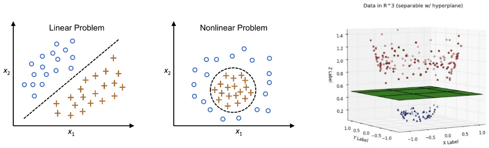

*Figure 10. A linear problem separated by a line, a nonlinear problem separated by a circle, and data that a plane separates after moving to three dimensions*

- **Linear problem:** in the left plot, the circles (○) and crosses (+) are separated by a single dashed line. A linear model is enough.
- **Nonlinear problem:** in the middle plot, the crosses lie inside a circular boundary and the circles outside it. No straight line can separate the two groups.
- **Transformation to a higher dimension:** as in the right plot, moving the data into three-dimensional space splits the two groups by height so that a single hyperplane (the green plane) separates them. For example, if each point $(x_1, x_2)$ gets a third coordinate $x_1^2 + x_2^2$, points inside the circle are low and points outside are high, so the plane at height $r^2$ separates them ($r$ is the radius of the circular boundary).

Real data are rarely separated cleanly by straight lines. Hidden layers with nonlinear activation functions learn from data a transformation that moves the input into a space where it is easy to separate, as above.

A classic example is the XOR problem, whose output is 1 only when the two inputs differ. The points (0, 0) and (1, 1) map to 0 and (0, 1) and (1, 0) map to 1, so no single line separates them, but one hidden layer with a nonlinear function (here the step function $u$, which outputs 1 if $s \ge 0$ and 0 if $s < 0$) solves it. Setting the hidden nodes to $h_1 = u(x_1 + x_2 - 0.5)$ and $h_2 = u(x_1 + x_2 - 1.5)$ and the output to $y = u(h_1 - h_2 - 0.5)$ gives the following.

| $x_1$ | $x_2$ | $h_1$ | $h_2$ | $y$ |
|:-----:|:-----:|:-----:|:-----:|:-----:|
| 0 | 0 | $u(-0.5) = 0$ | $u(-1.5) = 0$ | $u(-0.5) = 0$ |
| 0 | 1 | $u(0.5) = 1$ | $u(-0.5) = 0$ | $u(0.5) = 1$ |
| 1 | 0 | $u(0.5) = 1$ | $u(-0.5) = 0$ | $u(0.5) = 1$ |
| 1 | 1 | $u(1.5) = 1$ | $u(0.5) = 1$ | $u(-0.5) = 0$ |

*Table 11. Computing XOR with a single nonlinear hidden layer*

$h_1$ means "at least one is 1" and $h_2$ means "both are 1", so $y$ means "at least one is 1 but not both", which is XOR.

---

<br>

## 4. Loss Functions

### 4.1 Computing the Error

The second step of training is error computation. The closer the network's output vector (prediction) $\mathbf{o}$ is to the answer vector (true value) $\mathbf{y}$, the better the model has recognized the data. If they differ, the weights must be updated so that $\mathbf{o}$ and $\mathbf{y}$ move closer, and the larger the error, the larger the update.

- **Binary classification:** the model receives the input vector $x_1, \dots, x_n$ and produces a single output $o$. It decides dog if $o < 0.5$ and cat otherwise.
- **Multi-class classification:** the model produces a prediction vector of outputs $o_1, \dots, o_c$, one per class. The answer is represented by a label vector $y_1, \dots, y_c$ whose entry for the correct class is 1 and whose other entries are 0.

| Output node | Prediction vector $\mathbf{o}$ | Label vector $\mathbf{y}$ (when dog is correct) |
|:-----|:-----:|:-----:|
| $o_1$: probability of dog | 0.8 | 1 |
| $o_k$: probability of cat | 0.1 | 0 |
| $o_c$: probability of chicken | 0.1 | 0 |

*Table 12. The prediction vector and label vector of multi-class classification for a dog photo*

> **Definition:** A vector with a 1 in exactly one entry and 0 in all others is called a **one-hot vector**. The label vector of multi-class classification is a one-hot vector with a 1 only at the correct class.

### 4.2 Mean Squared Error

A **loss function** expresses the error (loss) between a deep learning model's output and the answer as a single number. The goal of deep learning training is to find the weights and biases that minimize the loss. Representative loss functions include the mean squared error (MSE), cross-entropy, and focal loss.

The **mean squared error (MSE)** is the average of the squared differences between the answers $y_i$ and the predictions $\hat{y}_i$.

$$
\text{MSE} = \frac{1}{N}\sum_{i=1}^{N}\left(y_i - \hat{y}_i\right)^2
$$

For the example in Section 4.1, the MSE between the prediction $\hat{\mathbf{y}} = (0.8, 0.1, 0.1)$ and the answer $\mathbf{y} = (1, 0, 0)$ is as follows ($N = 3$).

$$
\text{MSE} = \frac{(1 - 0.8)^2 + (0 - 0.1)^2 + (0 - 0.1)^2}{3} = \frac{0.04 + 0.01 + 0.01}{3} = 0.02
$$

If the prediction worsens to $(0.3, 0.4, 0.3)$, the loss grows to $\text{MSE} = (0.49 + 0.16 + 0.09)/3 \approx 0.247$. Because the differences are squared, large errors are penalized more, and the loss is at least 0 regardless of the sign of the error. As in Section 6, the sum of squared errors multiplied by $1/2$ instead of $1/N$ is sometimes used, because the exponent 2 and the $1/2$ cancel when differentiating and the formula becomes simpler. MSE is used mainly for regression, which predicts continuous values.

### 4.3 Cross-Entropy and Focal Loss

**Cross-entropy** is the most widely used loss function for classification. For a label vector $\mathbf{y}$ and a predicted probability vector $\mathbf{o}$, it is defined as follows.

$$
L_{\text{CE}} = -\sum_{k=1}^{c} y_k \log o_k
$$

If the label vector is one-hot, only the term of the correct class $t$ remains and $L_{\text{CE}} = -\log o_t$. In the example above, if the predicted probability of the correct class (dog) is 0.8, the loss is $-\ln 0.8 \approx 0.223$, and if it is 0.3, the loss is $-\ln 0.3 \approx 1.204$. When the probability of the correct class is close to 1 the loss is close to 0, and when it is close to 0 the loss grows without bound. Cross-entropy therefore puts a very large penalty on confident wrong predictions.

In binary classification, if the output $o$ is taken as the probability of class 1, cross-entropy becomes the following **binary cross-entropy**.

$$
L_{\text{BCE}} = -\left[y\log o + (1 - y)\log(1 - o)\right]
$$

If the answer is $y = 1$, only $-\log o$ remains, and if $y = 0$, only $-\log(1 - o)$ remains. For example, if the sigmoid output separating dog (0) from cat (1) is $o = 0.07$ for a dog photo, then $L_{\text{BCE}} = -\ln(1 - 0.07) = -\ln 0.93 \approx 0.073$.

**Focal loss** multiplies cross-entropy by $(1 - p_t)^{\gamma}$, reducing the loss of easy examples that are already predicted well and concentrating training on hard examples [2]. Here $p_t$ is the predicted probability of the correct class and $\gamma \ge 0$ is a focusing parameter.

$$
L_{\text{FL}} = -(1 - p_t)^{\gamma}\log p_t
$$

With $\gamma = 2$, an easy example with $p_t = 0.8$ gets $(0.2)^2 \times 0.223 \approx 0.0089$, 1/25 of its cross-entropy, but a hard example with $p_t = 0.3$ gets $(0.7)^2 \times 1.204 \approx 0.590$, reduced only by about half. With $\gamma = 0$ it equals cross-entropy. Focal loss was proposed for object detection (Lecture 5), where easy examples such as background vastly outnumber the others.

| Loss function | Formula | Main use |
|:-----|:-----|:-----|
| Mean squared error | $\frac{1}{N}\sum (y_i - \hat{y}_i)^2$ | Regression |
| Cross-entropy | $-\sum y_k \log o_k$ | Classification (with softmax or sigmoid outputs) |
| Focal loss | $-(1 - p_t)^{\gamma}\log p_t$ | Classification with severe class imbalance, object detection |

*Table 13. Formulas and uses of representative loss functions*

---

<br>

## 5. Gradient Descent

### 5.1 Optimization with Derivatives

If the loss is viewed as a function $J(\theta)$ of the weights, training is the **optimization** problem of finding the $\theta$ that minimizes $J(\theta)$. The slope of the tangent line, that is, the derivative, carries information about the direction and rate at which the function changes at that point.

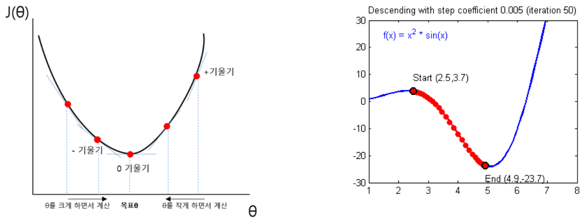

*Figure 11. Finding the direction of the minimum from the slope of the tangent, and the path of gradient descent down to a local minimum of x² sin x*

- In the left graph, the slope is negative to the left of the minimum and positive to the right, and it is 0 at the minimum (the target $\theta$). Moving so that $\theta$ increases when the slope is negative and decreases when the slope is positive brings $\theta$ closer to the minimum.
- To find the minimum of a function, one can differentiate and find where the slope is 0. However, the loss function of a neural network is a complicated function of millions of weights, so the equation for a zero slope cannot be solved at once. There are also many points with zero slope, and there is no guarantee that a local minimum among them is the global minimum.
- So the slope at the current position is computed and a small step is taken in the opposite direction, repeatedly. This method is **gradient descent**. A larger tangent slope calls for a larger update.

$$
\theta \leftarrow \theta - \eta\,\frac{\partial J}{\partial \theta}
$$

$\eta$ is a positive number that sets how far to move at once (Section 5.2). The right graph applies gradient descent to $f(x) = x^2\sin x$. Starting from $(2.5, 3.7)$, it descends along the valley (the graph marks the position after 50 iterations near $x = 4.9$), and further iterations converge to the local minimum $(5.09, -24.08)$ at $x \approx 5.09$. Because ever deeper valleys keep appearing as $x$ grows in $x^2\sin x$, this point is only a local minimum and not the minimum of the whole function. Gradient descent can converge to a local minimum near the starting point.

**Worked example.** Start from $w_0 = 0$ with $\eta = 0.1$ on $J(w) = (w - 3)^2$. The derivative is $J'(w) = 2(w - 3)$.

| Iteration $k$ | $w_k$ | Gradient $2(w_k - 3)$ | $w_{k+1} = w_k - 0.1 \times$ gradient |
|:-----:|:-----:|:-----:|:-----:|
| 0 | 0 | −6 | 0.6 |
| 1 | 0.6 | −4.8 | 1.08 |
| 2 | 1.08 | −3.84 | 1.464 |
| 3 | 1.464 | −3.072 | 1.7712 |
| 4 | 1.7712 | −2.4576 | 2.0170 |

*Table 14. Gradient descent on J(w) = (w − 3)² with learning rate 0.1*

The gradient is negative, so $w$ moves in the increasing direction, and as it approaches the minimum $w = 3$ the magnitude of the gradient shrinks and so does the step. In general $w_{k+1} - 3 = (1 - 0.2)(w_k - 3)$, so $w_k = 3 - 3 \times 0.8^k$, and $w_k \to 3$ as $k$ grows.

> **[Calculus]** In calculus, the gradient $\nabla J = \left(\frac{\partial J}{\partial \theta_1}, \dots, \frac{\partial J}{\partial \theta_n}\right)$ is the vector of partial derivatives with respect to each variable, and it points in the direction in which the function increases fastest. Hence $-\nabla J$ is the direction of fastest decrease, and gradient descent $\boldsymbol{\theta} \leftarrow \boldsymbol{\theta} - \eta\nabla J$ moves all weights a little in this direction at the same time.

### 5.2 Learning Rate

Smooth convergence to the minimum requires an appropriate step size, that is, a suitable **learning rate** $\eta$.

$$
w \leftarrow w - \eta\,\frac{\partial L}{\partial w}
$$

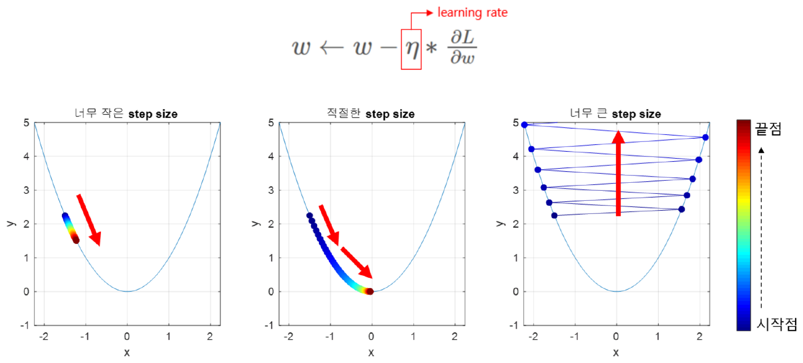

*Figure 12. Paths on y = x² when the learning rate is too small, appropriate, and too large*

The color of the points in Figure 12 changes from the start point (blue) to the end point (red). If the learning rate is too small, the same number of iterations does not reach the minimum; if it is appropriate, the minimum is reached; and if it is too large, the steps overshoot the minimum, bounce between the two sides of the valley, and climb higher and higher (divergence).

This can be confirmed by calculation on $f(w) = w^2$. Since $f'(w) = 2w$, the update is $w \leftarrow w - \eta \cdot 2w = (1 - 2\eta)w$. Five updates from $w_0 = 2$ give the following.

| Learning rate $\eta$ | $1 - 2\eta$ | $w_1, w_2, \dots, w_5$ | Result |
|:-----:|:-----:|:-----|:-----|
| 0.01 | 0.98 | 1.96, 1.9208, 1.8824, 1.8447, 1.8078 | Too slow |
| 0.3 | 0.4 | 0.8, 0.32, 0.128, 0.0512, 0.0205 | Converges quickly |
| 0.9 | −0.8 | −1.6, 1.28, −1.024, 0.8192, −0.6554 | Converges while alternating sides |
| 1.1 | −1.2 | −2.4, 2.88, −3.456, 4.1472, −4.9766 | Diverges |

*Table 15. Progress of gradient descent on f(w) = w² for different learning rates*

Since $w_k = (1 - 2\eta)^k w_0$, the iteration converges only when $\lvert 1 - 2\eta \rvert < 1$, that is, $0 < \eta < 1$. This range applies to $w^2$; for a general loss function, the acceptable size of the learning rate depends on how sharply the function curves (its curvature).

### 5.3 Optimizers

A concrete algorithm that searches for the minimum of the loss function is called an **optimizer**, and there are many of them. The updates of classical stochastic gradient descent (SGD) and of SGD with momentum are as follows ($\rho$ is the learning rate and $\alpha$ the momentum coefficient).

$$
\text{Classical SGD: } \mathbf{w} \leftarrow \mathbf{w} - \rho\frac{\partial J}{\partial \mathbf{w}} \qquad\qquad \text{SGD with momentum: } \mathbf{v} \leftarrow \alpha\mathbf{v} - \rho\frac{\partial J}{\partial \mathbf{w}}, \quad \mathbf{w} \leftarrow \mathbf{w} + \mathbf{v}
$$

In momentum, $\mathbf{v}$ is a velocity vector that keeps the previous movement scaled by $\alpha$ (usually 0.9). If the gradient keeps pointing the same way, the movement accelerates, and if its direction alternates, the movements cancel and oscillation decreases. Optimizers can be compared to ways of finding a good narrow trail down a mountain, and they have developed as follows.

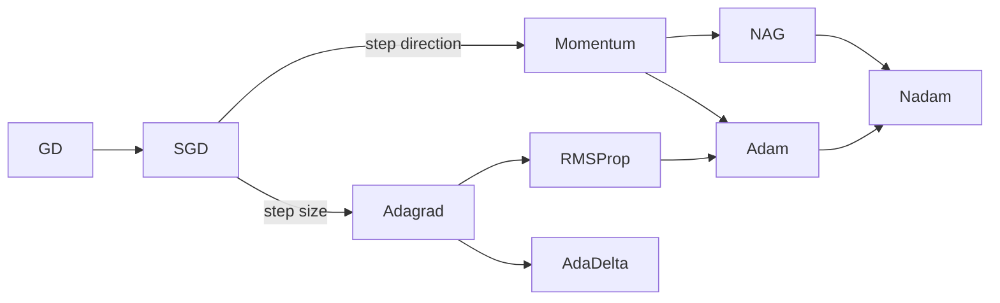

*Figure 13. The lineage of optimizers, split into a branch that improves the step direction and a branch that improves the step size*

| Optimizer | Idea |
|:-----|:-----|
| GD (gradient descent) | Examines all training data to compute the slope at the current position and decide the direction. |
| SGD (stochastic gradient descent) | Looking at everything for one step takes too long, so it decides quickly from part of the data (a mini-batch, Section 7.4). It moves further in the same amount of time. |
| Momentum | Adds the inertia of the direction it was already moving in to the step computed from the gradient. |
| NAG (Nesterov accelerated gradient) | First moves in the direction of inertia and computes the gradient at that point, correcting overshooting in advance. |
| Adagrad | Accumulates the squared gradients of each weight, so weights that have been updated a lot take smaller steps for a fine search and weights updated little take larger steps. |
| RMSProp | Shrinks the step like Adagrad, but uses an exponential moving average of recent squared gradients instead of the cumulative sum, adapting to the recent situation. |
| AdaDelta | Prevents Adagrad's step from becoming so small that learning stops. |
| Adam | Combines Momentum (direction) and RMSProp (step size), adjusting both the direction and the step size appropriately. |
| Nadam | Uses NAG instead of Momentum in Adam. |

*Table 16. Ideas of the main optimizers*

When the paths of several optimizers are compared on a surface with a saddle point, which goes down in one direction and up in another, SGD tends to linger near the saddle point, methods that adapt the step size per weight such as Adagrad, AdaDelta, and RMSProp escape quickly, and Momentum and NAG escape after swinging wide because of their inertia [3].

Adam, the most widely used optimizer today, keeps both a moving average $m_t$ of the gradient $g_t$ (direction) and a moving average $v_t$ of the squared gradient (step size) [4].

$$
m_t = \beta_1 m_{t-1} + (1 - \beta_1)g_t, \quad v_t = \beta_2 v_{t-1} + (1 - \beta_2)g_t^2, \quad \hat{m}_t = \frac{m_t}{1 - \beta_1^t}, \quad \hat{v}_t = \frac{v_t}{1 - \beta_2^t}, \quad w_t = w_{t-1} - \eta\frac{\hat{m}_t}{\sqrt{\hat{v}_t} + \epsilon}
$$

$\hat{m}_t$ and $\hat{v}_t$ correct the bias of moving averages started at 0, which are too small at first, and the defaults are $\beta_1 = 0.9$, $\beta_2 = 0.999$, and $\epsilon = 10^{-8}$. Dividing by $\sqrt{\hat{v}_t}$ shrinks the step for weights whose gradients fluctuate strongly.

---

<br>

## 6. Error Backpropagation

### 6.1 The Idea of Backpropagation

Gradient descent requires the partial derivative of the loss $\partial L/\partial w$ for every weight $w$. **Error backpropagation** computes these partial derivatives in order, starting from the weights near the output layer and going back toward the input layer [5]. Derivatives computed on the output side are reused when computing the derivatives of the layer before, so the gradients of all weights can be obtained with roughly the cost of one forward pass. Each weight then changes a little with its gradient as follows.

$$
w \leftarrow w - \eta\,\frac{\partial L}{\partial w}
$$

Backpropagation proceeds in this order. It first computes how the weights directly connected to the output layer affected the error, then computes the responsibility of the hidden layer just before in a chain, and repeats this down to the first layer. When it finishes, it is known how much and in which direction (sign) every weight contributed to the final error.

### 6.2 Forward Propagation in the Example Network

Backpropagation is computed from start to finish on the following network. There is a single input $x_1 = 0.5$, the hidden and output layers have two nodes each, and the target values (answers) of the outputs $y_1, y_2$ are 0.3 and 0.9. To keep the computation simple, there are no biases.

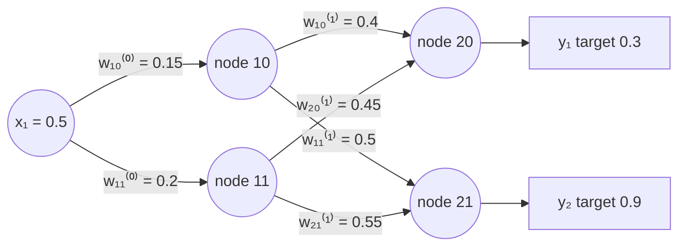

*Figure 14. The backpropagation example network with one input, two hidden nodes, and two output nodes, and its initial weights*

**Notation.** Node $ij$ is the $j$-th node of layer $i$ (the hidden layer has nodes 10 and 11 and the output layer nodes 20 and 21). Each node's $z$ is the weighted sum of its incoming values, and $a = \sigma(z)$ is its output after applying the sigmoid to that sum. In a weight $w_{ij}^{(l)}$, the superscript $l$ gives the weight layer, the subscript $i$ gives the position of the source node within its layer (1 is upper, 2 is lower), and $j$ gives the number of the destination node (0 is upper, 1 is lower). For example, $w_{20}^{(1)}$ is the weight from the lower hidden node (node 11) to the upper output node (node 20).

Forward propagation gives the following node values (rounded to four decimal places).

| Node | Weighted sum $z$ | Output $a = \sigma(z)$ |
|:-----|:-----|:-----:|
| 10 | $z_{10} = 0.15 \times 0.5 = 0.075$ | $a_{10} = 0.5187$ |
| 11 | $z_{11} = 0.2 \times 0.5 = 0.1$ | $a_{11} = 0.5250$ |
| 20 | $z_{20} = 0.4 \times 0.5187 + 0.45 \times 0.5250 = 0.2075 + 0.2362 = 0.4437$ | $a_{20} = 0.6091$ |
| 21 | $z_{21} = 0.5 \times 0.5187 + 0.55 \times 0.5250 = 0.2594 + 0.2887 = 0.5481$ | $a_{21} = 0.6337$ |

*Table 17. Forward propagation results of the example network*

The output $y_1 = a_{20} = 0.6091$ is larger than its target 0.3, and $y_2 = a_{21} = 0.6337$ is smaller than its target 0.9. Defining the total error as the sum of squared errors multiplied by $1/2$ gives the following.

$$
E_{tot} = \frac{1}{2}\left((target_{y1} - a_{20})^2 + (target_{y2} - a_{21})^2\right) = \frac{1}{2}\left((0.3 - 0.6091)^2 + (0.9 - 0.6337)^2\right) = \frac{1}{2}(0.0956 + 0.0709) \approx 0.0832
$$

### 6.3 Decomposing the Gradient with the Chain Rule

Training the weight $w_{10}^{(1)}$ (the weight from node 10 to node 20) requires $\partial E_{tot}/\partial w_{10}^{(1)}$. $w_{10}^{(1)}$ changes $z_{20}$, $z_{20}$ changes $a_{20}$, and $a_{20}$ changes $E_{tot}$. Splitting the derivative into three parts along this chain of influence is the **chain rule**.

$$
\frac{\partial E_{tot}}{\partial w_{10}^{(1)}} = \underbrace{\frac{\partial E_{tot}}{\partial a_{20}}}_{①} \cdot \underbrace{\frac{\partial a_{20}}{\partial z_{20}}}_{②} \cdot \underbrace{\frac{\partial z_{20}}{\partial w_{10}^{(1)}}}_{③}
$$

① **Rate of change of the error with respect to the output.** The second term of $E_{tot}$ does not contain $a_{20}$, so its derivative is 0. The first term is $\frac{1}{2}u^2$ with $u = target_{y1} - a_{20}$, whose derivative is $u \cdot \frac{\partial u}{\partial a_{20}} = u \cdot (-1)$.

$$
\frac{\partial E_{tot}}{\partial a_{20}} = (target_{y1} - a_{20}) \cdot (-1) + 0 = -(target_{y1} - a_{20})
$$

② **Rate of change of the output with respect to the weighted sum.** Since $a_{20} = \text{sigmoid}(z_{20})$, the sigmoid derivative of Section 3.2 applies.

$$
\frac{\partial a_{20}}{\partial z_{20}} = \text{sigmoid}(z_{20}) \cdot (1 - \text{sigmoid}(z_{20})) = a_{20}(1 - a_{20})
$$

③ **Rate of change of the weighted sum with respect to the weight.** $z_{20} = w_{10}^{(1)}a_{10} + w_{20}^{(1)}a_{11}$, and the second term does not depend on $w_{10}^{(1)}$.

$$
\frac{\partial z_{20}}{\partial w_{10}^{(1)}} = a_{10} + 0 = a_{10}
$$

Multiplying the three parts gives the following.

$$
\frac{\partial E_{tot}}{\partial w_{10}^{(1)}} = -(target_{y1} - a_{20}) \cdot \text{sigmoid}(z_{20}) \cdot (1 - \text{sigmoid}(z_{20})) \cdot a_{10}
$$

> **[Calculus]** In calculus, the chain rule is the differentiation rule for composite functions: if $y = f(u)$ and $u = g(x)$, then $\frac{dy}{dx} = \frac{dy}{du}\cdot\frac{du}{dx}$. With several variables, when $x$ affects $y$ along several paths, the products along each path are added. In Section 6.5, the output of a hidden node affects both output nodes, and adding the contributions of the two paths is this multivariable chain rule.

### 6.4 Updating One Output-Layer Weight

Substitute the values of Table 17.

$$
\frac{\partial E_{tot}}{\partial w_{10}^{(1)}} = -(0.3 - 0.6091) \times 0.6091 \times (1 - 0.6091) \times 0.5187 = 0.3091 \times 0.2381 \times 0.5187 \approx 0.0382
$$

With the learning rate $\eta = 0.5$, the gradient descent update is as follows.

$$
w_{10}^{(1)+} = w_{10}^{(1)} - \eta\,\frac{\partial E_{tot}}{\partial w_{10}^{(1)}} = 0.4 - 0.5 \times 0.0382 = 0.3809
$$

The effect of $w_{10}^{(1)}$ on the total error is 0.0382, and the updated value $w_{10}^{(1)+}$ is 0.3809. A positive gradient means that increasing $w_{10}^{(1)}$ increases the error. Indeed, the output $a_{20} = 0.6091$ is larger than the target 0.3, so decreasing this weight to lower $a_{20}$ is the right direction.

> **Note:** If the intermediate values are cut to three decimal places ($a_{20} = 0.609$, $a_{10} = 0.518$), the gradient becomes $0.309 \times 0.609 \times 0.391 \times 0.518 \approx 0.0381$ and the updated value $0.4 - 0.5 \times 0.0381 \approx 0.381$. Only the last digit changes slightly with the cut-off position; the result is the same.

### 6.5 Updating All Weights and the Result of One Backpropagation Pass

The remaining weights are computed the same way. To simplify the formulas, the **error signal** $\delta$ of an output node is defined as the product of ① and ②.

$$
\delta_{20} = (a_{20} - target_{y1})\,a_{20}(1 - a_{20}) = 0.3091 \times 0.2381 \approx 0.0736, \qquad \delta_{21} = (a_{21} - target_{y2})\,a_{21}(1 - a_{21}) = (-0.2663) \times 0.2321 \approx -0.0618
$$

The gradient of an output-layer weight is then "the $\delta$ of the destination node × the output of the source node".

| Weight | Connection | Gradient $\partial E_{tot}/\partial w$ | After update ($\eta = 0.5$) |
|:-----|:-----|:-----|:-----|
| $w_{10}^{(1)}$ | node 10 → node 20 | $\delta_{20}a_{10} = 0.0736 \times 0.5187 = 0.0382$ | $0.4 - 0.5 \times 0.0382 = 0.3809$ |
| $w_{20}^{(1)}$ | node 11 → node 20 | $\delta_{20}a_{11} = 0.0736 \times 0.5250 = 0.0386$ | $0.45 - 0.5 \times 0.0386 = 0.4307$ |
| $w_{11}^{(1)}$ | node 10 → node 21 | $\delta_{21}a_{10} = -0.0618 \times 0.5187 = -0.0321$ | $0.5 + 0.5 \times 0.0321 = 0.5160$ |
| $w_{21}^{(1)}$ | node 11 → node 21 | $\delta_{21}a_{11} = -0.0618 \times 0.5250 = -0.0325$ | $0.55 + 0.5 \times 0.0325 = 0.5662$ |

*Table 18. Gradients and updated values of the four output-layer weights*

$y_2$ is smaller than its target, so the gradients of the weights entering node 21 are negative, and the update increases those weights.

**Going back to the hidden layer.** The output $a_{10}$ of hidden node 10 affects both $z_{20}$ and $z_{21}$, so the contributions of the two paths are added (multivariable chain rule).

$$
\frac{\partial E_{tot}}{\partial a_{10}} = \delta_{20}w_{10}^{(1)} + \delta_{21}w_{11}^{(1)} = 0.0736 \times 0.4 + (-0.0618) \times 0.5 = 0.0294 - 0.0309 \approx -0.00147
$$

Multiplying by the sigmoid derivative $a_{10}(1 - a_{10}) = 0.5187 \times 0.4813 \approx 0.2496$ gives the error signal of hidden node 10, $\delta_{10} \approx -0.000366$, and multiplying by the input $x_1 = 0.5$ gives the gradient.

$$
\frac{\partial E_{tot}}{\partial w_{10}^{(0)}} = \delta_{10}\,x_1 \approx -0.000366 \times 0.5 \approx -0.000183, \qquad w_{10}^{(0)+} = 0.15 + 0.5 \times 0.000183 \approx 0.1501
$$

For hidden node 11 in the same way, $\delta_{20}w_{20}^{(1)} + \delta_{21}w_{21}^{(1)} = 0.0331 - 0.0340 \approx -0.00088$, $\delta_{11} \approx -0.00088 \times 0.2494 \approx -0.000219$, and the gradient is $\approx -0.000109$, so $w_{11}^{(0)+} \approx 0.2001$. The hidden-layer gradients use the output-layer weights before the update (0.4, 0.5, 0.45, 0.55), because backpropagation first computes all gradients and then updates all weights at once.

> **Key Point:** The general rule of backpropagation fits in three lines. The error signal of an output node is $\delta = (a - target)\,\sigma'(z)$, the error signal of a hidden node is $\delta_j = \left(\sum_k \delta_k w_{jk}\right)\sigma'(z_j)$ (the error signals of the next layer gathered backward through the weights), and the gradient of a weight is "the $\delta$ of the destination node × the output of the source node". It is called backpropagation because $\delta$ is passed backward one layer at a time starting from the output layer.

Running forward propagation again with the updated weights changes the outputs as follows.

| Stage | $y_1$ (target 0.3) | $y_2$ (target 0.9) | Total error $E_{tot}$ |
|:-----|:-----:|:-----:|:-----:|
| Before training | 0.6091 | 0.6337 | 0.0832 |
| After 1 pass | 0.6044 | 0.6376 | 0.0807 |
| After 10 passes | 0.5632 | 0.6691 | 0.0613 |
| After 100 passes | 0.3560 | 0.8092 | 0.0057 |
| After 1,000 passes | 0.2999 | 0.8977 | 0.000003 |

*Table 19. Changes in the outputs and the total error as backpropagation and updates are repeated*

One update moves the outputs only slightly, but repeating forward propagation, error computation, and backpropagation with updates makes both outputs converge to their targets. The three-step training of Section 2.4 is exactly this repetition.

> **Note:** Some materials give the state after training as $w_{20}^{(1)} = 0.250$, $w_{11}^{(0)} = 0.1909$, and $w_{10}^{(0)} = 0.1502$ with outputs $y_1 = 0.581$ and $y_2 = 0.638$, but following the backpropagation formulas above, the updated values are 0.4307, 0.2001, and 0.1501, and the outputs are 0.6044 and 0.6376. The other values 0.380, 0.516, and 0.567 differ from 0.3809, 0.5160, and 0.5662 above only in the last digit.

---

<br>

## 7. Training Basics

### 7.1 Training, Validation, and Test Sets

A dataset is divided into **training**, **validation**, and **test** sets. The three sets do not overlap.

```text
[ ORIGINAL SET                                      ]
[ TRAINING                            ][ TESTING    ]
[ TRAINING            ][ VALIDATION   ][ TESTING    ]
```

*Figure 15. Ways of dividing the original dataset into training, validation, and test sets*

| Dataset | Purpose | Typical share |
|:-----|:-----|:-----|
| Training set (train set) | Used to train the model, that is, to update the weights. | 60-80% |
| Validation set (valid set) | Used to measure the performance of models trained on the training set and to choose one of several models or hyperparameter settings. | 10-20% |
| Test set | Used only once, at the end, after the model to use has been decided, to measure that model's expected performance. | 10-20% |

*Table 20. Purposes and shares of the training, validation, and test sets*

For example, assume that models 1, 2, and 3 with different structures are trained on the training set and their accuracies on the validation set are 85%, 92%, and 87%. Model 2, with the highest validation accuracy, is chosen, and its accuracy of 90% measured on the test set is reported as its final performance.

The test set is needed separately for the following reason. The validation set has been used repeatedly for many models, and the chosen model may be the one whose performance happened to be measured as better by luck. The validation accuracy of 92% may therefore be optimistic. To reduce this error, the final performance is measured on a test set that was never used in the selection process. If the model is changed again after seeing the test result, the test set becomes contaminated like the validation set, so testing is done only once, at the end.

### 7.2 Overfitting and Underfitting

**Overfitting** is the phenomenon in which a model predicts the training data almost perfectly but performs much worse on new data it did not see during training. It is like a student who memorized the questions and answers of a workbook while studying for an exam and cannot solve new questions.

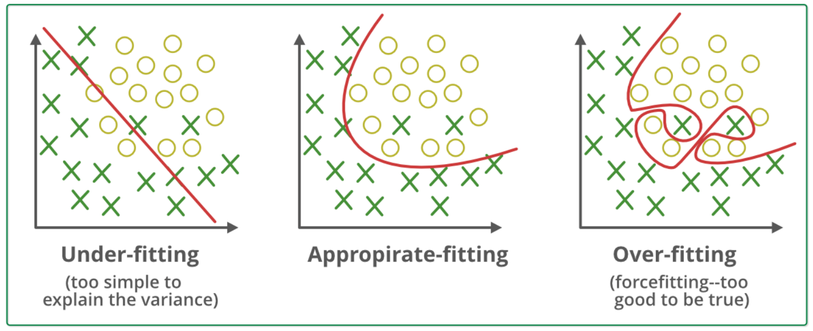

*Figure 16. Decision boundaries in the underfitting, appropriate fitting, and overfitting states*

| State | Decision boundary | Description |
|:-----|:-----|:-----|
| **Underfitting** | A single straight line | The model is too simple and has learned almost none of the patterns in the data. A single line cannot separate the two classes properly, so there are many errors even on the training data. |
| Appropriate fitting | A gentle curve | The ideal state, in which the model captures the overall trend of the data well and predicts new data well even if it misses a few exceptions. |
| **Overfitting** | A complicated curve that wraps even the exceptional points | The model is too complex and has memorized not only the main trend but also minor noise and outliers. It classifies the training data perfectly but is likely to misclassify new data. |

*Table 21. Comparison of underfitting, appropriate fitting, and overfitting*

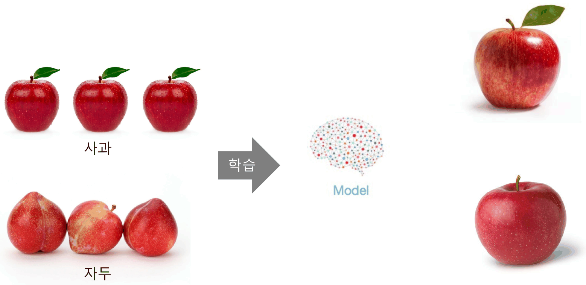

*Figure 17. A model trained on apples with leaves and on plums classifying new apple photos*

In the training data of Figure 17, every apple photo shows a bright red apple with a leaf, and every plum photo shows a red fruit without a leaf. If the model memorizes a property that appears in the training data only by chance, such as "it is an apple if it has a leaf", it gets a new apple with a leaf right but may misclassify an apple without a leaf as a plum. For the same reason, a model trained only on red apples may classify an apple tinged with yellow as another fruit. For appropriate training, the model must be led to "understand" the overall features of the data rather than "memorize" the data.

### 7.3 Ways to Reduce Overfitting

1. **Diversifying the data:** if the model is shown more and more varied data than it can memorize, it has no choice but to learn the essential common patterns of the data. More data are collected, or the existing images are transformed by flipping, cropping, color changes, and so on to increase their number, which is data augmentation (Lecture 4).
2. **Reducing the model's complexity:** the model is deliberately made simpler by reducing the number of layers or neurons per layer. Alternatively, a penalty term that keeps the weights from growing too large (for example, $L + \lambda\sum w^2$) is added to the loss function to regularize the weights. Large weights make the output react strongly to small changes in the input, so keeping the weights small leads the model to learn more general patterns.
3. **Dropout (node deletion):** at every training step, a random part of the neurons in the hidden layers is deactivated [6]. Since the network cannot rely on particular neurons, each neuron learns features that are useful on their own.

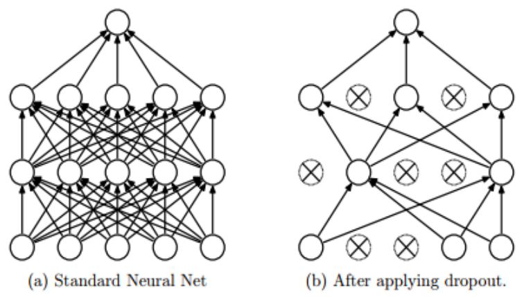

*Figure 18. A standard neural network and the network after applying dropout*

On the right of Figure 18, the nodes marked ⊗ are the nodes deleted in that training step, and the connections attached to them disappear as well. The nodes to delete are drawn anew at every step. For example, with a deletion probability of $p = 0.5$, about half of the hidden nodes are switched off at each step. At inference (prediction) time all nodes are used, and the values are adjusted so that the scale of the output matches that during training. Other methods are also used, such as early stopping, which stops training when the validation loss no longer decreases.

### 7.4 Batch Size

The weights could be updated by backpropagating the gradient computed for each single image, but this requires many updates and thus much computation, and the gradient of a single image is noisy, which can make training unstable. So the gradients of several images are collected and averaged, and the weights are updated only once. The number of data points whose gradients are collected for one update is called the **batch size**, and each bundle of data of that size is called a **mini-batch**.

$$
\mathbf{g} = \frac{1}{B}\sum_{i=1}^{B}\nabla_{\mathbf{w}} L_i, \qquad \mathbf{w} \leftarrow \mathbf{w} - \eta\,\mathbf{g}
$$

$B$ is the batch size and $L_i$ is the loss of the $i$-th data point in the mini-batch.

```text
|<────────────────────── full dataset ──────────────────────>|
[    ][    ][    ][    ][    ][    ][    ][    ][    ][    ]
|<─>|                                               └ mini-batch
batch size
```

*Figure 19. The full dataset divided into mini-batches of the batch size*

- The batch size is usually a power of 2 (8, 16, 32, 64, 128, and so on). CPU and GPU memory is organized in power-of-2 units, so a power-of-2 batch size makes it easier to transfer data and compute efficiently.
- NVIDIA GPUs execute threads in groups of 32 called warps [7], so divisors or multiples of 32 are efficient as long as the batch fits in GPU memory.

> **Caution:** A power of 2 is a convention for efficiency, not a requirement. A batch size of 100 causes no problem for training. A large batch gives a more stable gradient estimate but uses more memory, and a small batch updates more often with noisier gradients.

### 7.5 Epochs and Iterations

- **Epoch:** a unit of training; using all of the training data once is 1 epoch.
- **Iteration:** training on one mini-batch is 1 iteration. One weight update happens per iteration.

```text
|<────────────────────── full dataset ──────────────────────>|
[128 ][128 ][     ][     ][ ... ][     ][     ][128 ]
1 iter 1 iter                                  1 iter
|<────────────────────────── 1 epoch ───────────────────────>|
```

*Figure 20. The relation between iterations and an epoch with a batch size of 128*

With $N$ data points and batch size $B$, the number of iterations in one epoch is $\lceil N/B \rceil$. For example, training on 1,280 images with batch size 128 gives $1280/128 = 10$ iterations per epoch, and training for 20 epochs updates the weights $10 \times 20 = 200$ times. With 1,000 images, $1000/128 = 7.8125$, so there are 7 mini-batches of 128 and a last mini-batch of 104, that is, 8 iterations (some implementations drop the small last batch).

These terms can be compared to studying a workbook with 10,000 problems.

| Term | Compared to studying a workbook |
|:-----|:-----|
| Weights | The importance of each concept needed to solve the problems |
| Bias | The basic answering tendency of a student who knows nothing yet |
| Batch size 100 | The plan to solve 100 problems at a time |
| Mini-batch | A bundle of problems of the batch size (problems 1-100, 101-200, …) |
| 1 iteration | Solving one bundle of 100 problems and reviewing the wrong answers |
| 1 epoch | Working through the whole workbook once |

*Table 22. Training terms compared to studying a workbook*

### 7.6 Parameters and Hyperparameters

| Kind | Definition | Examples | How it is determined |
|:-----|:-----|:-----|:-----|
| **Parameter** | A variable determined inside the model | Weight coefficients, biases | Obtained from data during training. |
| **Hyperparameter** | A value that the user sets directly when building the model | Learning rate, number of epochs, number of iterations, batch size, number of layers, dropout probability | Set by people; there is no fixed optimal value, so it is often chosen empirically (heuristically) through repeated experiments. |

*Table 23. Comparison of parameters and hyperparameters*

There are many values that the user must set when building a model, and all of them are hyperparameters. A common practice is to fix candidate hyperparameter values, train a model with each combination, and compare the models on the validation set to choose one (Section 7.1). The number of iterations per epoch is determined by the dataset size and the batch size, so the user usually sets the number of epochs or the total number of iterations.

---

<br>

## 8. Deep Learning Development Environment

### 8.1 Google Colab

**Google Colab (Colaboratory)** is a cloud-based development environment provided by Google [8].

- It provides an environment like the Jupyter notebook (Section 8.2) as a cloud service in the web browser, using Google's CPUs, GPUs, TPUs, and memory.
- It can connect to Google Drive to read and write data.
- Work does not depend on the specifications of one's own computer, which makes it a good environment for simple exercises. Free use has limits on running time and GPU types.

A deep learning practice environment is prepared on Colab in the following order.

1. Go to https://colab.research.google.com/ and sign in with a Google account.
2. Create a new notebook, or from the File menu upload a notebook (`.ipynb`) or open one stored on Google Drive or GitHub.
3. If a GPU is needed, open Change runtime type in the Runtime menu and set the hardware accelerator to GPU (for example, T4).
4. Select a code cell and press Shift+Enter to run it. Prefixing a line with `!` runs a shell command (for example, `!nvidia-smi` to check the GPU and `!pip install package` to install a package).
5. Upload data files to the session storage (`/content`) from the Files pane on the left, or connect Google Drive with the following code and use the files under `/content/drive/MyDrive/`.

```python
from google.colab import drive
drive.mount('/content/drive')   # after granting permission, Drive is attached at /content/drive

import torch
print(torch.cuda.is_available())  # True on a GPU runtime
```

> **Caution:** Files uploaded to the session storage and packages installed in it disappear when the runtime ends. Keep files you need on Google Drive, and run the installation cells again each time the runtime restarts.

### 8.2 Jupyter Notebook and JupyterLab

**Jupyter Notebook** is a development environment that runs in a web browser, in which code can be written and run in many programming languages, including Python. **JupyterLab** is its next-generation interface, which puts a file browser, several notebooks, and terminals on one screen.

- A notebook (`.ipynb`) is a list of **cells**. A code cell stores its results (output, plots) right below it, and a markdown cell holds explanations.
- The program that runs the cells is the **kernel**, and it keeps remembering variables across cells. This makes it convenient to load data once and experiment with it across several cells.
- On a local computer, it is installed with `pip install jupyterlab` and started with the `jupyter lab` command.

| Python IDE or editor | Share of users |
|:-----|:-----:|
| Jupyter | 57% |
| PyCharm | 35% |
| Spyder | 27% |
| Visual Studio Code | 21% |
| Sublime Text | 12% |
| Atom | 10% |
| Vim | 8.5% |
| Another IDE | 3.1% |
| Eclipse | 3.0% |
| Another text editor | 2.5% |
| Emacs | 2.2% |
| gedit | 1.3% |
| Rodeo | 1.2% |

*Table 24. The most popular Python IDEs and editors in a survey of Python developers*

> **Caution:** Notebook cells can be run in any order, so the order of the code on screen and the actual state of the kernel can differ. To let others reproduce the results, it is good practice to restart the kernel at the end and run all cells again from the top.

### 8.3 Deep Learning Frameworks: PyTorch and Keras

A **framework** is a kind of package that bundles the libraries and modules for developing applications so that they can be used efficiently. Keras and PyTorch are widely used open-source frameworks for deep learning.

| Framework | Developer | Characteristics |
|:-----|:-----|:-----|
| Keras | Google | Provides a concise high-level API that stacks layers like blocks, and is used together with TensorFlow. |
| PyTorch | Facebook (now Meta) | Builds the computation graph in the order the Python code runs, which makes debugging easy, and is widely used in research and industry. The labs of this course use PyTorch. |

*Table 25. Comparison of Keras and PyTorch*

One of PyTorch's core features is **automatic differentiation (autograd)**, which performs the backpropagation of Section 6 automatically. The following code computes the example network of Section 6.2 with PyTorch. Tensors created with `requires_grad=True` record their operations, and `E.backward()` applies the chain rule from the output back toward the inputs and stores the gradient of each weight in `.grad`.

```python
import torch
torch.set_printoptions(precision=6)

x = torch.tensor(0.5)
w0 = torch.tensor([0.15, 0.2], requires_grad=True)                   # x1 → node 10, node 11
w1 = torch.tensor([[0.4, 0.45], [0.5, 0.55]], requires_grad=True)    # rows: nodes 20, 21 / columns: a10, a11
t = torch.tensor([0.3, 0.9])                                          # targets

a1 = torch.sigmoid(w0 * x)          # hidden-layer outputs [a10, a11]
a2 = torch.sigmoid(w1 @ a1)         # output-layer outputs [a20, a21]
E = 0.5 * ((t - a2) ** 2).sum()     # total error
E.backward()                        # backpropagation: compute all gradients

print(a2)
print(E.item())
print(w1.grad)
print(w0.grad)
```

```text
tensor([0.609149, 0.633697], grad_fn=<SigmoidBackward0>)
0.08324529230594635
tensor([[ 0.038182,  0.038641],
        [-0.032066, -0.032452]])
tensor([-0.000183, -0.000109])
```

The first row of `w1.grad` holds the gradients of the weights entering node 20, $w_{10}^{(1)}, w_{20}^{(1)}$ (0.0382, 0.0386), and the second row those entering node 21, $w_{11}^{(1)}, w_{21}^{(1)}$ (−0.0321, −0.0325), the same as Table 18. `w0.grad` also matches the hidden-layer gradients of Section 6.5. On a local computer, PyTorch is installed with `pip install torch torchvision` (for a GPU build, choose the command matching the operating system and CUDA version from the installation guide on the PyTorch website).

### 8.4 Docker

**Docker** is a tool that packages an application with the libraries and settings it needs into an isolated unit called a **container**, so that it runs the same way anywhere [9]. In deep learning it is used to reproduce environments exactly, such as combinations of Python, CUDA, and PyTorch versions that are hard to match.


*Figure 21. Comparison of the Docker container architecture and the virtual machine architecture*

- **Containers (left):** a single host operating system runs on the infrastructure (hardware), and Docker on top of it runs several applications (App A-F) as containers. Containers share the kernel of the host operating system, so they are light and start quickly.
- **Virtual machines (right):** a hypervisor on the infrastructure creates several virtual machines, and each virtual machine contains a whole guest operating system of its own. The isolation is strong, but running entire operating systems makes them heavy.

```bash
docker pull pytorch/pytorch                                              # get an image with PyTorch installed
docker run -it pytorch/pytorch python -c "import torch; print(torch.__version__)"   # run in a container
```

---

<br>

## Concept Applications

**True/False Check:**

| Statement | Judgment and reason |
|:-----|:------------|
| Even with 10 hidden layers, a network whose activation functions are all linear is no more expressive than a network with no hidden layer. | **T.** A composition of linear transformations is one linear transformation, so it reduces to a single $W'\mathbf{x} + \mathbf{b}'$ (Section 3.4). |
| Depending on the logits, the softmax outputs can sum to more than 1. | **F.** The denominator is the sum of all numerators, so the outputs always sum to 1. |
| A larger learning rate always reaches the minimum faster. | **F.** In the $w^2$ example, $\eta > 1$ overshoots the minimum and diverges, and $\eta = 1$ bounces between $\pm w_0$ forever (Section 5.2). |
| A weight whose backpropagated gradient is positive becomes smaller after a gradient descent update. | **T.** In $w \leftarrow w - \eta\,\partial L/\partial w$, with $\eta > 0$ and a positive gradient, $w$ decreases. |
| If a model was chosen with the validation set, its validation accuracy can be reported as the final performance as it is. | **F.** It may be an optimistic value fitted to the validation set during selection, so the performance is measured on a test set not used in selection. |
| Training on 1,000 data points with batch size 100 updates the weights 10 times per epoch. | **T.** $1000/100 = 10$ iterations, with one update per iteration. |

---

<br>

## Summary

| Concept | Key Summary |
|:-----|:----------|
| Applications and tasks | Image, sound, and text applications split into tasks such as classification, detection, segmentation, recognition, and generation, and a suitable model and network (DNN, CNN, RNN) is chosen for each task. |
| AI, machine learning, deep learning | Deep learning ⊂ machine learning ⊂ artificial intelligence. In traditional machine learning people design the features, whereas in deep learning one deep network learns feature extraction and classification together. |
| Learning types | Supervised learning learns from input-answer pairs, unsupervised learning from inputs without answers, and reinforcement learning from rewards from an environment. |
| Neural network | It consists of input, hidden, and output layers, and the weights of the connections and the biases of the nodes are learned. A network with two or more hidden layers is regarded as deep. |
| Three steps of training | Forward computation (prediction), error computation (loss), and backward weight update (backpropagation and gradient descent) are repeated. |
| Activation functions | They include the step, sigmoid, tanh, softplus, and ReLU functions. They must be nonlinear for stacking layers to make sense. The derivative of the sigmoid is $\sigma(1 - \sigma)$. |
| Output-layer functions | Binary classification uses the sigmoid (one output), and multi-class classification uses softmax (outputs summing to 1). |
| Loss functions | MSE is the mean of squared errors and is used mainly for regression, and cross-entropy $-\log o_t$ is used for classification. Focal loss scales the loss of easy examples by $(1 - p_t)^{\gamma}$. |
| Gradient descent | $w \leftarrow w - \eta\,\partial L/\partial w$ moves a little in the direction opposite to the gradient. A learning rate that is too small is slow, and one that is too large diverges. |
| Optimizers | Momentum and NAG improved the step direction, Adagrad, RMSProp, and AdaDelta improved the step size, and Adam combines the two. |
| Error backpropagation | With the chain rule, the error signal $\delta$ is passed backward from the output layer to obtain the gradients. The gradient of a weight is the product of the destination node's $\delta$ and the source node's output. |
| Dataset split | The training set is for training, the validation set for model selection, and the test set for a single final performance measurement. |
| Overfitting | The model fits the training data well but performs worse on new data. It is reduced by diversifying the data, reducing complexity and regularizing, and dropout. |
| Batch, epoch, iteration | One update with the average gradient of one mini-batch is 1 iteration, and using all the training data once is 1 epoch. The number of iterations per epoch is $\lceil N/B \rceil$. |
| Hyperparameters | Values set by the user, such as the learning rate, number of epochs, and batch size. Parameters such as weights and biases are obtained by training. |
| Development environment | Colab runs notebooks on cloud GPUs, Jupyter is a notebook environment that runs code cell by cell, PyTorch is a framework that provides automatic differentiation, and Docker reproduces the runtime environment as a container. |

---

<br>

## Self-Check Questions

1. **Machine learning and deep learning:** Compare the pipelines of traditional machine learning and deep learning using the word "feature".

   <details>
   <summary>Answer</summary>

   Traditional machine learning proceeds input → feature extraction → classification → output; a person designs which features to use, and the model learns only the classification from those features. Deep learning proceeds input → feature extraction and classification → output; one deep network learns feature extraction and classification together from the raw input.

   </details>

2. **Neuron computation:** For a neuron with $x_1 = 2$, $x_2 = -1$, $w_1 = 0.5$, $w_2 = 1$, and $b = 0.5$, find the output when the activation function is ReLU and when it is the sigmoid.

   <details>
   <summary>Answer</summary>

   The total is $a = 0.5 \times 2 + 1 \times (-1) + 0.5 = 0.5$. ReLU gives $\max(0, 0.5) = 0.5$, and the sigmoid gives $1/(1 + e^{-0.5}) \approx 0.622$.

   </details>

3. **Nonlinearity:** A network with activation function $h(x) = 2x$ computes $x_1 \to$ two hidden nodes (weights 1 and 3) $\to$ an output node (weights 2 and −1). Find the one-layer network equivalent to it.

   <details>
   <summary>Answer</summary>

   $a_1 = 2 \cdot 1 \cdot x_1 = 2x_1$ and $a_2 = 2 \cdot 3 \cdot x_1 = 6x_1$. The output is $h(2a_1 - a_2) = 2(4x_1 - 6x_1) = -4x_1$. It is therefore the same as applying $h$ to a single connection with weight $-2$: $h(-2x_1) = -4x_1$. Even with two layers it expresses only one linear function.

   </details>

4. **Softmax:** Apply softmax to the logits $(1, 1, \ln 2)$.

   <details>
   <summary>Answer</summary>

   $e^1 = e$, $e^1 = e$, and $e^{\ln 2} = 2$, so the sum is $2e + 2 \approx 7.437$. The result is $(e/7.437, e/7.437, 2/7.437) \approx (0.366, 0.366, 0.269)$, which sums to 1.

   </details>

5. **Loss computation:** For a data point whose answer is cat (the second class), the predicted probabilities are $(0.2, 0.7, 0.1)$. Find the MSE and the cross-entropy.

   <details>
   <summary>Answer</summary>

   The label vector is $(0, 1, 0)$. MSE $= (0.2^2 + 0.3^2 + 0.1^2)/3 = (0.04 + 0.09 + 0.01)/3 \approx 0.0467$. For cross-entropy only the term of the correct class remains: $-\ln 0.7 \approx 0.357$.

   </details>

6. **Gradient descent:** On $J(w) = (w + 1)^2$ with $w_0 = 1$ and $\eta = 0.25$, find $w_2$ after two updates.

   <details>
   <summary>Answer</summary>

   $J'(w) = 2(w + 1)$. $w_1 = 1 - 0.25 \times 2(1 + 1) = 1 - 1 = 0$ and $w_2 = 0 - 0.25 \times 2(0 + 1) = -0.5$. Each update halves the distance to the minimum $-1$.

   </details>

7. **Learning rate:** How does gradient descent move on $f(w) = w^2$ when the learning rate is $\eta = 0.5$?

   <details>
   <summary>Answer</summary>

   The update becomes $w \leftarrow (1 - 2 \times 0.5)w = 0$, so from any starting point a single update reaches the minimum 0. For this function, gradient descent converges for $0 < \eta < 1$, and $\eta = 0.5$ is the fastest.

   </details>

8. **Backpropagation:** For the network of Section 6.2, write $\partial E_{tot}/\partial w_{21}^{(1)}$ as the three chain-rule factors and find its value.

   <details>
   <summary>Answer</summary>

   $\frac{\partial E_{tot}}{\partial w_{21}^{(1)}} = \frac{\partial E_{tot}}{\partial a_{21}} \cdot \frac{\partial a_{21}}{\partial z_{21}} \cdot \frac{\partial z_{21}}{\partial w_{21}^{(1)}} = -(0.9 - 0.6337) \times 0.6337 \times (1 - 0.6337) \times a_{11}$. This is $-0.2663 \times 0.2321 \times 0.5250 \approx -0.0325$, and the updated value is $0.55 + 0.5 \times 0.0325 \approx 0.5662$.

   </details>

9. **Datasets:** What problem arises if the validation and test sets are merged and used both for model selection and for reporting the final performance?

   <details>
   <summary>Answer</summary>

   Among several models, the one that happened to perform well on that dataset is chosen, so performance measured on the same dataset is more optimistic than the actual performance. A test set never used in selection is needed to estimate the performance on unseen data without bias.

   </details>

10. **Epochs and iterations:** 50,000 training images are trained for 30 epochs with batch size 64. If the last mini-batch is not dropped, find the number of iterations per epoch and the total number of weight updates.

    <details>
    <summary>Answer</summary>

    $50000/64 = 781.25$, so there are 781 mini-batches of 64 and one mini-batch of 16, that is, 782 iterations per epoch. The total number of updates is $782 \times 30 = 23460$.

    </details>

---

<br>

## References

1. I. Goodfellow, Y. Bengio, and A. Courville, *Deep Learning*. Cambridge, MA, USA: MIT Press, 2016.
2. T.-Y. Lin, P. Goyal, R. Girshick, K. He, and P. Dollár, "Focal Loss for Dense Object Detection," in *Proc. IEEE Int. Conf. Computer Vision (ICCV)*, pp. 2980-2988, 2017.
3. S. Ruder, "An overview of gradient descent optimization algorithms," arXiv:1609.04747, 2016.
4. D. P. Kingma and J. Ba, "Adam: A Method for Stochastic Optimization," in *Proc. Int. Conf. Learning Representations (ICLR)*, 2015.
5. D. E. Rumelhart, G. E. Hinton, and R. J. Williams, "Learning representations by back-propagating errors," *Nature*, vol. 323, pp. 533-536, 1986.
6. N. Srivastava, G. Hinton, A. Krizhevsky, I. Sutskever, and R. Salakhutdinov, "Dropout: A Simple Way to Prevent Neural Networks from Overfitting," *Journal of Machine Learning Research*, vol. 15, pp. 1929-1958, 2014.
7. NVIDIA, "CUDA C++ Programming Guide," accessed Nov. 4, 2026. https://docs.nvidia.com/cuda/cuda-c-programming-guide/
8. Google, "Colaboratory Frequently Asked Questions," accessed Nov. 4, 2026. https://research.google.com/colaboratory/faq.html
9. Docker, "What is a Container?," accessed Nov. 4, 2026. https://www.docker.com/resources/what-container/
