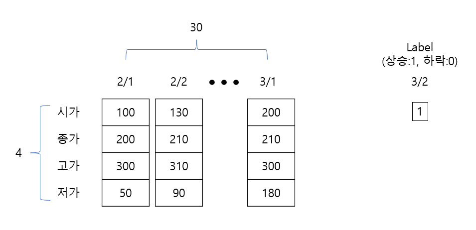

# 2강 실습 — CNN과 LSTM의 텐서 크기 추적

[레포지토리 안내](../../README.ko.md) | [English](Concepts_Lab.md) | [한국어](Concepts_Lab.ko.md)

> **최종 수정일:** 2026-11-04

> **학습 목표:**
> 1. `nn.Module`을 상속한 모델 클래스에서 `__init__`과 `forward`가 맡는 역할을 설명할 수 있다
> 2. `Conv2d`와 `Linear`로 이루어진 CNN에서 층마다 텐서 크기를 계산하고, 펼치기에 필요한 크기와 파라미터 수를 구할 수 있다
> 3. AlexNet의 뒷부분을 옮긴 모델에서 합성곱 블록, 풀링, 로그 소프트맥스를 거치는 텐서 크기를 추적할 수 있다
> 4. 주가 예측 형식의 데이터를 `nn.LSTM`의 (배치, 시퀀스, 특징) 텐서로 나타내고, 단방향과 양방향 LSTM에서 마지막 시점의 출력을 꺼낼 수 있다

---

## 목차

- [1. 실습 개요](#1-실습-개요)
- [2. CNN의 텐서 크기 추적](#2-cnn의-텐서-크기-추적)
  - [2.1 모델 정의](#21-모델-정의)
  - [2.2 실행 결과와 크기 계산](#22-실행-결과와-크기-계산)
- [3. AlexNet의 뒷부분을 옮긴 Mini_Alex](#3-alexnet의-뒷부분을-옮긴-mini_alex)
  - [3.1 모델 정의](#31-모델-정의)
  - [3.2 실행 결과와 크기 계산](#32-실행-결과와-크기-계산)
- [4. LSTM으로 시퀀스 분류하기](#4-lstm으로-시퀀스-분류하기)
  - [4.1 문제 설정: 30일의 주가로 다음 날의 등락 예측](#41-문제-설정-30일의-주가로-다음-날의-등락-예측)
  - [4.2 모델 정의](#42-모델-정의)
  - [4.3 실행 결과](#43-실행-결과)
- [5. 양방향 LSTM](#5-양방향-lstm)
  - [5.1 모델 정의](#51-모델-정의)
  - [5.2 실행 결과와 두 방향의 마지막 출력](#52-실행-결과와-두-방향의-마지막-출력)
- [요약](#요약)
- [점검 문제](#점검-문제)
- [참고 문헌](#참고-문헌)

---

<br>

## 1. 실습 개요

실습 노트북 `Example_CNN-RNN.ipynb`는 2강에서 배운 CNN과 LSTM을 PyTorch로 정의하고, 무작위 값으로 만든 입력을 넣어 층마다 텐서의 크기가 어떻게 바뀌는지 출력한다. 모델을 학습시키지는 않으므로(1강의 세 단계 중 전방 계산만 수행) 데이터 파일이 필요 없고, CPU에서도 바로 실행된다. Colab에서는 노트북 파일만 업로드하여 열면 되고, 로컬 컴퓨터에서는 `pip install torch jupyterlab`으로 설치한 뒤 JupyterLab에서 연다.

입력과 가중치의 초깃값이 무작위이므로 실행할 때마다 출력의 수치는 달라지지만, 텐서의 크기는 항상 같다. 이 실습의 목적은 크기를 미리 계산하고 출력과 맞추어 보는 것이다. 노트북은 2강 4절의 구현 흐름 중 4단계(네트워크 모델 작성)와 5단계(순전파 정의)에 해당한다.

PyTorch에서 신경망 모델은 `torch.nn.Module`을 상속한 클래스로 만든다 [1].

- `__init__` 메서드에서 학습할 가중치를 가진 층(`nn.Conv2d`, `nn.Linear`, `nn.LSTM` 등)을 만들어 속성으로 저장한다. 맨 앞에서 `super().__init__()`으로 부모 클래스 `nn.Module`을 초기화해야 층의 파라미터가 모델에 등록된다.
- `forward` 메서드에서 입력이 층을 지나는 순서, 즉 순전파를 정의한다.
- 모델 객체를 함수처럼 `model(x)`로 호출하면 `forward(x)`가 실행된다.

---

<br>

## 2. CNN의 텐서 크기 추적

### 2.1 모델 정의

```python
import torch
import torch.nn as nn
import torch.nn.functional as F

class CNN(nn.Module):
  def __init__(self):
    super(CNN, self).__init__() # nn.Module의 다양한 변수를 상속받기 위함

    self.conv1 = nn.Conv2d(in_channels=1, out_channels=3, kernel_size=5, stride=1)
    self.conv2 = nn.Conv2d(in_channels=3, out_channels=10, kernel_size=5, stride=1)
    self.fc1 = nn.Linear(10 * 12 * 12, 50)
    self.fc2 = nn.Linear(50, 10)

  def forward(self, x):
    print("연산 전", x.size())
    x = F.relu(self.conv1(x))
    print("conv1 연산 후", x.size())
    x = F.relu(self.conv2(x))
    print("conv2 연산 후",x.size())
    x = x.view(-1, 10 * 12 * 12)
    print("차원 감소 후", x.size())
    x = F.relu(self.fc1(x))
    print("fc1 연산 후", x.size())
    x = self.fc2(x)
    print("fc2 연산 후", x.size())
    return x

cnn = CNN()
input_x = torch.randn(16, 1, 20, 20)
output = cnn(input_x)  # Input Size: (16, 1, 20, 20)
```

- `import torch.nn as nn`은 층을 클래스로 제공하는 모듈, `import torch.nn.functional as F`는 같은 연산을 함수로 제공하는 모듈이다. 가중치가 없는 ReLU는 `F.relu`처럼 함수로 쓰는 경우가 많다.
- `super(CNN, self).__init__()`은 `super().__init__()`의 옛 표기로, 부모 클래스 `nn.Module`의 초기화를 실행한다.
- `self.conv1`은 채널 1개(흑백 이미지)를 받아 5 × 5 커널 3개로 합성곱하여 채널 3개를 내는 층이다. 패딩은 기본값 0이다.
- `self.conv2`는 채널 3개를 받아 5 × 5 × 3 커널 10개로 합성곱하여 채널 10개를 낸다.
- `self.fc1 = nn.Linear(10 * 12 * 12, 50)`은 입력 1,440개를 받아 50개를 내는 완전 연결 층이다. 1,440은 `conv2`의 출력 $10 \times 12 \times 12$를 펼친 크기이므로, 이 값은 입력 이미지의 크기로부터 미리 계산하여 적어야 한다(2.2절).
- `self.fc2 = nn.Linear(50, 10)`은 10개 클래스의 점수를 낸다.
- `forward`에서 `x.size()`는 텐서의 크기를 돌려주며, `print`로 각 단계 뒤의 크기를 출력한다.
- `x.view(-1, 10 * 12 * 12)`는 텐서를 2차원 $(\cdot, 1440)$으로 바꾼다(펼치기). `-1`은 전체 원소 수가 맞도록 PyTorch가 계산하라는 뜻이며, 여기서는 배치 크기 16이 된다.
- `torch.randn(16, 1, 20, 20)`은 표준정규분포의 난수로 (배치 16, 채널 1, 높이 20, 너비 20) 크기의 입력을 만든다. 20 × 20 흑백 이미지 16장에 해당한다.

### 2.2 실행 결과와 크기 계산

```text
연산 전 torch.Size([16, 1, 20, 20])
conv1 연산 후 torch.Size([16, 3, 16, 16])
conv2 연산 후 torch.Size([16, 10, 12, 12])
차원 감소 후 torch.Size([16, 1440])
fc1 연산 후 torch.Size([16, 50])
fc2 연산 후 torch.Size([16, 10])
```

각 줄은 이름이 붙은 연산을 마친 뒤의 텐서 크기이다. 2강 2.8절의 공식 $\lfloor (H + 2P - F)/S \rfloor + 1$로 각 크기를 계산하면 다음과 같다.

| 단계 | 출력 크기 (배치, 채널, 높이, 너비) | 계산 | 파라미터 수 |
|:-----|:-----|:-----|:-----|
| 입력 | (16, 1, 20, 20) | | |
| `conv1` + ReLU | (16, 3, 16, 16) | $(20 + 0 - 5)/1 + 1 = 16$, 채널 = 커널 3개 | $3 \times (1 \times 5 \times 5) + 3 = 78$ |
| `conv2` + ReLU | (16, 10, 12, 12) | $(16 + 0 - 5)/1 + 1 = 12$, 채널 = 커널 10개 | $10 \times (3 \times 5 \times 5) + 10 = 760$ |
| `view` | (16, 1440) | $10 \times 12 \times 12 = 1440$ | |
| `fc1` + ReLU | (16, 50) | | $1440 \times 50 + 50 = 72050$ |
| `fc2` | (16, 10) | | $50 \times 10 + 10 = 510$ |

*표 1. CNN 모델의 층별 출력 크기와 파라미터 수*

파라미터는 모두 73,398개이며, 그중 98%가 `fc1`에 있다. 배치 크기 16은 모든 단계에서 첫 번째 축에 그대로 유지된다. 층은 이미지 한 장씩을 독립적으로 처리하기 때문이다. 이 모델에는 풀링 층이 없으며, 패딩이 없는 5 × 5 합성곱이 크기를 한 번에 4씩 줄인다.

> **주의:** `fc1`의 입력 크기 1440과 `view(-1, 10 * 12 * 12)`는 입력이 20 × 20일 때만 맞는다. 예를 들어 24 × 24 입력을 넣으면 `conv2`의 출력이 $10 \times 16 \times 16 = 2560$이 되어 `view`에서 오류가 나거나, 전체 원소 수가 1440으로 나누어떨어지는 경우에는 배치 크기가 잘못된 텐서가 조용히 만들어진다. 펼칠 때는 `x.view(x.size(0), -1)`처럼 배치 축을 고정하는 편이 안전하며, 입력 크기가 바뀌면 `fc1`의 입력 크기를 다시 계산해야 한다.

---

<br>

## 3. AlexNet의 뒷부분을 옮긴 Mini_Alex

### 3.1 모델 정의

다음 모델은 2강 2.12절 AlexNet의 CONV4, CONV5, POOL3과 완전 연결 층 3개를 그대로 옮긴 것이다. 입력은 CONV3의 출력 크기인 $384 \times 13 \times 13$이다.

```python
import torch
import torch.nn as nn
import torch.nn.functional as F


class Mini_Alex(nn.Module):
    def __init__(self):
        super().__init__()
        self.conv1 = nn.Sequential(
            nn.Conv2d(384, 384, 3, 1, 1), # in_channels: 384, out_channels: 384, kernel_size=3x3, stride=1, padding=1
            nn.ReLU() # 13 유지
            # 384x13x13
        )
        self.conv2 = nn.Sequential(
            nn.Conv2d(384, 256, 3, 1, 1),
            nn.ReLU(),
            nn.MaxPool2d(3, 2) # 13 -> 6
            # 256x6x6
        )

        self.fc1 = nn.Linear(256 * 6 * 6, 4096)
        self.fc2 = nn.Linear(4096, 4096)
        self.fc3 = nn.Linear(4096, 1000)

    def forward(self, x): # input size = 384x13x13
        print('연산 전:', x.size())
        out = self.conv1(x)
        print('conv1 block 후 결과:', out.size())
        out = self.conv2(out)
        print('conv2 block 후 결과:', out.size())
        out = out.view(out.size(0), -1)
        print('차원 감소 후 결과:', out.size())

        out = F.relu(self.fc1(out))
        print('fc1 연산 후 결과:', out.size())
        out = F.relu(self.fc2(out))
        print('fc2 연산 후 결과:', out.size())
        out = self.fc3(out)
        out = F.log_softmax(out, dim=1)
        print('fc3 연산 후 결과:', out.size())

        return out

alex = Mini_Alex()
output = alex(torch.randn(10, 384, 13, 13))  # Input Size: (10, 384, 13, 13)
print('\n최종 출력 결과:', output.size())
```

- `nn.Sequential(...)`은 여러 층을 순서대로 묶어 하나의 층처럼 쓰게 한다. `self.conv1(x)`를 호출하면 안의 층이 차례로 실행된다. 2강 2.11절의 합성곱 블록을 코드로 나타낸 것이다.
- `nn.Conv2d(384, 384, 3, 1, 1)`은 인자를 위치로 준 것으로, 차례로 `in_channels=384`, `out_channels=384`, `kernel_size=3`, `stride=1`, `padding=1`이다. 3 × 3 커널에 패딩 1이므로 크기 13이 유지된다.
- `nn.MaxPool2d(3, 2)`는 `kernel_size=3`, `stride=2`인 중첩 최대 풀링이다. $\lfloor (13 - 3)/2 \rfloor + 1 = 6$이므로 13이 6이 된다.
- `out.view(out.size(0), -1)`은 배치 축 `out.size(0)`을 고정하고 나머지를 펼친다. 2.2절의 주의 사항을 반영한 안전한 펼치기이다.
- `F.log_softmax(out, dim=1)`은 클래스 축(1번 축)으로 소프트맥스를 계산한 뒤 로그를 취한다. 결과는 각 클래스 확률의 로그 값이며, 음의 로그 가능도 손실 `nn.NLLLoss`와 함께 쓰면 로짓에 교차 엔트로피 손실 `nn.CrossEntropyLoss`를 쓴 것과 같다. 로그를 따로 취하는 것보다 수치적으로 안정적이다.
- `print('\n최종 출력 결과:', ...)`의 `\n`은 줄바꿈 문자이므로 출력 앞에 빈 줄이 하나 생긴다.

### 3.2 실행 결과와 크기 계산

```text
연산 전: torch.Size([10, 384, 13, 13])
conv1 block 후 결과: torch.Size([10, 384, 13, 13])
conv2 block 후 결과: torch.Size([10, 256, 6, 6])
차원 감소 후 결과: torch.Size([10, 9216])
fc1 연산 후 결과: torch.Size([10, 4096])
fc2 연산 후 결과: torch.Size([10, 4096])
fc3 연산 후 결과: torch.Size([10, 1000])

최종 출력 결과: torch.Size([10, 1000])
```

| 단계 | 출력 크기 | 계산 | 파라미터 수 |
|:-----|:-----|:-----|:-----|
| 입력 | (10, 384, 13, 13) | | |
| `conv1` 블록 (CONV4) | (10, 384, 13, 13) | $(13 + 2 - 3)/1 + 1 = 13$ | $384 \times (384 \times 3 \times 3) + 384 = 1{,}327{,}488$ |
| `conv2` 블록 (CONV5, POOL3) | (10, 256, 6, 6) | 합성곱 13 유지, 풀링 $(13 - 3)/2 + 1 = 6$ | $256 \times (384 \times 3 \times 3) + 256 = 884{,}992$ |
| `view` | (10, 9216) | $256 \times 6 \times 6 = 9216$ | |
| `fc1` (FC6) | (10, 4096) | | $9216 \times 4096 + 4096 = 37{,}752{,}832$ |
| `fc2` (FC7) | (10, 4096) | | $4096 \times 4096 + 4096 = 16{,}781{,}312$ |
| `fc3` (FC8) + 로그 소프트맥스 | (10, 1000) | | $4096 \times 1000 + 1000 = 4{,}097{,}000$ |

*표 2. Mini_Alex의 층별 출력 크기와 파라미터 수*

파라미터는 모두 60,843,624개이며, 완전 연결 층 세 개가 그중 약 96%를 차지한다. 2강 2.12절에서 본 것처럼 AlexNet 파라미터의 대부분은 완전 연결 층에 있다.

---

<br>

## 4. LSTM으로 시퀀스 분류하기

### 4.1 문제 설정: 30일의 주가로 다음 날의 등락 예측

LSTM 실습은 다음 형식의 데이터를 가정한다. 하루의 주가를 시가, 종가, 고가, 저가의 4개 특징으로 나타내고, 연속된 30일의 기록을 보고 그다음 날 주가가 오를지(레이블 1) 내릴지(레이블 0)를 예측한다. 2강 3.5절의 다 대 일(many-to-one) 문제이다. 노트북의 LSTM 부분은 순환 신경망을 시간 방향으로 펼친 그림(2강 3.4절)과 다음 그림 1로 시작한다.



*그림 1. 30일 동안의 시가, 종가, 고가, 저가로 다음 날의 상승(1)과 하락(0)을 예측하는 데이터의 형식*

샘플 하나는 30 × 4 행렬(시퀀스 길이 30, 특징 4)이고, 이런 샘플 32개를 묶은 미니 배치는 (배치 32, 시퀀스 30, 특징 4) 크기의 텐서이다. 2강 3.10절의 기호로 $N = 32$, $L = 30$, $H_{in} = 4$이다. 실습에서는 실제 주가 대신 같은 크기의 난수 텐서 `torch.randn(32, 30, 4)`를 넣는다.

### 4.2 모델 정의

```python
import torch
import torch.nn as nn
import torch.nn.functional as F


class LSTM1(nn.Module):
  def __init__(self):
    super().__init__()
    self.lstm = nn.LSTM(input_size=4,
                        hidden_size=64,
                        batch_first=True
                        )
    self.sigmoid = torch.nn.Sigmoid()
    self.fc = nn.Linear(64*1, 1) # (hidden_size * bidirectional(True->2), 원하는 output 크기)


  def forward(self, x):
    h_0 = torch.zeros(1*1, 32, 64) # (bidirectional(True->2)*num_layer, batch, hidden_size)
    c_0 = torch.zeros(1*1, 32, 64)

    print("연산 전", x.size())
    out, (h, c) = self.lstm(x, (h_0, c_0))
    print("최종층 출력",out.shape)
    o = out[:,-1,:]
    print("마지막 hidden unit 출력", o.shape)
    o = self.sigmoid(self.fc(o))

    return o


lstm = LSTM1()
output = lstm(torch.randn(32, 30, 4))  # Input Size: (32, 30, 4)
print(output)
```

- `nn.LSTM(input_size=4, hidden_size=64, batch_first=True)`은 각 시점의 입력 특징이 4개이고 은닉 상태의 크기가 64인 한 층짜리 단방향 LSTM이다 [2]. 입력을 (배치, 시퀀스, 특징) 순서로 주므로 `batch_first=True`가 필요하다(2강 3.10절의 주의 사항).
- `self.sigmoid`는 시그모이드 층이다. 이진 분류이므로 출력 노드 하나에 시그모이드를 적용해 상승할 확률로 해석한다(1강 3.3절).
- `self.fc = nn.Linear(64*1, 1)`은 마지막 은닉 상태 64개를 받아 값 하나를 낸다. 주석대로 입력 크기는 `hidden_size`에 방향 수(단방향 1, 양방향 2)를 곱한 값이다.
- `h_0`, `c_0`은 초기 은닉 상태와 셀 상태를 0으로 채운 텐서이며, 크기는 (방향 수 × 층 수, 배치, 은닉 크기) = (1, 32, 64)이다. 이 둘은 `batch_first`와 관계없이 배치 축이 가운데에 있다.
- `out, (h, c) = self.lstm(x, (h_0, c_0))`는 마지막 층의 모든 시점의 은닉 상태 `out`과 마지막 시점의 은닉 상태 `h`, 셀 상태 `c`를 돌려준다.
- `out[:, -1, :]`은 모든 샘플(`:`)에 대해 마지막 시점(`-1`)의 은닉 상태 64개(`:`)를 꺼낸다. 다 대 일 문제이므로 30일을 모두 읽은 마지막 은닉 상태만 쓴다. 단방향 LSTM에서 이 값은 `h[-1]`(마지막 층의 `h_n`)과 같다.
- `self.sigmoid(self.fc(o))`는 64개의 값을 하나로 줄인 뒤 시그모이드로 0과 1 사이의 값으로 바꾼다.

> **주의:** `h_0 = torch.zeros(1*1, 32, 64)`는 배치 크기를 32로 고정한다. 배치 크기가 다른 입력(예: 마지막 미니 배치가 16개)을 넣으면 "Expected hidden[0] size (1, 16, 64), got [1, 32, 64]" 같은 오류가 난다. `torch.zeros(1, x.size(0), 64)`로 입력에서 배치 크기를 읽거나, 초기 상태가 0이면 `self.lstm(x)`처럼 `(h_0, c_0)`을 생략한다(생략하면 0으로 채워진다).

### 4.3 실행 결과

```text
연산 전 torch.Size([32, 30, 4])
최종층 출력 torch.Size([32, 30, 64])
마지막 hidden unit 출력 torch.Size([32, 64])
tensor([[0.5010],
        [0.4977],
        [0.5049],
        ...
        [0.5075],
        [0.5043]], grad_fn=<SigmoidBackward0>)
```

| 텐서 | 크기 | 의미 |
|:-----|:-----|:-----|
| 입력 `x` | (32, 30, 4) | 샘플 32개, 각 30일, 하루 특징 4개 |
| `out` | (32, 30, 64) | 샘플마다 30개 시점의 은닉 상태(크기 64) |
| `o = out[:, -1, :]` | (32, 64) | 샘플마다 마지막 시점의 은닉 상태 |
| `self.fc(o)` | (32, 1) | 샘플마다 점수 하나 |
| 출력 (시그모이드 후) | (32, 1) | 샘플마다 상승할 확률 |

*표 3. 단방향 LSTM 모델의 텐서 크기*

출력 확률이 모두 0.5 근처인 것은 모델이 학습되지 않았기 때문이다. 초기 가중치가 작은 값이라 `fc`의 출력이 0 근처이고, $\sigma(0) = 0.5$이다. 이 모델을 실제로 쓰려면 2강 4절의 흐름대로 데이터셋, 손실 함수(이진 교차 엔트로피), 옵티마이저를 정해 학습시켜야 한다(3강). 이 LSTM 층의 파라미터는 $4 \times 64 \times (4 + 64) + 4 \times 64 \times 2 = 17{,}920$개이다. 게이트 4개 각각에 입력 가중치($64 \times 4$), 은닉 가중치($64 \times 64$), 편향 두 벌(`b_ih`, `b_hh`, 각 64)이 있기 때문이다.

---

<br>

## 5. 양방향 LSTM

### 5.1 모델 정의

같은 문제를 2강 3.9절의 양방향 LSTM으로 푼다. 노트북에는 2강 그림 18 (b)와 같은 양방향 LSTM의 그림이 함께 들어 있다.

```python
import torch
import torch.nn as nn
import torch.nn.functional as F


class LSTM1(nn.Module):
  def __init__(self):
    super().__init__()
    self.lstm = nn.LSTM(input_size=4,
                        hidden_size=64,
                        bidirectional=True,
                        batch_first=True
                        )
    self.sigmoid = torch.nn.Sigmoid()
    self.fc = nn.Linear(64*2, 1)


  def forward(self, x):
    h_0 = torch.zeros(2*1, 32, 64)
    c_0 = torch.zeros(2*1, 32, 64)

    print("연산 전", x.size())
    out, (h, c) = self.lstm(x, (h_0, c_0))
    print("최종층 출력",out.shape)
    o1 = out[:, -1, :64] # 순방향 마지막 출력
    print("합치기 전 o1", o1.shape)
    o2 = out[:, 0, 64:] # 역방향 마지막 출력
    print("합치기 전 o2", o2.shape)
    o = torch.concat((o1, o2), dim=1)
    print("합친 결과", o.shape)
    o = self.sigmoid(self.fc(o))

    return o


lstm = LSTM1()
output = lstm(torch.randn(32, 30, 4))  # Input Size: (32, 30, 4)
print(output)
```

단방향 모델과 달라진 곳은 다음과 같다.

- `bidirectional=True`로 정방향과 역방향 LSTM을 함께 둔다. 방향 수 $D = 2$이므로 `h_0`, `c_0`의 첫 차원이 $2 \times 1 = 2$이다.
- `out`의 마지막 축은 $D \times 64 = 128$이며, 앞의 64개(`:64`)가 정방향, 뒤의 64개(`64:`)가 역방향 LSTM의 은닉 상태이다. 두 방향의 은닉 상태를 시점마다 이어 붙인 것이다.
- `o1 = out[:, -1, :64]`는 정방향 LSTM이 시퀀스를 끝까지(시점 29까지) 읽은 마지막 출력이다.
- `o2 = out[:, 0, 64:]`는 역방향 LSTM의 마지막 출력이다. 역방향 LSTM은 시점 29에서 출발해 시점 0에서 끝나므로, 시퀀스 전체를 읽은 출력은 마지막 위치(`-1`)가 아니라 처음 위치(`0`)에 있다.
- `torch.concat((o1, o2), dim=1)`은 두 텐서를 1번 축으로 이어 붙여 (32, 128)을 만든다. `torch.concat`은 `torch.cat`의 다른 이름이다.
- `self.fc = nn.Linear(64*2, 1)`은 이어 붙인 128개를 받는다.

### 5.2 실행 결과와 두 방향의 마지막 출력

```text
연산 전 torch.Size([32, 30, 4])
최종층 출력 torch.Size([32, 30, 128])
합치기 전 o1 torch.Size([32, 64])
합치기 전 o2 torch.Size([32, 64])
합친 결과 torch.Size([32, 128])
tensor([[0.5372],
        [0.5290],
        [0.5361],
        ...
        [0.5307],
        [0.5384]], grad_fn=<SigmoidBackward0>)
```

두 방향의 은닉 상태를 64개씩 꺼낸 뒤 이어 붙이면 다시 128개가 된다. 각 방향의 마지막 은닉 상태가 `out`의 어느 위치에 있는지는 다음과 같다.

```text
out[:, t, :]  =  [ 정방향 은닉 상태 (64) | 역방향 은닉 상태 (64) ]

시점 t        0      1      2     ...     28     29
정방향  →   h0f →  h1f →  h2f →  ... →  h28f → h29f   ← o1 = out[:, -1, :64]
역방향  ←   h0b ←  h1b ←  h2b ←  ... ←  h28b ← h29b
            ↑
            o2 = out[:, 0, 64:]
```

*그림 2. 양방향 LSTM의 출력 out에서 두 방향의 마지막 은닉 상태를 꺼내는 위치*

`o1`은 `h_n[0]`(정방향의 마지막 은닉 상태)과, `o2`는 `h_n[1]`(역방향의 마지막 은닉 상태)과 같은 값이다. 따라서 `torch.cat((h[0], h[1]), dim=1)`로도 같은 `o`를 얻는다. 양방향 LSTM의 파라미터는 방향마다 LSTM 하나씩이므로 단방향의 두 배인 35,840개이다.

> **참고:** 이 노트북의 모델은 클래스 이름이 두 번 모두 `LSTM1`이다. 두 번째 셀을 실행하면 같은 이름의 클래스가 양방향 모델로 다시 정의되므로, 첫 번째 모델을 다시 쓰려면 첫 번째 셀을 다시 실행해야 한다.

---

<br>

## 요약

| 개념 | 핵심 요약 |
|:-----|:----------|
| 모델 클래스 | `nn.Module`을 상속하고, `__init__`에서 `super().__init__()` 뒤에 층을 만들며, `forward`에 순전파를 정의한다. `model(x)`가 `forward(x)`를 실행한다. |
| CNN의 크기 추적 | (16, 1, 20, 20) 입력이 5 × 5 합성곱 두 번으로 (16, 3, 16, 16), (16, 10, 12, 12)가 되고, 1440으로 펼쳐 완전 연결 층 두 개를 지나 (16, 10)이 된다. |
| 펼치기 | 완전 연결 층의 입력 크기는 펼친 크기와 같아야 한다. `view(x.size(0), -1)`처럼 배치 축을 고정하는 편이 안전하다. |
| Mini_Alex | AlexNet의 CONV4, CONV5, POOL3, FC6\~FC8을 옮긴 모델로, (10, 384, 13, 13) 입력이 (10, 256, 6, 6) = 9216을 거쳐 (10, 1000)이 된다. 파라미터는 약 6,084만 개이다. |
| 로그 소프트맥스 | `F.log_softmax`는 확률의 로그를 내며, `NLLLoss`와 함께 쓰면 교차 엔트로피 손실과 같다. |
| LSTM 입력 | 주가 30일 × 특징 4의 샘플 32개는 `batch_first=True`일 때 (32, 30, 4) 텐서이다. `h_0`, `c_0`은 (방향 수 × 층 수, 배치, 은닉 크기)이다. |
| 다 대 일 출력 | 단방향은 `out[:, -1, :]`, 양방향은 정방향 `out[:, -1, :64]`와 역방향 `out[:, 0, 64:]`를 이어 붙여 완전 연결 층과 시그모이드로 확률을 낸다. |

---

<br>

## 점검 문제

1. **CNN 크기:** 2절의 CNN에 입력 크기 (8, 1, 28, 28)을 넣으려면 `fc1`과 `view`의 1440을 얼마로 바꾸어야 하는가?

   <details>
   <summary>정답</summary>

   `conv1` 뒤 $28 - 5 + 1 = 24$, `conv2` 뒤 $24 - 5 + 1 = 20$이므로 `conv2`의 출력은 (8, 10, 20, 20)이다. 펼친 크기는 $10 \times 20 \times 20 = 4000$이므로 `nn.Linear(10 * 20 * 20, 50)`과 `x.view(-1, 10 * 20 * 20)`(또는 `x.view(x.size(0), -1)`)로 바꾼다.

   </details>

2. **파라미터 수:** 2절의 `conv2`를 `nn.Conv2d(3, 10, kernel_size=3, padding=1)`로 바꾸면 이 층의 파라미터 수와 출력 크기는 얼마인가?

   <details>
   <summary>정답</summary>

   파라미터는 $10 \times (3 \times 3 \times 3) + 10 = 280$개이다. 3 × 3 커널에 패딩 1이므로 크기가 유지되어 출력은 (16, 10, 16, 16)이고, 펼친 크기는 $10 \times 16 \times 16 = 2560$이 된다.

   </details>

3. **Mini_Alex:** `conv2` 블록의 `nn.MaxPool2d(3, 2)`를 `nn.MaxPool2d(2)`로 바꾸면 펼친 크기와 `fc1`의 가중치 수는 어떻게 되는가?

   <details>
   <summary>정답</summary>

   `MaxPool2d(2)`는 스트라이드도 2이므로 $\lfloor (13 - 2)/2 \rfloor + 1 = 6$이 되어 출력은 그대로 (10, 256, 6, 6)이고, 펼친 크기 9216과 `fc1`의 가중치 $9216 \times 4096$개도 그대로이다. 다만 풀링 영역이 겹치지 않고, 13번째 행과 열은 어느 영역에도 들어가지 않는다.

   </details>

4. **LSTM 출력:** 4절의 단방향 모델에서 `num_layers=2`로 바꾸면 `h_0`의 크기와 `out`, `h`의 크기는 각각 얼마인가?

   <details>
   <summary>정답</summary>

   `h_0`과 `c_0`은 $(1 \times 2, 32, 64) = (2, 32, 64)$로 바꾸어야 한다. `out`은 마지막 층의 모든 시점이므로 그대로 (32, 30, 64)이고, `h`는 층마다 하나씩이므로 (2, 32, 64)이다. `out[:, -1, :]`은 `h[-1]`, 즉 둘째 층의 마지막 은닉 상태와 같다.

   </details>

5. **양방향 LSTM:** 5절의 모델에서 `o2 = out[:, -1, 64:]`로 잘못 쓰면 어떤 정보를 꺼내게 되는가?

   <details>
   <summary>정답</summary>

   역방향 LSTM은 시점 29에서 출발하므로 `out[:, -1, 64:]`는 역방향 LSTM이 시점 29 하나만 읽은 첫 은닉 상태이다. 시퀀스 전체를 읽은 역방향의 마지막 출력은 `out[:, 0, 64:]`(또는 `h[1]`)이다.

   </details>

6. **배치 크기:** 4절의 모델에 `torch.randn(16, 30, 4)`를 넣으면 무슨 일이 생기며, 어떻게 고치는가?

   <details>
   <summary>정답</summary>

   `h_0`, `c_0`이 배치 크기 32로 만들어져 입력의 배치 크기 16과 맞지 않으므로 "Expected hidden[0] size (1, 16, 64), got [1, 32, 64]" 오류가 난다. `torch.zeros(1, x.size(0), 64)`로 만들거나 `(h_0, c_0)`을 생략하여 고친다.

   </details>

---

<br>

## 참고 문헌

1. PyTorch, "Module," *PyTorch Documentation*, accessed Nov. 4, 2026. https://docs.pytorch.org/docs/stable/generated/torch.nn.Module.html
2. PyTorch, "LSTM," *PyTorch Documentation*, accessed Nov. 4, 2026. https://docs.pytorch.org/docs/stable/generated/torch.nn.LSTM.html
