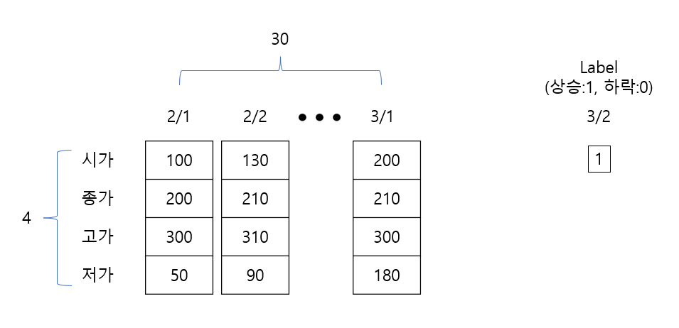

# Lecture 2 Lab — Tracing Tensor Sizes in CNNs and LSTMs

[Repository Guide](../../README.md) | [English](Concepts_Lab.md) | [한국어](Concepts_Lab.ko.md)

> **Last Updated:** 2026-11-04

> **Learning Objectives:**
> 1. Explain the roles of `__init__` and `forward` in a model class that inherits from `nn.Module`
> 2. Compute the tensor size at each layer of a CNN made of `Conv2d` and `Linear`, and find the size needed for flattening and the parameter counts
> 3. Trace the tensor sizes through the convolutional blocks, pooling, and log-softmax of a model that reproduces the latter part of AlexNet
> 4. Represent stock-prediction-style data as a (batch, sequence, feature) tensor for `nn.LSTM`, and extract the output of the last time point from unidirectional and bidirectional LSTMs

---

## Table of Contents

- [1. Lab Overview](#1-lab-overview)
- [2. Tracing Tensor Sizes in a CNN](#2-tracing-tensor-sizes-in-a-cnn)
  - [2.1 Model Definition](#21-model-definition)
  - [2.2 Output and Size Computation](#22-output-and-size-computation)
- [3. Mini_Alex, the Latter Part of AlexNet](#3-mini_alex-the-latter-part-of-alexnet)
  - [3.1 Model Definition](#31-model-definition)
  - [3.2 Output and Size Computation](#32-output-and-size-computation)
- [4. Classifying Sequences with an LSTM](#4-classifying-sequences-with-an-lstm)
  - [4.1 Problem Setting: Predicting the Next Day's Rise or Fall from 30 Days of Stock Prices](#41-problem-setting-predicting-the-next-days-rise-or-fall-from-30-days-of-stock-prices)
  - [4.2 Model Definition](#42-model-definition)
  - [4.3 Output](#43-output)
- [5. Bidirectional LSTM](#5-bidirectional-lstm)
  - [5.1 Model Definition](#51-model-definition)
  - [5.2 Output and the Last Outputs of the Two Directions](#52-output-and-the-last-outputs-of-the-two-directions)
- [Summary](#summary)
- [Self-Check Questions](#self-check-questions)
- [References](#references)

---

<br>

## 1. Lab Overview

The lab notebook `Example_CNN-RNN.ipynb` defines the CNN and LSTM of Lecture 2 in PyTorch, feeds them inputs made of random values, and prints how the tensor size changes at each layer. Since the models are not trained (only the forward computation of the three steps in Lecture 1 is performed), no data files are needed and it runs directly on a CPU. On Colab, just upload the notebook file and open it; on a local computer, install with `pip install torch jupyterlab` and open it in JupyterLab.

Because the inputs and the initial weights are random, the numbers in the output differ from run to run, but the tensor sizes are always the same. The purpose of this lab is to compute the sizes in advance and check them against the output. The notebook corresponds to step 4 (create the network model) and step 5 (define the forward pass) of the implementation flow in Section 4 of Lecture 2.

In PyTorch, a neural network model is written as a class that inherits from `torch.nn.Module` [1].

- In the `__init__` method, the layers with learnable weights (`nn.Conv2d`, `nn.Linear`, `nn.LSTM`, and so on) are created and stored as attributes. The parent class `nn.Module` must first be initialized with `super().__init__()` so that the parameters of the layers are registered with the model.
- The `forward` method defines the order in which the input passes through the layers, that is, the forward propagation.
- Calling the model object like a function, `model(x)`, runs `forward(x)`.

---

<br>

## 2. Tracing Tensor Sizes in a CNN

### 2.1 Model Definition

```python
import torch
import torch.nn as nn
import torch.nn.functional as F

class CNN(nn.Module):
  def __init__(self):
    super(CNN, self).__init__() # to inherit the various variables of nn.Module

    self.conv1 = nn.Conv2d(in_channels=1, out_channels=3, kernel_size=5, stride=1)
    self.conv2 = nn.Conv2d(in_channels=3, out_channels=10, kernel_size=5, stride=1)
    self.fc1 = nn.Linear(10 * 12 * 12, 50)
    self.fc2 = nn.Linear(50, 10)

  def forward(self, x):
    print("연산 전", x.size())
    x = F.relu(self.conv1(x))
    print("conv1 연산 후", x.size())
    x = F.relu(self.conv2(x))
    print("conv2 연산 후",x.size())
    x = x.view(-1, 10 * 12 * 12)
    print("차원 감소 후", x.size())
    x = F.relu(self.fc1(x))
    print("fc1 연산 후", x.size())
    x = self.fc2(x)
    print("fc2 연산 후", x.size())
    return x

cnn = CNN()
input_x = torch.randn(16, 1, 20, 20)
output = cnn(input_x)  # Input Size: (16, 1, 20, 20)
```

- `import torch.nn as nn` is the module that provides layers as classes, and `import torch.nn.functional as F` is the module that provides the same operations as functions. ReLU, which has no weights, is often used as a function such as `F.relu`.
- `super(CNN, self).__init__()` is the older form of `super().__init__()` and runs the initialization of the parent class `nn.Module`.
- `self.conv1` is a layer that takes 1 channel (a grayscale image) and convolves it with 3 kernels of 5 × 5 to produce 3 channels. Padding is the default 0.
- `self.conv2` takes 3 channels and convolves them with 10 kernels of 5 × 5 × 3 to produce 10 channels.
- `self.fc1 = nn.Linear(10 * 12 * 12, 50)` is a fully connected layer that takes 1,440 inputs and produces 50. 1,440 is the flattened size of the `conv2` output, $10 \times 12 \times 12$, so this value must be computed in advance from the size of the input image (Section 2.2).
- `self.fc2 = nn.Linear(50, 10)` produces scores for 10 classes.
- In `forward`, `x.size()` returns the size of the tensor, and `print` shows the size after each step. The Korean labels mean "before the operations" (연산 전), "after conv1" (conv1 연산 후), and "after flattening" (차원 감소 후).
- `x.view(-1, 10 * 12 * 12)` reshapes the tensor into two dimensions $(\cdot, 1440)$ (flattening). `-1` tells PyTorch to compute that dimension so that the total number of elements matches; here it becomes the batch size 16.
- `torch.randn(16, 1, 20, 20)` creates an input of size (batch 16, channel 1, height 20, width 20) with standard normal random numbers. It corresponds to 16 grayscale images of 20 × 20.

### 2.2 Output and Size Computation

```text
연산 전 torch.Size([16, 1, 20, 20])
conv1 연산 후 torch.Size([16, 3, 16, 16])
conv2 연산 후 torch.Size([16, 10, 12, 12])
차원 감소 후 torch.Size([16, 1440])
fc1 연산 후 torch.Size([16, 50])
fc2 연산 후 torch.Size([16, 10])
```

Each line is the tensor size after the named operation. Computing each size with the formula $\lfloor (H + 2P - F)/S \rfloor + 1$ of Section 2.8 of Lecture 2 gives the following.

| Step | Output size (batch, channels, height, width) | Computation | Parameters |
|:-----|:-----|:-----|:-----|
| Input | (16, 1, 20, 20) | | |
| `conv1` + ReLU | (16, 3, 16, 16) | $(20 + 0 - 5)/1 + 1 = 16$, channels = 3 kernels | $3 \times (1 \times 5 \times 5) + 3 = 78$ |
| `conv2` + ReLU | (16, 10, 12, 12) | $(16 + 0 - 5)/1 + 1 = 12$, channels = 10 kernels | $10 \times (3 \times 5 \times 5) + 10 = 760$ |
| `view` | (16, 1440) | $10 \times 12 \times 12 = 1440$ | |
| `fc1` + ReLU | (16, 50) | | $1440 \times 50 + 50 = 72050$ |
| `fc2` | (16, 10) | | $50 \times 10 + 10 = 510$ |

*Table 1. Output sizes and parameter counts of each layer of the CNN model*

There are 73,398 parameters in total, 98% of them in `fc1`. The batch size 16 stays unchanged on the first axis at every step, because the layers process each image independently. This model has no pooling layer, and each 5 × 5 convolution without padding shrinks the size by 4.

> **Caution:** The input size 1440 of `fc1` and `view(-1, 10 * 12 * 12)` fit only a 20 × 20 input. For example, with a 24 × 24 input the output of `conv2` becomes $10 \times 16 \times 16 = 2560$, so `view` raises an error, or, when the total number of elements happens to be divisible by 1440, a tensor with the wrong batch size is silently created. When flattening, fixing the batch axis as in `x.view(x.size(0), -1)` is safer, and the input size of `fc1` must be recomputed whenever the input size changes.

---

<br>

## 3. Mini_Alex, the Latter Part of AlexNet

### 3.1 Model Definition

The following model reproduces CONV4, CONV5, POOL3, and the three fully connected layers of AlexNet from Section 2.12 of Lecture 2. Its input is $384 \times 13 \times 13$, the output size of CONV3.

```python
import torch
import torch.nn as nn
import torch.nn.functional as F


class Mini_Alex(nn.Module):
    def __init__(self):
        super().__init__()
        self.conv1 = nn.Sequential(
            nn.Conv2d(384, 384, 3, 1, 1), # in_channels: 384, out_channels: 384, kernel_size=3x3, stride=1, padding=1
            nn.ReLU() # 13 is kept
            # 384x13x13
        )
        self.conv2 = nn.Sequential(
            nn.Conv2d(384, 256, 3, 1, 1),
            nn.ReLU(),
            nn.MaxPool2d(3, 2) # 13 -> 6
            # 256x6x6
        )

        self.fc1 = nn.Linear(256 * 6 * 6, 4096)
        self.fc2 = nn.Linear(4096, 4096)
        self.fc3 = nn.Linear(4096, 1000)

    def forward(self, x): # input size = 384x13x13
        print('연산 전:', x.size())
        out = self.conv1(x)
        print('conv1 block 후 결과:', out.size())
        out = self.conv2(out)
        print('conv2 block 후 결과:', out.size())
        out = out.view(out.size(0), -1)
        print('차원 감소 후 결과:', out.size())

        out = F.relu(self.fc1(out))
        print('fc1 연산 후 결과:', out.size())
        out = F.relu(self.fc2(out))
        print('fc2 연산 후 결과:', out.size())
        out = self.fc3(out)
        out = F.log_softmax(out, dim=1)
        print('fc3 연산 후 결과:', out.size())

        return out

alex = Mini_Alex()
output = alex(torch.randn(10, 384, 13, 13))  # Input Size: (10, 384, 13, 13)
print('\n최종 출력 결과:', output.size())
```

- `nn.Sequential(...)` bundles several layers in order so that they can be used like one layer. Calling `self.conv1(x)` runs the layers inside in turn. It is the convolutional block of Section 2.11 of Lecture 2 written as code.
- `nn.Conv2d(384, 384, 3, 1, 1)` gives its arguments by position: `in_channels=384`, `out_channels=384`, `kernel_size=3`, `stride=1`, and `padding=1`. A 3 × 3 kernel with padding 1 keeps the size 13.
- `nn.MaxPool2d(3, 2)` is overlapping max pooling with `kernel_size=3` and `stride=2`. Since $\lfloor (13 - 3)/2 \rfloor + 1 = 6$, 13 becomes 6.
- `out.view(out.size(0), -1)` fixes the batch axis `out.size(0)` and flattens the rest. It is the safe form of flattening that reflects the caution of Section 2.2.
- `F.log_softmax(out, dim=1)` computes softmax along the class axis (axis 1) and then takes the logarithm. The result is the log of each class probability, and using it with the negative log-likelihood loss `nn.NLLLoss` is the same as using the cross-entropy loss `nn.CrossEntropyLoss` on the logits. It is numerically more stable than taking the logarithm separately.
- The `\n` in `print('\n최종 출력 결과:', ...)` is a newline character, so a blank line appears before the output. The Korean label means "final output".

### 3.2 Output and Size Computation

```text
연산 전: torch.Size([10, 384, 13, 13])
conv1 block 후 결과: torch.Size([10, 384, 13, 13])
conv2 block 후 결과: torch.Size([10, 256, 6, 6])
차원 감소 후 결과: torch.Size([10, 9216])
fc1 연산 후 결과: torch.Size([10, 4096])
fc2 연산 후 결과: torch.Size([10, 4096])
fc3 연산 후 결과: torch.Size([10, 1000])

최종 출력 결과: torch.Size([10, 1000])
```

| Step | Output size | Computation | Parameters |
|:-----|:-----|:-----|:-----|
| Input | (10, 384, 13, 13) | | |
| `conv1` block (CONV4) | (10, 384, 13, 13) | $(13 + 2 - 3)/1 + 1 = 13$ | $384 \times (384 \times 3 \times 3) + 384 = 1{,}327{,}488$ |
| `conv2` block (CONV5, POOL3) | (10, 256, 6, 6) | Convolution keeps 13, pooling $(13 - 3)/2 + 1 = 6$ | $256 \times (384 \times 3 \times 3) + 256 = 884{,}992$ |
| `view` | (10, 9216) | $256 \times 6 \times 6 = 9216$ | |
| `fc1` (FC6) | (10, 4096) | | $9216 \times 4096 + 4096 = 37{,}752{,}832$ |
| `fc2` (FC7) | (10, 4096) | | $4096 \times 4096 + 4096 = 16{,}781{,}312$ |
| `fc3` (FC8) + log-softmax | (10, 1000) | | $4096 \times 1000 + 1000 = 4{,}097{,}000$ |

*Table 2. Output sizes and parameter counts of each layer of Mini_Alex*

There are 60,843,624 parameters in total, and the three fully connected layers account for about 96% of them. As seen in Section 2.12 of Lecture 2, most of AlexNet's parameters are in its fully connected layers.

---

<br>

## 4. Classifying Sequences with an LSTM

### 4.1 Problem Setting: Predicting the Next Day's Rise or Fall from 30 Days of Stock Prices

The LSTM lab assumes data of the following form. A day's stock price is represented by four features, the opening, closing, high, and low prices, and the model looks at a record of 30 consecutive days to predict whether the price rises (label 1) or falls (label 0) on the next day. This is the many-to-one problem of Section 3.5 of Lecture 2. The LSTM part of the notebook begins with a figure of a recurrent neural network unrolled along time (Section 3.4 of Lecture 2) and with Figure 1 below.



*Figure 1. Data format for predicting the next day's rise (1) or fall (0) from 30 days of opening, closing, high, and low prices*

One sample is a 30 × 4 matrix (sequence length 30, 4 features), and a mini-batch of 32 such samples is a tensor of size (batch 32, sequence 30, features 4). In the notation of Section 3.10 of Lecture 2, $N = 32$, $L = 30$, and $H_{in} = 4$. In the lab, a random tensor of the same size, `torch.randn(32, 30, 4)`, is used instead of real stock prices.

### 4.2 Model Definition

```python
import torch
import torch.nn as nn
import torch.nn.functional as F


class LSTM1(nn.Module):
  def __init__(self):
    super().__init__()
    self.lstm = nn.LSTM(input_size=4,
                        hidden_size=64,
                        batch_first=True
                        )
    self.sigmoid = torch.nn.Sigmoid()
    self.fc = nn.Linear(64*1, 1) # (hidden_size * bidirectional(True->2), desired output size)


  def forward(self, x):
    h_0 = torch.zeros(1*1, 32, 64) # (bidirectional(True->2)*num_layer, batch, hidden_size)
    c_0 = torch.zeros(1*1, 32, 64)

    print("연산 전", x.size())
    out, (h, c) = self.lstm(x, (h_0, c_0))
    print("최종층 출력",out.shape)
    o = out[:,-1,:]
    print("마지막 hidden unit 출력", o.shape)
    o = self.sigmoid(self.fc(o))

    return o


lstm = LSTM1()
output = lstm(torch.randn(32, 30, 4))  # Input Size: (32, 30, 4)
print(output)
```

- `nn.LSTM(input_size=4, hidden_size=64, batch_first=True)` is a single-layer unidirectional LSTM with 4 input features at each time point and a hidden state of size 64 [2]. The input is given in (batch, sequence, feature) order, so `batch_first=True` is needed (the caution in Section 3.10 of Lecture 2).
- `self.sigmoid` is a sigmoid layer. Since this is binary classification, the sigmoid is applied to a single output node, interpreted as the probability of a rise (Section 3.3 of Lecture 1).
- `self.fc = nn.Linear(64*1, 1)` takes the 64 values of the last hidden state and produces one value. As the comment says, its input size is `hidden_size` multiplied by the number of directions (1 for unidirectional, 2 for bidirectional).
- `h_0` and `c_0` are tensors filled with zeros for the initial hidden state and cell state, of size (directions × layers, batch, hidden size) = (1, 32, 64). These two have the batch axis in the middle regardless of `batch_first`.
- `out, (h, c) = self.lstm(x, (h_0, c_0))` returns `out`, the hidden states of the last layer at every time point, and `h` and `c`, the hidden state and cell state at the last time point.
- `out[:, -1, :]` takes, for all samples (`:`), the 64 hidden-state values (`:`) at the last time point (`-1`). Because this is a many-to-one problem, only the last hidden state, after reading all 30 days, is used. In a unidirectional LSTM this value equals `h[-1]` (the `h_n` of the last layer).
- `self.sigmoid(self.fc(o))` reduces the 64 values to one and turns it into a value between 0 and 1 with the sigmoid.

> **Caution:** `h_0 = torch.zeros(1*1, 32, 64)` fixes the batch size at 32. Feeding an input with a different batch size (for example, a last mini-batch of 16) raises an error such as "Expected hidden[0] size (1, 16, 64), got [1, 32, 64]". Either read the batch size from the input with `torch.zeros(1, x.size(0), 64)` or, if the initial states are zero, omit `(h_0, c_0)` as in `self.lstm(x)` (omitted states are filled with zeros).

### 4.3 Output

```text
연산 전 torch.Size([32, 30, 4])
최종층 출력 torch.Size([32, 30, 64])
마지막 hidden unit 출력 torch.Size([32, 64])
tensor([[0.5010],
        [0.4977],
        [0.5049],
        ...
        [0.5075],
        [0.5043]], grad_fn=<SigmoidBackward0>)
```

| Tensor | Size | Meaning |
|:-----|:-----|:-----|
| Input `x` | (32, 30, 4) | 32 samples, 30 days each, 4 features per day |
| `out` | (32, 30, 64) | Hidden states (size 64) at 30 time points for each sample |
| `o = out[:, -1, :]` | (32, 64) | Hidden state at the last time point for each sample |
| `self.fc(o)` | (32, 1) | One score per sample |
| Output (after sigmoid) | (32, 1) | Probability of a rise for each sample |

*Table 3. Tensor sizes of the unidirectional LSTM model*

The Korean labels mean "before the operations" (연산 전), "output of the final layer" (최종층 출력), and "output of the last hidden unit" (마지막 hidden unit 출력). All output probabilities are near 0.5 because the model is untrained: the initial weights are small, so the output of `fc` is near 0, and $\sigma(0) = 0.5$. To use this model for real, it must be trained by deciding the dataset, loss function (binary cross-entropy), and optimizer as in Section 4 of Lecture 2 (Lecture 3). This LSTM layer has $4 \times 64 \times (4 + 64) + 4 \times 64 \times 2 = 17{,}920$ parameters, because each of the 4 gates has input weights ($`64 \times 4`$), hidden weights ($`64 \times 64`$), and two sets of biases (`b_ih` and `b_hh`, 64 each).

---

<br>

## 5. Bidirectional LSTM

### 5.1 Model Definition

The same problem is solved with the bidirectional LSTM of Section 3.9 of Lecture 2. The notebook also includes a figure of the bidirectional LSTM like Figure 18 (b) of Lecture 2.

```python
import torch
import torch.nn as nn
import torch.nn.functional as F


class LSTM1(nn.Module):
  def __init__(self):
    super().__init__()
    self.lstm = nn.LSTM(input_size=4,
                        hidden_size=64,
                        bidirectional=True,
                        batch_first=True
                        )
    self.sigmoid = torch.nn.Sigmoid()
    self.fc = nn.Linear(64*2, 1)


  def forward(self, x):
    h_0 = torch.zeros(2*1, 32, 64)
    c_0 = torch.zeros(2*1, 32, 64)

    print("연산 전", x.size())
    out, (h, c) = self.lstm(x, (h_0, c_0))
    print("최종층 출력",out.shape)
    o1 = out[:, -1, :64] # last output of the forward direction
    print("합치기 전 o1", o1.shape)
    o2 = out[:, 0, 64:] # last output of the backward direction
    print("합치기 전 o2", o2.shape)
    o = torch.concat((o1, o2), dim=1)
    print("합친 결과", o.shape)
    o = self.sigmoid(self.fc(o))

    return o


lstm = LSTM1()
output = lstm(torch.randn(32, 30, 4))  # Input Size: (32, 30, 4)
print(output)
```

The differences from the unidirectional model are as follows.

- `bidirectional=True` provides both a forward and a backward LSTM. The number of directions is $D = 2$, so the first dimension of `h_0` and `c_0` is $2 \times 1 = 2$.
- The last axis of `out` is $D \times 64 = 128$; the first 64 values (`:64`) are the hidden state of the forward LSTM and the last 64 (`64:`) that of the backward LSTM. The hidden states of the two directions are concatenated at each time point.
- `o1 = out[:, -1, :64]` is the last output of the forward LSTM, after it has read the sequence to the end (time point 29).
- `o2 = out[:, 0, 64:]` is the last output of the backward LSTM. The backward LSTM starts at time point 29 and ends at time point 0, so its output after reading the whole sequence is at the first position (`0`), not the last (`-1`).
- `torch.concat((o1, o2), dim=1)` joins the two tensors along axis 1 to make (32, 128). `torch.concat` is another name for `torch.cat`.
- `self.fc = nn.Linear(64*2, 1)` takes the 128 concatenated values.

### 5.2 Output and the Last Outputs of the Two Directions

```text
연산 전 torch.Size([32, 30, 4])
최종층 출력 torch.Size([32, 30, 128])
합치기 전 o1 torch.Size([32, 64])
합치기 전 o2 torch.Size([32, 64])
합친 결과 torch.Size([32, 128])
tensor([[0.5372],
        [0.5290],
        [0.5361],
        ...
        [0.5307],
        [0.5384]], grad_fn=<SigmoidBackward0>)
```

Taking 64 hidden-state values from each direction and concatenating them gives 128 values again ("합치기 전" means before concatenation and "합친 결과" the concatenated result). The positions in `out` of the last hidden state of each direction are as follows.

```text
out[:, t, :]  =  [ forward hidden state (64) | backward hidden state (64) ]

time t        0      1      2     ...     28     29
forward  →  h0f →  h1f →  h2f →  ... →  h28f → h29f   ← o1 = out[:, -1, :64]
backward ←  h0b ←  h1b ←  h2b ←  ... ←  h28b ← h29b
            ↑
            o2 = out[:, 0, 64:]
```

*Figure 2. Positions in the bidirectional LSTM output out from which the last hidden states of the two directions are taken*

`o1` has the same values as `h_n[0]` (the last hidden state of the forward direction), and `o2` the same values as `h_n[1]` (the last hidden state of the backward direction). So `torch.cat((h[0], h[1]), dim=1)` gives the same `o`. A bidirectional LSTM has one LSTM per direction, so it has twice the parameters of the unidirectional one, 35,840.

> **Note:** Both models in this notebook are named `LSTM1`. Running the second cell redefines the class of the same name as the bidirectional model, so the first cell must be run again to use the first model.

---

<br>

## Summary

| Concept | Key Summary |
|:-----|:----------|
| Model class | Inherit from `nn.Module`, create the layers in `__init__` after `super().__init__()`, and define the forward pass in `forward`. `model(x)` runs `forward(x)`. |
| Size tracing in a CNN | A (16, 1, 20, 20) input becomes (16, 3, 16, 16) and (16, 10, 12, 12) after two 5 × 5 convolutions, is flattened to 1440, and passes through two fully connected layers to become (16, 10). |
| Flattening | The input size of a fully connected layer must equal the flattened size. Fixing the batch axis as in `view(x.size(0), -1)` is safer. |
| Mini_Alex | A model that reproduces CONV4, CONV5, POOL3, and FC6-FC8 of AlexNet; a (10, 384, 13, 13) input passes through (10, 256, 6, 6) = 9216 to become (10, 1000). It has about 60.84 million parameters. |
| Log-softmax | `F.log_softmax` outputs the logarithm of the probabilities, and with `NLLLoss` it is the same as the cross-entropy loss. |
| LSTM input | 32 samples of 30 days × 4 stock features form a (32, 30, 4) tensor with `batch_first=True`. `h_0` and `c_0` are (directions × layers, batch, hidden size). |
| Many-to-one output | Unidirectional: `out[:, -1, :]`; bidirectional: concatenate the forward `out[:, -1, :64]` and the backward `out[:, 0, 64:]`; then a fully connected layer and a sigmoid give the probability. |

---

<br>

## Self-Check Questions

1. **CNN sizes:** To feed an input of size (8, 1, 28, 28) to the CNN of Section 2, what should replace 1440 in `fc1` and `view`?

   <details>
   <summary>Answer</summary>

   After `conv1` the size is $28 - 5 + 1 = 24$ and after `conv2` $24 - 5 + 1 = 20$, so the output of `conv2` is (8, 10, 20, 20). The flattened size is $10 \times 20 \times 20 = 4000$, so use `nn.Linear(10 * 20 * 20, 50)` and `x.view(-1, 10 * 20 * 20)` (or `x.view(x.size(0), -1)`).

   </details>

2. **Parameter count:** If `conv2` of Section 2 is changed to `nn.Conv2d(3, 10, kernel_size=3, padding=1)`, what are the parameter count and output size of this layer?

   <details>
   <summary>Answer</summary>

   It has $10 \times (3 \times 3 \times 3) + 10 = 280$ parameters. A 3 × 3 kernel with padding 1 keeps the size, so the output is (16, 10, 16, 16), and the flattened size becomes $10 \times 16 \times 16 = 2560$.

   </details>

3. **Mini_Alex:** If `nn.MaxPool2d(3, 2)` in the `conv2` block is changed to `nn.MaxPool2d(2)`, what happens to the flattened size and the number of weights in `fc1`?

   <details>
   <summary>Answer</summary>

   `MaxPool2d(2)` also has stride 2, giving $\lfloor (13 - 2)/2 \rfloor + 1 = 6$, so the output stays (10, 256, 6, 6), and the flattened size 9216 and the $9216 \times 4096$ weights of `fc1` stay the same. However, the pooling regions no longer overlap, and the 13th row and column do not fall into any region.

   </details>

4. **LSTM output:** If `num_layers=2` is set in the unidirectional model of Section 4, what are the sizes of `h_0`, `out`, and `h`?

   <details>
   <summary>Answer</summary>

   `h_0` and `c_0` must become $(1 \times 2, 32, 64) = (2, 32, 64)$. `out` covers all time points of the last layer, so it stays (32, 30, 64), and `h` has one entry per layer, (2, 32, 64). `out[:, -1, :]` equals `h[-1]`, the last hidden state of the second layer.

   </details>

5. **Bidirectional LSTM:** In the model of Section 5, what information is extracted if `o2 = out[:, -1, 64:]` is written by mistake?

   <details>
   <summary>Answer</summary>

   The backward LSTM starts at time point 29, so `out[:, -1, 64:]` is its first hidden state, after reading only time point 29. The last output of the backward direction, after reading the whole sequence, is `out[:, 0, 64:]` (or `h[1]`).

   </details>

6. **Batch size:** What happens if `torch.randn(16, 30, 4)` is fed to the model of Section 4, and how is it fixed?

   <details>
   <summary>Answer</summary>

   `h_0` and `c_0` are created with batch size 32, which does not match the input's batch size 16, so an error such as "Expected hidden[0] size (1, 16, 64), got [1, 32, 64]" is raised. Fix it by creating them with `torch.zeros(1, x.size(0), 64)` or by omitting `(h_0, c_0)`.

   </details>

---

<br>

## References

1. PyTorch, "Module," *PyTorch Documentation*, accessed Nov. 4, 2026. https://docs.pytorch.org/docs/stable/generated/torch.nn.Module.html
2. PyTorch, "LSTM," *PyTorch Documentation*, accessed Nov. 4, 2026. https://docs.pytorch.org/docs/stable/generated/torch.nn.LSTM.html
