# 2강 — 딥러닝 기초 2

[레포지토리 안내](../../README.ko.md) | [English](Concepts_Lecture.md) | [한국어](Concepts_Lecture.ko.md)

> **최종 수정일:** 2026-11-04

> **학습 목표:**
> 1. 퍼셉트론과 다층 퍼셉트론을 구분하고, 1차원과 2차원 합성곱을 직접 계산할 수 있다
> 2. 패딩, 스트라이드, 채널 수, 커널 개수가 주어지면 합성곱 층과 풀링 층의 출력 크기와 파라미터 수를 단계별로 계산할 수 있다
> 3. AlexNet의 구조를 따라 텐서 크기의 변화를 추적하고, CNN이 컴퓨터 비전을 바꾼 과정을 설명할 수 있다
> 4. 시계열 데이터의 특성과 RNN의 순환 구조, 가중치 공유, 입출력 형태를 설명하고 은닉 상태를 직접 계산할 수 있다
> 5. 기울기 소실의 원인을 설명하고, LSTM의 세 게이트와 셀 상태, GRU의 두 게이트를 식으로 설명할 수 있다
> 6. PyTorch의 `Conv2d`, `MaxPool2d`, `LSTM`의 인자와 입출력 텐서 크기를 해석하고, 딥러닝 구현의 9단계 흐름을 설명할 수 있다

---

## 목차

- [1. 딥러닝 학습 복습](#1-딥러닝-학습-복습)
  - [1.1 학습의 세 단계](#11-학습의-세-단계)
  - [1.2 퍼셉트론과 다층 퍼셉트론](#12-퍼셉트론과-다층-퍼셉트론)
- [2. CNN](#2-cnn)
  - [2.1 CNN과 그 응용](#21-cnn과-그-응용)
  - [2.2 합성곱 연산](#22-합성곱-연산)
  - [2.3 합성곱으로 특징 추출하기](#23-합성곱으로-특징-추출하기)
  - [2.4 학습되는 커널](#24-학습되는-커널)
  - [2.5 CNN이 바꾼 컴퓨터 비전](#25-cnn이-바꾼-컴퓨터-비전)
  - [2.6 2차원 합성곱의 계산](#26-2차원-합성곱의-계산)
  - [2.7 패딩과 스트라이드](#27-패딩과-스트라이드)
  - [2.8 출력 크기 계산](#28-출력-크기-계산)
  - [2.9 다채널 입력과 여러 개의 커널](#29-다채널-입력과-여러-개의-커널)
  - [2.10 풀링](#210-풀링)
  - [2.11 합성곱 블록](#211-합성곱-블록)
  - [2.12 AlexNet의 구조](#212-alexnet의-구조)
  - [2.13 PyTorch의 Conv2d와 MaxPool2d](#213-pytorch의-conv2d와-maxpool2d)
- [3. RNN](#3-rnn)
  - [3.1 시계열 데이터](#31-시계열-데이터)
  - [3.2 시계열 데이터의 특성과 표현](#32-시계열-데이터의-특성과-표현)
  - [3.3 RNN의 응용](#33-rnn의-응용)
  - [3.4 RNN의 구조](#34-rnn의-구조)
  - [3.5 RNN의 입출력 형태](#35-rnn의-입출력-형태)
  - [3.6 기울기 소실 문제](#36-기울기-소실-문제)
  - [3.7 LSTM](#37-lstm)
  - [3.8 GRU](#38-gru)
  - [3.9 적층 LSTM과 양방향 LSTM](#39-적층-lstm과-양방향-lstm)
  - [3.10 PyTorch의 LSTM](#310-pytorch의-lstm)
- [4. PyTorch를 활용한 딥러닝 구현 흐름](#4-pytorch를-활용한-딥러닝-구현-흐름)
- [개념 적용](#개념-적용)
- [요약](#요약)
- [점검 문제](#점검-문제)
- [참고 문헌](#참고-문헌)

---

<br>

## 1. 딥러닝 학습 복습

### 1.1 학습의 세 단계

기계적 관점에서 학습이란, 일련의 반복적인 과정을 통해 출력하는 결과값이 원하는 기댓값에 점진적으로 수렴하도록 변하는 것을 의미한다. 1강 2.4절에서 본 것처럼 신경망의 학습은 다음 세 과정의 반복이며, 이 설명은 정답이 주어지는 지도학습을 기준으로 한다.

1. **전방 계산:** 입력에 가중치를 곱하고 더하기를 층마다 반복하여 출력(예측값)을 계산한다.
2. **오차 계산:** 예측값이 정답과 얼마나 다른지 손실 함수로 계산한다.
3. **후방 가중치 갱신:** 오차를 미분하여 각 가중치를 얼마나 고쳐야 하는지 판단하고(오류 역전파), 그만큼 가중치를 고친다(경사하강법).

2강은 이 학습 방법은 그대로 두고, 입력에서 출력까지 계산하는 신경망의 구조를 데이터의 종류에 맞게 바꾼 두 가지 대표 구조, 이미지에 맞춘 CNN과 순서 있는 데이터에 맞춘 RNN을 다룬다.

### 1.2 퍼셉트론과 다층 퍼셉트론

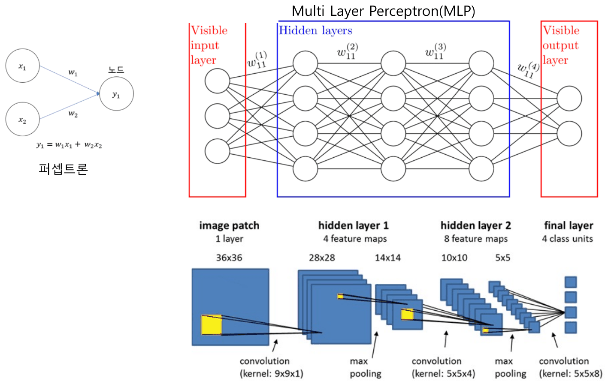

*그림 1. 퍼셉트론, 다층 퍼셉트론, 작은 합성곱 신경망의 구조*

- **퍼셉트론(perceptron):** 입력 벡터를 받아 가중합(과 편향)을 만든 뒤 활성화 함수를 적용해 출력을 내는 노드 하나짜리 신경망이다. 그림 1의 왼쪽은 두 입력 $x_1, x_2$에서 $y_1 = w_1x_1 + w_2x_2$를 계산하는 퍼셉트론이다.
- **다층 퍼셉트론(multi-layer perceptron, MLP):** 퍼셉트론을 여러 층으로 쌓은 구조이다. 값이 바깥에서 보이는 입력층(visible input layer), 여러 개의 은닉층(hidden layers), 출력층(visible output layer)으로 이루어지며, 이웃한 층의 모든 노드가 서로 연결된다. 연결은 입력에서 출력 방향으로만 이어지고 되돌아가는 연결은 없다. $w_{11}^{(1)}, \dots, w_{11}^{(4)}$의 위첨자는 몇 번째 층 사이의 가중치인지를 나타낸다.

실제 딥러닝 모델은 MLP보다 복잡한 구조를 쓴다. 그림 1의 아래쪽은 그 예인 작은 합성곱 신경망으로, 각 층에서 텐서의 크기는 다음과 같이 바뀐다(2절에서 각 연산을 자세히 다룬다).

| 단계 | 연산 | 출력 크기 | 계산 |
|:-----|:-----|:-----|:-----|
| 입력 | 이미지 조각 1장(채널 1개) | 36 × 36 × 1 | |
| 은닉층 1 | 9 × 9 × 1 커널 4개로 합성곱 | 28 × 28 × 4 | $36 - 9 + 1 = 28$ |
| | 최대 풀링 | 14 × 14 × 4 | $28 / 2 = 14$ |
| 은닉층 2 | 5 × 5 × 4 커널 8개로 합성곱 | 10 × 10 × 8 | $14 - 5 + 1 = 10$ |
| | 최대 풀링 | 5 × 5 × 8 | $10 / 2 = 5$ |
| 마지막 층 | 5 × 5 × 8 커널 4개로 합성곱 | 1 × 1 × 4 | $5 - 5 + 1 = 1$, 클래스 4개의 출력 |

*표 1. 그림 1의 작은 합성곱 신경망에서 층마다 바뀌는 텐서의 크기*

---

<br>

## 2. CNN

### 2.1 CNN과 그 응용

**CNN(convolutional neural network, 합성곱 신경망)** 은 합성곱 연산을 활용한 신경망이다. 영상을 다루는 컴퓨터 비전(computer vision)에서 매우 성공한 모델이며, 오랫동안 가장 성공한 모델로 여겨졌다. 최근에는 GPT 등에 쓰이는 트랜스포머(Transformer, 8강) 같은 새로운 구조가 컴퓨터 비전에서도 널리 쓰인다.

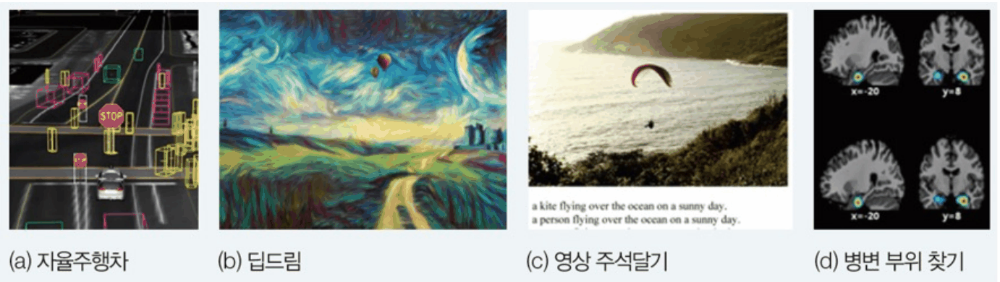

*그림 2. CNN의 응용: 자율주행차, 딥드림, 영상 주석 달기, 병변 부위 찾기*

- **자율주행차:** 카메라 영상에서 차량, 보행자, 신호등, 차선을 실시간으로 찾는다.
- **딥드림(deep dream):** 학습된 CNN이 반응하는 패턴을 이미지에 증폭시켜 그림 같은 영상을 만든다. 사진을 특정 화풍으로 바꾸는 것도 영상처리의 응용이다.
- **영상 주석 달기(image captioning):** 사진을 보고 "a kite flying over the ocean on a sunny day"처럼 설명 문장을 만든다(CNN이 영상의 특징을 뽑고 RNN이 문장을 만든다).
- **병변 부위 찾기:** 뇌 영상에서 병변의 위치를 찾는다.

### 2.2 합성곱 연산

**합성곱(convolution) 연산**은 입력의 일부 영역과 **커널(kernel)** 의 선형 결합이다. 커널은 **필터(filter)** 라고도 하며, 작은 가중치 배열이다. 커널이 한 번에 겹쳐 보는 입력의 영역을 **수용 영역(receptive field)** 이라 한다. 1차원 신호 $z$에 크기 $h$(홀수)인 커널 $u$를 적용한 결과 $f$는 다음과 같다.

$$
f(i) = z(i) \circledast u = \sum_{x=-(h-1)/2}^{(h-1)/2} z(i + x)\,u(x)
$$

커널의 위치를 가운데가 0이 되도록 $-(h-1)/2, \dots, (h-1)/2$로 번호를 매긴다. 크기 3인 커널 $u = (-1, 0, 1)$이면 $u(-1) = -1$, $u(0) = 0$, $u(1) = 1$이고 $f(i) = -z(i - 1) + z(i + 1)$이다. 커널을 한 칸씩 옮기며 각 위치의 값끼리 곱하고 모두 더한 결과를 **특징 맵(feature map)** 이라 한다.

**1차원 합성곱의 예.** 신호 $z = (2, 2, 2, 2, 2, 9, 9, 9)$에 커널 $(-1, 0, 1)$을 적용한다.

| 위치 $i$ | 0 | 1 | 2 | 3 | 4 | 5 | 6 | 7 |
|:-----|:-----:|:-----:|:-----:|:-----:|:-----:|:-----:|:-----:|:-----:|
| 신호 $z(i)$ | 2 | 2 | 2 | 2 | 2 | 9 | 9 | 9 |
| 특징 맵 $f(i) = -z(i-1) + z(i+1)$ | − | 0 | 0 | 0 | 7 | 7 | 0 | − |

*표 2. 신호 (2, 2, 2, 2, 2, 9, 9, 9)에 커널 (−1, 0, 1)을 적용한 1차원 합성곱*

예를 들어 $i = 5$에서 수용 영역은 위치 4, 5, 6의 값 (2, 9, 9)이고 $f(5) = 2 \times (-1) + 9 \times 0 + 9 \times 1 = 7$이다. 양 끝($i = 0, 7$)은 커널이 신호 밖으로 나가므로 값이 정의되지 않는다(−). 결과를 보면 값이 일정한 구간은 0, 값이 2에서 9로 바뀌는 경계 근처만 7이므로, 이 커널은 값이 변하는 지점(경계)을 찾는다.

**2차원 합성곱의 예.** 2차원 신호(이미지)에는 2차원 커널을 가로, 세로로 옮기며 적용한다. 다음 8 × 8 이미지에 3 × 3 커널을 적용하면 6 × 6 특징 맵이 나온다(바깥 테두리는 정의되지 않는다).

```text
2차원 신호                     커널            특징 맵 (가운데 6 × 6)
   0 1 2 3 4 5 6 7
0  2 2 2 2 2 9 9 9                               0  0 14 21  7  0
1  2 2 2 2 9 9 9 9                               0  0 21 21  0  0
2  2 2 2 2 9 9 9 9           -1 0 1              0  7 21 14  0  0
3  2 2 2 2 9 9 9 9     ⊛     -1 0 1      =       0 14 21  7  0  0
4  2 2 2 9 9 9 9 9           -1 0 1              0 21 21  0  0  0
5  2 2 2 9 9 9 9 9                               0 21 21  0  0  0
6  2 2 2 9 9 9 9 9
7  2 2 2 9 9 9 9 9
```

*그림 3. 8×8 이미지에 세로 경계를 찾는 3×3 커널을 적용한 2차원 합성곱*

특징 맵의 각 값은 수용 영역(3 × 3) 안에서 오른쪽 열의 합에서 왼쪽 열의 합을 뺀 값이다. 예를 들어 이미지의 (5, 2) 위치(5행 2열)를 중심으로 하는 수용 영역은 4\~6행, 1\~3열이며, 오른쪽 열(3열)은 모두 9, 왼쪽 열(1열)은 모두 2이므로 결과는 $3 \times (9 - 2) = 21$이다. 특징 맵에서 값이 큰 곳은 2와 9의 세로 경계와 일치한다.

> **참고:** 수학과 신호 처리에서 합성곱은 커널을 뒤집어 $\sum z(i - x)u(x)$로 정의한다. 커널을 뒤집지 않는 $\sum z(i + x)u(x)$는 엄밀히는 **교차 상관(cross-correlation)** 이다. 딥러닝 라이브러리는 대부분 교차 상관을 계산하면서 이를 합성곱이라 부른다 [1]. 커널은 학습으로 정해지므로, 뒤집은 커널을 학습하면 결과가 같아 실용적인 차이는 없다.

### 2.3 합성곱으로 특징 추출하기

합성곱 연산을 통해 입력(이미지)의 특징을 추출할 수 있다. 어떤 커널을 적용하느냐에 따라 원하는 특징을 추출할 수 있다.

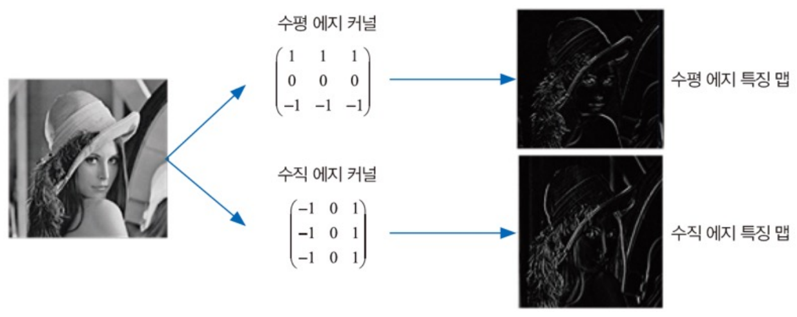

*그림 4. 수평 에지 커널과 수직 에지 커널을 적용해 얻은 두 특징 맵*

- **수평 에지 커널** $\begin{pmatrix} 1 & 1 & 1 \\ 0 & 0 & 0 \\ -1 & -1 & -1 \end{pmatrix}$은 위쪽 행의 합에서 아래쪽 행의 합을 뺀다. 위아래로 밝기가 달라지는 곳, 즉 가로 방향의 경계(수평 에지)에서 값이 커진다.
- **수직 에지 커널** $\begin{pmatrix} -1 & 0 & 1 \\ -1 & 0 & 1 \\ -1 & 0 & 1 \end{pmatrix}$은 오른쪽 열의 합에서 왼쪽 열의 합을 뺀다. 좌우로 밝기가 달라지는 곳, 즉 세로 방향의 경계(수직 에지)에서 값이 커진다(2.2절의 예).

그림 4에서 같은 사진에 두 커널을 적용하면 각각 가로 특징과 세로 특징이 밝게 드러난 특징 맵이 나온다. 밝기가 일정한 영역에서는 커널의 양수 부분과 음수 부분이 상쇄되어 값이 0에 가깝다.

### 2.4 학습되는 커널

에지 커널은 이해하기 쉬운 예이며, CNN에서는 커널의 값을 사람이 정하지 않는다. 커널(필터)의 값이 곧 가중치이며, 입력 데이터를 가장 잘 표현하고 원하는 결론을 내리기 좋은 특징을 뽑도록 역전파와 경사하강법으로 학습된다. 예를 들어 강아지 사진을 분류하는 모델은 강아지에게서만 나타나는 특징을 잘 뽑는 커널로 조금씩 바뀌어 간다.

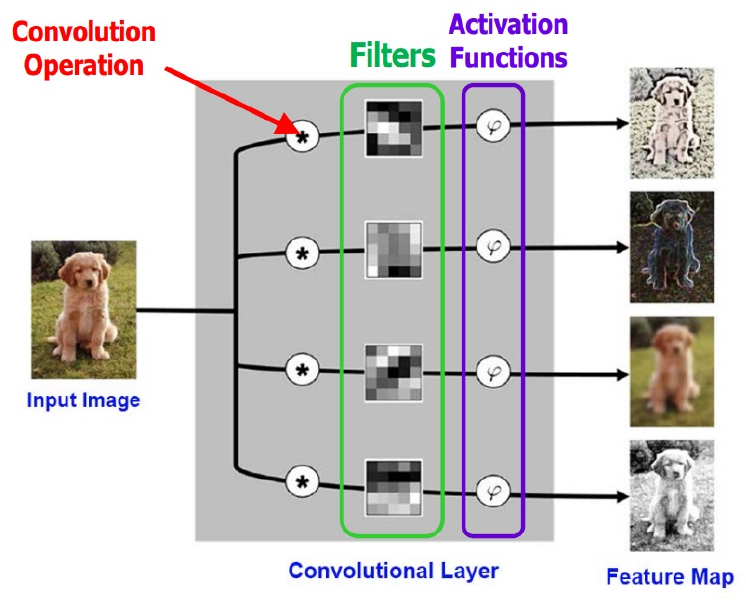

*그림 5. 입력 이미지에 여러 필터의 합성곱과 활성화 함수를 적용해 여러 장의 특징 맵을 만드는 합성곱 층*

그림 5의 **합성곱 층(convolutional layer)** 은 입력 이미지에 서로 다른 필터 4개로 합성곱 연산(⊛)을 하고, 각 결과에 활성화 함수(φ)를 적용하여 특징 맵 4장을 만든다. 필터마다 다른 특징(윤곽, 질감, 색의 대비 등)을 뽑으므로 특징 맵의 모습도 서로 다르다. CNN은 이런 층을 여러 개 쌓아 사용하는 커널이 매우 많으며, 각 커널이 서로 다양한 특징을 뽑도록 학습된다.

### 2.5 CNN이 바꾼 컴퓨터 비전

**개와 고양이 구별 문제.** 개와 고양이 사진을 구별하는 일은 예전 컴퓨터 비전에서 매우 어려운 문제여서 사람과 프로그램을 구별하는 보안 인증인 **캡차(CAPTCHA)** 로 쓰였다. 예를 들어 Asirra 캡차는 사진 12장을 보여 주고 모두 개인지 고양이인지 맞혀야 통과시킨다 [2]. 사진 한 장을 맞힐 확률이 $p$이면 12장을 모두 맞힐 확률은 $p^{12}$이다.

| 방법 | 사진 한 장의 정확도 $p$ | 12장 모두 맞힐 확률 $p^{12}$ |
|:-----|:-----:|:-----|
| 무작위로 찍기 | 0.5 | $0.5^{12} = 1/4096 \approx 0.024\%$ |
| 고전적인 컴퓨터 비전 기술 [3] | 0.827 | $0.827^{12} \approx 0.102 \approx 1/9.77$ |
| 합성곱 신경망 [4] | 0.98914 | $0.98914^{12} \approx 0.877$ |

*표 3. 개와 고양이 캡차를 통과할 확률의 비교*

고전적인 기술로도 약 10번에 1번 뚫리지만, 합성곱 신경망은 약 88%의 확률로 통과하므로 캡차로서의 기능을 잃는다.

**ILSVRC 2012와 AlexNet.** 대규모 이미지 분류 대회 ILSVRC는 자연 영상을 1,000개 클래스로 분류하는 문제를 겨룬다(1강 실습). 2012년 대회에서 CNN인 **AlexNet**이 상위 5개 오류율(top-5 error rate) 15.3%로 우승했다 [5]. 이전 해 대회는 고전적인 컴퓨터 비전 기술이 25.8%로 우승했으므로 오류율이 한꺼번에 10%p 넘게 떨어졌고, 이후 대부분의 컴퓨터 비전 연구자가 고전적인 방법에서 딥러닝으로 옮겨 갔다. CNN과 합성곱 연산 자체는 오래된 기술이지만, 이 시기에 GPU의 계산 능력과 대규모 데이터가 갖추어져 깊은 신경망을 현실적인 시간에 학습할 수 있게 되었다.

| 연도 | 대표 모델 (팀) | top-5 오류율 (%) |
|:-----|:-----|:-----:|
| 2010 | NEC America | 28.2 |
| 2011 | Xerox | 25.8 |
| 2012 | AlexNet | 16.4 |
| 2013 | Clarifai | 11.7 |
| 2014 | VGG (2위) | 7.3 |
| 2014 | GoogLeNet | 6.7 |
| 2015 | ResNet | 3.6 |

*표 4. ImageNet 분류 대회 연도별 대표 모델의 top-5 오류율*

**top-5 오류율**은 모델이 확률이 높다고 고른 5개 클래스 안에 정답이 없는 비율이다. 2015년의 ResNet [6]은 사람의 top-5 오류율로 추정된 약 5.1% [7]보다 낮은 오류율을 기록했다. VGG는 1강 실습과 3강, ResNet은 3\~4강에서 다룬다.

> **참고:** 표 4의 AlexNet 값 16.4%는 CNN 5개를 평균한 결과이고, 본문의 15.3%는 추가 데이터로 미리 학습한 CNN 2개를 더해 7개를 평균한 결과이다 [5]. 2012년 대회의 2위 팀 오류율은 26.2%였다.

### 2.6 2차원 합성곱의 계산

입력 크기 5 × 5, 커널 크기 3 × 3이면 출력 크기는 3 × 3이다. 커널을 입력의 왼쪽 위에 겹친 뒤, 겹친 9개 칸끼리 곱하고 모두 더해 출력 한 칸을 만들고, 커널을 한 칸씩 옮기며 반복한다.

```text
입력 (5 × 5)        커널 (3 × 3)      출력 (3 × 3)
3 3 2 1 0
0 0 1 3 1           0 1 2             12 12 17
3 1 2 2 3     ⊛     2 2 0      =      10 17 19
2 0 0 2 2           0 1 2              9  6 14
2 0 0 0 1
```

*그림 6. 5×5 입력에 3×3 커널을 적용한 2차원 합성곱*

출력의 왼쪽 위 값은 입력의 왼쪽 위 3 × 3 영역과 커널을 원소끼리 곱한 9개 값의 합이다.

$$
\begin{aligned}
&3 \cdot 0 + 3 \cdot 1 + 2 \cdot 2 \\
+\;&0 \cdot 2 + 0 \cdot 2 + 1 \cdot 0 \\
+\;&3 \cdot 0 + 1 \cdot 1 + 2 \cdot 2 \;=\; 0 + 3 + 4 + 0 + 0 + 0 + 0 + 1 + 4 = 12
\end{aligned}
$$

커널을 오른쪽으로 한 칸 옮기면 수용 영역은 0\~2행, 1\~3열 $\begin{pmatrix} 3 & 2 & 1 \\ 0 & 1 & 3 \\ 1 & 2 & 2 \end{pmatrix}$이 되고, $0 + 2 + 2 + 0 + 2 + 0 + 0 + 2 + 4 = 12$이다. 같은 방법으로 가로 3칸, 세로 3칸의 위치에서 계산하면 9개의 출력이 모두 채워진다.

### 2.7 패딩과 스트라이드

커널을 씌우다 보면 출력 크기가 입력보다 작아진다(5 × 5 → 3 × 3). 합성곱을 반복하면 크기가 계속 줄어 깊은 신경망을 만들기 어렵다. **패딩(padding)** 과 **스트라이드(stride)** 로 출력 크기를 조절한다.

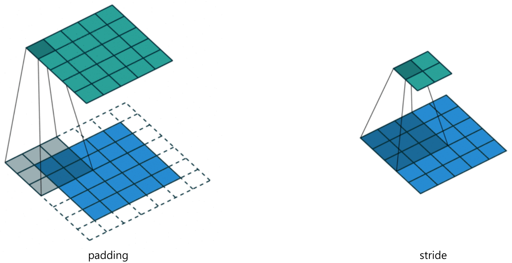

*그림 7. 입력 둘레에 패딩을 덧대어 출력 크기를 유지하는 합성곱과 스트라이드 2로 건너뛰며 적용하는 합성곱*

- **패딩:** 합성곱을 하기 전에 입력의 가장자리에 가짜 픽셀(보통 0)을 덧대는 것이다. 그림 7의 왼쪽은 5 × 5 입력(파랑) 둘레에 한 칸씩 0을 덧대어(점선) 7 × 7로 만든 뒤 3 × 3 커널을 적용하므로 출력(초록)이 5 × 5로 유지된다. 출력 크기를 보존하고, 가장자리 픽셀도 수용 영역의 가운데에 올 수 있어 가장자리 정보가 덜 손실되며, 깊은 신경망을 설계하기 쉬워진다.
- **스트라이드:** 커널이 한 번에 이동하는 간격이다. 기본은 1칸이며, 2칸 이상이면 커널이 건너뛰며 이동한다. 그림 7의 오른쪽은 5 × 5 입력에 3 × 3 커널을 스트라이드 2로 적용하여 2 × 2 출력을 만든다. 출력의 해상도를 줄이고(다운샘플링), 연산량과 메모리를 아낀다.

2.6절의 입력에 적용하면 다음과 같다.

$$
\text{패딩 1, 스트라이드 1: } \begin{pmatrix} 6 & 14 & 17 & 11 & 3 \\ 14 & 12 & 12 & 17 & 11 \\ 8 & 10 & 17 & 19 & 13 \\ 11 & 9 & 6 & 14 & 12 \\ 6 & 4 & 4 & 6 & 4 \end{pmatrix} \qquad \text{패딩 0, 스트라이드 2: } \begin{pmatrix} 12 & 17 \\ 9 & 14 \end{pmatrix}
$$

스트라이드 2의 출력은 스트라이드 1의 출력(그림 6)에서 0, 2번째 행과 열만 고른 것과 같다.

### 2.8 출력 크기 계산

입력 크기 $(H, W)$, 필터 크기 $(FH, FW)$, 스트라이드 $S$, 패딩 $P$일 때 출력 크기 $(OH, OW)$는 다음과 같다.

$$
(OH, OW) = \left(\frac{H + 2P - FH}{S} + 1,\ \frac{W + 2P - FW}{S} + 1\right)
$$

**유도.** 패딩을 덧댄 입력의 너비는 $W + 2P$이다. 커널의 왼쪽 끝이 놓일 수 있는 가장 오른쪽 위치는 $W + 2P - FW$이고(0부터 셈), 커널은 0에서 출발해 $S$칸씩 이동하므로 놓일 수 있는 위치는 $0, S, 2S, \dots$ 중 $W + 2P - FW$ 이하인 값이다. 그 개수가 $\lfloor (W + 2P - FW)/S \rfloor + 1$이다. 나누어떨어지지 않으면 남는 칸은 쓰지 않으므로 내림($\lfloor \cdot \rfloor$)을 취한다.

| 입력 | 필터 | 패딩 | 스트라이드 | 계산 | 출력 |
|:-----:|:-----:|:-----:|:-----:|:-----|:-----:|
| 5 | 3 | 0 | 1 | $(5 + 0 - 3)/1 + 1$ | 3 |
| 5 | 3 | 1 | 1 | $(5 + 2 - 3)/1 + 1$ | 5 |
| 5 | 3 | 0 | 2 | $(5 + 0 - 3)/2 + 1$ | 2 |
| 7 | 3 | 0 | 2 | $(7 + 0 - 3)/2 + 1$ | 3 |
| 6 | 3 | 0 | 2 | $\lfloor (6 + 0 - 3)/2 \rfloor + 1 = \lfloor 1.5 \rfloor + 1$ | 2 |
| 227 | 11 | 0 | 4 | $(227 - 11)/4 + 1$ | 55 |

*표 5. 출력 크기 공식을 적용한 예*

마지막 줄은 AlexNet의 첫 층이다(2.12절). 커널이 $F \times F$이고 스트라이드가 1일 때 $P = (F - 1)/2$로 두면 출력 크기가 입력과 같아진다. 예를 들어 3 × 3 커널은 패딩 1, 5 × 5 커널은 패딩 2이다. 이 공식은 직접 몇 번 계산해 보면 이해되는 내용을 수식으로 정리한 것이며, 신경망을 설계할 때 층의 크기를 맞추는 데 쓴다.

### 2.9 다채널 입력과 여러 개의 커널

RGB 컬러 이미지는 빨강, 초록, 파랑 세 채널의 2차원 배열을 쌓은 3차원 입력(W × H × C)이다. 다채널 입력에서 합성곱은 다음 규칙을 따른다.

- **입력의 채널 수와 커널의 채널 수가 같아야 한다.** 입력이 3채널이면 커널 하나도 3채널(예: 3 × 3 × 3)이다. 각 채널의 커널 조각이 입력의 같은 채널과 계산된다.
- 커널 하나를 한 위치에 적용하면 $3 \times 3 \times 3 = 27$개의 곱을 모두 더한 값 하나(필요하면 편향을 더한 값)가 나온다. 따라서 커널 하나의 출력은 채널이 1개인 2차원 특징 맵이다.
- **커널(필터)의 개수가 출력의 채널 수가 된다.** 커널을 2개 쓰면 특징 맵 2장이 쌓여 출력 채널이 2개가 된다.

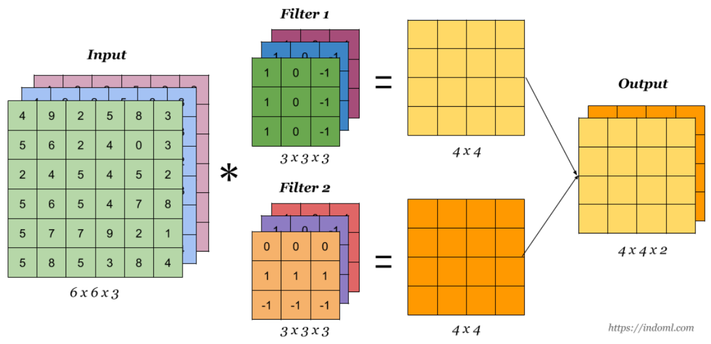

*그림 8. 6×6×3 입력에 3×3×3 필터 2개를 적용하여 4×4×2 출력을 만드는 다채널 합성곱*

| 항목 | 값 | 계산 |
|:-----|:-----|:-----|
| 입력 크기 | 6 × 6 × 3 | |
| 커널 크기 | 3 × 3 × 3 | 커널의 채널 수 = 입력의 채널 수 3 |
| 커널 하나의 출력 크기 | 4 × 4 | $6 - 3 + 1 = 4$ |
| 커널 개수 | 2 | |
| 최종 출력 크기 | 4 × 4 × 2 | 출력 채널 수 = 커널 개수 |
| 파라미터 수 | 56 | 가중치 $2 \times (3 \times 3 \times 3) = 54$, 편향 2 |

*표 6. 다채널 합성곱의 크기와 파라미터 수 계산*

일반적으로 입력 채널이 $C_{in}$, 출력 채널이 $C_{out}$, 커널이 $K \times K$인 합성곱 층의 파라미터 수는 $C_{out} \times (C_{in} \times K \times K) + C_{out}$이다. 예를 들어 VGG-16의 첫 층(3채널 입력, 64채널 출력, 3 × 3)은 $64 \times 27 + 64 = 1792$개이다. 파라미터 수는 입력 이미지의 가로세로 크기와 무관하다. 같은 커널을 이미지의 모든 위치에서 공유하기 때문이다.

> **주의:** 입력의 채널(R, G, B 같은 깊이 방향)과 출력의 채널(커널 개수만큼 생기는 특징 맵의 수)을 모두 "채널"이라 부르므로 헷갈리기 쉽다. 커널의 깊이는 입력 채널 수로 정해지고, 커널의 개수는 출력 채널 수로 정해진다.

이 규칙을 시각적으로 보여 주는 애니메이션으로 "All Convolution Animations Are Wrong" 영상과 그 웹사이트 [8]가 있다. 흔한 합성곱 애니메이션은 2차원 평면 하나만 보여 주어 채널 방향을 빠뜨리지만, 실제로는 커널 하나가 입력의 모든 채널을 덮는 3차원 블록이고 커널마다 출력 채널이 하나씩 생긴다.

### 2.10 풀링

**풀링(pooling)** 층은 특징 맵을 작은 영역으로 나누어 영역마다 값 하나로 요약한다.

- **최대 풀링(max pooling):** 커널 안에 있는 값 중 최댓값을 취한다.
- **평균 풀링(average pooling):** 커널 안에 있는 값의 평균을 취한다.

다음은 4 × 4 특징 맵에 2 × 2 커널, 스트라이드 2로 풀링한 예이다.

```text
특징 맵 (4 × 4)       최대 풀링 (2 × 2)     평균 풀링 (2 × 2)
3 1 | 7 2
5 1 | 0 9               5  9                 2.5   4.5
----+----
8 2 | 4 9               8  9                 4.25  3.75
4 3 | 1 1
```

*그림 9. 4×4 특징 맵에 2×2 최대 풀링과 평균 풀링을 적용한 결과*

왼쪽 위 영역 (3, 1, 5, 1)의 최댓값은 5, 평균은 $10/4 = 2.5$이다. 오른쪽 위 영역 (7, 2, 0, 9)의 최댓값은 9, 평균은 $18/4 = 4.5$이다.

- 풀링은 특징 맵의 지나친 상세함을 줄여 요약 통계량을 추출한다. 최대 풀링은 영역 안에서 특징이 조금 움직여도 같은 값을 내므로 작은 위치 변화에 덜 민감해진다.
- 스트라이드를 $s$로 하면 특징 맵은 길이 기준으로 $1/s$, 넓이 기준으로 $1/s^2$로 줄어든다. 위 예는 $s = 2$이므로 값의 개수가 16개에서 4개로 줄었다.
- 풀링(다운샘플링)은 특징 맵의 공간 해상도를 낮추어 연산량과 메모리를 줄이고, 뒤에 오는 층에 필요한 가중치 수를 줄인다. 풀링 층 자체에는 학습할 가중치가 없다. 예를 들어 2강 실습의 `Mini_Alex`에서 마지막 최대 풀링이 없으면 펼친 값이 $256 \times 13 \times 13 = 43264$개라서 첫 완전 연결 층의 가중치가 $43264 \times 4096 \approx 1.77$억 개이지만, 풀링으로 $256 \times 6 \times 6 = 9216$개로 줄이면 $9216 \times 4096 \approx 3{,}775$만 개가 된다.
- 연속된 합성곱 층 사이에 풀링을 넣으면 뒤쪽 층이 점점 더 넓은 입력 영역을 보게 되어(수용 영역 확대) 저수준 특징(에지)에서 고수준 특징(물체의 부분)으로 이어지는 공간적 계층 구조가 만들어진다. 예를 들어 3 × 3 합성곱 두 층의 출력 한 칸은 입력의 5 × 5 영역을 보지만, 그 사이에 2 × 2 최대 풀링(스트라이드 2)을 넣으면 8 × 8 영역을 본다.

### 2.11 합성곱 블록

CNN은 보통 **합성곱 → 활성화 함수 → 풀링**을 하나의 **빌딩 블록(building block)** 으로 묶고, 이 블록을 여러 개 쌓아 만든다.

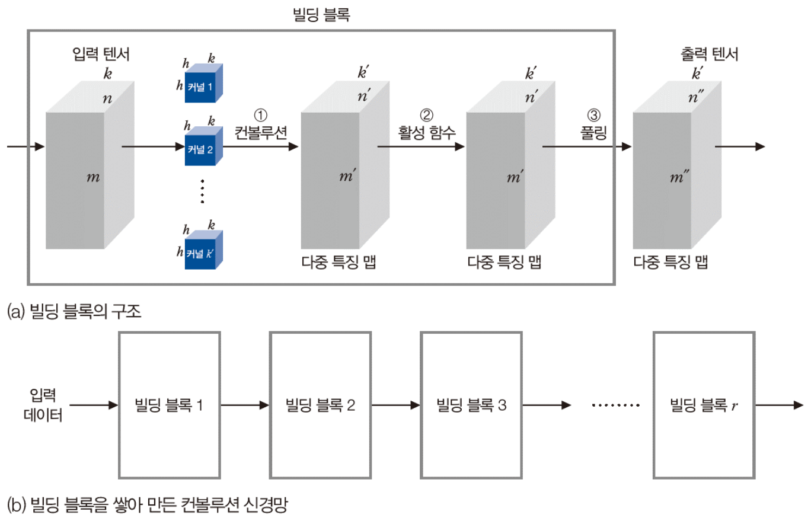

*그림 10. 합성곱, 활성화 함수, 풀링으로 이루어진 빌딩 블록과 블록을 쌓아 만든 합성곱 신경망*

그림 10 (a)에서 $m \times n \times k$ 입력 텐서에 $h \times h \times k$ 커널 $k'$개로 ① 합성곱을 하면 $m' \times n' \times k'$ 다중 특징 맵이 되고, ② 활성화 함수(예: ReLU)는 크기를 바꾸지 않으며, ③ 풀링은 가로세로를 줄여 $m'' \times n'' \times k'$ 출력 텐서를 만든다. 그림 10 (b)처럼 빌딩 블록 1, 2, …, $r$을 차례로 쌓으면 깊은 CNN이 된다. 1강 실습의 VGG-16도 이런 블록 5개 뒤에 완전 연결 층을 둔 구조이다.

### 2.12 AlexNet의 구조

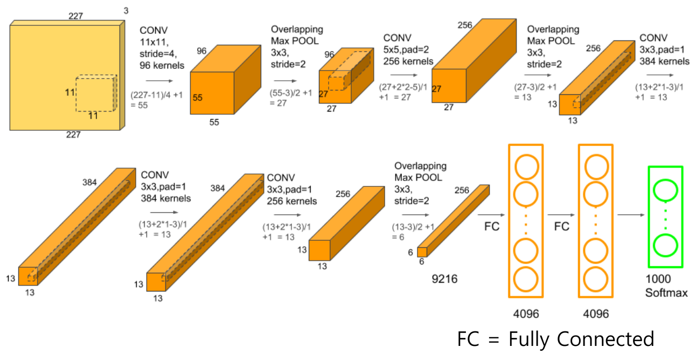

*그림 11. 다섯 개의 합성곱 층, 세 개의 최대 풀링 층, 세 개의 완전 연결 층으로 이루어진 AlexNet의 구조*

AlexNet은 합성곱 층 5개와 **완전 연결 층(fully connected layer, FC)** 3개로 이루어진다. 완전 연결 층은 이전 층의 모든 노드가 다음 층의 모든 노드와 연결된 층으로, 밀집 층(dense layer)이라고도 한다. 풀링 영역(3 × 3)이 스트라이드(2)보다 커서 이웃한 영역이 서로 겹치는 최대 풀링을 **중첩 최대 풀링(overlapping max pooling)** 이라 한다. 2.8절의 공식으로 각 층의 크기를 계산하면 다음과 같다.

| 층 | 설정 | 출력 크기 | 계산 |
|:-----|:-----|:-----|:-----|
| 입력 | RGB 이미지 | 227 × 227 × 3 | |
| CONV1 | 11 × 11, 스트라이드 4, 커널 96개 | 55 × 55 × 96 | $(227 - 11)/4 + 1 = 55$ |
| POOL1 | 3 × 3 중첩 최대 풀링, 스트라이드 2 | 27 × 27 × 96 | $(55 - 3)/2 + 1 = 27$ |
| CONV2 | 5 × 5, 패딩 2, 커널 256개 | 27 × 27 × 256 | $(27 + 2 \cdot 2 - 5)/1 + 1 = 27$ |
| POOL2 | 3 × 3, 스트라이드 2 | 13 × 13 × 256 | $(27 - 3)/2 + 1 = 13$ |
| CONV3 | 3 × 3, 패딩 1, 커널 384개 | 13 × 13 × 384 | $(13 + 2 \cdot 1 - 3)/1 + 1 = 13$ |
| CONV4 | 3 × 3, 패딩 1, 커널 384개 | 13 × 13 × 384 | 같은 계산 |
| CONV5 | 3 × 3, 패딩 1, 커널 256개 | 13 × 13 × 256 | 같은 계산 |
| POOL3 | 3 × 3, 스트라이드 2 | 6 × 6 × 256 | $(13 - 3)/2 + 1 = 6$ |
| 펼치기 | | 9216 | $6 \times 6 \times 256 = 9216$ |
| FC6 | 완전 연결 | 4096 | |
| FC7 | 완전 연결 | 4096 | |
| FC8 | 완전 연결과 소프트맥스 | 1000 | 클래스 1,000개의 확률 |

*표 7. AlexNet의 층별 설정과 출력 크기*

파라미터는 약 6,000만 개이며, 대부분이 완전 연결 층에 있다. 합성곱 층의 파라미터는 약 375만 개뿐이고, FC6 하나가 $9216 \times 4096 \approx 3{,}775$만 개를 차지한다.

> **참고:** AlexNet 논문은 입력을 224 × 224로 적었지만, 그 크기로는 첫 층의 계산 $(224 - 11)/4 + 1 = 54.25$가 정수가 되지 않는다. 그래서 보통 227 × 227 입력을 기준으로 설명한다. 원래 AlexNet은 GPU 2개에 층을 나누어 학습했으며, 그림 11은 이를 하나로 합쳐 그린 것이다.

### 2.13 PyTorch의 Conv2d와 MaxPool2d

PyTorch는 2차원 합성곱 층을 `torch.nn.Conv2d` 클래스로 제공한다 [9].

```python
torch.nn.Conv2d(in_channels, out_channels, kernel_size, stride=1, padding=0, dilation=1,
                groups=1, bias=True, padding_mode='zeros', device=None, dtype=None)
```

| 인자 | 의미 | 기본값 |
|:-----|:-----|:-----|
| `in_channels` | 입력 이미지의 채널 수 | (필수) |
| `out_channels` | 합성곱이 만드는 출력 채널 수, 즉 커널 개수 | (필수) |
| `kernel_size` | 커널의 크기 (정수 또는 튜플) | (필수) |
| `stride` | 커널의 이동 간격 | 1 |
| `padding` | 입력의 네 변에 덧대는 칸 수 | 0 |
| `padding_mode` | 패딩 값을 정하는 방식: `'zeros'`, `'reflect'`, `'replicate'`, `'circular'` | `'zeros'` |
| `dilation` | 커널 원소 사이의 간격 (1이면 붙어 있음) | 1 |
| `groups` | 입력 채널과 출력 채널을 몇 묶음으로 나누어 연결할지 | 1 |
| `bias` | `True`이면 학습 가능한 편향을 출력에 더함 | `True` |

*표 8. torch.nn.Conv2d의 인자*

입력은 $(N, C_{in}, H_{in}, W_{in})$ 또는 배치 축이 없는 $(C_{in}, H_{in}, W_{in})$이고, 출력은 $(N, C_{out}, H_{out}, W_{out})$이다. $N$은 배치 크기이다. 출력 크기는 다음과 같다(`[0]`, `[1]`은 높이와 너비 방향의 값).

$$
H_{out} = \left\lfloor \frac{H_{in} + 2 \times \text{padding}[0] - \text{dilation}[0] \times (\text{kernel\_size}[0] - 1) - 1}{\text{stride}[0]} + 1 \right\rfloor
$$

$W_{out}$도 `[1]` 값으로 같은 식을 쓴다. `dilation = 1`이면 분자가 $H_{in} + 2P - F$가 되어 2.8절의 공식과 같다. `dilation`이 $d$이면 커널 원소 사이에 $d - 1$칸씩 간격을 두므로 커널이 실제로 덮는 크기가 $d(F - 1) + 1$이 된다.

최대 풀링 층은 `torch.nn.MaxPool2d`이다 [10].

```python
torch.nn.MaxPool2d(kernel_size, stride=None, padding=0, dilation=1, return_indices=False, ceil_mode=False)
```

| 인자 | 의미 |
|:-----|:-----|
| `kernel_size` | 최댓값을 취할 영역의 크기 |
| `stride` | 영역의 이동 간격. 기본값 `None`은 `kernel_size`와 같다 |
| `padding` | 양쪽에 덧대는 칸 수. 덧댄 칸은 음의 무한대로 취급되어 최댓값으로 뽑히지 않는다 |
| `dilation` | 영역 안 원소 사이의 간격 |
| `return_indices` | `True`이면 최댓값의 위치도 함께 돌려준다(`MaxUnpool2d`에 쓰임) |
| `ceil_mode` | `True`이면 출력 크기를 계산할 때 내림 대신 올림을 쓴다 |

*표 9. torch.nn.MaxPool2d의 인자*

출력 크기 공식은 `Conv2d`와 같다. 따라서 `MaxPool2d(2)`는 스트라이드도 2가 되어 가로세로를 절반으로 줄이고, `MaxPool2d(3, 2)`는 AlexNet의 중첩 최대 풀링이다. 이 두 클래스로 CNN을 만들고 층마다 텐서 크기를 추적하는 코드는 2강 실습에서 다룬다.

---

<br>

## 3. RNN

### 3.1 시계열 데이터

**시계열 데이터(time-series data)** 는 시간 정보나 순서가 들어 있는 데이터, 즉 시간 축을 따라 신호가 변하는 동적 데이터이다. 예를 들어 문장 "세상에는 시계열 데이터가 참 많다"는 단어가 나타나는 순서가 중요하고, 문장마다 길이가 다르다.

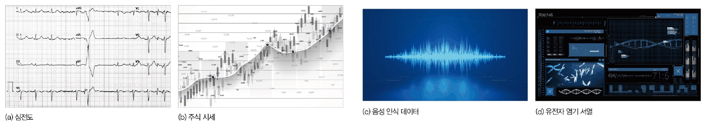

*그림 12. 시계열 데이터의 예: 심전도, 주식 시세, 음성 인식 데이터, 유전자 염기 서열*

| 구분 | 모델 |
|:-----|:-----|
| 시계열 데이터를 인식하는 고전적인 모델 | ARIMA(autoregressive integrated moving average), SARIMA(seasonal ARIMA), Prophet 등 |
| 시계열 데이터를 인식하는 딥러닝 모델 | 순환 신경망(recurrent neural network, RNN), LSTM(long short-term memory), GRU(gated recurrent unit) |

*표 10. 시계열 데이터를 인식하는 고전적인 모델과 딥러닝 모델*

1강의 다층 퍼셉트론, 깊은 다층 퍼셉트론, 2절의 합성곱 신경망은 크기가 정해진 정적 데이터를 한꺼번에 입력받으므로 시계열 데이터에 맞지 않는다. 길이가 다른 시계열을 억지로 고정 크기의 정적 데이터로 바꾸어 입력하면(잘라 내거나 평균을 내는 등) 순서와 길이에 담긴 정보가 크게 손실된다. 그래서 딥러닝에서는 시계열 특성을 반영하는 순환 신경망이나 LSTM을 활용한다.

### 3.2 시계열 데이터의 특성과 표현

| 특성 | 의미 | 예 |
|:-----|:-----|:-----|
| 요소의 순서가 중요 | 순서를 바꾸면 의미가 훼손된다 | "고양이를 따라가는 강아지"를 "강아지를 따라가는 고양이"로 바꾸면 뜻이 달라진다 |
| 샘플의 길이가 다름 | 같은 내용도 샘플마다 길이가 다르다 | 짧은 발음 "인공지능"과 길게 끈 발음 "인\~공\~\~지\~능" |
| 문맥 의존성 | 멀리 떨어진 요소끼리 밀접하게 관련된다 | "시계열은 앞에서 말한 바와 … 특성이 있다"에서 "시계열은"과 "특성이 있다" |
| 계절성 | 일정한 주기로 비슷한 패턴이 반복된다 | 상추 판매량, 미세먼지 수치, 항공권 판매량 |

*표 11. 시계열 데이터의 독특한 특성*

시계열 데이터 하나는 각 시점의 값을 벡터로 나타내고 그 벡터를 시간 순서대로 늘어놓은 **벡터의 벡터**이며, 길이가 샘플마다 다른 가변 길이이다.

$$
\mathbf{x} = (\mathbf{a}^1, \mathbf{a}^2, \dots, \mathbf{a}^T)
$$

예를 들어 매일 기온, 습도, 미세먼지 농도를 기록한다면 $\mathbf{a}^1 = (23.5, 42, 0.1)$, $\mathbf{a}^2 = (25.5, 45, 0.08)$, …이고, 기록한 날수 $T$가 시계열의 길이이다. 위첨자 $t$는 거듭제곱이 아니라 시점을 뜻한다.

### 3.3 RNN의 응용

순환 신경망은 구조가 유연하여 여러 문제에 적용할 수 있다.

- **미래 예측(prediction, forecasting):** 대표적인 응용이다. 내일의 주가, 내일의 날씨, 기계의 고장, 풍속과 풍향(풍력 발전기의 효율 향상), 농산물의 가격과 수요량 등을 지난 기록으로 예측한다.
- **언어 번역:** 한 언어의 문장(시계열)을 다른 언어의 문장(시계열)으로 바꾼다(8강).
- **음성 인식:** 음성 신호(시계열)를 텍스트로 바꾼다(6강).
- **생성 모델:** 사진을 보고 설명 문장을 생성하는 것처럼 시계열을 만들어 낸다.

### 3.4 RNN의 구조

**RNN(recurrent neural network, 순환 신경망)** 은 이전 시점의 정보를 현재 시점의 계산에 반영하는 순환 구조를 가진다. 시점 $t$에서 입력 $\mathbf{a}^t$가 들어오면, 이전 시점의 **은닉 상태(hidden state)** $\mathbf{h}^{t-1}$을 함께 사용하여 현재 은닉 상태 $\mathbf{h}^t$를 계산하고, 은닉 상태에서 출력 $\mathbf{o}^t$를 만든다.

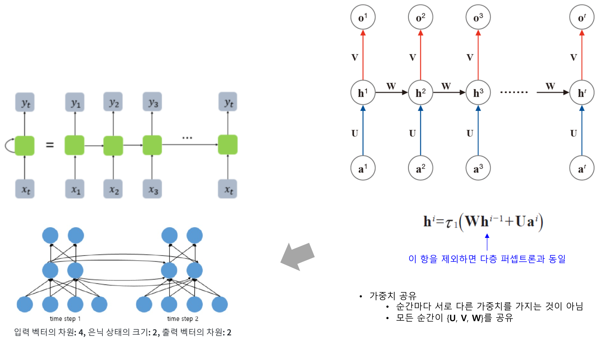

*그림 13. 순환 연결을 시간 방향으로 펼친 RNN과 가중치 U, W, V로 표현한 RNN의 계산*

$$
\mathbf{h}^t = \tau_1\left(\mathbf{W}\mathbf{h}^{t-1} + \mathbf{U}\mathbf{a}^t + \mathbf{b}\right), \qquad \mathbf{o}^t = \tau_2\left(\mathbf{V}\mathbf{h}^t + \mathbf{c}\right)
$$

- $\mathbf{U}$는 입력에서 은닉층으로, $\mathbf{W}$는 이전 은닉 상태에서 현재 은닉 상태로, $\mathbf{V}$는 은닉층에서 출력으로 가는 가중치 행렬이다. $\mathbf{b}, \mathbf{c}$는 편향이고, $\tau_1$은 보통 tanh, $\tau_2$는 문제에 맞는 출력 함수(예: 소프트맥스)이다.
- $\mathbf{W}\mathbf{h}^{t-1}$ 항을 제외하면 다층 퍼셉트론과 같다. 이 항이 과거의 정보를 현재로 전달하는 순환 연결이다.
- 그림 13 왼쪽 위는 같은 셀(초록)이 자기 자신으로 되돌아가는 순환을 시간 방향으로 펼친(unrolled) 모습이다. 펼친 그림의 셀들은 서로 다른 셀이 아니라 하나의 셀을 시점마다 반복해 쓰는 것이다.
- **가중치 공유:** 시점마다 서로 다른 가중치를 가지는 것이 아니라, 모든 시점이 같은 $\lbrace\mathbf{U}, \mathbf{V}, \mathbf{W}\rbrace$를 공유한다. 그래서 시계열의 길이가 달라도 같은 모델을 쓸 수 있고, 길이가 늘어나도 파라미터 수는 그대로이다.

그림 13 왼쪽 아래는 입력 벡터의 차원이 4, 은닉 상태의 크기가 2, 출력 벡터의 차원이 2인 RNN을 두 시점(time step 1, 2)에 걸쳐 그린 것이다. 이때 $\mathbf{U}$는 $2 \times 4$, $\mathbf{W}$는 $2 \times 2$, $\mathbf{V}$는 $2 \times 2$ 행렬이므로 가중치는 $8 + 4 + 4 = 16$개이고, 편향 $\mathbf{b}, \mathbf{c}$(각 2개)를 더하면 20개이다. 은닉층 노드 사이의 곡선이 시점 1의 은닉 상태를 시점 2로 전달하는 $\mathbf{W}$이다.

**계산 예.** 입력, 은닉 상태, 출력이 모두 스칼라이고 $w = 0.5$, $u = 1$, 편향 0, $\tau_1 = \tanh$, $h^0 = 0$이라 하자. 입력 시퀀스 $(1, 0, -1)$을 넣으면 다음과 같다.

| 시점 $t$ | 입력 $a^t$ | $w h^{t-1} + u a^t$ | $h^t = \tanh(\cdot)$ |
|:-----:|:-----:|:-----|:-----:|
| 1 | 1 | $0.5 \times 0 + 1 = 1$ | 0.7616 |
| 2 | 0 | $0.5 \times 0.7616 + 0 = 0.3808$ | 0.3634 |
| 3 | −1 | $0.5 \times 0.3634 - 1 = -0.8183$ | −0.6741 |

*표 12. 스칼라 RNN에 입력 시퀀스 (1, 0, −1)을 넣었을 때의 은닉 상태*

시점 2의 입력은 0인데도 은닉 상태가 0.3634인 것은 시점 1의 정보가 $w h^1$으로 전달되었기 때문이다. 은닉 상태는 지금까지 본 시퀀스의 요약이며, 시점 3의 은닉 상태에도 시점 1의 입력이 조금 남아 있다.

### 3.5 RNN의 입출력 형태

RNN은 시점마다 출력을 낼 수도 있고, 마지막 시점의 출력만 쓸 수도 있다. 입력과 출력의 길이에 따라 다음과 같이 활용한다.

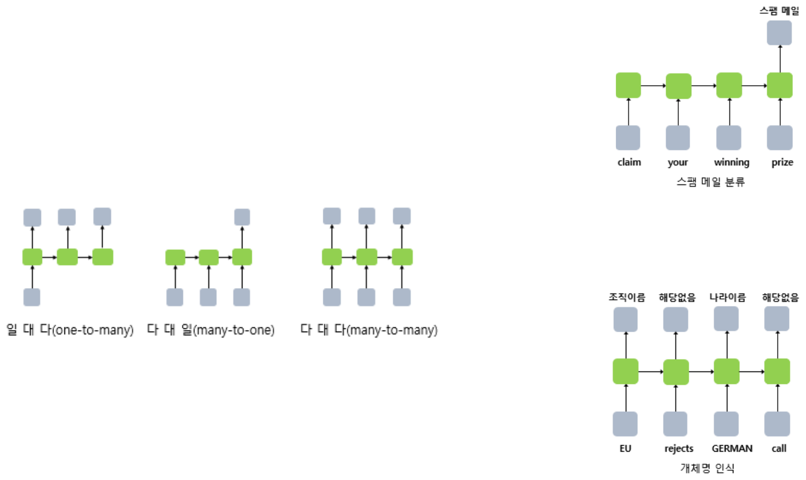

*그림 14. 일 대 다, 다 대 일, 다 대 다 RNN과 스팸 메일 분류, 개체명 인식의 예*

| 형태 | 입력 | 출력 | 예 |
|:-----|:-----|:-----|:-----|
| 일 대 다(one-to-many) | 1개 | 여러 개 | 영상 주석 달기: 사진 한 장 → 설명 문장("강아지가 잔디 위에 앉아 있다") |
| 다 대 일(many-to-one) | 여러 개 | 1개 | 스팸 메일 분류: 문장 "claim your winning prize" → 스팸 여부 |
| 다 대 다(many-to-many) | 여러 개 | 여러 개 | 개체명 인식: "EU rejects GERMAN call" → 조직 이름, 해당 없음, 나라 이름, 해당 없음 |

*표 13. RNN의 입출력 형태와 활용 예*

스팸 메일 분류는 시점마다 출력을 낼 수 있지만, 문장 전체를 다 읽은 마지막 시점의 출력만 0(정상) 또는 1(스팸)로 학습시킨다. 마지막 은닉 상태에 앞의 단어들의 정보가 모두 반영되어 있기 때문이다. **개체명 인식(named entity recognition)** 은 문장의 각 단어가 사람, 조직, 나라 같은 고유한 개체의 이름인지 판단하는 태스크이다.

### 3.6 기울기 소실 문제

기본 RNN은 시퀀스가 길어지면 앞쪽의 정보를 잃는 **기울기 소실(vanishing gradient)** 문제가 생긴다. 문장이 매우 길어지면 앞 단어의 정보가 뒤까지 전달되지 않는데, 기본 RNN에는 이를 해결할 장치가 없다. 그래서 기본 RNN은 실제로 잘 쓰이지 않는다.

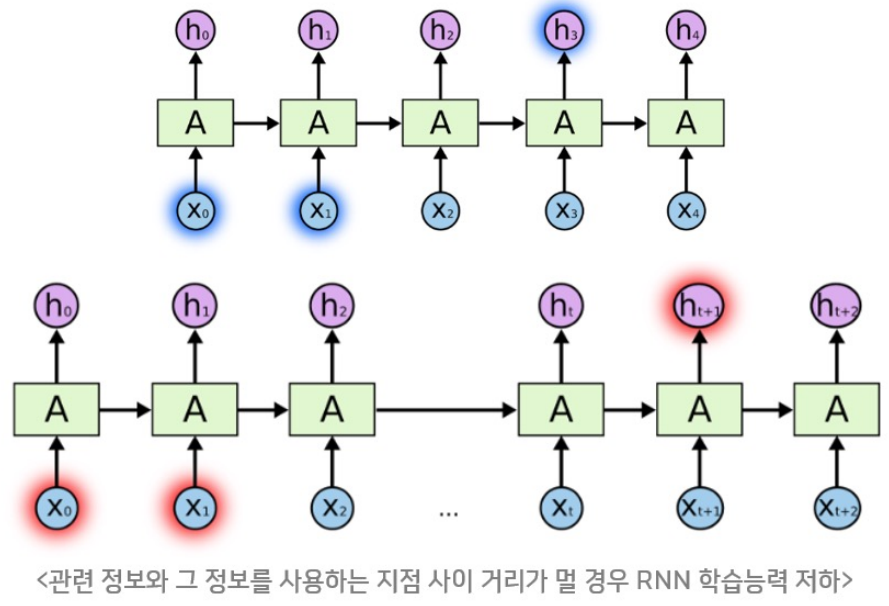

*그림 15. 관련 정보와 그 정보를 쓰는 지점 사이의 거리가 가까울 때와 멀 때의 RNN*

그림 15의 위쪽은 $h_3$에 필요한 정보가 바로 앞의 $x_0, x_1$에 있는 경우로, 거리가 가까워 RNN이 잘 학습한다. 아래쪽은 $h_{t+1}$에 필요한 정보가 훨씬 앞의 $x_0, x_1$에 있는 경우로, 관련 정보와 그 정보를 쓰는 지점 사이의 거리가 멀어 RNN의 학습 능력이 떨어진다 [11].

**원인.** 3.4절의 스칼라 RNN $h^t = \tanh(w h^{t-1} + u a^t)$에서 한 시점 앞의 은닉 상태에 대한 미분은 $\frac{\partial h^t}{\partial h^{t-1}} = w\,(1 - (h^t)^2)$이다($\tanh'(s) = 1 - \tanh^2(s)$). 역전파에서 시점 $T$의 손실이 시점 1의 입력까지 전달되려면 연쇄 법칙에 의해 이 값을 $T - 1$번 곱해야 한다.

$$
\frac{\partial h^T}{\partial h^1} = \prod_{t=2}^{T} w\,(1 - (h^t)^2)
$$

$\tanh$의 도함수는 1 이하이므로 $\lvert w \rvert < 1$이면 곱이 시점 수에 대해 지수적으로 작아진다. 예를 들어 각 인자가 0.5이면 20시점 뒤에는 $0.5^{20} \approx 9.5 \times 10^{-7}$이 되어, 앞쪽 입력에 대한 가중치는 거의 갱신되지 않는다. 반대로 인자의 크기가 1보다 크면 곱이 폭발적으로 커지는 **기울기 폭주(exploding gradient)** 가 생긴다(예: $1.1^{50} \approx 117$).

### 3.7 LSTM

**LSTM(long short-term memory)** 은 RNN의 기울기 소실을 보완한 구조이다 [12]. RNN의 은닉 상태에 **셀 상태(cell state)** 를 추가하여 주요한 정보를 오래 기억하도록 해서 성능을 개선한다.

- 셀 상태는 은닉 상태와 마찬가지로 이전 시점의 셀 상태를 다음 시점으로 넘겨준다.
- 셀 상태의 주된 역할은 세 게이트, 즉 **망각 게이트(forget gate)**, **입력 게이트(input gate)**, **출력 게이트(output gate)** 와 함께 작용하여 정보를 선택적으로 활용할 수 있도록 하는 것이다. **게이트(gate)** 는 0과 1 사이의 값을 원소별로 곱해 정보가 지나가는 양을 조절하는 장치이다.

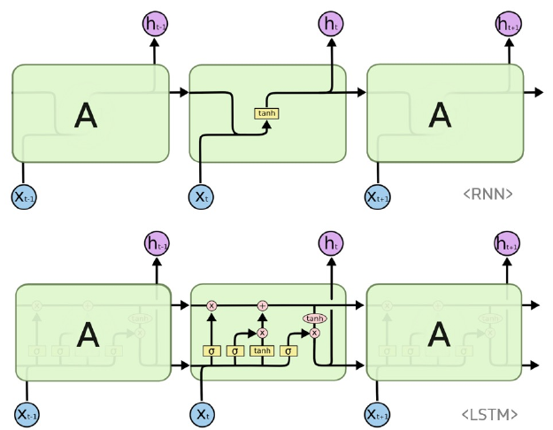

*그림 16. 반복 모듈 안에 tanh 층 하나가 있는 RNN과 시그모이드 게이트 층 세 개와 tanh 층 하나가 있는 LSTM*

그림 16의 위쪽 RNN은 반복 모듈 안에 tanh 층 하나만 있고, 아래쪽 LSTM은 시그모이드 층(σ) 3개와 tanh 층 1개가 있으며 모듈 위쪽을 가로지르는 선이 셀 상태이다 [13]. LSTM의 계산은 다음과 같다. $\sigma$는 시그모이드, $\odot$는 원소별 곱이다.

$$
\begin{aligned}
f_t &= \sigma(W_{xh\_f}\,x_t + W_{hh\_f}\,h_{t-1} + b_{h\_f}) \\
i_t &= \sigma(W_{xh\_i}\,x_t + W_{hh\_i}\,h_{t-1} + b_{h\_i}) \\
o_t &= \sigma(W_{xh\_o}\,x_t + W_{hh\_o}\,h_{t-1} + b_{h\_o}) \\
g_t &= \tanh(W_{xh\_g}\,x_t + W_{hh\_g}\,h_{t-1} + b_{h\_g}) \\
c_t &= f_t \odot c_{t-1} + i_t \odot g_t \\
h_t &= o_t \odot \tanh(c_t)
\end{aligned}
$$

| 기호 | 이름 | 값의 범위 | 역할 |
|:-----|:-----|:-----|:-----|
| $f_t$ | 망각 게이트 | $(0, 1)$ | 이전 셀 상태 $c_{t-1}$을 얼마나 남길지 정한다. 0이면 지우고 1이면 그대로 둔다. |
| $i_t$ | 입력 게이트 | $(0, 1)$ | 새 후보 정보 $g_t$를 얼마나 셀 상태에 쓸지 정한다. |
| $g_t$ | 후보 값 | $(-1, 1)$ | 현재 입력과 이전 은닉 상태로 만든, 셀 상태에 더할 새 정보이다. |
| $o_t$ | 출력 게이트 | $(0, 1)$ | 셀 상태 중 얼마를 은닉 상태(출력)로 내보낼지 정한다. |
| $c_t$ | 셀 상태 | 제한 없음 | 장기 기억. 남긴 과거 정보와 새로 쓴 정보의 합이다. |
| $h_t$ | 은닉 상태 | $(-1, 1)$ | 단기 기억이자 시점 $t$의 출력이다. |

*표 14. LSTM의 게이트와 상태*

**계산 예.** 모든 값이 스칼라이고, $x_t = 1$, $h_{t-1} = 0$, $c_{t-1} = 0.5$, 망각 게이트의 가중치와 편향이 $W_{xh\_f} = 0.5$, $b_{h\_f} = 1$, 나머지 게이트는 $W_{xh} = 1$, 편향 0이라 하자($h_{t-1} = 0$이므로 $W_{hh}$ 항은 0이다).

$$
f_t = \sigma(0.5 + 1) = \sigma(1.5) \approx 0.818, \quad i_t = \sigma(1) \approx 0.731, \quad o_t = \sigma(1) \approx 0.731, \quad g_t = \tanh(1) \approx 0.762
$$

$$
c_t = 0.818 \times 0.5 + 0.731 \times 0.762 \approx 0.409 + 0.557 = 0.966, \qquad h_t = 0.731 \times \tanh(0.966) \approx 0.731 \times 0.747 \approx 0.546
$$

이전 셀 상태 0.5의 약 82%가 남고, 새 정보 0.762의 약 73%가 더해져 셀 상태가 0.966이 되었다.

**기울기 소실을 줄이는 이유.** 셀 상태는 $c_t = f_t \odot c_{t-1} + i_t \odot g_t$처럼 곱셈과 활성화 함수를 거듭 통과하지 않고 덧셈으로 갱신된다. 이 경로만 보면 $\frac{\partial c_t}{\partial c_{t-1}} = f_t$이므로, 망각 게이트가 1에 가까우면 기울기가 여러 시점을 지나도 크게 줄지 않는다. 모델은 중요한 정보에 대해 망각 게이트를 1에 가깝게 학습하여 그 정보를 오래 유지한다.

### 3.8 GRU

**GRU(gated recurrent unit)** 는 LSTM을 간소화한 모델이다 [14]. LSTM이 무겁다는 점을 개선하여 셀 상태를 따로 두지 않고, **리셋 게이트(reset gate)** 와 **업데이트 게이트(update gate)** 2개만 사용한다. 중요한 정보를 더 오래 기억한다는 역할은 LSTM과 비슷하다.

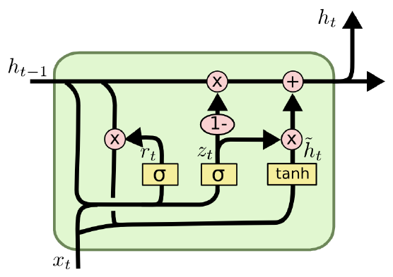

*그림 17. 리셋 게이트와 업데이트 게이트로 이루어진 GRU 셀*

$$
\begin{aligned}
z_t &= \sigma(W_z \cdot [h_{t-1}, x_t]) \\
r_t &= \sigma(W_r \cdot [h_{t-1}, x_t]) \\
\tilde{h}_t &= \tanh(W \cdot [r_t * h_{t-1}, x_t]) \\
h_t &= (1 - z_t) * h_{t-1} + z_t * \tilde{h}_t
\end{aligned}
$$

- $[h_{t-1}, x_t]$는 두 벡터를 이어 붙인 벡터이고, $*$는 원소별 곱이다.
- **업데이트 게이트** $z_t$는 이전 은닉 상태를 얼마나 유지하고 새 후보 $\tilde{h}_t$를 얼마나 받아들일지 정한다. LSTM의 망각 게이트와 입력 게이트를 하나로 합친 역할이며, $z_t$가 0에 가까우면 이전 상태를 거의 그대로 유지한다.
- **리셋 게이트** $r_t$는 새 후보를 만들 때 이전 은닉 상태를 얼마나 반영할지 정한다. 0에 가까우면 과거를 무시하고 현재 입력 위주로 후보를 만든다.

게이트에 필요한 가중치 묶음이 LSTM은 4개, GRU는 3개이므로 같은 크기에서 GRU가 더 가볍다. 예를 들어 입력 4, 은닉 상태 64일 때 PyTorch의 LSTM은 파라미터가 17,920개, GRU는 13,440개이다. 실제로 기본 RNN은 거의 쓰이지 않고, LSTM과 GRU가 쓰인다.

> **주의:** 업데이트 게이트의 방향은 문헌마다 다르다. 위 식은 $z_t$가 새 후보의 비율이지만, PyTorch의 `nn.GRU`는 $h_t = (1 - z_t) \odot n_t + z_t \odot h_{t-1}$로 $z_t$가 이전 상태를 유지하는 비율이다($n_t$가 후보). 두 정의는 $z_t$와 $1 - z_t$를 바꾼 것일 뿐 표현력은 같다.

### 3.9 적층 LSTM과 양방향 LSTM

CNN에서 합성곱 층을 여러 개 쌓듯이 RNN 계열(LSTM, GRU)도 여러 층을 쌓는다. 몇 층을 쌓을지는 설계자가 실험으로 정한다.

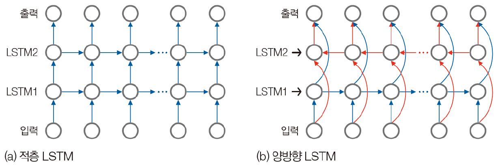

*그림 18. 두 LSTM 층을 수직으로 쌓은 적층 LSTM과 정방향과 역방향 LSTM을 결합한 양방향 LSTM*

- **적층 LSTM(stacked LSTM):** $n$개의 LSTM 층을 수직으로 쌓은 구조이다. 첫 번째 LSTM 층의 각 시점 출력이 두 번째 LSTM 층의 입력이 된다. 모델이 더 깊은 수준의 추상화를 학습하여 표현력이 커진다.
- **양방향 LSTM(bidirectional LSTM):** 각 시점에서 과거뿐 아니라 미래의 정보도 함께 고려하기 위한 구조이다. 내부에 독립적인 LSTM 층 두 개를 두어, 정방향 LSTM은 입력 시퀀스를 시간 순서대로, 역방향 LSTM은 역순으로 처리한다. 각 시점에서 두 방향의 은닉 상태를 주로 이어 붙여(concatenation) 출력을 만든다. 데이터의 양쪽 문맥을 모두 보므로 문장 번역, 개체명 인식, 감성 분석 같은 자연어 처리에 강점이 있다. 다만 미래의 입력이 필요하므로 다음 값을 실시간으로 예측하는 문제에는 쓸 수 없다.

### 3.10 PyTorch의 LSTM

PyTorch는 LSTM 층을 `torch.nn.LSTM` 클래스로 제공한다 [15].

| 인자 | 의미 | 기본값 |
|:-----|:-----|:-----|
| `input_size` | 입력 $x$의 특징 수 (각 시점 벡터의 차원) | (필수) |
| `hidden_size` | 은닉 상태 $h$의 특징 수 | (필수) |
| `num_layers` | 쌓을 LSTM 층의 수. 2이면 적층 LSTM이 된다 | 1 |
| `bias` | `False`이면 편향 `b_ih`, `b_hh`를 쓰지 않는다 | `True` |
| `batch_first` | `True`이면 입력과 출력 텐서를 (배치, 시퀀스, 특징) 순서로 쓴다 | `False` |
| `dropout` | 0이 아니면 마지막 층을 제외한 각 LSTM 층의 출력에 이 확률로 드롭아웃을 적용한다 | 0 |
| `bidirectional` | `True`이면 양방향 LSTM이 된다 | `False` |
| `proj_size` | 0보다 크면 은닉 상태를 이 크기로 투영하는 LSTM을 쓴다 | 0 |

*표 15. torch.nn.LSTM의 인자*

텐서의 크기를 나타내는 기호는 $N$ = 배치 크기, $L$ = 시퀀스 길이, $D$ = 양방향이면 2 아니면 1, $H_{in}$ = `input_size`, $H_{cell}$ = `hidden_size`, $H_{out}$ = `proj_size`가 0보다 크면 `proj_size` 아니면 `hidden_size`이다.

| 텐서 | 크기 (`batch_first=False`) | 크기 (`batch_first=True`) | 내용 |
|:-----|:-----|:-----|:-----|
| 입력 `input` | $(L, N, H_{in})$ | $(N, L, H_{in})$ | 입력 시퀀스의 특징 |
| `h_0` | $(D \times \text{num\_layers}, N, H_{out})$ | 같음 | 각 층의 초기 은닉 상태. 주지 않으면 0 |
| `c_0` | $(D \times \text{num\_layers}, N, H_{cell})$ | 같음 | 각 층의 초기 셀 상태. 주지 않으면 0 |
| 출력 `output` | $(L, N, D \times H_{out})$ | $(N, L, D \times H_{out})$ | 마지막 층의 모든 시점의 은닉 상태 $h_t$ |
| `h_n` | $(D \times \text{num\_layers}, N, H_{out})$ | 같음 | 각 층의 마지막 은닉 상태 |
| `c_n` | $(D \times \text{num\_layers}, N, H_{cell})$ | 같음 | 각 층의 마지막 셀 상태 |

*표 16. torch.nn.LSTM의 입력과 출력 텐서 크기*

LSTM 층은 `lstm(input, (h_0, c_0))`처럼 입력과 함께 은닉 상태와 셀 상태를 담을 초기 배열 `h_0`, `c_0`을 받고, `output, (h_n, c_n)`을 돌려준다. 은닉 상태와 셀 상태는 층마다, 방향마다 하나씩 필요하므로 첫 차원이 $D \times \text{num\_layers}$이다. 예를 들어 2층 양방향 LSTM이면 $2 \times 2 = 4$이다.

> **주의:** 다른 층과 달리 `nn.LSTM`의 기본값 `batch_first=False`에서는 배치 축이 가운데 $(L, N, H_{in})$에 온다. 데이터셋을 (배치, 시퀀스, 특징) 순서로 만들었다면 `batch_first=True`를 주어야 한다. 또한 `batch_first`는 `h_0`, `c_0`, `h_n`, `c_n`의 축 순서에는 영향을 주지 않아 이들은 항상 배치 축이 가운데에 있다. 블로그 글보다 공식 문서로 기본값을 확인하는 습관이 필요하다.

LSTM의 계산 과정을 단계별로 보여 주는 애니메이션도 있다 [16]. 이전 셀 상태 $c_{t-1}$, 이전 은닉 상태 $h_{t-1}$, 현재 입력 $x_t$가 셀로 들어가 게이트를 거쳐 새 셀 상태와 은닉 상태가 만들어지고, 이것이 다음 시점으로 넘겨지는 과정이 3.7절의 식 그대로 반복된다. 스팸 메일 분류 같은 다 대 일 문제에서는 마지막 시점의 은닉 상태 $h_L$에 완전 연결 층을 연결하여 원하는 개수의 출력을 만든다. 이 코드는 2강 실습에서 다룬다.

---

<br>

## 4. PyTorch를 활용한 딥러닝 구현 흐름

PyTorch로 딥러닝 모델을 구현하는 코드는 보통 다음 순서로 짠다.

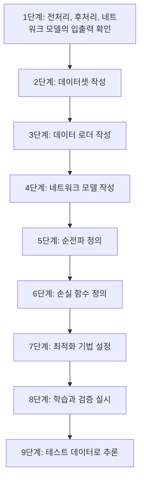

*그림 19. PyTorch를 활용한 딥러닝 구현의 9단계 흐름*

| 단계 | 하는 일 |
|:-----|:-----|
| 1. 입출력 확인 | 입력을 어떻게 전처리하고 모델의 출력을 어떻게 해석(후처리)할지 정한다. 1강 실습의 `BaseTransform`과 `ILSVRCPredictor`가 이 단계이다. |
| 2. 데이터셋 작성 | 데이터 하나를 꺼내면 전처리된 입력과 정답을 돌려주는 객체(`Dataset`)를 만든다. |
| 3. 데이터 로더 작성 | 데이터셋에서 배치 크기만큼 묶어 미니 배치를 만들고 순서를 섞는 객체(`DataLoader`)를 만든다. |
| 4. 네트워크 모델 작성 | 층(`Conv2d`, `LSTM`, `Linear` 등)을 정의한 모델 클래스(`nn.Module`)를 만든다. |
| 5. 순전파 정의 | 모델의 `forward` 메서드에 입력이 층을 지나는 순서를 쓴다. |
| 6. 손실 함수 정의 | 교차 엔트로피 등 문제에 맞는 손실 함수를 고른다(1강 4절). |
| 7. 최적화 기법 설정 | SGD, Adam 등 옵티마이저와 학습률을 정한다(1강 5절). |
| 8. 학습과 검증 실시 | 에포크마다 훈련 데이터로 순전파, 손실 계산, 역전파, 가중치 갱신을 반복하고 검증 데이터로 성능을 잰다. |
| 9. 테스트 데이터로 추론 | 완성된 모델로 테스트 데이터나 새 데이터를 예측한다. |

*표 17. 딥러닝 구현의 각 단계에서 하는 일*

2강 실습은 4, 5단계(모델과 순전파)를 다루고, 데이터셋부터 학습까지의 전체 흐름은 3강에서 다룬다.

---

<br>

## 개념 적용

**T/F 점검:**

| 문장 | 판단과 근거 |
|:-----|:------------|
| 3채널 입력에 3 × 3 커널 16개를 적용하는 합성곱 층의 출력 채널 수는 3이다. | **F.** 출력 채널 수는 커널 개수이므로 16이다. 각 커널의 깊이가 3이다. |
| 합성곱 층의 파라미터 수는 입력 이미지가 클수록 많아진다. | **F.** 같은 커널을 모든 위치에서 공유하므로 파라미터 수는 $C_{out}(C_{in}K^2) + C_{out}$로, 입력의 가로세로 크기와 무관하다. |
| 최대 풀링 층에는 학습되는 가중치가 없다. | **T.** 영역의 최댓값을 고르기만 하므로 파라미터가 없으며, 특징 맵을 줄여 뒤쪽 층의 계산과 가중치 수를 줄인다. |
| RNN은 시점마다 다른 가중치를 써서 시퀀스가 길어지면 파라미터 수도 늘어난다. | **F.** 모든 시점이 $\mathbf{U}, \mathbf{V}, \mathbf{W}$를 공유하므로 파라미터 수는 시퀀스 길이와 무관하다. |
| LSTM의 셀 상태는 덧셈으로 갱신되므로, 망각 게이트가 1에 가까우면 기울기가 여러 시점을 지나도 크게 줄지 않는다. | **T.** $\partial c_t/\partial c_{t-1} = f_t$이므로 기울기가 tanh 도함수와 가중치의 곱으로 매번 줄어드는 기본 RNN과 다르다. |
| `nn.LSTM(4, 64)`에 `(32, 30, 4)` 크기의 텐서를 (배치, 시퀀스, 특징)의 뜻으로 넣으면 그대로 올바르게 처리된다. | **F.** 기본값 `batch_first=False`에서는 첫 축을 시퀀스 길이로 해석하므로 길이 32, 배치 30으로 처리된다. `batch_first=True`가 필요하다. |

---

<br>

## 요약

| 개념 | 핵심 요약 |
|:-----|:----------|
| 퍼셉트론과 MLP | 퍼셉트론은 가중합과 활성화 함수로 된 노드 하나, MLP는 퍼셉트론을 여러 층으로 쌓아 이웃한 층을 모두 연결한 순방향 신경망이다. |
| 합성곱 연산 | 커널을 한 칸씩 옮기며 수용 영역과 커널의 원소별 곱을 모두 더해 특징 맵을 만든다. 딥러닝의 합성곱은 커널을 뒤집지 않는 교차 상관이다. |
| 커널과 특징 | 커널에 따라 수평, 수직 에지 같은 특징이 추출되며, CNN에서는 커널의 값이 가중치로서 학습된다. |
| CNN의 성과 | 개와 고양이 캡차를 무력화했고(정확도 98.9%), AlexNet이 ILSVRC 2012에서 top-5 오류율 15.3%로 우승하며 딥러닝 시대를 열었다. |
| 출력 크기 | $\lfloor (H + 2P - F)/S \rfloor + 1$. 패딩은 크기를 유지하고 스트라이드는 크기를 줄인다. 3 × 3 커널은 패딩 1로 크기를 유지한다. |
| 다채널 합성곱 | 커널의 깊이는 입력 채널 수와 같고, 커널 개수가 출력 채널 수가 된다. 파라미터 수는 $C_{out}(C_{in}K^2) + C_{out}$이다. |
| 풀링 | 영역의 최댓값이나 평균으로 특징 맵을 요약한다. 스트라이드 $s$이면 길이 $1/s$, 넓이 $1/s^2$이 되고, 파라미터가 없으며 수용 영역을 넓힌다. |
| AlexNet | 227 × 227 × 3 입력이 합성곱 5개와 풀링 3개를 지나 6 × 6 × 256 = 9216이 되고, 완전 연결 층 3개를 지나 1,000개 클래스로 분류된다. 파라미터는 약 6,000만 개이다. |
| 시계열 데이터 | 순서가 중요하고, 길이가 다르며, 문맥 의존성과 계절성이 있는 가변 길이의 벡터의 벡터이다. |
| RNN | $\mathbf{h}^t = \tau_1(\mathbf{W}\mathbf{h}^{t-1} + \mathbf{U}\mathbf{a}^t)$로 이전 은닉 상태를 현재 계산에 반영하며, 모든 시점이 같은 가중치를 공유한다. 일 대 다, 다 대 일, 다 대 다로 활용한다. |
| 기울기 소실 | 역전파에서 $w \cdot \tanh'$를 시점 수만큼 곱하므로 기울기가 지수적으로 작아져 먼 과거의 정보를 학습하지 못한다. |
| LSTM | 셀 상태와 망각, 입력, 출력 게이트로 정보를 선택적으로 기억한다. 셀 상태의 덧셈 갱신이 기울기 소실을 줄인다. |
| GRU | 리셋 게이트와 업데이트 게이트만 쓰는 LSTM의 간소화 모델로, 파라미터가 더 적다. |
| 적층과 양방향 | 적층 LSTM은 층을 수직으로 쌓아 표현력을 키우고, 양방향 LSTM은 정방향과 역방향의 은닉 상태를 이어 붙여 양쪽 문맥을 본다. |
| PyTorch의 층 | `Conv2d(in, out, k, stride, padding)`, `MaxPool2d(k, stride=k)`, `LSTM(input_size, hidden_size, batch_first=False)`이며, LSTM은 `(h_0, c_0)`을 받고 `output, (h_n, c_n)`을 돌려준다. |
| 구현 흐름 | 입출력 확인, 데이터셋, 데이터 로더, 모델, 순전파, 손실 함수, 옵티마이저, 학습과 검증, 추론의 9단계로 구현한다. |

---

<br>

## 점검 문제

1. **1차원 합성곱:** 신호 $(1, 3, 6, 6, 6, 2)$에 커널 $(-1, 0, 1)$을 적용한 특징 맵(양 끝 제외)을 구하라.

   <details>
   <summary>정답</summary>

   $f(i) = -z(i - 1) + z(i + 1)$이다. $f(1) = -1 + 6 = 5$, $f(2) = -3 + 6 = 3$, $f(3) = -6 + 6 = 0$, $f(4) = -6 + 2 = -4$이므로 특징 맵은 $(5, 3, 0, -4)$이다. 값이 증가하는 곳은 양수, 감소하는 곳은 음수, 변화가 없는 곳은 0이다.

   </details>

2. **2차원 합성곱:** 2.6절의 5 × 5 입력과 커널에서 출력의 가운데 값 17을 계산 과정과 함께 보여라.

   <details>
   <summary>정답</summary>

   가운데 출력의 수용 영역은 1\~3행, 1\~3열 $\begin{pmatrix} 0 & 1 & 3 \\ 1 & 2 & 2 \\ 0 & 0 & 2 \end{pmatrix}$이다. 커널 $\begin{pmatrix} 0 & 1 & 2 \\ 2 & 2 & 0 \\ 0 & 1 & 2 \end{pmatrix}$와 원소별로 곱하면 $0 + 1 + 6 + 2 + 4 + 0 + 0 + 0 + 4 = 17$이다.

   </details>

3. **출력 크기:** 입력 32 × 32 × 3에 `Conv2d(3, 16, kernel_size=5, stride=1, padding=2)`, 이어서 `MaxPool2d(2)`, 이어서 `Conv2d(16, 32, kernel_size=3, stride=2, padding=0)`을 적용한다. 각 단계의 출력 크기와 두 합성곱 층의 파라미터 수를 구하라.

   <details>
   <summary>정답</summary>

   첫 합성곱은 $(32 + 4 - 5)/1 + 1 = 32$이므로 16 × 32 × 32이다(채널 × 높이 × 너비). 풀링 후 16 × 16 × 16이다. 둘째 합성곱은 $\lfloor (16 - 3)/2 \rfloor + 1 = \lfloor 6.5 \rfloor + 1 = 7$이므로 32 × 7 × 7이다. 파라미터 수는 $16 \times (3 \times 5 \times 5) + 16 = 1216$개와 $32 \times (16 \times 3 \times 3) + 32 = 4640$개이다.

   </details>

4. **패딩:** 7 × 7 커널을 스트라이드 1로 적용할 때 출력 크기가 입력과 같으려면 패딩이 얼마여야 하는가?

   <details>
   <summary>정답</summary>

   $(H + 2P - 7)/1 + 1 = H$에서 $2P = 6$이므로 $P = 3$이다. 일반적으로 $P = (F - 1)/2$이다.

   </details>

5. **풀링:** 특징 맵 $\begin{pmatrix} 1 & 4 & 2 & 0 \\ 3 & 8 & 1 & 1 \\ 0 & 2 & 6 & 7 \\ 5 & 1 & 3 & 2 \end{pmatrix}$에 2 × 2 최대 풀링과 평균 풀링(스트라이드 2)을 적용하라.

   <details>
   <summary>정답</summary>

   네 영역은 (1, 4, 3, 8), (2, 0, 1, 1), (0, 2, 5, 1), (6, 7, 3, 2)이다. 최대 풀링은 $\begin{pmatrix} 8 & 2 \\ 5 & 7 \end{pmatrix}$, 평균 풀링은 $\begin{pmatrix} 4 & 1 \\ 2 & 4.5 \end{pmatrix}$이다.

   </details>

6. **캡차:** 사진 한 장의 정확도가 95%인 분류기가 사진 12장을 모두 맞혀야 하는 캡차를 통과할 확률은 얼마인가?

   <details>
   <summary>정답</summary>

   $0.95^{12} \approx 0.540$이므로 약 54%이다. 한 장의 정확도가 높아도 12장을 모두 맞힐 확률은 거듭제곱으로 줄어들지만, 이 정도면 캡차로서 기능을 잃는다.

   </details>

7. **RNN 계산:** 3.4절의 스칼라 RNN($w = 0.5$, $u = 1$, $h^0 = 0$)에 입력 시퀀스 $(0, 1)$을 넣으면 $h^2$는 얼마인가? 표 12의 $h^1$과 비교하라.

   <details>
   <summary>정답</summary>

   $h^1 = \tanh(0) = 0$, $h^2 = \tanh(0.5 \times 0 + 1) = \tanh(1) \approx 0.7616$이다. 입력 1이 첫 시점에 들어간 표 12의 $h^1$과 같다. 앞의 입력이 0이어서 전달된 과거 정보가 없기 때문이다.

   </details>

8. **기울기 소실:** 스칼라 RNN에서 각 시점의 $\lvert w(1 - (h^t)^2) \rvert$가 0.8이라면, 30시점 떨어진 입력에 대한 기울기는 몇 배로 줄어드는가?

   <details>
   <summary>정답</summary>

   연쇄 법칙으로 30개의 인자를 곱하므로 $0.8^{30} \approx 0.0012$배, 즉 약 1/800로 줄어든다. 먼 과거의 입력에 대한 가중치는 거의 갱신되지 않는다.

   </details>

9. **LSTM 게이트:** 망각 게이트 $f_t = 0$, 입력 게이트 $i_t = 1$이면 셀 상태 $c_t$는 무엇이 되는가? 반대로 $f_t = 1$, $i_t = 0$이면 어떻게 되는가?

   <details>
   <summary>정답</summary>

   $f_t = 0$, $i_t = 1$이면 $c_t = g_t$로, 과거의 기억을 모두 지우고 새 정보로 바꾼다. $f_t = 1$, $i_t = 0$이면 $c_t = c_{t-1}$로, 새 정보를 받지 않고 기억을 그대로 유지한다.

   </details>

10. **LSTM 텐서 크기:** `nn.LSTM(input_size=10, hidden_size=20, num_layers=2, bidirectional=True, batch_first=True)`에 크기 $(8, 15, 10)$인 입력을 넣었을 때 `output`, `h_n`, `c_n`의 크기를 구하라.

    <details>
    <summary>정답</summary>

    $N = 8$, $L = 15$, $D = 2$이다. `output`은 $(N, L, D \times H_{out}) = (8, 15, 40)$, `h_n`과 `c_n`은 $(D \times \text{num\_layers}, N, H) = (4, 8, 20)$이다. `batch_first=True`여도 `h_n`, `c_n`은 배치 축이 가운데에 있다.

    </details>

---

<br>

## 참고 문헌

1. I. Goodfellow, Y. Bengio, and A. Courville, *Deep Learning*. Cambridge, MA, USA: MIT Press, 2016.
2. J. Elson, J. R. Douceur, J. Howell, and J. Saul, "Asirra: A CAPTCHA that Exploits Interest-Aligned Manual Image Categorization," in *Proc. ACM Conf. Computer and Communications Security (CCS)*, pp. 366-374, 2007.
3. P. Golle, "Machine Learning Attacks Against the Asirra CAPTCHA," in *Proc. ACM Conf. Computer and Communications Security (CCS)*, pp. 535-542, 2008.
4. Kaggle, "Dogs vs. Cats," 2013, accessed Nov. 4, 2026. https://www.kaggle.com/c/dogs-vs-cats
5. A. Krizhevsky, I. Sutskever, and G. E. Hinton, "ImageNet Classification with Deep Convolutional Neural Networks," in *Advances in Neural Information Processing Systems (NIPS)*, pp. 1097-1105, 2012.
6. K. He, X. Zhang, S. Ren, and J. Sun, "Deep Residual Learning for Image Recognition," in *Proc. IEEE Conf. Computer Vision and Pattern Recognition (CVPR)*, pp. 770-778, 2016.
7. O. Russakovsky et al., "ImageNet Large Scale Visual Recognition Challenge," *International Journal of Computer Vision*, vol. 115, no. 3, pp. 211-252, 2015.
8. Animated AI, "All Convolution Animations Are Wrong," accessed Nov. 4, 2026. https://www.youtube.com/watch?v=w4kNHKcBGzA and https://animatedai.github.io/
9. PyTorch, "Conv2d," *PyTorch Documentation*, accessed Nov. 4, 2026. https://docs.pytorch.org/docs/stable/generated/torch.nn.Conv2d.html
10. PyTorch, "MaxPool2d," *PyTorch Documentation*, accessed Nov. 4, 2026. https://docs.pytorch.org/docs/stable/generated/torch.nn.MaxPool2d.html
11. Y. Bengio, P. Simard, and P. Frasconi, "Learning Long-Term Dependencies with Gradient Descent is Difficult," *IEEE Transactions on Neural Networks*, vol. 5, no. 2, pp. 157-166, 1994.
12. S. Hochreiter and J. Schmidhuber, "Long Short-Term Memory," *Neural Computation*, vol. 9, no. 8, pp. 1735-1780, 1997.
13. C. Olah, "Understanding LSTM Networks," 2015, accessed Nov. 4, 2026. https://colah.github.io/posts/2015-08-Understanding-LSTMs/
14. K. Cho et al., "Learning Phrase Representations using RNN Encoder-Decoder for Statistical Machine Translation," in *Proc. Conf. Empirical Methods in Natural Language Processing (EMNLP)*, pp. 1724-1734, 2014.
15. PyTorch, "LSTM," *PyTorch Documentation*, accessed Nov. 4, 2026. https://docs.pytorch.org/docs/stable/generated/torch.nn.LSTM.html
16. A. Sefidian, "A complete guide to understand Long Short-Term Memory (LSTM) networks," 2019, accessed Nov. 4, 2026. http://www.sefidian.com/2019/08/15/a-complete-guide-to-understand-long-short-term-memory-lstm-networks/
