# Lecture 2 — Deep Learning Fundamentals 2

[Repository Guide](../../README.md) | [English](Concepts_Lecture.md) | [한국어](Concepts_Lecture.ko.md)

> **Last Updated:** 2026-11-04

> **Learning Objectives:**
> 1. Distinguish the perceptron from the multi-layer perceptron, and compute one- and two-dimensional convolutions by hand
> 2. Given the padding, stride, number of channels, and number of kernels, compute the output size and parameter count of convolution and pooling layers step by step
> 3. Trace how tensor sizes change through the structure of AlexNet, and explain how CNNs transformed computer vision
> 4. Explain the characteristics of time-series data and the recurrent structure, weight sharing, and input-output forms of the RNN, and compute hidden states by hand
> 5. Explain the cause of vanishing gradients, and describe with equations the three gates and cell state of the LSTM and the two gates of the GRU
> 6. Interpret the arguments and input and output tensor sizes of PyTorch's `Conv2d`, `MaxPool2d`, and `LSTM`, and explain the nine-step flow of a deep learning implementation

---

## Table of Contents

- [1. Review of Deep Learning Training](#1-review-of-deep-learning-training)
  - [1.1 The Three Steps of Training](#11-the-three-steps-of-training)
  - [1.2 Perceptron and Multi-Layer Perceptron](#12-perceptron-and-multi-layer-perceptron)
- [2. CNN](#2-cnn)
  - [2.1 CNNs and Their Applications](#21-cnns-and-their-applications)
  - [2.2 The Convolution Operation](#22-the-convolution-operation)
  - [2.3 Extracting Features with Convolution](#23-extracting-features-with-convolution)
  - [2.4 Learned Kernels](#24-learned-kernels)
  - [2.5 How CNNs Changed Computer Vision](#25-how-cnns-changed-computer-vision)
  - [2.6 Computing a Two-Dimensional Convolution](#26-computing-a-two-dimensional-convolution)
  - [2.7 Padding and Stride](#27-padding-and-stride)
  - [2.8 Computing the Output Size](#28-computing-the-output-size)
  - [2.9 Multichannel Input and Multiple Kernels](#29-multichannel-input-and-multiple-kernels)
  - [2.10 Pooling](#210-pooling)
  - [2.11 Convolutional Blocks](#211-convolutional-blocks)
  - [2.12 The Structure of AlexNet](#212-the-structure-of-alexnet)
  - [2.13 Conv2d and MaxPool2d in PyTorch](#213-conv2d-and-maxpool2d-in-pytorch)
- [3. RNN](#3-rnn)
  - [3.1 Time-Series Data](#31-time-series-data)
  - [3.2 Characteristics and Representation of Time-Series Data](#32-characteristics-and-representation-of-time-series-data)
  - [3.3 Applications of RNNs](#33-applications-of-rnns)
  - [3.4 The Structure of an RNN](#34-the-structure-of-an-rnn)
  - [3.5 Input-Output Forms of RNNs](#35-input-output-forms-of-rnns)
  - [3.6 The Vanishing Gradient Problem](#36-the-vanishing-gradient-problem)
  - [3.7 LSTM](#37-lstm)
  - [3.8 GRU](#38-gru)
  - [3.9 Stacked LSTM and Bidirectional LSTM](#39-stacked-lstm-and-bidirectional-lstm)
  - [3.10 LSTM in PyTorch](#310-lstm-in-pytorch)
- [4. The Flow of a Deep Learning Implementation with PyTorch](#4-the-flow-of-a-deep-learning-implementation-with-pytorch)
- [Concept Applications](#concept-applications)
- [Summary](#summary)
- [Self-Check Questions](#self-check-questions)
- [References](#references)

---

<br>

## 1. Review of Deep Learning Training

### 1.1 The Three Steps of Training

From a mechanical point of view, learning means that the output changes through a series of repeated steps so that it gradually converges to the desired expected value. As seen in Section 2.4 of Lecture 1, training a neural network repeats the following three steps, and this description assumes supervised learning, in which answers are given.

1. **Forward computation:** multiply the input by weights and add, layer after layer, to compute the output (the prediction).
2. **Error computation:** compute with a loss function how far the prediction is from the answer.
3. **Backward weight update:** differentiate the error to judge how much each weight should change (error backpropagation), and change the weights by that amount (gradient descent).

Lecture 2 keeps this training method and covers two representative structures that adapt the network computing from input to output to the kind of data: the CNN, suited to images, and the RNN, suited to ordered data.

### 1.2 Perceptron and Multi-Layer Perceptron

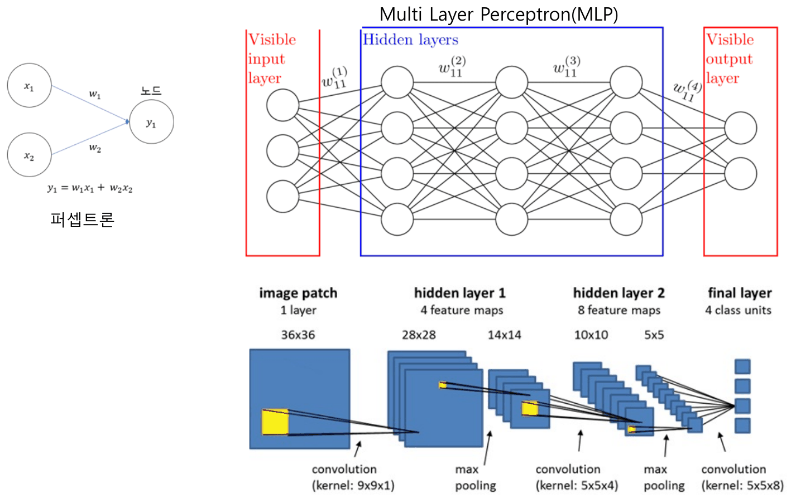

*Figure 1. Structures of a perceptron, a multi-layer perceptron, and a small convolutional neural network*

- **Perceptron:** a neural network with a single node that takes an input vector, forms a weighted sum (plus a bias), and applies an activation function to produce the output. The left of Figure 1 is a perceptron that computes $y_1 = w_1x_1 + w_2x_2$ from two inputs $x_1, x_2$.
- **Multi-layer perceptron (MLP):** a structure that stacks perceptrons in several layers. It consists of an input layer whose values are visible from outside (visible input layer), several hidden layers, and an output layer (visible output layer), and every node of a layer is connected to every node of the neighboring layer. Connections run only from input to output, with no connections going back. The superscripts of $w_{11}^{(1)}, \dots, w_{11}^{(4)}$ indicate between which layers a weight sits.

Real deep learning models use structures more complex than the MLP. The bottom of Figure 1 is one example, a small convolutional neural network, in which the tensor size changes at each layer as follows (Section 2 covers each operation in detail).

| Stage | Operation | Output size | Computation |
|:-----|:-----|:-----|:-----|
| Input | One image patch (1 channel) | 36 × 36 × 1 | |
| Hidden layer 1 | Convolution with 4 kernels of 9 × 9 × 1 | 28 × 28 × 4 | $36 - 9 + 1 = 28$ |
| | Max pooling | 14 × 14 × 4 | $28 / 2 = 14$ |
| Hidden layer 2 | Convolution with 8 kernels of 5 × 5 × 4 | 10 × 10 × 8 | $14 - 5 + 1 = 10$ |
| | Max pooling | 5 × 5 × 8 | $10 / 2 = 5$ |
| Final layer | Convolution with 4 kernels of 5 × 5 × 8 | 1 × 1 × 4 | $5 - 5 + 1 = 1$, outputs for 4 classes |

*Table 1. Tensor sizes at each layer of the small convolutional neural network in Figure 1*

---

<br>

## 2. CNN

### 2.1 CNNs and Their Applications

A **CNN (convolutional neural network)** is a neural network that uses the convolution operation. It has been very successful in computer vision, which deals with images, and for a long time it was regarded as the most successful model there. Recently, newer structures such as the Transformer (Lecture 8), used in GPT and similar models, are also widely used in computer vision.

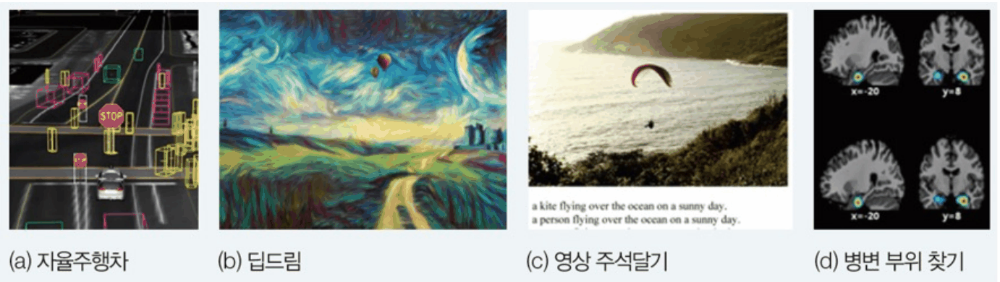

*Figure 2. Applications of CNNs: self-driving cars, deep dream, image captioning, and lesion localization*

- **Self-driving cars:** find vehicles, pedestrians, traffic lights, and lanes in camera images in real time.
- **Deep dream:** amplifies in an image the patterns that a trained CNN responds to, producing painting-like images. Converting a photo into a particular painting style is also an application of image processing.
- **Image captioning:** looks at a photo and generates a descriptive sentence such as "a kite flying over the ocean on a sunny day" (a CNN extracts the image features and an RNN produces the sentence).
- **Lesion localization:** finds the location of lesions in brain images.

### 2.2 The Convolution Operation

The **convolution operation** is a linear combination of a region of the input and a **kernel**. A kernel, also called a **filter**, is a small array of weights. The region of the input that the kernel overlaps at one time is called the **receptive field**. Applying a kernel $u$ of size $h$ (odd) to a one-dimensional signal $z$ gives the result $f$ as follows.

$$
f(i) = z(i) \circledast u = \sum_{x=-(h-1)/2}^{(h-1)/2} z(i + x)\,u(x)
$$

The kernel positions are numbered $-(h-1)/2, \dots, (h-1)/2$ so that the center is 0. For a kernel of size 3, $u = (-1, 0, 1)$, we have $u(-1) = -1$, $u(0) = 0$, $u(1) = 1$, and $f(i) = -z(i - 1) + z(i + 1)$. Sliding the kernel one position at a time, multiplying the values at each position, and adding them all gives a result called a **feature map**.

**Example of one-dimensional convolution.** Apply the kernel $(-1, 0, 1)$ to the signal $z = (2, 2, 2, 2, 2, 9, 9, 9)$.

| Position $i$ | 0 | 1 | 2 | 3 | 4 | 5 | 6 | 7 |
|:-----|:-----:|:-----:|:-----:|:-----:|:-----:|:-----:|:-----:|:-----:|
| Signal $z(i)$ | 2 | 2 | 2 | 2 | 2 | 9 | 9 | 9 |
| Feature map $f(i) = -z(i-1) + z(i+1)$ | − | 0 | 0 | 0 | 7 | 7 | 0 | − |

*Table 2. One-dimensional convolution of the signal (2, 2, 2, 2, 2, 9, 9, 9) with the kernel (−1, 0, 1)*

For example, at $i = 5$ the receptive field is the values (2, 9, 9) at positions 4, 5, 6, and $f(5) = 2 \times (-1) + 9 \times 0 + 9 \times 1 = 7$. At the two ends ($i = 0, 7$) the kernel extends outside the signal, so the value is undefined (−). The result is 0 where the values are constant and 7 only near the boundary where the value changes from 2 to 9, so this kernel finds the points where the value changes (boundaries).

**Example of two-dimensional convolution.** For a two-dimensional signal (an image), a two-dimensional kernel is slid horizontally and vertically. Applying a 3 × 3 kernel to the following 8 × 8 image gives a 6 × 6 feature map (the outer border is undefined).

```text
2D signal                      kernel          feature map (central 6 × 6)
   0 1 2 3 4 5 6 7
0  2 2 2 2 2 9 9 9                               0  0 14 21  7  0
1  2 2 2 2 9 9 9 9                               0  0 21 21  0  0
2  2 2 2 2 9 9 9 9           -1 0 1              0  7 21 14  0  0
3  2 2 2 2 9 9 9 9     ⊛     -1 0 1      =       0 14 21  7  0  0
4  2 2 2 9 9 9 9 9           -1 0 1              0 21 21  0  0  0
5  2 2 2 9 9 9 9 9                               0 21 21  0  0  0
6  2 2 2 9 9 9 9 9
7  2 2 2 9 9 9 9 9
```

*Figure 3. Two-dimensional convolution of an 8×8 image with a 3×3 kernel that finds vertical boundaries*

Each value of the feature map is the sum of the right column minus the sum of the left column within the 3 × 3 receptive field. For example, the receptive field centered at position (5, 2) of the image (row 5, column 2) covers rows 4-6 and columns 1-3; the right column (column 3) is all 9 and the left column (column 1) is all 2, so the result is $3 \times (9 - 2) = 21$. The large values in the feature map coincide with the vertical boundary between 2 and 9.

> **Note:** In mathematics and signal processing, convolution flips the kernel and is defined as $\sum z(i - x)u(x)$. The unflipped $\sum z(i + x)u(x)$ is strictly speaking **cross-correlation**. Most deep learning libraries compute cross-correlation and call it convolution [1]. Because the kernel is determined by training, learning the flipped kernel gives the same result, so there is no practical difference.

### 2.3 Extracting Features with Convolution

The convolution operation can extract features of the input (image). Depending on which kernel is applied, the desired feature can be extracted.

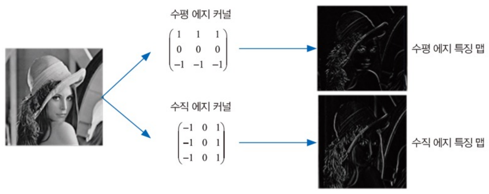

*Figure 4. Two feature maps obtained by applying a horizontal edge kernel and a vertical edge kernel*

- The **horizontal edge kernel** $\begin{pmatrix} 1 & 1 & 1 \\ 0 & 0 & 0 \\ -1 & -1 & -1 \end{pmatrix}$ subtracts the sum of the bottom row from the sum of the top row. Its value is large where the brightness changes from top to bottom, that is, at horizontal boundaries (horizontal edges).
- The **vertical edge kernel** $\begin{pmatrix} -1 & 0 & 1 \\ -1 & 0 & 1 \\ -1 & 0 & 1 \end{pmatrix}$ subtracts the sum of the left column from the sum of the right column. Its value is large where the brightness changes from left to right, that is, at vertical boundaries (vertical edges), as in the example of Section 2.2.

In Figure 4, applying the two kernels to the same photo gives feature maps in which the horizontal and vertical features stand out brightly. In regions of constant brightness, the positive and negative parts of the kernel cancel and the value is close to 0.

### 2.4 Learned Kernels

Edge kernels are an easy-to-understand example, but in a CNN people do not set the kernel values. The values of a kernel (filter) are the weights, and they are learned by backpropagation and gradient descent so as to extract the features that best represent the input data and best support the desired conclusion. For example, a model that classifies puppy photos gradually changes into kernels that extract well the features found only in puppies.

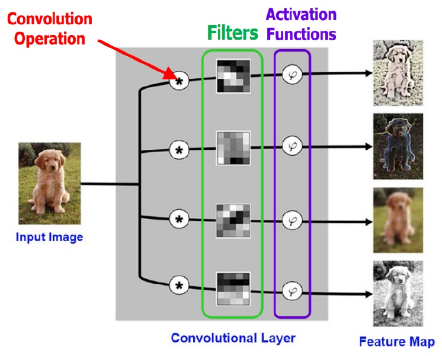

*Figure 5. A convolutional layer that applies convolutions with several filters and activation functions to an input image to produce several feature maps*

The **convolutional layer** of Figure 5 convolves (⊛) the input image with four different filters and applies an activation function (φ) to each result, producing four feature maps. Each filter extracts a different feature (outlines, textures, color contrasts, and so on), so the feature maps look different from one another. A CNN stacks many such layers and uses a great many kernels, each trained to extract different features.

### 2.5 How CNNs Changed Computer Vision

**The dog-versus-cat problem.** Telling dog photos from cat photos was a very hard problem in earlier computer vision, so it was used as a **CAPTCHA**, a security check that distinguishes people from programs. For example, the Asirra CAPTCHA shows 12 photos and lets the user pass only if all of them are correctly marked as dog or cat [2]. If the probability of getting one photo right is $p$, the probability of getting all 12 right is $p^{12}$.

| Method | Accuracy per photo $p$ | Probability of getting all 12 right $p^{12}$ |
|:-----|:-----:|:-----|
| Random guessing | 0.5 | $0.5^{12} = 1/4096 \approx 0.024\%$ |
| Classical computer vision [3] | 0.827 | $0.827^{12} \approx 0.102 \approx 1/9.77$ |
| Convolutional neural network [4] | 0.98914 | $0.98914^{12} \approx 0.877$ |

*Table 3. Comparison of the probabilities of passing the dog-and-cat CAPTCHA*

Even classical techniques break it about once in 10 tries, but a convolutional neural network passes with a probability of about 88%, so the CAPTCHA loses its function.

**ILSVRC 2012 and AlexNet.** The large-scale image classification competition ILSVRC competes on classifying natural images into 1,000 classes (Lecture 1 lab). In the 2012 competition, the CNN **AlexNet** won with a top-5 error rate of 15.3% [5]. The previous year's competition had been won by classical computer vision techniques at 25.8%, so the error rate dropped by more than 10 percentage points at once, and afterward most computer vision researchers moved from classical methods to deep learning. CNNs and the convolution operation themselves are old techniques, but around this time GPU computing power and large-scale data became available, making it possible to train deep networks in practical time.

| Year | Representative model (team) | Top-5 error rate (%) |
|:-----|:-----|:-----:|
| 2010 | NEC America | 28.2 |
| 2011 | Xerox | 25.8 |
| 2012 | AlexNet | 16.4 |
| 2013 | Clarifai | 11.7 |
| 2014 | VGG (runner-up) | 7.3 |
| 2014 | GoogLeNet | 6.7 |
| 2015 | ResNet | 3.6 |

*Table 4. Top-5 error rates of representative models in the ImageNet classification competition by year*

The **top-5 error rate** is the fraction of cases in which the answer is not among the 5 classes the model rates most probable. ResNet in 2015 [6] recorded an error rate below the roughly 5.1% estimated as the human top-5 error rate [7]. VGG is covered in the Lecture 1 lab and Lecture 3, and ResNet in Lectures 3-4.

> **Note:** AlexNet's value of 16.4% in Table 4 is the result of averaging 5 CNNs, and the 15.3% in the text is the result of averaging 7 CNNs, adding 2 CNNs pretrained on extra data [5]. The second-place team in the 2012 competition had an error rate of 26.2%.

### 2.6 Computing a Two-Dimensional Convolution

With an input of size 5 × 5 and a kernel of size 3 × 3, the output size is 3 × 3. The kernel is laid over the top left of the input, the 9 overlapping cells are multiplied pairwise and summed to give one output cell, and the kernel is moved one position at a time to repeat.

```text
input (5 × 5)       kernel (3 × 3)    output (3 × 3)
3 3 2 1 0
0 0 1 3 1           0 1 2             12 12 17
3 1 2 2 3     ⊛     2 2 0      =      10 17 19
2 0 0 2 2           0 1 2              9  6 14
2 0 0 0 1
```

*Figure 6. Two-dimensional convolution of a 5×5 input with a 3×3 kernel*

The top-left output value is the sum of the 9 elementwise products of the top-left 3 × 3 region of the input and the kernel.

$$
\begin{aligned}
&3 \cdot 0 + 3 \cdot 1 + 2 \cdot 2 \\
+\;&0 \cdot 2 + 0 \cdot 2 + 1 \cdot 0 \\
+\;&3 \cdot 0 + 1 \cdot 1 + 2 \cdot 2 \;=\; 0 + 3 + 4 + 0 + 0 + 0 + 0 + 1 + 4 = 12
\end{aligned}
$$

Moving the kernel one position to the right makes the receptive field rows 0-2, columns 1-3, $\begin{pmatrix} 3 & 2 & 1 \\ 0 & 1 & 3 \\ 1 & 2 & 2 \end{pmatrix}$, giving $0 + 2 + 2 + 0 + 2 + 0 + 0 + 2 + 4 = 12$. Computing the same way at 3 horizontal and 3 vertical positions fills all 9 outputs.

### 2.7 Padding and Stride

As the kernel is applied, the output becomes smaller than the input (5 × 5 → 3 × 3). Repeated convolutions keep shrinking the size, which makes deep networks hard to build. **Padding** and **stride** control the output size.

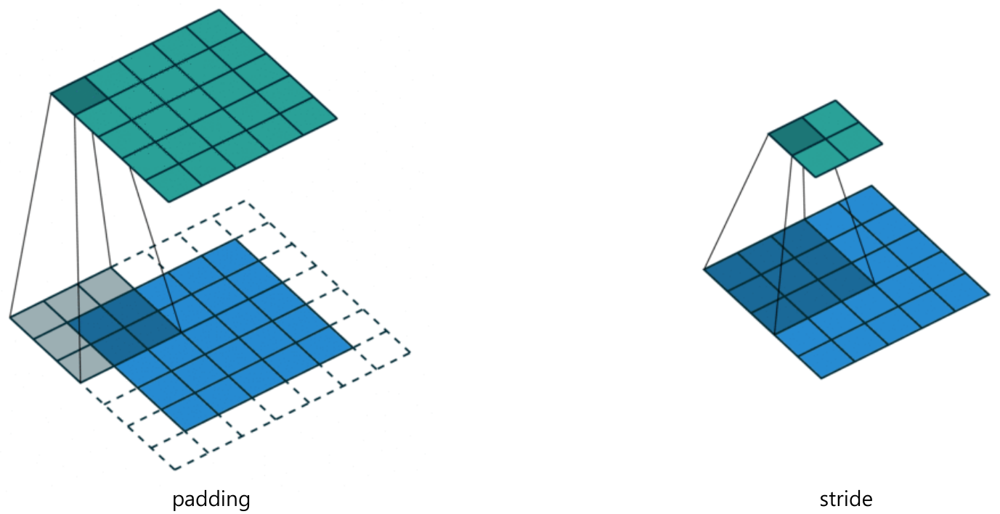

*Figure 7. Convolution that keeps the output size by padding around the input, and convolution applied with stride 2*

- **Padding:** adding fake pixels (usually 0) around the edges of the input before convolution. The left of Figure 7 pads one cell of zeros (dashed) around a 5 × 5 input (blue) to make 7 × 7 and then applies a 3 × 3 kernel, so the output (green) stays 5 × 5. Padding preserves the output size, lets edge pixels sit at the center of a receptive field so that less edge information is lost, and makes deep networks easier to design.
- **Stride:** the distance the kernel moves at a time. The default is 1, and with 2 or more the kernel skips as it moves. The right of Figure 7 applies a 3 × 3 kernel to a 5 × 5 input with stride 2, producing a 2 × 2 output. A larger stride lowers the output resolution (downsampling) and saves computation and memory.

Applied to the input of Section 2.6, they give the following.

$$
\text{padding 1, stride 1: } \begin{pmatrix} 6 & 14 & 17 & 11 & 3 \\ 14 & 12 & 12 & 17 & 11 \\ 8 & 10 & 17 & 19 & 13 \\ 11 & 9 & 6 & 14 & 12 \\ 6 & 4 & 4 & 6 & 4 \end{pmatrix} \qquad \text{padding 0, stride 2: } \begin{pmatrix} 12 & 17 \\ 9 & 14 \end{pmatrix}
$$

The stride-2 output is the same as taking only rows and columns 0 and 2 of the stride-1 output (Figure 6).

### 2.8 Computing the Output Size

With input size $(H, W)$, filter size $(FH, FW)$, stride $S$, and padding $P$, the output size $(OH, OW)$ is as follows.

$$
(OH, OW) = \left(\frac{H + 2P - FH}{S} + 1,\ \frac{W + 2P - FW}{S} + 1\right)
$$

**Derivation.** The width of the padded input is $W + 2P$. The rightmost position at which the left end of the kernel can sit is $W + 2P - FW$ (counting from 0), and the kernel starts at 0 and moves $S$ cells at a time, so the possible positions are the values among $0, S, 2S, \dots$ that do not exceed $W + 2P - FW$. Their number is $\lfloor (W + 2P - FW)/S \rfloor + 1$. If the division is not exact, the leftover cells are not used, so the floor ($\lfloor \cdot \rfloor$) is taken.

| Input | Filter | Padding | Stride | Computation | Output |
|:-----:|:-----:|:-----:|:-----:|:-----|:-----:|
| 5 | 3 | 0 | 1 | $(5 + 0 - 3)/1 + 1$ | 3 |
| 5 | 3 | 1 | 1 | $(5 + 2 - 3)/1 + 1$ | 5 |
| 5 | 3 | 0 | 2 | $(5 + 0 - 3)/2 + 1$ | 2 |
| 7 | 3 | 0 | 2 | $(7 + 0 - 3)/2 + 1$ | 3 |
| 6 | 3 | 0 | 2 | $\lfloor (6 + 0 - 3)/2 \rfloor + 1 = \lfloor 1.5 \rfloor + 1$ | 2 |
| 227 | 11 | 0 | 4 | $(227 - 11)/4 + 1$ | 55 |

*Table 5. Examples of applying the output-size formula*

The last row is the first layer of AlexNet (Section 2.12). For an $F \times F$ kernel with stride 1, setting $P = (F - 1)/2$ makes the output size equal to the input size. For example, a 3 × 3 kernel uses padding 1 and a 5 × 5 kernel padding 2. The formula summarizes in symbols what becomes clear after computing a few cases by hand, and it is used to match layer sizes when designing a network.

### 2.9 Multichannel Input and Multiple Kernels

An RGB color image is a three-dimensional input (W × H × C) that stacks the two-dimensional arrays of the red, green, and blue channels. With multichannel input, convolution follows these rules.

- **The number of input channels and the number of kernel channels must be equal.** If the input has 3 channels, each kernel also has 3 channels (for example, 3 × 3 × 3). Each channel slice of the kernel is computed with the same channel of the input.
- Applying one kernel at one position gives a single value that sums all $3 \times 3 \times 3 = 27$ products (plus a bias if used). The output of one kernel is therefore a two-dimensional feature map with one channel.
- **The number of kernels (filters) becomes the number of output channels.** Using 2 kernels stacks 2 feature maps, giving 2 output channels.

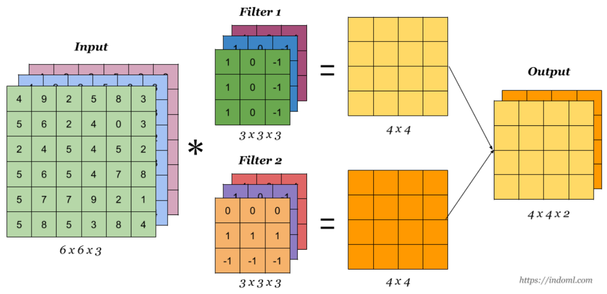

*Figure 8. Multichannel convolution that applies two 3×3×3 filters to a 6×6×3 input to produce a 4×4×2 output*

| Item | Value | Computation |
|:-----|:-----|:-----|
| Input size | 6 × 6 × 3 | |
| Kernel size | 3 × 3 × 3 | Kernel channels = input channels, 3 |
| Output size of one kernel | 4 × 4 | $6 - 3 + 1 = 4$ |
| Number of kernels | 2 | |
| Final output size | 4 × 4 × 2 | Output channels = number of kernels |
| Number of parameters | 56 | Weights $2 \times (3 \times 3 \times 3) = 54$, biases 2 |

*Table 6. Computing the sizes and parameter count of a multichannel convolution*

In general, a convolution layer with $C_{in}$ input channels, $C_{out}$ output channels, and a $K \times K$ kernel has $C_{out} \times (C_{in} \times K \times K) + C_{out}$ parameters. For example, the first layer of VGG-16 (3-channel input, 64-channel output, 3 × 3) has $64 \times 27 + 64 = 1792$. The number of parameters does not depend on the height and width of the input image, because the same kernel is shared at every position of the image.

> **Caution:** Both the input channels (the depth direction such as R, G, B) and the output channels (the feature maps, one per kernel) are called "channels", which is easy to confuse. The depth of a kernel is set by the number of input channels, and the number of kernels sets the number of output channels.

An animation that shows these rules visually is the video "All Convolution Animations Are Wrong" and its website [8]. Common convolution animations show only one two-dimensional plane and leave out the channel direction, but in fact each kernel is a three-dimensional block covering all input channels, and each kernel produces one output channel.

### 2.10 Pooling

A **pooling** layer divides a feature map into small regions and summarizes each region with a single value.

- **Max pooling:** takes the maximum of the values inside the kernel.
- **Average pooling:** takes the average of the values inside the kernel.

The following example pools a 4 × 4 feature map with a 2 × 2 kernel and stride 2.

```text
feature map (4 × 4)   max pooling (2 × 2)   average pooling (2 × 2)
3 1 | 7 2
5 1 | 0 9               5  9                 2.5   4.5
----+----
8 2 | 4 9               8  9                 4.25  3.75
4 3 | 1 1
```

*Figure 9. Results of 2×2 max pooling and average pooling applied to a 4×4 feature map*

The top-left region (3, 1, 5, 1) has maximum 5 and average $10/4 = 2.5$. The top-right region (7, 2, 0, 9) has maximum 9 and average $18/4 = 4.5$.

- Pooling reduces excessive detail in a feature map and extracts summary statistics. Max pooling gives the same value even if a feature moves slightly within the region, so the network becomes less sensitive to small shifts in position.
- With stride $s$, the feature map shrinks to $1/s$ in length and $1/s^2$ in area. The example above has $s = 2$, so the number of values dropped from 16 to 4.
- Pooling (downsampling) lowers the spatial resolution of the feature map, reducing computation and memory, and reduces the number of weights needed in the following layers. The pooling layer itself has no weights to learn. For example, without the last max pooling in `Mini_Alex` of the Lecture 2 lab, the flattened values would number $256 \times 13 \times 13 = 43264$, so the first fully connected layer would have $43264 \times 4096 \approx 177$ million weights, but reducing them to $256 \times 6 \times 6 = 9216$ by pooling gives $9216 \times 4096 \approx 37.75$ million.
- Inserting pooling between successive convolution layers makes later layers see ever wider regions of the input (a larger receptive field), forming a spatial hierarchy from low-level features (edges) to high-level features (parts of objects). For example, one output cell of two 3 × 3 convolution layers sees a 5 × 5 region of the input, but with a 2 × 2 max pooling (stride 2) between them it sees an 8 × 8 region.

### 2.11 Convolutional Blocks

A CNN usually groups **convolution → activation function → pooling** into one **building block** and stacks several such blocks.

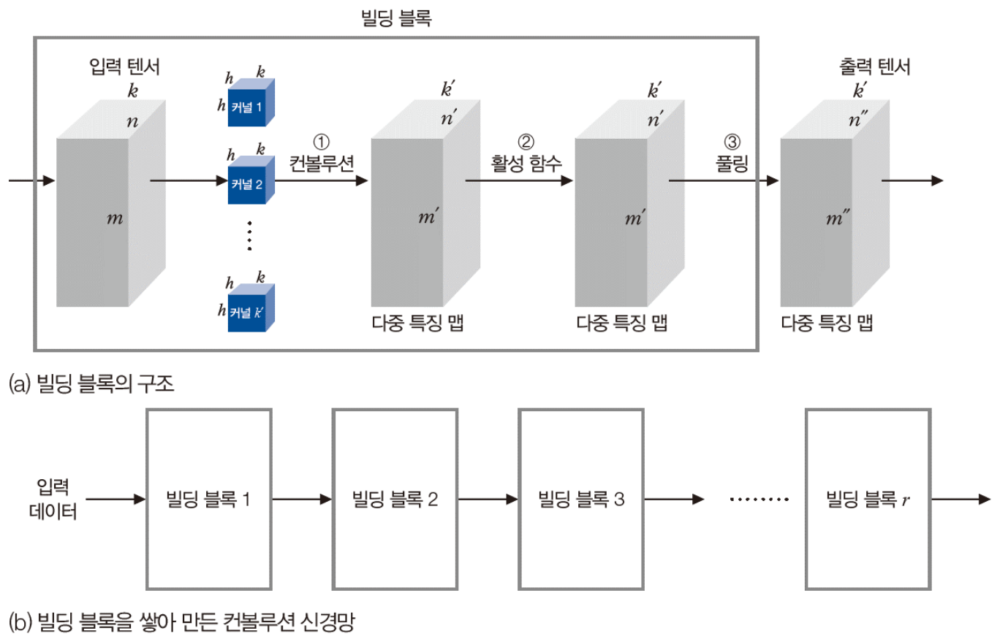

*Figure 10. A building block made of convolution, activation function, and pooling, and a convolutional neural network built by stacking blocks*

In Figure 10 (a), ① convolving an $m \times n \times k$ input tensor with $k'$ kernels of size $h \times h \times k$ gives an $m' \times n' \times k'$ stack of feature maps, ② the activation function (for example, ReLU) does not change the size, and ③ pooling reduces the height and width to produce an $m'' \times n'' \times k'$ output tensor. Stacking building blocks 1, 2, …, $r$ in turn as in Figure 10 (b) gives a deep CNN. The VGG-16 of the Lecture 1 lab is also five such blocks followed by fully connected layers.

### 2.12 The Structure of AlexNet

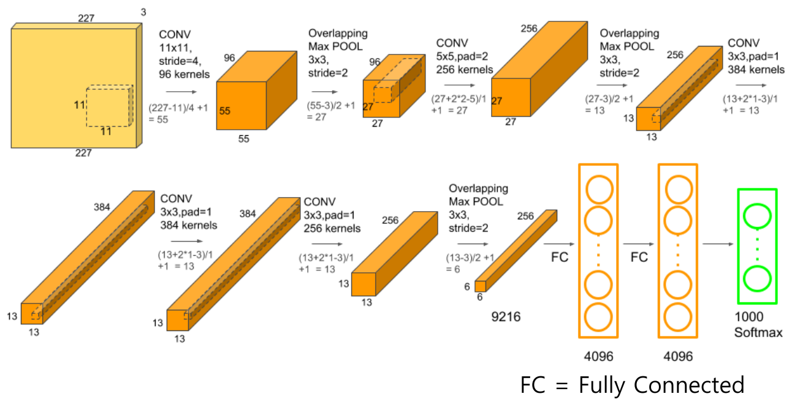

*Figure 11. The structure of AlexNet with five convolution layers, three max pooling layers, and three fully connected layers*

AlexNet consists of 5 convolution layers and 3 **fully connected layers (FC)**. A fully connected layer connects every node of the previous layer to every node of the next layer, and it is also called a dense layer. Max pooling whose pooling region (3 × 3) is larger than its stride (2), so that neighboring regions overlap, is called **overlapping max pooling**. Computing the size of each layer with the formula of Section 2.8 gives the following.

| Layer | Setting | Output size | Computation |
|:-----|:-----|:-----|:-----|
| Input | RGB image | 227 × 227 × 3 | |
| CONV1 | 11 × 11, stride 4, 96 kernels | 55 × 55 × 96 | $(227 - 11)/4 + 1 = 55$ |
| POOL1 | 3 × 3 overlapping max pooling, stride 2 | 27 × 27 × 96 | $(55 - 3)/2 + 1 = 27$ |
| CONV2 | 5 × 5, padding 2, 256 kernels | 27 × 27 × 256 | $(27 + 2 \cdot 2 - 5)/1 + 1 = 27$ |
| POOL2 | 3 × 3, stride 2 | 13 × 13 × 256 | $(27 - 3)/2 + 1 = 13$ |
| CONV3 | 3 × 3, padding 1, 384 kernels | 13 × 13 × 384 | $(13 + 2 \cdot 1 - 3)/1 + 1 = 13$ |
| CONV4 | 3 × 3, padding 1, 384 kernels | 13 × 13 × 384 | Same computation |
| CONV5 | 3 × 3, padding 1, 256 kernels | 13 × 13 × 256 | Same computation |
| POOL3 | 3 × 3, stride 2 | 6 × 6 × 256 | $(13 - 3)/2 + 1 = 6$ |
| Flatten | | 9216 | $6 \times 6 \times 256 = 9216$ |
| FC6 | Fully connected | 4096 | |
| FC7 | Fully connected | 4096 | |
| FC8 | Fully connected with softmax | 1000 | Probabilities of 1,000 classes |

*Table 7. Layer settings and output sizes of AlexNet*

There are about 60 million parameters, most of them in the fully connected layers. The convolution layers have only about 3.75 million parameters, while FC6 alone accounts for $9216 \times 4096 \approx 37.75$ million.

> **Note:** The AlexNet paper gives the input as 224 × 224, but with that size the first-layer computation $(224 - 11)/4 + 1 = 54.25$ is not an integer. For this reason the network is usually explained with a 227 × 227 input. The original AlexNet split its layers across two GPUs for training, and Figure 11 draws them merged into one.

### 2.13 Conv2d and MaxPool2d in PyTorch

PyTorch provides the two-dimensional convolution layer as the class `torch.nn.Conv2d` [9].

```python
torch.nn.Conv2d(in_channels, out_channels, kernel_size, stride=1, padding=0, dilation=1,
                groups=1, bias=True, padding_mode='zeros', device=None, dtype=None)
```

| Argument | Meaning | Default |
|:-----|:-----|:-----|
| `in_channels` | Number of channels in the input image | (required) |
| `out_channels` | Number of channels produced by the convolution, that is, the number of kernels | (required) |
| `kernel_size` | Size of the kernel (integer or tuple) | (required) |
| `stride` | Step with which the kernel moves | 1 |
| `padding` | Number of cells added to all four sides of the input | 0 |
| `padding_mode` | How the padding values are chosen: `'zeros'`, `'reflect'`, `'replicate'`, `'circular'` | `'zeros'` |
| `dilation` | Spacing between kernel elements (1 means adjacent) | 1 |
| `groups` | Into how many groups the input and output channels are split for connection | 1 |
| `bias` | If `True`, adds a learnable bias to the output | `True` |

*Table 8. Arguments of torch.nn.Conv2d*

The input is $(N, C_{in}, H_{in}, W_{in})$ or, without a batch axis, $(C_{in}, H_{in}, W_{in})$, and the output is $(N, C_{out}, H_{out}, W_{out})$. $N$ is the batch size. The output size is as follows (`[0]` and `[1]` are the values for the height and width directions).

$$
H_{out} = \left\lfloor \frac{H_{in} + 2 \times \text{padding}[0] - \text{dilation}[0] \times (\text{kernel\_size}[0] - 1) - 1}{\text{stride}[0]} + 1 \right\rfloor
$$

$W_{out}$ uses the same formula with the `[1]` values. With `dilation = 1`, the numerator becomes $H_{in} + 2P - F$, matching the formula of Section 2.8. With `dilation` $d$, the kernel elements are spaced $d - 1$ cells apart, so the kernel actually covers $d(F - 1) + 1$ cells.

The max pooling layer is `torch.nn.MaxPool2d` [10].

```python
torch.nn.MaxPool2d(kernel_size, stride=None, padding=0, dilation=1, return_indices=False, ceil_mode=False)
```

| Argument | Meaning |
|:-----|:-----|
| `kernel_size` | Size of the region over which the maximum is taken |
| `stride` | Step with which the region moves. The default `None` equals `kernel_size` |
| `padding` | Number of cells added on both sides. Added cells are treated as negative infinity, so they are never chosen as the maximum |
| `dilation` | Spacing between elements within the region |
| `return_indices` | If `True`, also returns the positions of the maxima (used with `MaxUnpool2d`) |
| `ceil_mode` | If `True`, uses the ceiling instead of the floor when computing the output size |

*Table 9. Arguments of torch.nn.MaxPool2d*

The output-size formula is the same as for `Conv2d`. So `MaxPool2d(2)` also has stride 2 and halves the height and width, and `MaxPool2d(3, 2)` is AlexNet's overlapping max pooling. Code that builds a CNN with these two classes and traces the tensor size at each layer is covered in the Lecture 2 lab.

---

<br>

## 3. RNN

### 3.1 Time-Series Data

**Time-series data** are data that contain time information or order, that is, dynamic data whose signal changes along the time axis. For example, in the sentence "세상에는 시계열 데이터가 참 많다" ("there is a great deal of time-series data in the world"), the order in which the words appear matters, and sentences differ in length.

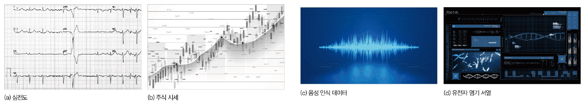

*Figure 12. Examples of time-series data: an electrocardiogram, stock prices, speech recognition data, and a DNA base sequence*

| Kind | Models |
|:-----|:-----|
| Classical models for recognizing time-series data | ARIMA (autoregressive integrated moving average), SARIMA (seasonal ARIMA), Prophet, and others |
| Deep learning models for recognizing time-series data | Recurrent neural network (RNN), LSTM (long short-term memory), GRU (gated recurrent unit) |

*Table 10. Classical and deep learning models for recognizing time-series data*

The multi-layer perceptron and deep multi-layer perceptron of Lecture 1 and the convolutional neural network of Section 2 take static data of a fixed size all at once, so they do not suit time-series data. Forcing time series of different lengths into static data of a fixed size (by cutting or averaging, for example) loses much of the information carried by the order and the length. Deep learning therefore uses recurrent neural networks or LSTMs, which reflect the time-series characteristics.

### 3.2 Characteristics and Representation of Time-Series Data

| Characteristic | Meaning | Example |
|:-----|:-----|:-----|
| Order of elements matters | Changing the order damages the meaning | "고양이를 따라가는 강아지" (a puppy following a cat) and "강아지를 따라가는 고양이" (a cat following a puppy) mean different things |
| Samples differ in length | The same content can have different lengths in different samples | A short pronunciation "인공지능" and a drawn-out pronunciation "인\~공\~\~지\~능" of the same word |
| Context dependence | Elements far apart are closely related | In "시계열은 앞에서 말한 바와 … 특성이 있다" ("time series, as mentioned above, … have the property"), "시계열은" and "특성이 있다" |
| Seasonality | Similar patterns repeat with a regular period | Lettuce sales, fine-dust levels, airline ticket sales |

*Table 11. Distinctive characteristics of time-series data*

A single piece of time-series data represents the value at each time point as a vector and arranges those vectors in time order, making it a **vector of vectors** of variable length that differs from sample to sample.

$$
\mathbf{x} = (\mathbf{a}^1, \mathbf{a}^2, \dots, \mathbf{a}^T)
$$

For example, if the temperature, humidity, and fine-dust concentration are recorded every day, then $\mathbf{a}^1 = (23.5, 42, 0.1)$, $\mathbf{a}^2 = (25.5, 45, 0.08)$, …, and the number of recorded days $T$ is the length of the time series. The superscript $t$ denotes the time point, not a power.

### 3.3 Applications of RNNs

Recurrent neural networks have a flexible structure and can be applied to many problems.

- **Future prediction (forecasting):** the representative application. Tomorrow's stock prices and weather, machine failures, wind speed and direction (to improve the efficiency of wind turbines), and the prices and demand of agricultural products are predicted from past records.
- **Language translation:** converts a sentence (time series) in one language into a sentence (time series) in another (Lecture 8).
- **Speech recognition:** converts a speech signal (time series) into text (Lecture 6).
- **Generative models:** produce time series, such as generating a descriptive sentence from a photo.

### 3.4 The Structure of an RNN

An **RNN (recurrent neural network)** has a recurrent structure that feeds information from the previous time point into the computation at the current time point. When the input $\mathbf{a}^t$ arrives at time $t$, the RNN computes the current **hidden state** $\mathbf{h}^t$ using the previous hidden state $\mathbf{h}^{t-1}$ as well, and produces the output $\mathbf{o}^t$ from the hidden state.

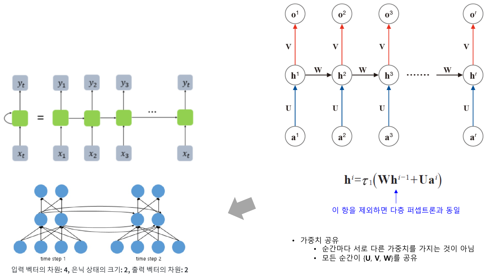

*Figure 13. An RNN with its recurrent connection unrolled along time, and the RNN computation expressed with the weights U, W, and V*

$$
\mathbf{h}^t = \tau_1\left(\mathbf{W}\mathbf{h}^{t-1} + \mathbf{U}\mathbf{a}^t + \mathbf{b}\right), \qquad \mathbf{o}^t = \tau_2\left(\mathbf{V}\mathbf{h}^t + \mathbf{c}\right)
$$

- $\mathbf{U}$ is the weight matrix from the input to the hidden layer, $\mathbf{W}$ from the previous hidden state to the current hidden state, and $\mathbf{V}$ from the hidden layer to the output. $\mathbf{b}, \mathbf{c}$ are biases, $\tau_1$ is usually tanh, and $\tau_2$ is an output function suited to the problem (for example, softmax).
- Without the term $\mathbf{W}\mathbf{h}^{t-1}$, this is the same as a multi-layer perceptron. That term is the recurrent connection that carries past information into the present.
- The top left of Figure 13 shows the recurrence, in which the same cell (green) loops back to itself, unrolled along time. The cells in the unrolled picture are not different cells but one cell used repeatedly at every time point.
- **Weight sharing:** the time points do not each have different weights; all of them share the same $\{\mathbf{U}, \mathbf{V}, \mathbf{W}\}$. The same model can therefore handle time series of different lengths, and the number of parameters stays the same as the length grows.

The bottom left of Figure 13 draws an RNN with input dimension 4, hidden state size 2, and output dimension 2 over two time points (time steps 1 and 2). Here $\mathbf{U}$ is a $2 \times 4$ matrix, $\mathbf{W}$ is $2 \times 2$, and $\mathbf{V}$ is $2 \times 2$, so there are $8 + 4 + 4 = 16$ weights, or 20 including the biases $\mathbf{b}, \mathbf{c}$ (2 each). The curves between the hidden nodes are $\mathbf{W}$, which carries the hidden state of time step 1 to time step 2.

**Worked example.** Let the input, hidden state, and output all be scalars, with $w = 0.5$, $u = 1$, zero bias, $\tau_1 = \tanh$, and $h^0 = 0$. Feeding the input sequence $(1, 0, -1)$ gives the following.

| Time $t$ | Input $a^t$ | $w h^{t-1} + u a^t$ | $h^t = \tanh(\cdot)$ |
|:-----:|:-----:|:-----|:-----:|
| 1 | 1 | $0.5 \times 0 + 1 = 1$ | 0.7616 |
| 2 | 0 | $0.5 \times 0.7616 + 0 = 0.3808$ | 0.3634 |
| 3 | −1 | $0.5 \times 0.3634 - 1 = -0.8183$ | −0.6741 |

*Table 12. Hidden states of a scalar RNN for the input sequence (1, 0, −1)*

Although the input at time 2 is 0, the hidden state is 0.3634 because the information of time 1 was carried over through $w h^1$. The hidden state is a summary of the sequence seen so far, and a little of the time-1 input remains even in the hidden state of time 3.

### 3.5 Input-Output Forms of RNNs

An RNN can produce an output at every time point or use only the output of the last time point. Depending on the lengths of the input and output, it is used as follows.

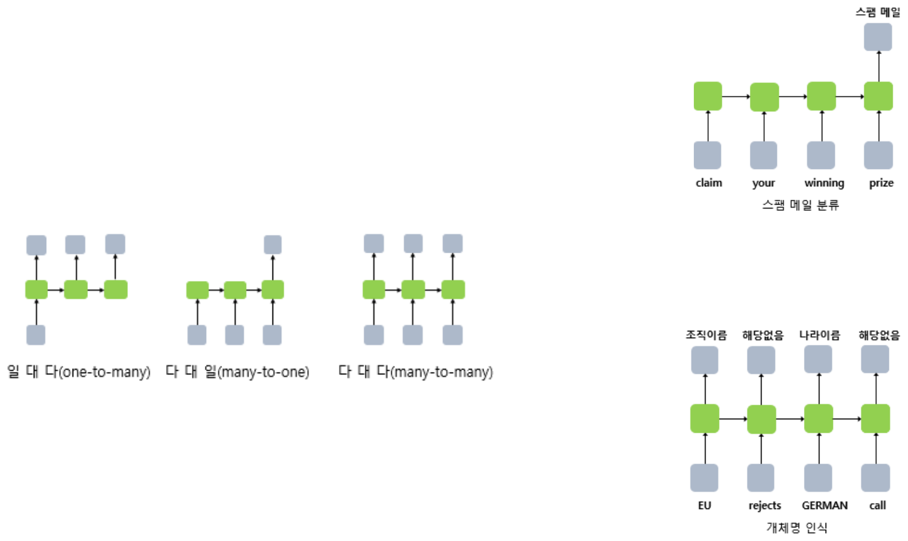

*Figure 14. One-to-many, many-to-one, and many-to-many RNNs with examples of spam classification and named entity recognition*

| Form | Input | Output | Example |
|:-----|:-----|:-----|:-----|
| One-to-many | 1 | Many | Image captioning: one photo → a descriptive sentence ("a puppy is sitting on the grass") |
| Many-to-one | Many | 1 | Spam classification: the sentence "claim your winning prize" → spam or not |
| Many-to-many | Many | Many | Named entity recognition: "EU rejects GERMAN call" → organization name, none, country name, none |

*Table 13. Input-output forms of RNNs and example uses*

Spam classification could produce an output at every time point, but only the output of the last time point, after reading the whole sentence, is trained to be 0 (normal) or 1 (spam), because the last hidden state reflects the information of all the preceding words. **Named entity recognition** is the task of deciding whether each word of a sentence is the name of a specific entity such as a person, organization, or country.

### 3.6 The Vanishing Gradient Problem

A basic RNN suffers from the **vanishing gradient** problem, losing the information of the early part of a sequence as the sequence grows long. When a sentence becomes very long, the information of the early words does not reach the end, and a basic RNN has no mechanism to fix this. For this reason basic RNNs are rarely used in practice.

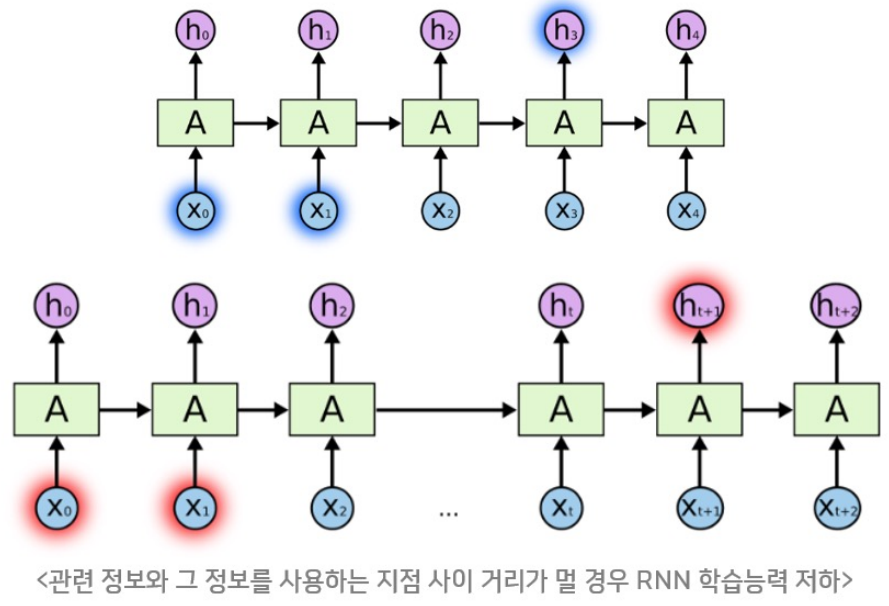

*Figure 15. RNNs when the relevant information is near to and far from the point where it is used*

The top of Figure 15 is a case where the information that $h_3$ needs is in the nearby $x_0, x_1$, so the gap is short and the RNN learns well. The bottom is a case where the information that $h_{t+1}$ needs is in the much earlier $x_0, x_1$; the gap between the relevant information and the point that uses it is long, and the RNN's ability to learn degrades [11].

**Cause.** For the scalar RNN $h^t = \tanh(w h^{t-1} + u a^t)$ of Section 3.4, the derivative with respect to the hidden state one step earlier is $\frac{\partial h^t}{\partial h^{t-1}} = w\,(1 - (h^t)^2)$ (since $\tanh'(s) = 1 - \tanh^2(s)$). For the loss at time $T$ to reach the input at time 1 during backpropagation, the chain rule multiplies this value $T - 1$ times.

$$
\frac{\partial h^T}{\partial h^1} = \prod_{t=2}^{T} w\,(1 - (h^t)^2)
$$

The derivative of tanh is at most 1, so if $\lvert w \rvert < 1$ the product shrinks exponentially with the number of time points. For example, if each factor is 0.5, after 20 time points it is $0.5^{20} \approx 9.5 \times 10^{-7}$, and the weights for the early inputs are hardly updated. Conversely, if the factors are larger than 1 in magnitude, the product grows explosively, which is the **exploding gradient** problem (for example, $1.1^{50} \approx 117$).

### 3.7 LSTM

The **LSTM (long short-term memory)** is a structure that remedies the vanishing gradient of the RNN [12]. It adds a **cell state** to the hidden state of the RNN so that important information is remembered for a long time, improving performance.

- Like the hidden state, the cell state passes the cell state of the previous time point on to the next time point.
- The main role of the cell state is to work with three gates, the **forget gate**, the **input gate**, and the **output gate**, so that information can be used selectively. A **gate** is a mechanism that multiplies elementwise by values between 0 and 1 to control how much information passes.

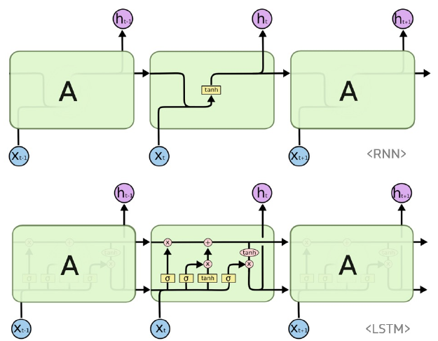

*Figure 16. An RNN with a single tanh layer in its repeating module and an LSTM with four gate layers*

The RNN at the top of Figure 16 has only one tanh layer in its repeating module, while the LSTM at the bottom has three sigmoid layers (σ) and one tanh layer, and the line running across the top of the module is the cell state [13]. The LSTM computes the following, where $\sigma$ is the sigmoid and $\odot$ is the elementwise product.

$$
\begin{aligned}
f_t &= \sigma(W_{xh\_f}\,x_t + W_{hh\_f}\,h_{t-1} + b_{h\_f}) \\
i_t &= \sigma(W_{xh\_i}\,x_t + W_{hh\_i}\,h_{t-1} + b_{h\_i}) \\
o_t &= \sigma(W_{xh\_o}\,x_t + W_{hh\_o}\,h_{t-1} + b_{h\_o}) \\
g_t &= \tanh(W_{xh\_g}\,x_t + W_{hh\_g}\,h_{t-1} + b_{h\_g}) \\
c_t &= f_t \odot c_{t-1} + i_t \odot g_t \\
h_t &= o_t \odot \tanh(c_t)
\end{aligned}
$$

| Symbol | Name | Range | Role |
|:-----|:-----|:-----|:-----|
| $f_t$ | Forget gate | $(0, 1)$ | Decides how much of the previous cell state $c_{t-1}$ to keep. 0 erases it and 1 keeps it as it is. |
| $i_t$ | Input gate | $(0, 1)$ | Decides how much of the new candidate information $g_t$ to write into the cell state. |
| $g_t$ | Candidate value | $(-1, 1)$ | New information to add to the cell state, made from the current input and the previous hidden state. |
| $o_t$ | Output gate | $(0, 1)$ | Decides how much of the cell state to send out as the hidden state (output). |
| $c_t$ | Cell state | Unbounded | Long-term memory: the sum of the kept past information and the newly written information. |
| $h_t$ | Hidden state | $(-1, 1)$ | Short-term memory and the output at time $t$. |

*Table 14. Gates and states of the LSTM*

**Worked example.** Let all values be scalars, with $x_t = 1$, $h_{t-1} = 0$, $c_{t-1} = 0.5$, the forget gate's weight and bias $W_{xh\_f} = 0.5$, $b_{h\_f} = 1$, and the other gates $W_{xh} = 1$ with bias 0 (since $h_{t-1} = 0$, the $W_{hh}$ terms are 0).

$$
f_t = \sigma(0.5 + 1) = \sigma(1.5) \approx 0.818, \quad i_t = \sigma(1) \approx 0.731, \quad o_t = \sigma(1) \approx 0.731, \quad g_t = \tanh(1) \approx 0.762
$$

$$
c_t = 0.818 \times 0.5 + 0.731 \times 0.762 \approx 0.409 + 0.557 = 0.966, \qquad h_t = 0.731 \times \tanh(0.966) \approx 0.731 \times 0.747 \approx 0.546
$$

About 82% of the previous cell state 0.5 is kept and about 73% of the new information 0.762 is added, so the cell state becomes 0.966.

**Why it reduces vanishing gradients.** The cell state is updated by addition, $c_t = f_t \odot c_{t-1} + i_t \odot g_t$, rather than by repeatedly passing through multiplications and activation functions. Along this path alone, $\frac{\partial c_t}{\partial c_{t-1}} = f_t$, so if the forget gate is close to 1, the gradient does not shrink much even across many time points. The model learns forget gates close to 1 for important information and keeps that information for a long time.

### 3.8 GRU

The **GRU (gated recurrent unit)** is a simplified LSTM [14]. Improving on the heaviness of the LSTM, it has no separate cell state and uses only two gates, the **reset gate** and the **update gate**. Its role of remembering important information longer is similar to that of the LSTM.

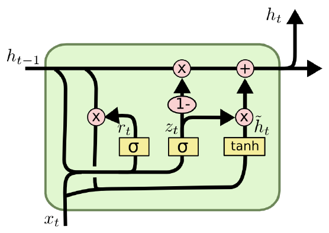

*Figure 17. A GRU cell with a reset gate and an update gate*

$$
\begin{aligned}
z_t &= \sigma(W_z \cdot [h_{t-1}, x_t]) \\
r_t &= \sigma(W_r \cdot [h_{t-1}, x_t]) \\
\tilde{h}_t &= \tanh(W \cdot [r_t * h_{t-1}, x_t]) \\
h_t &= (1 - z_t) * h_{t-1} + z_t * \tilde{h}_t
\end{aligned}
$$

- $[h_{t-1}, x_t]$ is the concatenation of the two vectors, and $*$ is the elementwise product.
- The **update gate** $z_t$ decides how much of the previous hidden state to keep and how much of the new candidate $\tilde{h}_t$ to accept. It plays the combined role of the LSTM's forget and input gates, and when $z_t$ is close to 0 the previous state is kept almost unchanged.
- The **reset gate** $r_t$ decides how much of the previous hidden state to use when forming the new candidate. Close to 0, it ignores the past and forms the candidate mainly from the current input.

The LSTM needs 4 sets of gate weights and the GRU 3, so the GRU is lighter at the same size. For example, with input size 4 and hidden state size 64, PyTorch's LSTM has 17,920 parameters and its GRU 13,440. In practice basic RNNs are rarely used, and LSTMs and GRUs are used instead.

> **Caution:** The direction of the update gate differs between sources. In the equations above, $z_t$ is the share of the new candidate, but PyTorch's `nn.GRU` uses $h_t = (1 - z_t) \odot n_t + z_t \odot h_{t-1}$, in which $z_t$ is the share of the previous state that is kept ($n_t$ is the candidate). The two definitions only swap $z_t$ and $1 - z_t$ and have the same expressive power.

### 3.9 Stacked LSTM and Bidirectional LSTM

Just as convolution layers are stacked in a CNN, RNN-family layers (LSTM, GRU) are also stacked. The designer decides by experiment how many layers to stack.

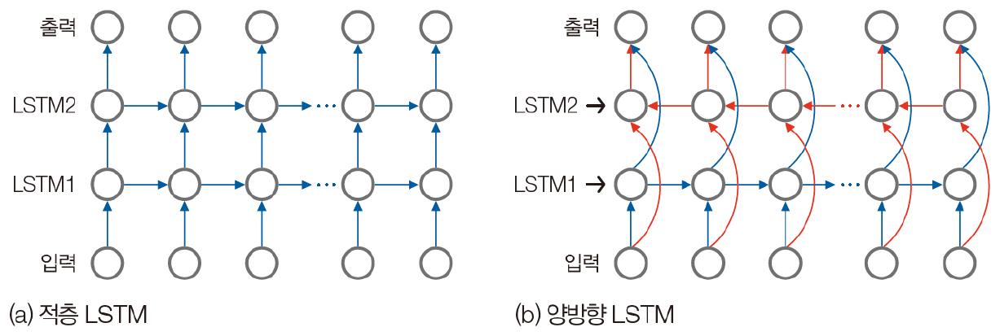

*Figure 18. A stacked LSTM with two LSTM layers stacked vertically and a bidirectional LSTM combining forward and backward LSTMs*

- **Stacked LSTM:** a structure with $n$ LSTM layers stacked vertically. The output of the first LSTM layer at each time point becomes the input of the second LSTM layer. The model learns deeper levels of abstraction, and its expressive power grows.
- **Bidirectional LSTM:** a structure that considers future as well as past information at each time point. It contains two independent LSTM layers: the forward LSTM processes the input sequence in time order and the backward LSTM in reverse. At each time point, the hidden states of the two directions are usually concatenated to form the output. Because it sees context on both sides of the data, it is strong in natural language processing tasks such as translation, named entity recognition, and sentiment analysis. However, it needs future inputs, so it cannot be used for problems that predict the next value in real time.

### 3.10 LSTM in PyTorch

PyTorch provides the LSTM layer as the class `torch.nn.LSTM` [15].

| Argument | Meaning | Default |
|:-----|:-----|:-----|
| `input_size` | Number of features in the input $x$ (dimension of the vector at each time point) | (required) |
| `hidden_size` | Number of features in the hidden state $h$ | (required) |
| `num_layers` | Number of stacked LSTM layers. 2 gives a stacked LSTM | 1 |
| `bias` | If `False`, the biases `b_ih` and `b_hh` are not used | `True` |
| `batch_first` | If `True`, input and output tensors are given in (batch, sequence, feature) order | `False` |
| `dropout` | If nonzero, applies dropout with this probability to the output of each LSTM layer except the last | 0 |
| `bidirectional` | If `True`, it becomes a bidirectional LSTM | `False` |
| `proj_size` | If greater than 0, uses an LSTM that projects the hidden state to this size | 0 |

*Table 15. Arguments of torch.nn.LSTM*

The symbols for tensor sizes are $N$ = batch size, $L$ = sequence length, $D$ = 2 if bidirectional and 1 otherwise, $H_{in}$ = `input_size`, $H_{cell}$ = `hidden_size`, and $H_{out}$ = `proj_size` if it is greater than 0 and `hidden_size` otherwise.

| Tensor | Size (`batch_first=False`) | Size (`batch_first=True`) | Content |
|:-----|:-----|:-----|:-----|
| Input `input` | $(L, N, H_{in})$ | $(N, L, H_{in})$ | Features of the input sequence |
| `h_0` | $(D \times \text{num\_layers}, N, H_{out})$ | Same | Initial hidden state of each layer; 0 if not given |
| `c_0` | $(D \times \text{num\_layers}, N, H_{cell})$ | Same | Initial cell state of each layer; 0 if not given |
| Output `output` | $(L, N, D \times H_{out})$ | $(N, L, D \times H_{out})$ | Hidden states $h_t$ of the last layer at every time point |
| `h_n` | $(D \times \text{num\_layers}, N, H_{out})$ | Same | Final hidden state of each layer |
| `c_n` | $(D \times \text{num\_layers}, N, H_{cell})$ | Same | Final cell state of each layer |

*Table 16. Input and output tensor sizes of torch.nn.LSTM*

An LSTM layer takes, along with the input, initial arrays `h_0` and `c_0` that hold the hidden state and cell state, as in `lstm(input, (h_0, c_0))`, and returns `output, (h_n, c_n)`. One hidden state and one cell state are needed per layer and per direction, so the first dimension is $D \times \text{num\_layers}$. For example, a two-layer bidirectional LSTM has $2 \times 2 = 4$.

> **Caution:** Unlike other layers, `nn.LSTM` with the default `batch_first=False` puts the batch axis in the middle, $(L, N, H_{in})$. If the dataset was built in (batch, sequence, feature) order, `batch_first=True` must be given. Also, `batch_first` does not affect the axis order of `h_0`, `c_0`, `h_n`, and `c_n`, which always have the batch axis in the middle. It is a good habit to check defaults in the official documentation rather than in blog posts.

There are also animations that show the LSTM computation step by step [16]. The previous cell state $c_{t-1}$, the previous hidden state $h_{t-1}$, and the current input $x_t$ enter the cell and pass through the gates to produce the new cell state and hidden state, which are handed on to the next time point, repeating the equations of Section 3.7 exactly. In a many-to-one problem such as spam classification, a fully connected layer is attached to the hidden state $h_L$ of the last time point to produce the desired number of outputs. This code is covered in the Lecture 2 lab.

---

<br>

## 4. The Flow of a Deep Learning Implementation with PyTorch

Code that implements a deep learning model with PyTorch is usually written in the following order.

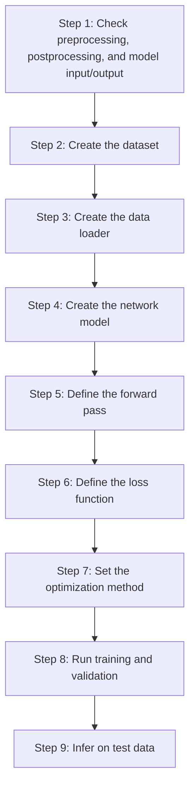

*Figure 19. The nine-step flow of a deep learning implementation with PyTorch*

| Step | What it does |
|:-----|:-----|
| 1. Check input and output | Decide how to preprocess the input and how to interpret (postprocess) the model's output. `BaseTransform` and `ILSVRCPredictor` in the Lecture 1 lab belong to this step. |
| 2. Create the dataset | Build an object (`Dataset`) that returns a preprocessed input and its answer when one data point is taken out. |
| 3. Create the data loader | Build an object (`DataLoader`) that bundles the dataset into mini-batches of the batch size and shuffles the order. |
| 4. Create the network model | Build a model class (`nn.Module`) that defines the layers (`Conv2d`, `LSTM`, `Linear`, and so on). |
| 5. Define the forward pass | Write in the model's `forward` method the order in which the input passes through the layers. |
| 6. Define the loss function | Choose a loss function suited to the problem, such as cross-entropy (Lecture 1, Section 4). |
| 7. Set the optimization method | Choose an optimizer such as SGD or Adam and the learning rate (Lecture 1, Section 5). |
| 8. Run training and validation | For each epoch, repeat forward propagation, loss computation, backpropagation, and weight updates on the training data, and measure performance on the validation data. |
| 9. Infer on test data | Predict test data or new data with the finished model. |

*Table 17. What each step of a deep learning implementation does*

The Lecture 2 lab covers steps 4 and 5 (the model and the forward pass), and the whole flow from the dataset to training is covered in Lecture 3.

---

<br>

## Concept Applications

**True/False Check:**

| Statement | Judgment and reason |
|:-----|:------------|
| A convolution layer that applies 16 kernels of 3 × 3 to a 3-channel input has 3 output channels. | **F.** The number of output channels is the number of kernels, 16. Each kernel has depth 3. |
| The more pixels the input image has, the more parameters a convolution layer has. | **F.** The same kernel is shared at every position, so the parameter count $C_{out}(C_{in}K^2) + C_{out}$ does not depend on the height and width of the input. |
| A max pooling layer has no learned weights. | **T.** It only picks the maximum of each region, so it has no parameters; it shrinks the feature map and thus reduces the computation and weight count of later layers. |
| An RNN uses different weights at each time point, so its parameter count grows with the sequence length. | **F.** All time points share $\mathbf{U}, \mathbf{V}, \mathbf{W}$, so the parameter count does not depend on the sequence length. |
| Because the LSTM cell state is updated by addition, the gradient does not shrink much across many time points when the forget gate is close to 1. | **T.** $\partial c_t/\partial c_{t-1} = f_t$, unlike the basic RNN, whose gradient shrinks every step through the product of the tanh derivative and the weight. |
| Feeding a tensor of size `(32, 30, 4)` meant as (batch, sequence, feature) into `nn.LSTM(4, 64)` is processed correctly as it is. | **F.** With the default `batch_first=False`, the first axis is interpreted as the sequence length, so it is processed as length 32 and batch 30. `batch_first=True` is needed. |

---

<br>

## Summary

| Concept | Key Summary |
|:-----|:----------|
| Perceptron and MLP | A perceptron is a single node with a weighted sum and an activation function; an MLP is a feedforward network that stacks perceptrons in layers and fully connects neighboring layers. |
| Convolution operation | Slides the kernel one position at a time and sums the elementwise products of the receptive field and the kernel to form a feature map. Convolution in deep learning is cross-correlation, which does not flip the kernel. |
| Kernels and features | Depending on the kernel, features such as horizontal and vertical edges are extracted, and in a CNN the kernel values are learned as weights. |
| Achievements of CNNs | They defeated the dog-and-cat CAPTCHA (98.9% accuracy), and AlexNet opened the deep learning era by winning ILSVRC 2012 with a top-5 error rate of 15.3%. |
| Output size | $\lfloor (H + 2P - F)/S \rfloor + 1$. Padding preserves the size and stride reduces it. A 3 × 3 kernel keeps the size with padding 1. |
| Multichannel convolution | The depth of a kernel equals the number of input channels, and the number of kernels becomes the number of output channels. The parameter count is $C_{out}(C_{in}K^2) + C_{out}$. |
| Pooling | Summarizes a feature map by the maximum or average of each region. With stride $s$ the length becomes $1/s$ and the area $1/s^2$; it has no parameters and enlarges the receptive field. |
| AlexNet | A 227 × 227 × 3 input passes through 5 convolutions and 3 poolings to become 6 × 6 × 256 = 9216 values, then through 3 fully connected layers to be classified into 1,000 classes. It has about 60 million parameters. |
| Time-series data | Variable-length vectors of vectors in which order matters, lengths differ, and there is context dependence and seasonality. |
| RNN | $\mathbf{h}^t = \tau_1(\mathbf{W}\mathbf{h}^{t-1} + \mathbf{U}\mathbf{a}^t)$ feeds the previous hidden state into the current computation, and all time points share the same weights. It is used as one-to-many, many-to-one, and many-to-many. |
| Vanishing gradient | Backpropagation multiplies $w \cdot \tanh'$ as many times as there are time points, so the gradient shrinks exponentially and information from the distant past is not learned. |
| LSTM | Remembers information selectively with the cell state and the forget, input, and output gates. The additive update of the cell state reduces vanishing gradients. |
| GRU | A simplified LSTM that uses only a reset gate and an update gate, with fewer parameters. |
| Stacked and bidirectional | A stacked LSTM stacks layers vertically to increase expressive power, and a bidirectional LSTM concatenates forward and backward hidden states to see context on both sides. |
| PyTorch layers | `Conv2d(in, out, k, stride, padding)`, `MaxPool2d(k, stride=k)`, and `LSTM(input_size, hidden_size, batch_first=False)`; the LSTM takes `(h_0, c_0)` and returns `output, (h_n, c_n)`. |
| Implementation flow | Implemented in nine steps: check input and output, dataset, data loader, model, forward pass, loss function, optimizer, training and validation, and inference. |

---

<br>

## Self-Check Questions

1. **One-dimensional convolution:** Find the feature map (excluding the two ends) of the signal $(1, 3, 6, 6, 6, 2)$ convolved with the kernel $(-1, 0, 1)$.

   <details>
   <summary>Answer</summary>

   $f(i) = -z(i - 1) + z(i + 1)$. $f(1) = -1 + 6 = 5$, $f(2) = -3 + 6 = 3$, $f(3) = -6 + 6 = 0$, and $f(4) = -6 + 2 = -4$, so the feature map is $(5, 3, 0, -4)$. It is positive where the values increase, negative where they decrease, and 0 where there is no change.

   </details>

2. **Two-dimensional convolution:** For the 5 × 5 input and kernel of Section 2.6, show how the central output value 17 is computed.

   <details>
   <summary>Answer</summary>

   The receptive field of the central output is rows 1-3, columns 1-3, $\begin{pmatrix} 0 & 1 & 3 \\ 1 & 2 & 2 \\ 0 & 0 & 2 \end{pmatrix}$. Multiplying elementwise with the kernel $\begin{pmatrix} 0 & 1 & 2 \\ 2 & 2 & 0 \\ 0 & 1 & 2 \end{pmatrix}$ gives $0 + 1 + 6 + 2 + 4 + 0 + 0 + 0 + 4 = 17$.

   </details>

3. **Output size:** To a 32 × 32 × 3 input apply `Conv2d(3, 16, kernel_size=5, stride=1, padding=2)`, then `MaxPool2d(2)`, then `Conv2d(16, 32, kernel_size=3, stride=2, padding=0)`. Find the output size of each step and the parameter counts of the two convolution layers.

   <details>
   <summary>Answer</summary>

   The first convolution gives $(32 + 4 - 5)/1 + 1 = 32$, so 16 × 32 × 32 (channels × height × width). After pooling it is 16 × 16 × 16. The second convolution gives $\lfloor (16 - 3)/2 \rfloor + 1 = \lfloor 6.5 \rfloor + 1 = 7$, so 32 × 7 × 7. The parameter counts are $16 \times (3 \times 5 \times 5) + 16 = 1216$ and $32 \times (16 \times 3 \times 3) + 32 = 4640$.

   </details>

4. **Padding:** How much padding is needed for the output size to equal the input size when a 7 × 7 kernel is applied with stride 1?

   <details>
   <summary>Answer</summary>

   From $(H + 2P - 7)/1 + 1 = H$, $2P = 6$, so $P = 3$. In general $P = (F - 1)/2$.

   </details>

5. **Pooling:** Apply 2 × 2 max pooling and average pooling (stride 2) to the feature map $\begin{pmatrix} 1 & 4 & 2 & 0 \\ 3 & 8 & 1 & 1 \\ 0 & 2 & 6 & 7 \\ 5 & 1 & 3 & 2 \end{pmatrix}$.

   <details>
   <summary>Answer</summary>

   The four regions are (1, 4, 3, 8), (2, 0, 1, 1), (0, 2, 5, 1), and (6, 7, 3, 2). Max pooling gives $\begin{pmatrix} 8 & 2 \\ 5 & 7 \end{pmatrix}$ and average pooling $\begin{pmatrix} 4 & 1 \\ 2 & 4.5 \end{pmatrix}$.

   </details>

6. **CAPTCHA:** What is the probability that a classifier with 95% accuracy per photo passes a CAPTCHA that requires all 12 photos to be correct?

   <details>
   <summary>Answer</summary>

   $0.95^{12} \approx 0.540$, about 54%. Even with high per-photo accuracy, the probability of getting all 12 right decreases as a power, but at this level the CAPTCHA has lost its function.

   </details>

7. **RNN computation:** For the scalar RNN of Section 3.4 ($w = 0.5$, $u = 1$, $h^0 = 0$), what is $h^2$ for the input sequence $(0, 1)$? Compare it with $h^1$ in Table 12.

   <details>
   <summary>Answer</summary>

   $h^1 = \tanh(0) = 0$ and $h^2 = \tanh(0.5 \times 0 + 1) = \tanh(1) \approx 0.7616$. It equals $h^1$ of Table 12, where the input 1 entered at the first time point, because the earlier input was 0 and no past information was carried over.

   </details>

8. **Vanishing gradient:** In a scalar RNN, if $\lvert w(1 - (h^t)^2) \rvert$ is 0.8 at every time point, by what factor does the gradient with respect to an input 30 time points earlier shrink?

   <details>
   <summary>Answer</summary>

   The chain rule multiplies 30 factors, so it shrinks by $0.8^{30} \approx 0.0012$, about 1/800. The weights for inputs in the distant past are hardly updated.

   </details>

9. **LSTM gates:** If the forget gate is $f_t = 0$ and the input gate $i_t = 1$, what does the cell state $c_t$ become? What happens with $f_t = 1$ and $i_t = 0$?

   <details>
   <summary>Answer</summary>

   With $f_t = 0$ and $i_t = 1$, $c_t = g_t$: all past memory is erased and replaced by the new information. With $f_t = 1$ and $i_t = 0$, $c_t = c_{t-1}$: no new information is accepted and the memory is kept as it is.

   </details>

10. **LSTM tensor sizes:** Find the sizes of `output`, `h_n`, and `c_n` when an input of size $(8, 15, 10)$ is fed to `nn.LSTM(input_size=10, hidden_size=20, num_layers=2, bidirectional=True, batch_first=True)`.

    <details>
    <summary>Answer</summary>

    $N = 8$, $L = 15$, and $D = 2$. `output` is $(N, L, D \times H_{out}) = (8, 15, 40)$, and `h_n` and `c_n` are $(D \times \text{num\_layers}, N, H) = (4, 8, 20)$. Even with `batch_first=True`, `h_n` and `c_n` have the batch axis in the middle.

    </details>

---

<br>

## References

1. I. Goodfellow, Y. Bengio, and A. Courville, *Deep Learning*. Cambridge, MA, USA: MIT Press, 2016.
2. J. Elson, J. R. Douceur, J. Howell, and J. Saul, "Asirra: A CAPTCHA that Exploits Interest-Aligned Manual Image Categorization," in *Proc. ACM Conf. Computer and Communications Security (CCS)*, pp. 366-374, 2007.
3. P. Golle, "Machine Learning Attacks Against the Asirra CAPTCHA," in *Proc. ACM Conf. Computer and Communications Security (CCS)*, pp. 535-542, 2008.
4. Kaggle, "Dogs vs. Cats," 2013, accessed Nov. 4, 2026. https://www.kaggle.com/c/dogs-vs-cats
5. A. Krizhevsky, I. Sutskever, and G. E. Hinton, "ImageNet Classification with Deep Convolutional Neural Networks," in *Advances in Neural Information Processing Systems (NIPS)*, pp. 1097-1105, 2012.
6. K. He, X. Zhang, S. Ren, and J. Sun, "Deep Residual Learning for Image Recognition," in *Proc. IEEE Conf. Computer Vision and Pattern Recognition (CVPR)*, pp. 770-778, 2016.
7. O. Russakovsky et al., "ImageNet Large Scale Visual Recognition Challenge," *International Journal of Computer Vision*, vol. 115, no. 3, pp. 211-252, 2015.
8. Animated AI, "All Convolution Animations Are Wrong," accessed Nov. 4, 2026. https://www.youtube.com/watch?v=w4kNHKcBGzA and https://animatedai.github.io/
9. PyTorch, "Conv2d," *PyTorch Documentation*, accessed Nov. 4, 2026. https://docs.pytorch.org/docs/stable/generated/torch.nn.Conv2d.html
10. PyTorch, "MaxPool2d," *PyTorch Documentation*, accessed Nov. 4, 2026. https://docs.pytorch.org/docs/stable/generated/torch.nn.MaxPool2d.html
11. Y. Bengio, P. Simard, and P. Frasconi, "Learning Long-Term Dependencies with Gradient Descent is Difficult," *IEEE Transactions on Neural Networks*, vol. 5, no. 2, pp. 157-166, 1994.
12. S. Hochreiter and J. Schmidhuber, "Long Short-Term Memory," *Neural Computation*, vol. 9, no. 8, pp. 1735-1780, 1997.
13. C. Olah, "Understanding LSTM Networks," 2015, accessed Nov. 4, 2026. https://colah.github.io/posts/2015-08-Understanding-LSTMs/
14. K. Cho et al., "Learning Phrase Representations using RNN Encoder-Decoder for Statistical Machine Translation," in *Proc. Conf. Empirical Methods in Natural Language Processing (EMNLP)*, pp. 1724-1734, 2014.
15. PyTorch, "LSTM," *PyTorch Documentation*, accessed Nov. 4, 2026. https://docs.pytorch.org/docs/stable/generated/torch.nn.LSTM.html
16. A. Sefidian, "A complete guide to understand Long Short-Term Memory (LSTM) networks," 2019, accessed Nov. 4, 2026. http://www.sefidian.com/2019/08/15/a-complete-guide-to-understand-long-short-term-memory-lstm-networks/
