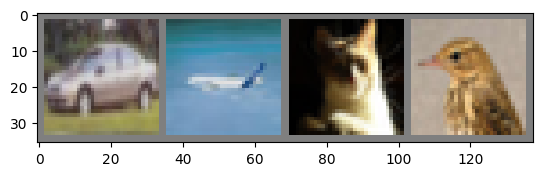
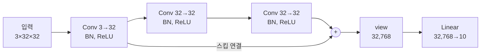

# 3강 실습 — CIFAR-10 분류 모델 학습과 간단한 ResNet 구현

[레포지토리 안내](../../README.ko.md) | [English](Concepts_Lab.md) | [한국어](Concepts_Lab.ko.md)

> **최종 수정일:** 2026-11-04

> **학습 목표:**
> 1. torchvision으로 CIFAR-10 데이터셋과 데이터 로더를 만들고, 정규화된 이미지를 되돌려 화면에 표시할 수 있다
> 2. 합성곱 신경망의 층별 파라미터 수를 계산할 수 있다
> 3. 학습 루프와 검증 루프의 각 줄이 하는 일을 설명하고, 출력된 손실과 정확도를 해석할 수 있다
> 4. 새 이미지에 학습 때와 같은 전처리를 적용해 추론하고, 로짓을 softmax 확률로 바꿀 수 있다
> 5. 잔차 블록을 `nn.Module`로 구현하고, 스킵 연결이 파라미터 수를 늘리지 않음을 설명할 수 있다

---

## 목차

- [1. 실습 개요](#1-실습-개요)
- [2. 학습 튜토리얼 노트북](#2-학습-튜토리얼-노트북)
  - [2.1 데이터 로드와 정규화](#21-데이터-로드와-정규화)
  - [2.2 Google Drive 연동](#22-google-drive-연동)
  - [2.3 데이터 확인](#23-데이터-확인)
  - [2.4 모델 구축](#24-모델-구축)
  - [2.5 손실 함수와 옵티마이저 설정](#25-손실-함수와-옵티마이저-설정)
  - [2.6 학습 진행](#26-학습-진행)
  - [2.7 검증 진행](#27-검증-진행)
  - [2.8 새 이미지로 추론](#28-새-이미지로-추론)
  - [2.9 softmax로 확률 구하기](#29-softmax로-확률-구하기)
- [3. 간단한 ResNet 노트북](#3-간단한-resnet-노트북)
  - [3.1 일반 합성곱 모델](#31-일반-합성곱-모델)
  - [3.2 잔차 블록](#32-잔차-블록)
  - [3.3 잔차 블록을 적용한 모델](#33-잔차-블록을-적용한-모델)
  - [3.4 동작 확인](#34-동작-확인)
  - [3.5 일반 모델과 잔차 모델의 비교](#35-일반-모델과-잔차-모델의-비교)
- [요약](#요약)
- [점검 문제](#점검-문제)
- [참고 문헌](#참고-문헌)

---

<br>

## 1. 실습 개요

이 실습은 3강 강의 노트의 1절(PyTorch 구현 흐름)과 4절(ResNet)을 코드로 확인한다. 노트북은 두 개이다.

| 노트북 | 내용 | 필요한 데이터 |
|:-----|:-----|:-----|
| [Example_Training-Tutorial.ipynb](Example_Training-Tutorial.ipynb) | CIFAR-10 분류 모델의 데이터 준비, 모델 정의, 학습, 검증, 새 이미지 추론 | CIFAR-10 (실행 시 자동으로 내려받음), `data/goldenretriever-3724972_640.jpg` |
| [Example_ResNet-Simple.ipynb](Example_ResNet-Simple.ipynb) | 일반 합성곱 모델과 잔차 블록을 적용한 모델의 정의와 텐서 크기 확인 | 없음 (무작위 텐서 사용) |

*표 1. 3강 실습 노트북의 내용과 필요한 데이터*

두 노트북은 Google Colab에서 작성되었으며, 저장된 출력도 Colab에서 실행한 결과이다. 로컬에서 실행할 때는 PyTorch, torchvision, matplotlib, tqdm, Pillow가 필요하고, 노트북이 있는 폴더를 작업 폴더로 두어야 상대 경로 `./data`와 `data/...`가 이 단원의 `data/` 폴더를 가리킨다. Google Drive를 연결하는 셀(2.2절)은 Colab에서만 동작하므로 로컬에서는 건너뛴다. 저장된 출력은 실행할 때마다 달라지는 값(무작위로 섞인 미니배치, 무작위 초기 가중치)을 포함하므로 다시 실행하면 숫자가 조금씩 다르게 나온다.

---

<br>

## 2. 학습 튜토리얼 노트북

### 2.1 데이터 로드와 정규화

```python
import torch
import torchvision
import torchvision.transforms as transforms

# 데이터 정규화 설정
transform = transforms.Compose(
    [transforms.ToTensor(),
     transforms.Normalize((0.5, 0.5, 0.5), (0.5, 0.5, 0.5))])

# 데이터셋 작성
trainset = torchvision.datasets.CIFAR10(root='./data', train=True,
                                        download=True, transform=transform)
testset = torchvision.datasets.CIFAR10(root='./data', train=False,
                                       download=True, transform=transform)

# 데이터 로더 작성
trainloader = torch.utils.data.DataLoader(trainset, batch_size=4,
                                          shuffle=True)
testloader = torch.utils.data.DataLoader(testset, batch_size=4,
                                         shuffle=False)

classes = ('plane', 'car', 'bird', 'cat',
           'deer', 'dog', 'frog', 'horse', 'ship', 'truck')
```

```text
100%|██████████| 170M/170M [00:02<00:00, 66.9MB/s]
```

- `import torch`, `import torchvision`: PyTorch 본체와 컴퓨터 비전 라이브러리를 불러온다. `torchvision.transforms`는 `transforms`라는 짧은 이름으로 쓴다.
- `transforms.Compose([...])`: 목록의 변환을 차례로 적용하는 하나의 변환을 만든다. 먼저 `ToTensor()`가 PIL 이미지(32×32×3, 0\~255)를 3×32×32 실수 텐서(0\~1)로 바꾸고, `Normalize`가 채널마다 0.5를 빼고 0.5로 나누어 −1\~1 범위로 옮긴다. 계산 예는 강의 노트 1.3절의 표 3에 있다.
- `torchvision.datasets.CIFAR10(...)`: CIFAR-10 데이터셋 객체를 만든다 [1]. `root='./data'`는 데이터를 저장할 폴더, `train=True`는 학습용 50,000장, `train=False`는 테스트용 10,000장을 뜻한다. `download=True`이면 폴더에 데이터가 없을 때 약 170 MB의 압축 파일을 내려받아 푼다. 출력의 진행 막대가 이 다운로드이다. `transform=transform`을 주면 데이터셋에서 이미지를 꺼낼 때마다 위의 변환이 적용된다.
- `torch.utils.data.DataLoader(...)`: 데이터셋에서 이미지 4장(`batch_size=4`)씩 꺼내 4×3×32×32 이미지 텐서와 길이 4의 정답 텐서로 묶는다. 학습 로더는 에포크마다 순서를 섞고(`shuffle=True`), 테스트 로더는 섞지 않는다.
- `classes`: 정답 번호 0\~9를 클래스 이름으로 바꾸는 튜플이다. CIFAR-10의 번호 순서(airplane, automobile, bird, …, truck)와 같으며, 이름을 짧게 `plane`, `car`로 줄였다.

### 2.2 Google Drive 연동

```python
from google.colab import drive
drive.mount('/content/drive')
```

```text
Mounted at /content/drive
```

Colab에서 사용자의 Google Drive를 `/content/drive` 경로에 연결하는 셀이다. 연결하면 Drive에 올려 둔 파일을 일반 파일처럼 읽을 수 있다. 같은 셀이 추론 부분(2.8절 코드의 바로 앞)에도 한 번 더 있다. 이 노트북은 추론에 쓰는 이미지를 상대 경로 `data/goldenretriever-3724972_640.jpg`로 읽으므로 Drive 연결이 필요하지 않으며, `google.colab` 모듈이 없는 로컬 환경에서는 이 두 셀을 실행하지 않는다.

### 2.3 데이터 확인

데이터 로더가 내놓는 미니배치를 그림으로 확인하는 선택 단계이다.

```python
import matplotlib.pyplot as plt
import numpy as np

# 이미지 시각화 함수
def imshow(img):
    img = img / 2 + 0.5     # unnormalize
    npimg = img.numpy()
    plt.imshow(np.transpose(npimg, (1, 2, 0)))
    plt.show()


# 학습용 이미지를 무작위로 가져오기
dataiter = iter(trainloader)
images, labels = next(dataiter)

# 이미지 보여주기
imshow(torchvision.utils.make_grid(images))
# 정답(label) 출력
print(' '.join('%5s' % classes[labels[j]] for j in range(4)))
```

```text
  car plane   cat  bird
```

- `img / 2 + 0.5`: 정규화를 되돌린다. 정규화가 $x' = (x - 0.5)/0.5 = 2x - 1$이었으므로 $x = x'/2 + 0.5$로 다시 0\~1 범위가 된다. 되돌리지 않으면 음수 값 때문에 색이 잘못 표시된다.
- `img.numpy()`: 텐서를 NumPy 배열로 바꾼다.
- `np.transpose(npimg, (1, 2, 0))`: 축의 순서를 채널×높이×너비에서 높이×너비×채널로 바꾼다. PyTorch는 채널을 앞에 두지만 matplotlib의 `imshow`는 채널을 마지막에 둔 배열을 받는다.
- `iter(trainloader)`와 `next(dataiter)`: 데이터 로더에서 미니배치 하나를 꺼낸다. 학습 로더는 순서를 섞으므로 실행할 때마다 다른 이미지가 나온다.
- `torchvision.utils.make_grid(images)`: 이미지 4장을 가로로 이어 붙여 한 장으로 만든다. 이미지 사이와 테두리에 2픽셀씩 여백을 두므로 결과는 3×36×138 텐서이다(높이 32 + 2×2, 너비 4×32 + 5×2).
- `'%5s' % classes[labels[j]]`: 클래스 이름을 5칸에 오른쪽 정렬로 맞춘다. 그래서 `cat` 앞에 공백이 두 칸 붙는다.



*그림 1. 데이터 로더에서 꺼낸 미니배치 하나의 이미지 네 장(자동차, 비행기, 고양이, 새)*

그림 1은 저장된 실행 결과로, 32×32의 작은 이미지이므로 흐릿하게 보인다. 출력된 정답 `car plane cat bird`가 그림의 순서와 일치한다.

### 2.4 모델 구축

```python
import torch.nn as nn
import torch.nn.functional as F


class Model(nn.Module):
    def __init__(self):
        super(Model, self).__init__()
        self.conv1 = nn.Conv2d(3, 6, 5) # in_channels, out_channels, kernel_size
        self.pool = nn.MaxPool2d(2, 2)
        self.conv2 = nn.Conv2d(6, 16, 5)
        self.fc1 = nn.Linear(16 * 5 * 5, 120)
        self.fc2 = nn.Linear(120, 84)
        self.fc3 = nn.Linear(84, 10)

    def forward(self, x):
        x = self.pool(F.relu(self.conv1(x)))
        x = self.pool(F.relu(self.conv2(x)))
        x = x.view(-1, 16 * 5 * 5)
        x = F.relu(self.fc1(x))
        x = F.relu(self.fc2(x))
        x = self.fc3(x)
        return x


model = Model()
```

- `class Model(nn.Module)`: 모든 PyTorch 모델의 부모 클래스인 `nn.Module`을 상속한다. `super(Model, self).__init__()`은 부모 클래스를 초기화하는 호출로, 이것이 있어야 아래에서 만든 층의 파라미터가 모델에 등록된다.
- `nn.Conv2d(3, 6, 5)`: 입력 채널 3, 출력 채널 6, 커널 5×5의 합성곱 층이다. 스트라이드는 기본값 1, 패딩은 기본값 0이다.
- `nn.MaxPool2d(2, 2)`: 2×2 영역의 최댓값을 고르고 2칸씩 이동하는 풀링 층이다. 학습할 파라미터가 없으므로 한 번 만들어 두 번 쓴다.
- `nn.Linear(16 * 5 * 5, 120)`: 400개 입력을 120개 출력으로 바꾸는 완전 연결 층이다. 400은 두 번째 풀링의 출력 16×5×5를 펼친 개수이다(강의 노트 1.4절의 표 5).
- `forward`: 합성곱, ReLU, 풀링을 두 번 반복한 뒤 `x.view(-1, 16 * 5 * 5)`로 펼친다. `view`의 −1은 나머지 차원에서 자동으로 계산하라는 뜻이므로 미니배치 크기가 4이면 4×400이 된다. 이어서 완전 연결 층 세 개를 지나며, 마지막 `fc3`에는 활성화 함수를 쓰지 않는다. 출력은 로짓이고 softmax는 손실 함수 안에서 계산되기 때문이다.
- `F.relu`: `torch.nn.functional`의 ReLU 함수이다. 파라미터가 없는 연산은 이처럼 층 객체를 만들지 않고 함수로 호출할 수 있다.

층별 파라미터 수는 가중치 수와 편향 수의 합이다. 합성곱 층의 가중치 수는 (입력 채널)×(출력 채널)×(커널 높이)×(커널 너비), 완전 연결 층은 (입력 수)×(출력 수)이고, 편향은 출력 채널(출력)마다 하나씩이다.

| 층 | 가중치 | 편향 | 합계 |
|:-----|:-----|:-----|:-----|
| conv1 | 3 × 6 × 5 × 5 = 450 | 6 | 456 |
| conv2 | 6 × 16 × 5 × 5 = 2,400 | 16 | 2,416 |
| fc1 | 400 × 120 = 48,000 | 120 | 48,120 |
| fc2 | 120 × 84 = 10,080 | 84 | 10,164 |
| fc3 | 84 × 10 = 840 | 10 | 850 |
| 전체 | | | 62,006 |

*표 2. 학습 튜토리얼 모델의 층별 파라미터 수*

파라미터의 77% 이상이 `fc1`에 있다. 합성곱 층은 같은 커널을 이미지 전체에 다시 쓰므로 파라미터가 적고, 완전 연결 층은 모든 입력과 출력을 잇기 때문에 파라미터가 많다.

### 2.5 손실 함수와 옵티마이저 설정

```python
import torch.optim as optim

criterion = nn.CrossEntropyLoss()
optimizer = optim.SGD(model.parameters(), lr=0.001, momentum=0.9)
```

- `nn.CrossEntropyLoss()`: 로짓과 정답 번호를 받아 softmax와 음의 로그 우도를 한 번에 계산하는 교차 엔트로피 손실이다(강의 노트 1.5절). 미니배치의 손실은 기본적으로 표본별 손실의 평균이다.
- `optim.SGD(model.parameters(), lr=0.001, momentum=0.9)`: 모델의 모든 파라미터(표 2의 62,006개)를 학습률 0.001, 모멘텀 0.9의 확률적 경사하강법으로 갱신하는 옵티마이저를 만든다. `model.parameters()`는 `__init__`에서 등록된 파라미터를 모두 돌려준다.

### 2.6 학습 진행

```python
for epoch in range(1):   # 전체 데이터셋을 여러번 반복하기

    training_loss = 0.0
    model.train()
    for i, data in enumerate(trainloader):
        # 입력 받기: 데이터는 [inputs, labels] 형태의 리스트
        inputs, labels = data

        # 파라미터 변화도(.grad)를 0으로 만들기
        optimizer.zero_grad()

        # 순전파 + 역전파 + 최적화
        outputs = model(inputs)
        loss = criterion(outputs, labels) # 손실을 계산
        loss.backward() # 파라미터들의 에러에 대한 변화도를 계산함
        optimizer.step() # loss function을 효율적으로 최소화 할 수 있게 파라미터 수정

        # 통계 출력
        training_loss += loss.item()
        if i % 2000 == 1999:    # 미니배치 2000개 마다 출력
            print('[%d, %5d] loss: %.3f' %
                  (epoch + 1, i + 1, training_loss / 2000))
            training_loss = 0.0

print('Finished Training')
```

```text
[1,  2000] loss: 2.225
[1,  4000] loss: 1.850
[1,  6000] loss: 1.665
[1,  8000] loss: 1.571
[1, 10000] loss: 1.496
[1, 12000] loss: 1.483
Finished Training
```

- `for epoch in range(1)`: 에포크를 한 번만 돈다. 정확도를 높이려면 이 숫자를 늘린다.
- `model.train()`: 학습 모드로 바꾼다. 이 모델에는 dropout이나 배치 정규화가 없어 결과에 영향이 없지만, 그런 층이 있는 모델과 같은 형태로 쓰는 습관이다.
- `for i, data in enumerate(trainloader)`: 미니배치를 하나씩 꺼낸다. `i`는 0부터 12,499까지의 미니배치 번호이고, `data`는 이미지 텐서와 정답 텐서의 쌍이다.
- `optimizer.zero_grad()`: 이전 반복의 기울기를 지운다. `backward()`는 기울기를 누적하므로 반복마다 먼저 지워야 한다.
- `outputs = model(inputs)`: 순전파로 4×10 로짓을 얻는다. `model(...)`처럼 객체를 호출하면 내부에서 `forward`가 실행된다.
- `loss = criterion(outputs, labels)`, `loss.backward()`, `optimizer.step()`: 손실을 계산하고, 역전파로 모든 파라미터의 `.grad`를 채우고, 그 기울기로 파라미터를 고친다.
- `training_loss += loss.item()`: `item()`은 원소가 하나인 텐서를 Python 실수로 바꾼다. 텐서 그대로 더하면 계산 기록이 계속 쌓이므로 숫자만 꺼내 더한다.
- `if i % 2000 == 1999`: 2,000번째, 4,000번째, … 미니배치에서 지난 2,000개의 평균 손실을 출력하고 합계를 0으로 되돌린다. 한 에포크는 12,500개 미니배치이므로 12,000번째까지 6번 출력되고 마지막 500개는 출력되지 않는다.

평균 손실이 2.225에서 1.483으로 줄었다. 무작위 추측의 손실 $\ln 10 \approx 2.303$에서 출발해 학습이 진행되고 있음을 보여 준다. 감소 폭은 점점 작아져 10,000번째와 12,000번째 사이에는 0.013만 줄었으므로, 손실을 더 낮추려면 에포크를 늘려 학습을 계속해야 한다.

### 2.7 검증 진행

```python
from tqdm import tqdm

val_loss = 0.0
corrects = 0
model.eval()
for i, data in tqdm(enumerate(testloader)):
    # 입력 받기: 데이터는 [inputs, labels] 형태의 리스트
    inputs, labels = data
    # print(inputs.size)

    # 순전파
    outputs = model(inputs)
    loss = criterion(outputs, labels) # 손실을 계산
    _, preds = torch.max(outputs, 1)  # 라벨을 예측

    # 통계 출력
    val_loss += loss.item()
    corrects += torch.sum(preds == labels.data)

val_loss = val_loss / (i+1)
val_acc = corrects / len(testloader.dataset)
print('val Loss: {:.4f} val Acc: {:.4f}'.format(val_loss, val_acc))
```

```text
2500it [00:10, 249.01it/s]
val Loss: 1.3826 val Acc: 0.5029
```

- `from tqdm import tqdm`: 반복문을 감싸면 진행 막대를 보여 주는 라이브러리이다. 출력의 `2500it`는 2,500번 반복했다는 뜻이다(10,000장 ÷ 4).
- `model.eval()`: 평가 모드로 바꾼다.
- `_, preds = torch.max(outputs, 1)`: 미니배치의 각 이미지에서 로짓이 가장 큰 클래스 번호를 구한다. 결과 `preds`는 길이 4의 텐서이다.
- `preds == labels.data`: 예측과 정답을 원소별로 비교해 True/False 텐서를 만들고, `torch.sum`이 True의 개수(맞힌 개수)를 센다. `labels.data`는 `labels`와 같은 값을 가진 텐서이다.
- `val_loss / (i+1)`: 반복이 끝났을 때 `i`는 마지막 번호 2,499이므로 `i+1` = 2,500으로 나누어 미니배치 평균 손실을 구한다.
- `corrects / len(testloader.dataset)`: 맞힌 개수를 테스트 이미지 수 10,000으로 나눈 정확도이다.

검증 손실 1.3826, 정확도 0.5029는 10,000장 중 5,029장을 맞혔다는 뜻이다. 무작위로 고르면 정확도가 0.1이므로 한 에포크 학습으로 상당한 성능을 얻었지만, 아직 절반은 틀린다.

> **참고:** 이 셀은 기울기가 필요 없는데도 계산 기록을 남긴다. 루프 전체를 `with torch.no_grad():` 안에 넣으면 같은 결과를 더 적은 메모리로 얻는다. 또한 테스트 데이터를 검증에 쓰는 점의 문제는 강의 노트 1.6절의 `주의` 상자에서 다룬다.

### 2.8 새 이미지로 추론

```python
from PIL import Image

# test 이미지 불러오기
image_file_path = 'data/goldenretriever-3724972_640.jpg'
img_origin = Image.open(image_file_path)  # [높이][너비][색RGB]
print('원본 크기:', np.shape(img_origin))

# 데이터 전처리
img = img_origin.resize((32, 32))
print('resize 크기:', np.shape(img))
input = transform(img)
print('transform 크기:', input.size())
print()

# inference
model.eval()
output = model(input) # 모델에 입력 넣기
print(output)
_, preds = torch.max(output, 1)  # 라벨을 예측
print(classes)

print(preds)
# 결과 시각화
plt.imshow(img_origin)
plt.show()
print('예측 class:', classes[preds[0]])
```

```text
원본 크기: (426, 640, 3)
resize 크기: (32, 32, 3)
transform 크기: torch.Size([3, 32, 32])

tensor([[-1.1642, -4.5498,  1.6623,  2.7455,  2.0443,  4.1119, -1.7750,  3.1851,
         -2.8741, -3.5939]], grad_fn=<AddmmBackward0>)
('plane', 'car', 'bird', 'cat', 'deer', 'dog', 'frog', 'horse', 'ship', 'truck')
tensor([5])
예측 class: dog
```

- `Image.open(image_file_path)`: 이미지 파일을 PIL 이미지로 연다. `np.shape`으로 보면 (높이, 너비, 채널) = (426, 640, 3)이다.
- `img_origin.resize((32, 32))`: 학습 이미지와 같은 32×32로 줄인다. PIL의 `resize`는 (너비, 높이) 순서로 크기를 받는다. 원본의 가로세로 비율(640:426)을 무시하고 정사각형으로 줄이므로 개가 가로로 눌린 모양이 된다.
- `input = transform(img)`: 학습 때와 같은 변환으로 3×32×32 텐서를 만든다. 학습과 같은 전처리를 하지 않으면 모델이 처음 보는 분포의 입력을 받게 된다.
- `output = model(input)`: 배치 차원이 없는 3×32×32 텐서를 그대로 넣는다. PyTorch의 `Conv2d`와 `MaxPool2d`는 배치 차원이 없는 (채널, 높이, 너비) 입력도 표본 하나로 처리하며 [2], 두 번째 풀링 뒤의 16×5×5 텐서를 `view(-1, 400)`이 1×400으로 펼치므로 출력은 1×10이 된다. 일반적으로는 `input.unsqueeze(0)`으로 1×3×32×32를 만들어 넣는 편이 분명하다.
- `grad_fn=<AddmmBackward0>`: 출력이 행렬 곱과 편향 덧셈(`fc3`)으로 만들어졌고 자동 미분의 계산 기록에 연결되어 있다는 표시이다.
- `torch.max(output, 1)`: 로짓 10개 중 최댓값 4.1119의 위치 5를 돌려주며, `classes[5]`는 `'dog'`이다. 두 번째로 큰 로짓은 `horse`(3.1851), 세 번째는 `cat`(2.7455)이다.

> **참고:** 변수 이름 `input`은 Python 내장 함수 `input()`을 가린다. 노트북에서는 문제가 없지만, 같은 이름 공간에서 키보드 입력을 받으려 하면 오류가 나므로 `input_tensor` 같은 이름이 안전하다.

### 2.9 softmax로 확률 구하기

```python
softmax = nn.Softmax(dim=1)
soft_out = softmax(output)
print(soft_out)

print(torch.sum(soft_out).item())
```

```text
tensor([[1.5964e-03, 3.7347e-04, 3.6052e-02, 4.3075e-01, 5.1477e-03, 4.7230e-01,
         2.3025e-02, 2.5649e-02, 1.8250e-03, 3.2878e-03]],
       grad_fn=<SoftmaxBackward0>)
1.0
```

- `nn.Softmax(dim=1)`: 1번 차원(클래스 차원)을 따라 softmax를 적용하는 층이다. 각 로짓을 $e^{z_k}$로 바꾸고 그 합으로 나누므로 모든 값이 0과 1 사이가 되고 합이 1이 된다.
- `torch.sum(soft_out).item()`: 확률의 합이 1.0임을 확인한다.

저장된 출력에서 가장 큰 확률은 `dog`의 0.4723, 그다음은 `cat`의 0.4308이다. 모델은 개로 예측했지만 고양이와 거의 비슷한 확신도를 보였다. 32×32로 줄인 사진에서는 세부 특징이 많이 사라지고, 한 에포크만 학습한 모델이므로 이런 불확실한 예측이 자연스럽다.

> **참고:** 노트북에 저장된 2.8절 셀과 2.9절 셀의 출력은 서로 다른 실행에서 나온 것이다. 2.8절 셀에 출력된 로짓에 softmax를 직접 적용하면 `dog` 0.534, `horse` 0.211, `cat` 0.136 등이 되어 2.9절 셀의 값과 다르다. 두 셀을 이어서 다시 실행하면 같은 로짓에서 계산된 확률이 나온다. 예측 클래스(`dog`)는 두 출력에서 같다.

---

<br>

## 3. 간단한 ResNet 노트북

### 3.1 일반 합성곱 모델

스킵 연결이 없는 일반(plain) 모델을 먼저 정의한다.

```python
from torch import nn

class Conv(nn.Module):
  def __init__(self):
    super().__init__()
    self.convblock = nn.Sequential(
        nn.Conv2d(3, 32, 3, 1, 1),
        nn.BatchNorm2d(32),
        nn.ReLU(),

        nn.Conv2d(32, 32, 3, 1, 1),
        nn.BatchNorm2d(32),
        nn.ReLU(),

        nn.Conv2d(32, 32, 3, 1, 1),
        nn.BatchNorm2d(32),
        nn.ReLU()
    )

    self.fclayer = nn.Linear(32*32*32, 10)

  def forward(self, x):
    x = self.convblock(x)
    x = x.view(x.size(0), -1)
    out = self.fclayer(x)

    return out
```

- `nn.Sequential(...)`: 넣은 층을 순서대로 실행하는 컨테이너이다. `forward`에서 층을 하나씩 호출하지 않아도 `self.convblock(x)` 한 번으로 모두 지난다.
- `nn.Conv2d(3, 32, 3, 1, 1)`: 인자는 순서대로 입력 채널 3, 출력 채널 32, 커널 3, 스트라이드 1, 패딩 1이다. 출력 크기가 (32 − 3 + 2×1)/1 + 1 = 32이므로 높이와 너비가 그대로 유지된다.
- `nn.BatchNorm2d(32)`: 채널 32개마다 미니배치의 평균과 분산으로 정규화하는 배치 정규화 층이다(강의 노트 5.2절). 채널마다 학습 파라미터 $\gamma$, $\beta$를 하나씩 가진다.
- `nn.ReLU()`: ReLU 활성화 함수를 층 객체로 만든 것이다. `nn.Sequential` 안에서는 함수 대신 층 객체를 쓴다.
- `nn.Linear(32*32*32, 10)`: 합성곱 블록의 출력 32×32×32 = 32,768개 값을 클래스 10개의 로짓으로 바꾼다.
- `x.view(x.size(0), -1)`: 첫 번째 차원(배치 크기)은 그대로 두고 나머지를 한 줄로 펼친다. 2.4절의 `view(-1, 400)`과 달리 배치 크기를 명시하므로, 펼칠 크기를 잘못 계산했을 때 배치 크기가 바뀌지 않고 다음 층에서 오류가 나 실수를 찾기 쉽다.

### 3.2 잔차 블록

```python
class ResBlock(nn.Module):
  def __init__(self, convblock):
    super().__init__()
    self.convblock = convblock

  def forward(self, x):
    return self.convblock(x) + x  # f(x) + x
```

`ResBlock`은 임의의 모듈 `convblock`을 받아 그 출력에 입력 `x`를 더하는 래퍼(wrapper)이다. `self.convblock(x)`가 강의 노트 4.3절의 $F(x)$, `+ x`가 스킵 연결이며, 반환값이 $H(x) = F(x) + x$이다. 두 텐서를 더하려면 `convblock`의 출력 크기가 입력 크기와 같아야 한다.

### 3.3 잔차 블록을 적용한 모델

```python
class ResConv(nn.Module):
  def __init__(self):
    super().__init__()
    self.convblock = nn.Sequential(
        nn.Conv2d(3, 32, 3, 1, 1),
        nn.BatchNorm2d(32),
        nn.ReLU(),

        ResBlock(
            nn.Sequential(
                nn.Conv2d(32, 32, 3, 1, 1),
                nn.BatchNorm2d(32),
                nn.ReLU(),

                nn.Conv2d(32, 32, 3, 1, 1),
                nn.BatchNorm2d(32),
                nn.ReLU()
            )
        )
    )

    self.fclayer = nn.Linear(32*32*32, 10)

  def forward(self, x):
    print("input: ", x.shape)
    x = self.convblock(x)
    print("after ResConv: ", x.shape)
    x = x.view(x.size(0), -1)
    print("after view: ", x.shape)
    out = self.fclayer(x)
    print("output: ", out.shape)

    return out
```

`ResConv`는 3.1절의 `Conv`와 같은 층을 쓰되, 두 번째와 세 번째 합성곱 묶음을 `ResBlock`으로 감쌌다. 첫 번째 합성곱은 채널을 3에서 32로 바꾸므로 입력과 출력의 크기가 달라 잔차 블록 밖에 둔다. 그 뒤의 두 합성곱은 32채널, 32×32 크기를 유지하므로 입력을 그대로 더할 수 있다. `forward`의 `print`는 각 단계의 텐서 크기를 확인하기 위한 것이다.



*그림 2. ResConv 모델의 구조*

### 3.4 동작 확인

```python
import torch

miniResNet = ResConv()
input_x = torch.randn(16, 3, 32, 32) # 32x32 크기의 RGB 이미지를 인풋으로 가정, 16 => batch size
output = miniResNet(input_x)
```

```text
input:  torch.Size([16, 3, 32, 32])
after ResConv:  torch.Size([16, 32, 32, 32])
after view:  torch.Size([16, 32768])
output:  torch.Size([16, 10])
```

- `torch.randn(16, 3, 32, 32)`: 표준 정규 분포에서 뽑은 무작위 값으로 32×32 RGB 이미지 16장짜리 미니배치를 흉내 낸다. 실제 데이터가 없어도 모델의 입출력 크기를 확인할 수 있다.
- 출력은 입력 16×3×32×32가 합성곱 블록 뒤 16×32×32×32, 펼친 뒤 16×32,768, 최종 16×10이 되는 과정을 보여 준다. CIFAR-10과 같은 크기의 입력과 10개 클래스의 출력이므로, 2절의 데이터 로더와 학습 루프에서 `model = ResConv()`로 바꾸면(이때 `print` 줄은 지우는 편이 좋다) 그대로 학습할 수 있다.

### 3.5 일반 모델과 잔차 모델의 비교

두 모델의 파라미터 수를 층별로 세면 다음과 같다.

| 층 | 계산 | 파라미터 수 |
|:-----|:-----|:-----|
| 합성곱 1 (3→32) | 3 × 32 × 3 × 3 + 32 | 896 |
| 합성곱 2, 3 (32→32) | 각각 32 × 32 × 3 × 3 + 32 | 각 9,248 |
| 배치 정규화 3개 | 각각 32 × 2 ($\gamma$, $\beta$) | 각 64 |
| 완전 연결 | 32,768 × 10 + 10 | 327,690 |
| 전체 | 896 + 2 × 9,248 + 3 × 64 + 327,690 | 347,274 |

*표 3. Conv 모델과 ResConv 모델의 층별 파라미터 수*

`Conv`와 `ResConv`는 파라미터 수가 347,274개로 같다. 스킵 연결은 텐서 덧셈 하나일 뿐 파라미터를 더하지 않기 때문이다. 두 모델의 차이는 두 번째 합성곱의 입력이 세 번째 합성곱 묶음의 출력에 더해진다는 점 하나이며, 이 덧셈이 역전파에 $\partial H/\partial x = \partial F/\partial x + 1$의 지름길을 만든다.

잔차 블록이 항등 함수를 쉽게 표현한다는 점도 코드로 확인할 수 있다. 블록 안의 모든 파라미터를 0으로 두면 합성곱 출력이 0, 배치 정규화 출력이 $\beta = 0$, ReLU 출력이 0이 되어 $F(x) = 0$이고, 블록의 출력은 입력과 같다.

```python
blk = ResBlock(nn.Sequential(
    nn.Conv2d(32, 32, 3, 1, 1), nn.BatchNorm2d(32), nn.ReLU(),
    nn.Conv2d(32, 32, 3, 1, 1), nn.BatchNorm2d(32), nn.ReLU()))
for p in blk.parameters():
    nn.init.zeros_(p)
blk.eval()
z = torch.randn(2, 32, 8, 8)
print(torch.allclose(blk(z), z))
```

```text
True
```

`nn.init.zeros_`는 텐서를 0으로 채우고, `blk.eval()`은 배치 정규화가 미니배치 통계 대신 누적 통계를 쓰게 한다. `torch.allclose`는 두 텐서의 값이 오차 범위 안에서 모두 같은지 확인한다. 일반 블록이었다면 0인 파라미터로는 출력이 모두 0이 되어 입력을 전혀 전달하지 못한다.

> **참고:** 이 노트북의 잔차 블록은 원래 ResNet의 기본 블록과 순서가 조금 다르다. ResNet 논문의 기본 블록은 합성곱, 배치 정규화, ReLU, 합성곱, 배치 정규화를 거친 뒤 입력을 더하고 그 다음에 ReLU를 적용한다 [3]. 이 노트북은 마지막 ReLU를 덧셈 앞에 두므로 $F(x)$가 항상 0 이상이어서 블록이 입력에 0 이상의 값만 더할 수 있다. 덧셈 앞뒤의 층 순서가 학습에 주는 영향은 He 등의 후속 연구가 자세히 비교했다 [4].

---

<br>

## 요약

| 개념 | 핵심 요약 |
|:-----|:-----|
| 데이터 준비 | `CIFAR10`과 `DataLoader`로 50,000장의 학습 이미지를 4장씩 12,500개 미니배치로 나누고, `ToTensor`와 `Normalize`로 −1\~1 범위의 3×32×32 텐서를 만든다. |
| 데이터 확인 | `img / 2 + 0.5`로 정규화를 되돌리고 `np.transpose`로 채널 축을 마지막으로 옮겨야 matplotlib로 올바르게 표시된다. |
| 모델 | 합성곱 2개와 완전 연결 3개로 이루어진 모델의 파라미터는 62,006개이며 그중 `fc1`이 48,120개이다. |
| 학습 루프 | zero_grad, 순전파, 손실, backward, step을 반복하며, 한 에포크 동안 평균 손실이 2.225에서 1.483으로 줄었다. |
| 검증 | eval 모드에서 `torch.max`로 예측하고 맞힌 개수를 세며, 한 에포크 학습한 모델의 정확도는 약 0.50이었다. |
| 추론과 softmax | 새 이미지를 32×32로 줄이고 같은 변환을 적용해 추론하며, softmax는 로짓을 합이 1인 확률로 바꾼다. |
| 잔차 블록 | `self.convblock(x) + x`로 구현하며, 입력과 출력의 크기가 같아야 더할 수 있다. |
| 파라미터 비교 | Conv와 ResConv는 모두 347,274개로 같으며, 스킵 연결은 파라미터 없이 기울기의 지름길만 만든다. |

---

<br>

## 점검 문제

1. **정규화 되돌리기:** 정규화된 값 −0.6을 `img / 2 + 0.5`로 되돌린 값과 원래 픽셀 값(0\~255)을 구하라.

   <details>
   <summary>정답</summary>

   −0.6/2 + 0.5 = 0.2이고, 0.2 × 255 = 51이다.

   </details>

2. **미니배치 수:** 학습 데이터 50,000장을 `batch_size=8`로 나누면 한 에포크의 미니배치는 몇 개이며, 2,000개마다 손실을 출력하면 몇 번 출력되는가?

   <details>
   <summary>정답</summary>

   50,000/8 = 6,250개이다. 출력은 2,000번째, 4,000번째, 6,000번째의 3번이며 마지막 250개는 출력되지 않는다.

   </details>

3. **파라미터 수:** `nn.Conv2d(6, 16, 5)`와 `nn.Linear(120, 84)`의 파라미터 수를 각각 계산하라.

   <details>
   <summary>정답</summary>

   합성곱은 6 × 16 × 5 × 5 + 16 = 2,416개, 완전 연결은 120 × 84 + 84 = 10,164개이다.

   </details>

4. **`loss.item()`:** 학습 루프에서 `training_loss += loss`라고 쓰지 않고 `loss.item()`을 더하는 이유는 무엇인가?

   <details>
   <summary>정답</summary>

   `loss`는 계산 기록이 연결된 텐서이므로 그대로 더하면 반복마다 기록이 이어져 메모리가 계속 늘어난다. `item()`은 값만 Python 실수로 꺼내므로 이 문제가 없다.

   </details>

5. **정확도 해석:** 검증 출력이 `val Acc: 0.5029`일 때 맞힌 이미지 수와, 무작위로 클래스를 고르는 모델의 기대 정확도를 비교하라.

   <details>
   <summary>정답</summary>

   0.5029 × 10,000 = 5,029장을 맞혔다. 클래스가 10개이므로 무작위로 고르면 기대 정확도가 0.1(1,000장)이며, 한 에포크 학습만으로 약 5배 높은 정확도를 얻었다.

   </details>

6. **추론 전처리:** 새 이미지에 `transform`을 적용하지 않고 0\~255의 값을 그대로 넣으면 어떤 문제가 생기는가?

   <details>
   <summary>정답</summary>

   모델은 −1\~1 범위의 입력으로 학습되었으므로 수백 배 큰 값이 들어오면 학습 때와 전혀 다른 분포의 입력이 되어 예측을 신뢰할 수 없다. 또 `ToTensor`가 하는 채널×높이×너비 순서의 텐서 변환도 이루어지지 않아 모델에 넣을 수 없다.

   </details>

7. **잔차 블록의 조건:** `ResConv`에서 첫 번째 `nn.Conv2d(3, 32, 3, 1, 1)`까지 `ResBlock` 안에 넣으면 어떻게 되는가?

   <details>
   <summary>정답</summary>

   블록의 입력은 3채널이고 합성곱 출력은 32채널이어서 `self.convblock(x) + x`의 두 텐서 크기가 맞지 않아 덧셈에서 오류가 난다. 크기가 다르면 1×1 합성곱 같은 사영(projection)으로 입력의 채널 수를 맞춘 뒤 더해야 한다.

   </details>

8. **스킵 연결과 파라미터:** `Conv`와 `ResConv`의 파라미터 수가 같은 이유를 설명하라.

   <details>
   <summary>정답</summary>

   두 모델은 같은 합성곱, 배치 정규화, 완전 연결 층을 쓰고, `ResConv`는 여기에 입력을 더하는 연산만 추가했다. 텐서 덧셈에는 학습할 파라미터가 없으므로 두 모델 모두 347,274개이다.

   </details>

---

<br>

## 참고 문헌

1. A. Krizhevsky, "Learning Multiple Layers of Features from Tiny Images," Tech. Rep., University of Toronto, 2009.
2. PyTorch Contributors, "Conv2d," *PyTorch Documentation*, accessed Nov. 4, 2026. https://pytorch.org/docs/stable/generated/torch.nn.Conv2d.html
3. K. He, X. Zhang, S. Ren, and J. Sun, "Deep Residual Learning for Image Recognition," in *Proc. IEEE Conf. Computer Vision and Pattern Recognition (CVPR)*, pp. 770-778, 2016.
4. K. He, X. Zhang, S. Ren, and J. Sun, "Identity Mappings in Deep Residual Networks," in *Proc. European Conf. Computer Vision (ECCV)*, pp. 630-645, 2016.
