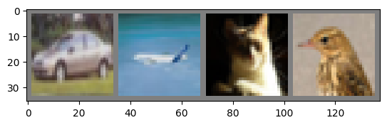
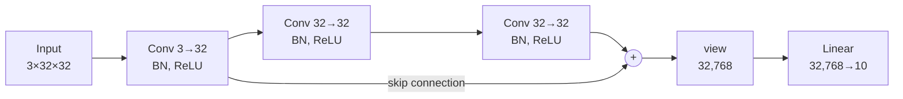

# Lecture 3 Lab — Training a CIFAR-10 Classifier and Implementing a Simple ResNet

[Repository Guide](../../README.md) | [English](Concepts_Lab.md) | [한국어](Concepts_Lab.ko.md)

> **Last Updated:** 2026-11-04

> **Learning Objectives:**
> 1. Build the CIFAR-10 dataset and data loaders with torchvision, and undo the normalization to display images
> 2. Compute the number of parameters of each layer of a convolutional neural network
> 3. Explain what each line of the training and validation loops does, and interpret the printed loss and accuracy
> 4. Run inference on a new image with the same preprocessing as in training, and turn logits into softmax probabilities
> 5. Implement a residual block as an `nn.Module`, and explain why a skip connection adds no parameters

---

## Table of Contents

- [1. Lab Overview](#1-lab-overview)
- [2. The Training Tutorial Notebook](#2-the-training-tutorial-notebook)
  - [2.1 Loading and Normalizing the Data](#21-loading-and-normalizing-the-data)
  - [2.2 Connecting Google Drive](#22-connecting-google-drive)
  - [2.3 Checking the Data](#23-checking-the-data)
  - [2.4 Building the Model](#24-building-the-model)
  - [2.5 Setting the Loss Function and the Optimizer](#25-setting-the-loss-function-and-the-optimizer)
  - [2.6 Training](#26-training)
  - [2.7 Validation](#27-validation)
  - [2.8 Inference on a New Image](#28-inference-on-a-new-image)
  - [2.9 Probabilities with Softmax](#29-probabilities-with-softmax)
- [3. The Simple ResNet Notebook](#3-the-simple-resnet-notebook)
  - [3.1 A Plain Convolutional Model](#31-a-plain-convolutional-model)
  - [3.2 The Residual Block](#32-the-residual-block)
  - [3.3 A Model with a Residual Block](#33-a-model-with-a-residual-block)
  - [3.4 Checking the Behavior](#34-checking-the-behavior)
  - [3.5 Comparing the Plain and Residual Models](#35-comparing-the-plain-and-residual-models)
- [Summary](#summary)
- [Self-Check Questions](#self-check-questions)
- [References](#references)

---

<br>

## 1. Lab Overview

This lab checks Section 1 (the PyTorch implementation flow) and Section 4 (ResNet) of the Lecture 3 lecture note in code. There are two notebooks.

| Notebook | Content | Required data |
|:-----|:-----|:-----|
| [Example_Training-Tutorial.ipynb](Example_Training-Tutorial.ipynb) | Data preparation, model definition, training, validation, and inference on a new image for a CIFAR-10 classifier | CIFAR-10 (downloaded automatically when run), `data/goldenretriever-3724972_640.jpg` |
| [Example_ResNet-Simple.ipynb](Example_ResNet-Simple.ipynb) | Definition of a plain convolutional model and a model with a residual block, and a check of tensor sizes | None (uses a random tensor) |

*Table 1. Content and required data of the Lecture 3 lab notebooks*

Both notebooks were written in Google Colab, and the saved outputs are also from runs in Colab. To run them locally you need PyTorch, torchvision, matplotlib, tqdm, and Pillow, and the folder containing the notebook must be the working folder so that the relative paths `./data` and `data/...` point to this unit's `data/` folder. The cells that connect Google Drive (Section 2.2) work only in Colab, so skip them locally. The saved outputs include values that change from run to run (randomly shuffled mini-batches, random initial weights), so rerunning gives slightly different numbers.

---

<br>

## 2. The Training Tutorial Notebook

### 2.1 Loading and Normalizing the Data

```python
import torch
import torchvision
import torchvision.transforms as transforms

# 데이터 정규화 설정
transform = transforms.Compose(
    [transforms.ToTensor(),
     transforms.Normalize((0.5, 0.5, 0.5), (0.5, 0.5, 0.5))])

# 데이터셋 작성
trainset = torchvision.datasets.CIFAR10(root='./data', train=True,
                                        download=True, transform=transform)
testset = torchvision.datasets.CIFAR10(root='./data', train=False,
                                       download=True, transform=transform)

# 데이터 로더 작성
trainloader = torch.utils.data.DataLoader(trainset, batch_size=4,
                                          shuffle=True)
testloader = torch.utils.data.DataLoader(testset, batch_size=4,
                                         shuffle=False)

classes = ('plane', 'car', 'bird', 'cat',
           'deer', 'dog', 'frog', 'horse', 'ship', 'truck')
```

```text
100%|██████████| 170M/170M [00:02<00:00, 66.9MB/s]
```

- `import torch`, `import torchvision`: import the PyTorch core and the computer vision library. `torchvision.transforms` is used under the short name `transforms`.
- `transforms.Compose([...])`: builds one transformation that applies the listed transformations in order. First `ToTensor()` turns a PIL image (32×32×3, 0-255) into a 3×32×32 floating-point tensor (0-1), and then `Normalize` subtracts 0.5 and divides by 0.5 for each channel, moving the values into the range −1 to 1. A worked example is in Table 3 of Section 1.3 of the lecture note.
- `torchvision.datasets.CIFAR10(...)`: creates the CIFAR-10 dataset object [1]. `root='./data'` is the folder for storing the data, `train=True` means the 50,000 training images, and `train=False` the 10,000 test images. With `download=True`, an archive of about 170 MB is downloaded and extracted if the data is not in the folder. The progress bar in the output is this download. Passing `transform=transform` applies the transformation above every time an image is taken from the dataset.
- `torch.utils.data.DataLoader(...)`: takes four images at a time (`batch_size=4`) from the dataset and groups them into a 4×3×32×32 image tensor and a label tensor of length 4. The training loader shuffles the order every epoch (`shuffle=True`), and the test loader does not.
- `classes`: a tuple that turns the label numbers 0-9 into class names. It follows the label order of CIFAR-10 (airplane, automobile, bird, …, truck), with names shortened to `plane` and `car`.

### 2.2 Connecting Google Drive

```python
from google.colab import drive
drive.mount('/content/drive')
```

```text
Mounted at /content/drive
```

This cell connects the user's Google Drive to the path `/content/drive` in Colab. Once connected, files uploaded to Drive can be read like ordinary files. The same cell appears once more in the inference part (just before the code of Section 2.8). This notebook reads the image used for inference from the relative path `data/goldenretriever-3724972_640.jpg`, so the Drive connection is not needed, and in a local environment without the `google.colab` module these two cells are not run.

### 2.3 Checking the Data

This optional step checks the mini-batches yielded by the data loader as pictures.

```python
import matplotlib.pyplot as plt
import numpy as np

# 이미지 시각화 함수
def imshow(img):
    img = img / 2 + 0.5     # unnormalize
    npimg = img.numpy()
    plt.imshow(np.transpose(npimg, (1, 2, 0)))
    plt.show()


# 학습용 이미지를 무작위로 가져오기
dataiter = iter(trainloader)
images, labels = next(dataiter)

# 이미지 보여주기
imshow(torchvision.utils.make_grid(images))
# 정답(label) 출력
print(' '.join('%5s' % classes[labels[j]] for j in range(4)))
```

```text
  car plane   cat  bird
```

- `img / 2 + 0.5`: undoes the normalization. Since the normalization was $x' = (x - 0.5)/0.5 = 2x - 1$, the values return to the range 0-1 with $x = x'/2 + 0.5$. Without undoing it, negative values make the colors display incorrectly.
- `img.numpy()`: turns the tensor into a NumPy array.
- `np.transpose(npimg, (1, 2, 0))`: changes the axis order from channels×height×width to height×width×channels. PyTorch puts the channels first, but matplotlib's `imshow` takes arrays with the channels last.
- `iter(trainloader)` and `next(dataiter)`: take one mini-batch from the data loader. The training loader shuffles the order, so different images appear on every run.
- `torchvision.utils.make_grid(images)`: joins the four images side by side into one image. It leaves 2 pixels of padding between the images and around the border, so the result is a 3×36×138 tensor (height 32 + 2×2, width 4×32 + 5×2).
- `'%5s' % classes[labels[j]]`: right-aligns the class name in 5 characters. That is why two spaces precede `cat`.



*Figure 1. The four images of one mini-batch taken from the data loader (car, airplane, cat, bird)*

Figure 1 is the saved output; the images are small 32×32 images, so they look blurry. The printed labels `car plane cat bird` match the order in the figure.

### 2.4 Building the Model

```python
import torch.nn as nn
import torch.nn.functional as F


class Model(nn.Module):
    def __init__(self):
        super(Model, self).__init__()
        self.conv1 = nn.Conv2d(3, 6, 5) # in_channels, out_channels, kernel_size
        self.pool = nn.MaxPool2d(2, 2)
        self.conv2 = nn.Conv2d(6, 16, 5)
        self.fc1 = nn.Linear(16 * 5 * 5, 120)
        self.fc2 = nn.Linear(120, 84)
        self.fc3 = nn.Linear(84, 10)

    def forward(self, x):
        x = self.pool(F.relu(self.conv1(x)))
        x = self.pool(F.relu(self.conv2(x)))
        x = x.view(-1, 16 * 5 * 5)
        x = F.relu(self.fc1(x))
        x = F.relu(self.fc2(x))
        x = self.fc3(x)
        return x


model = Model()
```

- `class Model(nn.Module)`: inherits from `nn.Module`, the parent class of every PyTorch model. `super(Model, self).__init__()` initializes the parent class, and it is needed for the parameters of the layers created below to be registered with the model.
- `nn.Conv2d(3, 6, 5)`: a convolutional layer with 3 input channels, 6 output channels, and a 5×5 kernel. The stride is the default 1 and the padding the default 0.
- `nn.MaxPool2d(2, 2)`: a pooling layer that picks the maximum of each 2×2 region and moves 2 positions at a time. It has no trainable parameters, so it is created once and used twice.
- `nn.Linear(16 * 5 * 5, 120)`: a fully connected layer that turns 400 inputs into 120 outputs. 400 is the number of values in the second pooling output 16×5×5 when flattened (Table 5 in Section 1.4 of the lecture note).
- `forward`: repeats convolution, ReLU, and pooling twice and then flattens with `x.view(-1, 16 * 5 * 5)`. The −1 in `view` tells PyTorch to infer that dimension from the remaining ones, so with a mini-batch of 4 the result is 4×400. Then the input passes through three fully connected layers, and the last one, `fc3`, has no activation function, because the output is logits and softmax is computed inside the loss function.
- `F.relu`: the ReLU function from `torch.nn.functional`. Operations without parameters can be called as functions like this, without creating layer objects.

The number of parameters of a layer is the number of weights plus the number of biases. A convolutional layer has (input channels)×(output channels)×(kernel height)×(kernel width) weights, a fully connected layer has (inputs)×(outputs) weights, and there is one bias per output channel (output).

| Layer | Weights | Biases | Total |
|:-----|:-----|:-----|:-----|
| conv1 | 3 × 6 × 5 × 5 = 450 | 6 | 456 |
| conv2 | 6 × 16 × 5 × 5 = 2,400 | 16 | 2,416 |
| fc1 | 400 × 120 = 48,000 | 120 | 48,120 |
| fc2 | 120 × 84 = 10,080 | 84 | 10,164 |
| fc3 | 84 × 10 = 840 | 10 | 850 |
| Total | | | 62,006 |

*Table 2. Number of parameters of each layer of the training tutorial model*

More than 77% of the parameters are in `fc1`. Convolutional layers reuse the same kernel across the whole image and therefore have few parameters, whereas fully connected layers connect every input to every output and therefore have many.

### 2.5 Setting the Loss Function and the Optimizer

```python
import torch.optim as optim

criterion = nn.CrossEntropyLoss()
optimizer = optim.SGD(model.parameters(), lr=0.001, momentum=0.9)
```

- `nn.CrossEntropyLoss()`: the cross-entropy loss that takes logits and label numbers and computes softmax and the negative log-likelihood at once (Section 1.5 of the lecture note). By default the loss of a mini-batch is the mean of the per-sample losses.
- `optim.SGD(model.parameters(), lr=0.001, momentum=0.9)`: creates an optimizer that updates all parameters of the model (the 62,006 of Table 2) by stochastic gradient descent with learning rate 0.001 and momentum 0.9. `model.parameters()` returns all parameters registered in `__init__`.

### 2.6 Training

```python
for epoch in range(1):   # 전체 데이터셋을 여러번 반복하기

    training_loss = 0.0
    model.train()
    for i, data in enumerate(trainloader):
        # 입력 받기: 데이터는 [inputs, labels] 형태의 리스트
        inputs, labels = data

        # 파라미터 변화도(.grad)를 0으로 만들기
        optimizer.zero_grad()

        # 순전파 + 역전파 + 최적화
        outputs = model(inputs)
        loss = criterion(outputs, labels) # 손실을 계산
        loss.backward() # 파라미터들의 에러에 대한 변화도를 계산함
        optimizer.step() # loss function을 효율적으로 최소화 할 수 있게 파라미터 수정

        # 통계 출력
        training_loss += loss.item()
        if i % 2000 == 1999:    # 미니배치 2000개 마다 출력
            print('[%d, %5d] loss: %.3f' %
                  (epoch + 1, i + 1, training_loss / 2000))
            training_loss = 0.0

print('Finished Training')
```

```text
[1,  2000] loss: 2.225
[1,  4000] loss: 1.850
[1,  6000] loss: 1.665
[1,  8000] loss: 1.571
[1, 10000] loss: 1.496
[1, 12000] loss: 1.483
Finished Training
```

- `for epoch in range(1)`: runs only one epoch. Increase this number to raise the accuracy.
- `model.train()`: switches to training mode. This model has no dropout or batch normalization, so it does not affect the result, but it is a habit that keeps the code in the same form as for models that do have such layers.
- `for i, data in enumerate(trainloader)`: takes the mini-batches one at a time. `i` is the mini-batch number from 0 to 12,499, and `data` is the pair of the image tensor and the label tensor.
- `optimizer.zero_grad()`: clears the gradients of the previous iteration. `backward()` accumulates gradients, so they must be cleared first in every iteration.
- `outputs = model(inputs)`: obtains 4×10 logits by the forward pass. Calling the object as in `model(...)` runs `forward` internally.
- `loss = criterion(outputs, labels)`, `loss.backward()`, `optimizer.step()`: compute the loss, fill `.grad` of every parameter by backpropagation, and correct the parameters with those gradients.
- `training_loss += loss.item()`: `item()` turns a tensor with one element into a Python float. Adding the tensor itself would keep accumulating the computation record, so only the number is taken out and added.
- `if i % 2000 == 1999`: at the 2,000th, 4,000th, … mini-batch, prints the average loss of the last 2,000 and resets the sum to 0. One epoch is 12,500 mini-batches, so there are 6 prints up to the 12,000th and the last 500 are not printed.

The average loss decreased from 2.225 to 1.483. It shows that training is progressing from the loss of random guessing, $\ln 10 \approx 2.303$. The decrease keeps getting smaller, only 0.013 between the 10,000th and 12,000th mini-batches, so lowering the loss further requires more epochs of training.

### 2.7 Validation

```python
from tqdm import tqdm

val_loss = 0.0
corrects = 0
model.eval()
for i, data in tqdm(enumerate(testloader)):
    # 입력 받기: 데이터는 [inputs, labels] 형태의 리스트
    inputs, labels = data
    # print(inputs.size)

    # 순전파
    outputs = model(inputs)
    loss = criterion(outputs, labels) # 손실을 계산
    _, preds = torch.max(outputs, 1)  # 라벨을 예측

    # 통계 출력
    val_loss += loss.item()
    corrects += torch.sum(preds == labels.data)

val_loss = val_loss / (i+1)
val_acc = corrects / len(testloader.dataset)
print('val Loss: {:.4f} val Acc: {:.4f}'.format(val_loss, val_acc))
```

```text
2500it [00:10, 249.01it/s]
val Loss: 1.3826 val Acc: 0.5029
```

- `from tqdm import tqdm`: a library that shows a progress bar when it wraps a loop. `2500it` in the output means 2,500 iterations (10,000 images ÷ 4).
- `model.eval()`: switches to evaluation mode.
- `_, preds = torch.max(outputs, 1)`: obtains, for each image of the mini-batch, the class number with the largest logit. The result `preds` is a tensor of length 4.
- `preds == labels.data`: compares predictions and labels element-wise to make a True/False tensor, and `torch.sum` counts the Trues (the number of correct predictions). `labels.data` is a tensor with the same values as `labels`.
- `val_loss / (i+1)`: when the loop ends, `i` is the last number, 2,499, so dividing by `i+1` = 2,500 gives the average loss per mini-batch.
- `corrects / len(testloader.dataset)`: the accuracy, the number of correct predictions divided by the 10,000 test images.

A validation loss of 1.3826 and an accuracy of 0.5029 mean that 5,029 of the 10,000 images were classified correctly. Random choice would give an accuracy of 0.1, so one epoch of training already achieves considerable performance, but half of the images are still wrong.

> **Note:** This cell records the computation even though no gradients are needed. Putting the whole loop inside `with torch.no_grad():` gives the same result with less memory. The problem of using the test data for validation is discussed in the `Caution` box of Section 1.6 of the lecture note.

### 2.8 Inference on a New Image

```python
from PIL import Image

# test 이미지 불러오기
image_file_path = 'data/goldenretriever-3724972_640.jpg'
img_origin = Image.open(image_file_path)  # [높이][너비][색RGB]
print('원본 크기:', np.shape(img_origin))

# 데이터 전처리
img = img_origin.resize((32, 32))
print('resize 크기:', np.shape(img))
input = transform(img)
print('transform 크기:', input.size())
print()

# inference
model.eval()
output = model(input) # 모델에 입력 넣기
print(output)
_, preds = torch.max(output, 1)  # 라벨을 예측
print(classes)

print(preds)
# 결과 시각화
plt.imshow(img_origin)
plt.show()
print('예측 class:', classes[preds[0]])
```

```text
원본 크기: (426, 640, 3)
resize 크기: (32, 32, 3)
transform 크기: torch.Size([3, 32, 32])

tensor([[-1.1642, -4.5498,  1.6623,  2.7455,  2.0443,  4.1119, -1.7750,  3.1851,
         -2.8741, -3.5939]], grad_fn=<AddmmBackward0>)
('plane', 'car', 'bird', 'cat', 'deer', 'dog', 'frog', 'horse', 'ship', 'truck')
tensor([5])
예측 class: dog
```

- `Image.open(image_file_path)`: opens the image file as a PIL image. Viewed with `np.shape`, it is (height, width, channels) = (426, 640, 3).
- `img_origin.resize((32, 32))`: shrinks the image to 32×32 like the training images. PIL's `resize` takes the size in (width, height) order. It ignores the original aspect ratio (640:426) and shrinks the image into a square, so the dog is squeezed horizontally.
- `input = transform(img)`: makes a 3×32×32 tensor with the same transformation as in training. Without the same preprocessing as in training, the model would receive inputs from a distribution it has never seen.
- `output = model(input)`: feeds the 3×32×32 tensor without a batch dimension as it is. PyTorch's `Conv2d` and `MaxPool2d` also treat an input of shape (channels, height, width) without a batch dimension as a single sample [2], and `view(-1, 400)` flattens the 16×5×5 tensor after the second pooling into 1×400, so the output is 1×10. In general it is clearer to make a 1×3×32×32 tensor with `input.unsqueeze(0)` and feed that.
- `grad_fn=<AddmmBackward0>`: indicates that the output was produced by a matrix multiplication with bias addition (`fc3`) and is linked to the computation record of automatic differentiation.
- `torch.max(output, 1)`: returns position 5 of the maximum logit 4.1119 among the 10 logits, and `classes[5]` is `'dog'`. The second-largest logit is `horse` (3.1851) and the third `cat` (2.7455).

> **Note:** The variable name `input` shadows Python's built-in function `input()`. It causes no problem in the notebook, but trying to read keyboard input in the same namespace raises an error, so a name such as `input_tensor` is safer.

### 2.9 Probabilities with Softmax

```python
softmax = nn.Softmax(dim=1)
soft_out = softmax(output)
print(soft_out)

print(torch.sum(soft_out).item())
```

```text
tensor([[1.5964e-03, 3.7347e-04, 3.6052e-02, 4.3075e-01, 5.1477e-03, 4.7230e-01,
         2.3025e-02, 2.5649e-02, 1.8250e-03, 3.2878e-03]],
       grad_fn=<SoftmaxBackward0>)
1.0
```

- `nn.Softmax(dim=1)`: a layer that applies softmax along dimension 1 (the class dimension). It turns each logit into $e^{z_k}$ and divides by their sum, so every value lies between 0 and 1 and the values sum to 1.
- `torch.sum(soft_out).item()`: confirms that the probabilities sum to 1.0.

In the saved output, the largest probability is 0.4723 for `dog`, followed by 0.4308 for `cat`. The model predicted a dog but was almost as confident about a cat. A photo shrunk to 32×32 loses many fine features, and the model was trained for only one epoch, so such an uncertain prediction is natural.

> **Note:** The saved outputs of the cells of Sections 2.8 and 2.9 in the notebook come from different runs. Applying softmax directly to the logits printed by the cell of Section 2.8 gives `dog` 0.534, `horse` 0.211, `cat` 0.136, and so on, which differ from the values of the cell of Section 2.9. Running the two cells again in sequence gives probabilities computed from the same logits. The predicted class (`dog`) is the same in both outputs.

---

<br>

## 3. The Simple ResNet Notebook

### 3.1 A Plain Convolutional Model

First, a plain model without skip connections is defined.

```python
from torch import nn

class Conv(nn.Module):
  def __init__(self):
    super().__init__()
    self.convblock = nn.Sequential(
        nn.Conv2d(3, 32, 3, 1, 1),
        nn.BatchNorm2d(32),
        nn.ReLU(),

        nn.Conv2d(32, 32, 3, 1, 1),
        nn.BatchNorm2d(32),
        nn.ReLU(),

        nn.Conv2d(32, 32, 3, 1, 1),
        nn.BatchNorm2d(32),
        nn.ReLU()
    )

    self.fclayer = nn.Linear(32*32*32, 10)

  def forward(self, x):
    x = self.convblock(x)
    x = x.view(x.size(0), -1)
    out = self.fclayer(x)

    return out
```

- `nn.Sequential(...)`: a container that runs the given layers in order. Instead of calling the layers one by one in `forward`, a single call `self.convblock(x)` passes through all of them.
- `nn.Conv2d(3, 32, 3, 1, 1)`: the arguments are, in order, 3 input channels, 32 output channels, kernel 3, stride 1, and padding 1. The output size is (32 − 3 + 2×1)/1 + 1 = 32, so the height and width are preserved.
- `nn.BatchNorm2d(32)`: a batch normalization layer that normalizes each of the 32 channels with the mean and variance of the mini-batch (Section 5.2 of the lecture note). Each channel has one trainable parameter $\gamma$ and one $\beta$.
- `nn.ReLU()`: the ReLU activation function as a layer object. Inside `nn.Sequential`, layer objects are used instead of functions.
- `nn.Linear(32*32*32, 10)`: turns the 32×32×32 = 32,768 values output by the convolutional block into the logits of 10 classes.
- `x.view(x.size(0), -1)`: keeps the first dimension (the batch size) and flattens the rest into one row. Unlike `view(-1, 400)` in Section 2.4, it states the batch size explicitly, so if the flattened size is miscomputed, the batch size does not change and the next layer raises an error, which makes the mistake easy to find.

### 3.2 The Residual Block

```python
class ResBlock(nn.Module):
  def __init__(self, convblock):
    super().__init__()
    self.convblock = convblock

  def forward(self, x):
    return self.convblock(x) + x  # f(x) + x
```

`ResBlock` is a wrapper that takes any module `convblock` and adds the input `x` to its output. `self.convblock(x)` is $F(x)$ of Section 4.3 of the lecture note, `+ x` is the skip connection, and the return value is $H(x) = F(x) + x$. For the two tensors to be added, the output size of `convblock` must equal the input size.

### 3.3 A Model with a Residual Block

```python
class ResConv(nn.Module):
  def __init__(self):
    super().__init__()
    self.convblock = nn.Sequential(
        nn.Conv2d(3, 32, 3, 1, 1),
        nn.BatchNorm2d(32),
        nn.ReLU(),

        ResBlock(
            nn.Sequential(
                nn.Conv2d(32, 32, 3, 1, 1),
                nn.BatchNorm2d(32),
                nn.ReLU(),

                nn.Conv2d(32, 32, 3, 1, 1),
                nn.BatchNorm2d(32),
                nn.ReLU()
            )
        )
    )

    self.fclayer = nn.Linear(32*32*32, 10)

  def forward(self, x):
    print("input: ", x.shape)
    x = self.convblock(x)
    print("after ResConv: ", x.shape)
    x = x.view(x.size(0), -1)
    print("after view: ", x.shape)
    out = self.fclayer(x)
    print("output: ", out.shape)

    return out
```

`ResConv` uses the same layers as `Conv` in Section 3.1, but wraps the second and third convolution groups in a `ResBlock`. The first convolution changes the channels from 3 to 32, so its input and output sizes differ and it is placed outside the residual block. The two convolutions after it keep 32 channels and the 32×32 size, so the input can be added directly. The `print` calls in `forward` are there to check the tensor size at each stage.



*Figure 2. Architecture of the ResConv model*

### 3.4 Checking the Behavior

```python
import torch

miniResNet = ResConv()
input_x = torch.randn(16, 3, 32, 32) # 32x32 크기의 RGB 이미지를 인풋으로 가정, 16 => batch size
output = miniResNet(input_x)
```

```text
input:  torch.Size([16, 3, 32, 32])
after ResConv:  torch.Size([16, 32, 32, 32])
after view:  torch.Size([16, 32768])
output:  torch.Size([16, 10])
```

- `torch.randn(16, 3, 32, 32)`: imitates a mini-batch of sixteen 32×32 RGB images with random values drawn from the standard normal distribution. The model's input and output sizes can be checked without real data.
- The output shows the input 16×3×32×32 becoming 16×32×32×32 after the convolutional block, 16×32,768 after flattening, and finally 16×10. Since the input has the same size as CIFAR-10 and the output covers 10 classes, replacing the model with `model = ResConv()` in the data loaders and training loop of Section 2 (preferably deleting the `print` lines) trains it as is.

### 3.5 Comparing the Plain and Residual Models

Counting the parameters of the two models layer by layer gives the following.

| Layer | Computation | Parameters |
|:-----|:-----|:-----|
| Convolution 1 (3→32) | 3 × 32 × 3 × 3 + 32 | 896 |
| Convolutions 2, 3 (32→32) | 32 × 32 × 3 × 3 + 32 each | 9,248 each |
| Three batch normalizations | 32 × 2 ($\gamma$, $\beta$) each | 64 each |
| Fully connected | 32,768 × 10 + 10 | 327,690 |
| Total | 896 + 2 × 9,248 + 3 × 64 + 327,690 | 347,274 |

*Table 3. Number of parameters of each layer of the Conv and ResConv models*

`Conv` and `ResConv` have the same number of parameters, 347,274. A skip connection is just one tensor addition and adds no parameters. The only difference between the two models is that the input of the second convolution is added to the output of the third convolution group, and this addition creates the shortcut $\partial H/\partial x = \partial F/\partial x + 1$ for backpropagation.

That a residual block easily represents the identity function can also be checked in code. If all parameters in the block are set to 0, the convolution outputs are 0, the batch normalization outputs are $\beta = 0$, and the ReLU outputs are 0, so $F(x) = 0$ and the block output equals its input.

```python
blk = ResBlock(nn.Sequential(
    nn.Conv2d(32, 32, 3, 1, 1), nn.BatchNorm2d(32), nn.ReLU(),
    nn.Conv2d(32, 32, 3, 1, 1), nn.BatchNorm2d(32), nn.ReLU()))
for p in blk.parameters():
    nn.init.zeros_(p)
blk.eval()
z = torch.randn(2, 32, 8, 8)
print(torch.allclose(blk(z), z))
```

```text
True
```

`nn.init.zeros_` fills a tensor with 0, and `blk.eval()` makes batch normalization use the accumulated statistics instead of mini-batch statistics. `torch.allclose` checks whether all values of two tensors are equal within a tolerance. In a plain block, zero parameters would make the output all 0, passing none of the input through.

> **Note:** The residual block in this notebook differs slightly in order from the basic block of the original ResNet. The basic block of the ResNet paper goes through convolution, batch normalization, ReLU, convolution, and batch normalization, adds the input, and only then applies ReLU [3]. This notebook places the last ReLU before the addition, so $F(x)$ is always nonnegative and the block can only add nonnegative values to its input. The effect of the order of layers around the addition on training was compared in detail in a follow-up study by He et al. [4].

---

<br>

## Summary

| Concept | Key Summary |
|:-----|:-----|
| Data preparation | `CIFAR10` and `DataLoader` split the 50,000 training images into 12,500 mini-batches of 4, and `ToTensor` and `Normalize` produce 3×32×32 tensors in the range −1 to 1. |
| Checking the data | The normalization must be undone with `img / 2 + 0.5` and the channel axis moved to the end with `np.transpose` for matplotlib to display the images correctly. |
| Model | The model with 2 convolutional and 3 fully connected layers has 62,006 parameters, 48,120 of them in `fc1`. |
| Training loop | It repeats zero_grad, the forward pass, the loss, backward, and step, and the average loss fell from 2.225 to 1.483 during one epoch. |
| Validation | In eval mode, `torch.max` gives the predictions and the correct ones are counted; the model trained for one epoch reached an accuracy of about 0.50. |
| Inference and softmax | A new image is shrunk to 32×32 and given the same transformation before inference, and softmax turns logits into probabilities that sum to 1. |
| Residual block | It is implemented as `self.convblock(x) + x`, and the input and output must have the same size to be added. |
| Parameter comparison | Conv and ResConv both have 347,274 parameters; a skip connection creates a shortcut for the gradient without parameters. |

---

<br>

## Self-Check Questions

1. **Undoing normalization:** Compute the value obtained by undoing the normalized value −0.6 with `img / 2 + 0.5`, and the original pixel value (0-255).

   <details>
   <summary>Answer</summary>

   −0.6/2 + 0.5 = 0.2, and 0.2 × 255 = 51.

   </details>

2. **Number of mini-batches:** If the 50,000 training images are split with `batch_size=8`, how many mini-batches are there in one epoch, and how many times is the loss printed when it is printed every 2,000 mini-batches?

   <details>
   <summary>Answer</summary>

   50,000/8 = 6,250. The loss is printed 3 times, at the 2,000th, 4,000th, and 6,000th mini-batches, and the last 250 are not printed.

   </details>

3. **Number of parameters:** Compute the number of parameters of `nn.Conv2d(6, 16, 5)` and of `nn.Linear(120, 84)`.

   <details>
   <summary>Answer</summary>

   The convolution has 6 × 16 × 5 × 5 + 16 = 2,416, and the fully connected layer has 120 × 84 + 84 = 10,164.

   </details>

4. **`loss.item()`:** Why does the training loop add `loss.item()` instead of writing `training_loss += loss`?

   <details>
   <summary>Answer</summary>

   `loss` is a tensor linked to the computation record, so adding it directly would chain the records across iterations and keep increasing memory use. `item()` takes out only the value as a Python float, so this problem does not occur.

   </details>

5. **Interpreting accuracy:** When the validation output is `val Acc: 0.5029`, compare the number of correctly classified images with the expected accuracy of a model that picks classes at random.

   <details>
   <summary>Answer</summary>

   0.5029 × 10,000 = 5,029 images were classified correctly. With 10 classes, random choice gives an expected accuracy of 0.1 (1,000 images), so one epoch of training already gives about 5 times higher accuracy.

   </details>

6. **Preprocessing for inference:** What problem occurs if a new image is fed with its 0-255 values unchanged, without applying `transform`?

   <details>
   <summary>Answer</summary>

   The model was trained on inputs in the range −1 to 1, so values hundreds of times larger form inputs from an entirely different distribution than in training, and the prediction cannot be trusted. In addition, the conversion into a channels×height×width tensor done by `ToTensor` does not take place, so the image cannot be fed to the model.

   </details>

7. **Condition of the residual block:** What happens if the first `nn.Conv2d(3, 32, 3, 1, 1)` of `ResConv` is also put inside the `ResBlock`?

   <details>
   <summary>Answer</summary>

   The block input has 3 channels and the convolution output has 32 channels, so the two tensors in `self.convblock(x) + x` do not match in size and the addition raises an error. When the sizes differ, the number of channels of the input must be matched by a projection such as a 1×1 convolution before adding.

   </details>

8. **Skip connections and parameters:** Explain why `Conv` and `ResConv` have the same number of parameters.

   <details>
   <summary>Answer</summary>

   The two models use the same convolutional, batch normalization, and fully connected layers, and `ResConv` only adds an operation that adds the input. Tensor addition has no trainable parameters, so both models have 347,274.

   </details>

---

<br>

## References

1. A. Krizhevsky, "Learning Multiple Layers of Features from Tiny Images," Tech. Rep., University of Toronto, 2009.
2. PyTorch Contributors, "Conv2d," *PyTorch Documentation*, accessed Nov. 4, 2026. https://pytorch.org/docs/stable/generated/torch.nn.Conv2d.html
3. K. He, X. Zhang, S. Ren, and J. Sun, "Deep Residual Learning for Image Recognition," in *Proc. IEEE Conf. Computer Vision and Pattern Recognition (CVPR)*, pp. 770-778, 2016.
4. K. He, X. Zhang, S. Ren, and J. Sun, "Identity Mappings in Deep Residual Networks," in *Proc. European Conf. Computer Vision (ECCV)*, pp. 630-645, 2016.
