# 3강 — 영상처리 1

[레포지토리 안내](../../README.ko.md) | [English](Concepts_Lecture.md) | [한국어](Concepts_Lecture.ko.md)

> **최종 수정일:** 2026-11-04

> **학습 목표:**
> 1. PyTorch로 딥러닝 모델을 구현하는 아홉 단계의 흐름을 설명하고, 각 단계에서 쓰는 데이터셋, 데이터 로더, 모델, 손실 함수, 옵티마이저의 역할을 구분할 수 있다
> 2. ToTensor와 Normalize가 픽셀 값을 어떻게 바꾸는지 계산하고, 입력 정규화가 필요한 이유를 설명할 수 있다
> 3. 이미지 분류, 객체 탐지, 분할, OCR, 초해상도, 이미지 생성 태스크의 입력과 출력을 구분할 수 있다
> 4. ImageNet 대회의 흐름 속에서 VGGNet과 ResNet이 네트워크의 깊이를 어떻게 다루었는지 설명할 수 있다
> 5. 기울기 소실과 폭주의 원인을 연쇄 법칙으로 설명하고, 배치 정규화, 활성화 함수, 기울기 클리핑, 스킵 연결이 이를 완화하는 원리를 설명할 수 있다
> 6. 전이 학습의 개념을 설명할 수 있다

---

## 목차

- [1. PyTorch를 이용한 딥러닝 구현 흐름](#1-pytorch를-이용한-딥러닝-구현-흐름)
  - [1.1 아홉 단계의 개요](#11-아홉-단계의-개요)
  - [1.2 전처리, 후처리, 네트워크 모델의 입출력 확인](#12-전처리-후처리-네트워크-모델의-입출력-확인)
  - [1.3 데이터셋과 데이터 로더 작성](#13-데이터셋과-데이터-로더-작성)
  - [1.4 네트워크 모델 작성과 순전파 정의](#14-네트워크-모델-작성과-순전파-정의)
  - [1.5 손실 함수 정의와 최적화 기법 설정](#15-손실-함수-정의와-최적화-기법-설정)
  - [1.6 학습과 검증](#16-학습과-검증)
  - [1.7 테스트 데이터로 추론](#17-테스트-데이터로-추론)
- [2. 영상처리 응용](#2-영상처리-응용)
  - [2.1 영상 데이터로 할 수 있는 태스크](#21-영상-데이터로-할-수-있는-태스크)
  - [2.2 이미지 분류와 객체 탐지](#22-이미지-분류와-객체-탐지)
  - [2.3 분할](#23-분할)
  - [2.4 OCR, 초해상도, 이미지 생성](#24-ocr-초해상도-이미지-생성)
  - [2.5 실제 적용 사례](#25-실제-적용-사례)
  - [2.6 ImageNet 이미지 분류 대회](#26-imagenet-이미지-분류-대회)
- [3. VGGNet](#3-vggnet)
  - [3.1 깊이의 영향을 확인하기 위한 설계](#31-깊이의-영향을-확인하기-위한-설계)
  - [3.2 VGG-16의 구조](#32-vgg-16의-구조)
  - [3.3 여섯 가지 구성](#33-여섯-가지-구성)
- [4. ResNet](#4-resnet)
  - [4.1 깊게 쌓을수록 좋아지는가: 성능 저하 문제](#41-깊게-쌓을수록-좋아지는가-성능-저하-문제)
  - [4.2 깊은 네트워크와 기울기 소실](#42-깊은-네트워크와-기울기-소실)
  - [4.3 잔차 블록](#43-잔차-블록)
  - [4.4 34층 ResNet의 구조](#44-34층-resnet의-구조)
- [5. 기울기 소실과 기울기 폭주](#5-기울기-소실과-기울기-폭주)
  - [5.1 정의와 원인](#51-정의와-원인)
  - [5.2 해결책 1: 배치 정규화](#52-해결책-1-배치-정규화)
  - [5.3 해결책 2: 다양한 활성화 함수](#53-해결책-2-다양한-활성화-함수)
  - [5.4 해결책 3: 기울기 클리핑](#54-해결책-3-기울기-클리핑)
- [6. 전이 학습](#6-전이-학습)
- [요약](#요약)
- [점검 문제](#점검-문제)
- [참고 문헌](#참고-문헌)

---

<br>

## 1. PyTorch를 이용한 딥러닝 구현 흐름

### 1.1 아홉 단계의 개요

**PyTorch**는 Python에서 신경망을 정의하고 학습시키는 딥러닝 프레임워크이다. PyTorch로 이미지 분류 모델을 만드는 작업은 보통 다음 아홉 단계로 나눌 수 있다. 2강에서 이 흐름을 처음 소개했으며, 이 절에서는 각 단계를 실제 코드와 함께 자세히 살펴본다.

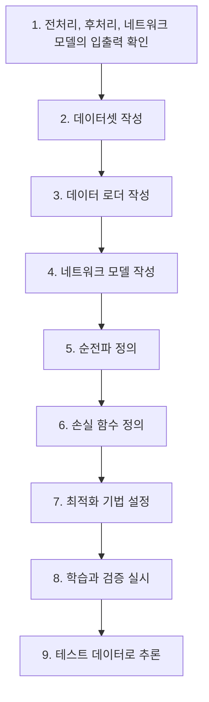

*그림 1. PyTorch를 이용한 딥러닝 구현의 아홉 단계*

아홉 단계는 신경망 학습의 세 동작과 대응한다. 신경망은 입력에서 출력까지 값을 계산하고(**전방 계산**), 예측값과 정답(기댓값)을 비교해 오차를 구하며(**오차 계산**), 오차를 줄이는 방향으로 출력층부터 입력층 쪽으로 가중치를 고친다(**후방 가중치 갱신**). 4, 5단계는 전방 계산을, 6단계는 오차 계산을, 7단계는 가중치 갱신의 규칙을 정하고, 8단계에서 이 세 동작을 반복한다.

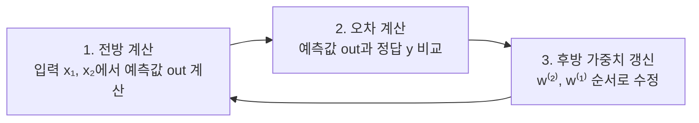

*그림 2. 신경망 학습에서 반복되는 전방 계산, 오차 계산, 후방 가중치 갱신*

그림 2의 w⁽¹⁾은 입력층과 은닉층 사이의 가중치, w⁽²⁾는 은닉층과 출력층 사이의 가중치이다. 오차를 각 가중치로 미분한 값(기울기)은 출력층에 가까운 w⁽²⁾부터 계산되므로 갱신도 뒤에서 앞으로 진행된다. 이 계산 방법이 1강에서 다룬 오류 역전파이다.

### 1.2 전처리, 후처리, 네트워크 모델의 입출력 확인

코드를 쓰기 전에 모델에 무엇을 넣고 무엇을 받을지 정한다. 이미지 분류에서 **입력**은 이미지이고 **출력**은 클래스마다 하나씩 나오는 점수이다. 이미지를 모델이 받을 수 있는 형태(크기, 값의 범위)로 바꾸는 과정을 **전처리(preprocessing)**, 모델의 출력 점수를 확률이나 클래스 이름으로 바꾸는 과정을 **후처리(postprocessing)** 라 한다.

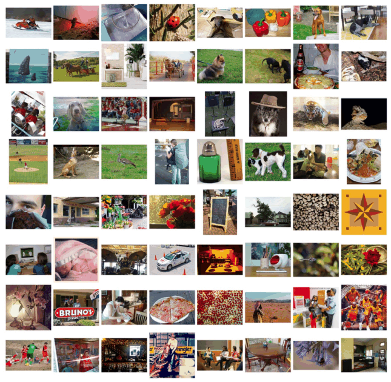

*그림 3. 다양한 범주의 사물과 장면을 담은 자연 이미지 입력의 예*

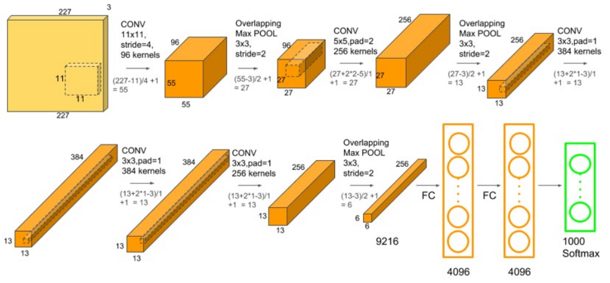

*그림 4. 227×227×3 입력에서 1000개 클래스의 softmax 출력까지 이어지는 AlexNet의 구조*

그림 4는 2강에서 다룬 AlexNet이다. 입력 크기가 정해져 있으므로 전처리에서 이미지를 227×227로 맞추어야 하고, 출력은 1000개 클래스의 점수이므로 후처리에서 가장 큰 점수의 위치를 클래스 이름으로 바꾸어야 한다. 합성곱 층과 풀링 층을 지날 때의 출력 크기는 입력 크기 $W$, 커널 크기 $K$, 패딩 $P$, 스트라이드 $S$로 계산한다.

$$
O = \left\lfloor \frac{W - K + 2P}{S} \right\rfloor + 1
$$

| 층 | 설정 | 출력 크기 계산 | 출력 |
|:-----|:-----|:-----|:-----|
| 입력 | | | 227×227×3 |
| 합성곱 1 | 11×11, 스트라이드 4, 커널 96개 | (227 − 11)/4 + 1 = 55 | 55×55×96 |
| 최대 풀링 1 | 3×3, 스트라이드 2 (겹치는 풀링) | (55 − 3)/2 + 1 = 27 | 27×27×96 |
| 합성곱 2 | 5×5, 패딩 2, 커널 256개 | (27 + 2×2 − 5)/1 + 1 = 27 | 27×27×256 |
| 최대 풀링 2 | 3×3, 스트라이드 2 | (27 − 3)/2 + 1 = 13 | 13×13×256 |
| 합성곱 3 | 3×3, 패딩 1, 커널 384개 | (13 + 2×1 − 3)/1 + 1 = 13 | 13×13×384 |
| 합성곱 4 | 3×3, 패딩 1, 커널 384개 | 13 | 13×13×384 |
| 합성곱 5 | 3×3, 패딩 1, 커널 256개 | 13 | 13×13×256 |
| 최대 풀링 3 | 3×3, 스트라이드 2 | (13 − 3)/2 + 1 = 6 | 6×6×256 = 9216 |
| 완전 연결 1, 2 | 뉴런 4096개씩 | | 4096 |
| 출력 | 완전 연결과 softmax | | 1000 |

*표 1. AlexNet의 층별 출력 크기 계산*

표의 2×2는 패딩 2를 양쪽에 더한 값이다. 마지막 풀링의 출력 6×6×256 = 9216개 값을 한 줄로 펼쳐야 완전 연결 층에 넣을 수 있다. 이처럼 층마다 입력과 출력의 크기를 미리 계산해 두면 모델 코드에서 크기가 맞지 않는 오류를 피할 수 있다.

### 1.3 데이터셋과 데이터 로더 작성

**데이터셋(dataset)** 은 입력과 정답의 쌍을 번호로 하나씩 꺼낼 수 있게 묶은 객체이고, **데이터 로더(data loader)** 는 데이터셋에서 정해진 개수만큼 표본을 꺼내 미니배치로 묶어 주는 객체이다.

**torchvision.** torchvision은 PyTorch와 함께 쓰는 컴퓨터 비전 라이브러리로, 이미지 분류, 객체 탐지, 비디오 분석 같은 태스크에 필요한 데이터셋(`torchvision.datasets`), 모델 구조와 사전 학습 가중치(`torchvision.models`), 이미지 변환 함수(`torchvision.transforms`)를 제공한다. PyTorch 생태계의 핵심 구성 요소이며, 연구자와 개발자가 비전 프로젝트를 쉽게 시작하고 실험하고 배포할 수 있도록 설계되었다.

**텐서.** **텐서(tensor)** 는 다차원 배열을 뜻하는 수학적 객체로, 스칼라, 벡터, 행렬을 일반화한 것이다. 딥러닝에서 입력 데이터, 모델의 가중치, 출력은 모두 텐서로 표현되고, 학습은 텐서 연산의 연속이다. PyTorch의 자료형 `Tensor`는 NumPy 배열과 비슷한 배열 계산 기능에 더해 GPU 연산과 **자동 미분(automatic differentiation)** 을 지원한다. 자동 미분은 연산 과정을 기록해 두었다가 손실의 기울기를 자동으로 계산해 주는 기능이다.

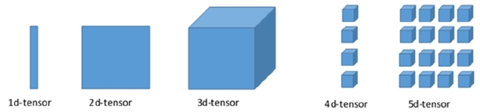

*그림 5. 1차원부터 5차원까지 텐서의 모양*

| 차원 | 이름 | 영상 데이터에서의 예 |
|:-----|:-----|:-----|
| 0 | 스칼라 | 손실 값 하나 |
| 1 | 벡터 | 클래스 10개의 점수 |
| 2 | 행렬 | 흑백 이미지 한 장 (높이×너비) |
| 3 | 3차원 텐서 | 컬러 이미지 한 장 (채널×높이×너비) |
| 4 | 4차원 텐서 | 컬러 이미지 미니배치 (배치×채널×높이×너비) |
| 5 | 5차원 텐서 | 동영상 미니배치 (배치×프레임×채널×높이×너비) |

*표 2. 텐서의 차원과 영상 데이터에서의 예*

**ToTensor.** PyTorch 모델은 텐서를 입력으로 받는다. `transforms.ToTensor()`는 PIL 이미지나 NumPy 배열(높이×너비×채널, 0\~255의 정수)을 채널×높이×너비 순서의 실수 텐서로 바꾸고, 값을 255로 나누어 0\~1 범위로 만든다.

**Normalize.** `transforms.Normalize(mean, std)`는 채널 $c$마다 평균 $m_c$를 빼고 표준 편차 $s_c$로 나눈다. `mean`과 `std`에는 채널 수만큼의 값을 시퀀스로 준다. 컬러 이미지는 채널이 3개이므로 `(0.5, 0.5, 0.5)`처럼 값이 3개이다.

$$
x' = \frac{x - m_c}{s_c}
$$

평균과 표준 편차를 모두 0.5로 주면 0\~1 범위의 값이 −1\~1 범위로 옮겨진다. 픽셀 값 0, 128, 255를 따라가면 다음과 같다.

| 원래 픽셀 값 | ToTensor 후 ($x$ = 값/255) | Normalize 후 ($x'$ = ($x$ − 0.5)/0.5) |
|:-----|:-----|:-----|
| 0 | 0.0 | −1.0 |
| 128 | 0.502 | 0.004 |
| 255 | 1.0 | 1.0 |

*표 3. ToTensor와 Normalize((0.5, 0.5, 0.5), (0.5, 0.5, 0.5))를 거친 픽셀 값의 변화*

0.5는 계산을 단순하게 하려고 고른 값이다. 정확하게 하려면 학습 데이터에서 채널별(또는 픽셀별) 평균과 표준 편차를 구해 쓴다. 예를 들어 CIFAR-10 학습 데이터의 채널별 평균은 약 (0.491, 0.482, 0.447), 표준 편차는 약 (0.247, 0.243, 0.262)이고, ImageNet으로 학습한 모델에는 평균 (0.485, 0.456, 0.406), 표준 편차 (0.229, 0.224, 0.225)를 쓰는 것이 관례이다(1강 실습).

**입력 정규화가 필요한 이유.** 입력 특성마다 값의 범위가 다르면 모델의 성능이 떨어질 수 있다. 두 학생의 점수를 예로 든다.

| | 영어 점수 (100점 만점) | 토익 점수 (990점 만점) |
|:-----|:-----|:-----|
| 학생 A | 50 | 900 |
| 학생 B | 100 | 700 |

*표 4. 범위가 다른 두 특성의 예*

두 점수를 그대로 쓰면 토익 점수의 차이(200점)가 영어 점수의 차이(50점)보다 크게 보이지만, 만점으로 나누면 영어는 0.5와 1.0으로 0.5만큼, 토익은 약 0.909와 0.707로 약 0.2만큼 차이 난다. 값의 크기가 특성의 중요도를 왜곡하는 것이다.

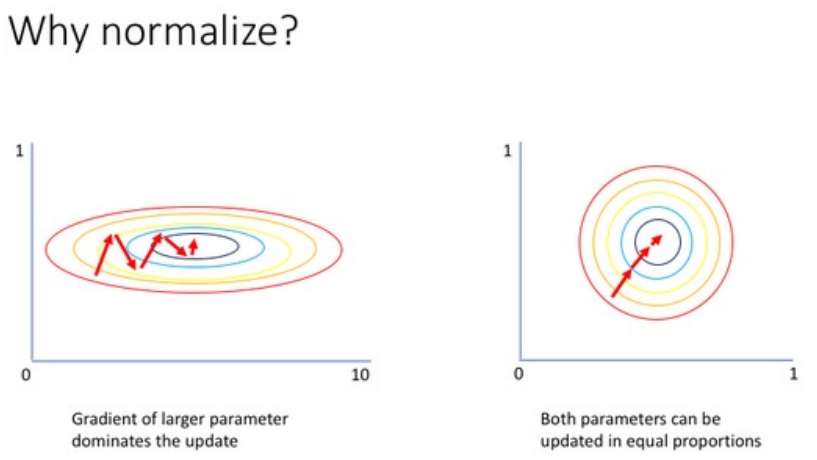

*그림 6. 범위가 다른 두 파라미터의 손실 등고선(왼쪽)과 정규화 후의 등고선(오른쪽)*

그림 6의 왼쪽처럼 한 파라미터의 범위가 0\~10이고 다른 하나가 0\~1이면 손실 함수의 등고선이 길쭉한 타원이 된다. 범위가 큰 파라미터의 기울기가 갱신을 지배해 경사하강법이 지그재그로 움직이며 최솟값에 느리게 다가간다. 오른쪽처럼 두 범위를 0\~1로 맞추면 등고선이 원에 가까워지고, 두 파라미터가 같은 비율로 갱신되어 최솟값을 향해 곧게 나아간다.

**코드.** CIFAR-10 데이터셋을 불러와 데이터 로더를 만드는 코드는 다음과 같다. **CIFAR-10**은 32×32 크기의 컬러 이미지 60,000장을 비행기, 자동차, 새, 고양이, 사슴, 개, 개구리, 말, 배, 트럭의 10개 클래스(클래스마다 6,000장)로 나눈 데이터셋으로, 50,000장은 학습용, 10,000장은 테스트용이다 [1].

```python
import torch
import torchvision
import torchvision.transforms as transforms

# 데이터 정규화 설정
transform = transforms.Compose(
    [transforms.ToTensor(),
     transforms.Normalize((0.5, 0.5, 0.5), (0.5, 0.5, 0.5))])

# 데이터셋 작성
trainset = torchvision.datasets.CIFAR10(root='./data', train=True,
                                        download=True, transform=transform)
testset = torchvision.datasets.CIFAR10(root='./data', train=False,
                                       download=True, transform=transform)

# 데이터 로더 작성
trainloader = torch.utils.data.DataLoader(trainset, batch_size=4,
                                          shuffle=True)
testloader = torch.utils.data.DataLoader(testset, batch_size=4,
                                         shuffle=False)

classes = ('plane', 'car', 'bird', 'cat',
           'deer', 'dog', 'frog', 'horse', 'ship', 'truck')
```

`transforms.Compose`는 여러 변환을 순서대로 적용하는 하나의 변환으로 묶는다. `CIFAR10`의 `train=True`는 학습용 50,000장, `train=False`는 테스트용 10,000장을 고르며, `download=True`이면 `root` 폴더에 데이터가 없을 때 내려받는다. 데이터 로더는 `batch_size=4`이므로 이미지 4장을 4×3×32×32 텐서 하나로 묶고, 한 에포크에 학습용은 50,000/4 = 12,500번, 테스트용은 10,000/4 = 2,500번 미니배치를 내놓는다. `shuffle=True`는 에포크마다 학습 데이터의 순서를 섞어 모델이 순서에 맞춰 학습하는 것을 막고, 평가에는 순서가 상관없으므로 테스트 로더는 섞지 않는다. 줄 단위 설명은 [실습 노트](Concepts_Lab.ko.md)에 있다.

### 1.4 네트워크 모델 작성과 순전파 정의

PyTorch에서 모델은 `nn.Module`을 상속한 클래스로 만든다. `__init__`에서 학습할 파라미터를 가진 층을 만들고(4단계), `forward`에서 입력이 층을 지나는 순서를 정한다(5단계). 순전파를 정의하면 역전파는 자동 미분이 대신 계산한다.

```python
import torch.nn as nn
import torch.nn.functional as F


class Model(nn.Module):
    def __init__(self):
        super(Model, self).__init__()
        self.conv1 = nn.Conv2d(3, 6, 5) # in_channels, out_channels, kernel_size
        self.pool = nn.MaxPool2d(2, 2)
        self.conv2 = nn.Conv2d(6, 16, 5)
        self.fc1 = nn.Linear(16 * 5 * 5, 120)
        self.fc2 = nn.Linear(120, 84)
        self.fc3 = nn.Linear(84, 10)

    def forward(self, x):
        x = self.pool(F.relu(self.conv1(x)))
        x = self.pool(F.relu(self.conv2(x)))
        x = x.view(-1, 16 * 5 * 5)
        x = F.relu(self.fc1(x))
        x = F.relu(self.fc2(x))
        x = self.fc3(x)
        return x


model = Model()
```

`nn.Conv2d(3, 6, 5)`는 입력 채널 3개를 받아 5×5 커널 6개로 합성곱하는 층이고, `nn.MaxPool2d(2, 2)`는 2×2 영역에서 최댓값을 고르며 스트라이드 2로 이동해 높이와 너비를 절반으로 줄인다. 미니배치 하나(이미지 4장)가 모델을 지날 때 텐서 크기는 다음과 같이 바뀐다.

| 단계 | 연산 | 출력 크기 (배치×채널×높이×너비) |
|:-----|:-----|:-----|
| 입력 | | 4×3×32×32 |
| conv1과 ReLU | 5×5 합성곱, (32 − 5)/1 + 1 = 28 | 4×6×28×28 |
| pool | 2×2 최대 풀링 | 4×6×14×14 |
| conv2와 ReLU | 5×5 합성곱, (14 − 5)/1 + 1 = 10 | 4×16×10×10 |
| pool | 2×2 최대 풀링 | 4×16×5×5 |
| view | 한 줄로 펼침 (16×5×5 = 400) | 4×400 |
| fc1과 ReLU | 400 → 120 | 4×120 |
| fc2와 ReLU | 120 → 84 | 4×84 |
| fc3 | 84 → 10 | 4×10 |

*표 5. 미니배치가 모델을 지날 때의 텐서 크기 변화*

`fc1`의 입력 크기 `16 * 5 * 5`는 표 5의 계산에서 나온 값이다. 1.2절에서 입출력 크기를 미리 확인하는 이유가 여기에 있다. 마지막 출력 10개는 클래스별 점수이며, 아직 확률로 바꾸지 않은 이 값을 **로짓(logit)** 이라 한다.

### 1.5 손실 함수 정의와 최적화 기법 설정

```python
import torch.optim as optim

criterion = nn.CrossEntropyLoss()
optimizer = optim.SGD(model.parameters(), lr=0.001, momentum=0.9)
```

PyTorch는 손실 함수와 층을 `torch.nn`에, 최적화 기법을 `torch.optim`에 제공하며, 잘 쓰이지 않는 일부를 빼면 널리 쓰이는 옵티마이저(SGD, Adam, RMSprop 등)를 대부분 갖추고 있다.

**교차 엔트로피 손실.** `nn.CrossEntropyLoss`는 로짓 $z_1, \dots, z_K$에 softmax를 적용해 확률로 바꾸고, 정답 클래스 $y$의 확률에 음의 로그를 취한다.

$$
p_k = \frac{e^{z_k}}{\sum_{j=1}^{K} e^{z_j}}, \qquad L = -\log p_y = -z_y + \log \sum_{j=1}^{K} e^{z_j}
$$

정답 클래스의 확률이 1에 가까우면 손실은 0에 가깝고, 확률이 작을수록 손실이 커진다. 예를 들어 정답 확률이 0.534이면 $L = -\ln 0.534 \approx 0.627$이다. 클래스가 10개인 문제에서 모든 클래스에 같은 확률 0.1을 주는 모델의 손실은 $-\ln 0.1 = \ln 10 \approx 2.303$이므로, 학습 초기의 손실은 이 값 근처에서 시작한다.

**모멘텀 SGD.** `optim.SGD`는 확률적 경사하강법(stochastic gradient descent)으로, 미니배치에서 구한 기울기 $g_t$로 파라미터 $\theta$를 고친다. `lr`은 **학습률(learning rate)** $\eta$, `momentum`은 모멘텀 계수 $\mu$이다. PyTorch의 모멘텀 SGD는 다음과 같이 이전 갱신 방향 $v$를 누적한다 [2].

$$
v_t = \mu v_{t-1} + g_t, \qquad \theta_t = \theta_{t-1} - \eta v_t
$$

$\mu = 0.9$이면 이전 방향을 90% 유지하면서 새 기울기를 더하므로, 기울기 방향이 계속 같은 축으로는 속도가 붙고 방향이 번갈아 바뀌는 축(그림 6의 지그재그)에서는 서로 상쇄된다.

### 1.6 학습과 검증

**학습.** 학습 루프는 두 겹의 `for` 문이다. 바깥쪽은 전체 데이터셋을 몇 번 반복할지 정하는 **에포크(epoch)** 단위 반복이고, 안쪽은 데이터 로더가 내놓는 미니배치 단위 반복이다.

```python
for epoch in range(1):   # 전체 데이터셋을 여러번 반복하기

    training_loss = 0.0
    model.train()
    for i, data in enumerate(trainloader):
        # 입력 받기: 데이터는 [inputs, labels] 형태의 리스트
        inputs, labels = data

        # 파라미터 변화도(.grad)를 0으로 만들기
        optimizer.zero_grad()

        # 순전파 + 역전파 + 최적화
        outputs = model(inputs)
        loss = criterion(outputs, labels) # 손실을 계산
        loss.backward() # 파라미터들의 에러에 대한 변화도를 계산함
        optimizer.step() # loss function을 효율적으로 최소화 할 수 있게 파라미터 수정

        # 통계 출력
        training_loss += loss.item()
        if i % 2000 == 1999:    # 미니배치 2000개 마다 출력
            print('[%d, %5d] loss: %.3f' %
                  (epoch + 1, i + 1, training_loss / 2000))
            training_loss = 0.0

print('Finished Training')
```

미니배치마다 네 가지 일이 일어난다. `optimizer.zero_grad()`는 이전 미니배치에서 계산한 기울기를 0으로 지운다. PyTorch는 `backward()`를 호출할 때마다 기울기를 `.grad`에 더해 누적하므로, 지우지 않으면 이전 미니배치의 기울기가 섞인다. `model(inputs)`는 순전파, `criterion(...)`은 손실 계산, `loss.backward()`는 역전파로 모든 파라미터의 기울기를 구하고, `optimizer.step()`은 1.5절의 규칙으로 파라미터를 고친다. 여기서는 시연을 위해 `range(1)`로 한 에포크만 돌리지만, 실제로는 보통 수십에서 수백 에포크를 반복한다.

출력은 미니배치 2,000개의 평균 손실이다. 한 실행에서 손실은 처음 2,000개 미니배치의 평균 2.225에서 마지막으로 출력된 10,001\~12,000번째 미니배치의 평균 1.483으로 줄었다. 첫 값이 2.303(무작위 추측의 손실)보다 약간 작은 것은 처음 2,000번 안에서 이미 학습이 시작되었기 때문이다.

**검증.** **검증(validation)** 은 학습에 쓰지 않은 데이터로 모델의 성능을 재는 과정이다. 가중치를 고치지 않으므로 순전파와 손실 계산만 한다.

```python
from tqdm import tqdm

val_loss = 0.0
corrects = 0
model.eval()
for i, data in tqdm(enumerate(testloader)):
    # 입력 받기: 데이터는 [inputs, labels] 형태의 리스트
    inputs, labels = data

    # 순전파
    outputs = model(inputs)
    loss = criterion(outputs, labels) # 손실을 계산
    _, preds = torch.max(outputs, 1)  # 라벨을 예측

    # 통계 출력
    val_loss += loss.item()
    corrects += torch.sum(preds == labels.data)

val_loss = val_loss / (i+1)
val_acc = corrects / len(testloader.dataset)
print('val Loss: {:.4f} val Acc: {:.4f}'.format(val_loss, val_acc))
```

`model.eval()`은 모델을 평가 모드로 바꾼다. dropout이나 배치 정규화(5.2절)처럼 학습과 평가에서 다르게 동작하는 층이 있을 때 반드시 필요하다. `torch.max(outputs, 1)`은 1번 차원(클래스 차원)을 따라 최댓값과 그 위치를 함께 돌려준다. 예를 들어 4×4 텐서 `a`의 행이 [−1.2360, 0.2942, −0.1222, 0.8475], [1.1949, −1.1127, −2.2379, −0.6702], [1.5717, −0.9207, 0.1297, −1.8768], [−0.6172, 1.0036, −0.6060, −0.2432]이면 `torch.max(a, 1)`은 값 [0.8475, 1.1949, 1.5717, 1.0036]과 위치 [3, 0, 0, 1]을 돌려준다. 분류에서는 위치가 예측 클래스이므로 값은 `_`로 버리고 위치만 `preds`에 받는다. 맞힌 개수를 전체 10,000장으로 나눈 값이 정확도이며, 한 에포크만 학습한 이 모델의 검증 정확도는 실행에 따라 50% 안팎이다.

> **주의:** 이 코드는 테스트 데이터를 검증에 쓴다. 엄밀하게는 학습 데이터 일부를 떼어 검증 데이터로 쓰고, 모델과 하이퍼파라미터를 고른 뒤 마지막에 한 번만 테스트 데이터로 평가해야 한다. 테스트 데이터를 보며 모델을 고르면 테스트 성능이 실제보다 좋게 측정된다. 또한 평가 루프를 `with torch.no_grad():` 안에 넣으면 기울기 계산을 위한 기록을 하지 않아 메모리와 시간이 절약된다.

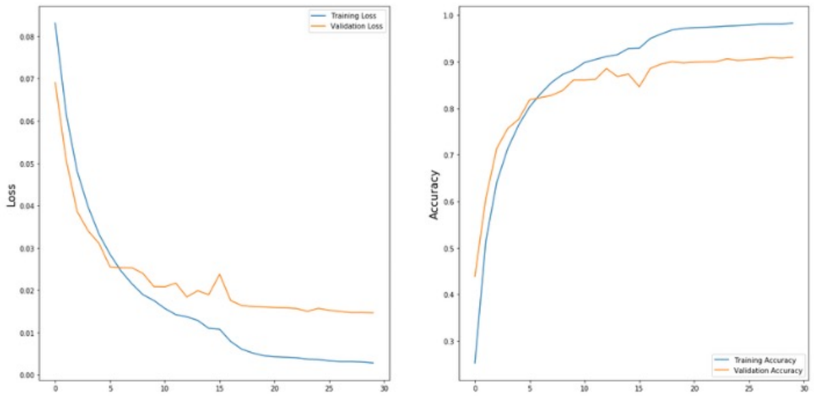

*그림 7. 에포크에 따른 학습 손실과 검증 손실(왼쪽), 학습 정확도와 검증 정확도(오른쪽)*

그림 7은 약 30 에포크 동안 학습 곡선(learning curve)을 그린 예이다. 학습 손실은 계속 줄어 0에 가까워지지만 검증 손실은 5 에포크 무렵부터 오르내리며 느리게 줄다가 17 에포크 무렵부터 약 0.015에서 거의 줄지 않으며, 학습 정확도는 약 0.98, 검증 정확도는 약 0.9에서 멈춘다. 모델은 학습 데이터에 맞추어 파라미터를 고치므로 보통 학습 데이터에서 손실이 더 낮고 정확도가 더 높다. 두 곡선의 간격이 계속 벌어지면 과적합을 의심한다.

### 1.7 테스트 데이터로 추론

**추론(inference)** 은 학습으로 만든 모델을 새로운 입력에 적용해 결과를 내는 단계이다. 새 이미지에도 학습 때와 같은 전처리를 해야 한다.

```python
from PIL import Image

# test 이미지 불러오기
image_file_path = 'data/goldenretriever-3724972_640.jpg'
img_origin = Image.open(image_file_path)  # [높이][너비][색RGB]
print('원본 크기:', np.shape(img_origin))

# 데이터 전처리
img = img_origin.resize((32, 32))
print('resize 크기:', np.shape(img))
input = transform(img)
print('transform 크기:', input.size())
print()

# inference
model.eval()
output = model(input) # 모델에 입력 넣기
print(output)
_, preds = torch.max(output, 1)  # 라벨을 예측
print(classes)

print(preds)
# 결과 시각화
plt.imshow(img_origin)
plt.show()
print('예측 class:', classes[preds[0]])
```

426×640 크기의 골든 리트리버 사진을 학습 데이터와 같은 32×32로 줄이고, 같은 `transform`으로 텐서로 바꾸어 정규화한다. 모델의 출력은 클래스 10개의 로짓이며, 가장 큰 로짓의 위치가 5이면 `classes[5]`인 `'dog'`로 예측한 것이다. 로짓을 확률로 보려면 후처리로 softmax를 적용한다. 출력값과 각 줄의 동작은 [실습 노트](Concepts_Lab.ko.md)에서 자세히 다룬다.

---

<br>

## 2. 영상처리 응용

### 2.1 영상 데이터로 할 수 있는 태스크

영상(이미지) 데이터로 풀 수 있는 대표적인 태스크와 각 태스크의 입력과 출력은 다음과 같다.

| 태스크 | 입력 | 출력 |
|:-----|:-----|:-----|
| 이미지 분류 (image classification) | 이미지 | 이미지 전체에 대한 클래스 하나(또는 클래스별 확률) |
| 객체 탐지 (object detection) | 이미지 | 객체마다 바운딩 박스의 위치, 클래스, 신뢰도 |
| 분할 (segmentation) | 이미지 | 픽셀마다 클래스(인스턴스 분할은 개별 객체까지 구분) |
| OCR (optical character recognition) | 글자가 있는 이미지 | 텍스트 |
| 초해상도 (super-resolution) | 저해상도 이미지 | 고해상도 이미지 |
| 이미지 생성 (image generation) | 무작위 잡음, 텍스트 같은 조건 | 새로운 이미지 |

*표 6. 영상처리 태스크별 입력과 출력*

이 밖에도 태스크는 계속 늘어난다. 새로운 연구는 Hugging Face의 Trending Papers(https://huggingface.co/papers/trending)처럼 주목받는 논문을 모아 보여 주는 페이지나 SciSpace(https://scispace.com/) 같은 AI 기반 논문 검색 도구로 찾아볼 수 있다.

### 2.2 이미지 분류와 객체 탐지

**이미지 분류(image classification)** 는 이미지 한 장에 클래스 하나를 붙이는 태스크이다. 3절의 VGG-16(그림 20)은 224×224 컬러 이미지를 받아 ImageNet의 1000개 클래스 중 하나로 분류한다.

**객체 탐지(object detection)** 는 이미지 안의 여러 객체에 대해 각각의 위치를 **바운딩 박스(bounding box)** 로 표시하고 클래스를 붙이는 태스크이다. 분류가 이미지에 무엇이 있는지를 알려 준다면, 탐지는 각 객체가 어디에 있는지까지 알려 준다.

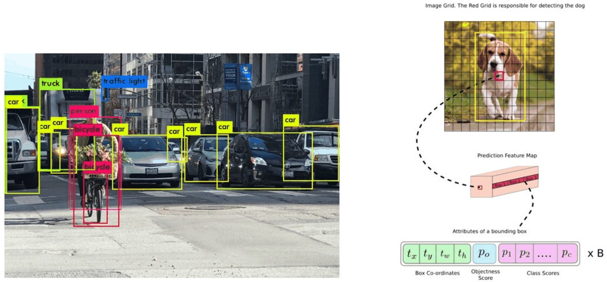

*그림 8. 도로 영상에서 자동차, 트럭, 사람, 자전거, 신호등을 탐지한 결과(왼쪽)와 격자 셀마다 바운딩 박스를 예측하는 방식(오른쪽)*

그림 8의 오른쪽은 YOLO 계열 탐지기의 방식이다. 이미지를 격자로 나누고, 객체의 중심이 들어 있는 셀(빨간 셀)이 그 객체(개)를 탐지할 책임을 진다. 각 셀은 바운딩 박스 B개를 예측하며, 상자 하나는 상자 좌표 $t_x, t_y, t_w, t_h$(중심 위치, 너비, 높이), 상자 안에 객체가 있을 가능성인 객체성 점수(objectness score) $p_o$, 클래스별 점수 $p_1, \dots, p_c$로 이루어진다. 상자마다 클래스 점수를 두는 이 그림은 YOLOv3 같은 후속 모델의 방식이며, 처음 제안된 YOLO [3]는 클래스 확률을 셀마다 한 세트만 예측한다(5강 3.3절). 객체 탐지는 5강에서 자세히 다룬다.

### 2.3 분할

**분할(segmentation)** 은 이미지의 모든 픽셀에 클래스를 붙이는 태스크이다. 바운딩 박스보다 정밀하게 객체의 모양까지 구한다.

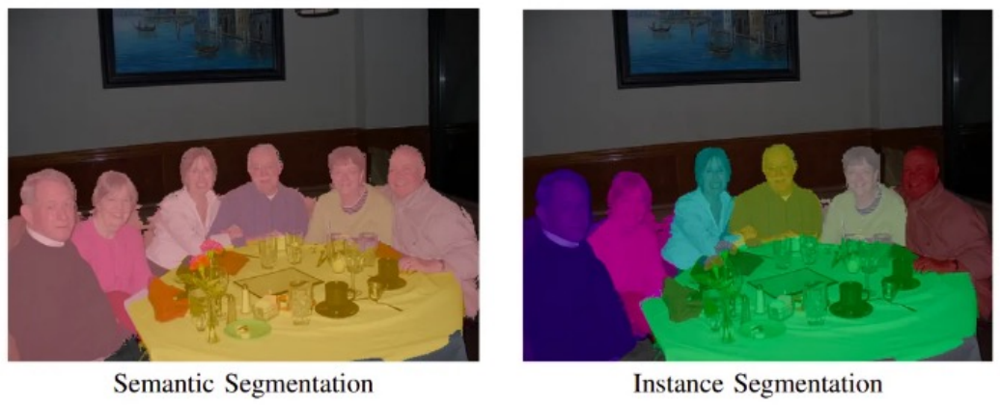

*그림 9. 같은 장면의 의미론적 분할(왼쪽)과 인스턴스 분할(오른쪽)*

**의미론적 분할(semantic segmentation)** 은 의미(클래스)가 같으면 하나로 묶는다. 그림 9의 왼쪽에서 사람은 모두 같은 색, 탁자는 다른 한 색이다. **인스턴스 분할(instance segmentation)** 은 같은 클래스라도 개별 객체를 구분한다. 오른쪽에서는 사람마다 다른 색이 칠해진다.

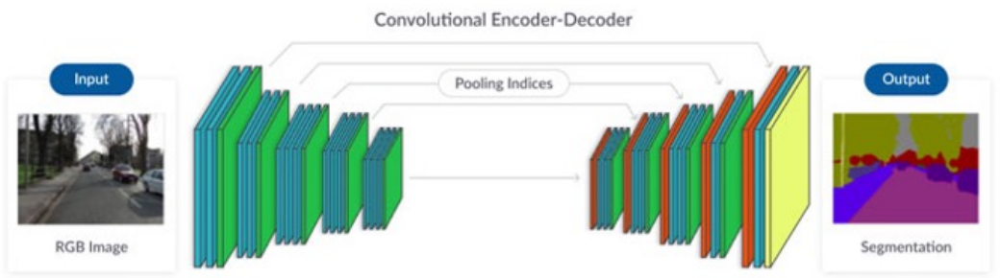

*그림 10. RGB 이미지를 받아 분할 지도를 출력하는 합성곱 인코더-디코더 구조*

분할 모델은 흔히 **인코더-디코더(encoder-decoder)** 구조를 쓴다. 인코더는 합성곱과 풀링으로 이미지의 크기를 줄이며 특징을 뽑고, 디코더는 크기를 다시 키워 입력과 같은 크기의 분할 지도를 만든다. 그림 10의 SegNet은 인코더의 풀링에서 최댓값을 고른 위치(pooling indices)를 디코더에 전달해, 크기를 키울 때 값을 원래 위치에 되돌려 놓는다 [4].

### 2.4 OCR, 초해상도, 이미지 생성

**OCR.** **광학 문자 인식(optical character recognition, OCR)** 은 이미지 속 글자를 텍스트로 바꾸는 태스크이다.

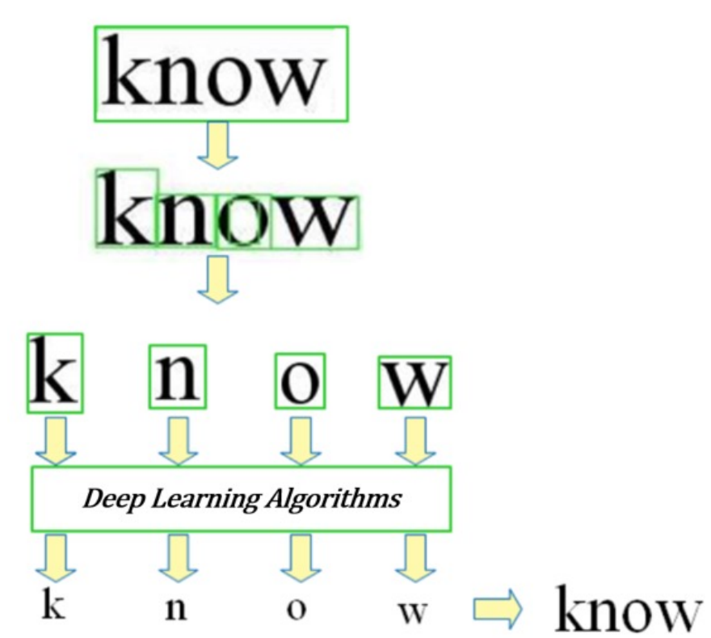

*그림 11. 단어 영역을 찾고 글자로 나눈 뒤 딥러닝 알고리즘으로 각 글자를 인식해 단어 know를 얻는 OCR 과정*

그림 11의 과정은 세 단계이다. 먼저 이미지에서 글자가 있는 영역(know)을 찾고, 그 영역을 글자 k, n, o, w로 나눈 뒤, 딥러닝 모델이 각 글자를 인식해 이어 붙인다.

**초해상도.** **초해상도(super-resolution)** 는 저해상도 이미지에서 고해상도 이미지를 복원하는 태스크이다.

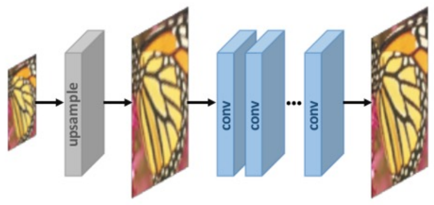

*그림 12. 저해상도 이미지를 업샘플링한 뒤 합성곱 층으로 세부를 복원하는 초해상도 구조*

그림 12의 구조는 작은 나비 이미지를 먼저 보간(업샘플링)으로 목표 크기까지 키운 다음, 여러 합성곱 층이 흐릿해진 경계와 무늬를 선명하게 복원하도록 학습한다. 이 방식의 대표적인 초기 모델이 SRCNN이다 [5].

**이미지 생성.** **이미지 생성(image generation)** 은 학습 데이터와 비슷한 새 이미지를 만드는 태스크이다. 최근 널리 쓰이는 **확산 모델(diffusion model)** 은 데이터에 잡음을 조금씩 더하는 과정을 거꾸로 되돌리는 법을 학습한다.

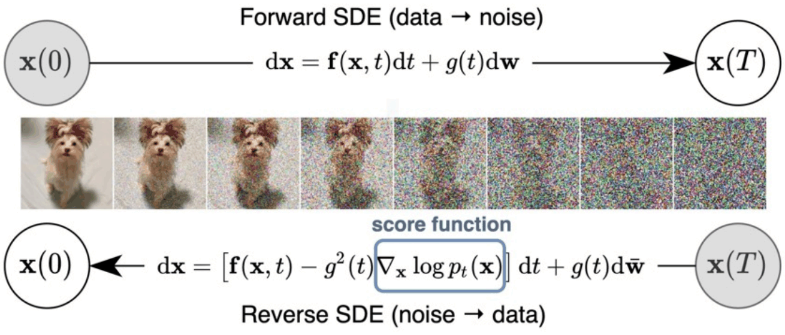

*그림 13. 데이터를 잡음으로 바꾸는 순방향 SDE와 잡음에서 데이터를 만드는 역방향 SDE*

그림 13은 확산 과정을 확률 미분 방정식(stochastic differential equation, SDE)으로 나타낸 점수 기반 생성 모델이다 [6]. 순방향 과정은 시각 0의 데이터 $\mathbf{x}(0)$에 잡음을 계속 더해 시각 $T$에서 순수한 잡음 $\mathbf{x}(T)$로 만든다.

$$
d\mathbf{x} = \mathbf{f}(\mathbf{x}, t)\,dt + g(t)\,d\mathbf{w}
$$

$\mathbf{f}$는 값이 움직이는 평균 방향(drift), $g(t)$는 잡음의 세기, $\mathbf{w}$는 무작위 움직임을 나타내는 Wiener 과정(브라운 운동)이다. 역방향 과정은 잡음 $\mathbf{x}(T)$에서 출발해 시간을 거슬러 데이터 $\mathbf{x}(0)$를 만든다.

$$
d\mathbf{x} = \left[\mathbf{f}(\mathbf{x}, t) - g(t)^2 \nabla_{\mathbf{x}} \log p_t(\mathbf{x})\right] dt + g(t)\,d\bar{\mathbf{w}}
$$

$p_t$는 시각 $t$에서 데이터의 확률 분포이고, $\nabla_{\mathbf{x}} \log p_t(\mathbf{x})$는 확률이 높아지는 방향을 가리키는 **점수 함수(score function)** 이다. 신경망이 이 점수 함수를 학습하면 잡음에서 시작해 점점 데이터다운 이미지를 만들 수 있다. 그림의 강아지 사진은 순방향으로 갈수록 잡음에 묻히고, 역방향으로 오면 다시 나타난다.

### 2.5 실제 적용 사례

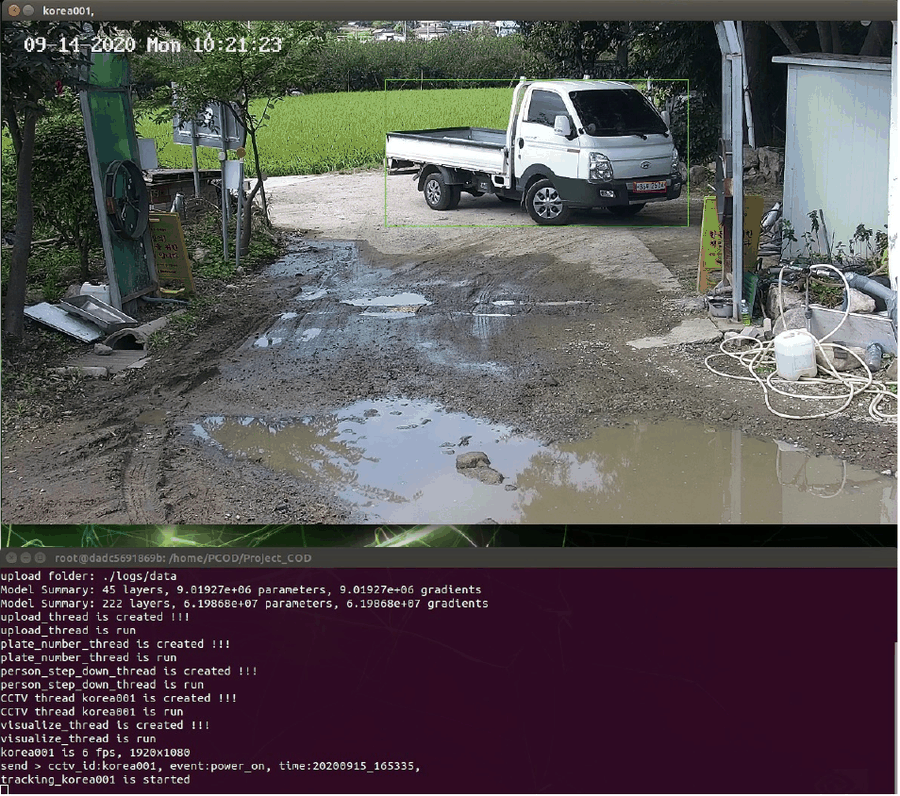

*그림 14. CCTV 영상에서 화물차를 탐지하고 여러 처리 스레드를 실행하는 차량 감시 프로그램*

그림 14는 CCTV 영상(1920×1080, 초당 6프레임)에서 화물차를 탐지한 화면과 프로그램의 실행 기록이다. 기록에는 크기가 다른 두 모델(파라미터 약 900만 개와 약 6,200만 개)을 불러온 뒤 번호판 인식, 차에서 내리는 사람 감지, 업로드, 시각화, 추적을 맡는 스레드가 각각 실행되는 과정이 나타난다. 하나의 응용이 여러 영상처리 모델과 처리 단계를 묶어 만들어짐을 보여 준다.

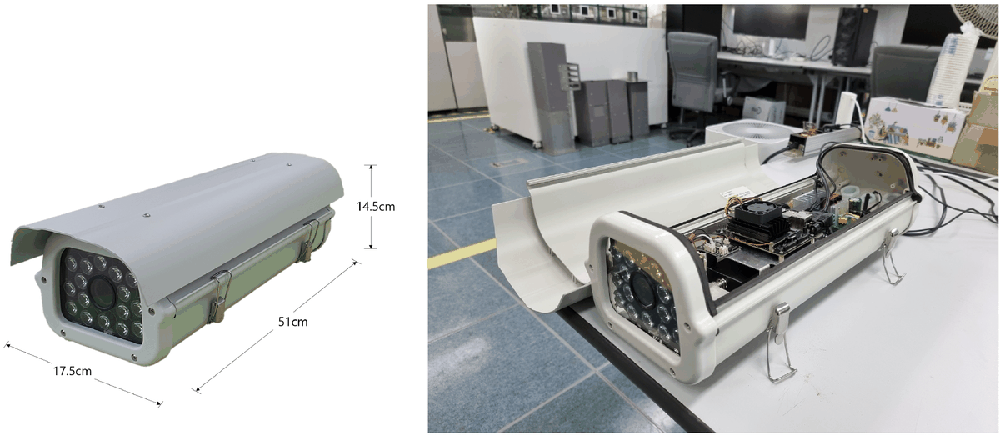

*그림 15. 딥러닝 모델을 실행하는 보드를 하우징 안에 넣은 카메라 장치*

그림 15는 약 51 cm × 17.5 cm × 14.5 cm 크기의 카메라 하우징과 그 안을 연 모습이다. 하우징 안의 연산 보드가 현장에서 직접 모델을 실행하므로 영상을 서버로 보내지 않고도 결과를 낼 수 있다. 이런 엣지 장치에 맞는 가벼운 모델은 9강에서 다룬다.

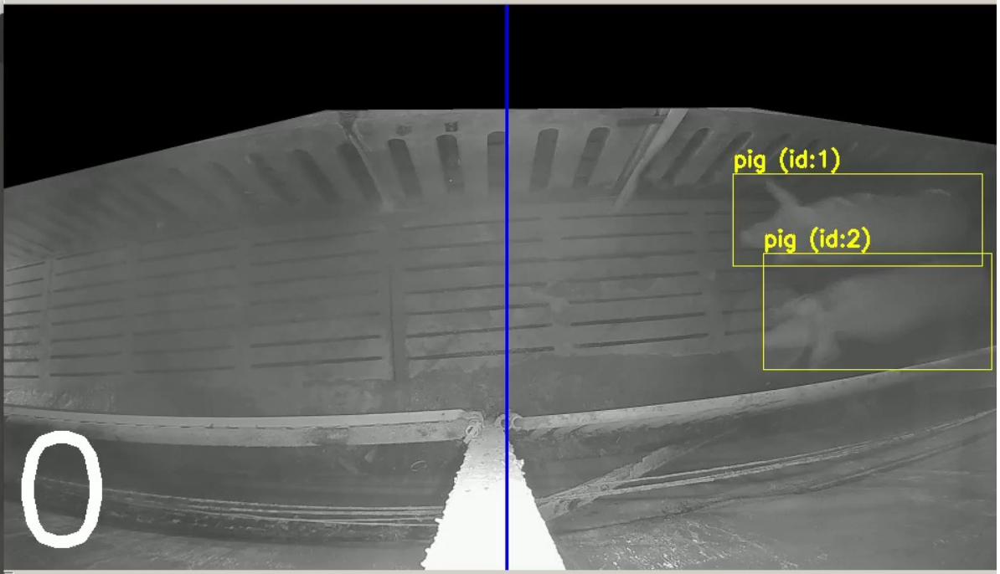

*그림 16. 축사 영상에서 돼지를 탐지하고 번호를 붙여 추적하는 사례*

그림 16은 적외선 영상에서 돼지를 탐지하고 `pig (id:1)`, `pig (id:2)`처럼 개체마다 번호를 붙여 추적하는 사례이다. 화면의 파란 세로선과 왼쪽 아래의 숫자는 기준선을 지나는 개체 수를 세는 데 쓰인다.

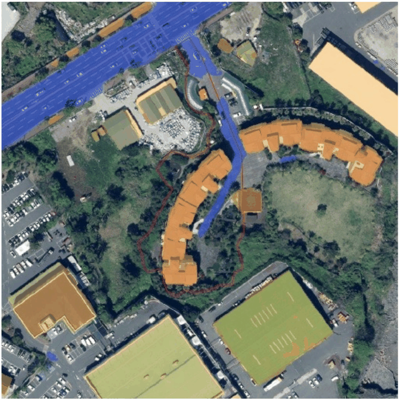

*그림 17. 항공 영상에서 도로, 건물, 경작지를 분할하고 감시 대상 필지를 빨간 선으로 표시한 사례*

그림 17은 의미론적 분할의 사례이다. 항공 영상의 픽셀마다 도로(파란색), 건물(주황색) 같은 클래스를 붙이고, 빨간 선 안의 감시 대상 필지에서 토지가 어떻게 쓰이는지 확인한다.

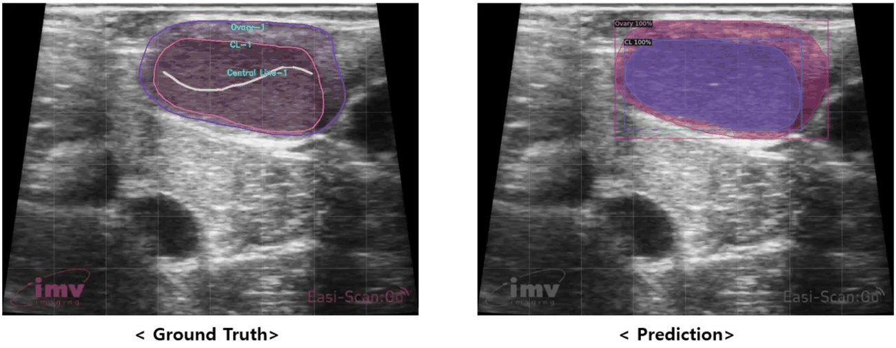

*그림 18. 초음파 영상에서 난소와 황체 영역의 정답(왼쪽)과 모델의 예측(오른쪽)*

그림 18은 가축의 생식기 초음파 영상에서 난소(Ovary)와 황체(CL, corpus luteum) 영역을 분할하는 사례이다. 왼쪽은 사람이 표시한 정답(ground truth), 오른쪽은 모델의 예측이며, 두 영역의 모양이 비슷하게 맞는다.

### 2.6 ImageNet 이미지 분류 대회

**ImageNet**은 단어 체계 WordNet의 명사마다 이미지를 모은 대규모 데이터셋이고, 이를 이용한 대회 **ILSVRC**(ImageNet Large Scale Visual Recognition Challenge)는 2010년부터 2017년까지 열렸다. 분류 부문은 약 128만 장의 학습 이미지로 1000개 클래스를 분류하며, 성능은 **top-5 오류율**로 잰다 [7]. top-5 오류율은 모델이 가장 높은 점수를 준 다섯 클래스 안에 정답이 없는 이미지의 비율이다.

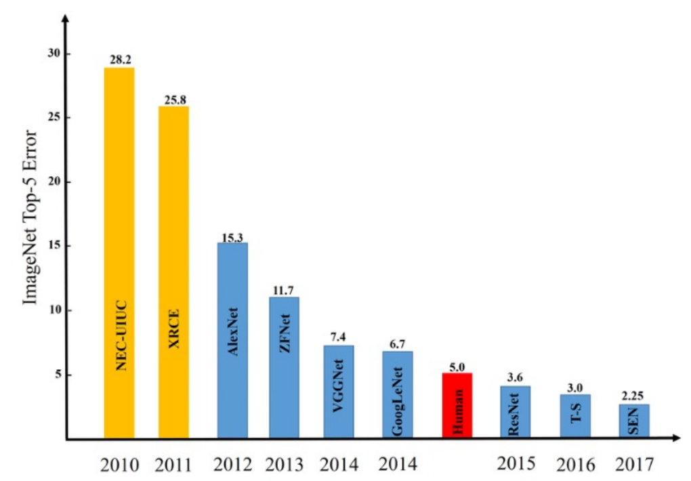

*그림 19. ImageNet 분류 대회 우승 모델의 연도별 top-5 오류율과 사람의 오류율*

2010년(NEC-UIUC, 28.2%)과 2011년(XRCE, 25.8%)에는 사람이 설계한 특징을 쓰는 고전적인 방법이 우승했다. 2012년 CNN인 AlexNet이 15.3%로 오류율을 크게 낮추면서 CNN의 시대가 열렸고, 이후 ZFNet(2013, 11.7%), VGGNet(2014, 7.3%, 그림에는 7.4%), GoogLeNet(2014, 6.7%)이 뒤를 이었다. 2015년의 ResNet(3.6%)은 사람의 오류율(약 5%)보다 낮은 오류율을 기록했으며, 2016년 Trimps-Soushen(T-S, 3.0%)과 2017년 SENet(2.25%)이 그 뒤를 이었다. 3절과 4절에서 VGGNet과 ResNet을 자세히 살펴본다.

---

<br>

## 3. VGGNet

### 3.1 깊이의 영향을 확인하기 위한 설계

**VGGNet**은 옥스퍼드 대학교의 Visual Geometry Group이 제안한 CNN으로, 2014년 ILSVRC 분류 부문에서 2위, 위치 추정 부문에서 1위를 했다 [8]. VGG 연구의 핵심 질문은 **네트워크의 깊이를 깊게 만드는 것이 성능에 어떤 영향을 미치는가**였다. 연구팀은 깊이의 영향만 확인하려고 다른 조건을 최대한 고정했으며, 특히 합성곱 필터(커널)의 크기를 가장 작은 3×3으로 통일했다. 3×3은 상하좌우와 중심을 구분할 수 있는 가장 작은 크기이다. 3×3 필터를 쌓는 설계의 이점은 4강에서 계산으로 확인한다.

### 3.2 VGG-16의 구조

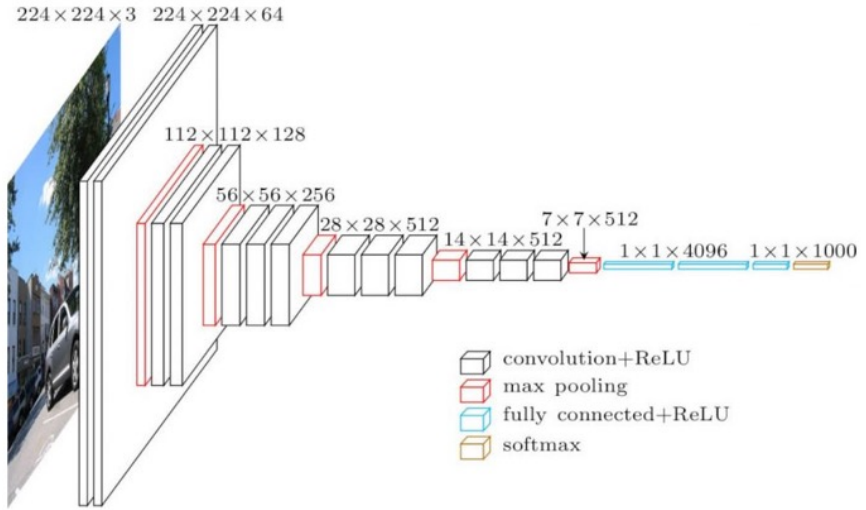

*그림 20. 224×224×3 입력이 합성곱과 최대 풀링을 거쳐 1×1×1000 출력이 되는 VGG-16의 구조*

VGG-16은 가중치를 가진 층이 16개(합성곱 13개, 완전 연결 3개)이다. 모든 합성곱은 3×3, 스트라이드 1, 패딩 1이어서 높이와 너비를 바꾸지 않고, 크기는 2×2 최대 풀링(스트라이드 2)에서만 절반으로 줄어든다. 크기가 줄 때마다 채널 수를 두 배로 늘려(512에서 멈춤) 정보량의 균형을 맞춘다.

| 단계 | 구성 | 출력 크기 |
|:-----|:-----|:-----|
| 입력 | | 224×224×3 |
| 블록 1 | 3×3 합성곱(64) 2개, 최대 풀링 | 112×112×64 |
| 블록 2 | 3×3 합성곱(128) 2개, 최대 풀링 | 56×56×128 |
| 블록 3 | 3×3 합성곱(256) 3개, 최대 풀링 | 28×28×256 |
| 블록 4 | 3×3 합성곱(512) 3개, 최대 풀링 | 14×14×512 |
| 블록 5 | 3×3 합성곱(512) 3개, 최대 풀링 | 7×7×512 |
| 분류기 | 완전 연결 4096, 4096, 1000과 softmax | 1000 |

*표 7. VGG-16의 단계별 구성과 출력 크기*

그림 20의 숫자는 각 블록 안의 합성곱 출력(224×224×64, 112×112×128, …, 14×14×512)과 마지막 풀링 출력(7×7×512)을 표시한 것이다. VGG-16의 파라미터는 약 1억 3,800만 개이며, 그중 첫 완전 연결 층(7×7×512 = 25,088 → 4096)이 약 1억 개를 차지한다.

### 3.3 여섯 가지 구성

VGG 논문은 깊이만 다른 여섯 가지 구성을 비교했다. `conv3-64`는 3×3 합성곱에 출력 채널 64개, `conv1-256`은 1×1 합성곱에 출력 채널 256개를 뜻하며, 굵게 표시한 층은 바로 왼쪽 구성에 비해 추가되거나 바뀐 층이다.

| | A | A-LRN | B | C | D | E |
|:-----|:-----|:-----|:-----|:-----|:-----|:-----|
| 가중치 층 수 | 11 | 11 | 13 | 16 | 16 | 19 |
| 블록 1 | conv3-64 | conv3-64<br>**LRN** | conv3-64<br>**conv3-64** | conv3-64<br>conv3-64 | conv3-64<br>conv3-64 | conv3-64<br>conv3-64 |
| 블록 2 | conv3-128 | conv3-128 | conv3-128<br>**conv3-128** | conv3-128<br>conv3-128 | conv3-128<br>conv3-128 | conv3-128<br>conv3-128 |
| 블록 3 | conv3-256<br>conv3-256 | conv3-256<br>conv3-256 | conv3-256<br>conv3-256 | conv3-256<br>conv3-256<br>**conv1-256** | conv3-256<br>conv3-256<br>**conv3-256** | conv3-256<br>conv3-256<br>conv3-256<br>**conv3-256** |
| 블록 4 | conv3-512<br>conv3-512 | conv3-512<br>conv3-512 | conv3-512<br>conv3-512 | conv3-512<br>conv3-512<br>**conv1-512** | conv3-512<br>conv3-512<br>**conv3-512** | conv3-512<br>conv3-512<br>conv3-512<br>**conv3-512** |
| 블록 5 | conv3-512<br>conv3-512 | conv3-512<br>conv3-512 | conv3-512<br>conv3-512 | conv3-512<br>conv3-512<br>**conv1-512** | conv3-512<br>conv3-512<br>**conv3-512** | conv3-512<br>conv3-512<br>conv3-512<br>**conv3-512** |

*표 8. VGG 논문이 비교한 여섯 가지 구성 A\~E*

모든 구성은 224×224 RGB 이미지를 입력으로 받고, 각 블록 뒤에 최대 풀링을 두며, 마지막에 FC-4096, FC-4096, FC-1000과 softmax를 둔다. 구성 D가 VGG-16, 구성 E가 VGG-19이다. A-LRN은 AlexNet이 쓴 국소 응답 정규화(local response normalization, LRN)를 더한 구성인데 성능이 좋아지지 않았고, 깊이가 11층에서 19층으로 늘수록 오류율이 낮아지다가 19층 부근에서 포화되었다 [8].

---

<br>

## 4. ResNet

### 4.1 깊게 쌓을수록 좋아지는가: 성능 저하 문제

VGG는 더 깊은 네트워크가 더 좋은 성능을 낸다는 것을 보여 주었다. 그렇다면 네트워크를 깊게 만들기만 하면 성능이 계속 좋아질까? 실제로 층을 무작정 늘리면 성능이 오히려 떨어졌다.

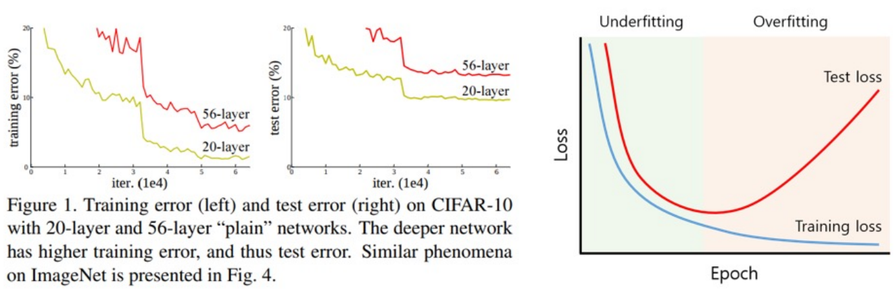

*그림 21. CIFAR-10에서 20층과 56층 일반 네트워크의 학습 오류와 테스트 오류(왼쪽), 과소적합과 과적합 구간의 손실 곡선(오른쪽)*

그림 21의 왼쪽에서 4.3절의 스킵 연결이 없는 일반(plain) 네트워크를 CIFAR-10으로 학습하면, 56층 네트워크가 20층 네트워크보다 학습 오류도 테스트 오류도 높다 [9]. 오른쪽 그림처럼 **과적합(overfitting)** 이라면 학습 손실은 계속 낮아지고 테스트 손실만 올라가야 한다. 그런데 56층 네트워크는 학습 데이터에서도 성능이 나쁘므로 원인은 과적합이 아니다. 깊은 네트워크를 학습시키는 최적화 자체가 어려워진 것이며, 이를 **성능 저하 문제(degradation problem)** 라 한다.

이론적으로는 깊은 네트워크가 얕은 네트워크보다 나쁠 이유가 없다. 20층 네트워크의 가중치를 그대로 복사하고 나머지 36층이 입력을 그대로 내보내는 항등 함수(identity function)가 되면 56층 네트워크도 같은 성능을 낼 수 있기 때문이다. 문제는 여러 비선형 층을 쌓은 구조가 항등 함수조차 학습하기 어렵다는 데 있다.

### 4.2 깊은 네트워크와 기울기 소실

성능 저하와는 별개로, 층이 깊어질수록 역전파의 학습 신호가 입력 쪽 층까지 잘 전달되지 않는 기울기 소실 문제도 있다. 역전파에서 앞쪽 층의 기울기는 연쇄 법칙(chain rule)에 따라 뒤쪽 층들의 미분값을 차례로 곱해 얻는다. 곱해지는 값이 1보다 작으면 층을 지날 때마다 기울기가 작아진다.

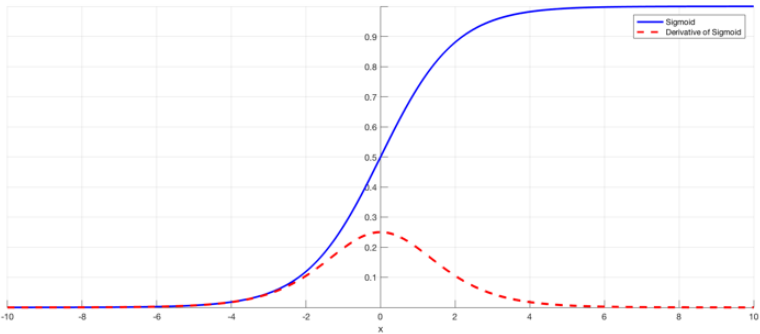

*그림 22. sigmoid 함수(실선)와 그 도함수(점선)*

sigmoid 함수 $\sigma(z) = 1/(1+e^{-z})$의 도함수는 $\sigma'(z) = \sigma(z)(1-\sigma(z))$이며, $z = 0$에서 최댓값 0.25를 갖고 $|z|$가 커지면 0에 가까워진다(그림 22). 층마다 0.25 이하의 값이 곱해지면 10개 층을 지난 기울기는 많아야 $0.25^{10} \approx 9.5 \times 10^{-7}$배가 된다.

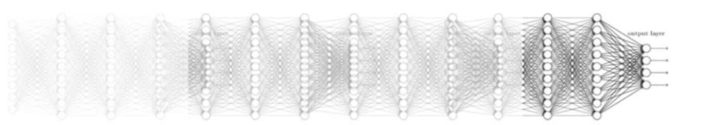

*그림 23. 출력층에서 멀어질수록 학습 신호가 희미해지는 깊은 신경망*

그림 23에서 출력층에 가까운 층은 진하게, 입력층에 가까운 층은 흐리게 그려져 있다. 출력층에서 멀어질수록 기울기가 작아져 앞쪽 층의 가중치가 거의 바뀌지 않는다는 뜻이다. 역전파가 널리 알려진 1986년 이후에도 이 문제 때문에 깊은 신경망은 잘 학습되지 않았고, 1990년대 중반부터 깊은 신경망의 학습 방법이 다시 주목받은 2006년 무렵까지 신경망 연구가 침체했다. 이 시기를 신경망의 두 번째 겨울이라 부르기도 한다. 기울기 소실은 5절에서 자세히 다루며, 정규화된 가중치 초기화와 5.2절의 배치 정규화 같은 기법으로 상당 부분 완화된다.

### 4.3 잔차 블록

**ResNet**은 스킵 연결을 이용한 **잔차 학습(residual learning)** 으로 4.1절의 성능 저하 문제를 해결하여 152층 네트워크까지 학습시켰으며, 2015년 ILSVRC 분류 부문에서 우승했다 [9].

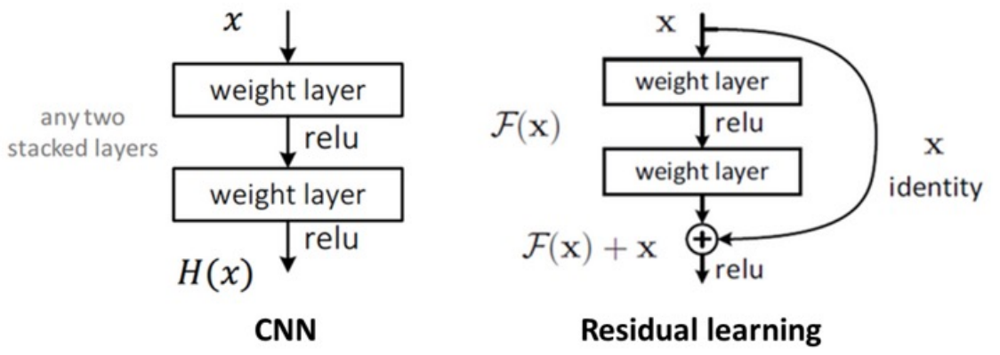

*그림 24. 두 층을 쌓은 일반 CNN 블록(왼쪽)과 입력 x를 출력에 더하는 잔차 블록(오른쪽)*

그림 24의 왼쪽 일반 블록은 두 층(weight layer와 ReLU)이 원하는 출력 $H(x)$를 직접 학습한다. 오른쪽 **잔차 블록(residual block)** 에서는 두 층이 $F(x)$를 계산하고, 입력 $x$를 층을 건너뛰어 그대로 더한다. 이 건너뛰는 연결을 **스킵 연결(skip connection)** 또는 shortcut connection이라 하며, 층을 거친 뒤 원본 $x$를 다시 더해 원본을 잊지 않게 한다.

$$
H(x) = F(x) + x \quad \Longleftrightarrow \quad F(x) = H(x) - x
$$

두 층은 원하는 출력 전체가 아니라 출력과 입력의 차이, 즉 **잔차(residual)** $F(x)$만 학습하면 된다. 4.1절의 상황처럼 항등 함수가 최선이라면 일반 블록은 비선형 층으로 $H(x) = x$를 맞춰야 하지만, 잔차 블록은 가중치를 0 쪽으로 보내 $F(x) = 0$으로 만들면 된다. 이쪽이 훨씬 쉽다.

스킵 연결은 역전파에도 지름길을 만든다. 블록 출력을 입력으로 미분하면

$$
\frac{\partial H}{\partial x} = \frac{\partial F}{\partial x} + 1
$$

이므로, $\partial F/\partial x$가 작아도 1이 더해져 기울기가 사라지지 않고 앞 블록으로 전달된다. 단순화하여 각 블록의 미분을 스칼라 0.1이라 가정하면, 일반 블록 10개를 지난 기울기는 $0.1^{10} = 10^{-10}$배가 되지만 잔차 블록 10개를 지난 기울기는 $(1 + 0.1)^{10} \approx 2.59$배가 되어 사라지지 않는다. 스킵 연결은 파라미터를 더하지 않으므로 계산량도 거의 늘지 않는다.

> **참고:** He 등은 성능 저하 문제의 원인이 기울기 소실일 가능성은 낮다고 보았다. 실험에 쓴 일반 네트워크에는 배치 정규화가 있어 순전파 신호의 분산이 0이 아니었고 역전파 기울기의 크기도 정상 범위였는데도 성능 저하가 나타났으므로, 깊은 일반 네트워크를 최적화하기 어렵다는 것이 근본 원인이라는 해석이다 [9]. 따라서 잔차 블록의 주된 역할은 항등 함수에 가까운 해를 쉽게 찾게 하여 이 최적화 문제를 완화하는 것이며, 위에서 본 기울기의 지름길은 깊은 네트워크에서 기울기가 잘 전달되도록 돕는 보완적인 효과이다.

### 4.4 34층 ResNet의 구조

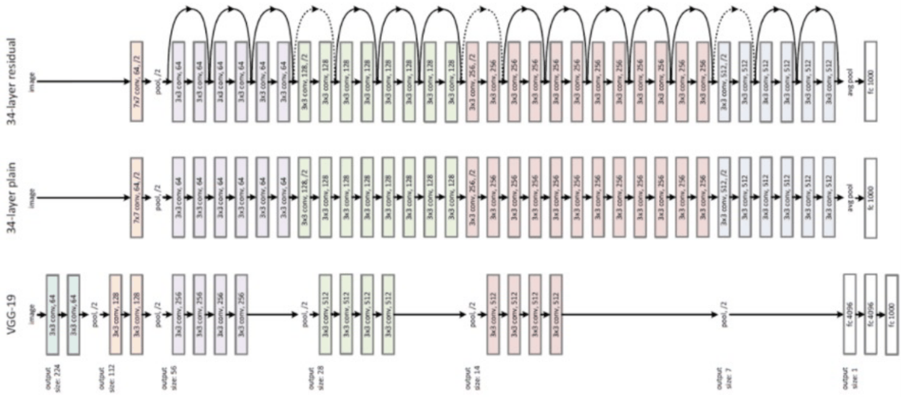

*그림 25. 34층 잔차 네트워크(위), 34층 일반 네트워크(가운데), VGG-19(아래)의 구조 비교*

그림 25의 가운데 일반 네트워크에 스킵 연결을 더하면 위의 잔차 네트워크가 된다. 34층 ResNet은 7×7 합성곱(채널 64, 스트라이드 2)과 최대 풀링으로 시작해, 3×3 합성곱 두 개짜리 잔차 블록을 채널 64에서 3개, 128에서 4개, 256에서 6개, 512에서 3개 쌓고, 전역 평균 풀링(avg pool)과 1000개 출력의 완전 연결 층으로 끝난다. 가중치 층은 1 + 2×(3 + 4 + 6 + 3) + 1 = 34개이다.

실선 곡선은 입력을 그대로 더하는 항등 스킵 연결이다. 점선 곡선은 채널 수가 두 배로 늘고 크기가 절반으로 줄어드는(`/2`) 지점으로, 입력과 출력의 모양이 달라 그대로 더할 수 없으므로 1×1 합성곱으로 모양을 맞추거나 늘어난 채널을 0으로 채운 뒤 더한다. VGG-19와 비교하면 34층 ResNet은 층이 더 많지만 첫 합성곱과 풀링에서 크기를 56×56까지 빠르게 줄이고 같은 크기에서 쓰는 필터 수가 적어 연산량이 약 36억 FLOPs로 VGG-19(약 196억 FLOPs)의 18% 정도이다 [9]. 완전 연결 층을 하나만 두어 크게 줄어드는 것은 연산량이 아니라 파라미터 수이다.

---

<br>

## 5. 기울기 소실과 기울기 폭주

### 5.1 정의와 원인

역전파는 가중치를 갱신하기 위해 오차를 출력층에서 입력층 쪽으로 전파한다. 이때 기울기가 점점 작아져 거의 0에 수렴하는 현상을 **기울기 소실(vanishing gradient)**, 반대로 기울기가 너무 커져 발산하는 현상을 **기울기 폭주(exploding gradient)** 라 한다.

층 $l$의 가중합을 $z^{(l)}$, 활성화 함수를 $\sigma$, 손실을 $L$이라 하면, 역전파에서 층 $l$의 오차 신호 $\delta^{(l)} = \partial L / \partial z^{(l)}$은 바로 뒤 층의 오차 신호로부터 다음과 같이 계산된다.

$$
\delta^{(l)} = \left( W^{(l+1)} \right)^{\top} \delta^{(l+1)} \odot \sigma'\!\left( z^{(l)} \right)
$$

$\odot$은 원소별 곱이다. 입력 쪽 층의 기울기는 이 식을 여러 번 적용한 결과이므로, 대략 층마다 가중치의 크기와 활성화 함수의 미분값을 곱한 값이 거듭 곱해진다. 이 곱이 1보다 작으면 기울기가 지수적으로 작아지고(소실), 1보다 크면 지수적으로 커진다(폭주). 층마다 0.25가 곱해지면 10층 뒤에는 $0.25^{10} \approx 9.5 \times 10^{-7}$, 층마다 2가 곱해지면 $2^{10} = 1024$가 된다.

| 현상 | 주요 원인 | 결과 |
|:-----|:-----|:-----|
| 기울기 소실 | sigmoid, tanh처럼 입력의 절댓값이 커지면 미분값이 0에 가까워지는(포화되는) 활성화 함수 | 입력 쪽 층의 가중치가 거의 갱신되지 않아 학습이 멈춘다 |
| 기울기 폭주 | 큰 가중치 초깃값, ReLU처럼 기울기를 줄여 주지 않는 활성화 함수와 큰 가중치의 조합 | 갱신 폭이 너무 커져 손실이 진동하거나 발산하고, 값이 무한대나 NaN이 되기도 한다 |

*표 9. 기울기 소실과 폭주의 원인과 결과*

sigmoid의 미분값은 0.25 이하이고 tanh의 미분값 $1 - \tanh^2(z)$은 1 이하이며, 둘 다 입력이 커질수록 0에 가까워진다. ReLU의 미분값은 양수 구간에서 1이어서 기울기를 줄이지 않으므로 소실에는 강하지만, 가중치가 크면 그 큰 값이 그대로 곱해져 폭주로 이어질 수 있다. 해결책으로는 4절의 스킵 연결 외에 배치 정규화, 활성화 함수의 선택, 기울기 클리핑이 있고, 층의 크기에 맞춰 가중치의 초기 분산을 정하는 초기화 방법도 쓰인다 [10].

### 5.2 해결책 1: 배치 정규화

**배치 정규화(batch normalization, BN)** 는 층의 중간 출력을 미니배치 단위로 정규화해 값이 너무 작거나 커지지 않도록 막는다 [11].

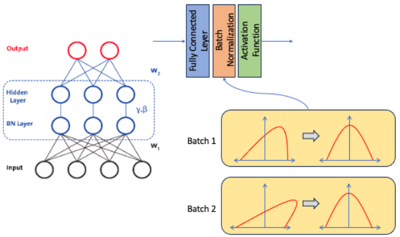

*그림 26. 은닉층과 활성화 함수 사이에 놓인 배치 정규화 층과, 미니배치마다 치우친 분포를 정규화하는 모습*

그림 26처럼 BN 층은 보통 완전 연결 층(또는 합성곱 층)과 활성화 함수 사이에 놓는다. 미니배치 $B = \{x_1, \dots, x_m\}$에 대해 특성(채널)마다 다음을 계산한다.

$$
\mu_B = \frac{1}{m}\sum_{i=1}^{m} x_i, \qquad \sigma_B^2 = \frac{1}{m}\sum_{i=1}^{m} (x_i - \mu_B)^2, \qquad \hat{x}_i = \frac{x_i - \mu_B}{\sqrt{\sigma_B^2 + \epsilon}}, \qquad y_i = \gamma \hat{x}_i + \beta
$$

$\epsilon$은 0으로 나누는 것을 막는 작은 수이다. 정규화로 평균 0, 분산 1이 된 값을 학습 가능한 파라미터 $\gamma$(크기)와 $\beta$(이동)로 다시 조정하므로, 필요하면 네트워크가 원래 분포를 되살릴 수도 있다. 그림 26의 오른쪽에서 Batch 1과 Batch 2의 분포는 서로 다른 쪽으로 치우쳐 있지만, BN을 거치면 둘 다 비슷한 종 모양의 분포가 된다. 값이 sigmoid나 tanh의 포화 구간으로 밀려나지 않으므로 기울기 소실이 줄고, 큰 학습률로도 안정적으로 학습된다. 평가 때는 미니배치 통계 대신 학습 중에 누적한 평균과 분산을 쓰므로, 1.6절에서 본 `model.eval()`이 필요하다.

### 5.3 해결책 2: 다양한 활성화 함수

포화되지 않는 활성화 함수를 쓰면 기울기 소실을 줄일 수 있다.

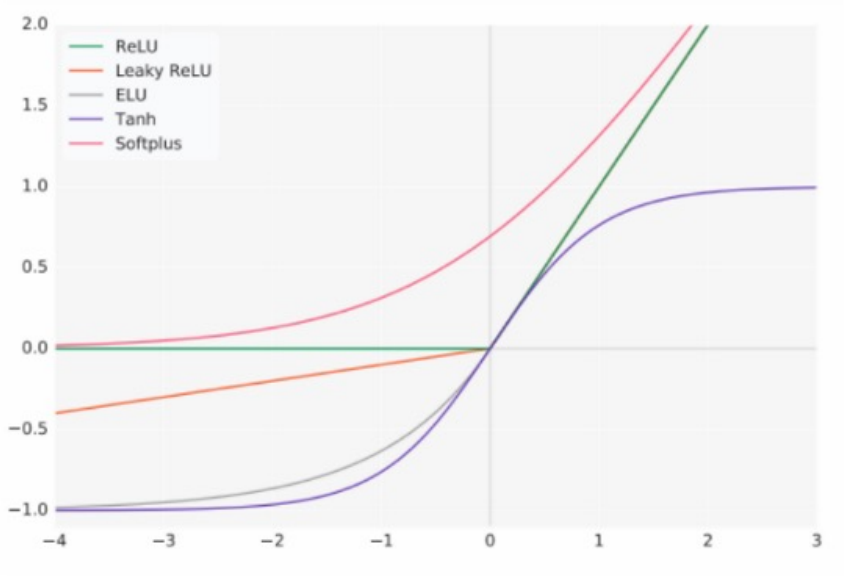

*그림 27. ReLU, Leaky ReLU, ELU, Tanh, Softplus 활성화 함수의 그래프*

| 함수 | 식 | 미분값 | 특징 |
|:-----|:-----|:-----|:-----|
| Tanh | $\tanh z$ | $1 - \tanh^2 z$ (최대 1) | 출력이 −1\~1이며 양쪽 끝에서 포화된다 |
| ReLU | $\max(0, z)$ | $z > 0$이면 1, $z < 0$이면 0 | 양수 구간에서 포화되지 않고 계산이 간단하다. 음수 입력만 받는 뉴런은 기울기가 0이 되어 학습이 멈출 수 있다 |
| Leaky ReLU | $z > 0$이면 $z$, 아니면 $\alpha z$ | 1 또는 $\alpha$ | 음수 구간에도 작은 기울기 $\alpha$(예: 0.01)를 주어 ReLU의 문제를 줄인다 |
| ELU | $z > 0$이면 $z$, 아니면 $\alpha(e^{z} - 1)$ | 1 또는 $\alpha e^{z}$ | 음수 구간이 −α로 부드럽게 수렴하여 출력의 평균이 0에 가까워진다 |
| Softplus | $\ln(1 + e^{z})$ | $\sigma(z)$ | ReLU를 부드럽게 만든 함수로, $z = 0$에서 $\ln 2 \approx 0.693$이다 |

*표 10. 대표적인 활성화 함수의 식, 미분값, 특징*

그림 27에서 ReLU 계열(ReLU, Leaky ReLU, ELU)과 Softplus는 양수 구간에서 계속 증가하므로 큰 입력에서도 미분값이 1(Softplus는 1에 가까운 값)로 유지된다. 반면 Tanh는 $z$가 2를 넘으면 거의 평평해져 미분값이 0에 가까워진다. 그래서 깊은 네트워크의 은닉층에는 ReLU 계열을 주로 쓴다.

### 5.4 해결책 3: 기울기 클리핑

**기울기 클리핑(gradient clipping)** 은 기울기의 크기가 임계값 $\tau$보다 크면 방향은 그대로 두고 크기만 $\tau$로 줄이는 방법이다 [12].

$$
\mathbf{g}_{\text{clipped}} =
\begin{cases}
\mathbf{g} & \text{if } \lVert \mathbf{g} \rVert_2 \le \tau \\
\tau \cdot \dfrac{\mathbf{g}}{\lVert \mathbf{g} \rVert_2} & \text{if } \lVert \mathbf{g} \rVert_2 > \tau
\end{cases}
$$

$\lVert \mathbf{g} \rVert_2$는 기울기 벡터의 L2 노름(길이)이다. 예를 들어 $\mathbf{g} = (3, 4)$, $\tau = 1$이면 $\lVert \mathbf{g} \rVert_2 = \sqrt{3^2 + 4^2} = 5 > 1$이므로 $\mathbf{g}_{\text{clipped}} = 1 \cdot (3, 4)/5 = (0.6, 0.8)$이 된다. 방향은 같고 길이만 1로 줄었다.

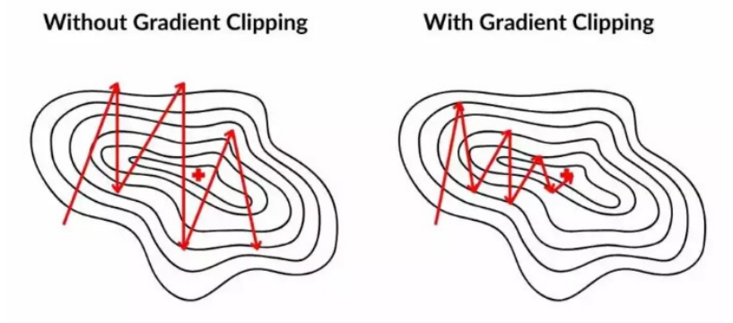

*그림 28. 기울기 클리핑을 쓰지 않을 때(왼쪽)와 쓸 때(오른쪽)의 최적화 경로*

그림 28의 왼쪽에서는 기울기가 큰 곳에서 한 번에 너무 멀리 이동해 최솟값(빨간 점)을 크게 지나쳐 버린다. 오른쪽처럼 클리핑을 쓰면 이동 폭이 제한되어 최솟값 근처로 차근차근 다가간다. 클리핑은 폭주를 막는 방법이며 소실에는 효과가 없다. PyTorch에서는 `loss.backward()`와 `optimizer.step()` 사이에 `torch.nn.utils.clip_grad_norm_(model.parameters(), max_norm)`을 호출한다.

---

<br>

## 6. 전이 학습

**전이 학습(transfer learning)** 은 특정 분야에서 학습된 신경망의 능력 일부를 비슷하거나 전혀 새로운 분야의 신경망 학습에 이용하는 것이다 [13]. 자전거를 탈 줄 아는 사람은 균형을 잡는 감각을 이미 익혔으므로 오토바이를 처음부터 배우는 사람보다 빨리 배운다. 마찬가지로 ImageNet처럼 큰 데이터셋으로 학습한 CNN의 앞쪽 층은 가장자리, 질감, 단순한 모양처럼 여러 이미지에 공통인 특징을 추출하므로, 이 층을 다른 태스크에 가져다 쓰면 적은 데이터로도 좋은 성능을 얻을 수 있다. 앞쪽 층의 특징은 일반적이고 뒤쪽 층으로 갈수록 원래 태스크에 특화된다 [14]. 미세 조정 전략과 백본은 4강에서 다룬다.

---

<br>

## 요약

| 개념 | 핵심 요약 |
|:-----|:-----|
| 구현 흐름 | 입출력 확인, 데이터셋, 데이터 로더, 모델, 순전파, 손실 함수, 최적화 기법, 학습과 검증, 추론의 아홉 단계로 구현하며, 학습은 전방 계산, 오차 계산, 후방 가중치 갱신의 반복이다. |
| 입출력 확인 | 출력 크기 $O = \lfloor (W - K + 2P)/S \rfloor + 1$로 층마다 텐서 크기를 미리 계산해 모델 코드의 크기 불일치를 막는다. |
| 텐서와 변환 | 텐서는 다차원 배열이며, ToTensor는 0\~255를 0\~1로, Normalize(0.5, 0.5)는 0\~1을 −1\~1로 바꾼다. |
| 입력 정규화 | 특성의 범위를 맞추면 손실 등고선이 둥글어져 경사하강법이 지그재그 없이 빠르게 수렴한다. |
| 학습 루프 | 미니배치마다 zero_grad로 기울기를 지우고, 순전파, 손실 계산, backward, step을 수행한다. |
| 검증과 추론 | eval 모드에서 순전파만 하고 torch.max로 예측 클래스를 구하며, 새 이미지에는 학습과 같은 전처리를 적용한다. |
| 영상처리 태스크 | 분류는 클래스 하나, 탐지는 상자와 클래스, 분할은 픽셀별 클래스, OCR은 텍스트, 초해상도는 고해상도 이미지, 생성은 새 이미지를 출력한다. |
| ImageNet 대회 | 2012년 AlexNet이 top-5 오류율을 15.3%로 낮춰 CNN의 시대를 열었고, 2015년 ResNet이 3.6%로 사람(약 5%)보다 낮아졌다. |
| VGGNet | 깊이의 영향만 보려고 필터를 3×3으로 고정하고 11\~19층 구성을 비교했으며, VGG-16은 합성곱 13층과 완전 연결 3층이다. |
| 성능 저하 문제 | 일반 네트워크를 깊게 쌓으면 학습 오류까지 높아지므로 원인은 과적합이 아니라 최적화의 어려움이다. |
| 잔차 블록 | $H(x) = F(x) + x$로 잔차만 학습하여 항등 함수에 가까운 해를 쉽게 찾게 하므로 성능 저하 문제를 해결하며, $\partial H/\partial x = \partial F/\partial x + 1$이어서 기울기도 지름길로 전달된다. |
| 기울기 소실과 폭주 | 연쇄 법칙의 곱이 1보다 작으면 기울기가 0으로, 크면 무한대로 간다. sigmoid와 tanh의 포화는 소실을, 큰 가중치는 폭주를 일으킨다. |
| 해결책 | 배치 정규화는 중간 값을 정규화하고, ReLU 계열은 포화를 피하며, 기울기 클리핑은 방향을 유지한 채 크기를 τ로 줄인다. |
| 전이 학습 | 큰 데이터셋으로 학습한 신경망의 능력 일부를 새 태스크의 학습에 재사용한다. |

---

<br>

## 점검 문제

1. **출력 크기:** 32×32×3 이미지에 5×5 합성곱(패딩 0, 스트라이드 1, 출력 채널 6)과 2×2 최대 풀링(스트라이드 2)을 차례로 적용한 출력의 크기를 구하라.

   <details>
   <summary>정답</summary>

   합성곱 출력은 (32 − 5 + 0)/1 + 1 = 28이므로 28×28×6이고, 풀링 출력은 (28 − 2)/2 + 1 = 14이므로 14×14×6이다.

   </details>

2. **정규화:** 픽셀 값 51에 `ToTensor()`와 `Normalize((0.5, 0.5, 0.5), (0.5, 0.5, 0.5))`를 차례로 적용한 값을 구하라.

   <details>
   <summary>정답</summary>

   ToTensor 후 51/255 = 0.2이고, Normalize 후 (0.2 − 0.5)/0.5 = −0.6이다.

   </details>

3. **zero_grad:** 학습 루프에서 `optimizer.zero_grad()`를 빼면 어떤 일이 생기는가?

   <details>
   <summary>정답</summary>

   PyTorch는 `backward()`를 호출할 때마다 기울기를 `.grad`에 더해 누적한다. 지우지 않으면 이전 미니배치들의 기울기가 계속 더해진 값으로 파라미터를 갱신하게 되어, 현재 미니배치의 기울기와 다른 방향과 크기로 학습이 진행된다.

   </details>

4. **교차 엔트로피:** 클래스가 10개인 문제에서 모든 클래스에 같은 확률을 주는 모델의 교차 엔트로피 손실은 얼마이며, 이 값은 학습 로그를 읽을 때 어떻게 쓰이는가?

   <details>
   <summary>정답</summary>

   정답 클래스의 확률이 0.1이므로 $L = -\ln 0.1 = \ln 10 \approx 2.303$이다. 학습 초기의 손실이 이 값 근처이면 정상적으로 시작한 것이고, 손실이 이 값보다 충분히 내려가야 모델이 무작위 추측보다 나은 예측을 하고 있다고 볼 수 있다.

   </details>

5. **태스크 구분:** 항공 영상에서 건물 하나하나를 서로 다른 객체로 구분해 픽셀 단위로 표시하려면 어떤 태스크를 써야 하며, 의미론적 분할과 무엇이 다른가?

   <details>
   <summary>정답</summary>

   인스턴스 분할이다. 의미론적 분할은 모든 건물 픽셀에 같은 클래스(건물)를 붙여 건물끼리 구분하지 않고, 인스턴스 분할은 같은 클래스라도 건물마다 다른 객체로 구분한다.

   </details>

6. **VGG의 설계:** VGG 연구팀이 필터 크기를 3×3으로 고정한 이유는 무엇인가?

   <details>
   <summary>정답</summary>

   연구의 목적이 네트워크의 깊이가 성능에 주는 영향을 확인하는 것이었으므로, 필터 크기 같은 다른 조건을 고정해 깊이만 바꾸어 비교하기 위해서이다. 3×3은 상하좌우와 중심을 구분할 수 있는 가장 작은 크기이다.

   </details>

7. **성능 저하 문제:** 56층 일반 네트워크가 20층보다 테스트 오류가 높다는 사실만으로 과적합이라고 판단할 수 없는 이유는 무엇인가?

   <details>
   <summary>정답</summary>

   과적합이라면 학습 오류는 낮고 테스트 오류만 높아야 한다. 56층 네트워크는 학습 오류도 20층보다 높으므로 학습 데이터조차 잘 맞추지 못하는 최적화의 문제, 즉 성능 저하 문제이다.

   </details>

8. **잔차 블록:** 잔차 블록 $H(x) = F(x) + x$에서 항등 함수를 학습하기 쉬운 이유와 기울기가 잘 전달되는 이유를 설명하라.

   <details>
   <summary>정답</summary>

   항등 함수 $H(x) = x$를 얻으려면 $F(x) = 0$이면 되므로 가중치를 0 쪽으로 보내기만 하면 된다. 또 $\partial H/\partial x = \partial F/\partial x + 1$이어서 $\partial F/\partial x$가 작아도 1이 더해진 기울기가 앞 블록으로 전달된다.

   </details>

9. **기울기 소실:** sigmoid를 활성화 함수로 쓰는 20층 네트워크에서 기울기가 층마다 sigmoid 미분의 최댓값만큼 곱해진다고 단순화하면, 입력 쪽 층에 전달되는 기울기는 출력 쪽의 몇 배 이하가 되는가?

   <details>
   <summary>정답</summary>

   sigmoid 미분의 최댓값은 $z = 0$에서 0.25이므로 $0.25^{20} \approx 9.1 \times 10^{-13}$배 이하가 된다. 앞쪽 층은 거의 학습되지 않는다.

   </details>

10. **기울기 클리핑:** $\mathbf{g} = (6, 8)$, $\tau = 5$일 때 클리핑한 기울기를 구하고, 기울기 클리핑이 기울기 소실을 해결하지 못하는 이유를 말하라.

    <details>
    <summary>정답</summary>

    $\lVert \mathbf{g} \rVert_2 = \sqrt{36 + 64} = 10 > 5$이므로 $\mathbf{g}_{\text{clipped}} = 5 \cdot (6, 8)/10 = (3, 4)$이다. 클리핑은 임계값보다 큰 기울기의 크기를 줄이기만 하고 작은 기울기는 그대로 두므로, 기울기가 너무 작아지는 소실에는 효과가 없다.

    </details>

---

<br>

## 참고 문헌

1. A. Krizhevsky, "Learning Multiple Layers of Features from Tiny Images," Tech. Rep., University of Toronto, 2009.
2. PyTorch Contributors, "SGD," *PyTorch Documentation*, accessed Nov. 4, 2026. https://pytorch.org/docs/stable/generated/torch.optim.SGD.html
3. J. Redmon, S. Divvala, R. Girshick, and A. Farhadi, "You Only Look Once: Unified, Real-Time Object Detection," in *Proc. IEEE Conf. Computer Vision and Pattern Recognition (CVPR)*, pp. 779-788, 2016.
4. V. Badrinarayanan, A. Kendall, and R. Cipolla, "SegNet: A Deep Convolutional Encoder-Decoder Architecture for Image Segmentation," *IEEE Trans. Pattern Analysis and Machine Intelligence*, vol. 39, no. 12, pp. 2481-2495, 2017.
5. C. Dong, C. C. Loy, K. He, and X. Tang, "Image Super-Resolution Using Deep Convolutional Networks," *IEEE Trans. Pattern Analysis and Machine Intelligence*, vol. 38, no. 2, pp. 295-307, 2016.
6. Y. Song, J. Sohl-Dickstein, D. P. Kingma, A. Kumar, S. Ermon, and B. Poole, "Score-Based Generative Modeling through Stochastic Differential Equations," in *Proc. Int. Conf. Learning Representations (ICLR)*, 2021.
7. O. Russakovsky et al., "ImageNet Large Scale Visual Recognition Challenge," *Int. J. Computer Vision*, vol. 115, no. 3, pp. 211-252, 2015.
8. K. Simonyan and A. Zisserman, "Very Deep Convolutional Networks for Large-Scale Image Recognition," in *Proc. Int. Conf. Learning Representations (ICLR)*, 2015.
9. K. He, X. Zhang, S. Ren, and J. Sun, "Deep Residual Learning for Image Recognition," in *Proc. IEEE Conf. Computer Vision and Pattern Recognition (CVPR)*, pp. 770-778, 2016.
10. X. Glorot and Y. Bengio, "Understanding the Difficulty of Training Deep Feedforward Neural Networks," in *Proc. Int. Conf. Artificial Intelligence and Statistics (AISTATS)*, pp. 249-256, 2010.
11. S. Ioffe and C. Szegedy, "Batch Normalization: Accelerating Deep Network Training by Reducing Internal Covariate Shift," in *Proc. Int. Conf. Machine Learning (ICML)*, pp. 448-456, 2015.
12. R. Pascanu, T. Mikolov, and Y. Bengio, "On the Difficulty of Training Recurrent Neural Networks," in *Proc. Int. Conf. Machine Learning (ICML)*, pp. 1310-1318, 2013.
13. S. J. Pan and Q. Yang, "A Survey on Transfer Learning," *IEEE Trans. Knowledge and Data Engineering*, vol. 22, no. 10, pp. 1345-1359, 2010.
14. J. Yosinski, J. Clune, Y. Bengio, and H. Lipson, "How Transferable Are Features in Deep Neural Networks?," in *Advances in Neural Information Processing Systems (NeurIPS)*, pp. 3320-3328, 2014.
