# Lecture 3 — Image Processing 1

[Repository Guide](../../README.md) | [English](Concepts_Lecture.md) | [한국어](Concepts_Lecture.ko.md)

> **Last Updated:** 2026-11-04

> **Learning Objectives:**
> 1. Explain the nine-step flow of implementing a deep learning model in PyTorch, and distinguish the roles of the dataset, data loader, model, loss function, and optimizer used in each step
> 2. Compute how ToTensor and Normalize change pixel values, and explain why input normalization is needed
> 3. Distinguish the inputs and outputs of image classification, object detection, segmentation, OCR, super-resolution, and image generation
> 4. Explain how VGGNet and ResNet dealt with network depth in the course of the ImageNet challenge
> 5. Explain the causes of vanishing and exploding gradients with the chain rule, and explain how batch normalization, activation functions, gradient clipping, and skip connections mitigate them
> 6. Explain the concept of transfer learning

---

## Table of Contents

- [1. Deep Learning Implementation Flow with PyTorch](#1-deep-learning-implementation-flow-with-pytorch)
  - [1.1 Overview of the Nine Steps](#11-overview-of-the-nine-steps)
  - [1.2 Checking Preprocessing, Postprocessing, and the Model's Inputs and Outputs](#12-checking-preprocessing-postprocessing-and-the-models-inputs-and-outputs)
  - [1.3 Building the Dataset and the Data Loader](#13-building-the-dataset-and-the-data-loader)
  - [1.4 Building the Network Model and Defining the Forward Pass](#14-building-the-network-model-and-defining-the-forward-pass)
  - [1.5 Defining the Loss Function and Setting the Optimizer](#15-defining-the-loss-function-and-setting-the-optimizer)
  - [1.6 Training and Validation](#16-training-and-validation)
  - [1.7 Inference on Test Data](#17-inference-on-test-data)
- [2. Image Processing Applications](#2-image-processing-applications)
  - [2.1 Tasks That Use Image Data](#21-tasks-that-use-image-data)
  - [2.2 Image Classification and Object Detection](#22-image-classification-and-object-detection)
  - [2.3 Segmentation](#23-segmentation)
  - [2.4 OCR, Super-Resolution, and Image Generation](#24-ocr-super-resolution-and-image-generation)
  - [2.5 Real-World Applications](#25-real-world-applications)
  - [2.6 The ImageNet Image Classification Challenge](#26-the-imagenet-image-classification-challenge)
- [3. VGGNet](#3-vggnet)
  - [3.1 A Design for Testing the Effect of Depth](#31-a-design-for-testing-the-effect-of-depth)
  - [3.2 Architecture of VGG-16](#32-architecture-of-vgg-16)
  - [3.3 Six Configurations](#33-six-configurations)
- [4. ResNet](#4-resnet)
  - [4.1 Is Deeper Always Better? The Degradation Problem](#41-is-deeper-always-better-the-degradation-problem)
  - [4.2 Deep Networks and Vanishing Gradients](#42-deep-networks-and-vanishing-gradients)
  - [4.3 The Residual Block](#43-the-residual-block)
  - [4.4 Architecture of the 34-Layer ResNet](#44-architecture-of-the-34-layer-resnet)
- [5. Vanishing and Exploding Gradients](#5-vanishing-and-exploding-gradients)
  - [5.1 Definitions and Causes](#51-definitions-and-causes)
  - [5.2 Remedy 1: Batch Normalization](#52-remedy-1-batch-normalization)
  - [5.3 Remedy 2: Various Activation Functions](#53-remedy-2-various-activation-functions)
  - [5.4 Remedy 3: Gradient Clipping](#54-remedy-3-gradient-clipping)
- [6. Transfer Learning](#6-transfer-learning)
- [Summary](#summary)
- [Self-Check Questions](#self-check-questions)
- [References](#references)

---

<br>

## 1. Deep Learning Implementation Flow with PyTorch

### 1.1 Overview of the Nine Steps

**PyTorch** is a deep learning framework for defining and training neural networks in Python. Building an image classification model in PyTorch can usually be divided into the following nine steps. Lecture 2 introduced this flow, and this section examines each step in detail together with actual code.

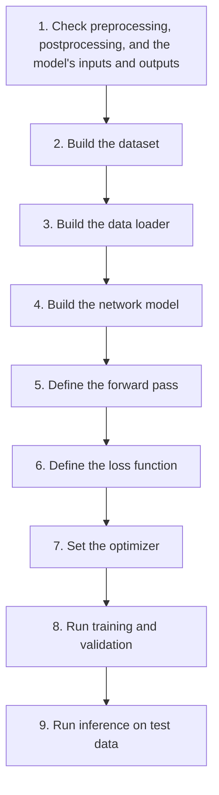

*Figure 1. The nine steps of implementing deep learning with PyTorch*

The nine steps correspond to the three actions of neural network training. The network computes values from the input to the output (**forward computation**), compares the prediction with the answer (the expected value) to obtain the error (**error computation**), and corrects the weights from the output layer toward the input layer in the direction that reduces the error (**backward weight update**). Steps 4 and 5 define the forward computation, step 6 defines the error computation, step 7 sets the rule for the weight update, and step 8 repeats the three actions.

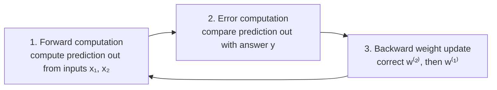

*Figure 2. Forward computation, error computation, and backward weight update repeated in neural network training*

In Figure 2, w⁽¹⁾ denotes the weights between the input layer and the hidden layer, and w⁽²⁾ the weights between the hidden layer and the output layer. The derivative of the error with respect to each weight (the gradient) is computed first for w⁽²⁾, which is closer to the output layer, so the updates also proceed from back to front. This computation is the backpropagation covered in Lecture 1.

### 1.2 Checking Preprocessing, Postprocessing, and the Model's Inputs and Outputs

Before writing code, decide what goes into the model and what comes out. In image classification the **input** is an image and the **output** is one score per class. Converting an image into the form the model accepts (size, value range) is called **preprocessing**, and converting the model's output scores into probabilities or class names is called **postprocessing**.

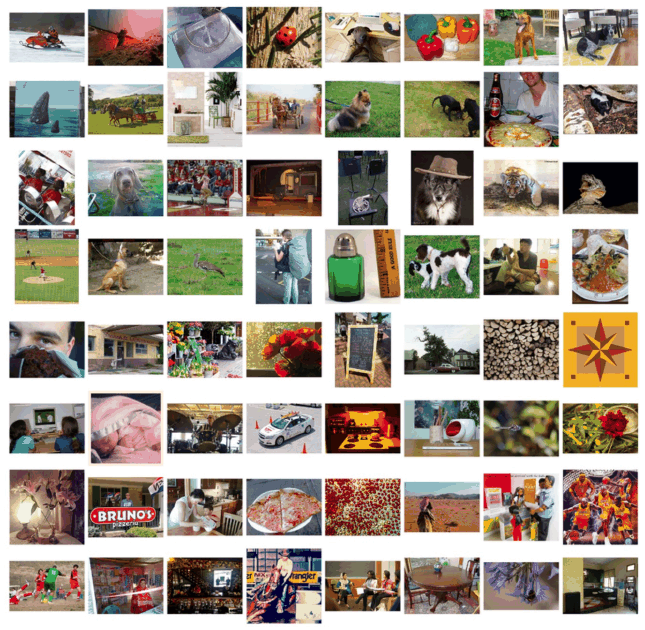

*Figure 3. Examples of natural image inputs showing objects and scenes of various categories*

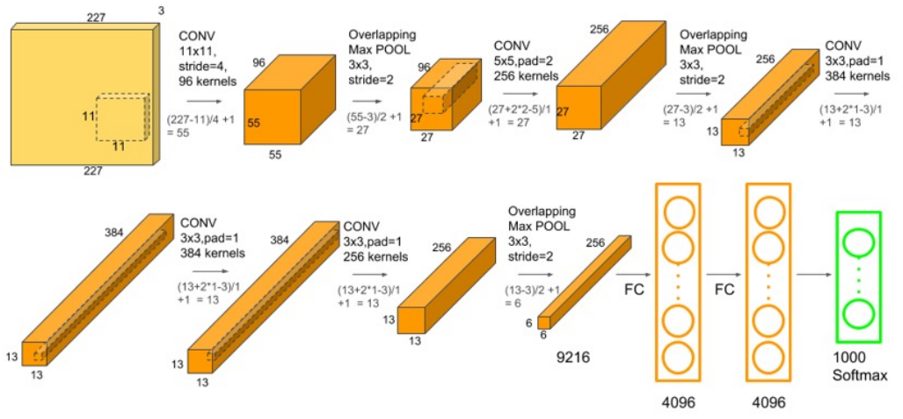

*Figure 4. Architecture of AlexNet from a 227×227×3 input to a softmax output over 1000 classes*

Figure 4 is AlexNet, covered in Lecture 2. Because its input size is fixed, preprocessing must resize images to 227×227, and because its output is a score for each of 1000 classes, postprocessing must turn the position of the largest score into a class name. The output size of a convolution or pooling layer is computed from the input size $W$, kernel size $K$, padding $P$, and stride $S$.

```math
O = \left\lfloor \frac{W - K + 2P}{S} \right\rfloor + 1
```

| Layer | Setting | Output size computation | Output |
|:-----|:-----|:-----|:-----|
| Input | | | 227×227×3 |
| Convolution 1 | 11×11, stride 4, 96 kernels | (227 − 11)/4 + 1 = 55 | 55×55×96 |
| Max pooling 1 | 3×3, stride 2 (overlapping pooling) | (55 − 3)/2 + 1 = 27 | 27×27×96 |
| Convolution 2 | 5×5, padding 2, 256 kernels | (27 + 2×2 − 5)/1 + 1 = 27 | 27×27×256 |
| Max pooling 2 | 3×3, stride 2 | (27 − 3)/2 + 1 = 13 | 13×13×256 |
| Convolution 3 | 3×3, padding 1, 384 kernels | (13 + 2×1 − 3)/1 + 1 = 13 | 13×13×384 |
| Convolution 4 | 3×3, padding 1, 384 kernels | 13 | 13×13×384 |
| Convolution 5 | 3×3, padding 1, 256 kernels | 13 | 13×13×256 |
| Max pooling 3 | 3×3, stride 2 | (13 − 3)/2 + 1 = 6 | 6×6×256 = 9216 |
| Fully connected 1, 2 | 4096 neurons each | | 4096 |
| Output | Fully connected and softmax | | 1000 |

*Table 1. Output size computation for each layer of AlexNet*

The 2×2 in the table is padding 2 added on both sides. The 6×6×256 = 9216 values output by the last pooling layer must be flattened into one row before they can enter the fully connected layer. Computing the input and output sizes of every layer in advance like this prevents size-mismatch errors in the model code.

### 1.3 Building the Dataset and the Data Loader

A **dataset** is an object that bundles pairs of inputs and answers so that they can be taken out one at a time by index, and a **data loader** is an object that takes a given number of samples from a dataset and groups them into mini-batches.

**torchvision.** torchvision is the computer vision library used with PyTorch. It provides datasets (`torchvision.datasets`), model architectures and pretrained weights (`torchvision.models`), and image transformation functions (`torchvision.transforms`) for tasks such as image classification, object detection, and video analysis. The datasets give easy access to major vision datasets such as CIFAR, MNIST, and ImageNet; the models include pretrained image classification models such as ResNet, AlexNet, VGG, and Inception and object detection models such as Faster R-CNN and Mask R-CNN; and the transforms provide common preprocessing and augmentation for images and video. It also provides utilities such as the data loader that simplify data processing and model training code. It is a core component of the PyTorch ecosystem, designed so that researchers and developers can easily start, experiment with, and deploy vision projects.

**Tensors.** A **tensor** is a mathematical object meaning a multidimensional array, a generalization of scalars, vectors, and matrices. In deep learning, input data, model weights, and outputs are all represented as tensors, and training is a sequence of tensor operations. PyTorch's `Tensor` type supports GPU computation and **automatic differentiation** in addition to array computation similar to NumPy arrays. Automatic differentiation records the sequence of operations and computes the gradient of the loss automatically.

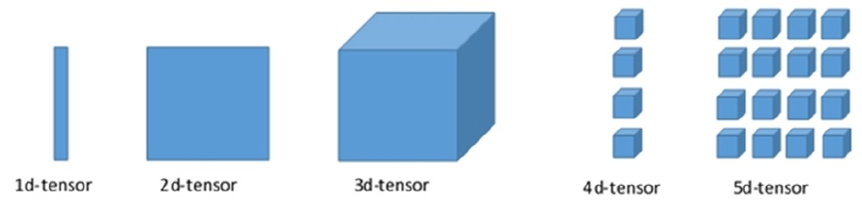

*Figure 5. Shapes of tensors from one to five dimensions*

| Dimensions | Name | Example in image data |
|:-----|:-----|:-----|
| 0 | Scalar | A single loss value |
| 1 | Vector | Scores of 10 classes |
| 2 | Matrix | One grayscale image (height×width) |
| 3 | 3D tensor | One color image (channels×height×width) |
| 4 | 4D tensor | A mini-batch of color images (batch×channels×height×width) |
| 5 | 5D tensor | A mini-batch of videos (batch×frames×channels×height×width) |

*Table 2. Tensor dimensions and examples in image data*

**ToTensor.** PyTorch models take tensors as input. `transforms.ToTensor()` converts a PIL image or a NumPy array (height×width×channels, integers 0-255) into a floating-point tensor in channels×height×width order, and divides the values by 255 to bring them into the range 0-1.

**Normalize.** `transforms.Normalize(mean, std)` subtracts the mean $m_c$ and divides by the standard deviation $s_c$ for each channel $c$. `mean` and `std` take a sequence with one value per channel. A color image has three channels, so there are three values, as in `(0.5, 0.5, 0.5)`.

```math
x' = \frac{x - m_c}{s_c}
```

With both the mean and the standard deviation set to 0.5, values in the range 0-1 move to the range −1 to 1. Following the pixel values 0, 128, and 255 gives the following.

| Original pixel value | After ToTensor ($x$ = value/255) | After Normalize ($x'$ = ($x$ − 0.5)/0.5) |
|:-----|:-----|:-----|
| 0 | 0.0 | −1.0 |
| 128 | 0.502 | 0.004 |
| 255 | 1.0 | 1.0 |

*Table 3. Change of pixel values through ToTensor and Normalize((0.5, 0.5, 0.5), (0.5, 0.5, 0.5))*

The value 0.5 is chosen to keep the computation simple. To be precise, compute the per-channel (or per-pixel) mean and standard deviation from the training data. For example, the per-channel mean of the CIFAR-10 training data is about (0.491, 0.482, 0.447) and the standard deviation about (0.247, 0.243, 0.262), and for models trained on ImageNet it is customary to use the mean (0.485, 0.456, 0.406) and the standard deviation (0.229, 0.224, 0.225) (Lecture 1 lab).

**Why input normalization is needed.** If input features have different value ranges, model performance can suffer. Take the scores of two students as an example.

| | English score (out of 100) | TOEIC score (out of 990) |
|:-----|:-----|:-----|
| Student A | 50 | 900 |
| Student B | 100 | 700 |

*Table 4. An example of two features with different ranges*

Used as they are, the difference in TOEIC scores (200 points) looks larger than the difference in English scores (50 points), but after dividing by the full marks the English scores are 0.5 and 1.0, a difference of 0.5, while the TOEIC scores are about 0.909 and 0.707, a difference of about 0.2. The magnitude of the values distorts the importance of the features.

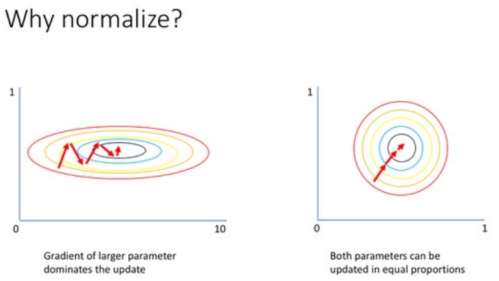

*Figure 6. Loss contours of two parameters with different ranges (left) and the contours after normalization (right)*

As on the left of Figure 6, if one parameter ranges over 0-10 and the other over 0-1, the contours of the loss function become elongated ellipses. The gradient of the parameter with the larger range dominates the update, so gradient descent zigzags and approaches the minimum slowly. As on the right, if both ranges are made 0-1, the contours become nearly circular, both parameters are updated in equal proportions, and the descent heads straight toward the minimum.

**Code.** The code that loads the CIFAR-10 dataset and builds data loaders is as follows. **CIFAR-10** is a dataset of 60,000 color images of size 32×32 divided into 10 classes (6,000 images per class): airplane, automobile, bird, cat, deer, dog, frog, horse, ship, and truck. 50,000 images are for training and 10,000 for testing [1].

```python
import torch
import torchvision
import torchvision.transforms as transforms

# 데이터 정규화 설정
transform = transforms.Compose(
    [transforms.ToTensor(),
     transforms.Normalize((0.5, 0.5, 0.5), (0.5, 0.5, 0.5))])

# 데이터셋 작성
trainset = torchvision.datasets.CIFAR10(root='./data', train=True,
                                        download=True, transform=transform)
testset = torchvision.datasets.CIFAR10(root='./data', train=False,
                                       download=True, transform=transform)

# 데이터 로더 작성
trainloader = torch.utils.data.DataLoader(trainset, batch_size=4,
                                          shuffle=True)
testloader = torch.utils.data.DataLoader(testset, batch_size=4,
                                         shuffle=False)

classes = ('plane', 'car', 'bird', 'cat',
           'deer', 'dog', 'frog', 'horse', 'ship', 'truck')
```

`transforms.Compose` combines several transformations into one that applies them in order. In `CIFAR10`, `train=True` selects the 50,000 training images and `train=False` the 10,000 test images, and with `download=True` the data is downloaded if it is not in the `root` folder. With `batch_size=4`, the data loader stacks four images into one 4×3×32×32 tensor and yields 50,000/4 = 12,500 mini-batches per epoch for training and 10,000/4 = 2,500 for testing. `shuffle=True` shuffles the order of the training data every epoch so that the model does not learn the order, and the test loader is not shuffled because order does not matter for evaluation. A line-by-line explanation is in the [lab note](Concepts_Lab.md).

### 1.4 Building the Network Model and Defining the Forward Pass

In PyTorch a model is a class that inherits from `nn.Module`. `__init__` creates the layers that hold trainable parameters (step 4), and `forward` defines the order in which the input passes through the layers (step 5). Once the forward pass is defined, automatic differentiation computes the backward pass.

```python
import torch.nn as nn
import torch.nn.functional as F


class Model(nn.Module):
    def __init__(self):
        super(Model, self).__init__()
        self.conv1 = nn.Conv2d(3, 6, 5) # in_channels, out_channels, kernel_size
        self.pool = nn.MaxPool2d(2, 2)
        self.conv2 = nn.Conv2d(6, 16, 5)
        self.fc1 = nn.Linear(16 * 5 * 5, 120)
        self.fc2 = nn.Linear(120, 84)
        self.fc3 = nn.Linear(84, 10)

    def forward(self, x):
        x = self.pool(F.relu(self.conv1(x)))
        x = self.pool(F.relu(self.conv2(x)))
        x = x.view(-1, 16 * 5 * 5)
        x = F.relu(self.fc1(x))
        x = F.relu(self.fc2(x))
        x = self.fc3(x)
        return x


model = Model()
```

`nn.Conv2d(3, 6, 5)` is a layer that takes 3 input channels and convolves them with six 5×5 kernels, and `nn.MaxPool2d(2, 2)` picks the maximum in each 2×2 region and moves with stride 2, halving the height and width. When one mini-batch (four images) passes through the model, the tensor size changes as follows.

| Step | Operation | Output size (batch×channels×height×width) |
|:-----|:-----|:-----|
| Input | | 4×3×32×32 |
| conv1 and ReLU | 5×5 convolution, (32 − 5)/1 + 1 = 28 | 4×6×28×28 |
| pool | 2×2 max pooling | 4×6×14×14 |
| conv2 and ReLU | 5×5 convolution, (14 − 5)/1 + 1 = 10 | 4×16×10×10 |
| pool | 2×2 max pooling | 4×16×5×5 |
| view | Flatten into one row (16×5×5 = 400) | 4×400 |
| fc1 and ReLU | 400 → 120 | 4×120 |
| fc2 and ReLU | 120 → 84 | 4×84 |
| fc3 | 84 → 10 | 4×10 |

*Table 5. Change of tensor size as a mini-batch passes through the model*

The input size of `fc1`, `16 * 5 * 5`, comes from the computation in Table 5. This is why Section 1.2 checks input and output sizes in advance. The final 10 outputs are class scores, and these values, not yet turned into probabilities, are called **logits**.

### 1.5 Defining the Loss Function and Setting the Optimizer

```python
import torch.optim as optim

criterion = nn.CrossEntropyLoss()
optimizer = optim.SGD(model.parameters(), lr=0.001, momentum=0.9)
```

PyTorch provides loss functions and layers in `torch.nn` and optimization methods in `torch.optim`, and apart from a few rarely used ones it offers most widely used optimizers (SGD, Adam, RMSprop, and others).

**Cross-entropy loss.** `nn.CrossEntropyLoss` applies softmax to the logits $z_1, \dots, z_K$ to turn them into probabilities and takes the negative logarithm of the probability of the correct class $y$.

```math
p_k = \frac{e^{z_k}}{\sum_{j=1}^{K} e^{z_j}}, \qquad L = -\log p_y = -z_y + \log \sum_{j=1}^{K} e^{z_j}
```

When the probability of the correct class is close to 1 the loss is close to 0, and the smaller the probability, the larger the loss. For example, if the probability of the correct class is 0.534, then $L = -\ln 0.534 \approx 0.627$. In a 10-class problem, a model that gives every class the same probability 0.1 has loss $-\ln 0.1 = \ln 10 \approx 2.303$, so the loss at the beginning of training starts near this value.

**SGD with momentum.** `optim.SGD` is stochastic gradient descent, which corrects the parameters $\theta$ with the gradient $g_t$ computed on a mini-batch. `lr` is the **learning rate** $\eta$ and `momentum` is the momentum coefficient $\mu$. PyTorch's SGD with momentum accumulates the previous update direction $v$ as follows [2].

```math
v_t = \mu v_{t-1} + g_t, \qquad \theta_t = \theta_{t-1} - \eta v_t
```

With $\mu = 0.9$, the update keeps 90% of the previous direction and adds the new gradient, so it gains speed along axes where the gradient keeps the same direction, and the contributions cancel along axes where the direction alternates (the zigzag of Figure 6).

### 1.6 Training and Validation

**Training.** The training loop is two nested `for` loops. The outer loop repeats over **epochs**, deciding how many times to go through the whole dataset, and the inner loop repeats over the mini-batches yielded by the data loader.

```python
for epoch in range(1):   # 전체 데이터셋을 여러번 반복하기

    training_loss = 0.0
    model.train()
    for i, data in enumerate(trainloader):
        # 입력 받기: 데이터는 [inputs, labels] 형태의 리스트
        inputs, labels = data

        # 파라미터 변화도(.grad)를 0으로 만들기
        optimizer.zero_grad()

        # 순전파 + 역전파 + 최적화
        outputs = model(inputs)
        loss = criterion(outputs, labels) # 손실을 계산
        loss.backward() # 파라미터들의 에러에 대한 변화도를 계산함
        optimizer.step() # loss function을 효율적으로 최소화 할 수 있게 파라미터 수정

        # 통계 출력
        training_loss += loss.item()
        if i % 2000 == 1999:    # 미니배치 2000개 마다 출력
            print('[%d, %5d] loss: %.3f' %
                  (epoch + 1, i + 1, training_loss / 2000))
            training_loss = 0.0

print('Finished Training')
```

Four things happen for every mini-batch. `optimizer.zero_grad()` clears the gradients computed for the previous mini-batch. PyTorch adds gradients into `.grad` every time `backward()` is called, so without clearing them the gradients of earlier mini-batches would be mixed in. `model(inputs)` is the forward pass, `criterion(...)` computes the loss, `loss.backward()` obtains the gradients of all parameters by backpropagation, and `optimizer.step()` corrects the parameters with the rule of Section 1.5. Here `range(1)` runs only one epoch for demonstration, but in practice training usually repeats for tens to hundreds of epochs.

The output is the average loss over 2,000 mini-batches. In one run, the loss decreased from an average of 2.225 over the first 2,000 mini-batches to an average of 1.483 over mini-batches 10,001-12,000, the last window printed. The first value is slightly below 2.303 (the loss of random guessing) because learning had already started within the first 2,000 mini-batches.

**Validation.** **Validation** is the process of measuring the model's performance on data not used for training. Because the weights are not corrected, only the forward pass and the loss computation are performed.

```python
from tqdm import tqdm

val_loss = 0.0
corrects = 0
model.eval()
for i, data in tqdm(enumerate(testloader)):
    # 입력 받기: 데이터는 [inputs, labels] 형태의 리스트
    inputs, labels = data

    # 순전파
    outputs = model(inputs)
    loss = criterion(outputs, labels) # 손실을 계산
    _, preds = torch.max(outputs, 1)  # 라벨을 예측

    # 통계 출력
    val_loss += loss.item()
    corrects += torch.sum(preds == labels.data)

val_loss = val_loss / (i+1)
val_acc = corrects / len(testloader.dataset)
print('val Loss: {:.4f} val Acc: {:.4f}'.format(val_loss, val_acc))
```

`model.eval()` switches the model to evaluation mode. It is required whenever there are layers that behave differently in training and evaluation, such as dropout or batch normalization (Section 5.2). `torch.max(outputs, 1)` returns both the maximum values and their positions along dimension 1 (the class dimension). For example, if the rows of a 4×4 tensor `a` are [−1.2360, −0.2942, −0.1222, 0.8475], [1.1949, −1.1127, −2.2379, −0.6702], [1.5717, −0.9207, 0.1297, −1.8768], and [−0.6172, 1.0036, −0.6060, −0.2432], then `torch.max(a, 1)` returns the values [0.8475, 1.1949, 1.5717, 1.0036] and the positions [3, 0, 0, 1]. In classification the position is the predicted class, so the values are discarded into `_` and only the positions are kept in `preds`. The number of correct predictions divided by all 10,000 images is the accuracy, and the validation accuracy of this model trained for only one epoch is around 50% depending on the run.

> **Caution:** This code uses the test data for validation. Strictly, part of the training data should be held out as validation data, and the test data should be used only once at the end, after the model and hyperparameters have been chosen. Choosing a model while looking at the test data makes the measured test performance better than the real one. Also, putting the evaluation loop inside `with torch.no_grad():` skips the recording needed for gradient computation and saves memory and time.

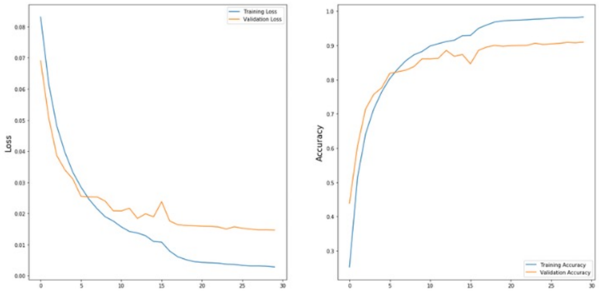

*Figure 7. Training and validation loss (left) and training and validation accuracy (right) over epochs*

Figure 7 is an example of learning curves drawn over about 30 epochs. The training loss keeps decreasing toward 0, but the validation loss fluctuates and decreases only slowly from around epoch 5 and stays almost flat at about 0.015 from around epoch 17, and the training accuracy levels off at about 0.98 and the validation accuracy at about 0.9. Because the model corrects its parameters to fit the training data, the loss is usually lower and the accuracy higher on the training data. If the gap between the two curves keeps widening, overfitting is suspected.

### 1.7 Inference on Test Data

**Inference** is the step of applying a trained model to new inputs to produce results. New images must receive the same preprocessing as in training.

```python
from PIL import Image

# test 이미지 불러오기
image_file_path = 'data/goldenretriever-3724972_640.jpg'
img_origin = Image.open(image_file_path)  # [높이][너비][색RGB]
print('원본 크기:', np.shape(img_origin))

# 데이터 전처리
img = img_origin.resize((32, 32))
print('resize 크기:', np.shape(img))
input = transform(img)
print('transform 크기:', input.size())
print()

# inference
model.eval()
output = model(input) # 모델에 입력 넣기
print(output)
_, preds = torch.max(output, 1)  # 라벨을 예측
print(classes)

print(preds)
# 결과 시각화
plt.imshow(img_origin)
plt.show()
print('예측 class:', classes[preds[0]])
```

A photo of a golden retriever, 426 pixels high and 640 pixels wide, is shrunk to 32×32 like the training data, converted to a tensor, and normalized with the same `transform`. The model's output is the logits of 10 classes, and if the position of the largest logit is 5, the model predicted `classes[5]`, which is `'dog'`. To see the logits as probabilities, apply softmax as postprocessing. The output values and what each line does are covered in detail in the [lab note](Concepts_Lab.md).

---

<br>

## 2. Image Processing Applications

### 2.1 Tasks That Use Image Data

Representative tasks that can be solved with image data, with the input and output of each, are as follows.

| Task | Input | Output |
|:-----|:-----|:-----|
| Image classification | Image | One class for the whole image (or a probability per class) |
| Object detection | Image | For each object, the location of a bounding box, its class, and a confidence |
| Segmentation | Image | A class for every pixel (instance segmentation also separates individual objects) |
| OCR (optical character recognition) | Image containing text | Text |
| Super-resolution | Low-resolution image | High-resolution image |
| Image generation | A condition such as random noise or text | A new image |

*Table 6. Inputs and outputs of image processing tasks*

The list of tasks keeps growing. New research can be found on pages that collect papers drawing attention, such as Hugging Face's Trending Papers (https://huggingface.co/papers/trending), or with AI-based paper search tools such as SciSpace (https://scispace.com/).

### 2.2 Image Classification and Object Detection

**Image classification** is the task of assigning one class to an image. VGG-16 in Section 3 (Figure 20) takes a 224×224 color image and classifies it into one of the 1000 ImageNet classes.

**Object detection** is the task of marking the location of each of several objects in an image with a **bounding box** and assigning a class to it. If classification tells what is in the image, detection also tells where each object is.

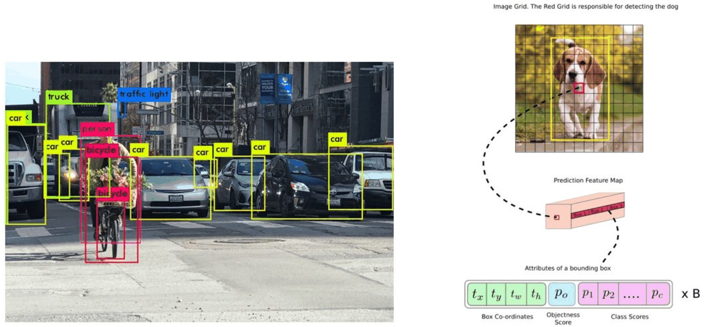

*Figure 8. Detection of cars, a truck, a person, a bicycle, and a traffic light in a street image (left) and prediction of bounding boxes per grid cell (right)*

The right side of Figure 8 shows how YOLO-family detectors work. The image is divided into a grid, and the cell containing the center of an object (the red cell) is responsible for detecting that object (the dog). Each cell predicts B bounding boxes, and each box consists of the box coordinates $t_x, t_y, t_w, t_h$ (center position, width, height), the objectness score $p_o$ indicating how likely the box contains an object, and the class scores $p_1, \dots, p_c$. This per-box class scoring is the scheme of later models such as YOLOv3; the original YOLO [3] predicts only one set of class probabilities per cell (Section 3.3 of Lecture 5). Object detection is covered in detail in Lecture 5.

### 2.3 Segmentation

**Segmentation** is the task of assigning a class to every pixel of an image. It recovers the shape of objects more precisely than bounding boxes.

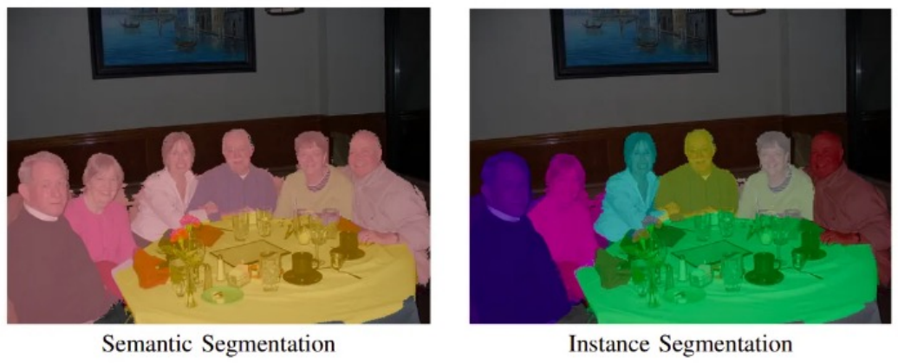

*Figure 9. Semantic segmentation (left) and instance segmentation (right) of the same scene*

**Semantic segmentation** groups pixels with the same meaning (class) together. On the left of Figure 9, all people share one color and the table has another. **Instance segmentation** separates individual objects even within the same class. On the right, each person is painted a different color.

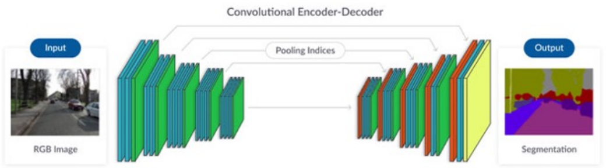

*Figure 10. A convolutional encoder-decoder architecture that takes an RGB image and outputs a segmentation map*

Segmentation models often use an **encoder-decoder** architecture. The encoder extracts features while shrinking the image with convolution and pooling, and the decoder enlarges it again to produce a segmentation map of the same size as the input. SegNet in Figure 10 passes the positions selected by the encoder's max pooling (pooling indices) to the decoder, so that values are put back in their original positions when the size is enlarged [4].

### 2.4 OCR, Super-Resolution, and Image Generation

**OCR.** **Optical character recognition (OCR)** is the task of converting characters in an image into text.

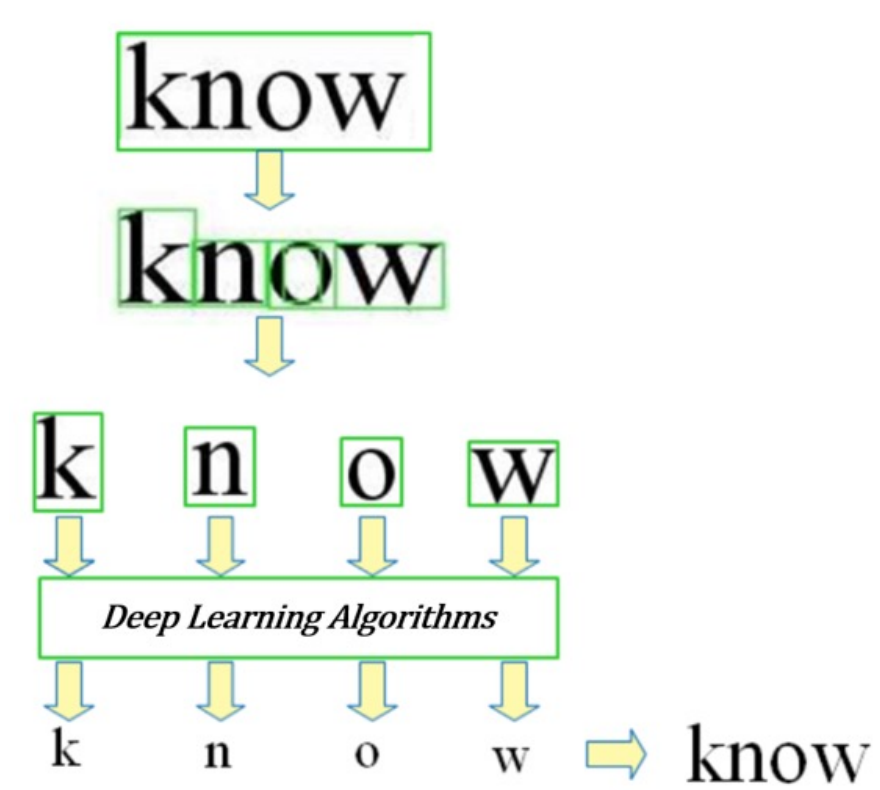

*Figure 11. The OCR process of finding a word region, splitting it into characters, and recognizing each character with a deep learning algorithm to obtain the word know*

The process in Figure 11 has three steps. First it finds the region containing text (know) in the image, then splits the region into the characters k, n, o, and w, and finally a deep learning model recognizes each character and joins them.

**Super-resolution.** **Super-resolution** is the task of restoring a high-resolution image from a low-resolution one.

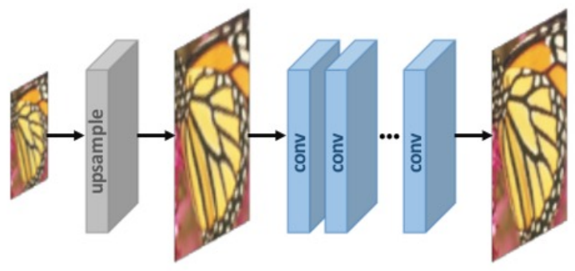

*Figure 12. A super-resolution architecture that upsamples a low-resolution image and then restores details with convolutional layers*

The architecture in Figure 12 first enlarges a small butterfly image to the target size by interpolation (upsampling), and then several convolutional layers learn to sharpen the blurred edges and patterns. A representative early model of this approach is SRCNN [5]. As another example of the same task, a blurred, mosaic-like low-resolution face photo (Original) can be turned into a sharp high-resolution face photo (Result). The details missing from the low-resolution image are filled in with plausible content that the model learned from its training data, so the restored face can differ from the actual person.

**Image generation.** **Image generation** is the task of creating new images similar to the training data. The widely used **diffusion models** learn to reverse a process that gradually adds noise to the data.

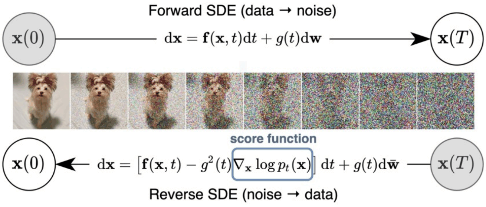

*Figure 13. The forward SDE that turns data into noise and the reverse SDE that creates data from noise*

Figure 13 shows a score-based generative model that describes diffusion with stochastic differential equations (SDEs) [6]. The forward process keeps adding noise to the data $\mathbf{x}(0)$ at time 0 until it becomes pure noise $\mathbf{x}(T)$ at time $T$.

```math
d\mathbf{x} = \mathbf{f}(\mathbf{x}, t)\,dt + g(t)\,d\mathbf{w}
```

$\mathbf{f}$ is the average direction in which the values move (drift), $g(t)$ is the strength of the noise, and $\mathbf{w}$ is a Wiener process (Brownian motion) representing random movement. The reverse process starts from the noise $\mathbf{x}(T)$ and goes backward in time to create the data $\mathbf{x}(0)$.

```math
d\mathbf{x} = \left[\mathbf{f}(\mathbf{x}, t) - g(t)^2 \nabla_{\mathbf{x}} \log p_t(\mathbf{x})\right] dt + g(t)\,d\bar{\mathbf{w}}
```

$p_t$ is the probability distribution of the data at time $t$, and $\nabla_{\mathbf{x}} \log p_t(\mathbf{x})$ is the **score function**, which points in the direction in which the probability increases. Once a neural network learns this score function, it can start from noise and create images that look more and more like data. The puppy photo in the figure is buried in noise as the forward process proceeds and reappears along the reverse process.

### 2.5 Real-World Applications

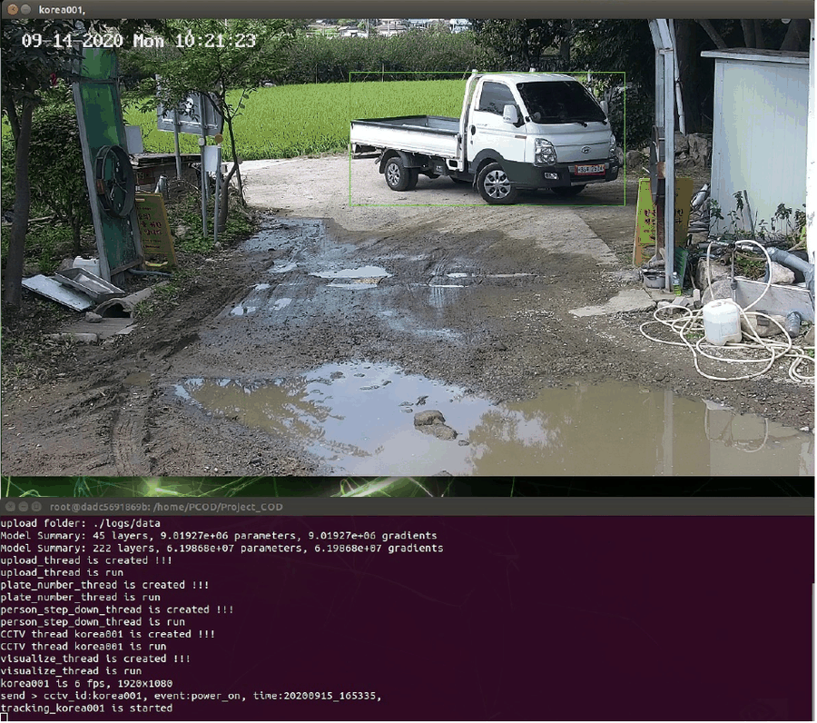

*Figure 14. A vehicle monitoring program that detects a truck in CCTV footage and runs several processing threads*

Figure 14 shows a frame in which a truck is detected in CCTV footage (1920×1080, 6 frames per second) together with the program's execution log. The log shows two models of different sizes (about 9 million and about 62 million parameters) being loaded, followed by separate threads for license plate recognition, detecting people stepping down from a vehicle, uploading, visualization, and tracking. It shows that a single application is built by combining several image processing models and processing stages.

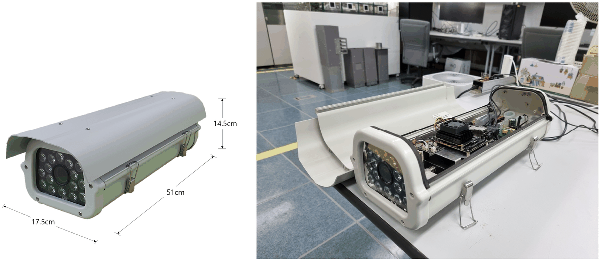

*Figure 15. A camera device with a board that runs a deep learning model inside its housing*

Figure 15 shows a camera housing about 51 cm × 17.5 cm × 14.5 cm in size and the housing opened up. The computing board inside runs the model on site, so results can be produced without sending video to a server. Lightweight models suited to such edge devices are covered in Lecture 9.

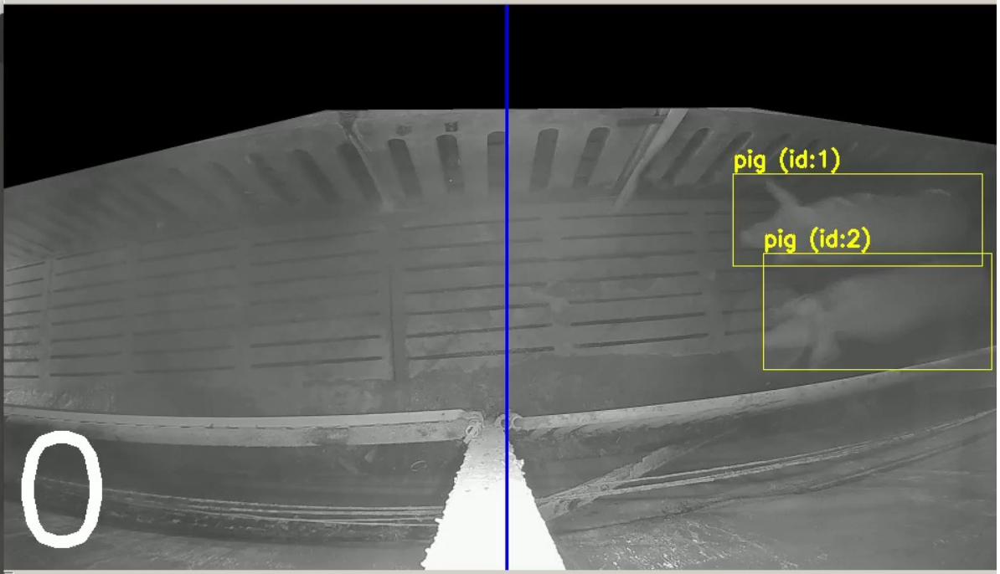

*Figure 16. Detecting pigs in barn footage and tracking them with numbered IDs*

Figure 16 is an example of detecting pigs in infrared footage and tracking them with an ID per animal, as in `pig (id:1)` and `pig (id:2)`. The blue vertical line on the screen and the number at the lower left are used to count the animals that cross the reference line.

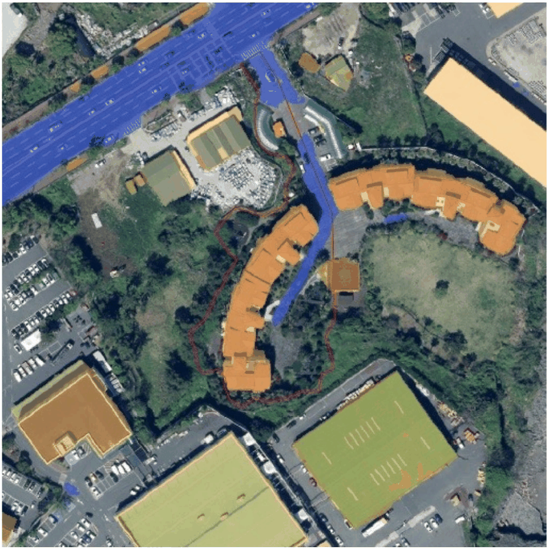

*Figure 17. Segmenting the pixels of an aerial image into classes such as roads and buildings, with the monitored land parcel outlined in red*

Figure 17 is an example of semantic segmentation. Each pixel of the aerial image receives a class such as road (blue) or building (orange), and the use of the land within the monitored parcel inside the red line is checked.

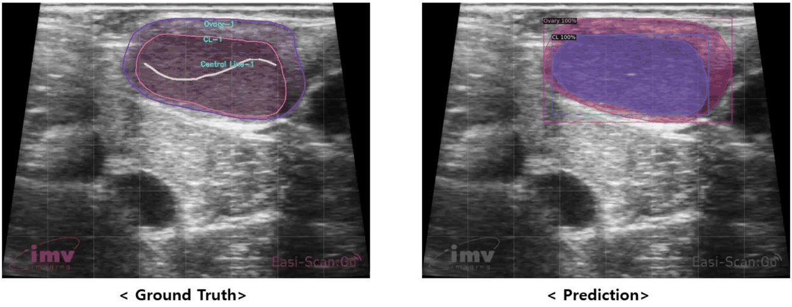

*Figure 18. Ground truth (left) and model prediction (right) of the ovary and corpus luteum regions in an ultrasound image*

Figure 18 is an example of segmenting the ovary and the corpus luteum (CL) regions in a reproductive ultrasound image of livestock. The left is the ground truth marked by a person and the right is the model's prediction, and the shapes of the two regions match closely.

### 2.6 The ImageNet Image Classification Challenge

**ImageNet** is a large-scale dataset that collects images for the nouns of the WordNet lexical hierarchy, and the challenge built on it, **ILSVRC** (ImageNet Large Scale Visual Recognition Challenge), was held from 2010 to 2017. Its classification track classifies images into 1000 classes using about 1.28 million training images, and performance is measured by the **top-5 error rate** [7]. The top-5 error rate is the fraction of images whose correct class is not among the five classes the model scored highest.

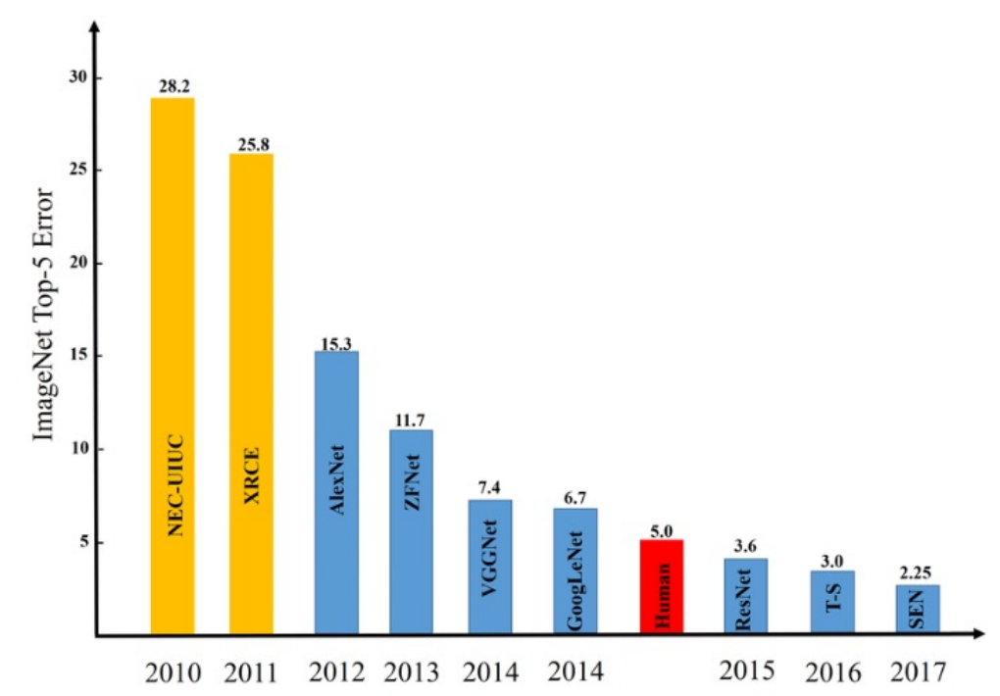

*Figure 19. Yearly top-5 error rates of the winning models of the ImageNet classification challenge and the human error rate*

In 2010 (NEC-UIUC, 28.2%) and 2011 (XRCE, 25.8%), classical methods using hand-designed features won. In 2012 the CNN AlexNet lowered the error rate sharply to 15.3% and opened the era of CNNs, followed by ZFNet (2013, 11.7%), VGGNet (2014, 7.3%; 7.4% in the figure), and GoogLeNet (2014, 6.7%). ResNet in 2015 (3.6%) recorded an error rate lower than the human error rate (about 5%), and Trimps-Soushen (T-S, 3.0%) in 2016 and SENet (2.25%) in 2017 followed. Sections 3 and 4 examine VGGNet and ResNet in detail.

---

<br>

## 3. VGGNet

### 3.1 A Design for Testing the Effect of Depth

**VGGNet** is a CNN proposed by the Visual Geometry Group of the University of Oxford, which took second place in the classification track and first place in the localization track of ILSVRC 2014 [8]. The central question of the VGG study was **what effect making the network deeper has on performance**. To examine only the effect of depth, the team fixed the other conditions as much as possible, and in particular unified the size of the convolution filters (kernels) to 3×3, the smallest. 3×3 is the smallest size that can distinguish up, down, left, right, and center. The benefits of stacking 3×3 filters are confirmed by computation in Lecture 4.

### 3.2 Architecture of VGG-16

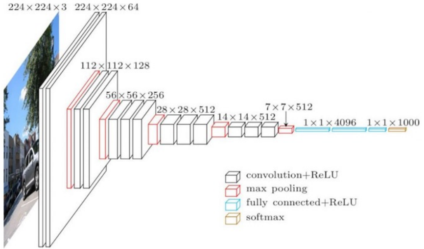

*Figure 20. Architecture of VGG-16, in which a 224×224×3 input passes through convolution and max pooling to become a 1×1×1000 output*

VGG-16 has 16 layers with weights (13 convolutional and 3 fully connected). Every convolution is 3×3 with stride 1 and padding 1, so it does not change the height and width, and the size is halved only at the 2×2 max pooling layers (stride 2). Each time the size shrinks, the number of channels doubles (stopping at 512) to balance the amount of information.

| Stage | Composition | Output size |
|:-----|:-----|:-----|
| Input | | 224×224×3 |
| Block 1 | Two 3×3 convolutions (64), max pooling | 112×112×64 |
| Block 2 | Two 3×3 convolutions (128), max pooling | 56×56×128 |
| Block 3 | Three 3×3 convolutions (256), max pooling | 28×28×256 |
| Block 4 | Three 3×3 convolutions (512), max pooling | 14×14×512 |
| Block 5 | Three 3×3 convolutions (512), max pooling | 7×7×512 |
| Classifier | Fully connected 4096, 4096, 1000 and softmax | 1000 |

*Table 7. Composition and output size of each stage of VGG-16*

The numbers in Figure 20 mark the convolution outputs within each block (224×224×64, 112×112×128, …, 14×14×512) and the last pooling output (7×7×512). VGG-16 has about 138 million parameters, of which the first fully connected layer (7×7×512 = 25,088 → 4096) accounts for about 100 million.

### 3.3 Six Configurations

The VGG paper compared six configurations that differ only in depth. `conv3-64` means a 3×3 convolution with 64 output channels and `conv1-256` a 1×1 convolution with 256 output channels, and the layers in bold are those added or changed relative to the configuration immediately to the left.

| | A | A-LRN | B | C | D | E |
|:-----|:-----|:-----|:-----|:-----|:-----|:-----|
| Weight layers | 11 | 11 | 13 | 16 | 16 | 19 |
| Block 1 | conv3-64 | conv3-64<br>**LRN** | conv3-64<br>**conv3-64** | conv3-64<br>conv3-64 | conv3-64<br>conv3-64 | conv3-64<br>conv3-64 |
| Block 2 | conv3-128 | conv3-128 | conv3-128<br>**conv3-128** | conv3-128<br>conv3-128 | conv3-128<br>conv3-128 | conv3-128<br>conv3-128 |
| Block 3 | conv3-256<br>conv3-256 | conv3-256<br>conv3-256 | conv3-256<br>conv3-256 | conv3-256<br>conv3-256<br>**conv1-256** | conv3-256<br>conv3-256<br>**conv3-256** | conv3-256<br>conv3-256<br>conv3-256<br>**conv3-256** |
| Block 4 | conv3-512<br>conv3-512 | conv3-512<br>conv3-512 | conv3-512<br>conv3-512 | conv3-512<br>conv3-512<br>**conv1-512** | conv3-512<br>conv3-512<br>**conv3-512** | conv3-512<br>conv3-512<br>conv3-512<br>**conv3-512** |
| Block 5 | conv3-512<br>conv3-512 | conv3-512<br>conv3-512 | conv3-512<br>conv3-512 | conv3-512<br>conv3-512<br>**conv1-512** | conv3-512<br>conv3-512<br>**conv3-512** | conv3-512<br>conv3-512<br>conv3-512<br>**conv3-512** |

*Table 8. The six configurations A-E compared in the VGG paper*

Every configuration takes a 224×224 RGB image as input, places max pooling after each block, and ends with FC-4096, FC-4096, FC-1000, and softmax. Configuration D is VGG-16 and configuration E is VGG-19. A-LRN adds the local response normalization (LRN) used by AlexNet, which did not improve performance, and as the depth grew from 11 to 19 layers the error rate decreased until it saturated around 19 layers [8].

---

<br>

## 4. ResNet

### 4.1 Is Deeper Always Better? The Degradation Problem

VGG showed that deeper networks perform better. Then does performance keep improving just by making the network deeper? In reality, adding layers indiscriminately made performance worse.

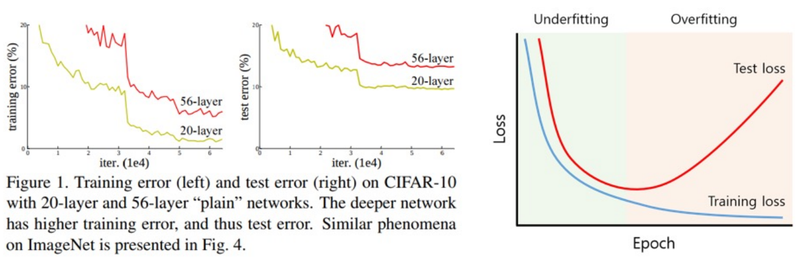

*Figure 21. Training and test error of 20-layer and 56-layer plain networks on CIFAR-10 (left), and loss curves in the underfitting and overfitting regions (right)*

On the left of Figure 21, when plain networks without the skip connections of Section 4.3 are trained on CIFAR-10, the 56-layer network has higher training error and higher test error than the 20-layer network [9]. In the case of **overfitting**, as in the right figure, the training loss should keep decreasing while only the test loss rises. The 56-layer network, however, performs poorly even on the training data, so the cause is not overfitting. The optimization of training a deep network itself has become difficult, and this is called the **degradation problem**.

In theory, a deeper network has no reason to be worse than a shallower one. If the weights of the 20-layer network were copied and the remaining 36 layers became identity functions that output their input unchanged, the 56-layer network could achieve the same performance. The problem is that a stack of many nonlinear layers has difficulty learning even the identity function.

### 4.2 Deep Networks and Vanishing Gradients

Separately from degradation, deeper networks also face the vanishing gradient problem, in which the learning signal of backpropagation does not reach the layers near the input well. In backpropagation, the gradient of an earlier layer is obtained by multiplying the derivatives of the later layers in sequence according to the chain rule. If the factors being multiplied are smaller than 1, the gradient shrinks at every layer.

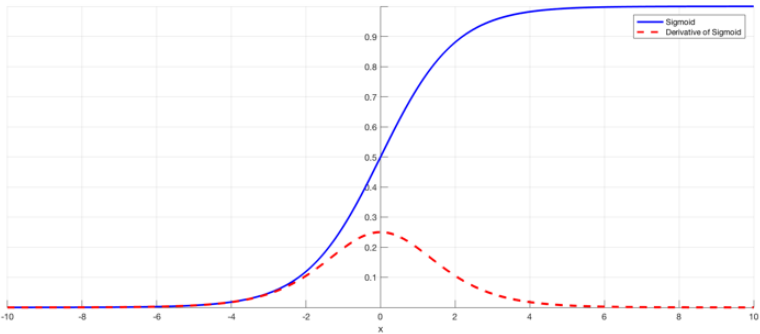

*Figure 22. The sigmoid function (solid) and its derivative (dashed)*

The derivative of the sigmoid function $\sigma(z) = 1/(1+e^{-z})$ is $\sigma'(z) = \sigma(z)(1-\sigma(z))$, which has its maximum 0.25 at $z = 0$ and approaches 0 as $|z|$ grows (Figure 22). If every layer multiplies by a value of at most 0.25, the gradient after 10 layers is at most $0.25^{10} \approx 9.5 \times 10^{-7}$ times the original.

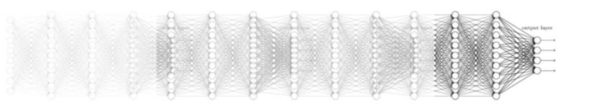

*Figure 23. A deep neural network whose learning signal fades with distance from the output layer*

In Figure 23 the layers near the output layer are drawn dark and the layers near the input layer faint. This means that the gradient shrinks with distance from the output layer, so the weights of the early layers hardly change. Even after backpropagation became widely known in 1986, this problem kept deep networks from training well. The period from 1986 until 2006, when methods for training deep neural networks drew attention again, is therefore sometimes called the second winter of neural networks (NN winter 2), and neural network research stagnated especially from the mid-1990s onward. Vanishing gradients are covered in detail in Section 5, and they are largely mitigated by normalized weight initialization and techniques such as the batch normalization of Section 5.2.

### 4.3 The Residual Block

**ResNet** solved the degradation problem of Section 4.1 through **residual learning** with skip connections, trained networks of up to 152 layers on ImageNet, and won the classification track of ILSVRC 2015 [9].

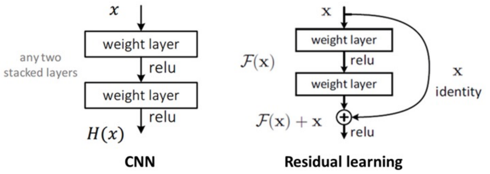

*Figure 24. A plain CNN block with two stacked layers (left) and a residual block that adds the input x to the output (right)*

In the plain block on the left of Figure 24, two layers (weight layer and ReLU) learn the desired output $H(x)$ directly. In the **residual block** on the right, the two layers compute $F(x)$, and the input $x$ skips the layers and is added unchanged. This skipping connection is called a **skip connection** or shortcut connection, and it adds the original $x$ back after the layers so that the original is not forgotten.

```math
H(x) = F(x) + x \quad \Longleftrightarrow \quad F(x) = H(x) - x
```

The two layers need to learn only the difference between the output and the input, the **residual** $F(x)$, rather than the whole desired output. If the identity function is the best choice, as in the situation of Section 4.1, a plain block must fit $H(x) = x$ with nonlinear layers, whereas a residual block only has to drive its weights toward 0 to make $F(x) = 0$. The latter is much easier.

The skip connection also creates a shortcut for backpropagation. Differentiating the block output with respect to its input gives

```math
\frac{\partial H}{\partial x} = \frac{\partial F}{\partial x} + 1
```

so even if $\partial F/\partial x$ is small, 1 is added and the gradient reaches the previous block without vanishing. As a simplification, assume that the derivative of each block is the scalar 0.1. The gradient after 10 plain blocks becomes $0.1^{10} = 10^{-10}$ times the original, whereas after 10 residual blocks it becomes $(1 + 0.1)^{10} \approx 2.59$ times and does not vanish. A skip connection adds no parameters, so the computation hardly increases either.

> **Note:** He et al. argued that the degradation problem is unlikely to be caused by vanishing gradients. The plain networks in their experiments had batch normalization, so the forward signals had nonzero variances and the backward gradients had healthy magnitudes, yet degradation still appeared; their interpretation is that the root cause is the difficulty of optimizing deep plain networks [9]. The main role of the residual block is therefore to mitigate this optimization problem by making solutions close to the identity function easy to find, and the gradient shortcut shown above is a complementary effect that helps gradients flow through deep networks.

### 4.4 Architecture of the 34-Layer ResNet

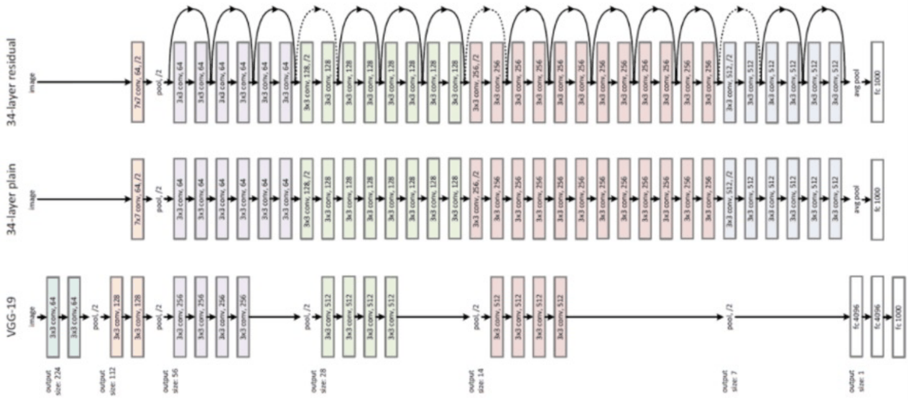

*Figure 25. Comparison of the 34-layer residual network (top), the 34-layer plain network (middle), and VGG-19 (bottom)*

Adding skip connections to the plain network in the middle of Figure 25 gives the residual network at the top. The 34-layer ResNet starts with a 7×7 convolution (64 channels, stride 2) and max pooling, stacks residual blocks of two 3×3 convolutions each, 3 blocks at 64 channels, 4 at 128, 6 at 256, and 3 at 512, and ends with global average pooling (avg pool) and a fully connected layer with 1000 outputs. The number of weight layers is 1 + 2×(3 + 4 + 6 + 3) + 1 = 34.

The solid curves are identity skip connections that add the input unchanged. The dotted curves are at points where the number of channels doubles and the size is halved (`/2`); since the input and output shapes differ and cannot be added directly, the shapes are matched with a 1×1 convolution or the extra channels are filled with zeros before adding. Compared with VGG-19, the 34-layer ResNet has more layers, but it shrinks the feature map to 56×56 quickly with the first convolution and pooling and uses fewer filters at each size, so its computation is about 3.6 billion FLOPs, roughly 18% of VGG-19 (about 19.6 billion FLOPs) [9]. Having only one fully connected layer mainly reduces the parameter count, not the computation.

---

<br>

## 5. Vanishing and Exploding Gradients

### 5.1 Definitions and Causes

Backpropagation propagates the error from the output layer toward the input layer in order to update the weights. The phenomenon in which the gradient becomes smaller and smaller and converges to nearly 0 is called the **vanishing gradient**, and the opposite phenomenon in which the gradient becomes too large and diverges is called the **exploding gradient**.

Let $z^{(l)}$ be the weighted sum of layer $l$, $\sigma$ the activation function, and $L$ the loss. In backpropagation, the error signal of layer $l$, $\delta^{(l)} = \partial L / \partial z^{(l)}$, is computed from the error signal of the next layer as follows.

```math
\delta^{(l)} = \left( W^{(l+1)} \right)^{\top} \delta^{(l+1)} \odot \sigma'\!\left( z^{(l)} \right)
```

$\odot$ is element-wise multiplication. The gradient of a layer near the input is the result of applying this equation many times, so roughly the product of the weight magnitude and the activation derivative of each layer is multiplied repeatedly. If this product is smaller than 1 the gradient shrinks exponentially (vanishing), and if it is larger than 1 the gradient grows exponentially (exploding). If every layer multiplies by 0.25, the factor after 10 layers is $0.25^{10} \approx 9.5 \times 10^{-7}$, and if every layer multiplies by 2, it is $2^{10} = 1024$.

| Phenomenon | Main causes | Consequence |
|:-----|:-----|:-----|
| Vanishing gradient | Activation functions such as sigmoid and tanh whose derivative approaches 0 (saturates) as the magnitude of the input grows | The weights of layers near the input are hardly updated, and training stalls |
| Exploding gradient | Large initial weights, and the combination of large weights with activation functions such as ReLU that do not shrink the gradient | Updates become too large, so the loss oscillates or diverges, and values can become infinite or NaN |

*Table 9. Causes and consequences of vanishing and exploding gradients*

The derivative of sigmoid is at most 0.25 and the derivative of tanh, $1 - \tanh^2(z)$, is at most 1, and both approach 0 as the input grows. The derivative of ReLU is 1 in the positive region and does not shrink the gradient, so ReLU is robust to vanishing, but if the weights are large, those large values are multiplied in unchanged and can lead to explosion. Besides the skip connections of Section 4, remedies include batch normalization, the choice of activation function, and gradient clipping, and initialization methods that set the initial variance of the weights according to layer size are also used [10].

### 5.2 Remedy 1: Batch Normalization

**Batch normalization (BN)** normalizes the intermediate outputs of a layer per mini-batch so that the values do not become too small or too large [11].

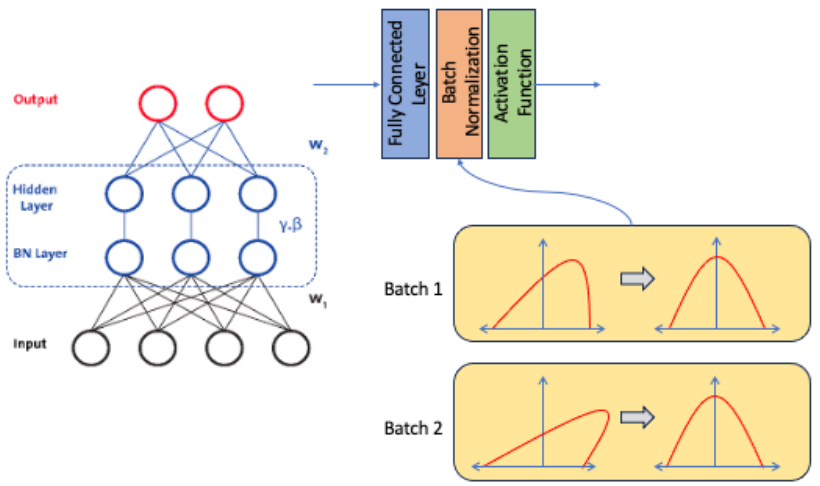

*Figure 26. A batch normalization layer placed between a hidden layer and the activation function, normalizing the skewed distribution of each mini-batch*

As in Figure 26, a BN layer is usually placed between a fully connected (or convolutional) layer and the activation function. For a mini-batch $B = \lbrace x_1, \dots, x_m\rbrace$, the following is computed for each feature (channel).

```math
\mu_B = \frac{1}{m}\sum_{i=1}^{m} x_i, \qquad \sigma_B^2 = \frac{1}{m}\sum_{i=1}^{m} (x_i - \mu_B)^2, \qquad \hat{x}_i = \frac{x_i - \mu_B}{\sqrt{\sigma_B^2 + \epsilon}}, \qquad y_i = \gamma \hat{x}_i + \beta
```

$\epsilon$ is a small number that prevents division by zero. The values normalized to mean 0 and variance 1 are rescaled by the trainable parameters $\gamma$ (scale) and $\beta$ (shift), so the network can recover the original distribution if needed. On the right of Figure 26, the distributions of Batch 1 and Batch 2 are skewed in different directions, but after BN both become similar bell-shaped distributions. Because values are not pushed into the saturated regions of sigmoid or tanh, vanishing gradients are reduced, and training stays stable even with a large learning rate. At evaluation time, the mean and variance accumulated during training are used instead of mini-batch statistics, which is why the `model.eval()` seen in Section 1.6 is needed.

### 5.3 Remedy 2: Various Activation Functions

Using activation functions that do not saturate reduces vanishing gradients.

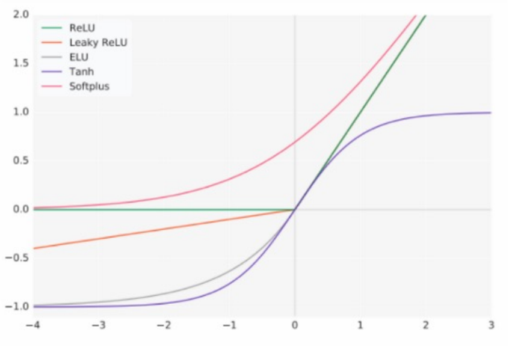

*Figure 27. Graphs of the ReLU, Leaky ReLU, ELU, Tanh, and Softplus activation functions*

| Function | Formula | Derivative | Characteristics |
|:-----|:-----|:-----|:-----|
| Tanh | $\tanh z$ | $1 - \tanh^2 z$ (at most 1) | Outputs lie in −1 to 1 and saturate at both ends |
| ReLU | $\max(0, z)$ | 1 if $z > 0$, 0 if $z < 0$ | Does not saturate in the positive region and is simple to compute. A neuron that receives only negative inputs has gradient 0 and can stop learning |
| Leaky ReLU | $z$ if $z > 0$, otherwise $\alpha z$ | 1 or $\alpha$ | Gives a small slope $\alpha$ (e.g., 0.01) in the negative region to reduce ReLU's problem |
| ELU | $z$ if $z > 0$, otherwise $\alpha(e^{z} - 1)$ | 1 or $\alpha e^{z}$ | The negative region converges smoothly to −α, bringing the mean of the outputs closer to 0 |
| Softplus | $\ln(1 + e^{z})$ | $\sigma(z)$ | A smoothed ReLU, equal to $\ln 2 \approx 0.693$ at $z = 0$ |

*Table 10. Formulas, derivatives, and characteristics of representative activation functions*

In Figure 27, the ReLU family (ReLU, Leaky ReLU, ELU) and Softplus keep increasing in the positive region, so their derivatives stay at 1 (close to 1 for Softplus) even for large inputs. Tanh, in contrast, becomes almost flat once $z$ exceeds 2, and its derivative approaches 0. This is why the ReLU family is mainly used in the hidden layers of deep networks.

### 5.4 Remedy 3: Gradient Clipping

**Gradient clipping** keeps the direction of the gradient and reduces only its magnitude to a threshold $\tau$ when the magnitude exceeds $\tau$ [12].

```math
\mathbf{g}_{\text{clipped}} =
\begin{cases}
\mathbf{g} & \text{if } \lVert \mathbf{g} \rVert_2 \le \tau \\
\tau \cdot \dfrac{\mathbf{g}}{\lVert \mathbf{g} \rVert_2} & \text{if } \lVert \mathbf{g} \rVert_2 > \tau
\end{cases}
```

$\lVert \mathbf{g} \rVert_2$ is the L2 norm (length) of the gradient vector. For example, if $\mathbf{g} = (3, 4)$ and $\tau = 1$, then $\lVert \mathbf{g} \rVert_2 = \sqrt{3^2 + 4^2} = 5 > 1$, so $`\mathbf{g}_{\text{clipped}} = 1 \cdot (3, 4)/5 = (0.6, 0.8)`$. The direction is the same and only the length has been reduced to 1.

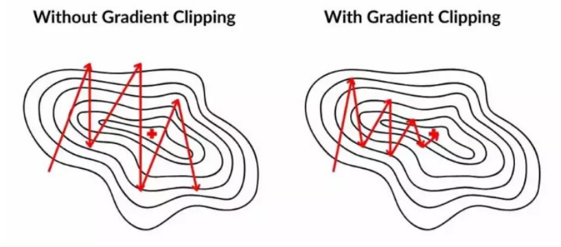

*Figure 28. Optimization paths without gradient clipping (left) and with gradient clipping (right)*

On the left of Figure 28, where the gradient is large, a single step moves too far and overshoots the minimum (the red + mark) by a wide margin. With clipping, as on the right, the step size is limited and the path approaches the neighborhood of the minimum step by step. Clipping prevents explosion and has no effect on vanishing. In PyTorch, call `torch.nn.utils.clip_grad_norm_(model.parameters(), max_norm)` between `loss.backward()` and `optimizer.step()`.

---

<br>

## 6. Transfer Learning

**Transfer learning** is the use of part of the abilities of a neural network trained in one domain for training a neural network in a similar or entirely new domain [13]. A person who can ride a bicycle has already acquired a sense of balance and therefore learns to ride a motorcycle faster than someone starting from scratch. Likewise, the early layers of a CNN trained on a large dataset such as ImageNet extract features common to many images, such as edges, textures, and simple shapes, so reusing these layers for another task gives good performance even with little data. Features in the early layers are general and become specialized to the original task toward the later layers [14]. Fine-tuning strategies and backbones are covered in Lecture 4.

---

<br>

## Summary

| Concept | Key Summary |
|:-----|:-----|
| Implementation flow | Implementation follows nine steps: checking inputs and outputs, dataset, data loader, model, forward pass, loss function, optimizer, training and validation, and inference; training repeats forward computation, error computation, and backward weight update. |
| Checking inputs and outputs | The output size $O = \lfloor (W - K + 2P)/S \rfloor + 1$ is used to compute every layer's tensor size in advance and prevent size mismatches in the model code. |
| Tensors and transforms | A tensor is a multidimensional array; ToTensor maps 0-255 to 0-1, and Normalize(0.5, 0.5) maps 0-1 to −1 to 1. |
| Input normalization | Matching feature ranges makes the loss contours round, so gradient descent converges quickly without zigzagging. |
| Training loop | For every mini-batch, zero_grad clears the gradients, followed by the forward pass, loss computation, backward, and step. |
| Validation and inference | In eval mode only the forward pass runs and torch.max gives the predicted class; new images receive the same preprocessing as in training. |
| Image processing tasks | Classification outputs one class, detection boxes and classes, segmentation a class per pixel, OCR text, super-resolution a high-resolution image, and generation a new image. |
| ImageNet challenge | In 2012 AlexNet lowered the top-5 error rate to 15.3% and opened the CNN era, and in 2015 ResNet reached 3.6%, below humans (about 5%). |
| VGGNet | To see only the effect of depth, the filters were fixed at 3×3 and configurations of 11-19 layers were compared; VGG-16 has 13 convolutional and 3 fully connected layers. |
| Degradation problem | Stacking a plain network deeper raises even the training error, so the cause is optimization difficulty, not overfitting. |
| Residual block | Learns only the residual with $H(x) = F(x) + x$, which makes solutions close to the identity function easy to find and thus solves the degradation problem, and since $\partial H/\partial x = \partial F/\partial x + 1$, the gradient also passes through a shortcut. |
| Vanishing and exploding gradients | If the product in the chain rule is below 1 the gradient goes to 0, and if above 1 it goes to infinity. Saturation of sigmoid and tanh causes vanishing, and large weights cause explosion. |
| Remedies | Batch normalization normalizes intermediate values, the ReLU family avoids saturation, and gradient clipping reduces the magnitude to τ while keeping the direction. |
| Transfer learning | Part of the abilities of a network trained on a large dataset is reused for training on a new task. |

---

<br>

## Self-Check Questions

1. **Output size:** Compute the output size after applying a 5×5 convolution (padding 0, stride 1, 6 output channels) and then 2×2 max pooling (stride 2) to a 32×32×3 image.

   <details>
   <summary>Answer</summary>

   The convolution output is (32 − 5 + 0)/1 + 1 = 28, giving 28×28×6, and the pooling output is (28 − 2)/2 + 1 = 14, giving 14×14×6.

   </details>

2. **Normalization:** Compute the value obtained by applying `ToTensor()` and then `Normalize((0.5, 0.5, 0.5), (0.5, 0.5, 0.5))` to the pixel value 51.

   <details>
   <summary>Answer</summary>

   After ToTensor it is 51/255 = 0.2, and after Normalize it is (0.2 − 0.5)/0.5 = −0.6.

   </details>

3. **zero_grad:** What happens if `optimizer.zero_grad()` is removed from the training loop?

   <details>
   <summary>Answer</summary>

   PyTorch adds gradients into `.grad` every time `backward()` is called. Without clearing them, the parameters are updated with the gradients of all previous mini-batches added together, so training proceeds in a direction and with a magnitude different from those of the current mini-batch's gradient.

   </details>

4. **Cross entropy:** In a 10-class problem, what is the cross-entropy loss of a model that gives every class the same probability, and how is this value used when reading a training log?

   <details>
   <summary>Answer</summary>

   The probability of the correct class is 0.1, so $L = -\ln 0.1 = \ln 10 \approx 2.303$. If the loss at the beginning of training is near this value, training has started normally, and only when the loss falls well below this value can the model be said to predict better than random guessing.

   </details>

5. **Distinguishing tasks:** To mark each building in an aerial image as a separate object at the pixel level, which task should be used, and how does it differ from semantic segmentation?

   <details>
   <summary>Answer</summary>

   Instance segmentation. Semantic segmentation gives all building pixels the same class (building) without separating the buildings, whereas instance segmentation separates each building as a different object even though they share a class.

   </details>

6. **VGG's design:** Why did the VGG team fix the filter size at 3×3?

   <details>
   <summary>Answer</summary>

   Because the goal of the study was to examine the effect of network depth on performance, other conditions such as filter size were fixed so that only depth varied in the comparison. 3×3 is the smallest size that can distinguish up, down, left, right, and center.

   </details>

7. **Degradation problem:** Why can the fact that a 56-layer plain network has higher test error than a 20-layer one not by itself be judged as overfitting?

   <details>
   <summary>Answer</summary>

   With overfitting, the training error would be low and only the test error high. The 56-layer network also has higher training error than the 20-layer one, so it fails to fit even the training data; this is an optimization problem, namely the degradation problem.

   </details>

8. **Residual block:** For the residual block $H(x) = F(x) + x$, explain why the identity function is easy to learn and why the gradient is passed on well.

   <details>
   <summary>Answer</summary>

   To obtain the identity function $H(x) = x$, it suffices that $F(x) = 0$, so the weights only have to be driven toward 0. Also, $\partial H/\partial x = \partial F/\partial x + 1$, so even if $\partial F/\partial x$ is small, a gradient with 1 added is passed to the previous block.

   </details>

9. **Vanishing gradient:** In a 20-layer network with sigmoid activations, assume for simplicity that the gradient is multiplied at every layer by the maximum of the sigmoid derivative. At most how many times the output-side gradient is the gradient that reaches the input-side layer?

   <details>
   <summary>Answer</summary>

   The maximum of the sigmoid derivative is 0.25 at $z = 0$, so the gradient is at most $0.25^{20} \approx 9.1 \times 10^{-13}$ times. The early layers are hardly trained.

   </details>

10. **Gradient clipping:** For $\mathbf{g} = (6, 8)$ and $\tau = 5$, compute the clipped gradient, and explain why gradient clipping does not solve vanishing gradients.

    <details>
    <summary>Answer</summary>

    $\lVert \mathbf{g} \rVert_2 = \sqrt{36 + 64} = 10 > 5$, so $`\mathbf{g}_{\text{clipped}} = 5 \cdot (6, 8)/10 = (3, 4)`$. Clipping only reduces the magnitude of gradients larger than the threshold and leaves small gradients unchanged, so it has no effect on vanishing, where gradients become too small.

    </details>

---

<br>

## References

1. A. Krizhevsky, "Learning Multiple Layers of Features from Tiny Images," Tech. Rep., University of Toronto, 2009.
2. PyTorch Contributors, "SGD," *PyTorch Documentation*, accessed Nov. 4, 2026. https://pytorch.org/docs/stable/generated/torch.optim.SGD.html
3. J. Redmon, S. Divvala, R. Girshick, and A. Farhadi, "You Only Look Once: Unified, Real-Time Object Detection," in *Proc. IEEE Conf. Computer Vision and Pattern Recognition (CVPR)*, pp. 779-788, 2016.
4. V. Badrinarayanan, A. Kendall, and R. Cipolla, "SegNet: A Deep Convolutional Encoder-Decoder Architecture for Image Segmentation," *IEEE Trans. Pattern Analysis and Machine Intelligence*, vol. 39, no. 12, pp. 2481-2495, 2017.
5. C. Dong, C. C. Loy, K. He, and X. Tang, "Image Super-Resolution Using Deep Convolutional Networks," *IEEE Trans. Pattern Analysis and Machine Intelligence*, vol. 38, no. 2, pp. 295-307, 2016.
6. Y. Song, J. Sohl-Dickstein, D. P. Kingma, A. Kumar, S. Ermon, and B. Poole, "Score-Based Generative Modeling through Stochastic Differential Equations," in *Proc. Int. Conf. Learning Representations (ICLR)*, 2021.
7. O. Russakovsky et al., "ImageNet Large Scale Visual Recognition Challenge," *Int. J. Computer Vision*, vol. 115, no. 3, pp. 211-252, 2015.
8. K. Simonyan and A. Zisserman, "Very Deep Convolutional Networks for Large-Scale Image Recognition," in *Proc. Int. Conf. Learning Representations (ICLR)*, 2015.
9. K. He, X. Zhang, S. Ren, and J. Sun, "Deep Residual Learning for Image Recognition," in *Proc. IEEE Conf. Computer Vision and Pattern Recognition (CVPR)*, pp. 770-778, 2016.
10. X. Glorot and Y. Bengio, "Understanding the Difficulty of Training Deep Feedforward Neural Networks," in *Proc. Int. Conf. Artificial Intelligence and Statistics (AISTATS)*, pp. 249-256, 2010.
11. S. Ioffe and C. Szegedy, "Batch Normalization: Accelerating Deep Network Training by Reducing Internal Covariate Shift," in *Proc. Int. Conf. Machine Learning (ICML)*, pp. 448-456, 2015.
12. R. Pascanu, T. Mikolov, and Y. Bengio, "On the Difficulty of Training Recurrent Neural Networks," in *Proc. Int. Conf. Machine Learning (ICML)*, pp. 1310-1318, 2013.
13. S. J. Pan and Q. Yang, "A Survey on Transfer Learning," *IEEE Trans. Knowledge and Data Engineering*, vol. 22, no. 10, pp. 1345-1359, 2010.
14. J. Yosinski, J. Clune, Y. Bengio, and H. Lipson, "How Transferable Are Features in Deep Neural Networks?," in *Advances in Neural Information Processing Systems (NeurIPS)*, pp. 3320-3328, 2014.
