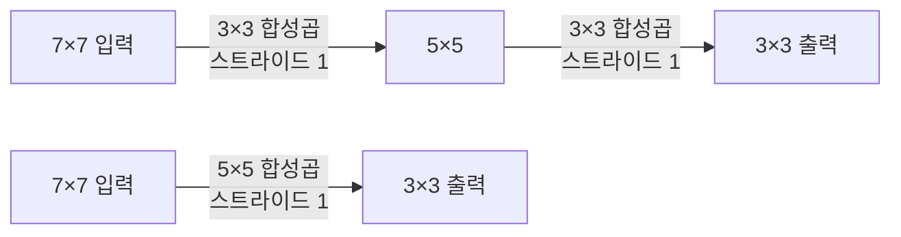
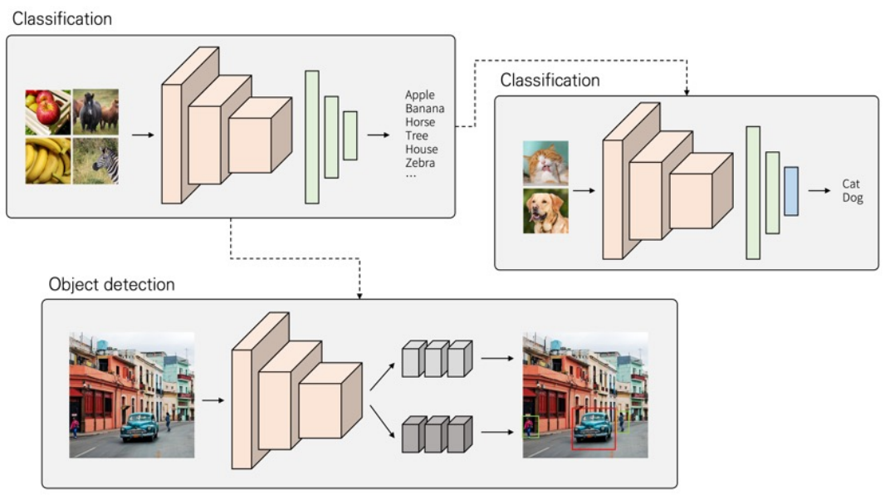
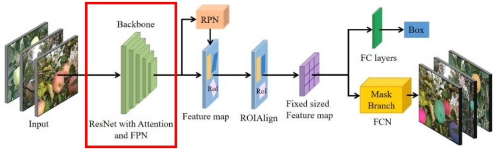
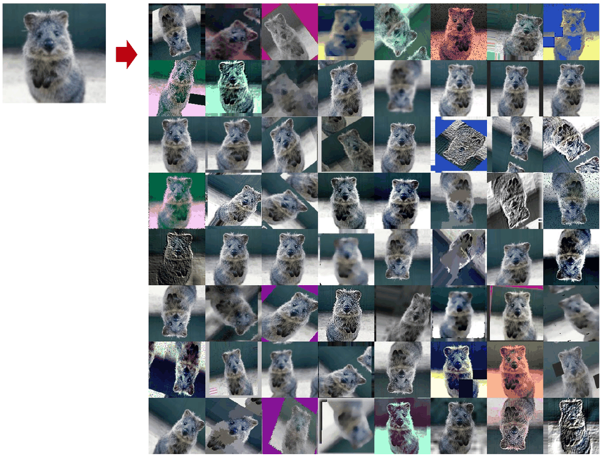
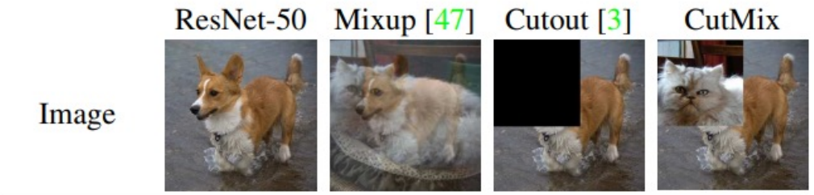
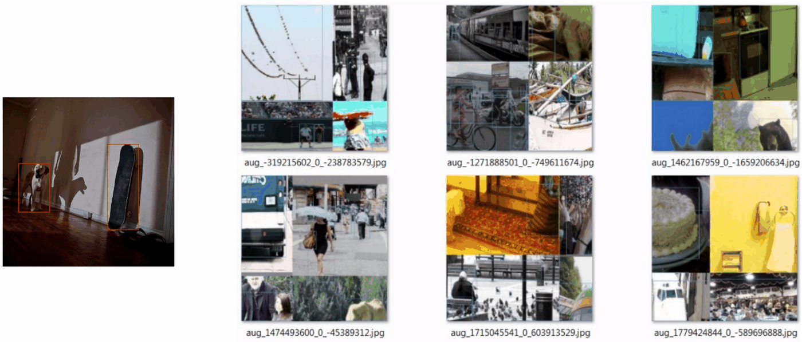
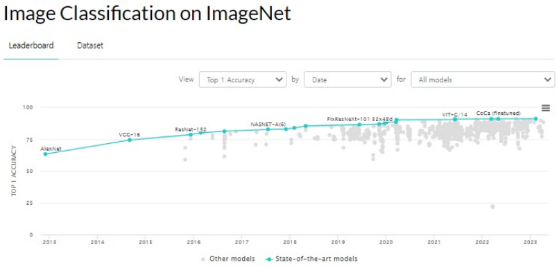
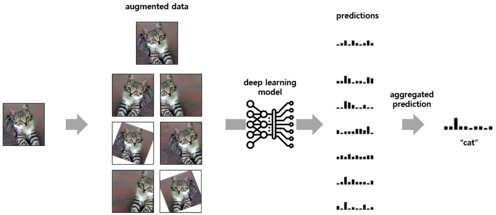
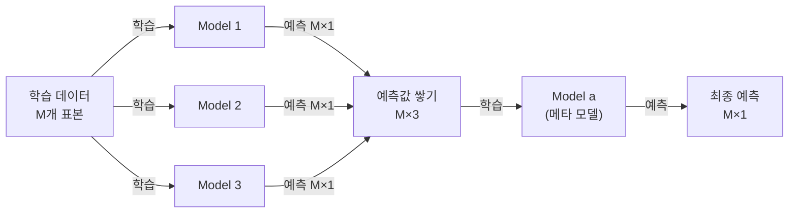
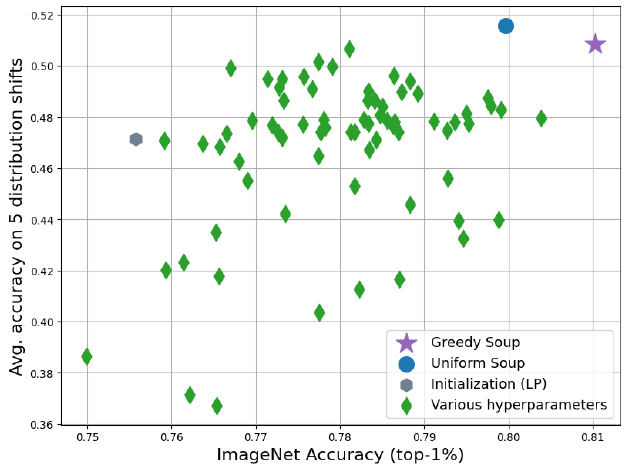

# 4강 — 영상처리 2

[레포지토리 안내](../../README.ko.md) | [English](Concepts_Lecture.md) | [한국어](Concepts_Lecture.ko.md)

> **최종 수정일:** 2026-11-04

> **학습 목표:**
> 1. VGGNet과 ResNet의 기여를 정리하고, 3×3 필터를 쌓는 설계가 파라미터 수와 수용 영역에 주는 효과를 계산할 수 있다
> 2. 데이터셋의 크기와 유사도에 따라 전이 학습의 미세 조정 전략을 고르고, 백본의 역할을 설명할 수 있다
> 3. 분류와 객체 탐지에 쓰는 데이터 증강 기법(Mixup, Cutout, CutMix, Mosaic)의 원리를 설명할 수 있다
> 4. 혼동 행렬에서 정확도, 정밀도, 재현율, F1 점수를 계산하고, 불균형 데이터에서 정확도의 한계를 설명할 수 있다
> 5. 다중 클래스 문제에서 macro, weighted, micro F1 점수를 계산하고 서로 비교할 수 있다
> 6. 경진대회에서 성능을 높이는 모델 선택, TTA, 보팅, 스태킹, model soups의 원리를 설명할 수 있다

---

## 목차

- [1. ImageNet 대회와 주제 개관](#1-imagenet-대회와-주제-개관)
- [2. VGGNet](#2-vggnet)
  - [2.1 핵심 아이디어](#21-핵심-아이디어)
  - [2.2 VGGNet의 기여](#22-vggnet의-기여)
  - [2.3 구성 비교에서 얻은 결론](#23-구성-비교에서-얻은-결론)
- [3. ResNet](#3-resnet)
  - [3.1 성능 저하 문제와 잔차 블록](#31-성능-저하-문제와-잔차-블록)
  - [3.2 ResNet의 기여](#32-resnet의-기여)
- [4. 전이 학습](#4-전이-학습)
  - [4.1 전이 학습이 사용되는 예](#41-전이-학습이-사용되는-예)
  - [4.2 특징 추출과 미세 조정](#42-특징-추출과-미세-조정)
  - [4.3 백본](#43-백본)
- [5. 데이터 증강](#5-데이터-증강)
  - [5.1 개념과 기본 기법](#51-개념과-기본-기법)
  - [5.2 분류를 위한 증강: Mixup, Cutout, CutMix](#52-분류를-위한-증강-mixup-cutout-cutmix)
  - [5.3 객체 탐지를 위한 증강: Mosaic](#53-객체-탐지를-위한-증강-mosaic)
- [6. 분류 성능의 평가 지표](#6-분류-성능의-평가-지표)
  - [6.1 혼동 행렬과 정확도](#61-혼동-행렬과-정확도)
  - [6.2 정확도의 한계](#62-정확도의-한계)
  - [6.3 정밀도와 재현율](#63-정밀도와-재현율)
  - [6.4 F1 점수](#64-f1-점수)
  - [6.5 다중 클래스 F1 점수](#65-다중-클래스-f1-점수)
  - [6.6 Macro, Weighted, Micro F1](#66-macro-weighted-micro-f1)
- [7. 경진대회에서 정확도를 높이는 기법](#7-경진대회에서-정확도를-높이는-기법)
  - [7.1 해커톤과 경진대회](#71-해커톤과-경진대회)
  - [7.2 모델 선택](#72-모델-선택)
  - [7.3 TTA](#73-tta)
  - [7.4 보팅](#74-보팅)
  - [7.5 스태킹](#75-스태킹)
  - [7.6 Model soups](#76-model-soups)
- [요약](#요약)
- [점검 문제](#점검-문제)
- [참고 문헌](#참고-문헌)

---

<br>

## 1. ImageNet 대회와 주제 개관

3강 2.6절에서 본 ImageNet 분류 대회에서 top-5 오류율은 2012년 AlexNet(15.3%) 이후 빠르게 낮아져, 2014년 VGGNet(7.3%)과 GoogLeNet(6.7%)을 거쳐 2015년 ResNet(3.6%)이 사람(약 5%)보다 낮은 오류율을 기록했다. 아래에서는 두 모델이 남긴 기여를 정리하고, 이렇게 학습된 모델을 다른 문제에 재사용하는 전이 학습, 데이터가 부족할 때 쓰는 데이터 증강, 모델을 평가하는 지표, 경진대회에서 성능을 끌어올리는 기법을 차례로 다룬다.

---

<br>

## 2. VGGNet

### 2.1 핵심 아이디어

VGG 모델의 핵심은 **네트워크의 깊이를 깊게 만드는 것이 성능에 어떤 영향을 미치는지 확인**하는 데 있었다. VGG 연구팀은 깊이의 영향만 확인하려고 합성곱 필터(커널)의 크기를 가장 작은 3×3으로 고정했다 [1]. 224×224×3 입력이 3×3 합성곱과 최대 풀링을 거쳐 1000개 클래스의 출력이 되는 VGG-16의 구조와 여섯 가지 구성 A\~E의 표는 3강 3절에 있다.

### 2.2 VGGNet의 기여

**깊은 네트워크의 효과 증명.** VGG는 이전 모델들보다 깊은 네트워크를 사용하여 이미지 분류 성능을 크게 높였다. 이를 통해 깊은 네트워크가 이미지 분류 성능 향상에 큰 영향을 미친다는 것을 보였다. 동시에 깊게 쌓는 것이 항상 좋은 것은 아니라는 한계도 보여 주었다. 2.3절에서 보듯 19층 부근에서 성능이 포화되었고, 그보다 깊게 쌓으면 3강 4.1절의 성능 저하 문제가 나타난다.

**작은 필터의 효율.** VGG는 큰 필터 한 층 대신 3×3 필터를 여러 층 쌓아, 같은 영역을 더 적은 파라미터로 보면서 더 나은 성능을 냈다(모델 전체의 파라미터는 완전 연결 층 때문에 AlexNet보다 많다). 핵심은 작은 필터를 여러 번 쌓으면 큰 필터와 같은 영역을 볼 수 있다는 점이다. 출력의 한 값이 입력에서 영향을 받는 영역의 크기를 **수용 영역(receptive field)** 이라 한다.



*그림 1. 3×3 합성곱을 두 번 쌓은 경우(위)와 5×5 합성곱을 한 번 적용한 경우(아래)의 출력 크기*

그림 1에서 7×7 입력에 패딩 없이 3×3 합성곱을 적용하면 (7 − 3)/1 + 1 = 5이므로 5×5가 되고, 한 번 더 적용하면 3×3이 된다. 5×5 합성곱을 한 번 적용해도 (7 − 5)/1 + 1 = 3이므로 똑같이 3×3이 된다. 최종 출력의 한 값은 두 경우 모두 입력의 5×5 영역에서 계산되므로 수용 영역이 같다. 같은 방식으로 3×3 합성곱 세 개는 7×7 합성곱 하나와 수용 영역이 같다.

수용 영역이 같아도 파라미터 수는 다르다. 입력과 출력의 채널 수가 모두 $C$이면 $k \times k$ 합성곱 한 층의 가중치는 $k^2 C^2$개이다(편향 제외).

| 구조 | 수용 영역 | 가중치 수 | $C = 64$일 때 |
|:-----|:-----|:-----|:-----|
| 3×3 합성곱 2층 | 5×5 | $2 \times 9C^2 = 18C^2$ | 73,728 |
| 5×5 합성곱 1층 | 5×5 | $25C^2$ | 102,400 |
| 3×3 합성곱 3층 | 7×7 | $3 \times 9C^2 = 27C^2$ | 110,592 |
| 7×7 합성곱 1층 | 7×7 | $49C^2$ | 200,704 |

*표 1. 수용 영역이 같은 합성곱 구조의 가중치 수 비교*

3×3 두 층은 5×5 한 층보다 가중치가 28% 적고, 3×3 세 층은 7×7 한 층보다 약 45% 적다. 또한 층마다 ReLU가 들어가므로 비선형 함수를 두세 번 거쳐 더 복잡한 특징을 표현할 수 있다. 적은 파라미터는 과적합을 줄이는 효과도 낸다 [1].

### 2.3 구성 비교에서 얻은 결론

VGG 논문은 깊이만 다른 구성 A(11층)\~E(19층)를 같은 조건으로 학습해 비교했고, 다음 결론을 얻었다 [1].

- AlexNet이 쓴 국소 응답 정규화(LRN)를 더한 A-LRN은 A보다 나아지지 않았으므로, 더 깊은 구성에서는 LRN을 쓰지 않았다.
- 깊이가 11층에서 19층으로 늘수록 오류율이 낮아졌고, 19층 부근에서 포화되었다.
- 깊이가 같은 16층이라도 일부 층에 1×1 합성곱을 쓴 C보다 모두 3×3 합성곱을 쓴 D가 좋았다. 비선형성을 늘리는 것만으로는 부족하고, 3×3 필터로 주변의 공간 정보를 함께 보는 것이 중요하다는 뜻이다.

VGG-16의 파라미터는 약 1억 3,800만 개, VGG-19는 약 1억 4,400만 개로 매우 많으며 대부분이 뒤쪽의 완전 연결 층(특히 첫 완전 연결 층)에 있다. 이 큰 모델 크기와, 대부분 합성곱 층에서 생기는 많은 연산량(표 2의 약 153억 FLOPs)이 VGG의 실용적인 단점이다.

---

<br>

## 3. ResNet

### 3.1 성능 저하 문제와 잔차 블록

VGG가 깊은 네트워크의 좋은 성능을 보여 주었지만, 네트워크를 깊게 만드는 것만으로 성능이 계속 좋아지지는 않았다. 층을 무작정 늘리면 56층 네트워크가 20층 네트워크보다 학습 오류와 테스트 오류가 모두 높았고, 학습 데이터에서도 성능이 나빴으므로 원인은 과적합이 아니었다(성능 저하 문제). 역전파에서 층이 깊어질수록 앞쪽 층까지 학습 신호가 잘 전달되지 않는 기울기 소실도 깊은 네트워크의 학습을 어렵게 하지만, 이 문제는 배치 정규화 같은 기법으로 상당 부분 완화되며 원 논문은 성능 저하의 원인을 기울기 소실로 보지 않는다(3강 4.3절).

ResNet은 스킵 연결을 이용한 잔차 학습으로 성능 저하 문제를 해결했다. 잔차 블록은 두 층이 계산한 $F(x)$에 입력 $x$를 더해 $H(x) = F(x) + x$를 출력하며, 역전파에서 $\partial H/\partial x = \partial F/\partial x + 1$이어서 기울기가 지름길로 전달된다. 34층 일반 네트워크에 스킵 연결을 더한 34층 ResNet과 VGG-19의 구조 비교는 3강 4.4절에 있다. 잔차 블록의 그림과 유도는 3강 4절에 있다.

### 3.2 ResNet의 기여

**잔차 연결의 도입.** ResNet은 **잔차 연결(residual connection)**, 곧 스킵 연결을 도입하여 깊은 네트워크에서 발생하는 성능 저하 문제를 해결했다 [2]. 잔차 연결은 기울기가 앞쪽 층까지 지름길로 전달되게 하여 깊은 네트워크의 학습도 돕는다.

**깊이 확장 가능성의 확보.** 152층 네트워크까지 성공적으로 학습시켜 딥러닝 모델의 깊이에 대한 한계를 돌파했다. 152층 ResNet을 포함한 앙상블은 ILSVRC 2015 분류 부문에서 top-5 오류율 3.57%로 우승했다 [2]. 깊어졌는데도 VGG보다 계산량이 적은 것은 첫 층에서 특징 맵을 빠르게 줄이고 같은 크기에서 쓰는 필터 수가 적으며, 50층 이상에서는 1×1 합성곱으로 채널 수를 줄였다 늘리는 병목 블록(bottleneck block)을 쓰기 때문이다(9강).

| 모델 | 가중치 층 수 | 파라미터 수 | 연산량 (FLOPs) |
|:-----|:-----|:-----|:-----|
| VGG-16 | 16 | 약 1억 3,840만 | 약 153억 |
| ResNet-18 | 18 | 약 1,170만 | 약 18억 |
| ResNet-34 | 34 | 약 2,180만 | 약 36억 |
| ResNet-50 | 50 | 약 2,560만 | 약 38억 |
| ResNet-101 | 101 | 약 4,450만 | 약 76억 |
| ResNet-152 | 152 | 약 6,020만 | 약 113억 |

*표 2. VGG-16과 여러 깊이의 ResNet의 파라미터 수와 연산량*

표 2의 연산량은 224×224 이미지 한 장을 처리하는 곱셈-덧셈 횟수이다 [2]. ResNet-152는 VGG-16보다 9배 이상 깊지만 파라미터는 절반 이하이고 연산량도 적다.

**다양한 분야로의 확장.** 잔차 블록은 입력을 출력에 더하는 단순한 구조이므로 다른 네트워크에 쉽게 적용할 수 있다. 이후 객체 탐지와 분할 모델의 백본(4.3절), 8강의 Transformer 같은 구조가 모두 잔차 연결을 쓴다.

---

<br>

## 4. 전이 학습

### 4.1 전이 학습이 사용되는 예

**전이 학습(transfer learning)** 은 특정 분야에서 학습된 신경망의 능력 일부를 비슷하거나 전혀 새로운 분야에서 사용하는 신경망의 학습에 이용하는 것이다(3강 6절).



*그림 2. 사전 학습한 분류 모델의 특징 추출 부분을 새로운 분류와 객체 탐지에 재사용하는 전이 학습의 예*

그림 2의 왼쪽 위 모델은 사과, 바나나, 말, 나무, 집, 얼룩말 같은 많은 클래스로 학습되었다. 이 모델의 합성곱 부분은 이미지에서 특징을 추출하는 능력을 이미 갖추었으므로 그대로 가져온다. 오른쪽 위에서는 마지막 분류기만 고양이와 개를 구분하는 새 분류기(파란 상자)로 바꾸어 새로운 분류 문제를 풀고, 아래에서는 같은 특징 추출 부분 뒤에 바운딩 박스의 위치와 클래스를 예측하는 두 갈래의 출력부를 붙여 객체 탐지를 푼다. 처음부터 학습하지 않으므로 데이터가 적어도 되고 학습 시간도 짧다.

### 4.2 특징 추출과 미세 조정

전이 학습에서 미리 학습된 모델을 **사전 학습 모델(pretrained model)** 이라 하며, 이를 쓰는 방법은 크게 두 가지이다.

- **특징 추출(feature extraction):** 사전 학습 모델의 합성곱 부분을 고정(freeze)하여 가중치를 바꾸지 않고, 새로 붙인 분류기만 학습한다.
- **미세 조정(fine-tuning):** 새 분류기와 함께 사전 학습 모델의 일부 또는 전체 층도 작은 학습률로 다시 학습해, 가중치를 새 데이터에 맞게 조금씩 조정한다.

어느 층까지 학습할지는 지금 풀려는 태스크의 데이터셋 크기와, 사전 학습에 쓰인 데이터셋과의 유사도에 따라 정한다.

| | 사전 학습 데이터셋과 많이 다름 | 사전 학습 데이터셋과 비슷함 |
|:-----|:-----|:-----|
| **데이터셋이 충분함** | 모델 전체를 학습한다 (사전 학습 가중치는 초깃값으로 쓴다) | 일부 층을 학습하고 나머지는 고정한다 |
| **데이터셋이 작음** | 일부 층을 학습하고 나머지는 고정한다 (비슷할 때보다 더 많은 층을 학습한다) | 합성곱 부분 전체를 고정하고 분류기만 학습한다 |

*표 3. 데이터셋의 크기와 유사도에 따른 미세 조정 전략*

- **데이터가 충분하고 많이 다를 때:** 데이터가 많으니 모델 전체를 다시 학습해도 과적합의 위험이 작다. 사전 학습 가중치는 무작위 초기화보다 좋은 출발점이 된다.
- **데이터가 충분하고 비슷할 때:** 앞쪽 층의 일반적인 특징(가장자리, 질감)은 그대로 쓰고, 출력 쪽 층과 분류기를 학습한다.
- **데이터가 작고 많이 다를 때:** 가장 어려운 경우이다. 원래 태스크에 특화된 뒤쪽 층은 맞지 않으므로 학습해야 하지만, 너무 많은 층을 학습하면 적은 데이터에 과적합된다. 앞쪽 일부만 고정하고 나머지를 학습하는 균형점을 찾아야 하며, 데이터 증강(5절)을 함께 쓰는 것이 좋다.
- **데이터가 작고 비슷할 때:** 사전 학습 모델의 특징을 그대로 쓸 수 있으므로 합성곱 부분을 모두 고정하고 분류기만 학습한다(특징 추출).

앞쪽 층을 고정하는 근거는 CNN의 앞쪽 층이 여러 이미지에 공통인 일반적 특징을, 뒤쪽 층이 원래 태스크에 특화된 특징을 학습한다는 점이다 [3]. PyTorch에서는 torchvision의 사전 학습 모델을 불러와 파라미터의 `requires_grad`를 `False`로 바꾸어 고정하고, 마지막 층을 새로 만든다.

```python
import torch.nn as nn
import torch.optim as optim
import torchvision.models as models

model = models.resnet18(weights="IMAGENET1K_V1")       # ImageNet으로 사전 학습한 ResNet-18
for p in model.parameters():                           # 모든 층을 고정
    p.requires_grad = False
model.fc = nn.Linear(model.fc.in_features, 2)          # 새 분류기: 512 -> 2 클래스

# 미세 조정할 때는 마지막 잔차 단계도 학습하도록 고정을 푼다
# for p in model.layer4.parameters():
#     p.requires_grad = True

optimizer = optim.SGD(filter(lambda p: p.requires_grad, model.parameters()),
                      lr=0.001, momentum=0.9)
```

`weights="IMAGENET1K_V1"`은 ImageNet으로 학습한 가중치를 내려받아 쓴다는 뜻이다. 모든 파라미터를 고정한 뒤 `model.fc`를 새로 만들면 새 층의 파라미터만 학습 대상이 된다. 이 예에서 전체 파라미터 약 1,118만 개 중 학습되는 것은 새 분류기의 512 × 2 + 2 = 1,026개뿐이다(특징 추출). 주석 처리한 두 줄을 실행해 `layer4`의 고정을 풀면 학습 대상이 약 839만 개로 늘어난다(미세 조정). 옵티마이저에는 `requires_grad`가 `True`인 파라미터만 넘긴다.

### 4.3 백본

딥러닝에서 **백본(backbone)** 은 컴퓨터 비전이나 자연어 처리(NLP) 같은 여러 분야의 딥러닝 모델에서 사용하는 핵심 네트워크 구조를 말한다. 주로 입력에서 특징(feature)을 추출하는 기본 신경망을 가리키며, 그 위에 태스크와 목적에 맞는 구조를 쌓아 올려 최종적으로 원하는 성능을 얻는다. ImageNet으로 사전 학습한 VGG나 ResNet이 대표적인 백본이며, 전이 학습은 백본을 재사용하는 일이라고 볼 수 있다.



*그림 3. ResNet 기반 백본(빨간 상자) 위에 RPN, RoIAlign, 상자와 마스크 출력부를 쌓은 Mask R-CNN 구조*

그림 3은 복잡한 배경 속 사과를 인스턴스 분할하는 모델이다 [4]. 기본 구조는 Mask R-CNN이며 [5], 각 부분이 하는 일은 다음과 같다.

1. **백본(빨간 상자):** 어텐션과 FPN(feature pyramid network, 여러 크기의 특징 지도를 함께 만드는 구조)을 더한 ResNet이 입력 이미지에서 특징 지도(feature map)를 만든다.
2. **RPN(region proposal network):** 특징 지도에서 객체가 있을 만한 후보 영역(RoI, region of interest)을 제안한다.
3. **RoIAlign:** 크기가 제각각인 후보 영역의 특징을 같은 크기의 특징 지도로 잘라 낸다.
4. **출력부:** 완전 연결 층(FC layers)이 후보마다 클래스와 바운딩 박스(Box)를 예측하고, 마스크 갈래(Mask Branch, FCN)가 객체 영역을 픽셀 단위로 표시한다.

백본만 다른 구조(예: 더 가벼운 네트워크)로 바꾸어도 나머지 구조는 그대로 쓸 수 있다는 점이 이 설계의 장점이다.

---

<br>

## 5. 데이터 증강

### 5.1 개념과 기본 기법

**데이터 증강(data augmentation)** 은 데이터셋을 여러 가지 방법으로 변형(augment)하여 실질적인 학습 데이터셋의 규모를 키우는 방법이다. 같은 이미지를 조금씩 바꾼 여러 버전을 학습시키면 모델이 위치, 방향, 색 같은 사소한 변화에 흔들리지 않는 특징을 배우고 과적합이 줄어든다.



*그림 4. 원본 이미지 한 장(왼쪽 위)을 여러 방법으로 변형해 만든 증강 이미지들*

그림 4는 증강 라이브러리 imgaug(https://github.com/aleju/imgaug)로 쿼카 사진 한 장을 64가지로 변형한 결과이다. 좌우 반전, 회전, 기울이기(shear), 확대와 자르기 같은 기하 변환, 밝기, 대비, 색조 변화 같은 색 변환, 흐림과 잡음 추가, 일부 영역 가리기, 엠보싱과 윤곽 강조 같은 필터가 쓰였다. 데이터 증강의 여러 기법은 Shorten과 Khoshgoftaar [6], Yang 등 [7]의 서베이에 정리되어 있다.

증강은 정답이 바뀌지 않는 범위에서만 써야 한다. 예를 들어 숫자 6을 180도 회전하면 9가 되므로 숫자 인식에는 큰 회전을 쓰지 않는다. 또 증강은 학습 데이터에만 적용하고, 검증과 테스트 데이터에는 크기 조정과 정규화 같은 결정적인 전처리만 적용한다. torchvision에서는 무작위 변환을 `transforms.Compose`로 묶어 학습용 데이터셋에 넘긴다.

```python
import torchvision.transforms as transforms

train_transform = transforms.Compose([
    transforms.RandomResizedCrop(224),                      # 무작위 영역을 잘라 224×224로 조정
    transforms.RandomHorizontalFlip(),                      # 50% 확률로 좌우 반전
    transforms.ColorJitter(brightness=0.2, contrast=0.2),   # 밝기와 대비를 ±20% 범위에서 변경
    transforms.ToTensor(),
    transforms.Normalize((0.485, 0.456, 0.406), (0.229, 0.224, 0.225)),
])
```

데이터 로더가 이미지를 꺼낼 때마다 무작위 변환이 새로 적용되므로, 에포크마다 같은 이미지가 조금씩 다른 모습으로 모델에 들어간다. 저장된 데이터의 수는 그대로이지만 모델이 보는 데이터는 사실상 늘어난다.

### 5.2 분류를 위한 증강: Mixup, Cutout, CutMix

분류에서는 여러 이미지를 섞거나 일부를 가리는 증강이 효과적이다.



*그림 5. 원본 이미지와 Mixup, Cutout, CutMix를 적용한 이미지*

- **Mixup:** 두 이미지 $x_i$, $x_j$와 정답 $y_i$, $y_j$(원-핫 벡터)를 비율 $\lambda$로 섞는다: $\tilde{x} = \lambda x_i + (1-\lambda) x_j$, $\tilde{y} = \lambda y_i + (1-\lambda) y_j$ [8]. 그림 5에서는 개와 고양이를 반씩 겹쳐 정답도 개 0.5, 고양이 0.5가 된다.
- **Cutout:** 이미지의 무작위 정사각형 영역을 0(검은색)으로 가린다 [9]. 정답은 그대로 개 1.0이다. 모델이 한 부분(예: 얼굴)에만 의존하지 않고 여러 부분을 보도록 만든다.
- **CutMix:** 한 이미지의 일부 영역을 잘라 내고 그 자리에 다른 이미지의 같은 영역을 붙인다. 정답은 붙인 영역의 넓이 비율로 섞는다 [10]. 그림 5에서는 고양이 영역이 이미지의 40%를 차지하므로 정답이 개 0.6, 고양이 0.4이다. Cutout과 달리 가린 영역에도 학습할 정보가 남고, Mixup과 달리 이미지가 부자연스럽게 겹치지 않는다.

| | ResNet-50 (기본) | Mixup | Cutout | CutMix |
|:-----|:-----|:-----|:-----|:-----|
| 정답 | 개 1.0 | 개 0.5, 고양이 0.5 | 개 1.0 | 개 0.6, 고양이 0.4 |
| ImageNet 분류 정확도 (%) | 76.3 (+0.0) | 77.4 (+1.1) | 77.1 (+0.8) | 78.6 (+2.3) |

*표 4. ResNet-50에 각 증강을 적용했을 때의 정답 표기와 ImageNet top-1 정확도*

표 4는 CutMix 논문의 비교로, 같은 ResNet-50에 증강 방법만 바꾸어 학습했을 때 CutMix가 정확도를 가장 크게(2.3%p) 높였다 [10].

### 5.3 객체 탐지를 위한 증강: Mosaic



*그림 6. 학습 이미지 네 장을 한 장으로 합친 Mosaic 증강의 예*

**Mosaic**은 YOLOv4에서 소개된 객체 탐지용 증강으로, 학습 이미지 네 장을 크기를 조정해 한 장의 네 구역에 이어 붙인다 [11]. 그림 6의 왼쪽은 원본 이미지 하나(개와 스케이트보드의 바운딩 박스)이고, 오른쪽은 이렇게 만든 Mosaic 이미지들이다. 각 이미지의 바운딩 박스 좌표도 같은 방식으로 옮기고 잘라 낸다. 이렇게 하면 객체가 평소와 다른 배경과 맥락에서 나타나고 작은 객체가 많아지며, 한 장 안에 네 이미지가 들어가므로 작은 미니배치로도 다양한 데이터를 학습할 수 있다.

---

<br>

## 6. 분류 성능의 평가 지표

분류 정확도를 측정하는 방식에는 다양한 **평가 지표(metric)** 가 있다. 이 절은 이진 분류의 지표에서 출발해 다중 클래스로 확장한다.

### 6.1 혼동 행렬과 정확도

이진 분류에서 양성(Positive, True로 표기)과 음성(Negative, False로 표기)의 예측과 실제 정답의 조합은 네 가지이다. 이를 표로 정리한 것을 **혼동 행렬(confusion matrix)** 이라 한다.

| 예측 \ 실제 정답 | True (양성) | False (음성) |
|:-----|:-----|:-----|
| **True (양성)** | True Positive (TP) | False Positive (FP) |
| **False (음성)** | False Negative (FN) | True Negative (TN) |

*표 5. 이진 분류의 혼동 행렬*

이름의 앞 단어(True/False)는 예측이 맞았는지, 뒤 단어(Positive/Negative)는 무엇으로 예측했는지를 뜻한다. FP는 음성을 양성으로 잘못 예측한 것이고, FN은 양성을 음성으로 잘못 예측한 것이다. 여기서 쓰는 혼동 행렬은 행이 예측값, 열이 실제 정답이다. scikit-learn의 `confusion_matrix`는 반대로 행이 실제 정답, 열이 예측값이므로 표를 읽을 때 방향을 확인해야 한다.

**정확도(accuracy)** 는 전체 중 맞힌 비율이다.

$$
\text{Accuracy} = \frac{TP + TN}{TP + TN + FP + FN}
$$

제품이 불량인지 분류하는 문제를 예로 든다. True는 불량, False는 정상이고, 전체 제품은 58개이다.

| 예측 \ 실제 정답 | True (불량) | False (정상) |
|:-----|:-----|:-----|
| **True (불량)** | 30 | 5 |
| **False (정상)** | 3 | 20 |

*표 6. 제품 불량 분류의 혼동 행렬 (전체 58개)*

TP = 30, FP = 5, FN = 3, TN = 20이므로 정확도는 (30 + 20)/(30 + 20 + 3 + 5) = 50/58 ≈ 0.862이다.

### 6.2 정확도의 한계

이진 분류에서 정확도만 쓰면 문제가 생길 수 있다. 스팸 메일인가, 질병에 감염되었는가처럼 한쪽 클래스의 비율이 너무 높아 드물게 일어나는 상황을 제대로 분류하지 못하는 경우, 정확도로는 모델의 일반화 성능을 보장하기 어렵다. 예를 들어 환자 1,000명 중 10명(1%)만 암에 걸린 데이터에서 무조건 False(정상)로 예측하는 모델은 정확도가 990/1,000 = 99%로 100%에 가깝지만, 정작 찾아야 할 암 환자는 한 명도 찾지 못한다. 그래서 양성 클래스를 얼마나 잘 다루는지 보는 지표가 따로 필요하다.

### 6.3 정밀도와 재현율

**정밀도(precision)** 는 Positive로 예측한 것 중 실제로 Positive인 비율로, 예측값이 얼마나 정확한가를 나타낸다.

$$
\text{Precision} = \frac{TP}{TP + FP}
$$

정밀도가 중요한 예는 스팸 메일 판별이다. 정상 메일(Negative)을 스팸(Positive)으로 판별하면 중요한 메일을 놓쳐 업무에 차질이 생기므로, Negative를 Positive로 판단하지 않는 것(FP를 줄이는 것)이 중요하다.

**재현율(recall)** 은 실제 Positive인 것 중 올바르게 Positive로 맞힌 비율로, 실제 정답을 얼마나 찾아냈는가를 나타낸다.

$$
\text{Recall} = \frac{TP}{TP + FN}
$$

재현율이 중요한 예는 암 환자 진단이다. 암 환자(Positive)를 정상(Negative)으로 진단하면 치료 시기를 놓치는 큰 문제가 생기므로, Positive를 Negative로 판단하지 않는 것(FN을 줄이는 것)이 중요하다. 6.2절의 무조건 정상으로 예측하는 모델은 TP = 0이므로 재현율이 0이 되어 문제가 바로 드러난다.

표 6의 예에서 정밀도는 30/(30 + 5) = 30/35 ≈ 0.857, 재현율은 30/(30 + 3) = 30/33 ≈ 0.909이다. 어느 지표가 더 중요한지는 문제에 따라 다르지만, 대부분의 경우 둘 다 중요하다.

### 6.4 F1 점수

정밀도와 재현율은 **트레이드오프(trade-off)** 관계, 즉 한쪽이 좋아지면 다른 쪽이 나빠지는 관계이다. 모델이 양성 확률이 임계값(예: 0.5)을 넘을 때 Positive로 예측한다고 하자. 임계값을 높이면 확실한 경우만 Positive로 예측하므로 FP가 줄어 정밀도는 오르지만, 애매한 양성을 놓쳐 FN이 늘고 재현율은 떨어진다. 임계값을 낮추면 반대가 된다.

두 지표를 모두 반영하는 지표가 **F1 점수(F1 score)** 이며, 정밀도와 재현율의 **조화 평균(harmonic mean)** 이다.

$$
F_1 = 2 \times \frac{\text{Precision} \times \text{Recall}}{\text{Precision} + \text{Recall}} = \frac{2TP}{2TP + FP + FN}
$$

오른쪽 식은 정밀도와 재현율의 정의를 대입해 정리한 것이다. 표 6의 예에서 $F_1 = 2 \times 0.857 \times 0.909 / (0.857 + 0.909) = 60/68 \approx 0.882$이다. 조화 평균은 두 값 중 작은 쪽에 가깝게 나온다. 정밀도 1.0, 재현율 0.01인 모델은 산술 평균이 0.505이지만 F1 점수는 $2 \times 1.0 \times 0.01 / 1.01 \approx 0.020$으로, 한쪽만 높은 모델을 높게 평가하지 않는다.

### 6.5 다중 클래스 F1 점수

클래스가 셋 이상이면 혼동 행렬도 커진다. 개(Dog), 고양이(Cat), 소(Cow)를 분류한 25개 표본의 결과가 다음과 같다고 하자.

| 예측 \ 실제 정답 | Dog | Cat | Cow |
|:-----|:-----|:-----|:-----|
| **Dog** | 4 | 6 | 3 |
| **Cat** | 1 | 2 | 0 |
| **Cow** | 1 | 2 | 6 |

*표 7. 개, 고양이, 소를 분류한 결과의 혼동 행렬*

대각선(4, 2, 6)이 맞힌 개수이다. 열을 더하면 실제 개수(Dog 6, Cat 10, Cow 9, 합계 25)이고, 행을 더하면 예측한 개수(Dog 13, Cat 3, Cow 9)이다.

다중 클래스 F1 점수는 **클래스마다 F1 점수를 구한 뒤 이를 평균하여** 계산한다. 클래스 하나를 Positive, 나머지를 모두 Negative(else)로 보면 클래스마다 이진 혼동 행렬을 만들 수 있다(일대다, one-vs-rest). Dog의 경우 TP는 Dog를 Dog로 예측한 4, FP는 Dog 행에서 대각선을 뺀 6 + 3 = 9, FN은 Dog 열에서 대각선을 뺀 1 + 1 = 2, TN은 나머지 25 − 4 − 9 − 2 = 10이다.

| 클래스 | TP | FP | FN | TN | 정밀도 | 재현율 | F1 점수 |
|:-----|:-----|:-----|:-----|:-----|:-----|:-----|:-----|
| Dog | 4 | 9 | 2 | 10 | 4/13 ≈ 0.308 | 4/6 ≈ 0.667 | 8/19 ≈ 0.421 |
| Cat | 2 | 1 | 8 | 14 | 2/3 ≈ 0.667 | 2/10 = 0.200 | 4/13 ≈ 0.308 |
| Cow | 6 | 3 | 3 | 13 | 6/9 ≈ 0.667 | 6/9 ≈ 0.667 | 12/18 ≈ 0.667 |

*표 8. 클래스별 일대다 혼동 행렬의 값과 정밀도, 재현율, F1 점수*

F1 점수는 $2TP/(2TP + FP + FN)$으로 계산하면 편하다. 예를 들어 Dog는 $8/(8 + 9 + 2) = 8/19$이다. Cat은 고양이 10마리 중 2마리만 찾아 재현율이 0.2로 낮고, Dog는 개가 아닌 것을 개로 많이 예측해 정밀도가 낮다.

### 6.6 Macro, Weighted, Micro F1

클래스별 F1 점수를 하나로 합치는 방법은 세 가지이다.

**Macro F1**은 클래스별 F1 점수의 산술 평균이다. 모든 클래스를 똑같이 중요하게 다룬다.

$$
F_1^{\text{macro}} = \frac{F_1(\text{dog}) + F_1(\text{cat}) + F_1(\text{cow})}{3} = \frac{0.421 + 0.308 + 0.667}{3} \approx 0.465
$$

**Weighted F1**은 클래스별 데이터의 규모(불균형)를 고려해, 각 클래스의 F1 점수를 실제 표본 수의 비율로 가중 평균한다. 실제 개수는 Dog 6, Cat 10, Cow 9개이다.

$$
F_1^{\text{weighted}} = 0.421 \times \frac{6}{25} + 0.308 \times \frac{10}{25} + 0.667 \times \frac{9}{25} \approx 0.101 + 0.123 + 0.240 = 0.464
$$

**Micro F1**은 클래스를 나누지 않고 전체 표본을 종합적으로 고려한다. 모든 클래스의 TP, FP, FN을 먼저 더한 뒤 정밀도, 재현율, F1 점수를 한 번에 계산한다.

| 클래스 | TP | FP | FN |
|:-----|:-----|:-----|:-----|
| Dog | 4 | 9 | 2 |
| Cat | 2 | 1 | 8 |
| Cow | 6 | 3 | 3 |
| 합계 | 12 | 13 | 13 |

*표 9. Micro F1 계산을 위한 TP, FP, FN의 합계*

$$
\text{Precision}^{\text{micro}} = \frac{12}{12 + 13} = 0.48, \qquad \text{Recall}^{\text{micro}} = \frac{12}{12 + 13} = 0.48, \qquad F_1^{\text{micro}} = 0.48
$$

이 값은 정확도 (4 + 2 + 6)/25 = 12/25 = 0.48과 같다. 표본마다 클래스를 정확히 하나 예측하는 분류(단일 레이블 다중 클래스 분류)에서는 틀린 표본 하나가 예측한 클래스의 FP 하나와 실제 클래스의 FN 하나를 동시에 만들므로, FP의 합과 FN의 합이 모두 틀린 표본 수와 같다. 따라서 micro 정밀도와 micro 재현율이 모두 (맞힌 수)/(전체 수)가 되어 micro F1 점수가 정확도와 같아진다.

| 방법 | 계산 | 이 예의 값 | 특징 |
|:-----|:-----|:-----|:-----|
| Macro F1 | 클래스별 F1의 산술 평균 | 0.465 | 모든 클래스를 똑같이 다루므로 표본이 적은 클래스의 성능도 크게 반영된다 |
| Weighted F1 | 클래스별 F1을 실제 표본 수로 가중 평균 | 0.464 | 표본이 많은 클래스의 성능이 더 크게 반영된다 |
| Micro F1 | TP, FP, FN을 모두 더한 뒤 계산 | 0.480 | 표본 하나하나를 똑같이 다루며, 단일 레이블 분류에서는 정확도와 같다 |

*표 10. 세 가지 다중 클래스 F1 점수의 비교*

이 예에서는 표본이 가장 많은 Cat의 F1 점수가 가장 낮으므로 weighted F1이 macro F1보다 조금 낮다. 드문 클래스를 잘 맞히는 것이 중요하면 macro F1을, 전체 표본에 대한 성능이 중요하면 micro F1(정확도)을 쓴다. scikit-learn의 `f1_score`는 `average` 인자로 `'macro'`, `'weighted'`, `'micro'`를 고르며, `None`을 주면 클래스별 F1 점수를 그대로 돌려준다 [12].

---

<br>

## 7. 경진대회에서 정확도를 높이는 기법

### 7.1 해커톤과 경진대회

**해커톤(hackathon)** 은 해킹(hacking)과 마라톤(marathon)의 합성어로, 프로그래머, 그래픽 디자이너, UI 설계자 등 여러 분야의 전문가가 모여 제한된 시간 동안 아이디어를 도출하고 결과물을 만드는 행사이다. 인공지능 분야에서는 국내의 DACON, 해외의 Kaggle 같은 플랫폼이 데이터와 문제를 공개하는 경진대회를 연다. 참가자는 테스트 데이터에 대한 예측을 제출하고, 대회가 정한 평가 지표(정확도, weighted F1 점수, RMSE, LogLoss 등)의 점수에 따라 리더보드에서 순위가 매겨진다.

리더보드의 상위권은 점수 차이가 매우 작아(예: 한 대회의 2위 0.71965와 3위 0.71585의 차이는 0.0038), 정확도를 조금이라도 높이는 것이 핵심이다. 이를 위해 자주 쓰는 기법이 모델 선택, TTA, 보팅, 스태킹, model soups이다.

### 7.2 모델 선택

출발점은 좋은 모델을 고르는 것이다. 연구 성과를 모아 둔 리더보드를 보면 태스크마다 어떤 모델이 높은 성능을 내는지 확인할 수 있다.



*그림 7. ImageNet 이미지 분류 리더보드의 연도별 top-1 정확도*

그림 7은 Papers with Code의 ImageNet 분류 리더보드로, 최고 성능 모델(청록색 선)이 AlexNet, VGG-16, ResNet-152, NASNET-A, FixResNeXt-101, ViT-G/14, CoCa로 바뀌며 top-1 정확도가 60%대에서 90% 이상으로 올라간 과정을 보여 준다. 리더보드 상위 모델은 다음과 같았다.

| 순위 | 모델 | top-1 정확도 | 파라미터 수 | 연도 |
|:-----|:-----|:-----|:-----|:-----|
| 1 | BASIC-L (Lion, fine-tuned) | 91.1% | 2440M | 2023 |
| 2 | CoCa (finetuned) | 91.0% | 2100M | 2022 |
| 3 | Model soups (BASIC-L) | 90.98% | 2440M | 2022 |

*표 11. ImageNet 분류 리더보드의 상위 세 모델*

파라미터 수의 M은 백만이므로 2440M은 약 24억 개이다. 경진대회에서는 정확도뿐 아니라 사용할 수 있는 GPU 메모리와 학습 시간, 추론 시간 제한, 사전 학습 가중치의 공개 여부를 함께 따져 모델을 고른다. 사전 학습 가중치가 있으면 4절의 전이 학습으로 적은 데이터에서도 높은 성능을 낼 수 있다.

### 7.3 TTA

**TTA(test-time augmentation)** 는 테스트(추론) 시점에 데이터 증강을 적용하는 기법이다. 테스트 이미지 한 장을 여러 방식으로 변형해 각각 예측하고, 그 예측을 모아 최종 예측을 낸다.



*그림 8. 테스트 이미지를 여러 버전으로 증강해 각각 예측하고 예측을 모아 최종 클래스를 정하는 TTA*

그림 8에서 고양이 이미지는 반전, 회전, 확대 등으로 일곱 가지 버전이 되고, 딥러닝 모델이 각 버전의 클래스별 점수(막대그래프)를 낸다. 이 점수를 평균하는 식으로 합친(aggregated) 예측에서 가장 높은 클래스인 "cat"이 최종 답이 된다. 한 버전에서 우연히 틀리더라도 여러 버전의 평균은 더 안정적이다. 대신 추론 계산량이 버전 수만큼 늘어난다.

PyTorch에서는 ttach 라이브러리(https://github.com/qubvel/ttach)로 TTA를 쉽게 적용할 수 있다 [13]. 다음은 등급 다섯 개(1++, 1+, 1, 2, 3)를 분류하는 대회에서 학습한 모델에 TTA를 적용해 제출 파일을 만드는 코드이다. `TestDataset`, `get_model`, `train_config`, 경로 상수(`DATA_DIR` 등)는 같은 프로젝트의 다른 파일에 정의되어 있다.

```python
if __name__ == '__main__':

    # Set device
    device = torch.device('cuda' if torch.cuda.is_available() else 'cpu')

    # Load data
    test_dataset = TestDataset(img_folder=os.path.join(DATA_DIR, 'images'),
                               dfpath=os.path.join(DATA_DIR, 'test_images.csv'))
    test_dataloader = DataLoader(dataset=test_dataset,
                                 # batch_size=train_config['DATALOADER']['test_batch_size'],
                                 batch_size=1,
                                 num_workers=train_config['DATALOADER']['num_workers'],
                                 shuffle=False,
                                 pin_memory=train_config['DATALOADER']['pin_memory'],
                                 drop_last=train_config['DATALOADER']['drop_last'])

    # Load model
    model_name = train_config['TRAINER']['model']
    model_args = train_config['MODEL'][model_name]
    model = get_model(model_name=model_name, model_args=model_args).to(device)

    checkpoint = torch.load(os.path.join(RECORDER_DIR, 'model.pt'))
    model.load_state_dict(checkpoint['model'])

    model.eval()

    # tta
    transforms = tta.Compose([
        tta.HorizontalFlip(),
        tta.VerticalFlip(),
        tta.Rotate90(angles=[0, 90])
    ])
    tta_model = tta.ClassificationTTAWrapper(model, transforms)

    # Make predictions
    y_preds = []
    filenames = []

    for batch_index, (x, filename) in enumerate(tqdm(test_dataloader)):
        x = x.to(device, dtype=torch.float)
        y_logits = tta_model(x).cpu()
        y_pred = torch.argmax(y_logits, dim=1)
        y_logits = y_logits.detach().numpy()
        y_pred = y_pred.detach().numpy()
        for fname in filename:
            filenames.append(fname)
        for yp in y_pred:
            y_preds.append(yp)

    # Decode Prediction Labels
    label_decoding = {0:'1++', 1:'1+', 2:'1', 3:'2', 4:'3'}
    pred_df = pd.DataFrame(list(zip(filenames, y_preds)), columns=['id','grade'])
    pred_df['grade'] = pred_df['grade'].replace(label_decoding)

    # Reorder
    sample_df = pd.read_csv(SAMPLE_DIR)
    sorter = list(sample_df['id'])
    resdf = pred_df.set_index('id')
    result = resdf.loc[sorter].reset_index()

    # Save predictions
    resultpath = os.path.join(PREDICT_DIR, 'predictions_tta.csv')
    result.to_csv(resultpath, index=False)
    print(resultpath, 'Done')
```

- **장치와 데이터:** GPU가 있으면 `cuda`, 없으면 `cpu`를 쓴다. 테스트 데이터 로더는 순서를 섞지 않는다(`shuffle=False`).
- **모델 불러오기:** 설정 파일에서 모델 이름과 인자를 읽어 모델을 만들고, 학습 때 저장한 체크포인트(`model.pt`)의 가중치를 `load_state_dict`로 불러온 뒤 평가 모드로 바꾼다.
- **TTA 설정:** `tta.Compose`에 좌우 반전(적용 안 함, 적용), 상하 반전(적용 안 함, 적용), 90도 회전(0도, 90도)을 넣으면 2 × 2 × 2 = 8가지 조합이 만들어진다. `ClassificationTTAWrapper`는 입력을 8가지로 변환해 각각 모델에 넣고, 기본 설정(`merge_mode='mean'`)에서 8개의 로짓을 평균해 돌려준다.
- **예측:** 평균한 로짓에서 `torch.argmax`로 클래스 번호를 고르고, 파일 이름과 함께 목록에 모은다.
- **후처리와 저장:** 클래스 번호를 등급 문자열로 바꾸고(`label_decoding`), 대회가 준 예시 제출 파일(`SAMPLE_DIR`)의 `id` 순서대로 정렬해 CSV로 저장한다.

ttach가 내부에서 하는 일을 직접 쓰면 다음과 같다. 여기서는 원본, 좌우 반전, 상하 반전, 90도 회전의 네 버전만 쓴다.

```python
def tta_predict(model, x):
    views = [x, torch.flip(x, dims=[3]), torch.flip(x, dims=[2]), torch.rot90(x, 1, dims=[2, 3])]
    with torch.no_grad():
        logits = torch.stack([model(v) for v in views]).mean(dim=0)
    return logits.argmax(dim=1)
```

`x`는 배치×채널×높이×너비 텐서이므로 `dims=[3]`은 너비 방향(좌우), `dims=[2]`는 높이 방향(상하) 반전이고, `torch.rot90(x, 1, dims=[2, 3])`은 높이와 너비 평면에서 90도 회전한다. 네 버전의 로짓을 쌓아(`torch.stack`) 평균한 뒤 가장 큰 클래스를 고른다. 이미지의 의미가 바뀌는 변환(예: 숫자의 회전)은 TTA에도 쓰지 않는다.

### 7.4 보팅

**보팅(voting)** 은 여러 모델의 예측을 투표처럼 모아 최종 예측을 정하는 앙상블 기법이다. 고양이 이미지 한 장을 세 모델이 다음과 같이 예측했다고 하자.

| 모델 | cat 확률 | dog 확률 | 예측 |
|:-----|:-----|:-----|:-----|
| Model 1 | 0.7 | 0.3 | cat |
| Model 2 | 0.1 | 0.9 | dog |
| Model 3 | 0.8 | 0.2 | cat |
| 평균 | 0.53 | 0.47 | |

*표 12. 세 모델의 클래스별 확률과 예측*

- **하드 보팅(hard voting):** 모델마다 가장 높은 클래스 하나에 표를 주고 다수결로 정한다. cat 2표, dog 1표이므로 최종 예측은 cat이다.
- **소프트 보팅(soft voting):** 모델들의 클래스별 확률을 평균해 가장 높은 클래스를 고른다. cat은 (0.7 + 0.1 + 0.8)/3 ≈ 0.53, dog는 (0.3 + 0.9 + 0.2)/3 ≈ 0.47이므로 cat이다.

두 방법의 결과가 항상 같지는 않다. Model 1과 Model 3이 cat 0.55, dog 0.45로 겨우 cat을 고르고 Model 2가 dog 0.99로 확신한다면, 하드 보팅은 cat(2표)이지만 소프트 보팅은 cat (0.55 + 0.01 + 0.55)/3 = 0.37, dog 0.63이 되어 dog를 고른다. 소프트 보팅은 각 모델의 확신 정도까지 반영한다. 보팅은 서로 다른 실수를 하는 모델들을 모을 때 효과가 크다.

### 7.5 스태킹

**스태킹(stacking)** 은 다른 모델들의 예측값을 새로운 특성(feature)으로 활용하고, 이를 입력으로 하는 또 하나의 모델로 최종 예측값을 도출하는 기법이다 [14].



*그림 9. 세 모델의 예측을 쌓아 메타 모델의 입력으로 쓰는 스태킹*

그림 9에서 표본 수가 M인 데이터로 Model 1, 2, 3을 학습하고, 각 모델의 예측값(M×1)을 열로 나란히 쌓아 M×3 데이터를 만든다. 이 데이터를 입력으로 새 모델 a(**메타 모델**)를 학습하면, 메타 모델은 어떤 상황에서 어느 모델을 더 믿어야 하는지를 배운다. 테스트 때는 세 모델의 예측을 같은 방식으로 쌓아 메타 모델에 넣고 최종 예측을 얻는다.

> **주의:** 기본 모델이 학습에 쓴 데이터를 그대로 예측해 메타 모델의 입력으로 쓰면, 기본 모델은 이미 본 데이터에서 실제보다 훨씬 정확하므로 메타 모델이 기본 모델을 과신하게 된다. 그래서 보통 학습 데이터를 K개로 나누어, 각 부분의 예측은 그 부분을 빼고 학습한 모델로 만드는 K-겹(K-fold) 방식으로 메타 모델의 입력을 만든다 [14].

### 7.6 Model soups

**Model soups**는 기존 모델들의 가중치(weight)를 조합해 새로운 모델을 만드는 방법이다. 서로 다른 조건에서 학습한 모델들을 합치면 더 다양한 데이터를 다룰 수 있고, 각 모델의 강점을 결합해 더 강력한 모델을 만들 수 있다. 구현은 https://github.com/mlfoundations/model-soups 에 공개되어 있다.

Wortsman 등이 제안한 원래 방법은 다음과 같다 [15]. 같은 사전 학습 모델에서 출발해 학습률, 데이터 증강, 학습 기간 같은 하이퍼파라미터만 바꾸어 여러 번 미세 조정한 뒤, 그 가중치들을 평균한다.

$$
\theta_{\text{soup}} = \frac{1}{k}\sum_{i=1}^{k} \theta_i
$$

- **uniform soup:** 미세 조정한 모델 $k$개의 가중치를 모두 평균한다.
- **greedy soup:** 검증 정확도가 높은 모델부터 차례로 하나씩 수프에 넣어 보고, 넣었을 때 검증 정확도가 오르는 경우에만 남긴다.



*그림 10. 하이퍼파라미터를 달리해 미세 조정한 모델들과 uniform soup, greedy soup의 ImageNet 정확도와 분포 이동 데이터의 평균 정확도*

그림 10의 가로축은 ImageNet top-1 정확도, 세로축은 학습 데이터와 분포가 다른 다섯 가지 데이터셋(분포 이동, distribution shift)에서의 평균 정확도이다. 초록 마름모는 하이퍼파라미터를 달리해 미세 조정한 개별 모델들이고, 회색 육각형은 미세 조정의 출발점(분류기만 학습한 선형 프로브 모델, LP)이다. greedy soup(보라 별)은 ImageNet 정확도가 약 0.81로 어떤 개별 모델보다 높고, uniform soup(파란 원)은 분포 이동 정확도가 약 0.515로 가장 높다.

Model soups의 가장 큰 장점은 결과가 모델 하나라는 점이다. 보팅이나 스태킹 같은 앙상블은 추론 때 모델 여러 개를 모두 실행해야 하지만, model soup은 가중치를 미리 평균해 두므로 추론 비용이 모델 하나와 같다. 7.2절의 리더보드에서 3위인 Model soups (BASIC-L)가 이 방법을 적용한 결과이다.

> **주의:** 가중치 평균이 잘 동작하려면 모델들이 같은 구조이고 같은 사전 학습 가중치에서 미세 조정되어, 손실 곡면의 같은 넓은 골짜기 안에 있어야 한다. 구조가 다르거나 서로 다른 무작위 초기화에서 따로 학습한 모델의 가중치를 평균하면 성능이 크게 떨어질 수 있다 [15].

---

<br>

## 요약

| 개념 | 핵심 요약 |
|:-----|:-----|
| VGGNet의 기여 | 깊은 네트워크가 분류 성능을 크게 높임을 보였고, 3×3 두 층은 5×5 한 층과 수용 영역이 같으면서 가중치가 28% 적다. 19층 부근에서 성능이 포화되었다. |
| ResNet의 기여 | 잔차 연결로 깊은 네트워크의 성능 저하 문제를 해결해 152층까지 학습했고, 단순한 구조여서 여러 네트워크에 적용된다. |
| 전이 학습 전략 | 데이터가 작고 비슷하면 합성곱 부분을 고정하고 분류기만, 크고 다르면 모델 전체를 학습하며, 그 사이에서는 일부 층을 학습한다. |
| 백본 | 특징을 추출하는 기본 신경망으로, 그 위에 태스크별 구조(RPN, 상자와 마스크 출력부 등)를 쌓는다. |
| 데이터 증강 | 정답을 바꾸지 않는 변형으로 학습 데이터를 늘리며, Mixup은 섞고, Cutout은 가리고, CutMix는 잘라 붙이고, Mosaic은 네 장을 합친다. |
| 정확도 | (TP + TN)/전체이며, 클래스가 불균형하면 무조건 다수 클래스로 예측해도 높게 나와 일반화 성능을 보장하지 못한다. |
| 정밀도와 재현율 | 정밀도 TP/(TP + FP)는 FP가 치명적인 스팸 판별에서, 재현율 TP/(TP + FN)은 FN이 치명적인 암 진단에서 중요하며 서로 트레이드오프 관계이다. |
| F1 점수 | 정밀도와 재현율의 조화 평균 2TP/(2TP + FP + FN)으로, 한쪽만 높은 모델을 높게 평가하지 않는다. |
| 다중 클래스 F1 | 일대다로 클래스별 F1을 구한 뒤 macro는 산술 평균, weighted는 표본 수 가중 평균, micro는 TP, FP, FN을 합산해 계산하며, 단일 레이블 분류의 micro F1은 정확도와 같다. |
| 모델 선택 | 리더보드의 성능과 함께 자원, 시간 제한, 사전 학습 가중치의 유무를 고려해 고른다. |
| TTA | 테스트 이미지를 여러 버전으로 증강해 예측을 평균하며, 추론 비용이 버전 수만큼 늘어난다. |
| 보팅과 스태킹 | 하드 보팅은 다수결, 소프트 보팅은 확률 평균이며, 스태킹은 기본 모델의 예측을 입력으로 메타 모델을 학습한다. |
| Model soups | 같은 사전 학습 모델에서 미세 조정한 모델들의 가중치를 평균해, 추론 비용을 늘리지 않고 정확도와 강건성을 높인다. |

---

<br>

## 점검 문제

1. **수용 영역과 파라미터:** 채널 수가 $C$로 같은 3×3 합성곱 네 층은 어떤 크기의 합성곱 한 층과 수용 영역이 같으며, 두 구조의 가중치 수를 비교하라(편향 제외).

   <details>
   <summary>정답</summary>

   3×3 합성곱은 층마다 수용 영역을 2씩 넓히므로 네 층은 3 + 2 × 3 = 9, 즉 9×9 합성곱 한 층과 같다. 가중치는 3×3 네 층이 $4 \times 9C^2 = 36C^2$, 9×9 한 층이 $81C^2$이므로 3×3 네 층이 약 56% 적다.

   </details>

2. **미세 조정 전략:** 사전 학습 모델이 ImageNet으로 학습되었고, 풀려는 문제가 흉부 X선 사진 500장으로 폐렴을 분류하는 것이다. 표 3의 어느 경우에 가까우며 어떤 전략을 쓰는 것이 좋은가?

   <details>
   <summary>정답</summary>

   데이터가 작고, 흑백 의료 영상이어서 ImageNet의 자연 이미지와 많이 다르므로, 데이터셋이 작고 사전 학습 데이터셋과 많이 다른 경우에 해당한다. 앞쪽의 일반적인 층 일부만 고정하고 나머지 층과 분류기를 작은 학습률로 학습하며, 과적합을 줄이기 위해 데이터 증강을 함께 쓴다.

   </details>

3. **CutMix의 정답:** 개 이미지에 고양이 이미지의 25% 영역을 잘라 붙였다. CutMix의 정답 벡터(개, 고양이)는 무엇인가?

   <details>
   <summary>정답</summary>

   정답은 넓이 비율로 섞으므로 개 0.75, 고양이 0.25이다.

   </details>

4. **정확도의 한계:** 사기 거래가 0.5%인 데이터에서 모든 거래를 정상으로 예측하는 모델의 정확도와 재현율(사기를 Positive로 할 때)을 구하라.

   <details>
   <summary>정답</summary>

   정확도는 99.5%이지만 사기 거래를 하나도 찾지 못하므로 TP = 0이고 재현율은 0이다. 정확도만으로는 쓸모없는 모델을 가려낼 수 없다.

   </details>

5. **정밀도, 재현율, F1:** TP = 40, FP = 10, FN = 40일 때 정밀도, 재현율, F1 점수를 구하라.

   <details>
   <summary>정답</summary>

   정밀도는 40/50 = 0.8, 재현율은 40/80 = 0.5이다. F1 = 2 × 0.8 × 0.5/(0.8 + 0.5) = 0.8/1.3 ≈ 0.615이며, $2TP/(2TP + FP + FN) = 80/130$으로 계산해도 같다.

   </details>

6. **다중 클래스 F1:** 클래스 A, B의 F1 점수가 0.9와 0.3이고 실제 표본 수가 90개와 10개일 때 macro F1과 weighted F1을 구하고, 차이가 생기는 이유를 설명하라.

   <details>
   <summary>정답</summary>

   macro F1은 (0.9 + 0.3)/2 = 0.6, weighted F1은 0.9 × 0.9 + 0.3 × 0.1 = 0.84이다. weighted F1은 표본이 많은 A의 높은 점수를 크게 반영하고, macro F1은 표본이 적은 B의 낮은 점수도 똑같이 반영하기 때문이다.

   </details>

7. **Micro F1과 정확도:** 단일 레이블 다중 클래스 분류에서 micro F1 점수가 정확도와 같아지는 이유를 설명하라.

   <details>
   <summary>정답</summary>

   틀린 표본 하나는 예측한 클래스에서 FP 하나, 실제 클래스에서 FN 하나를 만든다. 따라서 FP의 합과 FN의 합이 모두 틀린 표본 수와 같고, micro 정밀도와 micro 재현율이 모두 (맞힌 수)/(전체 수), 즉 정확도가 된다. 두 값이 같으므로 조화 평균인 micro F1도 정확도와 같다.

   </details>

8. **보팅:** 세 모델의 cat 확률이 0.6, 0.6, 0.1이고 dog 확률이 0.4, 0.4, 0.9일 때 하드 보팅과 소프트 보팅의 결과를 구하라.

   <details>
   <summary>정답</summary>

   하드 보팅은 cat 2표, dog 1표이므로 cat이다. 소프트 보팅은 cat (0.6 + 0.6 + 0.1)/3 ≈ 0.43, dog (0.4 + 0.4 + 0.9)/3 ≈ 0.57이므로 dog이다.

   </details>

9. **TTA와 model soups:** TTA와 model soups 중 추론 비용을 늘리지 않는 것은 무엇이며, 그 이유는 무엇인가?

   <details>
   <summary>정답</summary>

   model soups이다. model soups는 여러 모델의 가중치를 미리 평균해 모델 하나로 만들므로 추론 때 모델을 한 번만 실행한다. TTA는 테스트 이미지마다 증강한 버전 수만큼 모델을 실행하므로 추론 비용이 그만큼 늘어난다.

   </details>

---

<br>

## 참고 문헌

1. K. Simonyan and A. Zisserman, "Very Deep Convolutional Networks for Large-Scale Image Recognition," in *Proc. Int. Conf. Learning Representations (ICLR)*, 2015.
2. K. He, X. Zhang, S. Ren, and J. Sun, "Deep Residual Learning for Image Recognition," in *Proc. IEEE Conf. Computer Vision and Pattern Recognition (CVPR)*, pp. 770-778, 2016.
3. J. Yosinski, J. Clune, Y. Bengio, and H. Lipson, "How Transferable Are Features in Deep Neural Networks?," in *Advances in Neural Information Processing Systems (NeurIPS)*, pp. 3320-3328, 2014.
4. D. Wang and D. He, "Fusion of Mask RCNN and Attention Mechanism for Instance Segmentation of Apples under Complex Background," *Computers and Electronics in Agriculture*, vol. 196, Art. no. 106864, 2022.
5. K. He, G. Gkioxari, P. Dollár, and R. Girshick, "Mask R-CNN," in *Proc. IEEE Int. Conf. Computer Vision (ICCV)*, pp. 2961-2969, 2017.
6. C. Shorten and T. M. Khoshgoftaar, "A Survey on Image Data Augmentation for Deep Learning," *Journal of Big Data*, vol. 6, Art. no. 60, 2019.
7. S. Yang, W. Xiao, M. Zhang, S. Guo, J. Zhao, and F. Shen, "Image Data Augmentation for Deep Learning: A Survey," arXiv:2204.08610, 2022.
8. H. Zhang, M. Cisse, Y. N. Dauphin, and D. Lopez-Paz, "mixup: Beyond Empirical Risk Minimization," in *Proc. Int. Conf. Learning Representations (ICLR)*, 2018.
9. T. DeVries and G. W. Taylor, "Improved Regularization of Convolutional Neural Networks with Cutout," arXiv:1708.04552, 2017.
10. S. Yun, D. Han, S. J. Oh, S. Chun, J. Choe, and Y. Yoo, "CutMix: Regularization Strategy to Train Strong Classifiers with Localizable Features," in *Proc. IEEE/CVF Int. Conf. Computer Vision (ICCV)*, pp. 6023-6032, 2019.
11. A. Bochkovskiy, C.-Y. Wang, and H.-Y. M. Liao, "YOLOv4: Optimal Speed and Accuracy of Object Detection," arXiv:2004.10934, 2020.
12. scikit-learn developers, "f1_score," *scikit-learn Documentation*, accessed Nov. 4, 2026. https://scikit-learn.org/stable/modules/generated/sklearn.metrics.f1_score.html
13. P. Iakubovskii, "TTAch: Image Test Time Augmentation with PyTorch," *GitHub*, accessed Nov. 4, 2026. https://github.com/qubvel/ttach
14. D. H. Wolpert, "Stacked Generalization," *Neural Networks*, vol. 5, no. 2, pp. 241-259, 1992.
15. M. Wortsman et al., "Model Soups: Averaging Weights of Multiple Fine-Tuned Models Improves Accuracy without Increasing Inference Time," in *Proc. Int. Conf. Machine Learning (ICML)*, pp. 23965-23998, 2022.
