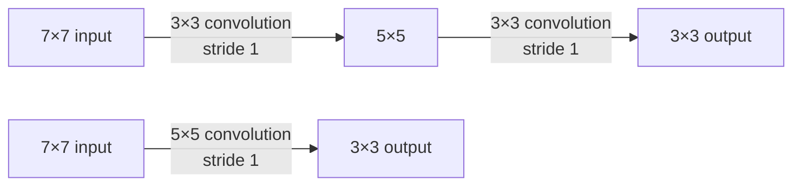
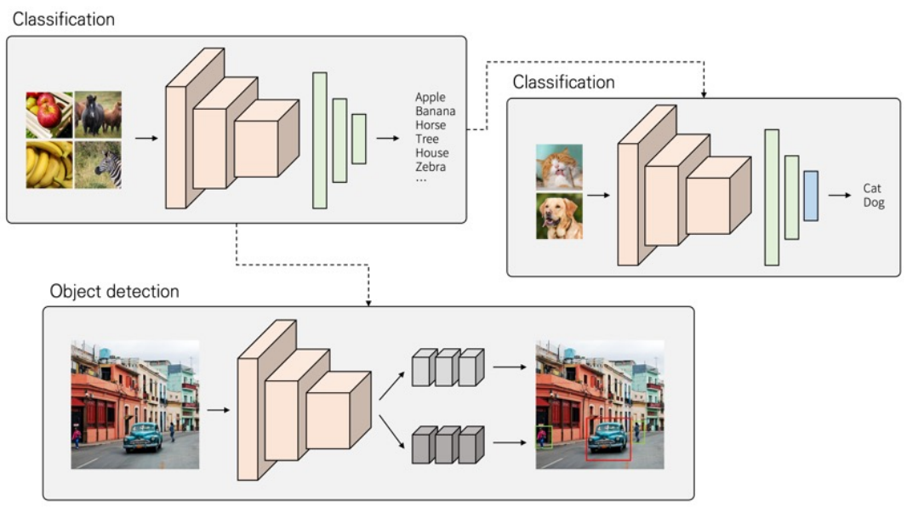
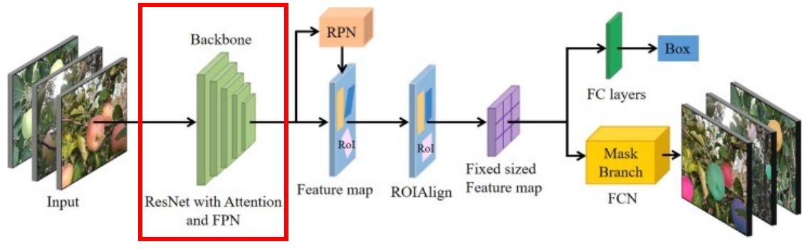
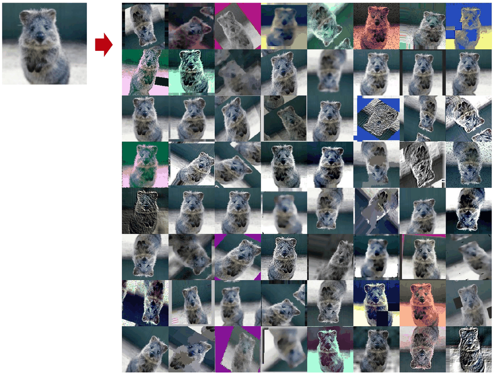
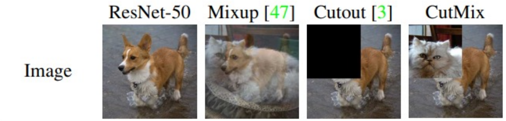
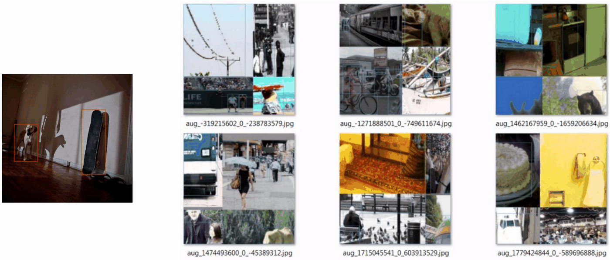
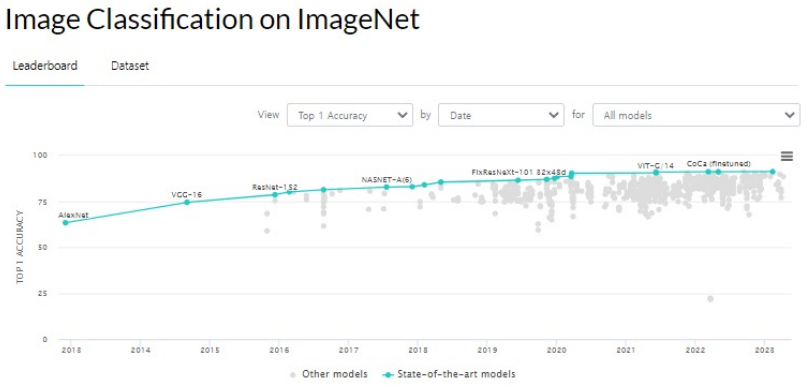
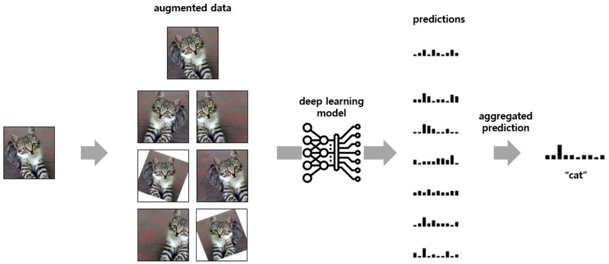
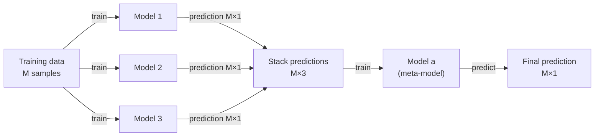
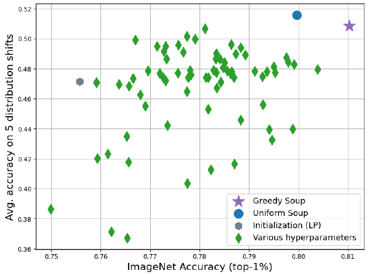

# Lecture 4 — Image Processing 2

[Repository Guide](../../README.md) | [English](Concepts_Lecture.md) | [한국어](Concepts_Lecture.ko.md)

> **Last Updated:** 2026-11-04

> **Learning Objectives:**
> 1. Summarize the contributions of VGGNet and ResNet, and compute the effect of stacking 3×3 filters on the number of parameters and the receptive field
> 2. Choose a fine-tuning strategy for transfer learning according to dataset size and similarity, and explain the role of a backbone
> 3. Explain the principles of the data augmentation techniques used for classification and object detection (Mixup, Cutout, CutMix, Mosaic)
> 4. Compute accuracy, precision, recall, and the F1 score from a confusion matrix, and explain the limitation of accuracy on imbalanced data
> 5. Compute and compare the macro, weighted, and micro F1 scores for a multi-class problem
> 6. Explain the principles of model selection, TTA, voting, stacking, and model soups, which raise performance in competitions

---

## Table of Contents

- [1. The ImageNet Challenge and the Flow of This Lecture](#1-the-imagenet-challenge-and-the-flow-of-this-lecture)
- [2. VGGNet](#2-vggnet)
  - [2.1 Key Idea](#21-key-idea)
  - [2.2 Contributions of VGGNet](#22-contributions-of-vggnet)
  - [2.3 Conclusions from Comparing Configurations](#23-conclusions-from-comparing-configurations)
- [3. ResNet](#3-resnet)
  - [3.1 The Degradation Problem and the Residual Block](#31-the-degradation-problem-and-the-residual-block)
  - [3.2 Contributions of ResNet](#32-contributions-of-resnet)
- [4. Transfer Learning](#4-transfer-learning)
  - [4.1 Examples of Transfer Learning](#41-examples-of-transfer-learning)
  - [4.2 Feature Extraction and Fine-Tuning](#42-feature-extraction-and-fine-tuning)
  - [4.3 Backbone](#43-backbone)
- [5. Data Augmentation](#5-data-augmentation)
  - [5.1 Concept and Basic Techniques](#51-concept-and-basic-techniques)
  - [5.2 Augmentation for Classification: Mixup, Cutout, CutMix](#52-augmentation-for-classification-mixup-cutout-cutmix)
  - [5.3 Augmentation for Object Detection: Mosaic](#53-augmentation-for-object-detection-mosaic)
- [6. Evaluation Metrics for Classification](#6-evaluation-metrics-for-classification)
  - [6.1 Confusion Matrix and Accuracy](#61-confusion-matrix-and-accuracy)
  - [6.2 Limitation of Accuracy](#62-limitation-of-accuracy)
  - [6.3 Precision and Recall](#63-precision-and-recall)
  - [6.4 F1 Score](#64-f1-score)
  - [6.5 Multi-Class F1 Score](#65-multi-class-f1-score)
  - [6.6 Macro, Weighted, and Micro F1](#66-macro-weighted-and-micro-f1)
- [7. Techniques for Raising Accuracy in Competitions](#7-techniques-for-raising-accuracy-in-competitions)
  - [7.1 Hackathons and Competitions](#71-hackathons-and-competitions)
  - [7.2 Model Selection](#72-model-selection)
  - [7.3 TTA](#73-tta)
  - [7.4 Voting](#74-voting)
  - [7.5 Stacking](#75-stacking)
  - [7.6 Model Soups](#76-model-soups)
- [Summary](#summary)
- [Self-Check Questions](#self-check-questions)
- [References](#references)

---

<br>

## 1. The ImageNet Challenge and the Flow of This Lecture

In the ImageNet classification challenge seen in Section 2.6 of Lecture 3, the top-5 error rate fell rapidly after AlexNet in 2012 (15.3%), passing through VGGNet (7.3%) and GoogLeNet (6.7%) in 2014 until ResNet (3.6%) in 2015 recorded an error rate lower than humans (about 5%). This lecture summarizes the contributions of these two models and then covers, in order, transfer learning, which reuses models trained this way for other problems, data augmentation, which is used when data is scarce, metrics for evaluating models, and techniques for pushing up performance in competitions.

---

<br>

## 2. VGGNet

### 2.1 Key Idea

The key of the VGG model was **to examine what effect making the network deeper has on performance**. To examine only the effect of depth, the VGG team fixed the size of the convolution filters (kernels) at the smallest, 3×3 [1]. The architecture of VGG-16, in which a 224×224×3 input passes through 3×3 convolutions and max pooling to become an output over 1000 classes, and the table of the six configurations A-E are in Section 3 of Lecture 3.

### 2.2 Contributions of VGGNet

**Demonstrating the effect of deep networks.** VGG greatly improved image classification performance by using networks deeper than previous models. In doing so, it showed that deep networks have a large effect on improving image classification performance. At the same time, it also showed the limitation that stacking deeper is not always better. As Section 2.3 shows, performance saturated around 19 layers, and stacking deeper than that brings out the degradation problem of Section 4.1 of Lecture 3.

**Efficiency of small filters.** Instead of one layer with a large filter, VGG stacked several layers of 3×3 filters, covering the same region with fewer parameters and performing better (the model as a whole still has more parameters than AlexNet because of its fully connected layers). The key point is that stacking small filters several times covers the same region as a large filter. The size of the region of the input that affects one value of the output is called the **receptive field**.



*Figure 1. Output sizes for two stacked 3×3 convolutions (top) and one 5×5 convolution (bottom)*

In Figure 1, applying a 3×3 convolution without padding to a 7×7 input gives (7 − 3)/1 + 1 = 5, a 5×5 output, and applying it once more gives 3×3. Applying a 5×5 convolution once also gives (7 − 5)/1 + 1 = 3, the same 3×3. In both cases one value of the final output is computed from a 5×5 region of the input, so the receptive fields are the same. In the same way, three 3×3 convolutions have the same receptive field as one 7×7 convolution.

Even with the same receptive field, the number of parameters differs. If both the input and output have $C$ channels, one $k \times k$ convolutional layer has $k^2 C^2$ weights (excluding biases).

| Structure | Receptive field | Number of weights | When $C = 64$ |
|:-----|:-----|:-----|:-----|
| Two 3×3 convolutional layers | 5×5 | $2 \times 9C^2 = 18C^2$ | 73,728 |
| One 5×5 convolutional layer | 5×5 | $25C^2$ | 102,400 |
| Three 3×3 convolutional layers | 7×7 | $3 \times 9C^2 = 27C^2$ | 110,592 |
| One 7×7 convolutional layer | 7×7 | $49C^2$ | 200,704 |

*Table 1. Number of weights of convolutional structures with the same receptive field*

Two 3×3 layers have 28% fewer weights than one 5×5 layer, and three 3×3 layers about 45% fewer than one 7×7 layer. In addition, each layer has a ReLU, so the input passes through the nonlinearity two or three times and more complex features can be represented. Having fewer parameters also reduces overfitting [1].

### 2.3 Conclusions from Comparing Configurations

The VGG paper trained configurations A (11 layers) through E (19 layers), which differ only in depth, under the same conditions and compared them, reaching the following conclusions [1].

- A-LRN, which adds the local response normalization (LRN) used by AlexNet, was no better than A, so LRN was not used in the deeper configurations.
- As the depth grew from 11 to 19 layers, the error rate decreased, and it saturated around 19 layers.
- At the same depth of 16 layers, D, which uses only 3×3 convolutions, was better than C, which uses 1×1 convolutions in some layers. This means that adding nonlinearity alone is not enough, and that capturing the surrounding spatial information with 3×3 filters matters.

VGG-16 has about 138 million parameters and VGG-19 about 144 million, which is very many, and most of them are in the fully connected layers at the end (especially the first one). This large model size and the heavy computation, which comes mostly from the convolutional layers (about 15.3 billion FLOPs in Table 2), are VGG's practical drawbacks.

---

<br>

## 3. ResNet

### 3.1 The Degradation Problem and the Residual Block

VGG showed the good performance of deep networks, but making a network deeper did not keep improving performance by itself. When layers were added indiscriminately, a 56-layer network had both higher training error and higher test error than a 20-layer network, and since it performed poorly even on the training data, the cause was not overfitting (the degradation problem). The vanishing gradient, in which the learning signal does not reach the early layers well as backpropagation goes deeper, also makes deep networks hard to train, but it is largely mitigated by techniques such as batch normalization, and the original paper does not attribute degradation to vanishing gradients (Section 4.3 of Lecture 3).

ResNet solved the degradation problem with residual learning using skip connections. A residual block adds the input $x$ to the $F(x)$ computed by two layers and outputs $H(x) = F(x) + x$, and since $\partial H/\partial x = \partial F/\partial x + 1$ in backpropagation, the gradient passes through a shortcut. The comparison of the 34-layer ResNet, obtained by adding skip connections to a 34-layer plain network, with VGG-19 is in Section 4.4 of Lecture 3. The figures and derivations of the residual block are in Section 4 of Lecture 3.

### 3.2 Contributions of ResNet

**Introducing residual connections.** ResNet introduced the **residual connection**, that is, the skip connection, and thereby solved the degradation problem that arises in deep networks [2]. Residual connections also let gradients reach the early layers through a shortcut, which helps train deep networks.

**Securing the possibility of scaling depth.** It successfully trained networks of up to 152 layers, breaking through the limit on the depth of deep learning models. An ensemble including the 152-layer ResNet won the classification track of ILSVRC 2015 with a top-5 error rate of 3.57% [2]. It requires less computation than VGG despite being deeper because it shrinks the feature map quickly in the first layers and uses fewer filters at each size, and from 50 layers up it uses bottleneck blocks that reduce and then restore the number of channels with 1×1 convolutions (Lecture 9).

| Model | Weight layers | Parameters | Computation (FLOPs) |
|:-----|:-----|:-----|:-----|
| VGG-16 | 16 | about 138.4 million | about 15.3 billion |
| ResNet-18 | 18 | about 11.7 million | about 1.8 billion |
| ResNet-34 | 34 | about 21.8 million | about 3.6 billion |
| ResNet-50 | 50 | about 25.6 million | about 3.8 billion |
| ResNet-101 | 101 | about 44.5 million | about 7.6 billion |
| ResNet-152 | 152 | about 60.2 million | about 11.3 billion |

*Table 2. Number of parameters and computation of VGG-16 and ResNets of various depths*

The computation in Table 2 is the number of multiply-adds needed to process one 224×224 image [2]. ResNet-152 is more than 9 times deeper than VGG-16 but has less than half the parameters and also less computation.

**Extension to various fields.** The residual block is a simple structure that adds the input to the output, so it is easily applied to other networks. Later structures such as the backbones of object detection and segmentation models (Section 4.3) and the Transformer of Lecture 8 all use residual connections.

---

<br>

## 4. Transfer Learning

### 4.1 Examples of Transfer Learning

**Transfer learning** is the use of part of the abilities of a neural network trained in one domain for training a neural network used in a similar or entirely new domain (Section 6 of Lecture 3).



*Figure 2. Examples of transfer learning that reuse the feature extraction part of a pretrained classification model for a new classification task and for object detection*

The model at the top left of Figure 2 was trained on many classes such as apple, banana, horse, tree, house, and zebra. Its convolutional part has already acquired the ability to extract features from images, so it is taken over as is. At the top right, only the final classifier is replaced with a new classifier that distinguishes cats from dogs (the blue box) to solve a new classification problem, and at the bottom, two output branches that predict the location and class of bounding boxes are attached after the same feature extraction part to solve object detection. Because training does not start from scratch, less data is needed and training is shorter.

### 4.2 Feature Extraction and Fine-Tuning

In transfer learning, a model trained in advance is called a **pretrained model**, and there are two main ways to use it.

- **Feature extraction:** The convolutional part of the pretrained model is frozen so that its weights do not change, and only the newly attached classifier is trained.
- **Fine-tuning:** Some or all layers of the pretrained model are retrained with a small learning rate together with the new classifier, adjusting the weights slightly to the new data.

How many layers to train is decided by the size of the dataset for the task at hand and its similarity to the dataset used for pretraining.

| | Very different from the pretraining dataset | Similar to the pretraining dataset |
|:-----|:-----|:-----|
| **Dataset is large enough** | Train the entire model (use the pretrained weights as initial values) | Train some layers and leave the others frozen |
| **Dataset is small** | Train some layers and leave the others frozen (train more layers than in the similar case) | Freeze the entire convolutional base and train only the classifier |

*Table 3. Fine-tuning strategies according to dataset size and similarity*

- **Large and very different data:** With plenty of data, retraining the entire model carries little risk of overfitting. The pretrained weights are a better starting point than random initialization.
- **Large and similar data:** The general features of the early layers (edges, textures) are used as they are, and the output-side layers and the classifier are trained.
- **Small and very different data:** This is the hardest case. The later layers, specialized to the original task, do not fit and must be trained, but training too many layers overfits the small data. A balance must be found in which only some early layers are frozen and the rest are trained, and it is advisable to use data augmentation (Section 5) together.
- **Small and similar data:** The features of the pretrained model can be used as they are, so the whole convolutional part is frozen and only the classifier is trained (feature extraction).

The reason for freezing the early layers is that the early layers of a CNN learn general features common to many images, whereas the later layers learn features specialized to the original task [3]. In PyTorch, a pretrained model from torchvision is loaded, its parameters are frozen by setting `requires_grad` to `False`, and the final layer is created anew.

```python
import torch.nn as nn
import torch.optim as optim
import torchvision.models as models

model = models.resnet18(weights="IMAGENET1K_V1")       # ResNet-18 pretrained on ImageNet
for p in model.parameters():                           # freeze all layers
    p.requires_grad = False
model.fc = nn.Linear(model.fc.in_features, 2)          # new classifier: 512 -> 2 classes

# for fine-tuning, unfreeze the last residual stage as well
# for p in model.layer4.parameters():
#     p.requires_grad = True

optimizer = optim.SGD(filter(lambda p: p.requires_grad, model.parameters()),
                      lr=0.001, momentum=0.9)
```

`weights="IMAGENET1K_V1"` means that the weights trained on ImageNet are downloaded and used. If all parameters are frozen and `model.fc` is then created anew, only the parameters of the new layer are trained. In this example, of about 11.18 million parameters in total, only the 512 × 2 + 2 = 1,026 of the new classifier are trained (feature extraction). Running the two commented lines to unfreeze `layer4` increases the trainable parameters to about 8.39 million (fine-tuning). Only parameters whose `requires_grad` is `True` are passed to the optimizer.

### 4.3 Backbone

In deep learning, a **backbone** is the core network structure used in deep learning models of various fields such as computer vision and natural language processing (NLP). It mainly refers to the basic neural network that extracts features from the input, on top of which structures suited to the task and purpose are stacked to obtain the desired performance in the end. VGG and ResNet pretrained on ImageNet are typical backbones, and transfer learning can be seen as reusing a backbone.



*Figure 3. The Mask R-CNN architecture with an RPN, RoIAlign, and box and mask output branches stacked on a ResNet-based backbone (red box)*

Figure 3 is a model for instance segmentation of apples against a complex background [4]. Its base architecture is Mask R-CNN [5], and its parts do the following.

1. **Backbone (red box):** A ResNet with attention and an FPN (feature pyramid network, a structure that builds feature maps of several sizes together) produces feature maps from the input image.
2. **RPN (region proposal network):** Proposes candidate regions (RoIs, regions of interest) likely to contain objects from the feature maps.
3. **RoIAlign:** Crops the features of candidate regions of varying sizes into feature maps of the same size.
4. **Output branches:** Fully connected layers (FC layers) predict the class and bounding box (Box) for each candidate, and the mask branch (Mask Branch, FCN) marks the object region pixel by pixel.

The advantage of this design is that the rest of the structure can be used unchanged even if only the backbone is replaced with a different structure (for example, a lighter network).

---

<br>

## 5. Data Augmentation

### 5.1 Concept and Basic Techniques

**Data augmentation** is a way of enlarging the effective size of the training dataset by transforming (augmenting) the dataset in various ways. Training on several slightly altered versions of the same image teaches the model features that are not swayed by trivial changes such as position, orientation, and color, and reduces overfitting.



*Figure 4. Augmented images created by transforming one original image (top left) in various ways*

Figure 4 shows one quokka photo transformed in 64 ways with the augmentation library imgaug (https://github.com/aleju/imgaug). It uses geometric transformations such as flipping, rotation, shearing, and zooming and cropping, color transformations such as changes in brightness, contrast, and hue, blurring and noise, masking of some regions, and filters such as embossing and edge enhancement. Many data augmentation techniques are organized in the surveys by Shorten and Khoshgoftaar [6] and by Yang et al. [7].

Augmentation must be used only within the range that does not change the label. For example, rotating the digit 6 by 180 degrees turns it into 9, so large rotations are not used for digit recognition. Augmentation is also applied only to the training data, and validation and test data receive only deterministic preprocessing such as resizing and normalization. In torchvision, random transformations are combined with `transforms.Compose` and passed to the training dataset.

```python
import torchvision.transforms as transforms

train_transform = transforms.Compose([
    transforms.RandomResizedCrop(224),                      # crop a random region and resize to 224×224
    transforms.RandomHorizontalFlip(),                      # flip horizontally with probability 50%
    transforms.ColorJitter(brightness=0.2, contrast=0.2),   # vary brightness and contrast within ±20%
    transforms.ToTensor(),
    transforms.Normalize((0.485, 0.456, 0.406), (0.229, 0.224, 0.225)),
])
```

A new random transformation is applied every time the data loader takes an image, so the same image enters the model in a slightly different form every epoch. The number of stored data items stays the same, but the data the model sees effectively increases.

### 5.2 Augmentation for Classification: Mixup, Cutout, CutMix

For classification, augmentations that mix several images or mask part of an image are effective.



*Figure 5. The original image and images with Mixup, Cutout, and CutMix applied*

- **Mixup:** Mixes two images $x_i$, $x_j$ and their labels $y_i$, $y_j$ (one-hot vectors) with a ratio $\lambda$: $\tilde{x} = \lambda x_i + (1-\lambda) x_j$, $\tilde{y} = \lambda y_i + (1-\lambda) y_j$ [8]. In Figure 5 a dog and a cat are overlaid half and half, so the label also becomes dog 0.5, cat 0.5.
- **Cutout:** Masks a random square region of the image with 0 (black) [9]. The label stays dog 1.0. It makes the model look at several parts instead of relying on one part (for example, the face).
- **CutMix:** Cuts out a region of one image and pastes the same region of another image in its place. The labels are mixed by the area ratio of the pasted region [10]. In Figure 5 the cat region occupies 40% of the image, so the label is dog 0.6, cat 0.4. Unlike Cutout, information to learn remains in the masked region, and unlike Mixup, the images do not overlap unnaturally.

| | ResNet-50 (baseline) | Mixup | Cutout | CutMix |
|:-----|:-----|:-----|:-----|:-----|
| Label | dog 1.0 | dog 0.5, cat 0.5 | dog 1.0 | dog 0.6, cat 0.4 |
| ImageNet classification accuracy (%) | 76.3 (+0.0) | 77.4 (+1.1) | 77.1 (+0.8) | 78.6 (+2.3) |

*Table 4. Label notation and ImageNet top-1 accuracy when each augmentation is applied to ResNet-50*

Table 4 is the comparison from the CutMix paper: when the same ResNet-50 was trained with only the augmentation method changed, CutMix raised accuracy the most (by 2.3 percentage points) [10].

### 5.3 Augmentation for Object Detection: Mosaic



*Figure 6. Examples of Mosaic augmentation combining four training images into one*

**Mosaic** is an augmentation for object detection introduced in YOLOv4 that resizes four training images and joins them into the four sections of one image [11]. The left of Figure 6 is one original image (with bounding boxes for a dog and a skateboard), and the right shows Mosaic images made this way. The bounding box coordinates of each image are also moved and cropped in the same way. As a result, objects appear in backgrounds and contexts different from usual, small objects become more numerous, and since one image contains four images, diverse data can be learned even with small mini-batches.

---

<br>

## 6. Evaluation Metrics for Classification

There are various **metrics** for measuring classification accuracy. This section starts from the metrics for binary classification and extends them to multiple classes.

### 6.1 Confusion Matrix and Accuracy

In binary classification there are four combinations of prediction and actual answer for the positive class (Positive, written True) and the negative class (Negative, written False). The table that organizes them is called the **confusion matrix**.

| Predicted \ Actual | True (positive) | False (negative) |
|:-----|:-----|:-----|
| **True (positive)** | True Positive (TP) | False Positive (FP) |
| **False (negative)** | False Negative (FN) | True Negative (TN) |

*Table 5. Confusion matrix of binary classification*

The first word of each name (True/False) says whether the prediction was correct, and the second word (Positive/Negative) says what was predicted. FP means a negative wrongly predicted as positive, and FN a positive wrongly predicted as negative. In the confusion matrices of this lecture, rows are predictions and columns are actual answers. scikit-learn's `confusion_matrix` is the other way around, with rows as actual answers and columns as predictions, so check the orientation when reading such a table.

**Accuracy** is the fraction of all samples that were predicted correctly.

$$
\text{Accuracy} = \frac{TP + TN}{TP + TN + FP + FN}
$$

Take the problem of classifying whether a product is defective. True means defective, False means normal, and there are 58 products in total.

| Predicted \ Actual | True (defective) | False (normal) |
|:-----|:-----|:-----|
| **True (defective)** | 30 | 5 |
| **False (normal)** | 3 | 20 |

*Table 6. Confusion matrix for classifying defective products (58 in total)*

Since TP = 30, FP = 5, FN = 3, and TN = 20, the accuracy is (30 + 20)/(30 + 20 + 3 + 5) = 50/58 ≈ 0.862.

### 6.2 Limitation of Accuracy

Using only accuracy for binary classification can cause problems. When one class is so frequent that rare situations are not classified properly, as in deciding whether a mail is spam or whether a person is infected, accuracy cannot guarantee the model's generalization performance. For example, on data in which only 10 of 1,000 patients (1%) have cancer, a model that always predicts False (normal) has accuracy 990/1,000 = 99%, close to 100%, yet finds none of the cancer patients it is supposed to find. A separate metric is therefore needed to see how well the positive class is handled.

### 6.3 Precision and Recall

**Precision** is the fraction of the samples predicted as Positive that are actually Positive, and it indicates how accurate the predictions are.

$$
\text{Precision} = \frac{TP}{TP + FP}
$$

An example where precision matters is spam filtering. Classifying a normal mail (Negative) as spam (Positive) causes important mail to be missed and disrupts work, so it is important not to judge a Negative as Positive (to reduce FP).

**Recall** is the fraction of the actual Positives that were correctly predicted as Positive, and it indicates how many of the actual answers were found.

$$
\text{Recall} = \frac{TP}{TP + FN}
$$

An example where recall matters is cancer diagnosis. Diagnosing a cancer patient (Positive) as normal (Negative) causes the serious problem of missing the time for treatment, so it is important not to judge a Positive as Negative (to reduce FN). The model of Section 6.2 that always predicts normal has TP = 0, so its recall is 0 and the problem is exposed immediately.

In the example of Table 6, the precision is 30/(30 + 5) = 30/35 ≈ 0.857 and the recall is 30/(30 + 3) = 30/33 ≈ 0.909. Which metric matters more depends on the problem, but in most cases both matter.

### 6.4 F1 Score

Precision and recall are in a **trade-off** relationship, in which one improves as the other worsens. Suppose a model predicts Positive when the probability of the positive class exceeds a threshold (for example, 0.5). Raising the threshold makes the model predict Positive only in clear cases, so FP decreases and precision rises, but ambiguous positives are missed, so FN increases and recall falls. Lowering the threshold does the opposite.

The metric that reflects both is the **F1 score**, the **harmonic mean** of precision and recall.

$$
F_1 = 2 \times \frac{\text{Precision} \times \text{Recall}}{\text{Precision} + \text{Recall}} = \frac{2TP}{2TP + FP + FN}
$$

The right-hand expression is obtained by substituting the definitions of precision and recall and simplifying. In the example of Table 6, $F_1 = 2 \times 0.857 \times 0.909 / (0.857 + 0.909) = 60/68 \approx 0.882$. The harmonic mean comes out close to the smaller of the two values. A model with precision 1.0 and recall 0.01 has an arithmetic mean of 0.505, but its F1 score is $2 \times 1.0 \times 0.01 / 1.01 \approx 0.020$, so a model strong on only one side is not rated highly.

### 6.5 Multi-Class F1 Score

With three or more classes, the confusion matrix grows too. Suppose 25 samples of dogs (Dog), cats (Cat), and cows (Cow) were classified with the following result.

| Predicted \ Actual | Dog | Cat | Cow |
|:-----|:-----|:-----|:-----|
| **Dog** | 4 | 6 | 3 |
| **Cat** | 1 | 2 | 0 |
| **Cow** | 1 | 2 | 6 |

*Table 7. Confusion matrix of classifying dogs, cats, and cows*

The diagonal (4, 2, 6) holds the numbers of correct predictions. Summing the columns gives the actual counts (Dog 6, Cat 10, Cow 9, total 25), and summing the rows gives the predicted counts (Dog 13, Cat 3, Cow 9).

The multi-class F1 score is computed by **obtaining the F1 score for each class and then averaging them**. Treating one class as Positive and all the others as Negative (else) gives a binary confusion matrix for each class (one-vs-rest). For Dog, TP is the 4 dogs predicted as Dog, FP is the Dog row minus the diagonal, 6 + 3 = 9, FN is the Dog column minus the diagonal, 1 + 1 = 2, and TN is the rest, 25 − 4 − 9 − 2 = 10.

| Class | TP | FP | FN | TN | Precision | Recall | F1 score |
|:-----|:-----|:-----|:-----|:-----|:-----|:-----|:-----|
| Dog | 4 | 9 | 2 | 10 | 4/13 ≈ 0.308 | 4/6 ≈ 0.667 | 8/19 ≈ 0.421 |
| Cat | 2 | 1 | 8 | 14 | 2/3 ≈ 0.667 | 2/10 = 0.200 | 4/13 ≈ 0.308 |
| Cow | 6 | 3 | 3 | 13 | 6/9 ≈ 0.667 | 6/9 ≈ 0.667 | 12/18 ≈ 0.667 |

*Table 8. One-vs-rest confusion matrix values and precision, recall, and F1 score for each class*

The F1 score is convenient to compute as $2TP/(2TP + FP + FN)$. For example, for Dog it is $8/(8 + 9 + 2) = 8/19$. Cat found only 2 of the 10 cats, so its recall is a low 0.2, and Dog predicted many non-dogs as dogs, so its precision is low.

### 6.6 Macro, Weighted, and Micro F1

There are three ways to combine the per-class F1 scores into one.

**Macro F1** is the arithmetic mean of the per-class F1 scores. It treats all classes as equally important.

$$
F_1^{\text{macro}} = \frac{F_1(\text{dog}) + F_1(\text{cat}) + F_1(\text{cow})}{3} = \frac{0.421 + 0.308 + 0.667}{3} \approx 0.465
$$

**Weighted F1** takes the size (imbalance) of each class's data into account and weights each class's F1 score by its share of the actual samples. The actual counts are Dog 6, Cat 10, and Cow 9.

$$
F_1^{\text{weighted}} = 0.421 \times \frac{6}{25} + 0.308 \times \frac{10}{25} + 0.667 \times \frac{9}{25} \approx 0.101 + 0.123 + 0.240 = 0.464
$$

**Micro F1** considers all samples together without separating classes. It first sums TP, FP, and FN over all classes and then computes precision, recall, and the F1 score at once.

| Class | TP | FP | FN |
|:-----|:-----|:-----|:-----|
| Dog | 4 | 9 | 2 |
| Cat | 2 | 1 | 8 |
| Cow | 6 | 3 | 3 |
| Total | 12 | 13 | 13 |

*Table 9. Totals of TP, FP, and FN for computing micro F1*

$$
\text{Precision}^{\text{micro}} = \frac{12}{12 + 13} = 0.48, \qquad \text{Recall}^{\text{micro}} = \frac{12}{12 + 13} = 0.48, \qquad F_1^{\text{micro}} = 0.48
$$

This value equals the accuracy (4 + 2 + 6)/25 = 12/25 = 0.48. In classification that predicts exactly one class per sample (single-label multi-class classification), each misclassified sample creates one FP for the predicted class and one FN for the actual class at the same time, so the sum of FP and the sum of FN both equal the number of misclassified samples. Therefore micro precision and micro recall both become (number correct)/(total), and the micro F1 score equals the accuracy.

| Method | Computation | Value in this example | Characteristics |
|:-----|:-----|:-----|:-----|
| Macro F1 | Arithmetic mean of per-class F1 | 0.465 | Treats all classes equally, so the performance on classes with few samples is strongly reflected |
| Weighted F1 | Mean of per-class F1 weighted by actual sample counts | 0.464 | The performance on classes with many samples is reflected more strongly |
| Micro F1 | Computed after summing TP, FP, and FN | 0.480 | Treats every sample equally, and equals accuracy in single-label classification |

*Table 10. Comparison of the three multi-class F1 scores*

In this example, Cat, the class with the most samples, has the lowest F1 score, so the weighted F1 is slightly lower than the macro F1. If predicting rare classes well matters, use macro F1; if performance over all samples matters, use micro F1 (accuracy). scikit-learn's `f1_score` selects `'macro'`, `'weighted'`, or `'micro'` with the `average` argument, and `None` returns the per-class F1 scores as they are [12].

---

<br>

## 7. Techniques for Raising Accuracy in Competitions

### 7.1 Hackathons and Competitions

A **hackathon** is a blend of hacking and marathon: an event in which experts from various fields, such as programmers, graphic designers, and UI designers, gather to come up with ideas and build results within a limited time. In artificial intelligence, platforms such as DACON in Korea and Kaggle internationally hold competitions that publish data and problems. Participants submit predictions for the test data and are ranked on the leaderboard by their score on the evaluation metric set by the competition (accuracy, weighted F1 score, RMSE, LogLoss, and so on).

The score differences near the top of a leaderboard are very small (for example, 0.7355 versus 0.7197), so raising accuracy even slightly is the key. Techniques often used for this are model selection, TTA, voting, stacking, and model soups.

### 7.2 Model Selection

The starting point is choosing a good model. A leaderboard that collects research results shows which models perform well on each task.



*Figure 7. Top-1 accuracy over the years on the ImageNet image classification leaderboard*

Figure 7 is the ImageNet classification leaderboard of Papers with Code, which shows the state-of-the-art model (teal line) changing through AlexNet, VGG-16, ResNet-152, NASNET-A, FixResNeXt-101, ViT-G/14, and CoCa as top-1 accuracy rose from the 60% range to over 90%. The top models on the leaderboard were as follows.

| Rank | Model | Top-1 accuracy | Parameters | Year |
|:-----|:-----|:-----|:-----|:-----|
| 1 | BASIC-L (Lion, fine-tuned) | 91.1% | 2440M | 2023 |
| 2 | CoCa (finetuned) | 91.0% | 2100M | 2022 |
| 3 | Model soups (BASIC-L) | 90.98% | 2440M | 2022 |

*Table 11. The top three models on the ImageNet classification leaderboard*

The M in the parameter counts stands for million, so 2440M is about 2.44 billion. In a competition, a model is chosen by weighing not only accuracy but also the available GPU memory and training time, inference time limits, and whether pretrained weights are published. With pretrained weights, the transfer learning of Section 4 can give high performance even with little data.

### 7.3 TTA

**TTA (test-time augmentation)** is a technique that applies data augmentation at test (inference) time. One test image is transformed in several ways, each version is predicted, and the predictions are combined into the final prediction.



*Figure 8. TTA, which augments a test image into several versions, predicts each, and combines the predictions to decide the final class*

In Figure 8, the cat image becomes seven versions through flipping, rotation, zooming, and so on, and the deep learning model produces per-class scores (bar charts) for each version. In the prediction aggregated by, for example, averaging these scores, the highest class, "cat", becomes the final answer. Even if one version is wrong by chance, the average over several versions is more stable. In exchange, the inference computation grows by the number of versions.

In PyTorch, TTA is easily applied with the ttach library (https://github.com/qubvel/ttach) [13]. The following code applies TTA to a model trained in a competition that classifies five grades (1++, 1+, 1, 2, 3) and creates a submission file. `TestDataset`, `get_model`, `train_config`, and the path constants (`DATA_DIR` and others) are defined in other files of the same project.

```python
if __name__ == '__main__':

    # Set device
    device = torch.device('cuda' if torch.cuda.is_available() else 'cpu')

    # Load data
    test_dataset = TestDataset(img_folder=os.path.join(DATA_DIR, 'images'),
                               dfpath=os.path.join(DATA_DIR, 'test_images.csv'))
    test_dataloader = DataLoader(dataset=test_dataset,
                                 # batch_size=train_config['DATALOADER']['test_batch_size'],
                                 batch_size=1,
                                 num_workers=train_config['DATALOADER']['num_workers'],
                                 shuffle=False,
                                 pin_memory=train_config['DATALOADER']['pin_memory'],
                                 drop_last=train_config['DATALOADER']['drop_last'])

    # Load model
    model_name = train_config['TRAINER']['model']
    model_args = train_config['MODEL'][model_name]
    model = get_model(model_name=model_name, model_args=model_args).to(device)

    checkpoint = torch.load(os.path.join(RECORDER_DIR, 'model.pt'))
    model.load_state_dict(checkpoint['model'])

    model.eval()

    # tta
    transforms = tta.Compose([
        tta.HorizontalFlip(),
        tta.VerticalFlip(),
        tta.Rotate90(angles=[0, 90])
    ])
    tta_model = tta.ClassificationTTAWrapper(model, transforms)

    # Make predictions
    y_preds = []
    filenames = []

    for batch_index, (x, filename) in enumerate(tqdm(test_dataloader)):
        x = x.to(device, dtype=torch.float)
        y_logits = tta_model(x).cpu()
        y_pred = torch.argmax(y_logits, dim=1)
        y_logits = y_logits.detach().numpy()
        y_pred = y_pred.detach().numpy()
        for fname in filename:
            filenames.append(fname)
        for yp in y_pred:
            y_preds.append(yp)

    # Decode Prediction Labels
    label_decoding = {0:'1++', 1:'1+', 2:'1', 3:'2', 4:'3'}
    pred_df = pd.DataFrame(list(zip(filenames, y_preds)), columns=['id','grade'])
    pred_df['grade'] = pred_df['grade'].replace(label_decoding)

    # Reorder
    sample_df = pd.read_csv(SAMPLE_DIR)
    sorter = list(sample_df['id'])
    resdf = pred_df.set_index('id')
    result = resdf.loc[sorter].reset_index()

    # Save predictions
    resultpath = os.path.join(PREDICT_DIR, 'predictions_tta.csv')
    result.to_csv(resultpath, index=False)
    print(resultpath, 'Done')
```

- **Device and data:** Uses `cuda` if a GPU is available and `cpu` otherwise. The test data loader does not shuffle (`shuffle=False`).
- **Loading the model:** Reads the model name and arguments from the configuration, builds the model, loads the weights of the checkpoint saved during training (`model.pt`) with `load_state_dict`, and switches to evaluation mode.
- **TTA setup:** Putting horizontal flip (off, on), vertical flip (off, on), and 90-degree rotation (0, 90 degrees) into `tta.Compose` creates 2 × 2 × 2 = 8 combinations. `ClassificationTTAWrapper` transforms the input in the 8 ways, feeds each to the model, and with the default setting (`merge_mode='mean'`) returns the average of the 8 logits.
- **Prediction:** Picks the class number from the averaged logits with `torch.argmax` and collects it in a list together with the file name.
- **Postprocessing and saving:** Turns the class numbers into grade strings (`label_decoding`), sorts the results in the `id` order of the sample submission file provided by the competition (`SAMPLE_DIR`), and saves them as CSV.

Writing out what ttach does internally gives the following. Here only four versions are used: the original, a horizontal flip, a vertical flip, and a 90-degree rotation.

```python
def tta_predict(model, x):
    views = [x, torch.flip(x, dims=[3]), torch.flip(x, dims=[2]), torch.rot90(x, 1, dims=[2, 3])]
    with torch.no_grad():
        logits = torch.stack([model(v) for v in views]).mean(dim=0)
    return logits.argmax(dim=1)
```

`x` is a batch×channels×height×width tensor, so `dims=[3]` flips along the width (left-right) and `dims=[2]` along the height (up-down), and `torch.rot90(x, 1, dims=[2, 3])` rotates by 90 degrees in the height-width plane. The logits of the four versions are stacked (`torch.stack`) and averaged, and the largest class is chosen. Transformations that change the meaning of an image (for example, rotating digits) are not used for TTA either.

### 7.4 Voting

**Voting** is an ensemble technique that collects the predictions of several models like votes to decide the final prediction. Suppose three models predicted one cat image as follows.

| Model | cat probability | dog probability | Prediction |
|:-----|:-----|:-----|:-----|
| Model 1 | 0.7 | 0.3 | cat |
| Model 2 | 0.1 | 0.9 | dog |
| Model 3 | 0.8 | 0.2 | cat |
| Average | 0.53 | 0.47 | |

*Table 12. Per-class probabilities and predictions of three models*

- **Hard voting:** Each model casts one vote for its top class, and the majority decides. With 2 votes for cat and 1 for dog, the final prediction is cat.
- **Soft voting:** The per-class probabilities of the models are averaged and the highest class is chosen. Cat is (0.7 + 0.1 + 0.8)/3 ≈ 0.53 and dog (0.3 + 0.9 + 0.2)/3 ≈ 0.47, so the answer is cat.

The two methods do not always agree. If Model 1 and Model 3 barely choose cat with cat 0.55, dog 0.45 and Model 2 is confident in dog with 0.99, hard voting gives cat (2 votes), but soft voting gives cat (0.55 + 0.01 + 0.55)/3 = 0.37 and dog 0.63, choosing dog. Soft voting also reflects how confident each model is. Voting is most effective when it combines models that make different mistakes.

### 7.5 Stacking

**Stacking** is a technique that uses the predictions of other models as new features and derives the final prediction with another model that takes them as input [14].



*Figure 9. Stacking, which stacks the predictions of three models as the input of a meta-model*

In Figure 9, Models 1, 2, and 3 are trained on data with M samples, and the predictions of each model (M×1) are stacked side by side as columns to make M×3 data. Training a new model a (the **meta-model**) on this data teaches it which model to trust more in which situation. At test time, the predictions of the three models are stacked in the same way and fed to the meta-model to obtain the final prediction.

> **Caution:** If the base models predict the very data they were trained on and these predictions are used as the meta-model's input, the meta-model comes to overtrust the base models, which are far more accurate on data they have already seen than they actually are. Therefore the meta-model's input is usually built in a K-fold manner: the training data is split into K parts, and the predictions for each part are made by a model trained without that part [14].

### 7.6 Model Soups

**Model soups** is a method that creates a new model by combining the weights of existing models. Combining models trained under different conditions can cover more diverse data, and combining the strengths of each model can create a stronger model. The implementation is published at https://github.com/mlfoundations/model-soups.

The original method proposed by Wortsman et al. is as follows [15]. Starting from the same pretrained model, fine-tune several times while changing only hyperparameters such as the learning rate, data augmentation, and training length, and then average the resulting weights.

$$
\theta_{\text{soup}} = \frac{1}{k}\sum_{i=1}^{k} \theta_i
$$

- **Uniform soup:** Averages the weights of all $k$ fine-tuned models.
- **Greedy soup:** Tries adding models to the soup one at a time in order of validation accuracy, keeping a model only if adding it raises the validation accuracy.



*Figure 10. ImageNet accuracy and average accuracy on distribution-shift data of models fine-tuned with different hyperparameters, the uniform soup, and the greedy soup*

In Figure 10, the horizontal axis is ImageNet top-1 accuracy and the vertical axis is the average accuracy on five datasets whose distribution differs from the training data (distribution shifts). The green diamonds are individual models fine-tuned with different hyperparameters, and the gray hexagon is the starting point of fine-tuning (a linear probe model with only the classifier trained, LP). The greedy soup (purple star) has an ImageNet accuracy of about 0.81, higher than any individual model, and the uniform soup (blue circle) has the highest distribution-shift accuracy, about 0.515.

The greatest advantage of model soups is that the result is a single model. Ensembles such as voting and stacking must run all of the models at inference, but a model soup averages the weights in advance, so its inference cost equals that of one model. Model soups (BASIC-L), ranked third on the leaderboard of Section 7.2, is a result of applying this method.

> **Caution:** For weight averaging to work well, the models must have the same architecture and be fine-tuned from the same pretrained weights so that they lie in the same wide valley of the loss surface. Averaging the weights of models with different architectures, or of models trained separately from different random initializations, can greatly degrade performance [15].

---

<br>

## Summary

| Concept | Key Summary |
|:-----|:-----|
| Contributions of VGGNet | It showed that deep networks greatly improve classification performance, and two 3×3 layers have the same receptive field as one 5×5 layer with 28% fewer weights. Performance saturated around 19 layers. |
| Contributions of ResNet | Residual connections solved the degradation problem of deep networks, allowing training up to 152 layers, and the simple structure is applied to many networks. |
| Transfer learning strategy | With small, similar data, freeze the convolutional part and train only the classifier; with large, different data, train the entire model; in between, train some layers. |
| Backbone | The basic neural network that extracts features, on top of which task-specific structures (RPN, box and mask output branches, and so on) are stacked. |
| Data augmentation | Enlarges the training data with label-preserving transformations: Mixup mixes, Cutout masks, CutMix cuts and pastes, and Mosaic combines four images. |
| Accuracy | (TP + TN)/total; with imbalanced classes, always predicting the majority class also scores high, so it cannot guarantee generalization performance. |
| Precision and recall | Precision TP/(TP + FP) matters for spam filtering, where FP is costly, and recall TP/(TP + FN) for cancer diagnosis, where FN is costly; the two trade off against each other. |
| F1 score | The harmonic mean of precision and recall, 2TP/(2TP + FP + FN), which does not rate highly a model strong on only one side. |
| Multi-class F1 | After computing per-class F1 one-vs-rest, macro takes the arithmetic mean, weighted the mean weighted by sample counts, and micro sums TP, FP, and FN first; micro F1 of single-label classification equals accuracy. |
| Model selection | Choose by weighing leaderboard performance together with resources, time limits, and the availability of pretrained weights. |
| TTA | Augments a test image into several versions and averages the predictions, increasing inference cost by the number of versions. |
| Voting and stacking | Hard voting is a majority vote, soft voting averages probabilities, and stacking trains a meta-model on the predictions of base models. |
| Model soups | Averages the weights of models fine-tuned from the same pretrained model, raising accuracy and robustness without increasing inference cost. |

---

<br>

## Self-Check Questions

1. **Receptive field and parameters:** Four 3×3 convolutional layers, all with $C$ channels, have the same receptive field as one convolutional layer of what size? Compare the numbers of weights of the two structures (excluding biases).

   <details>
   <summary>Answer</summary>

   Each 3×3 convolution widens the receptive field by 2, so four layers give 3 + 2 × 3 = 9, the same as one 9×9 convolutional layer. The weights are $4 \times 9C^2 = 36C^2$ for four 3×3 layers and $81C^2$ for one 9×9 layer, so the four 3×3 layers have about 56% fewer.

   </details>

2. **Fine-tuning strategy:** The pretrained model was trained on ImageNet, and the problem is to classify pneumonia from 500 chest X-ray images. Which case of Table 3 is this closest to, and which strategy is advisable?

   <details>
   <summary>Answer</summary>

   The data is small, and grayscale medical images are very different from the natural images of ImageNet, so it is the case of a small dataset that is very different from the pretraining dataset. Freeze only some of the general early layers, train the remaining layers and the classifier with a small learning rate, and use data augmentation together to reduce overfitting.

   </details>

3. **CutMix label:** A 25% region of a cat image was cut and pasted onto a dog image. What is the CutMix label vector (dog, cat)?

   <details>
   <summary>Answer</summary>

   The labels are mixed by the area ratio, so dog 0.75 and cat 0.25.

   </details>

4. **Limitation of accuracy:** On data in which 0.5% of transactions are fraudulent, compute the accuracy and the recall (with fraud as Positive) of a model that predicts every transaction as normal.

   <details>
   <summary>Answer</summary>

   The accuracy is 99.5%, but no fraudulent transaction is found, so TP = 0 and the recall is 0. Accuracy alone cannot single out a useless model.

   </details>

5. **Precision, recall, F1:** Compute the precision, recall, and F1 score when TP = 40, FP = 10, and FN = 40.

   <details>
   <summary>Answer</summary>

   Precision is 40/50 = 0.8 and recall is 40/80 = 0.5. F1 = 2 × 0.8 × 0.5/(0.8 + 0.5) = 0.8/1.3 ≈ 0.615, and computing $2TP/(2TP + FP + FN) = 80/130$ gives the same.

   </details>

6. **Multi-class F1:** When classes A and B have F1 scores 0.9 and 0.3 and actual sample counts 90 and 10, compute the macro F1 and weighted F1, and explain why they differ.

   <details>
   <summary>Answer</summary>

   Macro F1 is (0.9 + 0.3)/2 = 0.6, and weighted F1 is 0.9 × 0.9 + 0.3 × 0.1 = 0.84. Weighted F1 strongly reflects the high score of A, which has many samples, while macro F1 reflects the low score of B, which has few samples, just as much.

   </details>

7. **Micro F1 and accuracy:** Explain why the micro F1 score equals accuracy in single-label multi-class classification.

   <details>
   <summary>Answer</summary>

   Each misclassified sample creates one FP in the predicted class and one FN in the actual class. Therefore the sum of FP and the sum of FN both equal the number of misclassified samples, and micro precision and micro recall both become (number correct)/(total), that is, the accuracy. Since the two values are equal, their harmonic mean, micro F1, also equals the accuracy.

   </details>

8. **Voting:** When the cat probabilities of three models are 0.6, 0.6, and 0.1 and the dog probabilities 0.4, 0.4, and 0.9, compute the results of hard voting and soft voting.

   <details>
   <summary>Answer</summary>

   Hard voting gives 2 votes for cat and 1 for dog, so cat. Soft voting gives cat (0.6 + 0.6 + 0.1)/3 ≈ 0.43 and dog (0.4 + 0.4 + 0.9)/3 ≈ 0.57, so dog.

   </details>

9. **TTA and model soups:** Which of TTA and model soups does not increase inference cost, and why?

   <details>
   <summary>Answer</summary>

   Model soups. Model soups averages the weights of several models in advance into a single model, so the model is run only once at inference. TTA runs the model once per augmented version of each test image, so the inference cost grows accordingly.

   </details>

---

<br>

## References

1. K. Simonyan and A. Zisserman, "Very Deep Convolutional Networks for Large-Scale Image Recognition," in *Proc. Int. Conf. Learning Representations (ICLR)*, 2015.
2. K. He, X. Zhang, S. Ren, and J. Sun, "Deep Residual Learning for Image Recognition," in *Proc. IEEE Conf. Computer Vision and Pattern Recognition (CVPR)*, pp. 770-778, 2016.
3. J. Yosinski, J. Clune, Y. Bengio, and H. Lipson, "How Transferable Are Features in Deep Neural Networks?," in *Advances in Neural Information Processing Systems (NeurIPS)*, pp. 3320-3328, 2014.
4. D. Wang and D. He, "Fusion of Mask RCNN and Attention Mechanism for Instance Segmentation of Apples under Complex Background," *Computers and Electronics in Agriculture*, vol. 196, Art. no. 106864, 2022.
5. K. He, G. Gkioxari, P. Dollár, and R. Girshick, "Mask R-CNN," in *Proc. IEEE Int. Conf. Computer Vision (ICCV)*, pp. 2961-2969, 2017.
6. C. Shorten and T. M. Khoshgoftaar, "A Survey on Image Data Augmentation for Deep Learning," *Journal of Big Data*, vol. 6, Art. no. 60, 2019.
7. S. Yang, W. Xiao, M. Zhang, S. Guo, J. Zhao, and F. Shen, "Image Data Augmentation for Deep Learning: A Survey," arXiv:2204.08610, 2022.
8. H. Zhang, M. Cisse, Y. N. Dauphin, and D. Lopez-Paz, "mixup: Beyond Empirical Risk Minimization," in *Proc. Int. Conf. Learning Representations (ICLR)*, 2018.
9. T. DeVries and G. W. Taylor, "Improved Regularization of Convolutional Neural Networks with Cutout," arXiv:1708.04552, 2017.
10. S. Yun, D. Han, S. J. Oh, S. Chun, J. Choe, and Y. Yoo, "CutMix: Regularization Strategy to Train Strong Classifiers with Localizable Features," in *Proc. IEEE/CVF Int. Conf. Computer Vision (ICCV)*, pp. 6023-6032, 2019.
11. A. Bochkovskiy, C.-Y. Wang, and H.-Y. M. Liao, "YOLOv4: Optimal Speed and Accuracy of Object Detection," arXiv:2004.10934, 2020.
12. scikit-learn developers, "f1_score," *scikit-learn Documentation*, accessed Nov. 4, 2026. https://scikit-learn.org/stable/modules/generated/sklearn.metrics.f1_score.html
13. P. Iakubovskii, "TTAch: Image Test Time Augmentation with PyTorch," *GitHub*, accessed Nov. 4, 2026. https://github.com/qubvel/ttach
14. D. H. Wolpert, "Stacked Generalization," *Neural Networks*, vol. 5, no. 2, pp. 241-259, 1992.
15. M. Wortsman et al., "Model Soups: Averaging Weights of Multiple Fine-Tuned Models Improves Accuracy without Increasing Inference Time," in *Proc. Int. Conf. Machine Learning (ICML)*, pp. 23965-23998, 2022.
