# 5강 — 영상처리 3

[레포지토리 안내](../../README.ko.md) | [English](Concepts_Lecture.md) | [한국어](Concepts_Lecture.ko.md)

> **최종 수정일:** 2026-11-04

> **학습 목표:**
> 1. 분류, 객체 탐지, 인스턴스 분할을 구분하고, 객체 탐지의 출력이 클래스 분류와 바운딩 박스 회귀로 이루어짐을 설명할 수 있다
> 2. 바운딩 박스를 두 가지 좌표 형식으로 표현하고 두 상자의 IoU를 계산할 수 있다
> 3. R-CNN, Fast R-CNN, Faster R-CNN의 동작 단계와 차이를 설명하고 2단계 탐지기와 1단계 탐지기를 비교할 수 있다
> 4. YOLO v1의 그리드 셀, 출력 텐서, 신뢰도, 손실 함수, 추론과 NMS 과정을 설명할 수 있다
> 5. 탐지 결과로부터 정밀도와 재현율, PR 곡선, AP, mAP를 단계별로 계산하고 COCO 평가 지표를 해석할 수 있다

---

## 목차

- [1. 객체 탐지란](#1-객체-탐지란)
  - [1.1 분류, 객체 탐지, 인스턴스 분할](#11-분류-객체-탐지-인스턴스-분할)
  - [1.2 탐지 결과: 분류와 회귀](#12-탐지-결과-분류와-회귀)
  - [1.3 바운딩 박스의 표현과 IoU](#13-바운딩-박스의-표현과-iou)
  - [1.4 객체 탐지의 발전과 두 계열](#14-객체-탐지의-발전과-두-계열)
- [2. 2단계 탐지: R-CNN 계열](#2-2단계-탐지-r-cnn-계열)
  - [2.1 R-CNN의 네 단계](#21-r-cnn의-네-단계)
  - [2.2 영역 제안: 슬라이딩 윈도와 선택적 탐색](#22-영역-제안-슬라이딩-윈도와-선택적-탐색)
  - [2.3 특징 추출, SVM 분류, 바운딩 박스 회귀](#23-특징-추출-svm-분류-바운딩-박스-회귀)
  - [2.4 Fast R-CNN과 Faster R-CNN](#24-fast-r-cnn과-faster-r-cnn)
  - [2.5 2단계 탐지의 속도 문제](#25-2단계-탐지의-속도-문제)
- [3. 1단계 탐지: YOLO](#3-1단계-탐지-yolo)
  - [3.1 YOLO의 아이디어](#31-yolo의-아이디어)
  - [3.2 네트워크 구조](#32-네트워크-구조)
  - [3.3 그리드 셀과 출력 텐서](#33-그리드-셀과-출력-텐서)
  - [3.4 신뢰도](#34-신뢰도)
  - [3.5 손실 함수](#35-손실-함수)
  - [3.6 추론: 클래스별 신뢰도 점수](#36-추론-클래스별-신뢰도-점수)
  - [3.7 NMS](#37-nms)
  - [3.8 성능과 한계](#38-성능과-한계)
  - [3.9 YOLO의 발전과 응용](#39-yolo의-발전과-응용)
- [4. 객체 탐지의 평가: mAP](#4-객체-탐지의-평가-map)
  - [4.1 혼동 행렬과 IoU 임계값](#41-혼동-행렬과-iou-임계값)
  - [4.2 신뢰도 임계값과 정밀도, 재현율](#42-신뢰도-임계값과-정밀도-재현율)
  - [4.3 예제: 탐지 결과에서 PR 표 만들기](#43-예제-탐지-결과에서-pr-표-만들기)
  - [4.4 PR 곡선과 AP](#44-pr-곡선과-ap)
  - [4.5 mAP와 COCO 평가 지표](#45-map와-coco-평가-지표)
- [개념 적용](#개념-적용)
- [요약](#요약)
- [점검 문제](#점검-문제)
- [참고 문헌](#참고-문헌)

---

<br>

## 1. 객체 탐지란

### 1.1 분류, 객체 탐지, 인스턴스 분할

**객체 탐지(object detection)** 는 이미지나 비디오에서 특정 객체를 식별하고 그 위치를 파악하는 기술이다. 3~4강의 이미지 분류가 사진에 무엇이 찍혔는가라는 질문에 답한다면, 객체 탐지는 사진의 어디에 무엇이 있는가라는 질문에 답한다. 딥러닝을 이용한 객체 탐지에는 주로 Faster R-CNN [1], YOLO [2], SSD [3] 같은 모델이 쓰인다. 이들 모델은 이미지를 입력받아 객체가 있는 위치를 추출하고, 각 객체의 클래스를 분류한다.

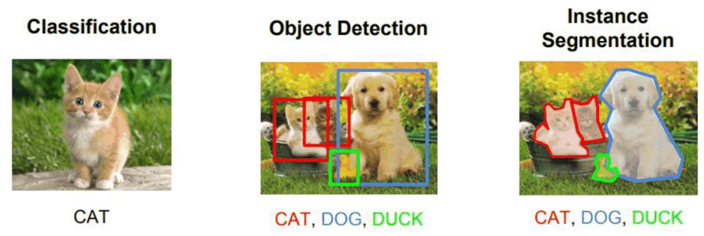

*그림 1. 같은 종류의 장면에 대한 분류, 객체 탐지, 인스턴스 분할의 출력*

왼쪽의 분류는 고양이 한 마리가 담긴 사진 전체에 CAT이라는 레이블 하나를 붙인다. 가운데의 객체 탐지는 고양이, 강아지, 오리를 각각 직사각형으로 둘러싸고 상자마다 클래스를 붙인다. 오른쪽의 인스턴스 분할은 직사각형 대신 각 객체가 차지하는 픽셀 영역의 윤곽을 따라 객체를 구분한다.

| 태스크 | 출력 | 답하는 질문 |
|:-----|:-----|:-----|
| 분류 (classification) | 이미지 전체에 대한 클래스 하나 | 무엇이 찍혔는가 |
| 객체 탐지 (object detection) | 객체마다 클래스와 바운딩 박스 | 어디에 무엇이 있는가 |
| 인스턴스 분할 (instance segmentation) | 객체마다 클래스와 픽셀 단위 마스크 | 각 객체가 정확히 어느 픽셀을 차지하는가 |

*표 1. 분류, 객체 탐지, 인스턴스 분할의 출력 비교*

분류 모델은 사진 한 장에 레이블 하나를 내므로, 대상이 하나뿐이고 화면의 대부분을 차지한다는 조건에서 잘 맞는다. 실제 카메라 영상에는 여러 객체가 다양한 크기로 함께 찍히는 경우가 많으므로, 실무에서는 위치까지 알려 주는 객체 탐지가 더 널리 쓰인다. 객체 탐지는 분류보다 한 단계 발전한 태스크라고 볼 수 있다.

### 1.2 탐지 결과: 분류와 회귀

객체 탐지의 결과는 **객체의 분류(classification)** 와 **상자 좌표의 회귀(regression)** 로 이루어진다. 분류기(classifier)는 이미지 하나에 클래스 이름 하나를 출력하지만, 탐지기(detector)는 탐지한 객체마다 클래스 이름과 상자 좌표를 함께 출력한다.

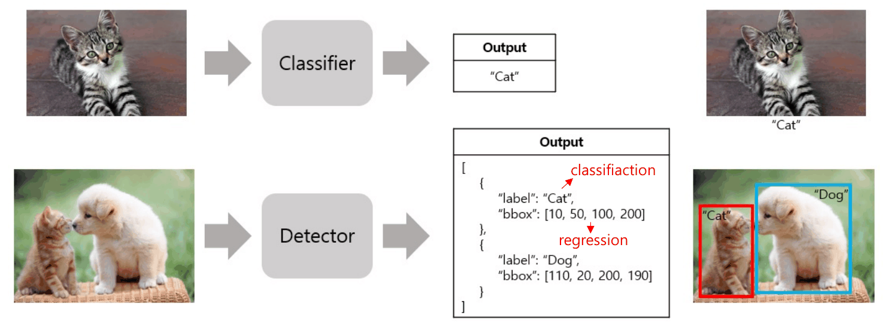

*그림 2. 분류기와 탐지기의 출력 비교*

위쪽의 분류기는 고양이 사진을 받아 `"Cat"` 하나를 출력한다. 아래쪽의 탐지기는 고양이와 강아지가 함께 있는 사진을 받아, 다음과 같이 객체마다 레이블(분류 결과)과 상자 좌표(회귀 결과)를 묶은 목록을 출력한다.

```json
[
  {"label": "Cat", "bbox": [10, 50, 100, 200]},
  {"label": "Dog", "bbox": [110, 20, 200, 190]}
]
```

- `"label"`은 미리 정한 클래스 중 하나를 고르는 **분류**의 결과이다.
- `"bbox"`의 네 숫자는 연속적인 값이므로 **회귀**로 예측한다. 상자의 위치는 처음부터 정확히 맞는 것이 아니라, 회귀를 통해 정답 상자에 가깝도록 조금씩 조정된다.

분류와 회귀의 차이는 다음과 같다.

- **분류(classification)** 는 입력 데이터를 사전 정의된 클래스 중 하나로 분류하는 기술이다. 출력은 이산적인 범주이다.
- **회귀(regression)** 는 입력 데이터와 연속적인 출력값 사이의 함수 관계를 학습하는 기술이다. 연속적인 값을 출력하므로 주로 수치 예측 문제에 사용된다. 예를 들어 주택 가격 예측 문제에서는 주택의 크기, 지역, 건축 연도 등의 정보를 바탕으로 주택의 가격을 예측하는 것이 목표이다.
- 회귀 모델은 입력과 출력값의 쌍으로 이루어진 데이터셋을 학습하여, 새로운 입력이 들어왔을 때 그에 대한 연속적인 값을 예측한다.

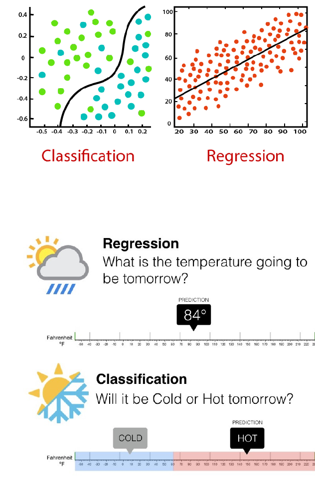

*그림 3. 분류의 결정 경계와 회귀의 추세선, 그리고 날씨 예보에서의 두 문제*

위의 두 그래프 중 왼쪽(Classification)은 두 클래스의 점들을 곡선 경계로 나누고, 오른쪽(Regression)은 점들의 추세를 직선으로 근사한다. 아래의 날씨 예는 같은 날씨 예보라도 질문에 따라 태스크가 달라짐을 보여 준다. "내일 기온은 몇 도인가"는 84°F 같은 연속값을 답하는 회귀 문제이고, "내일은 추운가 더운가"는 COLD와 HOT 중 하나를 고르는 분류 문제이다.

> **핵심:** 객체 탐지 모델 하나는 분류 문제와 회귀 문제를 동시에 푼다. 그래서 탐지 모델의 손실 함수에는 클래스 예측의 오차와 상자 좌표 예측의 오차가 함께 들어간다(3.5절). 손실 함수의 일반적인 개념은 1강에서 다루었다.

### 1.3 바운딩 박스의 표현과 IoU

**바운딩 박스(bounding box)** 는 객체를 둘러싸는, 이미지의 가로축과 세로축에 평행한 직사각형이다. 이미지 좌표계는 보통 왼쪽 위 모서리를 원점으로 하고, $x$는 오른쪽으로, $y$는 아래쪽으로 증가한다. 상자를 나타내는 형식은 크게 두 가지이다.

| 형식 | 네 값 | 의미 |
|:-----|:-----|:-----|
| 모서리 형식 | $(x_1, y_1, x_2, y_2)$ | 왼쪽 위 모서리와 오른쪽 아래 모서리의 좌표 |
| 중심 형식 | $(x, y, w, h)$ | 상자 중심의 좌표와 너비, 높이 |

*표 2. 바운딩 박스를 나타내는 두 가지 좌표 형식*

두 형식은 다음 식으로 서로 바꿀 수 있다.

```math
x = \frac{x_1 + x_2}{2}, \quad y = \frac{y_1 + y_2}{2}, \quad w = x_2 - x_1, \quad h = y_2 - y_1
```

예를 들어 1.2절의 고양이 상자 `[10, 50, 100, 200]`을 모서리 형식으로 읽으면 너비는 $100 - 10 = 90$, 높이는 $200 - 50 = 150$, 중심은 $(55, 125)$이므로 중심 형식으로는 $(55, 125, 90, 150)$이다. 초기의 탐지 연구는 모서리 형식을 많이 썼고, 최근의 모델은 중심 형식을 많이 쓴다. 같은 네 숫자라도 형식에 따라 전혀 다른 상자가 되므로, 데이터셋과 라이브러리를 쓰기 전에 어떤 형식인지, 좌표를 이미지 크기로 나누어 0~1 범위로 정규화했는지 확인해야 한다.

예측한 상자가 정답 상자와 얼마나 잘 겹치는지는 **IoU(Intersection over Union)** 로 측정한다.

> **용어 정의:** **IoU**는 두 상자의 교집합 넓이를 합집합 넓이로 나눈 값이다. $\text{IoU}(A, B) = \dfrac{\text{area}(A \cap B)}{\text{area}(A \cup B)}$이며, 0부터 1 사이의 값을 갖는다. 두 상자가 겹치지 않으면 0, 완전히 일치하면 1이다.

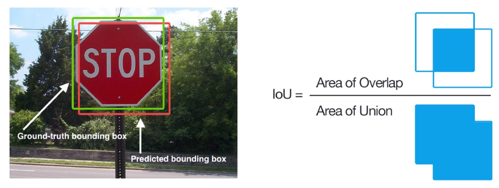

*그림 4. 정답 상자와 예측 상자, 그리고 IoU의 정의*

왼쪽 사진에서 초록색 상자는 사람이 표시한 **정답 상자(ground-truth bounding box)** 이고, 빨간색 상자는 모델의 **예측 상자(predicted bounding box)** 이다. 오른쪽 식에서 분자는 두 상자가 겹친 부분(Area of Overlap)이고, 분모는 두 상자를 합친 전체 영역(Area of Union)이다.

모서리 형식의 두 상자 $A = (10, 10, 110, 110)$(정답)과 $B = (30, 20, 130, 120)$(예측)의 IoU를 단계별로 계산하면 다음과 같다.

1. 교집합의 왼쪽 위 모서리는 두 상자의 왼쪽 위 좌표 중 큰 값이다: $(\max(10, 30), \max(10, 20)) = (30, 20)$.
2. 교집합의 오른쪽 아래 모서리는 두 상자의 오른쪽 아래 좌표 중 작은 값이다: $(\min(110, 130), \min(110, 120)) = (110, 110)$.
3. 교집합의 넓이는 $(110 - 30) \times (110 - 20) = 80 \times 90 = 7200$이다. 두 상자가 겹치지 않아 차이가 음수가 되면 넓이를 0으로 둔다.
4. 각 상자의 넓이는 $100 \times 100 = 10000$이므로 합집합의 넓이는 $10000 + 10000 - 7200 = 12800$이다. 교집합을 한 번 빼는 것은 두 넓이를 더할 때 겹친 부분이 두 번 세어지기 때문이다.
5. $\text{IoU} = 7200 / 12800 = 0.5625$이다.

IoU는 객체 탐지의 여러 단계에 쓰인다. YOLO는 예측 상자의 신뢰도를 IoU로 정의하고(3.4절), NMS는 IoU로 중복 상자를 찾으며(3.7절), 평가에서는 IoU로 예측이 맞았는지를 판정한다(4.1절).

### 1.4 객체 탐지의 발전과 두 계열

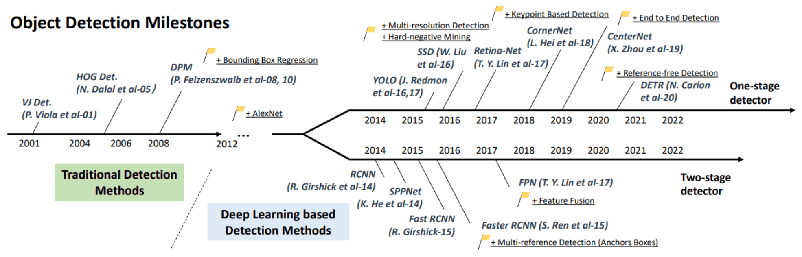

*그림 5. 2001년부터 2022년까지 객체 탐지의 주요 모델과 기법*

위 연대표는 객체 탐지의 역사를 두 시기로 나눈다 [4]. 2012년 이전의 **전통적 탐지 방법**은 사람이 설계한 특징을 썼다. Viola와 Jones의 얼굴 탐지기(VJ Det., 2001), Dalal과 Triggs의 HOG 탐지기(2005), Felzenszwalb 등의 DPM(2008, 2010)이 대표적이며, DPM에서 바운딩 박스 회귀가 도입되었다. 2012년 AlexNet으로 CNN의 성능이 입증된 뒤로는 **딥러닝 기반 탐지 방법**이 주류가 되었고, 이는 두 갈래로 나뉜다.

- **2단계 탐지기(two-stage detector):** RCNN(2014), SPPNet(2014), Fast RCNN(2015), Faster RCNN(2015), FPN(2017). Faster RCNN에서 앵커 박스를 이용한 다중 기준 탐지가, FPN에서 특징 융합이 도입되었다.
- **1단계 탐지기(one-stage detector):** YOLO(2016), SSD(2016), RetinaNet(2017), CornerNet(2018), CenterNet(2019), DETR(2020). 다중 해상도 탐지, 구별하기 어려운 배경 예제를 집중적으로 학습하는 hard-negative mining, 키포인트 기반 탐지, 기준 상자 없는 탐지, 처음부터 끝까지 하나의 모델로 학습하는 탐지 같은 기법이 이 흐름에서 등장했다.

두 계열의 차이는 **탐지를 몇 단계로 수행하는가**이다.

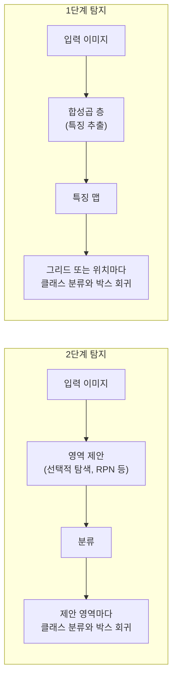

*그림 6. 2단계 탐지와 1단계 탐지의 처리 흐름*

| 항목 | 2단계 탐지 | 1단계 탐지 |
|:-----|:-----|:-----|
| 1단계 | 객체가 있을 만한 후보 영역을 먼저 제안한다 | 이미지 전체에서 특징 맵을 한 번에 추출한다 |
| 2단계 | 후보 영역마다 분류와 박스 회귀를 수행한다 | (없음) 특징 맵의 각 위치에서 분류와 박스 회귀를 동시에 수행한다 |
| 대표 모델 | R-CNN, Fast R-CNN, Faster R-CNN | YOLO, SSD, RetinaNet |
| 초기의 특성 | 정확도가 높지만 느리다 | 빠르지만 정확도가 낮았다 |

*표 3. 2단계 탐지와 1단계 탐지의 비교*

두 계열이 처음 등장했을 때는 단계가 적은 1단계 탐지기가 빠른 대신 정확도가 낮았고, 2단계 탐지기는 그 반대였다. 이후 1단계 탐지기의 정확도가 크게 향상되어, 실시간 처리가 필요한 응용에서는 1단계 계열이 널리 쓰인다.

---

<br>

## 2. 2단계 탐지: R-CNN 계열

### 2.1 R-CNN의 네 단계

**R-CNN(Regions with CNN features)** 은 Girshick 등이 2014년에 발표한 2단계 탐지기로, CNN이 학습한 특징을 객체 탐지에 처음 본격적으로 적용한 모델이다 [5].

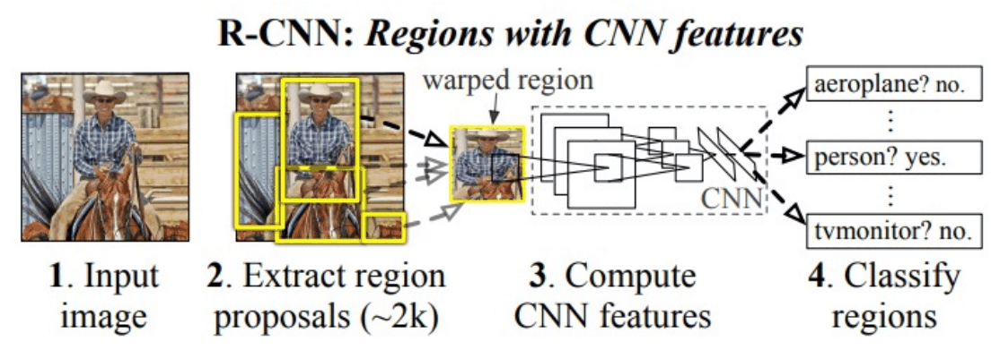

*그림 7. R-CNN의 처리 과정: 입력 이미지, 영역 제안, CNN 특징 계산, 영역 분류*

R-CNN은 다음 네 단계로 동작한다.

1. **선택적 탐색(selective search)** 으로 **관심 영역(RoI, Region of Interest)** 을 약 2,000개 추출한다.
2. 동일한 크기로 조정한 RoI를 CNN에 넣어 4,096차원의 특징을 추출한다.
3. CNN에서 나온 특징을 사전 학습된 SVM에 넣어 분류한다.
4. CNN에서 나온 특징으로 회귀를 수행하여 바운딩 박스를 예측한다.

> **용어 정의:** **관심 영역(RoI, Region of Interest)** 은 객체가 있을 가능성이 있어 자세히 검사할 후보 영역이다. R-CNN에서는 영역 제안 알고리즘이 낸 후보 상자 하나하나가 RoI이다.

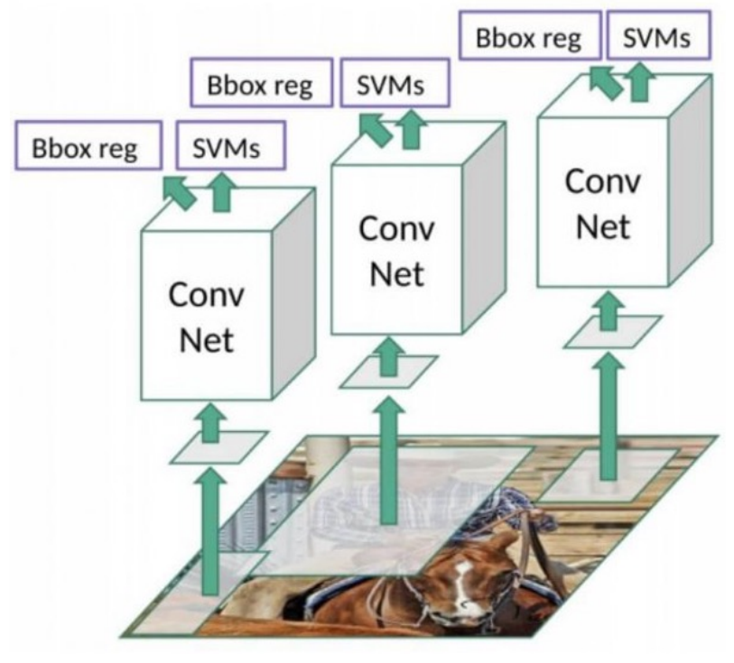

*그림 8. 제안 영역마다 CNN, SVM, 박스 회귀를 따로 적용하는 R-CNN의 구조*

위 그림은 R-CNN의 핵심적인 특징을 보여 준다. 이미지에서 잘라 낸 영역(바닥의 사진 위 작은 사각형들) 하나하나가 각자의 ConvNet을 통과하고, 그 출력이 각자의 SVMs와 Bbox reg로 들어간다. 영역이 2,000개이면 CNN 순전파도 2,000번 수행된다.

### 2.2 영역 제안: 슬라이딩 윈도와 선택적 탐색

**영역 제안(region proposal)** 은 객체가 있을 만한 후보 영역을 찾는 단계이다. 가장 단순한 방법은 **슬라이딩 윈도(sliding window)** 이다. 일정한 크기의 창(window)을 이미지의 왼쪽 위부터 오른쪽 아래까지 일정 간격으로 옮기며 모든 위치를 검사한다.

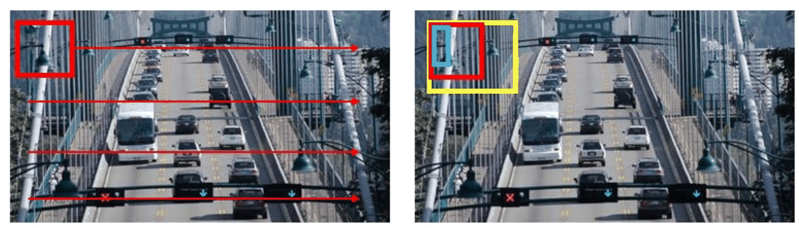

*그림 9. 창을 이미지 전체에 걸쳐 옮기며 검사하는 슬라이딩 윈도*

슬라이딩 윈도는 임의의 창으로 모든 영역을 탐색하므로 비효율적이다. 예를 들어 640×480 이미지에서 64×64 창을 8픽셀 간격으로 옮기면 가로로 $(640 - 64)/8 + 1 = 73$곳, 세로로 $(480 - 64)/8 + 1 = 53$곳이므로 창 하나의 크기에 대해서만 $73 \times 53 = 3869$개의 영역을 검사해야 한다. 객체의 크기와 가로세로 비율은 제각각이므로 창의 크기와 비율을 바꿀 때마다 이 수가 다시 곱해진다. 그림의 오른쪽처럼 창의 크기를 바꾸어(노란색) 같은 과정을 반복해야 하는 것이다.

**선택적 탐색(selective search)** 은 객체 인식이나 검출을 위해 가능한 후보 영역을 효율적으로 알아내는 것을 목표로 하는 기법이다 [6]. 객체와 주변 사이의 색감, 질감 차이 등을 파악하여 경향성이 같은 것끼리 묶는다(grouping).

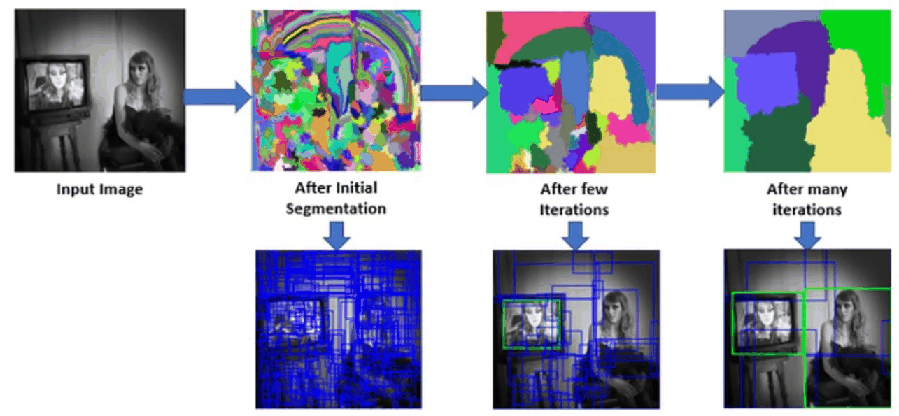

*그림 10. 선택적 탐색의 반복 병합 과정과 각 단계의 후보 상자*

1. **초기 분할(After Initial Segmentation):** 이미지를 색이 비슷한 작은 영역 수백 개로 잘게 나눈다(위 줄의 두 번째 그림).
2. **반복 병합(After few iterations, After many iterations):** 인접한 영역 쌍 중 색, 질감, 크기, 빈틈 없이 맞물리는 정도(fill)를 종합한 유사도가 가장 높은 쌍을 하나로 합치고, 이를 반복한다. 반복할수록 영역의 수가 줄고 크기가 커진다.
3. **후보 상자 생성:** 병합 과정의 모든 단계에서 각 영역을 감싸는 상자를 후보로 낸다(아래 줄). 초기에는 작은 상자가 매우 많고(파란색), 병합이 진행되면 텔레비전이나 사람처럼 객체 단위의 상자(초록색)가 나타난다.

여러 단계의 영역을 모두 후보로 쓰기 때문에 작은 객체부터 큰 객체까지 다양한 크기의 후보를 얻을 수 있고, 슬라이딩 윈도보다 훨씬 적은 수(R-CNN에서는 약 2,000개)로 대부분의 객체를 덮을 수 있다.

### 2.3 특징 추출, SVM 분류, 바운딩 박스 회귀

**특징 추출.** 제안된 영역은 크기와 비율이 제각각이지만, 완전 연결 층이 있는 CNN은 정해진 크기의 입력만 받는다. 그래서 R-CNN은 각 영역을 227×227로 강제로 늘이거나 줄인 뒤(warped region) CNN에 넣고, 완전 연결 층의 출력인 4,096차원 벡터를 그 영역의 특징으로 쓴다 [5]. CNN은 ImageNet 분류로 미리 학습한 뒤 탐지 데이터로 미세 조정한다. 이처럼 사전 학습한 모델을 다른 태스크에 맞게 조정하는 전이 학습은 3강에서 다루었다.

**SVM 분류.** 추출한 특징은 클래스마다 하나씩 학습한 이진 선형 SVM에 들어가, 그 영역이 해당 클래스인지 아닌지를 판정한다. 그림 7의 마지막 단계에서 aeroplane은 no, person은 yes, tvmonitor는 no로 판정되는 것이 이 과정이다.

> **[기계학습]** **SVM(Support Vector Machine)** 은 두 클래스 사이를 가르는 초평면 중 양쪽의 가장 가까운 데이터까지의 거리(마진)가 최대인 초평면을 찾는 전통적인 분류 모델이다. 클래스가 여러 개이면 어떤 표본이 그 클래스인지 아닌지를 판정하는 이진 SVM을 클래스마다 하나씩 학습하는 일대다(one-vs-rest) 방식을 많이 쓴다.

**바운딩 박스 회귀.** 선택적 탐색이 낸 상자는 객체를 대략적으로만 감싸므로, 같은 특징으로 상자를 얼마나 옮기고 늘일지를 회귀로 예측한다. 제안 상자를 중심 형식 $P = (P_x, P_y, P_w, P_h)$, 정답 상자를 $G = (G_x, G_y, G_w, G_h)$라 하면 모델이 학습하는 목표값은 다음과 같다 [5].

```math
t_x = \frac{G_x - P_x}{P_w}, \quad t_y = \frac{G_y - P_y}{P_h}, \quad t_w = \log\frac{G_w}{P_w}, \quad t_h = \log\frac{G_h}{P_h}
```

중심의 이동량을 제안 상자의 너비와 높이로 나누면 상자의 크기와 무관한 상대적인 이동량이 되고, 크기 변화에 로그를 취하면 항상 양수인 배율을 제약 없는 실수로 다룰 수 있다. 예를 들어 $P = (100, 100, 50, 80)$, $G = (110, 96, 60, 80)$이면 $t_x = 10/50 = 0.2$, $t_y = -4/80 = -0.05$, $t_w = \ln(60/50) = \ln 1.2 \approx 0.182$, $t_h = \ln(80/80) = 0$이다. 즉 중심을 너비의 20%만큼 오른쪽으로, 높이의 5%만큼 위로 옮기고, 너비를 1.2배로 늘이라는 뜻이다.

### 2.4 Fast R-CNN과 Faster R-CNN

R-CNN 이후 이를 개선한 Fast R-CNN [7]과 Faster R-CNN [1] 등이 연구되었다. 세 모델의 구조를 비교하면 다음과 같다.

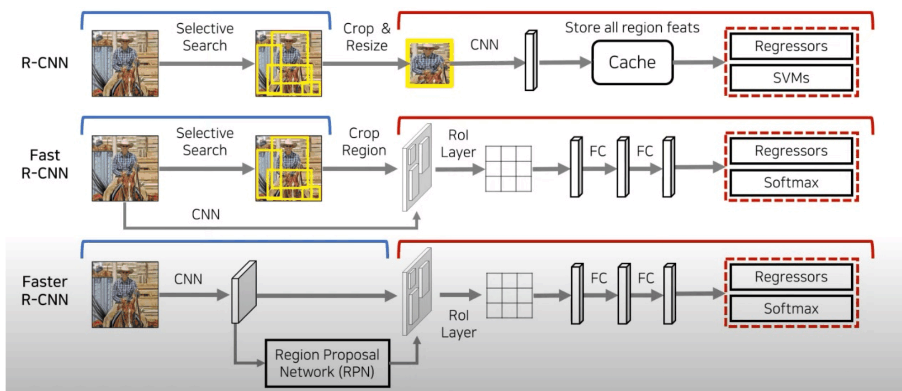

*그림 11. R-CNN, Fast R-CNN, Faster R-CNN의 구조 비교*

- **R-CNN(위):** 선택적 탐색으로 얻은 영역을 하나씩 잘라 크기를 맞추고(Crop & Resize) CNN에 넣는다. 모든 영역의 특징을 디스크에 저장해 두었다가(Cache) 회귀기(Regressors)와 SVM을 따로 학습한다. 선택적 탐색에서 2,000개의 영역을 뽑으면 CNN을 2,000번 실행하는 것이므로 매우 비효율적이다.
- **Fast R-CNN(가운데):** 이미지 전체를 CNN에 **한 번만** 통과시켜 특징 맵을 얻는다. 선택적 탐색으로 얻은 영역을 특징 맵 위의 해당 위치로 옮긴 뒤, **RoI 풀링 층(RoI Layer)** 으로 영역마다 고정된 크기의 특징을 뽑아 완전 연결 층(FC)에 넣는다. 마지막에는 소프트맥스 분류와 박스 회귀를 하나의 손실 함수로 함께 학습한다. VGG16 기준으로 R-CNN보다 학습이 9배, 추론이 213배 빠르다 [7].
- **Faster R-CNN(아래):** Fast R-CNN에 남아 있던 선택적 탐색을 **영역 제안 네트워크(RPN, Region Proposal Network)** 로 바꾸었다. RPN은 탐지에 쓰는 CNN 특징 맵을 그대로 공유하여 후보 영역도 CNN으로 뽑는다. 특징 맵의 각 위치에 크기 3가지와 가로세로 비율 3가지를 조합한 9개의 **앵커 박스(anchor box)** 를 두고, 앵커마다 객체가 있는지와 상자를 얼마나 고칠지를 예측한다. VGG-16을 쓸 때 GPU에서 영역 제안을 포함한 전체 과정이 초당 약 5프레임으로 동작한다 [1].

> **용어 정의:** **RoI 풀링(RoI pooling)** 은 특징 맵 위의 크기가 제각각인 RoI를 정해진 $H \times W$ 격자로 나누고 칸마다 최댓값을 취하여, RoI의 크기와 무관하게 같은 크기의 특징을 만드는 연산이다. 예를 들어 특징 맵에서 14×21 크기인 RoI를 7×7 격자로 나누면 칸 하나가 2×3 영역이 되고, 각 칸의 최댓값 49개가 출력이 된다.

| 모델 | 영역 제안 | CNN 실행 | 분류와 박스 회귀 |
|:-----|:-----|:-----|:-----|
| R-CNN | 선택적 탐색 (약 2,000개) | 영역마다 한 번 (약 2,000번) | SVM과 회귀기를 따로 학습 |
| Fast R-CNN | 선택적 탐색 | 이미지마다 한 번 + RoI 풀링 | 소프트맥스와 회귀기를 함께 학습 |
| Faster R-CNN | RPN (CNN 특징 공유) | 이미지마다 한 번 + RoI 풀링 | 소프트맥스와 회귀기를 함께 학습 |

*표 4. R-CNN 계열 세 모델의 비교*

### 2.5 2단계 탐지의 속도 문제

R-CNN 계열은 꾸준히 빨라졌지만, 2단계 계열의 모델은 영역 제안과 영역별 분류를 차례로 수행하므로 객체를 검출하는 데 오랜 시간이 걸린다. 그래서 자율주행 자동차처럼 실시간으로 결과를 도출해야 하는 태스크에 활용하기는 현실적으로 어렵다.

실시간성은 **FPS(Frames Per Second, 초당 프레임 수)** 로 따진다. 카메라가 60 FPS로 영상을 보낸다면 다음 프레임이 오기 전에 처리를 끝내야 하므로 한 장을 $1/60 \approx 0.0167$초, 즉 약 16.7 ms 안에 처리해야 한다. 영화의 표준인 24 FPS라도 한 장에 약 41.7 ms가 주어진다. 반면 R-CNN은 영역 제안과 특징 계산에만 GPU에서 이미지 한 장당 약 13초가 걸렸다 [5]. 이는 약 0.08 FPS로, 실시간과는 거리가 멀다. 영역 제안과 분류를 하나의 신경망으로 한 번에 처리하려는 시도가 3절의 1단계 탐지기이다.

---

<br>

## 3. 1단계 탐지: YOLO

### 3.1 YOLO의 아이디어

**YOLO(You Only Look Once)** 는 Redmon 등이 2016년에 발표한 대표적인 1단계 탐지 모델이다 [2]. 이름 그대로 이미지를 한 번만 보고 모든 객체를 찾는다.

- YOLO의 가장 큰 기여는 **입력부터 출력까지 하나의 신경망으로 한 번에 처리하는(end-to-end) 방식**으로 객체 탐지를 수행할 수 있다는 것이다.
- 이전의 탐지 모델들은 객체가 있을 만한 영역을 찾는 일과 클래스를 분류하는 일을 따로 처리했기 때문에 처리 속도가 느리고 복잡한 연산을 수행해야 했다.
- YOLO는 이미지를 그리드 셀(grid cell)로 나눈 후, 각 셀에서 객체가 있는지 여부와 그 객체가 어떤 클래스인지를 동시에 예측하여, 기존 탐지기보다 훨씬 빠르면서도 실시간 탐지기 가운데 가장 높은 정확도를 얻었다(3.8절). 논문은 탐지를 이미지 픽셀에서 상자 좌표와 클래스 확률로 가는 하나의 회귀 문제로 정의한다 [2].

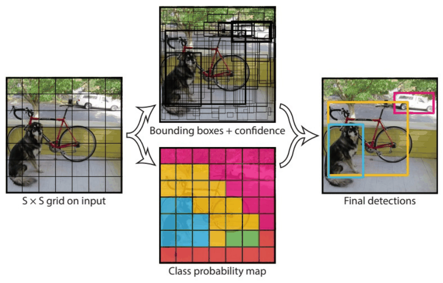

*그림 12. YOLO의 탐지 과정: S×S 그리드, 상자와 신뢰도 예측, 클래스 확률 지도, 최종 탐지*

왼쪽처럼 입력 이미지를 $S \times S$ 그리드로 나누면, 신경망은 두 가지를 동시에 출력한다. 위쪽 갈래는 셀마다 여러 개의 바운딩 박스와 각 상자의 신뢰도(굵은 선일수록 신뢰도가 높다)이고, 아래쪽 갈래는 셀마다 어떤 클래스일 확률이 가장 높은지를 색으로 칠한 **클래스 확률 지도(class probability map)** 이다. 두 결과를 결합하면 오른쪽의 최종 탐지(개, 자전거, 자동차)가 된다.

### 3.2 네트워크 구조

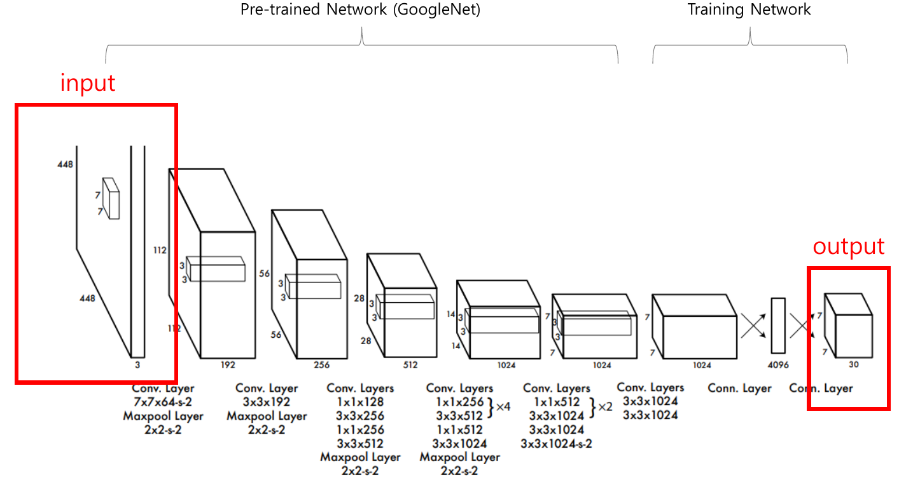

*그림 13. YOLO v1의 네트워크 구조: 448×448×3 입력에서 7×7×30 출력까지*

YOLO v1은 합성곱 층 24개와 완전 연결 층 2개로 이루어진다 [2]. 448×448 크기의 컬러 이미지(input)를 받아 최종적으로 7×7×30 크기의 텐서(output)를 낸다. 구조는 GoogLeNet을 참고했지만, 인셉션 모듈 대신 1×1 합성곱으로 채널 수를 줄인 뒤 3×3 합성곱을 적용하는 층을 반복한다. 그림 위쪽의 표시처럼 앞부분의 합성곱 층 20개는 ImageNet 분류로 미리 학습한 부분(Pre-trained Network)이고, 뒤에 추가한 합성곱 층 4개와 완전 연결 층 2개는 탐지를 위해 새로 학습하는 부분(Training Network)이다. 사전 학습은 224×224 해상도에서 하고, 탐지 학습은 더 세밀한 정보를 위해 448×448에서 한다.

| 단계 | 층 구성 | 출력 크기 |
|:-----|:-----|:-----|
| 1 | Conv 7×7, 64채널, stride 2 → Maxpool 2×2, stride 2 | 112×112×64 |
| 2 | Conv 3×3, 192채널 → Maxpool 2×2, stride 2 | 56×56×192 |
| 3 | Conv 1×1 128, 3×3 256, 1×1 256, 3×3 512 → Maxpool | 28×28×512 |
| 4 | (Conv 1×1 256, 3×3 512)×4, 1×1 512, 3×3 1024 → Maxpool | 14×14×1024 |
| 5 | (Conv 1×1 512, 3×3 1024)×2, 3×3 1024, 3×3 1024 stride 2 | 7×7×1024 |
| 6 | Conv 3×3 1024, 3×3 1024 | 7×7×1024 |
| 7 | 완전 연결 4096 | 4096 |
| 8 | 완전 연결 1470 → 7×7×30으로 재배열 | 7×7×30 |

*표 5. YOLO v1의 층 구성과 단계별 출력 크기*

합성곱 층의 수는 $1 + 1 + 4 + 10 + 6 + 2 = 24$이다. 마지막 층을 제외한 모든 층은 활성화 함수로 Leaky ReLU를 쓴다. 합성곱과 풀링의 계산 방식은 2강에서 다루었다.

### 3.3 그리드 셀과 출력 텐서

YOLO v1은 입력 이미지를 $S \times S = 7 \times 7$개의 그리드 셀로 나눈다. **객체의 중심이 어떤 셀 안에 있으면, 그 셀이 그 객체를 탐지할 책임을 진다** [2].

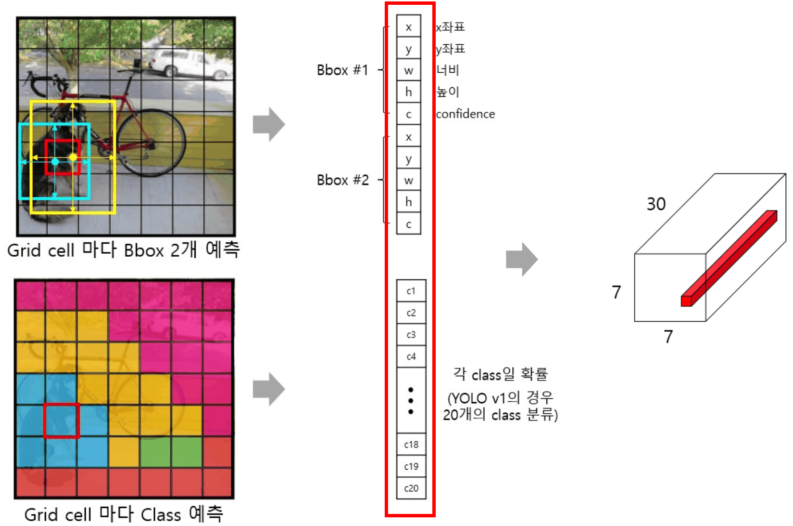

*그림 14. 그리드 셀 하나가 예측하는 바운딩 박스 2개와 클래스 확률, 그리고 7×7×30 출력 텐서*

각 그리드 셀은 다음을 예측한다.

- **바운딩 박스 $B = 2$개:** 상자마다 $x$, $y$, $w$, $h$, $c$의 다섯 값을 낸다. 위 그림의 위쪽처럼 빨간 셀은 중심점이 그 셀 안에 있는 상자 두 개(하늘색, 노란색)를 예측한다.
  - $x$, $y$: 상자 중심의 좌표를 셀의 왼쪽 위 모서리를 기준으로, 셀 크기로 나눈 값(0~1)이다.
  - $w$, $h$: 상자의 너비와 높이를 이미지 전체의 너비와 높이로 나눈 값(0~1)이다.
  - $c$: 상자의 신뢰도(confidence)이다(3.4절).
- **클래스 확률 $C = 20$개:** 셀에 객체가 있다고 할 때 그 객체가 각 클래스일 조건부 확률 $`\Pr(\text{Class}_i \mid \text{Object})`$이다. YOLO v1이 학습한 PASCAL VOC 데이터셋의 클래스가 20개이기 때문이다. 상자의 수와 관계없이 셀마다 한 세트만 예측한다(그림의 아래쪽, 셀마다 하나의 색).

따라서 셀 하나의 출력은 $B \times 5 + C = 2 \times 5 + 20 = 30$개의 값이고, 전체 출력은 $7 \times 7 \times 30$ 텐서, 즉 1,470개의 숫자이다. 셀 하나의 출력 벡터는 다음과 같이 배치된다.

```text
위치   : 0   1   2   3   4  |  5   6   7   8   9  |  10   11  ...  29
값     : x   y   w   h   c  |  x   y   w   h   c  |  P1   P2  ...  P20
         바운딩 박스 #1        바운딩 박스 #2        클래스별 조건부 확률
```

*그림 15. 그리드 셀 하나의 30차원 출력 벡터의 배치*

**좌표 부호화 예.** 448×448 입력에서 셀 하나의 크기는 $448 / 7 = 64$픽셀이다. 중심이 $(200, 300)$이고 크기가 120×90픽셀인 객체가 있다고 하자.

1. 중심이 속한 셀은 열 $\lfloor 200 / 64 \rfloor = 3$, 행 $\lfloor 300 / 64 \rfloor = 4$이다(0부터 센다). 이 셀이 객체를 책임진다.
2. $x = (200 - 3 \times 64) / 64 = 8 / 64 = 0.125$, $y = (300 - 4 \times 64) / 64 = 44 / 64 = 0.6875$이다.
3. $w = 120 / 448 \approx 0.268$, $h = 90 / 448 \approx 0.201$이다.

중심 좌표는 셀 기준, 크기는 이미지 기준으로 정규화하므로 네 값이 모두 0~1 범위에 들어가 학습이 안정된다.

### 3.4 신뢰도

YOLO v1에서 상자의 **신뢰도(confidence)** 는 다음과 같이 정의한다 [2].

```math
\text{confidence} = \Pr(\text{Object}) \times \text{IoU}_{\text{pred}}^{\text{truth}}
```

- $\Pr(\text{Object})$는 그 상자 안에 객체가 있을 확률이다.
- $`\text{IoU}_{\text{pred}}^{\text{truth}}`$는 예측 상자와 정답 상자의 IoU이다(1.3절).

신뢰도는 객체가 있는지와, 있다면 상자가 얼마나 정확한지를 하나의 수로 합친 것이다. 셀에 객체가 없으면 신뢰도는 0이어야 하고, 객체가 있으면 예측 상자와 정답 상자의 IoU와 같아야 한다. 학습할 때 신뢰도의 목표값도 이 정의를 따른다.

> **참고:** **정답(ground truth)과 레이블(label).** 정답은 이미지에 실제로 있는 대상, 예를 들어 "cat"이라는 사실 자체를 말하고, 레이블은 그 정답을 학습에 쓰기 위해 숫자 등으로 부호화한 값, 예를 들어 클래스 번호 1을 말한다. 두 말은 같은 답을 가리키므로 흔히 섞어 쓰지만, 엄밀히는 이렇게 구분된다.

### 3.5 손실 함수

YOLO v1은 모든 출력값의 오차를 제곱 오차의 합으로 계산하며, 손실 함수는 상자 위치의 오차, 신뢰도의 오차, 클래스 확률의 오차의 세 부분으로 이루어진다 [2].

```math
\begin{aligned}
\mathcal{L} = {} & \lambda_{\text{coord}} \sum_{i=0}^{S^2} \sum_{j=0}^{B} \mathbf{1}_{ij}^{\text{obj}} \left[ (x_i - \hat{x}_i)^2 + (y_i - \hat{y}_i)^2 \right] \\
& + \lambda_{\text{coord}} \sum_{i=0}^{S^2} \sum_{j=0}^{B} \mathbf{1}_{ij}^{\text{obj}} \left[ \left( \sqrt{w_i} - \sqrt{\hat{w}_i} \right)^2 + \left( \sqrt{h_i} - \sqrt{\hat{h}_i} \right)^2 \right] \\
& + \sum_{i=0}^{S^2} \sum_{j=0}^{B} \mathbf{1}_{ij}^{\text{obj}} \left( C_i - \hat{C}_i \right)^2 + \lambda_{\text{noobj}} \sum_{i=0}^{S^2} \sum_{j=0}^{B} \mathbf{1}_{ij}^{\text{noobj}} \left( C_i - \hat{C}_i \right)^2 \\
& + \sum_{i=0}^{S^2} \mathbf{1}_{i}^{\text{obj}} \sum_{c \in \text{classes}} \left( p_i(c) - \hat{p}_i(c) \right)^2
\end{aligned}
```

기호의 뜻은 다음과 같다.

- $i$는 그리드 셀의 번호, $j$는 셀 안의 상자 번호이다. 모자(^)를 쓴 값과 쓰지 않은 값 중 하나는 예측값, 다른 하나는 정답값이다. 제곱 오차이므로 어느 쪽을 예측값으로 쓰든 값은 같다.
- $`\mathbf{1}_{ij}^{\text{obj}}`$는 $i$번째 셀에 객체가 있고, 그 셀의 $j$번째 상자가 그 객체를 **책임지는** 상자일 때 1, 아니면 0이다. 셀의 두 상자 중 정답 상자와의 IoU가 더 큰 쪽이 책임을 진다.
- $`\mathbf{1}_{ij}^{\text{noobj}}`$는 책임지는 객체가 없는 상자일 때 1이다.
- $`\mathbf{1}_{i}^{\text{obj}}`$는 $i$번째 셀에 객체(의 중심)가 있을 때 1이다.

> **참고:** 논문의 표기는 합의 범위를 $i = 0$부터 $S^2$까지, $j = 0$부터 $B$까지로 쓰지만, 실제 의미는 $S^2$개의 셀 전체와 셀마다 $B$개의 상자 전체에 대한 합이다. 0부터 세면 마지막 번호는 $S^2 - 1$과 $B - 1$이다.

세 부분의 역할은 다음과 같다.

1. **위치 손실(localization loss):** 책임지는 상자에 대해서만 중심 좌표와 크기의 오차를 계산한다. 좌표 오차는 매우 중요하므로 가중치 $\lambda_{\text{coord}} = 5$를 곱해 키운다.
2. **신뢰도 손실(confidence loss):** 객체를 책임지는 상자는 신뢰도가 IoU에 가까워지도록, 그렇지 않은 상자는 0에 가까워지도록 학습한다. 대부분의 셀에는 객체가 없으므로 객체 없는 상자의 오차가 학습을 지배하지 않도록 가중치 $\lambda_{\text{noobj}} = 0.5$를 곱해 줄인다.
3. **분류 손실(classification loss):** 객체가 있는 셀에 대해서만 20개 클래스 확률의 오차를 계산한다.

손실 함수에서 살아남은 상자, 즉 지시 함수가 1인 항에 해당하는 상자만 각 오차의 학습에 참여한다. 학습의 목표는 경사하강법으로 이 손실을 0에 가깝게 최소화하는 것이다(1강).

**너비와 높이에 제곱근을 씌우는 이유.** 같은 크기의 오차라도 작은 상자에서는 큰 상자에서보다 훨씬 치명적이다. 같은 픽셀 수의 차이라도 작은 상자 둘이 어긋난 경우가 큰 상자 둘이 어긋난 경우보다 덜 비슷하다. 너비가 300인 큰 상자를 310으로, 너비가 30인 작은 상자를 40으로 예측했다고 하자.

- 제곱근 없이 계산하면 두 오차가 모두 $(310 - 300)^2 = (40 - 30)^2 = 100$으로 같다.
- 제곱근을 씌우면 큰 상자는 $(\sqrt{310} - \sqrt{300})^2 \approx (17.607 - 17.321)^2 \approx 0.082$, 작은 상자는 $(\sqrt{40} - \sqrt{30})^2 \approx (6.325 - 5.477)^2 \approx 0.718$이다.

제곱근을 씌우면 작은 상자의 같은 오차가 약 8.8배 크게 반영되어, 큰 상자의 오차에 대한 민감도를 낮추는 효과가 있다.

### 3.6 추론: 클래스별 신뢰도 점수

추론할 때 YOLO v1은 객체가 있든 없든 셀마다 상자 2개를 예측하므로, 이미지 한 장에서 항상 $7 \times 7 \times 2 = 98$개의 상자가 나온다.

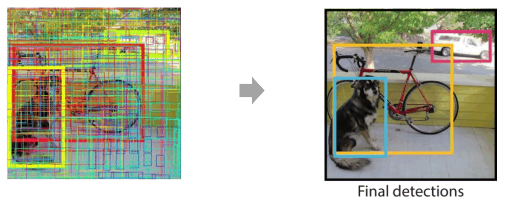

*그림 16. 98개의 예측 상자와 후처리 후의 최종 탐지*

왼쪽처럼 98개의 상자를 모두 그리면 이미지가 상자로 뒤덮인다. 실제로 탐지해야 할 상자만 남기기 위해, 상자마다 신뢰도와 셀의 클래스별 확률을 곱해 **클래스별 신뢰도 점수(class-specific confidence score)** 를 만든다 [2].

```math
\Pr(\text{Class}_i \mid \text{Object}) \times \Pr(\text{Object}) \times \text{IoU}_{\text{pred}}^{\text{truth}} = \Pr(\text{Class}_i) \times \text{IoU}_{\text{pred}}^{\text{truth}}
```

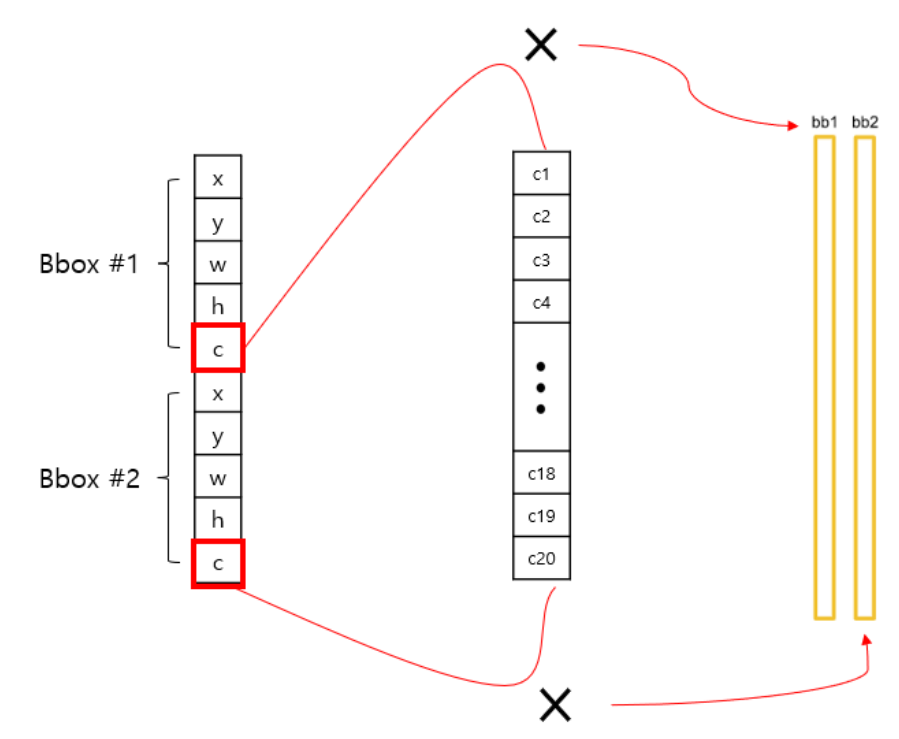

*그림 17. 상자의 신뢰도와 셀의 클래스 확률 20개를 곱해 상자마다 20차원 점수 벡터를 만드는 과정*

출력 벡터를 Bbox #1과 Bbox #2로 나누고, 각 상자의 신뢰도 $c$(빨간 칸)를 그 셀의 클래스 확률 20개(c1~c20)에 각각 곱한다. 그 결과 상자 하나마다 20차원의 점수 벡터(bb1, bb2)가 생긴다. 이렇게 하면 실제로 탐지해야 할 객체의 정보와 그 객체의 클래스 정보가 하나의 점수로 종합된다. 예를 들어 어떤 상자의 신뢰도가 0.8이고 그 셀의 클래스 확률이 개 0.7, 고양이 0.2라면 그 상자의 개 점수는 $0.8 \times 0.7 = 0.56$, 고양이 점수는 $0.8 \times 0.2 = 0.16$이다.

이 과정을 7×7 셀의 상자 2개씩, 모두 98개 상자에 적용하면 다음과 같은 20×98 점수 행렬을 얻는다.

```text
             bb1      bb2      bb3     ...     bb97     bb98
class 1     s(1,1)   s(1,2)   s(1,3)   ...   s(1,97)  s(1,98)
class 2     s(2,1)   s(2,2)   s(2,3)   ...   s(2,97)  s(2,98)
  ...
class 20    s(20,1)  s(20,2)  s(20,3)  ...   s(20,97) s(20,98)

s(k,b) = (상자 b의 신뢰도) × (상자 b가 속한 셀의 클래스 k 확률)
```

*그림 18. 98개 상자 각각에 대한 20개 클래스의 점수 행렬*

이후 점수가 일정 임계값보다 작은 항목을 0으로 만들고, 클래스마다 3.7절의 NMS를 적용하여 중복 상자를 제거하면 최종 탐지가 남는다.

### 3.7 NMS

**NMS(Non-Maximum Suppression, 비최대 억제)** 는 객체 탐지에서 중복된 예측 상자를 제거하는 기술이다. 같은 객체를 가리키는 여러 상자 중 가장 점수가 높은 상자만 남기고 나머지는 제거한다.

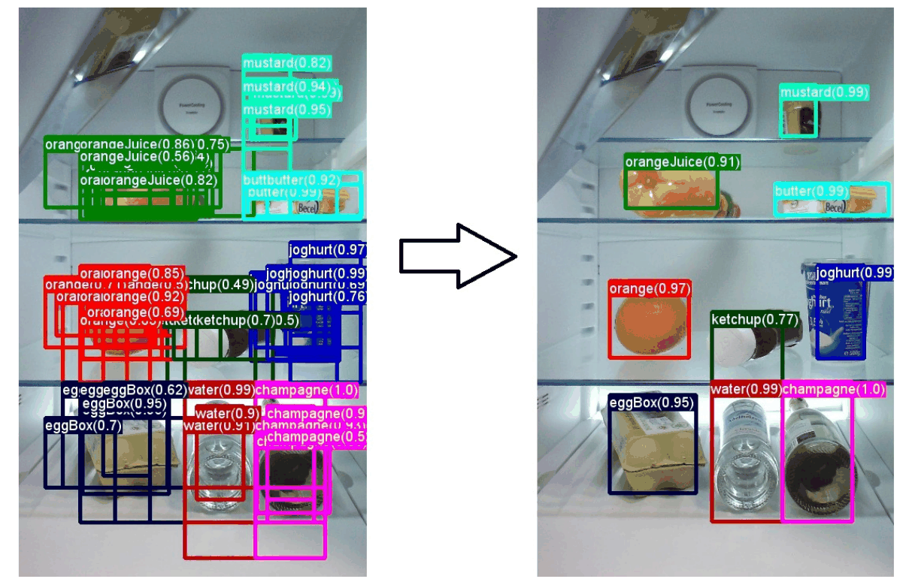

*그림 19. NMS 적용 전후의 탐지 결과*

왼쪽은 냉장고 안의 물건을 탐지한 결과로, 오렌지 주스, 겨자, 요구르트, 달걀 상자, 물병 하나에 상자가 여러 개씩 겹쳐 있다. NMS를 적용한 오른쪽에서는 물건마다 점수가 가장 높은 상자 하나(예: `orange(0.97)`, `mustard(0.99)`)만 남는다.

NMS의 절차는 다음과 같다.

1. 상자들을 신뢰도 점수에 따라 내림차순으로 정렬한다.
2. 가장 높은 점수의 상자를 결과로 확정하고, 이 상자와 나머지 상자들 사이의 IoU를 계산하여 IoU가 일정 임계값 이상인 상자들을 제거한다.
3. 남은 상자들에 대해 이 과정을 반복한다.
4. 최종적으로 서로 많이 겹치지 않는 예측 상자들만 남는다.

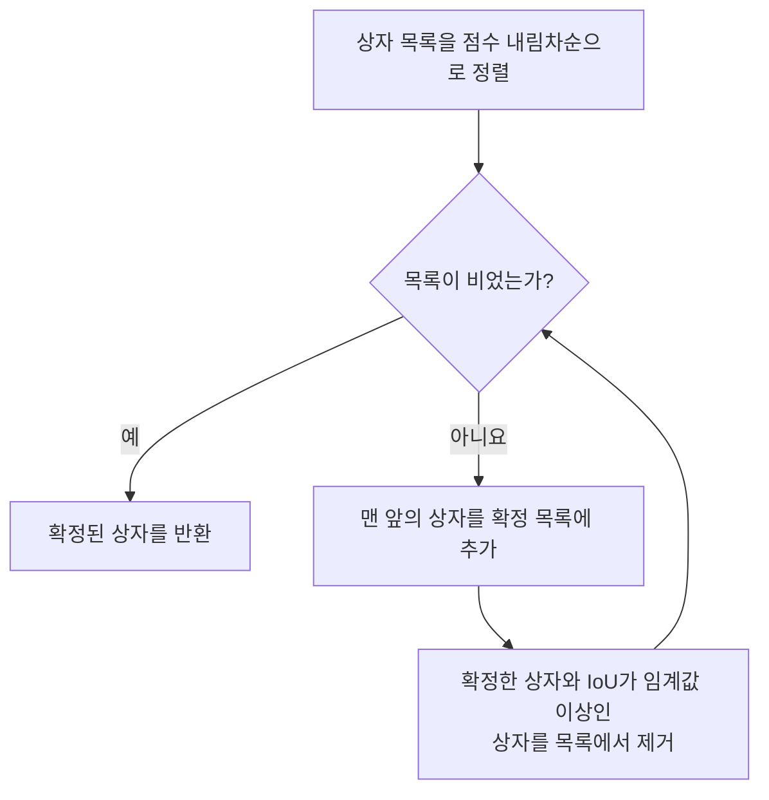

*그림 20. NMS 알고리즘의 흐름*

다음은 NMS를 파이썬으로 구현한 예이다. 상자는 모서리 형식이다.

```python
def iou(a, b):
    ix1, iy1 = max(a[0], b[0]), max(a[1], b[1])
    ix2, iy2 = min(a[2], b[2]), min(a[3], b[3])
    inter = max(0, ix2 - ix1) * max(0, iy2 - iy1)
    area_a = (a[2] - a[0]) * (a[3] - a[1])
    area_b = (b[2] - b[0]) * (b[3] - b[1])
    return inter / (area_a + area_b - inter)

def nms(boxes, scores, iou_threshold=0.5):
    order = sorted(range(len(boxes)), key=lambda i: scores[i], reverse=True)
    keep = []
    while order:
        best = order.pop(0)
        keep.append(best)
        order = [i for i in order if iou(boxes[best], boxes[i]) < iou_threshold]
    return keep

boxes = [(10, 10, 110, 110), (20, 15, 120, 115), (200, 50, 300, 150), (210, 60, 310, 160)]
scores = [0.9, 0.75, 0.8, 0.6]
print(nms(boxes, scores))
```

```text
[0, 2]
```

- `iou` 함수는 1.3절의 다섯 단계를 그대로 옮긴 것이다. 처음 두 줄은 교집합의 두 모서리를 구하고, `max(0, ...)`은 겹치지 않을 때 넓이가 음수가 되지 않게 한다. 마지막 줄은 교집합을 합집합으로 나눈다.
- `nms` 함수의 첫 줄은 상자 번호를 점수의 내림차순으로 정렬한다. 예제에서는 점수가 0.9, 0.8, 0.75, 0.6인 순서로 `[0, 2, 1, 3]`이 된다.
- `while` 문은 목록이 빌 때까지 반복한다. `order.pop(0)`으로 남은 것 중 점수가 가장 높은 상자를 꺼내 `keep`에 넣고, 그 상자와의 IoU가 임계값보다 작은 상자만 목록에 남긴다.
- 첫 반복에서 상자 0을 확정한다. 상자 1과의 IoU는 교집합 $90 \times 95 = 8550$, 합집합 $20000 - 8550 = 11450$이므로 약 0.747로 0.5 이상이어서 제거된다. 상자 2, 3은 상자 0과 겹치지 않으므로(IoU 0) 남는다.
- 두 번째 반복에서 상자 2를 확정한다. 상자 3과의 IoU는 $8100 / 11900 \approx 0.681$이므로 제거된다.
- 결과 `[0, 2]`는 두 객체에 상자가 하나씩 남았음을 뜻한다.

> **주의:** NMS는 보통 클래스마다 따로 적용한다. 개 상자와 고양이 상자가 많이 겹치더라도 서로 다른 객체이므로 지우지 않아야 하기 때문이다. 또한 IoU 임계값이 너무 낮으면 사람이 붐비는 장면처럼 실제로 가까이 붙어 있는 서로 다른 객체의 상자까지 지우고, 너무 높으면 같은 객체의 중복 상자가 남는다. YOLO 논문에 따르면 NMS는 mAP를 2~3%포인트 높였다 [2].

### 3.8 성능과 한계

| 구분 | 모델 | 학습 데이터 | mAP | FPS |
|:-----|:-----|:-----|-----:|-----:|
| 실시간 탐지기 | 100Hz DPM | 2007 | 16.0 | 100 |
| 실시간 탐지기 | 30Hz DPM | 2007 | 26.1 | 30 |
| 실시간 탐지기 | Fast YOLO | 2007+2012 | 52.7 | **155** |
| 실시간 탐지기 | YOLO | 2007+2012 | **63.4** | 45 |
| 실시간 미만 | Fastest DPM | 2007 | 30.4 | 15 |
| 실시간 미만 | R-CNN Minus R | 2007 | 53.5 | 6 |
| 실시간 미만 | Fast R-CNN | 2007+2012 | 70.0 | 0.5 |
| 실시간 미만 | Faster R-CNN VGG-16 | 2007+2012 | 73.2 | 7 |
| 실시간 미만 | Faster R-CNN ZF | 2007+2012 | 62.1 | 18 |
| 실시간 미만 | YOLO VGG-16 | 2007+2012 | 66.4 | 21 |

*표 6. PASCAL VOC 2007에서 실시간 탐지기와 그 밖의 탐지기의 정확도와 속도*

위 표는 YOLO 논문의 결과이다 [2]. 학습 데이터의 "2007+2012"는 PASCAL VOC 2007과 2012의 학습 데이터를 합쳐 썼다는 뜻이고, mAP는 4절에서 설명할 정확도 지표이다. 정확도만 보면 Faster R-CNN VGG-16이 73.2로 가장 높지만 속도는 7 FPS에 그친다. YOLO는 63.4의 mAP를 45 FPS로 달성했고, 더 작은 Fast YOLO는 155 FPS로 가장 빠르면서도 다른 실시간 탐지기보다 두 배 이상 정확하다. YOLO는 속도와 정확도를 함께 챙길 수 있었기 때문에 큰 인기를 끌었다.

YOLO v1에는 다음과 같은 문제점이 있다.

- **위치(localization) 오류:** 그리드 셀 하나는 상자 2개와 클래스 하나만 예측하므로, 하나의 그리드 셀에 여러 개의 객체가 있으면 이를 정확히 구분하지 못한다. 이로 인해 객체의 위치를 부정확하게 예측할 수 있다.
- **작은 객체 검출 미흡:** 작은 객체는 이미지에서 차지하는 비율이 작아 그리드 셀 안에 여러 개가 함께 들어가는 경우가 많다. 객체가 매우 작아 한 셀 안에 여러 객체가 포함되거나, 셀이 충분히 세밀한 정보를 담지 못할 수 있으므로 작은 객체에 대한 정확도가 떨어진다. 새 떼처럼 작은 객체가 무리 지어 있는 경우가 대표적이다.
- **새로운 형태의 바운딩 박스 예측 미흡:** 바운딩 박스의 형태를 데이터로부터 학습하므로, 학습 데이터에 드물었던 가로세로 비율이나 배치를 가진 상자는 정확히 예측하지 못한다.

### 3.9 YOLO의 발전과 응용

YOLO는 v1 이후 여러 연구 그룹과 기업이 이름을 이어 받아 계속 발전했다. 2022년 이후의 주요 버전과 공개 저장소는 다음과 같다.

| 연도 | 모델 | 공개 저장소 |
|:-----|:-----|:-----|
| 2022 | YOLOv6 | https://github.com/meituan/YOLOv6 |
| 2022 | YOLOv7 | https://github.com/WongKinYiu/yolov7 |
| 2023 | YOLOv8 | https://github.com/ultralytics/ultralytics |
| 2024 | YOLOv9 | https://github.com/WongKinYiu/yolov9 |
| 2024 | YOLOv10 | https://github.com/THU-MIG/yolov10 |
| 2024 | YOLO11 (YOLOv11) | https://github.com/ultralytics/ultralytics |

*표 7. 2022년 이후 YOLO의 주요 버전과 공개 저장소*

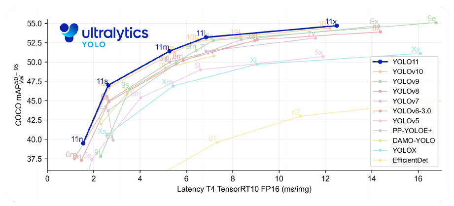

*그림 21. 여러 YOLO 버전의 COCO mAP와 추론 지연 시간의 관계*

위 그래프는 Ultralytics가 공개한 비교로 [8], 가로축은 NVIDIA T4 GPU에서 TensorRT FP16으로 이미지 한 장을 처리하는 데 걸린 시간(ms), 세로축은 COCO 검증 데이터에서의 mAP(IoU 0.50~0.95, 4.5절)이다. 각 곡선의 점은 같은 버전의 크기별 모델(n, s, m, l, x)이며, 왼쪽 위에 있을수록 빠르면서 정확하다. 이 비교에서는 YOLO11 곡선이 같은 지연 시간에서 가장 높은 mAP를 보인다.

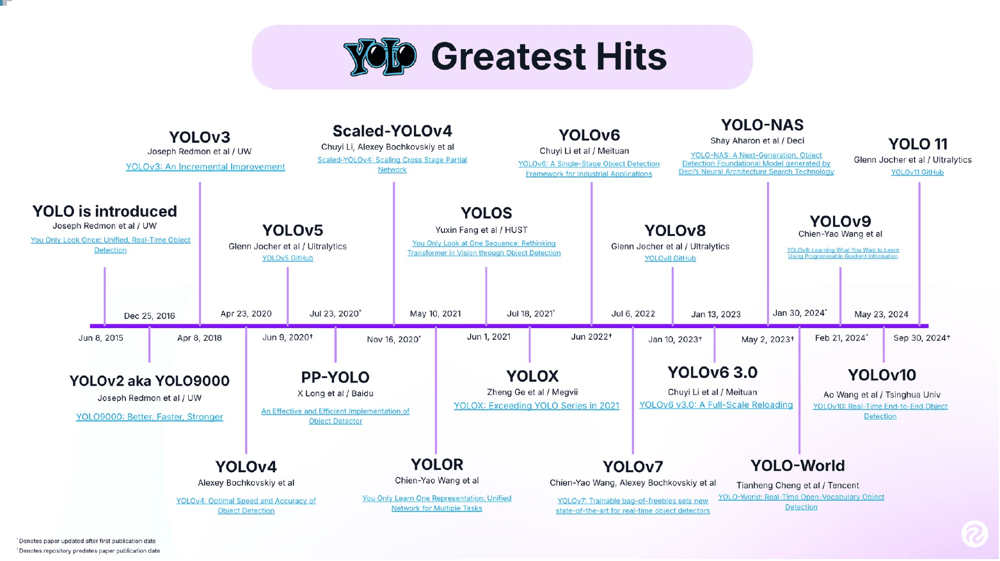

*그림 22. 2015년부터 2024년까지 YOLO 계열 모델의 발표 연대표*

연대표에는 Redmon 등의 YOLO(2015), YOLOv2 또는 YOLO9000(2016), YOLOv3(2018)에서 시작하여 Bochkovskiy 등의 YOLOv4(2020), Ultralytics의 YOLOv5(2020), Baidu의 PP-YOLO(2020), Scaled-YOLOv4(2020), YOLOR(2021), YOLOS(2021), Megvii의 YOLOX(2021), Meituan의 YOLOv6(2022), YOLOv7(2022), YOLOv8(2023), YOLOv6 3.0(2023), Deci의 YOLO-NAS(2023), Tencent의 YOLO-World(2024), YOLOv9(2024), 칭화대학교의 YOLOv10(2024), YOLO 11(2024)이 표시되어 있다. 하나의 연구 그룹이 아니라 여러 그룹이 YOLO라는 이름 아래 각자의 개선을 발표해 왔음을 알 수 있다.

2025년의 한 조사 연구는 YOLOv1부터 YOLOv13, YOLOv26까지의 핵심 혁신을 다음과 같이 정리한다 [9].

| 모델 (연도) | 핵심 구조 혁신과 기여 | 태스크 | 프레임워크 |
|:-----|:-----|:-----|:-----|
| YOLOv1 (2015) | 최초의 통합 단일 단계 탐지기(하나의 신경망이 상자와 클래스 확률을 함께 예측) | 객체 탐지, 분류 | Darknet |
| YOLOv2 (2016) | 다중 스케일 학습 도입, 앵커 박스 크기 군집화로 사전 상자 개선(YOLO9000의 탐지와 분류 공동 학습) | 객체 탐지, 분류 | Darknet |
| YOLOv3 (2018) | 잔차 연결을 쓰는 더 깊은 Darknet-53 백본, 작은 객체를 위한 SPP 모듈과 다중 스케일 특징 융합 | 객체 탐지, 다중 스케일 탐지 | Darknet |
| YOLOv4 (2020) | Mish 활성화 함수 채택, 특징 재사용을 강화한 CSPDarknet-53 백본 | 객체 탐지, 객체 추적 | Darknet |
| YOLOv5 (2020) | Ultralytics의 PyTorch 구현, 앵커 없는 탐지 헤드 선택지, SiLU 활성화와 PANet 넥 | 객체 탐지, 인스턴스 분할(제한적) | PyTorch (Ultralytics) |
| YOLOv6 (2022) | 셀프 어텐션을 포함한 EfficientRep 백본, 효율을 위한 앵커 없는 탐지 모드 | 객체 탐지, 인스턴스 분할 | PyTorch |
| YOLOv7 (2022) | 모델 재파라미터화를 쓰는 E-ELAN 백본, 추적 등을 위한 트랜스포머 기반 모듈 | 객체 탐지, 객체 추적, 인스턴스 분할 | PyTorch |
| YOLOv8 (2023) | 새로운 C2f 백본과 분리형 헤드, GAN 기반 데이터 증강, 완전한 앵커 없는 설계 | 객체 탐지, 인스턴스 분할, 파놉틱 분할, 키포인트 추정 | PyTorch (Ultralytics) |
| YOLOv9 (2024) | 선택적 학습을 위한 PGI(Programmable Gradient Information), 특징 추출을 개선한 G-ELAN | 객체 탐지, 인스턴스 분할 | PyTorch |
| YOLOv10 (2024) | 일관된 이중 할당 학습으로 NMS 없는 end-to-end 탐지(후처리 제거) | 객체 탐지 | PyTorch |
| YOLO11 (2024) | 백본과 넥 전반에 C3k2 CSP 병목 블록, SPPF 유지, 공간 주의를 쓰는 C2PSA 모듈, 자세 추정과 회전 상자 탐지로 확장 | 객체 탐지, 인스턴스 분할, 자세 추정, 회전 상자 탐지 | PyTorch (Ultralytics) |
| YOLOv12 (2025) | 주의 중심 구조: 효율적인 영역 주의 모듈과 R-ELAN 블록으로 YOLO 속도에서 트랜스포머 수준 정확도 | 객체 탐지 | PyTorch |
| YOLOv13 (2025) | 고차 특징 상호작용을 포착하는 HyperACE 모듈, FullPAD 특징 흐름, 깊이별 분리 합성곱으로 복잡도 감소 | 객체 탐지 | PyTorch |
| YOLOv26 (2025) | 엣지 최적화: NMS 없는 end-to-end 예측기, DFL 제거, MuSGD 옵티마이저, 작은 객체 정확도 향상과 CPU 추론 최대 43% 가속 | 객체 탐지, 인스턴스 분할, 자세 추정, 회전 상자 탐지, 분류 | PyTorch (Ultralytics) |

*표 8. YOLOv1부터 YOLOv26까지의 핵심 혁신, 태스크, 프레임워크*

표에서 몇 가지 흐름을 읽을 수 있다. 첫째, YOLOv2의 앵커 박스 도입 이후 YOLOv6와 YOLOv8에서 앵커 없는 설계로 옮겨 갔다. 둘째, YOLOv10과 YOLOv26은 3.7절의 NMS 후처리 없이 끝까지 하나의 모델로 탐지한다. 셋째, YOLOv12는 8강에서 다룰 어텐션 기법을, YOLOv13은 9강에서 다룰 깊이별 분리 합성곱 같은 경량화 기법을 받아들였다. 넷째, 태스크가 객체 탐지에서 분할, 자세 추정, 추적으로 넓어졌다.

> **참고:** 표 8의 일부 서술은 각 모델의 원 논문이나 공식 문서와 다르다. 원래의 YOLOv5는 앵커 기반 탐지 헤드를 쓰며, 앵커 없는 헤드는 이후 Ultralytics가 YOLOv8의 헤드를 가져와 만든 YOLOv5u에서 도입되었다. YOLOv6의 EfficientRep 백본은 셀프 어텐션이 아니라 재파라미터화가 가능한 합성곱 블록(RepVGG 방식)으로 이루어진다. YOLOv7 논문에는 트랜스포머 기반 모듈이 없고, YOLOv8의 데이터 증강(Mosaic, Mixup 등)에도 GAN 기반 증강은 없다.

YOLO는 실제 현장에서도 널리 쓰인다. 한 응용 예는 CCTV 영상(1920×1080, 초당 6프레임)에서 화물차를 탐지하는 시스템이다. 이 시스템은 영상 수신, 차량 번호판 인식, 차에서 사람이 내리는지 판단, 객체 추적, 결과 시각화와 서버 업로드를 각각의 스레드로 나누어 동시에 실행하고, 장비가 켜지는 것과 같은 사건을 시각과 함께 서버로 보낸다. 다른 예는 축사 내부 카메라에서 돼지를 탐지하고 개체마다 번호를 붙여 추적하는 시스템이다.

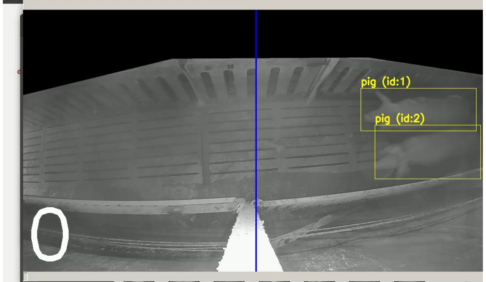

*그림 23. 축사 영상에서 돼지를 탐지하고 개체 번호를 붙여 추적한 결과*

두 마리의 돼지가 노란 상자로 탐지되어 있고, 상자마다 `pig (id:1)`, `pig (id:2)`처럼 클래스 이름과 개체 번호가 붙어 있다. 프레임마다 탐지한 상자를 이전 프레임의 상자와 연결하면 같은 개체에 같은 번호를 유지할 수 있으며, 이를 **객체 추적(object tracking)** 이라 한다.

---

<br>

## 4. 객체 탐지의 평가: mAP

### 4.1 혼동 행렬과 IoU 임계값

객체 탐지 모델의 성능은 어떻게 정량적으로 평가하는가? 표준 지표는 **mAP(mean Average Precision)** 이다.

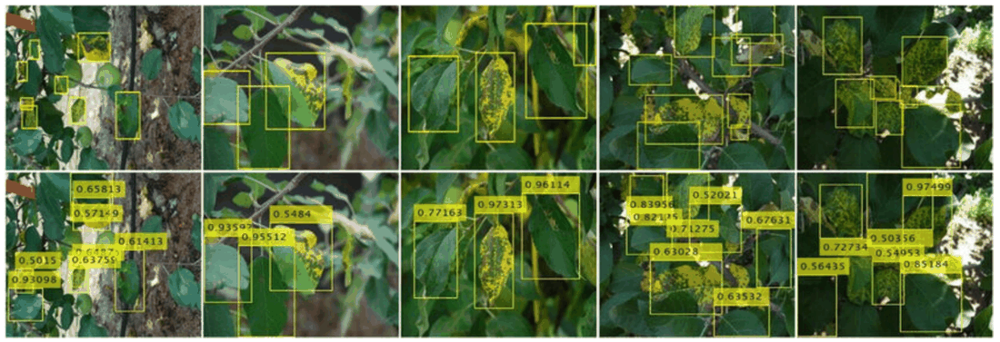

*그림 24. 잎의 병반을 탐지한 결과와 각 상자의 신뢰도*

위 그림은 식물 잎의 병든 부위를 탐지한 예로, 위 줄은 탐지한 상자, 아래 줄은 상자마다의 신뢰도(0.65813, 0.97499 등)를 함께 표시한 것이다. 이런 결과가 얼마나 좋은지를 하나의 수로 나타내려면, 각 상자가 맞았는지 틀렸는지를 먼저 정해야 한다. mAP는 크게 **혼동 행렬(confusion matrix)** 과 **IoU**를 이용해 계산한다.

| 예측값 \ 실제 정답 | True | False |
|:-----|:-----|:-----|
| True | 참 양성 (TP, True Positive) | 거짓 양성 (FP, False Positive) |
| False | 거짓 음성 (FN, False Negative) | 참 음성 (TN, True Negative) |

*표 9. 혼동 행렬*

객체 탐지에서 각 칸의 의미는 다음과 같다.

- **TP:** 예측 상자가 같은 클래스의 정답 상자와 충분히 겹친다(IoU가 임계값 이상).
- **FP:** 예측 상자가 어떤 정답 상자와도 충분히 겹치지 않거나, 이미 다른 예측이 맞힌 정답 상자를 또 가리킨다.
- **FN:** 정답 상자인데 어떤 예측 상자도 맞히지 못했다.
- **TN:** 객체가 없는 곳을 없다고 판단한 경우인데, 배경 영역의 수는 셀 수 없으므로 객체 탐지의 평가에서는 쓰지 않는다.

**IoU 임계값.** 예측이 맞았는지는 IoU를 임계값(threshold)과 비교하여 판정한다. IoU의 임계값을 0.5라고 하면 다음과 같다.

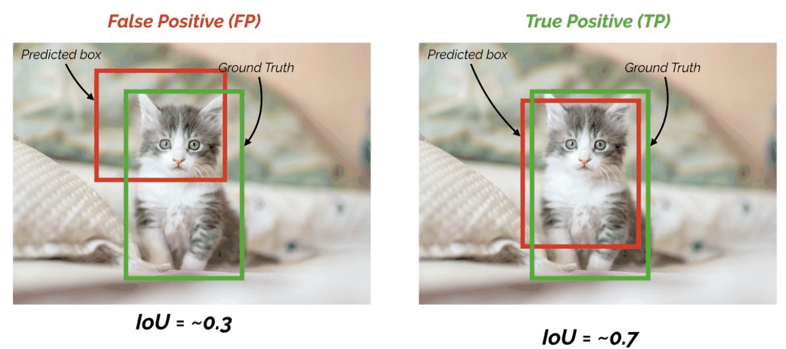

*그림 25. IoU 임계값 0.5에서 IoU 약 0.3인 예측은 FP, 약 0.7인 예측은 TP*

왼쪽의 예측 상자(빨간색)는 고양이를 포함하긴 하지만 정답 상자(초록색)와의 IoU가 약 0.3으로 0.5보다 작으므로 FP이다. 오른쪽의 예측 상자는 IoU가 약 0.7이므로 TP이다.

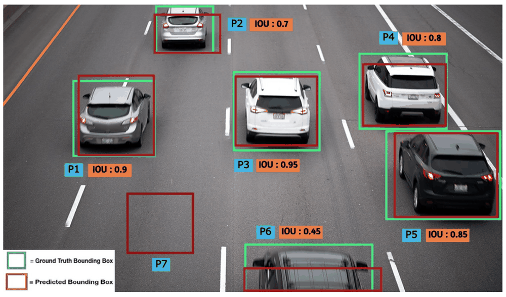

*그림 26. 고속도로 영상에서 정답 상자와 예측 상자 P1~P7의 IoU*

위 그림에는 정답 상자(초록색) 6개와 예측 상자(빨간색) 7개가 있다. IoU 임계값 0.5로 각 예측을 판정하면 다음과 같다.

| 예측 | IoU | 판정 | 이유 |
|:-----|-----:|:-----|:-----|
| P1 | 0.9 | TP | 0.5 이상 |
| P2 | 0.7 | TP | 0.5 이상 |
| P3 | 0.95 | TP | 0.5 이상 |
| P4 | 0.8 | TP | 0.5 이상 |
| P5 | 0.85 | TP | 0.5 이상 |
| P6 | 0.45 | FP | 0.5 미만 |
| P7 | 0 | FP | 겹치는 정답 상자가 없다 |

*표 10. IoU 임계값 0.5에서 예측 상자 P1~P7의 판정*

TP는 5개, FP는 2개이다. 정답 상자 6개 중 P6의 자동차만 맞힌 예측이 없으므로 FN은 1개이다. 4강에서 정의한 정밀도와 재현율을 다시 쓰면 다음과 같다.

```math
\text{Precision} = \frac{TP}{TP + FP}, \qquad \text{Recall} = \frac{TP}{TP + FN}
```

**정밀도(precision)** 는 모델이 예측한 것 중 맞은 비율이고, **재현율(recall)** 은 실제 정답 중 모델이 찾아낸 비율이다. 이 예에서 정밀도는 $5 / (5 + 2) = 5/7 \approx 0.714$, 재현율은 $5 / (5 + 1) = 5/6 \approx 0.833$이다. 재현율의 분모 $TP + FN$은 정답 상자의 총수와 같다.

### 4.2 신뢰도 임계값과 정밀도, 재현율

IoU 임계값과 별개로, 모델이 낸 상자 중 어느 신뢰도 이상을 최종 탐지로 인정할지 정하는 **신뢰도 임계값(confidence threshold)** 이 있다. 이 임계값은 너무 높아도, 너무 낮아도 문제가 된다.

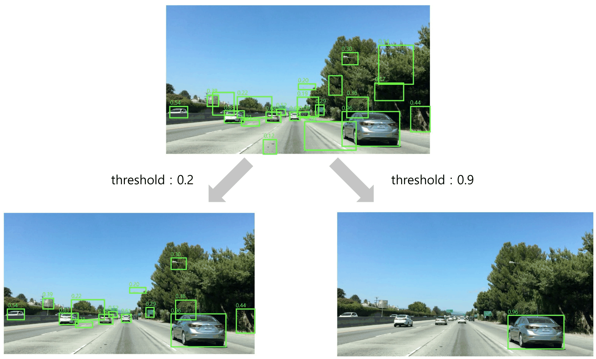

*그림 27. 신뢰도 임계값 0.2와 0.9에서의 탐지 결과*

- **임계값 0.2(왼쪽 아래):** 신뢰도가 낮은 상자까지 모두 인정하므로, 멀리 있는 자동차까지 찾지만 나무나 도로의 일부처럼 객체가 아닌 곳에도 상자가 많이 생긴다. FP가 늘어 정밀도가 떨어지는 대신 재현율은 높다.
- **임계값 0.9(오른쪽 아래):** 가장 확실한 자동차 한 대만 남는다. 남은 상자는 거의 확실히 맞으므로 정밀도는 높지만, 나머지 자동차를 모두 놓쳐 재현율이 낮다.

임계값을 낮추면 인정되는 상자가 늘어나므로 TP는 줄지 않고 재현율도 줄지 않는다. 그러나 FP가 함께 늘면 정밀도는 떨어질 수 있다. 이처럼 정밀도와 재현율은 서로 맞바꾸는 관계이므로, 임계값 하나에서의 성능만으로는 모델을 공정하게 비교하기 어렵다. 그래서 가능한 모든 임계값에서의 정밀도와 재현율을 함께 보는 **PR 곡선**과, 그 아래 넓이인 **AP**를 쓴다.

### 4.3 예제: 탐지 결과에서 PR 표 만들기

어떤 클래스에 대해 이미지들에서 실제 정답 상자가 5개 있고, 모델이 8개의 상자 a~h를 탐지했다고 하자. 각 상자의 신뢰도와, IoU 임계값으로 판정한 TP 또는 FP는 다음과 같다.

| 탐지된 객체 | 신뢰도 | 실제 상태 |
|:-----|-----:|:-----|
| a | 0.91 | TP |
| b | 0.75 | FP |
| c | 0.83 | TP |
| d | 0.85 | FP |
| e | 0.72 | FP |
| f | 0.88 | TP |
| g | 0.68 | TP |
| h | 0.80 | TP |

*표 11. 한 클래스에 대한 탐지 결과의 신뢰도와 판정*

**1단계: 신뢰도로 정렬한다.** 신뢰도 임계값을 높은 값에서 낮은 값으로 내리면 상자가 신뢰도 순서대로 하나씩 인정되므로, 먼저 신뢰도의 내림차순으로 정렬한다.

| 탐지된 객체 | 신뢰도 | 실제 상태 |
|:-----|-----:|:-----|
| a | 0.91 | TP |
| f | 0.88 | TP |
| d | 0.85 | FP |
| c | 0.83 | TP |
| h | 0.80 | TP |
| b | 0.75 | FP |
| e | 0.72 | FP |
| g | 0.68 | TP |

*표 12. 신뢰도의 내림차순으로 정렬한 탐지 결과*

**2단계: 누적 TP와 FP로 정밀도와 재현율을 계산한다.** 임계값을 각 상자의 신뢰도로 두면, 그 상자까지의 상자만 인정된다. 그때까지의 TP 수와 FP 수를 누적하고, 정밀도는 $TP / (TP + FP)$, 재현율은 $TP / 5$로 계산한다.

| 임계값 (신뢰도) | TP 수 | FP 수 | 정밀도 | 재현율 |
|-----:|-----:|-----:|:-----|:-----|
| 0.91 | 1 | 0 | 1/1 = 1.00 | 1/5 = 0.20 |
| 0.88 | 2 | 0 | 2/2 = 1.00 | 2/5 = 0.40 |
| 0.85 | 2 | 1 | 2/3 = 0.67 | 2/5 = 0.40 |
| 0.83 | 3 | 1 | 3/4 = 0.75 | 3/5 = 0.60 |
| 0.80 | 4 | 1 | 4/5 = 0.80 | 4/5 = 0.80 |
| 0.75 | 4 | 2 | 4/6 = 0.67 | 4/5 = 0.80 |
| 0.72 | 4 | 3 | 4/7 = 0.57 | 4/5 = 0.80 |
| 0.68 | 5 | 3 | 5/8 = 0.63 | 5/5 = 1.00 |

*표 13. 신뢰도 임계값에 따른 누적 TP, FP와 정밀도, 재현율 (실제 정답 상자 5개)*

표를 읽는 방법은 다음과 같다. 임계값이 0.85이면 a, f, d의 세 상자가 인정되며, 그중 a와 f가 TP, d가 FP이므로 정밀도는 2/3, 재현율은 2/5이다. FP인 상자가 추가될 때(d, b, e)는 재현율은 그대로이고 정밀도만 떨어지며, TP인 상자가 추가될 때(c, h, g)는 재현율이 0.2씩 오르고 정밀도도 다시 오른다.

### 4.4 PR 곡선과 AP

**PR 곡선(precision-recall curve)** 은 가로축에 재현율, 세로축에 정밀도를 두고, 표 13의 점들을 임계값이 낮아지는 순서로 이은 그래프이다.

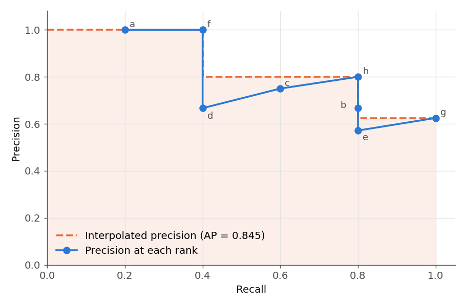

*그림 28. 예제의 PR 곡선과 보간한 정밀도*

파란 선은 각 상자를 인정할 때의 (재현율, 정밀도)를 이은 원래의 PR 곡선이다. FP가 나올 때마다 정밀도가 수직으로 떨어지고(f에서 d로, h에서 b, e로), TP가 나오면 오른쪽 위로 올라가므로 톱니 모양이 된다. 일반적으로 모델이 정확할수록 곡선이 뾰족하게 꺾이지 않고 높은 정밀도를 유지한 채 오른쪽으로 쭉 이어져, 그래프 영역을 거의 꽉 채운다.

**AP(Average Precision, 평균 정밀도)** 는 PR 곡선 아래의 넓이로, 재현율 0부터 1까지에 걸친 정밀도의 평균이라는 뜻이다. 톱니 모양을 그대로 적분하면 작은 흔들림에 민감하므로, 보통 다음과 같이 **보간한 정밀도(interpolated precision)** 를 쓴다.

```math
p_{\text{interp}}(r) = \max_{\tilde{r} \ge r} p(\tilde{r})
```

즉 재현율 $r$에서의 정밀도를, $r$ 이상의 재현율에서 얻을 수 있는 정밀도 중 최댓값으로 바꾼다. 재현율을 $r$ 이상으로 요구할 때 기대할 수 있는 최선의 정밀도를 뜻하며, 그 결과 곡선은 오른쪽으로 갈수록 내려가기만 하는 계단 모양(주황색 점선)이 된다. 예제에서 보간한 정밀도는 다음과 같다.

| 재현율 구간 | 그 구간 이상의 재현율에서 얻는 최대 정밀도 | 보간한 정밀도 | 넓이 |
|:-----|:-----|-----:|-----:|
| 0 ~ 0.4 | a, f의 1.00 | 1.000 | 0.4 × 1.000 = 0.400 |
| 0.4 ~ 0.8 | c의 0.75, h의 0.80 중 최대 | 0.800 | 0.4 × 0.800 = 0.320 |
| 0.8 ~ 1.0 | g의 0.625 | 0.625 | 0.2 × 0.625 = 0.125 |

*표 14. 예제의 보간한 정밀도와 구간별 넓이*

따라서 $\text{AP} = 0.400 + 0.320 + 0.125 = 0.845$이다. 재현율 0.4~0.8 구간에서 원래 곡선은 0.67, 0.75, 0.80으로 오르내리지만, 보간하면 그 구간의 오른쪽 끝에서 얻을 수 있는 0.80으로 평평해진다.

> **참고:** AP를 계산하는 방식은 데이터셋과 연도에 따라 다르다 [10]. 위의 방식은 모든 재현율 점에서 보간하는 방식(PASCAL VOC 2010 이후)이다. PASCAL VOC 2007은 재현율 0, 0.1, ..., 1.0의 11개 점에서 보간한 정밀도를 평균하며 [11], 예제에 적용하면 $(5 \times 1.0 + 4 \times 0.8 + 2 \times 0.625) / 11 \approx 0.859$이다. COCO는 0부터 1까지 101개 점을 쓰며, 예제에서는 약 0.847이다. 보간하지 않고 TP가 나올 때마다의 정밀도를 재현율 증가량으로 가중해 더하면 $0.2 \times (1.0 + 1.0 + 0.75 + 0.8 + 0.625) = 0.835$이다. 논문의 수치를 비교할 때는 같은 방식으로 계산했는지 확인해야 한다.

### 4.5 mAP와 COCO 평가 지표

AP는 클래스 하나에 대해 계산한다. **mAP(mean Average Precision)** 는 클래스마다 AP를 구해 평균한 값이다.

```math
\text{mAP} = \frac{1}{n} \sum_{k=1}^{n} \text{AP}_k
```

여기서 $`\text{AP}_k`$는 클래스 $k$의 AP, $n$은 클래스의 수이다. 예를 들어 클래스가 3개이고 각 AP가 0.845, 0.70, 0.60이면 $\text{mAP} = (0.845 + 0.70 + 0.60) / 3 = 0.715$이다.

COCO 데이터셋 [12]은 IoU 임계값과 객체 크기를 바꾸어 가며 여러 AP를 보고한다 [13]. COCO에서는 클래스 평균까지 포함한 값도 AP라고 부른다.

| 지표 | 정의 |
|:-----|:-----|
| AP | IoU 임계값 0.50, 0.55, ..., 0.95의 10개에서 구한 AP의 평균 (주 지표) |
| AP<sup>IoU=.50</sup> (AP<sub>50</sub>) | IoU 임계값 0.50에서의 AP (PASCAL VOC 지표) |
| AP<sup>IoU=.75</sup> (AP<sub>75</sub>) | IoU 임계값 0.75에서의 AP (엄격한 지표) |
| AP<sup>small</sup> (AP<sub>S</sub>) | 넓이가 32² 픽셀 미만인 작은 객체에 대한 AP |
| AP<sup>medium</sup> (AP<sub>M</sub>) | 넓이가 32²~96² 픽셀인 중간 객체에 대한 AP |
| AP<sup>large</sup> (AP<sub>L</sub>) | 넓이가 96² 픽셀보다 큰 큰 객체에 대한 AP |

*표 15. COCO의 AP 지표*

IoU 임계값을 0.5 하나로 정하면 상자가 대충만 맞아도 TP가 되지만, 0.50~0.95의 평균을 쓰면 상자를 정확히 맞출수록 점수가 높아진다. 32²은 1,024픽셀, 96²은 9,216픽셀이다. 다음은 YOLOv7 논문이 COCO 검증 데이터(val)에서 기존 모델과 비교한 결과이다 [14].

| 모델 | 파라미터 | FLOPs | 크기 | AP | AP<sub>50</sub> | AP<sub>75</sub> | AP<sub>S</sub> | AP<sub>M</sub> | AP<sub>L</sub> |
|:-----|-----:|-----:|-----:|-----:|-----:|-----:|-----:|-----:|-----:|
| YOLOv4 | 64.4M | 142.8G | 640 | 49.7% | 68.2% | 54.3% | 32.9% | 54.8% | 63.7% |
| YOLOR-u5 (r6.1) | 46.5M | 109.1G | 640 | 50.2% | 68.7% | 54.6% | 33.2% | 55.5% | 63.7% |
| YOLOv4-CSP | 52.9M | 120.4G | 640 | 50.3% | 68.6% | 54.9% | 34.2% | 55.6% | 65.1% |
| YOLOR-CSP | 52.9M | 120.4G | 640 | 50.8% | 69.5% | 55.3% | 33.7% | 56.0% | 65.4% |
| YOLOv7 | 36.9M | 104.7G | 640 | **51.2%** | **69.7%** | **55.5%** | **35.2%** | **56.0%** | **66.7%** |
| 개선 | -43% | -15% | - | +0.4 | +0.2 | +0.2 | +1.5 | = | +1.3 |
| YOLOR-CSP-X | 96.9M | 226.8G | 640 | 52.7% | **71.3%** | 57.4% | 36.3% | 57.5% | 68.3% |
| YOLOv7-X | 71.3M | 189.9G | 640 | **52.9%** | 71.1% | **57.5%** | **36.9%** | **57.7%** | **68.6%** |
| 개선 | -36% | -19% | - | +0.2 | -0.2 | +0.1 | +0.6 | +0.2 | +0.3 |
| YOLOv4-tiny | 6.1 | 6.9 | 416 | 24.9% | 42.1% | 25.7% | 8.7% | 28.4% | 39.2% |
| YOLOv7-tiny | 6.2 | 5.8 | 416 | **35.2%** | **52.8%** | **37.3%** | **15.7%** | **38.0%** | **53.4%** |
| 개선 | +2% | -19% | - | +10.3 | +10.7 | +11.6 | +7.0 | +9.6 | +14.2 |
| YOLOv4-tiny-3l | 8.7 | 5.2 | 320 | 30.8% | 47.3% | 32.2% | **10.9%** | 31.9% | 51.5% |
| YOLOv7-tiny | 6.2 | 3.5 | 320 | **30.8%** | **47.3%** | **32.2%** | 10.0% | **31.9%** | **52.2%** |
| 개선 | -39% | -49% | - | = | = | = | -0.9 | = | +0.7 |
| YOLOR-E6 | 115.8M | 683.2G | 1280 | 55.7% | 73.2% | 60.7% | 40.1% | **60.4%** | 69.2% |
| YOLOv7-E6 | 97.2M | 515.2G | 1280 | **55.9%** | **73.5%** | **61.1%** | **40.6%** | 60.3% | **70.0%** |
| 개선 | -19% | -33% | - | +0.2 | +0.3 | +0.4 | +0.5 | -0.1 | +0.8 |
| YOLOR-D6 | 151.7M | 935.6G | 1280 | 56.1% | 73.9% | 61.2% | **42.4%** | 60.5% | 69.9% |
| YOLOv7-D6 | 154.7M | 806.8G | 1280 | 56.3% | 73.8% | 61.4% | 41.3% | 60.6% | 70.1% |
| YOLOv7-E6E | 151.7M | 843.2G | 1280 | **56.8%** | **74.4%** | **62.1%** | 40.8% | **62.1%** | **70.6%** |
| 개선 | = | -11% | - | +0.7 | +0.5 | +0.9 | -1.6 | +1.6 | +0.7 |

*표 16. COCO 검증 데이터에서 YOLOv7과 기존 모델의 비교*

"파라미터"는 모델의 학습 가능한 파라미터 수(M은 백만), "FLOPs"는 이미지 한 장을 처리하는 데 드는 부동소수점 연산 수(G는 10억), "크기"는 입력 이미지의 한 변의 픽셀 수이며, tiny 모델 행은 단위 표기가 생략되었지만 각각 M과 G 단위이다. "개선" 행은 같은 묶음에서 가장 강한 기존 모델과 비교한 변화량으로, AP는 퍼센트포인트 차이이고, 파라미터와 FLOPs의 비율은 새 모델의 값을 분모로 계산되어 있다. 예를 들어 YOLOv7은 YOLOR-CSP보다 파라미터가 16.0M(36.9M의 43%), 연산량이 15.7G(104.7G의 15%) 적으면서도 AP가 0.4%포인트 높다. 또한 모든 모델에서 AP<sub>S</sub>가 AP<sub>L</sub>보다 크게 낮은데, 이는 작은 객체의 탐지가 여전히 어렵다는 것을 보여 준다.

---

<br>

## 개념 적용

**T/F 점검:**

| 문장 | 판단과 근거 |
|:-----|:-----|
| IoU가 0.6인 예측 상자는 항상 TP이다. | **F.** IoU 임계값이 0.75라면 FP이고, 클래스가 틀리거나 같은 정답 상자를 이미 다른 예측이 맞혔어도 FP이다. |
| R-CNN은 제안 영역마다 CNN 순전파를 따로 수행한다. | **T.** 약 2,000개의 영역을 각각 크기를 맞춰 CNN에 넣으므로 느리다. Fast R-CNN은 이미지 전체를 한 번만 통과시킨다. |
| Faster R-CNN은 선택적 탐색으로 후보 영역을 얻는다. | **F.** Faster R-CNN은 CNN 특징 맵을 공유하는 RPN으로 후보 영역을 얻는다. 선택적 탐색은 R-CNN과 Fast R-CNN이 쓴다. |
| YOLO v1은 이미지 한 장에서 항상 98개의 상자를 예측한다. | **T.** 7×7 셀마다 상자 2개를 예측하므로 $7 \times 7 \times 2 = 98$개이며, 후처리로 대부분을 지운다. |
| YOLO v1 손실 함수의 $\lambda_{\text{noobj}} = 0.5$는 객체가 없는 상자의 신뢰도 오차를 키우기 위한 것이다. | **F.** 객체가 없는 상자가 압도적으로 많으므로, 그 오차가 학습을 지배하지 않도록 줄이기 위한 것이다. |
| 신뢰도 임계값을 낮추면 재현율은 줄지 않는다. | **T.** 인정되는 상자가 늘기만 하므로 TP는 줄지 않는다. 다만 FP가 늘어 정밀도는 떨어질 수 있다. |
| NMS는 클래스와 관계없이 모든 상자에 한 번에 적용해야 한다. | **F.** 보통 클래스마다 따로 적용한다. 그렇지 않으면 많이 겹친 서로 다른 클래스의 객체 중 하나가 지워진다. |

---

<br>

## 요약

| 개념 | 핵심 요약 |
|:-----|:-----|
| 객체 탐지 | 이미지에서 객체마다 클래스(분류)와 바운딩 박스 좌표(회귀)를 출력한다. 분류는 이미지 전체에 레이블 하나, 인스턴스 분할은 객체마다 픽셀 마스크를 낸다. |
| 바운딩 박스 | 모서리 형식 $(x_1, y_1, x_2, y_2)$와 중심 형식 $(x, y, w, h)$가 있으며, 사용하는 데이터의 형식과 정규화 여부를 확인해야 한다. |
| IoU | 교집합 넓이를 합집합 넓이로 나눈 0~1의 값이다. 신뢰도 정의, NMS, 평가의 TP 판정에 쓰인다. |
| 2단계와 1단계 탐지 | 2단계는 영역 제안 후 영역마다 분류와 회귀를 하고, 1단계는 특징 맵의 각 위치에서 한 번에 예측한다. 초기에는 2단계가 정확하고 1단계가 빨랐다. |
| R-CNN | 선택적 탐색으로 약 2,000개 RoI를 뽑아 각각 CNN으로 4,096차원 특징을 얻고, SVM으로 분류하고 회귀로 상자를 고친다. 영역마다 CNN을 돌리므로 느리다. |
| Fast R-CNN과 Faster R-CNN | Fast R-CNN은 이미지 전체를 CNN에 한 번 통과시키고 RoI 풀링을 쓴다. Faster R-CNN은 선택적 탐색을 앵커 기반 RPN으로 바꾸었다. |
| YOLO v1 | 7×7 그리드의 셀마다 상자 2개(x, y, w, h, 신뢰도)와 클래스 확률 20개를 예측하여 7×7×30 텐서를 낸다. 신뢰도는 Pr(Object)×IoU이다. |
| YOLO 손실 함수 | 위치, 신뢰도, 분류의 제곱 오차 합이다. λcoord = 5, λnoobj = 0.5를 쓰고, 너비와 높이에 제곱근을 씌워 작은 상자의 오차를 더 반영한다. |
| NMS | 점수 내림차순으로 가장 높은 상자를 확정하고 그 상자와 IoU가 임계값 이상인 상자를 지우는 과정을 반복한다. 보통 클래스마다 적용한다. |
| YOLO의 성능과 한계 | PASCAL VOC 2007에서 63.4 mAP를 45 FPS로 달성했다. 한 셀의 여러 객체, 작은 객체, 낯선 형태의 상자에 약하다. |
| 정밀도와 재현율 | 정밀도는 TP/(TP+FP), 재현율은 TP/(TP+FN)이다. 신뢰도 임계값을 낮추면 재현율은 줄지 않고 정밀도는 떨어질 수 있다. |
| AP와 mAP | 신뢰도 순으로 누적한 PR 곡선을 보간하여 그 아래 넓이를 AP로 하고, 클래스 평균을 mAP로 한다. 예제의 AP는 0.845이다. |
| COCO 지표 | IoU 0.50~0.95의 10개 임계값 평균 AP를 주 지표로 하고, AP50, AP75와 객체 크기별 AP를 함께 보고한다. |

---

<br>

## 점검 문제

1. **IoU 계산:** 모서리 형식의 정답 상자 $(0, 0, 100, 100)$과 예측 상자 $(50, 0, 150, 100)$의 IoU를 구하라.

   <details>
   <summary>정답</summary>

   교집합은 $(50, 0)$부터 $(100, 100)$까지이므로 넓이가 $50 \times 100 = 5000$이다. 두 상자의 넓이는 각각 10,000이므로 합집합은 $20000 - 5000 = 15000$이다. IoU는 $5000 / 15000 \approx 0.333$이다.

   </details>

2. **좌표 형식:** 모서리 형식의 상자 $(110, 20, 200, 190)$을 중심 형식 $(x, y, w, h)$로 바꾸어라.

   <details>
   <summary>정답</summary>

   $x = (110 + 200)/2 = 155$, $y = (20 + 190)/2 = 105$, $w = 200 - 110 = 90$, $h = 190 - 20 = 170$이므로 $(155, 105, 90, 170)$이다.

   </details>

3. **R-CNN 계열:** R-CNN이 느린 가장 큰 이유는 무엇이며, Fast R-CNN과 Faster R-CNN은 각각 무엇을 바꾸어 이를 개선했는가?

   <details>
   <summary>정답</summary>

   R-CNN은 선택적 탐색으로 얻은 약 2,000개의 영역마다 CNN을 따로 실행한다. Fast R-CNN은 이미지 전체를 CNN에 한 번만 통과시키고 RoI 풀링으로 영역마다 고정 크기의 특징을 뽑아, 분류와 박스 회귀를 함께 학습한다. Faster R-CNN은 남아 있던 선택적 탐색을 CNN 특징 맵을 공유하는 RPN으로 바꾸어 영역 제안까지 신경망으로 처리한다.

   </details>

4. **바운딩 박스 회귀:** 제안 상자 $P = (50, 50, 40, 40)$, 정답 상자 $G = (54, 46, 40, 80)$일 때 $t_x$, $t_y$, $t_w$, $t_h$를 구하라.

   <details>
   <summary>정답</summary>

   $t_x = (54 - 50)/40 = 0.1$, $t_y = (46 - 50)/40 = -0.1$, $t_w = \ln(40/40) = 0$, $t_h = \ln(80/40) = \ln 2 \approx 0.693$이다.

   </details>

5. **YOLO 출력 텐서:** 그리드를 $S = 13$, 셀마다 상자를 $B = 3$개, 클래스를 $C = 80$개로 바꾼 YOLO v1 방식의 모델에서 출력 텐서의 크기와 이미지당 예측 상자 수를 구하라.

   <details>
   <summary>정답</summary>

   셀 하나의 출력은 $B \times 5 + C = 3 \times 5 + 80 = 95$이므로 출력 텐서는 $13 \times 13 \times 95$이다. 예측 상자는 $13 \times 13 \times 3 = 507$개이다.

   </details>

6. **좌표 부호화:** 448×448 입력과 7×7 그리드에서 중심이 $(100, 420)$이고 크기가 224×112인 객체를 책임지는 셀과 $x$, $y$, $w$, $h$의 목표값을 구하라.

   <details>
   <summary>정답</summary>

   셀 크기는 64이므로 열은 $\lfloor 100/64 \rfloor = 1$, 행은 $\lfloor 420/64 \rfloor = 6$이다. $x = (100 - 64)/64 = 0.5625$, $y = (420 - 384)/64 = 0.5625$, $w = 224/448 = 0.5$, $h = 112/448 = 0.25$이다.

   </details>

7. **제곱근 항:** YOLO v1의 위치 손실에서 너비와 높이에 제곱근을 씌우는 이유를 설명하라.

   <details>
   <summary>정답</summary>

   같은 픽셀 수의 오차라도 작은 상자에서는 상대적으로 큰 어긋남이지만 큰 상자에서는 작은 어긋남이다. 제곱근을 씌우면 큰 값 쪽에서 차이가 압축되므로, 같은 절대 오차에 대해 작은 상자의 손실이 더 커진다. 예를 들어 300→310과 30→40은 제곱 오차가 같지만, 제곱근을 씌우면 작은 상자의 손실이 약 8.8배 크다.

   </details>

8. **NMS:** 같은 클래스의 상자 A(0.9), B(0.8), C(0.7)에서 IoU(A, B) = 0.6, IoU(A, C) = 0.3, IoU(B, C) = 0.7이다. IoU 임계값 0.5로 NMS를 적용하면 어떤 상자가 남는가?

   <details>
   <summary>정답</summary>

   점수 순으로 A를 먼저 확정한다. B는 A와의 IoU가 0.6으로 0.5 이상이므로 제거되고, C는 0.3이므로 남는다. 다음으로 C를 확정하며, 남은 상자가 없으므로 A와 C가 남는다. B와 C의 IoU는 B가 이미 제거되었으므로 판정에 쓰이지 않는다.

   </details>

9. **PR 표와 AP:** 정답 상자가 4개이고, 신뢰도 순으로 정렬한 탐지 결과가 TP, FP, TP, TP, FP일 때 각 단계의 정밀도와 재현율을 구하고, 모든 점 보간 방식의 AP를 계산하라.

   <details>
   <summary>정답</summary>

   (정밀도, 재현율)은 차례로 (1/1, 0.25), (1/2, 0.25), (2/3, 0.5), (3/4, 0.75), (3/5, 0.75)이다. 보간한 정밀도는 재현율 0\~0.25 구간에서 1.0, 0.25\~0.5 구간에서 max(0.667, 0.75, 0.6) = 0.75, 0.5\~0.75 구간에서 0.75이다. 재현율 0.75보다 큰 점이 없으므로 그 뒤의 넓이는 0이다. AP는 $0.25 \times 1.0 + 0.25 \times 0.75 + 0.25 \times 0.75 = 0.625$이다.

   </details>

10. **COCO 지표:** COCO의 AP와 AP<sub>50</sub>은 무엇이 다르며, 같은 모델에서 어느 쪽이 더 높게 나오는가?

    <details>
    <summary>정답</summary>

    AP<sub>50</sub>은 IoU 임계값 0.5 하나에서 구한 AP이고, AP는 0.50부터 0.95까지 0.05 간격의 10개 임계값에서 구한 AP의 평균이다. 임계값이 높을수록 TP로 인정받기 어려우므로, 같은 모델에서는 보통 AP<sub>50</sub>이 AP보다 높다. 표의 YOLOv7도 AP<sub>50</sub> 69.7%, AP 51.2%이다.

    </details>

---

<br>

## 참고 문헌

1. S. Ren, K. He, R. Girshick, and J. Sun, "Faster R-CNN: Towards Real-Time Object Detection with Region Proposal Networks," in *Advances in Neural Information Processing Systems (NIPS)*, vol. 28, pp. 91-99, 2015.
2. J. Redmon, S. Divvala, R. Girshick, and A. Farhadi, "You Only Look Once: Unified, Real-Time Object Detection," in *Proc. IEEE Conf. Computer Vision and Pattern Recognition (CVPR)*, pp. 779-788, 2016.
3. W. Liu, D. Anguelov, D. Erhan, C. Szegedy, S. Reed, C.-Y. Fu, and A. C. Berg, "SSD: Single Shot MultiBox Detector," in *Proc. European Conf. Computer Vision (ECCV)*, pp. 21-37, 2016.
4. Z. Zou, K. Chen, Z. Shi, Y. Guo, and J. Ye, "Object Detection in 20 Years: A Survey," *Proceedings of the IEEE*, vol. 111, no. 3, pp. 257-276, 2023.
5. R. Girshick, J. Donahue, T. Darrell, and J. Malik, "Rich Feature Hierarchies for Accurate Object Detection and Semantic Segmentation," in *Proc. IEEE Conf. Computer Vision and Pattern Recognition (CVPR)*, pp. 580-587, 2014.
6. J. R. R. Uijlings, K. E. A. van de Sande, T. Gevers, and A. W. M. Smeulders, "Selective Search for Object Recognition," *Int. J. Computer Vision*, vol. 104, no. 2, pp. 154-171, 2013.
7. R. Girshick, "Fast R-CNN," in *Proc. IEEE Int. Conf. Computer Vision (ICCV)*, pp. 1440-1448, 2015.
8. Ultralytics, "Ultralytics YOLO," *GitHub*, accessed Nov. 4, 2026. https://github.com/ultralytics/ultralytics
9. R. Sapkota, R. H. Cheppally, A. Sharda, and M. Karkee, "YOLO26: Key Architectural Enhancements and Performance Benchmarking for Real-Time Object Detection," arXiv:2509.25164, 2025.
10. R. Padilla, S. L. Netto, and E. A. B. da Silva, "A Survey on Performance Metrics for Object-Detection Algorithms," in *Proc. Int. Conf. Systems, Signals and Image Processing (IWSSIP)*, pp. 237-242, 2020.
11. M. Everingham, L. Van Gool, C. K. I. Williams, J. Winn, and A. Zisserman, "The PASCAL Visual Object Classes (VOC) Challenge," *Int. J. Computer Vision*, vol. 88, no. 2, pp. 303-338, 2010.
12. T.-Y. Lin, M. Maire, S. Belongie, J. Hays, P. Perona, D. Ramanan, P. Dollár, and C. L. Zitnick, "Microsoft COCO: Common Objects in Context," in *Proc. European Conf. Computer Vision (ECCV)*, pp. 740-755, 2014.
13. COCO Consortium, "Detection Evaluation," *COCO Dataset*, accessed Nov. 4, 2026. https://cocodataset.org/#detection-eval
14. C.-Y. Wang, A. Bochkovskiy, and H.-Y. M. Liao, "YOLOv7: Trainable Bag-of-Freebies Sets New State-of-the-Art for Real-Time Object Detectors," in *Proc. IEEE/CVF Conf. Computer Vision and Pattern Recognition (CVPR)*, pp. 7464-7475, 2023.
