# Lecture 5 — Image Processing 3

[Repository Guide](../../README.md) | [English](Concepts_Lecture.md) | [한국어](Concepts_Lecture.ko.md)

> **Last Updated:** 2026-11-04

> **Learning Objectives:**
> 1. Distinguish classification, object detection, and instance segmentation, and explain that the output of object detection consists of class classification and bounding-box regression
> 2. Represent a bounding box in two coordinate formats and compute the IoU of two boxes
> 3. Explain the steps and differences of R-CNN, Fast R-CNN, and Faster R-CNN, and compare two-stage and one-stage detectors
> 4. Explain the grid cells, output tensor, confidence, loss function, inference, and NMS of YOLO v1
> 5. Compute precision and recall, the PR curve, AP, and mAP step by step from detection results, and interpret the COCO evaluation metrics

---

## Table of Contents

- [1. What Is Object Detection](#1-what-is-object-detection)
  - [1.1 Classification, Object Detection, and Instance Segmentation](#11-classification-object-detection-and-instance-segmentation)
  - [1.2 Detection Output: Classification and Regression](#12-detection-output-classification-and-regression)
  - [1.3 Bounding-Box Representation and IoU](#13-bounding-box-representation-and-iou)
  - [1.4 The Development of Object Detection and Its Two Families](#14-the-development-of-object-detection-and-its-two-families)
- [2. Two-Stage Detection: The R-CNN Family](#2-two-stage-detection-the-r-cnn-family)
  - [2.1 The Four Steps of R-CNN](#21-the-four-steps-of-r-cnn)
  - [2.2 Region Proposal: Sliding Window and Selective Search](#22-region-proposal-sliding-window-and-selective-search)
  - [2.3 Feature Extraction, SVM Classification, and Bounding-Box Regression](#23-feature-extraction-svm-classification-and-bounding-box-regression)
  - [2.4 Fast R-CNN and Faster R-CNN](#24-fast-r-cnn-and-faster-r-cnn)
  - [2.5 The Speed Problem of Two-Stage Detection](#25-the-speed-problem-of-two-stage-detection)
- [3. One-Stage Detection: YOLO](#3-one-stage-detection-yolo)
  - [3.1 The Idea of YOLO](#31-the-idea-of-yolo)
  - [3.2 Network Architecture](#32-network-architecture)
  - [3.3 Grid Cells and the Output Tensor](#33-grid-cells-and-the-output-tensor)
  - [3.4 Confidence](#34-confidence)
  - [3.5 Loss Function](#35-loss-function)
  - [3.6 Inference: Class-Specific Confidence Scores](#36-inference-class-specific-confidence-scores)
  - [3.7 NMS](#37-nms)
  - [3.8 Performance and Limitations](#38-performance-and-limitations)
  - [3.9 The Evolution and Applications of YOLO](#39-the-evolution-and-applications-of-yolo)
- [4. Evaluating Object Detection: mAP](#4-evaluating-object-detection-map)
  - [4.1 Confusion Matrix and IoU Threshold](#41-confusion-matrix-and-iou-threshold)
  - [4.2 Confidence Threshold, Precision, and Recall](#42-confidence-threshold-precision-and-recall)
  - [4.3 Example: Building a PR Table from Detection Results](#43-example-building-a-pr-table-from-detection-results)
  - [4.4 PR Curve and AP](#44-pr-curve-and-ap)
  - [4.5 mAP and the COCO Evaluation Metrics](#45-map-and-the-coco-evaluation-metrics)
- [Concept Applications](#concept-applications)
- [Summary](#summary)
- [Self-Check Questions](#self-check-questions)
- [References](#references)

---

<br>

## 1. What Is Object Detection

### 1.1 Classification, Object Detection, and Instance Segmentation

**Object detection** is the technique of identifying specific objects in an image or video and locating them. If the image classification of Lectures 3-4 answers the question of what is in a picture, object detection answers the question of what is where in the picture. Deep-learning object detection mainly uses models such as Faster R-CNN [1], YOLO [2], and SSD [3]. These models take an image as input, extract the locations where objects exist, and classify the class of each object.

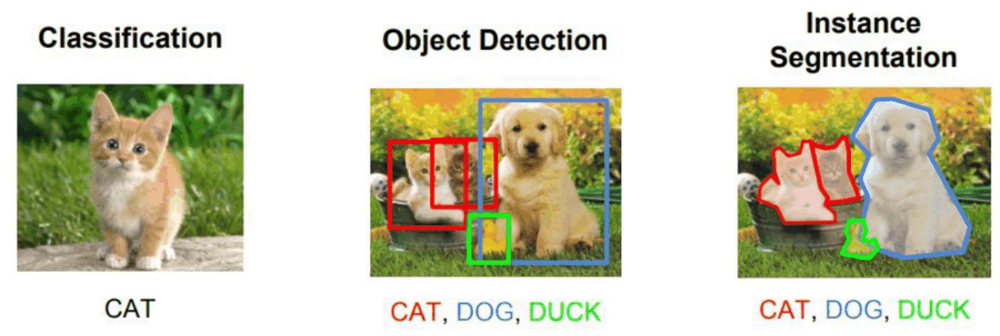

*Figure 1. Outputs of classification, object detection, and instance segmentation for similar scenes*

Classification on the left attaches a single label, CAT, to an entire photo containing one cat. Object detection in the middle surrounds the cat, the dog, and the duck with rectangles and attaches a class to each box. Instance segmentation on the right separates the objects by tracing the outline of the pixel region each object occupies instead of using rectangles.

| Task | Output | Question answered |
|:-----|:-----|:-----|
| Classification | One class for the whole image | What was photographed |
| Object detection | A class and a bounding box for each object | What is where |
| Instance segmentation | A class and a pixel-level mask for each object | Exactly which pixels each object occupies |

*Table 1. Comparison of the outputs of classification, object detection, and instance segmentation*

A classification model produces one label per photo, so it fits well when there is only one target and it occupies most of the frame. Real camera footage often contains several objects of various sizes together, so in practice object detection, which also reports locations, is more widely used. Object detection can be regarded as a task one step more advanced than classification.

### 1.2 Detection Output: Classification and Regression

The result of object detection consists of the **classification** of objects and the **regression** of box coordinates. A classifier outputs one class name per image, whereas a detector outputs a class name and box coordinates together for each detected object.

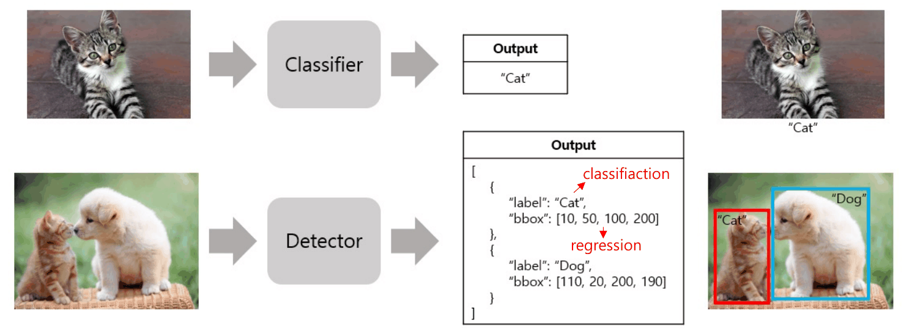

*Figure 2. Comparison of the outputs of a classifier and a detector*

The classifier at the top receives a cat photo and outputs a single `"Cat"`. The detector at the bottom receives a photo with a cat and a dog and outputs a list that pairs, for each object, a label (the classification result) and box coordinates (the regression result), as follows.

```json
[
  {"label": "Cat", "bbox": [10, 50, 100, 200]},
  {"label": "Dog", "bbox": [110, 20, 200, 190]}
]
```

- `"label"` is the result of **classification**, which chooses one of the predefined classes.
- The four numbers of `"bbox"` are continuous values, so they are predicted by **regression**. The box location is not exact from the start; regression adjusts it little by little so that it approaches the ground-truth box.

The difference between classification and regression is as follows.

- **Classification** is the technique of assigning input data to one of the predefined classes. The output is a discrete category.
- **Regression** is the technique of learning the functional relationship between input data and continuous output values. Because it outputs continuous values, it is mainly used for numerical prediction problems. For example, in house-price prediction the goal is to predict the price of a house from information such as its size, region, and year of construction.
- A regression model learns from a dataset of pairs of inputs and output values so that it can predict a continuous value for a new input.

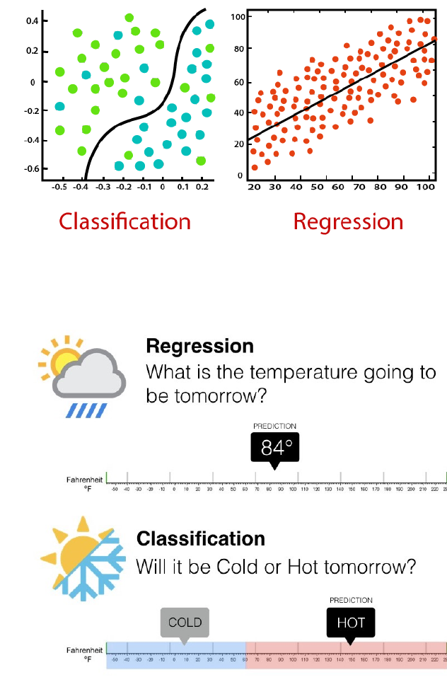

*Figure 3. The decision boundary of classification, the trend line of regression, and the two problems in weather forecasting*

Of the two graphs at the top, the left one (Classification) separates the points of two classes with a curved boundary, and the right one (Regression) approximates the trend of the points with a straight line. The weather example below shows that the same forecast becomes a different task depending on the question. "What is the temperature going to be tomorrow?" is a regression problem answered with a continuous value such as 84°F, and "Will it be Cold or Hot tomorrow?" is a classification problem that chooses between COLD and HOT.

> **Key Point:** A single object detection model solves a classification problem and a regression problem at the same time. Therefore the loss function of a detection model contains both the error of the class prediction and the error of the box-coordinate prediction (Section 3.5). The general concept of a loss function was covered in Lecture 1.

### 1.3 Bounding-Box Representation and IoU

A **bounding box** is a rectangle that encloses an object, with sides parallel to the horizontal and vertical axes of the image. The image coordinate system usually places the origin at the top-left corner, with $x$ increasing to the right and $y$ increasing downward. There are two main formats for representing a box.

| Format | Four values | Meaning |
|:-----|:-----|:-----|
| Corner format | $(x_1, y_1, x_2, y_2)$ | Coordinates of the top-left and bottom-right corners |
| Center format | $(x, y, w, h)$ | Coordinates of the box center, and the width and height |

*Table 2. The two coordinate formats for a bounding box*

The two formats are converted into each other by the following equations.

```math
x = \frac{x_1 + x_2}{2}, \quad y = \frac{y_1 + y_2}{2}, \quad w = x_2 - x_1, \quad h = y_2 - y_1
```

For example, reading the cat box `[10, 50, 100, 200]` of Section 1.2 in corner format gives a width of $100 - 10 = 90$, a height of $200 - 50 = 150$, and a center of $(55, 125)$, so in center format it is $(55, 125, 90, 150)$. Early detection research often used the corner format, and recent models often use the center format. The same four numbers describe completely different boxes in different formats, so before using a dataset or a library one must check which format it uses and whether the coordinates are normalized to the range 0-1 by dividing by the image size.

How well a predicted box overlaps the ground-truth box is measured by **IoU (Intersection over Union)**.

> **Definition:** **IoU** is the area of the intersection of two boxes divided by the area of their union. $\text{IoU}(A, B) = \dfrac{\text{area}(A \cap B)}{\text{area}(A \cup B)}$, which takes values from 0 to 1. It is 0 when the two boxes do not overlap and 1 when they coincide exactly.

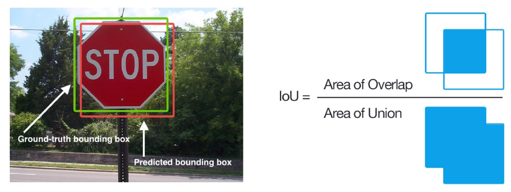

*Figure 4. A ground-truth box, a predicted box, and the definition of IoU*

In the photo on the left, the green box is the **ground-truth bounding box** marked by a person, and the red box is the model's **predicted bounding box**. In the equation on the right, the numerator is the part where the two boxes overlap (Area of Overlap), and the denominator is the whole region covered by the two boxes together (Area of Union).

The IoU of two corner-format boxes $A = (10, 10, 110, 110)$ (ground truth) and $B = (30, 20, 130, 120)$ (prediction) is computed step by step as follows.

1. The top-left corner of the intersection takes the larger of the two boxes' top-left coordinates: $(\max(10, 30), \max(10, 20)) = (30, 20)$.
2. The bottom-right corner of the intersection takes the smaller of the two boxes' bottom-right coordinates: $(\min(110, 130), \min(110, 120)) = (110, 110)$.
3. The intersection area is $(110 - 30) \times (110 - 20) = 80 \times 90 = 7200$. If the boxes do not overlap and a difference becomes negative, the area is set to 0.
4. Each box has area $100 \times 100 = 10000$, so the union area is $10000 + 10000 - 7200 = 12800$. The intersection is subtracted once because adding the two areas counts the overlapping part twice.
5. $\text{IoU} = 7200 / 12800 = 0.5625$.

IoU is used at several stages of object detection. YOLO defines the confidence of a predicted box with IoU (Section 3.4), NMS finds duplicate boxes with IoU (Section 3.7), and evaluation uses IoU to decide whether a prediction is correct (Section 4.1).

### 1.4 The Development of Object Detection and Its Two Families

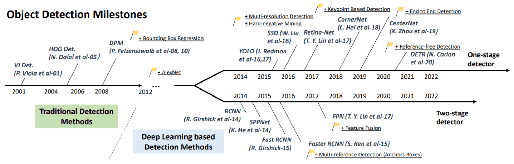

*Figure 5. Major object detection models and techniques from 2001 to 2022*

The timeline above divides the history of object detection into two periods [4]. **Traditional detection methods** before 2012 used hand-designed features. Representative examples are the face detector of Viola and Jones (VJ Det., 2001), the HOG detector of Dalal and Triggs (2005), and the DPM of Felzenszwalb et al. (2008, 2010); bounding-box regression was introduced with DPM. After AlexNet demonstrated the power of CNNs in 2012, **deep-learning-based detection methods** became mainstream, and they split into two branches.

- **Two-stage detectors:** RCNN (2014), SPPNet (2014), Fast RCNN (2015), Faster RCNN (2015), and FPN (2017). Faster RCNN introduced multi-reference detection with anchor boxes, and FPN introduced feature fusion.
- **One-stage detectors:** YOLO (2016), SSD (2016), RetinaNet (2017), CornerNet (2018), CenterNet (2019), and DETR (2020). Techniques such as multi-resolution detection, hard-negative mining (training intensively on background examples that are hard to distinguish), keypoint-based detection, reference-free detection, and end-to-end detection trained as a single model appeared along this line.

The difference between the two families is **how many stages the detection is performed in**.

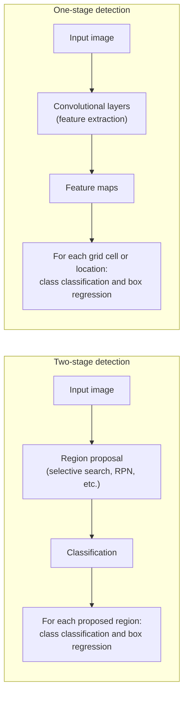

*Figure 6. Processing flows of two-stage and one-stage detection*

| Item | Two-stage detection | One-stage detection |
|:-----|:-----|:-----|
| Stage 1 | First proposes candidate regions likely to contain objects | Extracts feature maps from the whole image at once |
| Stage 2 | Performs classification and box regression for each candidate region | (None) Performs classification and box regression simultaneously at each location of the feature map |
| Representative models | R-CNN, Fast R-CNN, Faster R-CNN | YOLO, SSD, RetinaNet |
| Early characteristics | High accuracy but slow | Fast but less accurate |

*Table 3. Comparison of two-stage and one-stage detection*

When the two families first appeared, one-stage detectors with fewer stages were fast but less accurate, and two-stage detectors were the opposite. Later the accuracy of one-stage detectors improved greatly, and the one-stage family is now widely used in applications that require real-time processing.

---

<br>

## 2. Two-Stage Detection: The R-CNN Family

### 2.1 The Four Steps of R-CNN

**R-CNN (Regions with CNN features)** is a two-stage detector published by Girshick et al. in 2014, and it is the first model to apply features learned by a CNN to object detection in earnest [5].

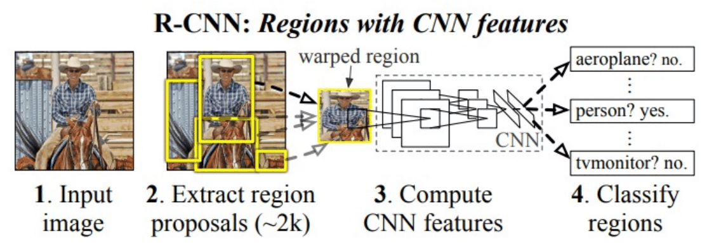

*Figure 7. The R-CNN pipeline: input image, region proposals, CNN feature computation, and region classification*

R-CNN operates in the following four steps.

1. Extract about 2,000 **RoIs (Regions of Interest)** with **selective search**.
2. Feed each RoI, resized to the same size, into a CNN and extract a 4,096-dimensional feature.
3. Feed the feature from the CNN into pre-trained SVMs to classify it.
4. Predict the bounding box by regression on the feature from the CNN.

> **Definition:** A **region of interest (RoI)** is a candidate region that may contain an object and is therefore examined closely. In R-CNN, each candidate box produced by the region proposal algorithm is an RoI.

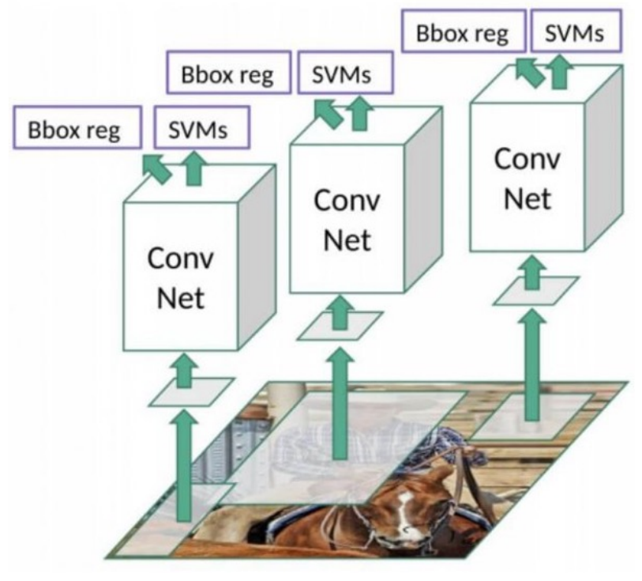

*Figure 8. The structure of R-CNN, which applies a CNN, SVMs, and box regression separately to each proposed region*

The figure above shows the key characteristic of R-CNN. Each region cut from the image (the small squares on the photo at the bottom) passes through its own ConvNet, and the output goes into its own SVMs and Bbox reg. If there are 2,000 regions, the CNN forward pass is also performed 2,000 times.

### 2.2 Region Proposal: Sliding Window and Selective Search

**Region proposal** is the step of finding candidate regions likely to contain objects. The simplest method is the **sliding window**. A window of fixed size is moved at regular intervals from the top left to the bottom right of the image, and every position is examined.

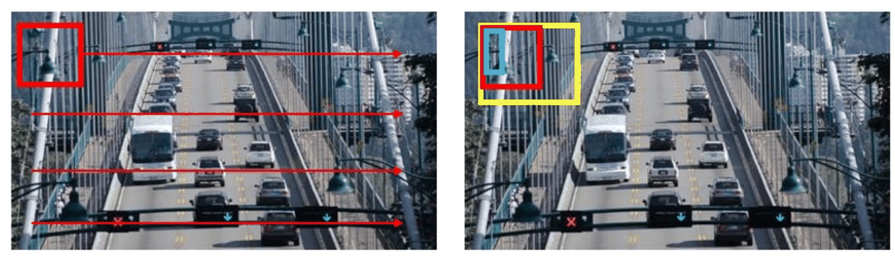

*Figure 9. A sliding window examining the image by moving a window across it*

A sliding window searches every region with arbitrary windows, so it is inefficient. For example, moving a 64×64 window over a 640×480 image with a stride of 8 pixels gives $(640 - 64)/8 + 1 = 73$ horizontal positions and $(480 - 64)/8 + 1 = 53$ vertical positions, so $73 \times 53 = 3869$ regions must be examined for a single window size alone. Objects vary in size and aspect ratio, so this number is multiplied again for every window size and ratio. As on the right of the figure, the same process must be repeated with a different window size (yellow).

**Selective search** is a technique whose goal is to find possible candidate regions for object recognition or detection efficiently [6]. It identifies differences in color, texture, and so on between objects and their surroundings, and groups together parts with the same tendency.

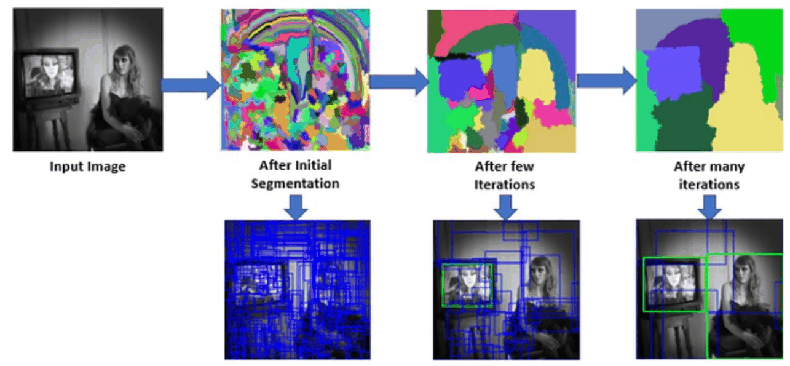

*Figure 10. The iterative merging of selective search and the candidate boxes at each stage*

1. **Initial segmentation (After Initial Segmentation):** The image is divided finely into hundreds of small regions of similar color (the second picture in the top row).
2. **Iterative merging (After few iterations, After many iterations):** Among adjacent region pairs, the pair with the highest similarity, which combines color, texture, size, and how well the regions fit together without gaps (fill), is merged into one, and this is repeated. As the iterations proceed, the number of regions decreases and their size increases.
3. **Candidate box generation:** At every stage of the merging, the box enclosing each region is output as a candidate (bottom row). At first there are very many small boxes (blue), and as merging proceeds, object-level boxes such as the television and the person (green) appear.

Because regions from all stages are used as candidates, candidates of many sizes from small to large objects are obtained, and most objects can be covered with far fewer regions than with a sliding window (about 2,000 in R-CNN).

### 2.3 Feature Extraction, SVM Classification, and Bounding-Box Regression

**Feature extraction.** The proposed regions have various sizes and ratios, but a CNN with fully connected layers accepts only inputs of a fixed size. R-CNN therefore stretches or shrinks each region to 227×227 (warped region) before feeding it into the CNN, and uses the 4,096-dimensional vector output by a fully connected layer as the feature of that region [5]. The CNN is pre-trained on ImageNet classification and then fine-tuned on detection data. Transfer learning, which adapts a pre-trained model to another task in this way, was covered in Lecture 3.

**SVM classification.** The extracted feature goes into binary linear SVMs, one trained per class, which decide whether the region belongs to that class or not. The last step of Figure 7, where aeroplane is judged no, person yes, and tvmonitor no, is this process.

> **[Machine Learning]** An **SVM (Support Vector Machine)** is a classical classification model that finds, among the hyperplanes separating two classes, the one with the maximum distance (margin) to the nearest data points on either side. With several classes, the one-vs-rest scheme, which trains one binary SVM per class to decide whether a sample belongs to that class or not, is often used.

**Bounding-box regression.** The boxes produced by selective search enclose objects only roughly, so the same feature is used to predict by regression how far to move and stretch the box. With the proposal box in center format $P = (P_x, P_y, P_w, P_h)$ and the ground-truth box $G = (G_x, G_y, G_w, G_h)$, the targets the model learns are as follows [5].

```math
t_x = \frac{G_x - P_x}{P_w}, \quad t_y = \frac{G_y - P_y}{P_h}, \quad t_w = \log\frac{G_w}{P_w}, \quad t_h = \log\frac{G_h}{P_h}
```

Dividing the center shift by the width and height of the proposal box makes it a relative shift independent of the box size, and taking the logarithm of the size change turns a scale factor, which is always positive, into an unconstrained real number. For example, if $P = (100, 100, 50, 80)$ and $G = (110, 96, 60, 80)$, then $t_x = 10/50 = 0.2$, $t_y = -4/80 = -0.05$, $t_w = \ln(60/50) = \ln 1.2 \approx 0.182$, and $t_h = \ln(80/80) = 0$. That is, the center should move right by 20% of the width and up by 5% of the height, and the width should be stretched by a factor of 1.2.

### 2.4 Fast R-CNN and Faster R-CNN

After R-CNN, improved models such as Fast R-CNN [7] and Faster R-CNN [1] were developed. The structures of the three models compare as follows.

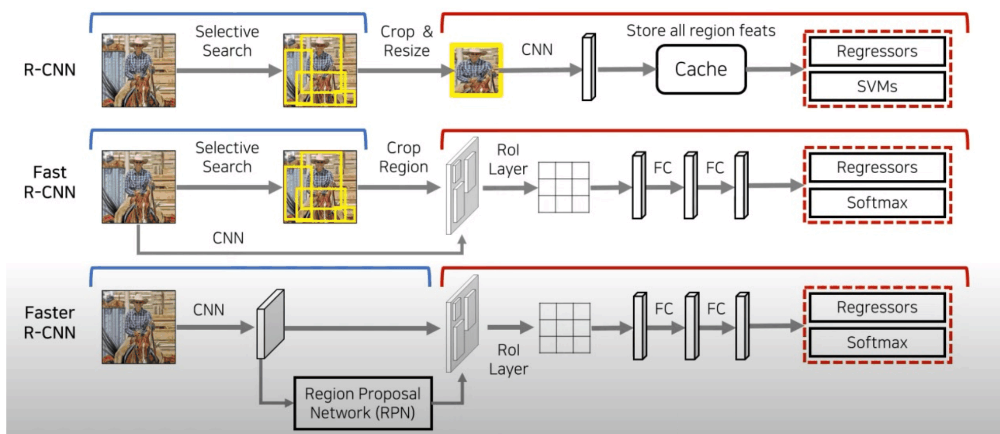

*Figure 11. Comparison of the structures of R-CNN, Fast R-CNN, and Faster R-CNN*

- **R-CNN (top):** Each region obtained by selective search is cut out, resized (Crop & Resize), and fed into the CNN. The features of all regions are stored on disk (Cache), and the regressors and SVMs are trained separately. Extracting 2,000 regions with selective search means running the CNN 2,000 times, which is very inefficient.
- **Fast R-CNN (middle):** The whole image passes through the CNN **only once** to obtain a feature map. The regions from selective search are projected to the corresponding locations on the feature map, and an **RoI pooling layer (RoI Layer)** extracts a fixed-size feature for each region, which is fed into fully connected layers (FC). At the end, softmax classification and box regression are trained together with a single loss function. With VGG16, it trains 9 times and runs inference 213 times faster than R-CNN [7].
- **Faster R-CNN (bottom):** The selective search that remained in Fast R-CNN is replaced with a **Region Proposal Network (RPN)**. The RPN shares the CNN feature map used for detection, so the candidate regions are also extracted by the CNN. At each location of the feature map it places nine **anchor boxes** combining three sizes and three aspect ratios, and for each anchor it predicts whether an object is present and how to correct the box. With VGG-16, the whole process including region proposal runs at about 5 frames per second on a GPU [1].

> **Definition:** **RoI pooling** is an operation that divides an RoI of arbitrary size on the feature map into a fixed $H \times W$ grid and takes the maximum in each cell, producing a feature of the same size regardless of the RoI size. For example, dividing an RoI of size 14×21 on the feature map into a 7×7 grid makes each cell a 2×3 region, and the 49 cell maxima form the output.

| Model | Region proposal | CNN runs | Classification and box regression |
|:-----|:-----|:-----|:-----|
| R-CNN | Selective search (about 2,000) | Once per region (about 2,000 times) | SVMs and regressors trained separately |
| Fast R-CNN | Selective search | Once per image + RoI pooling | Softmax and regressors trained together |
| Faster R-CNN | RPN (shares CNN features) | Once per image + RoI pooling | Softmax and regressors trained together |

*Table 4. Comparison of the three models of the R-CNN family*

### 2.5 The Speed Problem of Two-Stage Detection

The R-CNN family became steadily faster, but two-stage models perform region proposal and per-region classification one after the other, so detecting objects takes a long time. This makes them hard to use in practice for tasks that must produce results in real time, such as autonomous vehicles.

Real-time performance is measured in **FPS (Frames Per Second)**. If a camera sends video at 60 FPS, processing must finish before the next frame arrives, so one image must be processed within $1/60 \approx 0.0167$ seconds, that is, about 16.7 ms. Even at 24 FPS, the film standard, one image gets about 41.7 ms. R-CNN, in contrast, took about 13 seconds per image on a GPU for region proposal and feature computation alone [5]. This is about 0.08 FPS, far from real time. The attempt to process region proposal and classification at once with a single neural network is the one-stage detector of Section 3.

---

<br>

## 3. One-Stage Detection: YOLO

### 3.1 The Idea of YOLO

**YOLO (You Only Look Once)** is a representative one-stage detection model published by Redmon et al. in 2016 [2]. As the name says, it looks at the image only once and finds all objects.

- The largest contribution of YOLO is that it performs object detection in an **end-to-end manner, processing everything from input to output at once with a single neural network**.
- Earlier detection models handled finding regions likely to contain objects and classifying classes separately, so they were slow and required complex computation.
- YOLO divides the image into grid cells and, in each cell, simultaneously predicts whether an object is present and which class it belongs to, making it far faster than earlier detectors while reaching the highest accuracy among real-time detectors (Section 3.8). The paper defines detection as a single regression problem from image pixels to box coordinates and class probabilities [2].

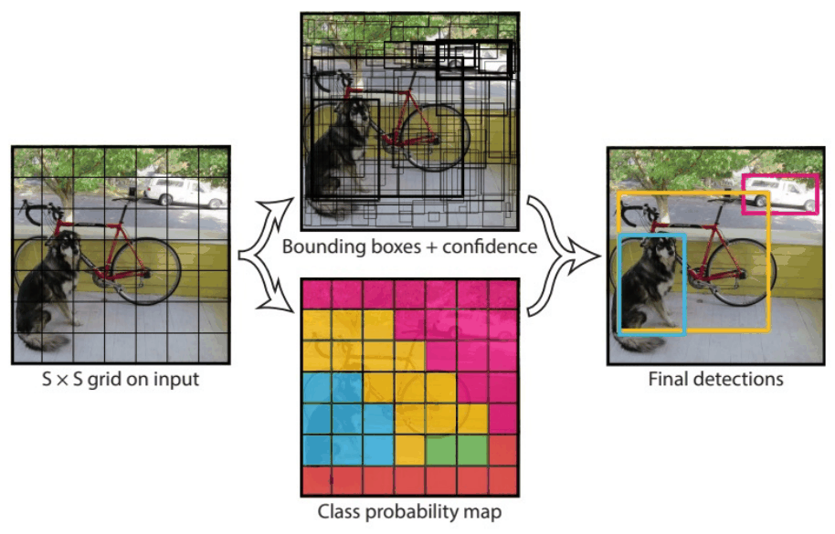

*Figure 12. The detection process of YOLO: S×S grid, box and confidence prediction, class probability map, and final detections*

When the input image is divided into an $S \times S$ grid as on the left, the network outputs two things at the same time. The upper branch is several bounding boxes per cell with the confidence of each box (a thicker line means higher confidence), and the lower branch is the **class probability map**, which colors each cell by the class with the highest probability. Combining the two results gives the final detections on the right (a dog, a bicycle, and a car).

### 3.2 Network Architecture

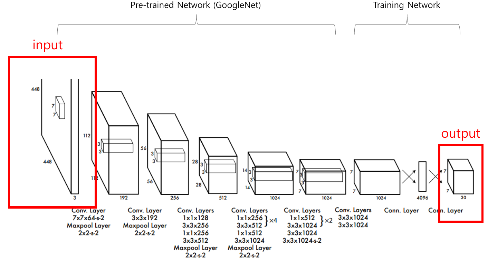

*Figure 13. The network architecture of YOLO v1: from a 448×448×3 input to a 7×7×30 output*

YOLO v1 consists of 24 convolutional layers and 2 fully connected layers [2]. It takes a 448×448 color image (input) and finally produces a tensor of size 7×7×30 (output). The architecture is inspired by GoogLeNet, but instead of inception modules it repeats layers that reduce the number of channels with a 1×1 convolution and then apply a 3×3 convolution. As marked at the top of the figure, the first 20 convolutional layers are the part pre-trained on ImageNet classification (Pre-trained Network), and the 4 convolutional layers and 2 fully connected layers added after them are the part newly trained for detection (Training Network). Pre-training is done at 224×224 resolution, and detection training is done at 448×448 for finer information.

| Stage | Layers | Output size |
|:-----|:-----|:-----|
| 1 | Conv 7×7, 64 channels, stride 2 → Maxpool 2×2, stride 2 | 112×112×64 |
| 2 | Conv 3×3, 192 channels → Maxpool 2×2, stride 2 | 56×56×192 |
| 3 | Conv 1×1 128, 3×3 256, 1×1 256, 3×3 512 → Maxpool | 28×28×512 |
| 4 | (Conv 1×1 256, 3×3 512)×4, 1×1 512, 3×3 1024 → Maxpool | 14×14×1024 |
| 5 | (Conv 1×1 512, 3×3 1024)×2, 3×3 1024, 3×3 1024 stride 2 | 7×7×1024 |
| 6 | Conv 3×3 1024, 3×3 1024 | 7×7×1024 |
| 7 | Fully connected 4096 | 4096 |
| 8 | Fully connected 1470 → reshaped to 7×7×30 | 7×7×30 |

*Table 5. Layers of YOLO v1 and the output size of each stage*

The number of convolutional layers is $1 + 1 + 4 + 10 + 6 + 2 = 24$. All layers except the last use Leaky ReLU as the activation function. The computation of convolution and pooling was covered in Lecture 2.

### 3.3 Grid Cells and the Output Tensor

YOLO v1 divides the input image into $S \times S = 7 \times 7$ grid cells. **If the center of an object falls inside a cell, that cell is responsible for detecting that object** [2].

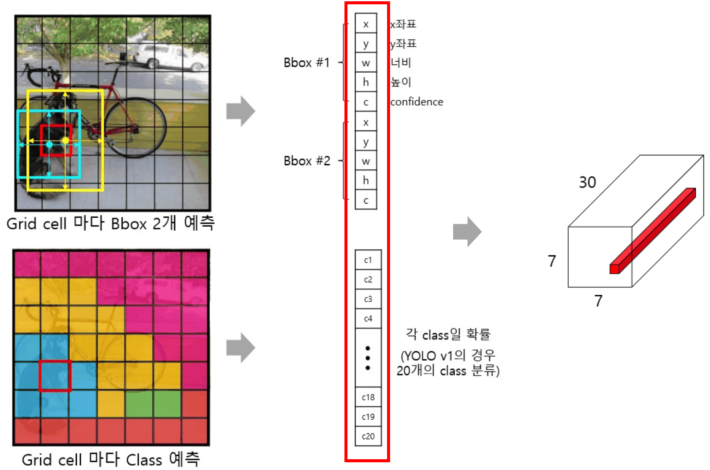

*Figure 14. The two bounding boxes and the class probabilities predicted by one grid cell, and the 7×7×30 output tensor*

Each grid cell predicts the following.

- **$B = 2$ bounding boxes:** Each box gives five values $x$, $y$, $w$, $h$, $c$. As in the upper part of the figure, the red cell predicts two boxes (sky blue and yellow) whose center points lie inside that cell.
  - $x$, $y$: the coordinates of the box center measured from the top-left corner of the cell and divided by the cell size (0-1).
  - $w$, $h$: the width and height of the box divided by the width and height of the whole image (0-1).
  - $c$: the confidence of the box (Section 3.4).
- **$C = 20$ class probabilities:** the conditional probabilities $`\Pr(\text{Class}_i \mid \text{Object})`$ that the object belongs to each class, given that the cell contains an object. There are 20 because the PASCAL VOC dataset on which YOLO v1 was trained has 20 classes. Only one set is predicted per cell regardless of the number of boxes (the lower part of the figure, one color per cell).

Therefore the output of one cell is $B \times 5 + C = 2 \times 5 + 20 = 30$ values, and the whole output is a $7 \times 7 \times 30$ tensor, that is, 1,470 numbers. The output vector of one cell is laid out as follows.

```text
index  : 0   1   2   3   4  |  5   6   7   8   9  |  10   11  ...  29
value  : x   y   w   h   c  |  x   y   w   h   c  |  P1   P2  ...  P20
         bounding box #1       bounding box #2       class conditional probabilities
```

*Figure 15. Layout of the 30-dimensional output vector of one grid cell*

**Coordinate encoding example.** With a 448×448 input, one cell is $448 / 7 = 64$ pixels wide. Suppose an object has its center at $(200, 300)$ and a size of 120×90 pixels.

1. The cell containing the center is column $\lfloor 200 / 64 \rfloor = 3$ and row $\lfloor 300 / 64 \rfloor = 4$ (counting from 0). This cell is responsible for the object.
2. $x = (200 - 3 \times 64) / 64 = 8 / 64 = 0.125$ and $y = (300 - 4 \times 64) / 64 = 44 / 64 = 0.6875$.
3. $w = 120 / 448 \approx 0.268$ and $h = 90 / 448 \approx 0.201$.

Because the center coordinates are normalized by the cell and the size by the image, all four values fall in the range 0-1, which stabilizes training.

### 3.4 Confidence

In YOLO v1, the **confidence** of a box is defined as follows [2].

```math
\text{confidence} = \Pr(\text{Object}) \times \text{IoU}_{\text{pred}}^{\text{truth}}
```

- $\Pr(\text{Object})$ is the probability that the box contains an object.
- $`\text{IoU}_{\text{pred}}^{\text{truth}}`$ is the IoU between the predicted box and the ground-truth box (Section 1.3).

The confidence combines whether there is an object and, if so, how accurate the box is into a single number. If the cell contains no object, the confidence should be 0; if it contains an object, the confidence should equal the IoU between the predicted box and the ground-truth box. The confidence target used during training also follows this definition.

> **Note:** **Ground truth and label.** The ground truth is the object actually present in the image, for example the fact "cat" itself, and the label is the value obtained by encoding that ground truth, for example as a number, for use in training, such as class number 1. The two words refer to the same answer and are often used interchangeably, but strictly they are distinguished in this way.

### 3.5 Loss Function

YOLO v1 computes the error of every output value as a sum of squared errors, and the loss function consists of three parts: the error of box locations, the error of confidences, and the error of class probabilities [2].

```math
\begin{aligned}
\mathcal{L} = {} & \lambda_{\text{coord}} \sum_{i=0}^{S^2} \sum_{j=0}^{B} \mathbf{1}_{ij}^{\text{obj}} \left[ (x_i - \hat{x}_i)^2 + (y_i - \hat{y}_i)^2 \right] \\
& + \lambda_{\text{coord}} \sum_{i=0}^{S^2} \sum_{j=0}^{B} \mathbf{1}_{ij}^{\text{obj}} \left[ \left( \sqrt{w_i} - \sqrt{\hat{w}_i} \right)^2 + \left( \sqrt{h_i} - \sqrt{\hat{h}_i} \right)^2 \right] \\
& + \sum_{i=0}^{S^2} \sum_{j=0}^{B} \mathbf{1}_{ij}^{\text{obj}} \left( C_i - \hat{C}_i \right)^2 + \lambda_{\text{noobj}} \sum_{i=0}^{S^2} \sum_{j=0}^{B} \mathbf{1}_{ij}^{\text{noobj}} \left( C_i - \hat{C}_i \right)^2 \\
& + \sum_{i=0}^{S^2} \mathbf{1}_{i}^{\text{obj}} \sum_{c \in \text{classes}} \left( p_i(c) - \hat{p}_i(c) \right)^2
\end{aligned}
```

The symbols mean the following.

- $i$ is the index of a grid cell and $j$ is the index of a box in the cell. Of the hatted (^) and unhatted values, one is the prediction and the other is the ground truth. Because the error is squared, the value is the same whichever one is taken as the prediction.
- $`\mathbf{1}_{ij}^{\text{obj}}`$ is 1 when the $i$-th cell contains an object and the $j$-th box of that cell is the box **responsible** for that object, and 0 otherwise. Of the two boxes of the cell, the one with the larger IoU with the ground-truth box is responsible.
- $`\mathbf{1}_{ij}^{\text{noobj}}`$ is 1 for a box that is not responsible for any object.
- $`\mathbf{1}_{i}^{\text{obj}}`$ is 1 when (the center of) an object lies in the $i$-th cell.

> **Note:** The paper writes the ranges of the sums as $i = 0$ to $S^2$ and $j = 0$ to $B$, but they actually mean the sum over all $S^2$ cells and over all $B$ boxes in each cell. Counting from 0, the last indices are $S^2 - 1$ and $B - 1$.

The roles of the three parts are as follows.

1. **Localization loss:** The errors of the center coordinates and the size are computed only for responsible boxes. Coordinate errors are very important, so they are amplified by the weight $\lambda_{\text{coord}} = 5$.
2. **Confidence loss:** A box responsible for an object is trained so that its confidence approaches the IoU, and other boxes so that their confidence approaches 0. Most cells contain no object, so the errors of object-free boxes are reduced by the weight $\lambda_{\text{noobj}} = 0.5$ so that they do not dominate training.
3. **Classification loss:** The errors of the 20 class probabilities are computed only for cells that contain an object.

Only the boxes that survive in the loss function, that is, the boxes corresponding to terms whose indicator function is 1, take part in learning each error. The goal of training is to minimize this loss toward 0 by gradient descent (Lecture 1).

**Why the width and height are square-rooted.** An error of the same size is far more serious for a small box than for a large one. Even with the same pixel difference, two small boxes that are misaligned are less alike than two large boxes that are misaligned. Suppose a large box of width 300 is predicted as 310 and a small box of width 30 is predicted as 40.

- Without square roots, both errors are equal: $(310 - 300)^2 = (40 - 30)^2 = 100$.
- With square roots, the large box gives $(\sqrt{310} - \sqrt{300})^2 \approx (17.607 - 17.321)^2 \approx 0.082$ and the small box gives $(\sqrt{40} - \sqrt{30})^2 \approx (6.325 - 5.477)^2 \approx 0.718$.

With square roots, the same error in the small box is weighted about 8.8 times more, which has the effect of lowering the sensitivity to errors in large boxes.

### 3.6 Inference: Class-Specific Confidence Scores

At inference time YOLO v1 predicts two boxes per cell whether or not there is an object, so one image always yields $7 \times 7 \times 2 = 98$ boxes.

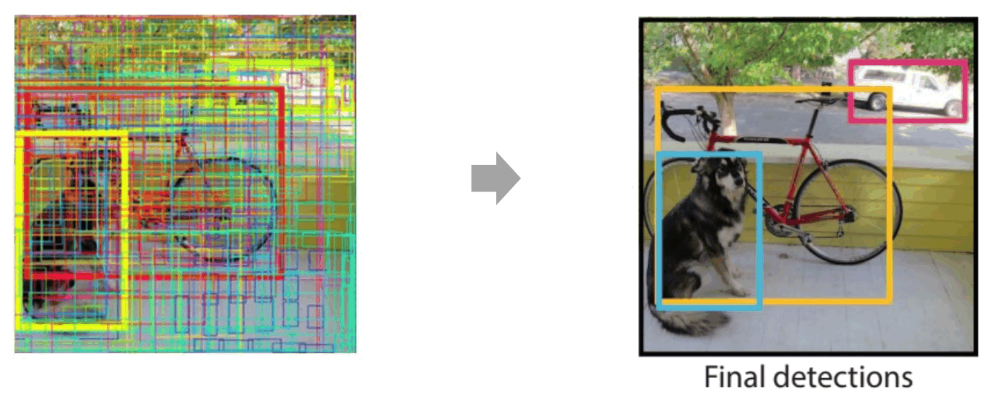

*Figure 16. The 98 predicted boxes and the final detections after post-processing*

Drawing all 98 boxes as on the left covers the image with boxes. To keep only the boxes that should actually be detected, the confidence of each box is multiplied by the class probabilities of its cell to form **class-specific confidence scores** [2].

```math
\Pr(\text{Class}_i \mid \text{Object}) \times \Pr(\text{Object}) \times \text{IoU}_{\text{pred}}^{\text{truth}} = \Pr(\text{Class}_i) \times \text{IoU}_{\text{pred}}^{\text{truth}}
```

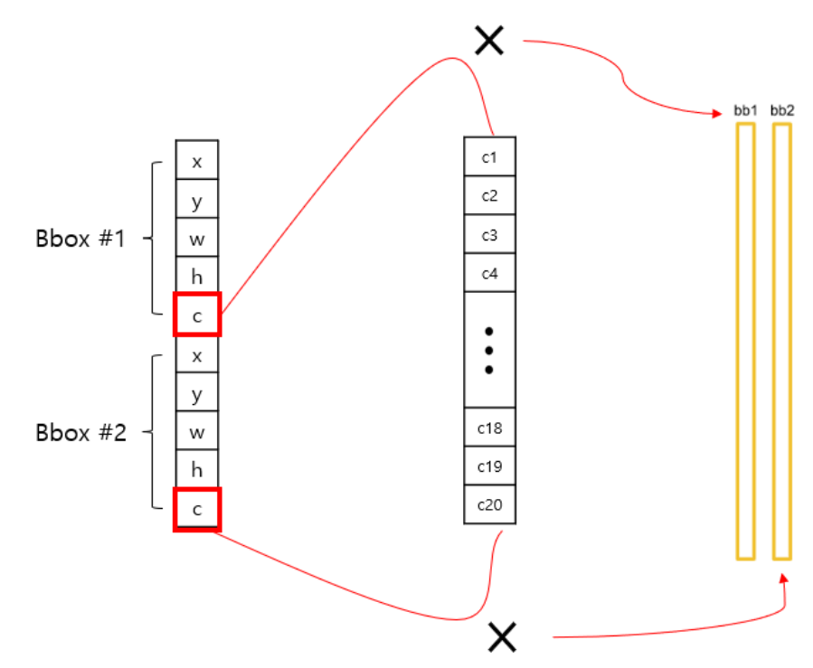

*Figure 17. Multiplying the confidence of a box by the 20 class probabilities of its cell to form a 20-dimensional score vector per box*

The output vector is split into Bbox #1 and Bbox #2, and the confidence $c$ of each box (red cell) is multiplied by each of the 20 class probabilities of the cell (c1-c20). As a result, each box gets a 20-dimensional score vector (bb1, bb2). In this way, the information about the objects that should actually be detected and their class information are combined into one score. For example, if a box has confidence 0.8 and its cell has class probabilities 0.7 for dog and 0.2 for cat, the dog score of the box is $0.8 \times 0.7 = 0.56$ and the cat score is $0.8 \times 0.2 = 0.16$.

Applying this process to all 98 boxes, two for each of the 7×7 cells, gives the following 20×98 score matrix.

```text
             bb1      bb2      bb3     ...     bb97     bb98
class 1     s(1,1)   s(1,2)   s(1,3)   ...   s(1,97)  s(1,98)
class 2     s(2,1)   s(2,2)   s(2,3)   ...   s(2,97)  s(2,98)
  ...
class 20    s(20,1)  s(20,2)  s(20,3)  ...   s(20,97) s(20,98)

s(k,b) = (confidence of box b) × (probability of class k in the cell of box b)
```

*Figure 18. The score matrix of 20 classes for each of the 98 boxes*

Afterwards, entries whose score is below a threshold are set to 0, and NMS from Section 3.7 is applied per class to remove duplicate boxes, leaving the final detections.

### 3.7 NMS

**NMS (Non-Maximum Suppression)** is the technique of removing duplicate predicted boxes in object detection. Among several boxes pointing to the same object, only the box with the highest score is kept and the rest are removed.

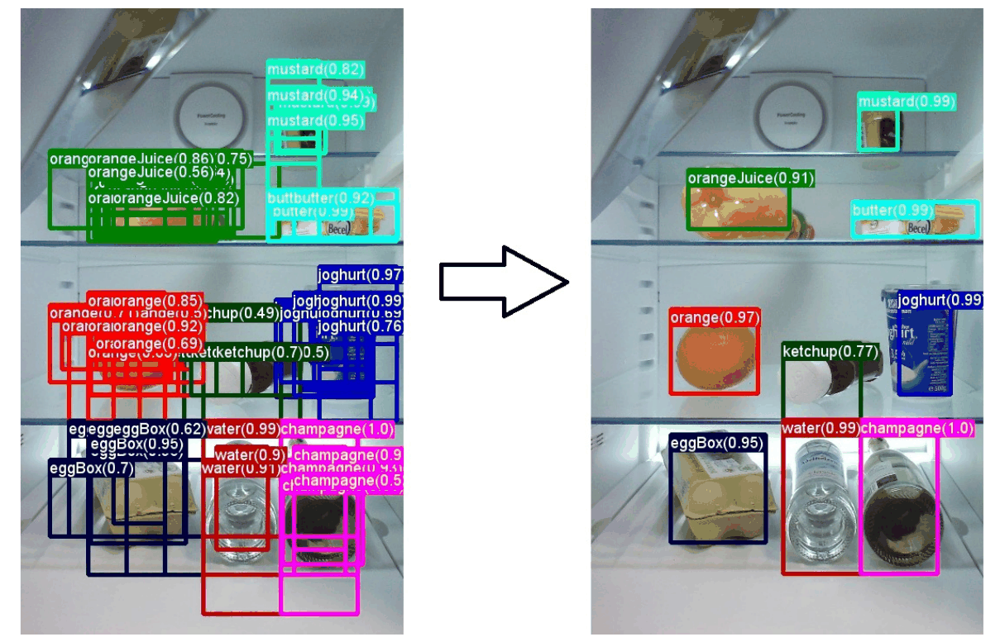

*Figure 19. Detection results before and after NMS*

The left is the detection result for items in a refrigerator, where several boxes overlap on each item such as orange juice, mustard, yogurt, an egg box, and a water bottle. On the right, after NMS, only the box with the highest score remains for each item (for example `orange(0.97)` and `mustard(0.99)`).

The procedure of NMS is as follows.

1. Sort the boxes in descending order of confidence score.
2. Confirm the box with the highest score as a result, compute the IoU between this box and the remaining boxes, and remove the boxes whose IoU is at or above a threshold.
3. Repeat this process for the remaining boxes.
4. In the end, only predicted boxes that do not overlap much with each other remain.

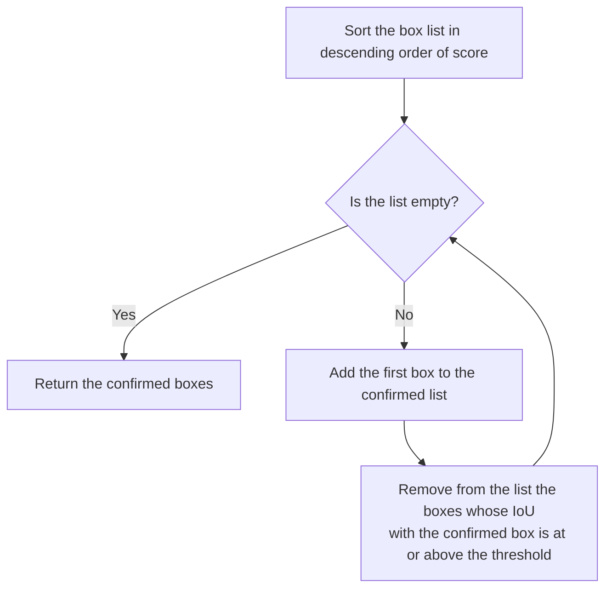

*Figure 20. Flow of the NMS algorithm*

The following is an implementation of NMS in Python. Boxes are in corner format.

```python
def iou(a, b):
    ix1, iy1 = max(a[0], b[0]), max(a[1], b[1])
    ix2, iy2 = min(a[2], b[2]), min(a[3], b[3])
    inter = max(0, ix2 - ix1) * max(0, iy2 - iy1)
    area_a = (a[2] - a[0]) * (a[3] - a[1])
    area_b = (b[2] - b[0]) * (b[3] - b[1])
    return inter / (area_a + area_b - inter)

def nms(boxes, scores, iou_threshold=0.5):
    order = sorted(range(len(boxes)), key=lambda i: scores[i], reverse=True)
    keep = []
    while order:
        best = order.pop(0)
        keep.append(best)
        order = [i for i in order if iou(boxes[best], boxes[i]) < iou_threshold]
    return keep

boxes = [(10, 10, 110, 110), (20, 15, 120, 115), (200, 50, 300, 150), (210, 60, 310, 160)]
scores = [0.9, 0.75, 0.8, 0.6]
print(nms(boxes, scores))
```

```text
[0, 2]
```

- The `iou` function transcribes the five steps of Section 1.3 directly. The first two lines find the two corners of the intersection, and `max(0, ...)` keeps the area from becoming negative when the boxes do not overlap. The last line divides the intersection by the union.
- The first line of `nms` sorts the box indices in descending order of score. In the example this gives `[0, 2, 1, 3]`, in the order of scores 0.9, 0.8, 0.75, 0.6.
- The `while` loop repeats until the list is empty. `order.pop(0)` takes out the remaining box with the highest score and puts it into `keep`, and only the boxes whose IoU with that box is smaller than the threshold remain in the list.
- In the first iteration box 0 is confirmed. Its IoU with box 1 has intersection $90 \times 95 = 8550$ and union $20000 - 8550 = 11450$, about 0.747, which is at least 0.5, so box 1 is removed. Boxes 2 and 3 do not overlap box 0 (IoU 0), so they remain.
- In the second iteration box 2 is confirmed. Its IoU with box 3 is $8100 / 11900 \approx 0.681$, so box 3 is removed.
- The result `[0, 2]` means that one box remains for each of the two objects.

> **Caution:** NMS is usually applied separately for each class, because a dog box and a cat box that overlap heavily are different objects and must not be removed. In addition, if the IoU threshold is too low, it also removes the boxes of distinct objects that are actually close together, as in a crowded scene, and if it is too high, duplicate boxes of the same object remain. According to the YOLO paper, NMS raised mAP by 2-3 percentage points [2].

### 3.8 Performance and Limitations

| Group | Model | Training data | mAP | FPS |
|:-----|:-----|:-----|-----:|-----:|
| Real-time detectors | 100Hz DPM | 2007 | 16.0 | 100 |
| Real-time detectors | 30Hz DPM | 2007 | 26.1 | 30 |
| Real-time detectors | Fast YOLO | 2007+2012 | 52.7 | **155** |
| Real-time detectors | YOLO | 2007+2012 | **63.4** | 45 |
| Less than real-time | Fastest DPM | 2007 | 30.4 | 15 |
| Less than real-time | R-CNN Minus R | 2007 | 53.5 | 6 |
| Less than real-time | Fast R-CNN | 2007+2012 | 70.0 | 0.5 |
| Less than real-time | Faster R-CNN VGG-16 | 2007+2012 | 73.2 | 7 |
| Less than real-time | Faster R-CNN ZF | 2007+2012 | 62.1 | 18 |
| Less than real-time | YOLO VGG-16 | 2007+2012 | 66.4 | 21 |

*Table 6. Accuracy and speed of real-time detectors and other detectors on PASCAL VOC 2007*

The table above shows the results of the YOLO paper [2]. "2007+2012" in the training data means that the training data of PASCAL VOC 2007 and 2012 were combined, and mAP is the accuracy metric explained in Section 4. In accuracy alone, Faster R-CNN VGG-16 is the highest at 73.2, but its speed is only 7 FPS. YOLO achieved 63.4 mAP at 45 FPS, and the smaller Fast YOLO is the fastest at 155 FPS while being more than twice as accurate as the other real-time detectors. YOLO became very popular because it could secure speed and accuracy together.

YOLO v1 has the following problems.

- **Localization errors:** One grid cell predicts only two boxes and one class, so when one grid cell contains several objects it cannot distinguish them accurately. As a result, it may predict object locations inaccurately.
- **Weak detection of small objects:** Small objects occupy a small proportion of the image, so several of them often fall inside one grid cell together. When objects are very small, one cell may contain several objects, or a cell may not carry sufficiently detailed information, so the accuracy for small objects drops. Small objects in a group, such as a flock of birds, are a typical case.
- **Weak prediction of new bounding-box shapes:** The shape of bounding boxes is learned from data, so boxes with aspect ratios or configurations that were rare in the training data are not predicted accurately.

### 3.9 The Evolution and Applications of YOLO

After v1, YOLO has kept evolving as several research groups and companies carried on the name. The main versions since 2022 and their public repositories are as follows.

| Year | Model | Public repository |
|:-----|:-----|:-----|
| 2022 | YOLOv6 | https://github.com/meituan/YOLOv6 |
| 2022 | YOLOv7 | https://github.com/WongKinYiu/yolov7 |
| 2023 | YOLOv8 | https://github.com/ultralytics/ultralytics |
| 2024 | YOLOv9 | https://github.com/WongKinYiu/yolov9 |
| 2024 | YOLOv10 | https://github.com/THU-MIG/yolov10 |
| 2024 | YOLO11 (YOLOv11) | https://github.com/ultralytics/ultralytics |

*Table 7. Main YOLO versions since 2022 and their public repositories*

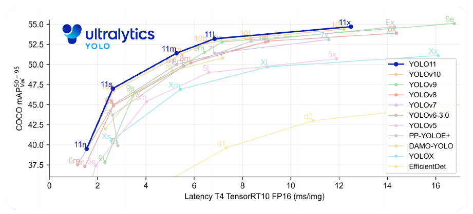

*Figure 21. COCO mAP versus inference latency for several YOLO versions*

The graph above is a comparison published by Ultralytics [8]. The horizontal axis is the time (ms) taken to process one image with TensorRT FP16 on an NVIDIA T4 GPU, and the vertical axis is the mAP on the COCO validation data (IoU 0.50-0.95, Section 4.5). The points on each curve are the models of the same version in different sizes (n, s, m, l, x), and the closer to the top left, the faster and more accurate. In this comparison, the YOLO11 curve shows the highest mAP at the same latency.

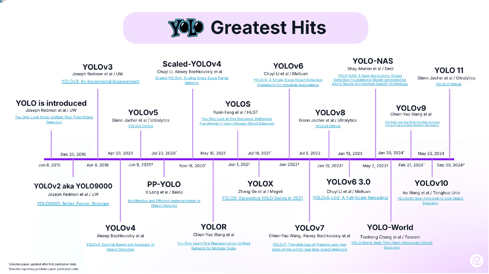

*Figure 22. Release timeline of YOLO-family models from 2015 to 2024*

The timeline marks, starting from YOLO (2015), YOLOv2 or YOLO9000 (2016), and YOLOv3 (2018) by Redmon et al., the YOLOv4 (2020) of Bochkovskiy et al., YOLOv5 (2020) of Ultralytics, PP-YOLO (2020) of Baidu, Scaled-YOLOv4 (2020), YOLOR (2021), YOLOS (2021), YOLOX (2021) of Megvii, YOLOv6 (2022) of Meituan, YOLOv7 (2022), YOLOv8 (2023), YOLOv6 3.0 (2023), YOLO-NAS (2023) of Deci, YOLO-World (2024) of Tencent, YOLOv9 (2024), YOLOv10 (2024) of Tsinghua University, and YOLO 11 (2024). It shows that not one research group but many groups have published their own improvements under the name YOLO.

A 2025 survey summarizes the key innovations from YOLOv1 to YOLOv13 and YOLOv26 as follows [9].

| Model (year) | Key architectural innovation and contribution | Tasks | Framework |
|:-----|:-----|:-----|:-----|
| YOLOv1 (2015) | First unified single-stage detector (one network predicts boxes and class probabilities together) | Object detection, classification | Darknet |
| YOLOv2 (2016) | Multi-scale training introduced; anchor-box dimension clustering for improved prior boxes (joint detection and classification of YOLO9000) | Object detection, classification | Darknet |
| YOLOv3 (2018) | Deeper Darknet-53 backbone with residual connections; SPP module and multi-scale feature fusion for small objects | Object detection, multi-scale detection | Darknet |
| YOLOv4 (2020) | Mish activation function adopted; CSPDarknet-53 backbone for enhanced feature reuse | Object detection, object tracking | Darknet |
| YOLOv5 (2020) | PyTorch implementation by Ultralytics; anchor-free detection head option; SiLU activation and PANet neck | Object detection, instance segmentation (limited) | PyTorch (Ultralytics) |
| YOLOv6 (2022) | EfficientRep backbone with embedded self-attention; anchor-free detection mode for efficiency | Object detection, instance segmentation | PyTorch |
| YOLOv7 (2022) | E-ELAN backbone with model re-parameterization; transformer-based modules for tasks such as tracking | Object detection, object tracking, instance segmentation | PyTorch |
| YOLOv8 (2023) | New C2f backbone and decoupled head; GAN-based data augmentation; fully anchor-free design | Object detection, instance segmentation, panoptic segmentation, keypoint estimation | PyTorch (Ultralytics) |
| YOLOv9 (2024) | PGI (Programmable Gradient Information) for selective learning; G-ELAN for improved feature extraction | Object detection, instance segmentation | PyTorch |
| YOLOv10 (2024) | NMS-free end-to-end detection via consistent dual-assignment training (post-processing removed) | Object detection | PyTorch |
| YOLO11 (2024) | C3k2 CSP bottleneck blocks throughout backbone and neck; SPPF retained; C2PSA module with spatial attention; extended to pose estimation and oriented detection | Object detection, instance segmentation, pose estimation, oriented detection | PyTorch (Ultralytics) |
| YOLOv12 (2025) | Attention-centric architecture: efficient area attention module and R-ELAN blocks for transformer-level accuracy at YOLO speed | Object detection | PyTorch |
| YOLOv13 (2025) | HyperACE module capturing high-order feature interactions; FullPAD feature flow; depthwise-separable convolutions to reduce complexity | Object detection | PyTorch |
| YOLOv26 (2025) | Edge-optimized: NMS-free end-to-end predictor, DFL removed, MuSGD optimizer, improved small-object accuracy and up to 43% faster CPU inference | Object detection, instance segmentation, pose estimation, oriented detection, classification | PyTorch (Ultralytics) |

*Table 8. Key innovations, tasks, and frameworks from YOLOv1 to YOLOv26*

Several trends can be read from the table. First, after the introduction of anchor boxes in YOLOv2, the design moved to anchor-free detection in YOLOv6 and YOLOv8. Second, YOLOv10 and YOLOv26 detect end to end with a single model without the NMS post-processing of Section 3.7. Third, YOLOv12 adopted the attention techniques covered in Lecture 8, and YOLOv13 adopted lightweight techniques such as the depthwise-separable convolution covered in Lecture 9. Fourth, the tasks widened from object detection to segmentation, pose estimation, and tracking.

> **Note:** Some entries of Table 8 differ from the original papers or official documentation of the models. The original YOLOv5 uses an anchor-based detection head; the anchor-free head was introduced later in YOLOv5u, which Ultralytics built by adopting the head of YOLOv8. The EfficientRep backbone of YOLOv6 consists of re-parameterizable convolution blocks (in the RepVGG style), not self-attention. The YOLOv7 paper contains no transformer-based modules, and the data augmentation of YOLOv8 (Mosaic, Mixup, and others) includes no GAN-based augmentation.

YOLO is also widely used in the field. One application is a system that detects a truck in CCTV footage (1920×1080, 6 frames per second). This system splits video reception, license-plate recognition, judging whether a person gets out of the vehicle, object tracking, and result visualization and server upload into separate threads that run concurrently, and it sends events, such as the device being powered on, to a server together with a timestamp. Another example is a system that detects pigs in a camera inside a pig barn and tracks them by assigning a number to each animal.

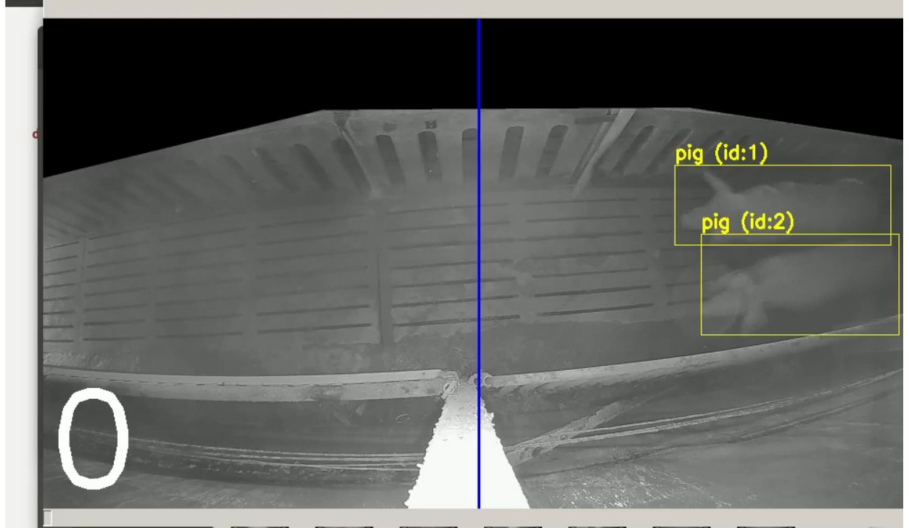

*Figure 23. Pigs detected in barn footage and tracked with individual ID numbers*

Two pigs are detected with yellow boxes, and each box carries a class name and an individual number such as `pig (id:1)` and `pig (id:2)`. Linking the boxes detected in each frame to the boxes of the previous frame keeps the same number on the same animal, which is called **object tracking**.

---

<br>

## 4. Evaluating Object Detection: mAP

### 4.1 Confusion Matrix and IoU Threshold

How is the performance of an object detection model evaluated quantitatively? The standard metric is **mAP (mean Average Precision)**.

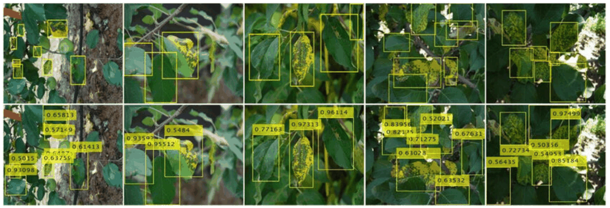

*Figure 24. Detection of leaf lesions and the confidence of each box*

The figure above is an example of detecting diseased parts of plant leaves, where the top row shows the detected boxes and the bottom row shows them together with the confidence of each box (0.65813, 0.97499, and so on). To express how good such a result is as a single number, one must first decide whether each box is correct or wrong. mAP is computed mainly with the **confusion matrix** and **IoU**.

| Prediction \ Ground truth | True | False |
|:-----|:-----|:-----|
| True | True Positive (TP) | False Positive (FP) |
| False | False Negative (FN) | True Negative (TN) |

*Table 9. Confusion matrix*

In object detection, each cell means the following.

- **TP:** A predicted box overlaps a ground-truth box of the same class sufficiently (IoU at or above the threshold).
- **FP:** A predicted box does not overlap any ground-truth box sufficiently, or it points again to a ground-truth box already matched by another prediction.
- **FN:** A ground-truth box that no predicted box matched.
- **TN:** The case of judging that there is no object where there is none, but the number of background regions cannot be counted, so it is not used in evaluating object detection.

**IoU threshold.** Whether a prediction is correct is decided by comparing its IoU with a threshold. With an IoU threshold of 0.5, the result is as follows.

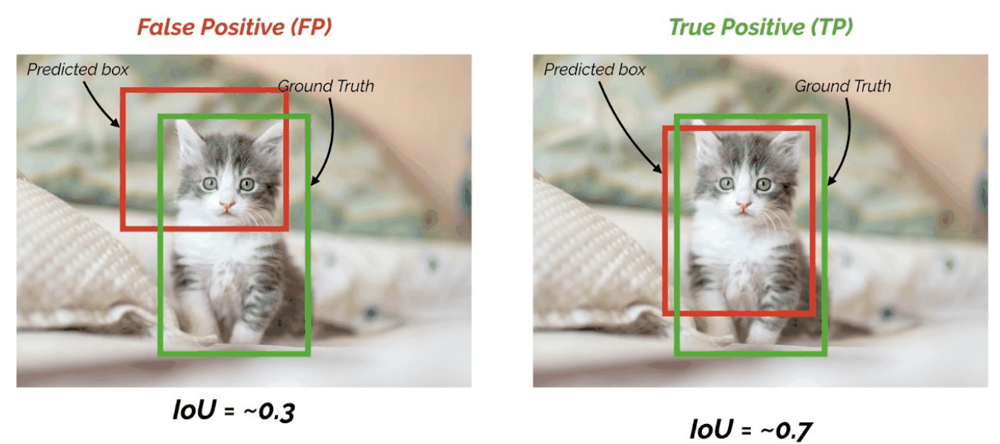

*Figure 25. At an IoU threshold of 0.5, a prediction with IoU about 0.3 is FP and one with IoU about 0.7 is TP*

The predicted box on the left (red) contains the cat, but its IoU with the ground-truth box (green) is about 0.3, which is less than 0.5, so it is FP. The predicted box on the right has an IoU of about 0.7, so it is TP.

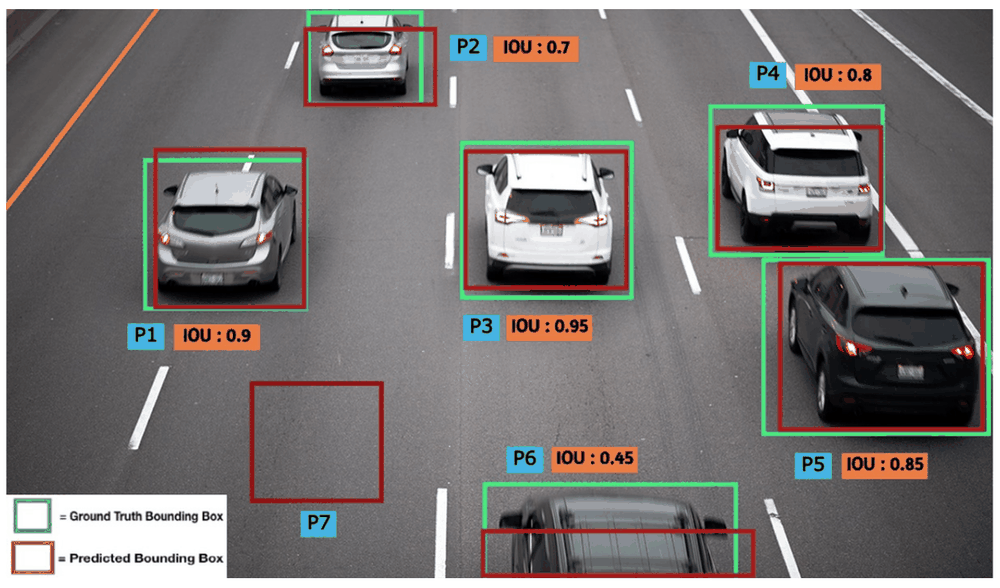

*Figure 26. IoU of the ground-truth boxes and the predicted boxes P1-P7 in highway footage*

The figure above has 6 ground-truth boxes (green) and 7 predicted boxes (red). Judging each prediction with an IoU threshold of 0.5 gives the following.

| Prediction | IoU | Judgment | Reason |
|:-----|-----:|:-----|:-----|
| P1 | 0.9 | TP | At least 0.5 |
| P2 | 0.7 | TP | At least 0.5 |
| P3 | 0.95 | TP | At least 0.5 |
| P4 | 0.8 | TP | At least 0.5 |
| P5 | 0.85 | TP | At least 0.5 |
| P6 | 0.45 | FP | Less than 0.5 |
| P7 | 0 | FP | No overlapping ground-truth box |

*Table 10. Judgments of the predicted boxes P1-P7 at an IoU threshold of 0.5*

There are 5 TPs and 2 FPs. Of the 6 ground-truth boxes, only the car of P6 has no matching prediction, so there is 1 FN. Restating precision and recall as defined in Lecture 4 gives the following.

```math
\text{Precision} = \frac{TP}{TP + FP}, \qquad \text{Recall} = \frac{TP}{TP + FN}
```

**Precision** is the fraction of the model's predictions that are correct, and **recall** is the fraction of the actual ground truths that the model found. In this example, precision is $5 / (5 + 2) = 5/7 \approx 0.714$ and recall is $5 / (5 + 1) = 5/6 \approx 0.833$. The denominator of recall, $TP + FN$, equals the total number of ground-truth boxes.

### 4.2 Confidence Threshold, Precision, and Recall

Separately from the IoU threshold, there is a **confidence threshold** that decides which of the model's boxes are accepted as final detections. This threshold causes problems whether it is too high or too low.

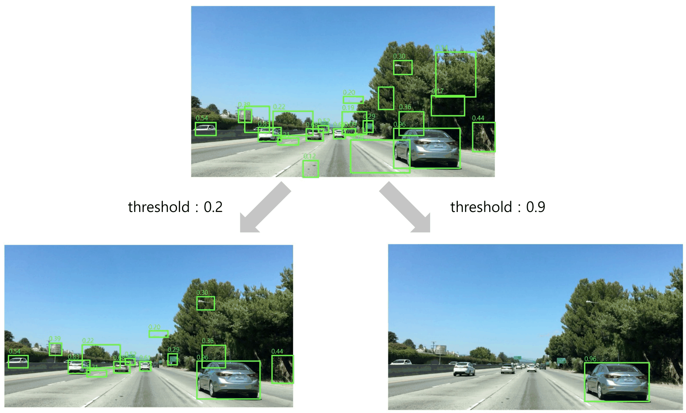

*Figure 27. Detection results at confidence thresholds 0.2 and 0.9*

- **Threshold 0.2 (bottom left):** Even low-confidence boxes are accepted, so cars far away are found, but many boxes also appear on non-objects such as trees and parts of the road. FPs increase and precision drops, while recall is high.
- **Threshold 0.9 (bottom right):** Only the single most certain car remains. The remaining box is almost certainly correct, so precision is high, but all the other cars are missed, so recall is low.

Lowering the threshold increases the number of accepted boxes, so TP does not decrease and recall does not decrease. However, if FP increases at the same time, precision can drop. Since precision and recall trade off against each other in this way, it is hard to compare models fairly by the performance at a single threshold. Therefore the **PR curve**, which looks at the precision and recall at all possible thresholds together, and **AP**, the area under it, are used.

### 4.3 Example: Building a PR Table from Detection Results

Suppose that for some class there are 5 actual ground-truth boxes in the images and the model detected 8 boxes a-h. The confidence of each box and its TP or FP judgment by the IoU threshold are as follows.

| Detected object | Confidence | Actual state |
|:-----|-----:|:-----|
| a | 0.91 | TP |
| b | 0.75 | FP |
| c | 0.83 | TP |
| d | 0.85 | FP |
| e | 0.72 | FP |
| f | 0.88 | TP |
| g | 0.68 | TP |
| h | 0.80 | TP |

*Table 11. Confidences and judgments of the detection results for one class*

**Step 1: Sort by confidence.** Lowering the confidence threshold from a high value to a low value accepts the boxes one at a time in order of confidence, so first sort them in descending order of confidence.

| Detected object | Confidence | Actual state |
|:-----|-----:|:-----|
| a | 0.91 | TP |
| f | 0.88 | TP |
| d | 0.85 | FP |
| c | 0.83 | TP |
| h | 0.80 | TP |
| b | 0.75 | FP |
| e | 0.72 | FP |
| g | 0.68 | TP |

*Table 12. Detection results sorted in descending order of confidence*

**Step 2: Compute precision and recall from the cumulative TP and FP.** Setting the threshold to the confidence of each box accepts only the boxes up to that box. Accumulate the numbers of TP and FP up to that point, and compute precision as $TP / (TP + FP)$ and recall as $TP / 5$.

| Threshold (confidence) | TP count | FP count | Precision | Recall |
|-----:|-----:|-----:|:-----|:-----|
| 0.91 | 1 | 0 | 1/1 = 1.00 | 1/5 = 0.20 |
| 0.88 | 2 | 0 | 2/2 = 1.00 | 2/5 = 0.40 |
| 0.85 | 2 | 1 | 2/3 = 0.67 | 2/5 = 0.40 |
| 0.83 | 3 | 1 | 3/4 = 0.75 | 3/5 = 0.60 |
| 0.80 | 4 | 1 | 4/5 = 0.80 | 4/5 = 0.80 |
| 0.75 | 4 | 2 | 4/6 = 0.67 | 4/5 = 0.80 |
| 0.72 | 4 | 3 | 4/7 = 0.57 | 4/5 = 0.80 |
| 0.68 | 5 | 3 | 5/8 = 0.63 | 5/5 = 1.00 |

*Table 13. Cumulative TP and FP, precision, and recall by confidence threshold (5 actual ground-truth boxes)*

The table is read as follows. At a threshold of 0.85, the three boxes a, f, and d are accepted; of these, a and f are TP and d is FP, so precision is 2/3 and recall is 2/5. When an FP box is added (d, b, e), recall stays the same and only precision drops, and when a TP box is added (c, h, g), recall rises by 0.2 and precision rises again.

### 4.4 PR Curve and AP

The **PR curve (precision-recall curve)** is a graph with recall on the horizontal axis and precision on the vertical axis, connecting the points of Table 13 in the order of decreasing threshold.

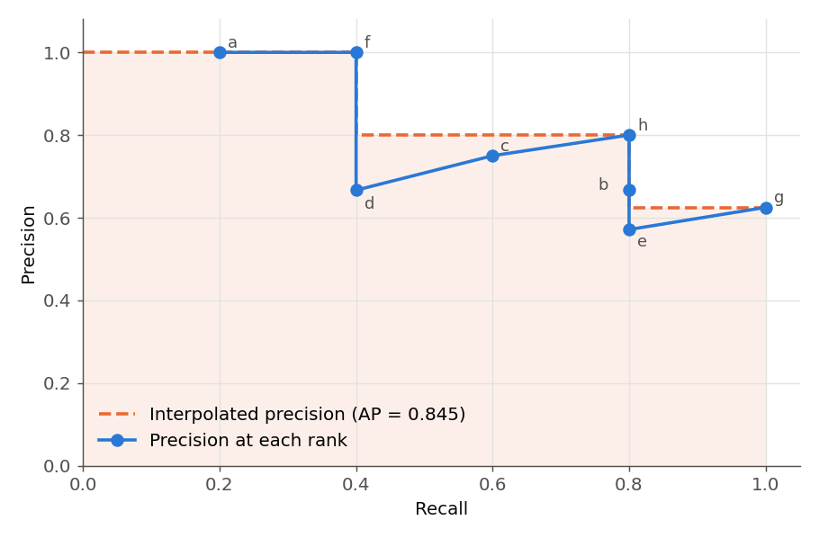

*Figure 28. The PR curve of the example and the interpolated precision*

The blue line is the original PR curve connecting (recall, precision) as each box is accepted. Each FP makes the precision drop vertically (from f to d, and from h to b and e), and each TP moves the curve up and to the right, so it takes a sawtooth shape. In general, the more accurate the model, the more the curve continues to the right while keeping high precision instead of bending sharply, so that it nearly fills the plot area.

**AP (Average Precision)** is the area under the PR curve, meaning the average of precision over recall from 0 to 1. Integrating the sawtooth shape as it is would be sensitive to small wiggles, so the following **interpolated precision** is usually used.

```math
p_{\text{interp}}(r) = \max_{\tilde{r} \ge r} p(\tilde{r})
```

That is, the precision at recall $r$ is replaced by the maximum precision obtainable at recall $r$ or above. It means the best precision one can expect when requiring recall of at least $r$, and as a result the curve becomes a staircase that only goes down toward the right (orange dashed line). The interpolated precision of the example is as follows.

| Recall interval | Maximum precision at recall in or above the interval | Interpolated precision | Area |
|:-----|:-----|-----:|-----:|
| 0-0.4 | 1.00 of a and f | 1.000 | 0.4 × 1.000 = 0.400 |
| 0.4-0.8 | Maximum of 0.75 of c and 0.80 of h | 0.800 | 0.4 × 0.800 = 0.320 |
| 0.8-1.0 | 0.625 of g | 0.625 | 0.2 × 0.625 = 0.125 |

*Table 14. Interpolated precision and the area of each interval in the example*

Therefore $\text{AP} = 0.400 + 0.320 + 0.125 = 0.845$. In the recall interval 0.4-0.8 the original curve goes up and down through 0.67, 0.75, and 0.80, but interpolation flattens it to 0.80, the value obtainable at the right end of that interval.

> **Note:** The way AP is computed differs by dataset and year [10]. The method above interpolates at all recall points (PASCAL VOC 2010 onward). PASCAL VOC 2007 averages the interpolated precision at the 11 recall points 0, 0.1, ..., 1.0 [11]; applied to the example, it gives $(5 \times 1.0 + 4 \times 0.8 + 2 \times 0.625) / 11 \approx 0.859$. COCO uses 101 points from 0 to 1, which gives about 0.847 for the example. Without interpolation, adding the precision at each TP weighted by the increase in recall gives $0.2 \times (1.0 + 1.0 + 0.75 + 0.8 + 0.625) = 0.835$. When comparing numbers from papers, one must check that they were computed in the same way.

### 4.5 mAP and the COCO Evaluation Metrics

AP is computed for one class. **mAP (mean Average Precision)** is the average of the AP computed for each class.

```math
\text{mAP} = \frac{1}{n} \sum_{k=1}^{n} \text{AP}_k
```

Here $`\text{AP}_k`$ is the AP of class $k$ and $n$ is the number of classes. For example, with 3 classes whose APs are 0.845, 0.70, and 0.60, $\text{mAP} = (0.845 + 0.70 + 0.60) / 3 = 0.715$.

The COCO dataset [12] reports several APs while varying the IoU threshold and the object size [13]. In COCO, the value that also includes the class average is likewise called AP.

| Metric | Definition |
|:-----|:-----|
| AP | Average of the APs at the 10 IoU thresholds 0.50, 0.55, ..., 0.95 (primary metric) |
| AP<sup>IoU=.50</sup> (AP<sub>50</sub>) | AP at IoU threshold 0.50 (PASCAL VOC metric) |
| AP<sup>IoU=.75</sup> (AP<sub>75</sub>) | AP at IoU threshold 0.75 (strict metric) |
| AP<sup>small</sup> (AP<sub>S</sub>) | AP for small objects with area less than 32² pixels |
| AP<sup>medium</sup> (AP<sub>M</sub>) | AP for medium objects with area between 32² and 96² pixels |
| AP<sup>large</sup> (AP<sub>L</sub>) | AP for large objects with area greater than 96² pixels |

*Table 15. The AP metrics of COCO*

With a single IoU threshold of 0.5, a box counts as TP even if it fits only roughly, but with the average over 0.50-0.95, the score rises the more precisely the box fits. 32² is 1,024 pixels and 96² is 9,216 pixels. The following are the results with which the YOLOv7 paper compared existing models on the COCO validation data (val) [14].

| Model | Params | FLOPs | Size | AP | AP<sub>50</sub> | AP<sub>75</sub> | AP<sub>S</sub> | AP<sub>M</sub> | AP<sub>L</sub> |
|:-----|-----:|-----:|-----:|-----:|-----:|-----:|-----:|-----:|-----:|
| YOLOv4 | 64.4M | 142.8G | 640 | 49.7% | 68.2% | 54.3% | 32.9% | 54.8% | 63.7% |
| YOLOR-u5 (r6.1) | 46.5M | 109.1G | 640 | 50.2% | 68.7% | 54.6% | 33.2% | 55.5% | 63.7% |
| YOLOv4-CSP | 52.9M | 120.4G | 640 | 50.3% | 68.6% | 54.9% | 34.2% | 55.6% | 65.1% |
| YOLOR-CSP | 52.9M | 120.4G | 640 | 50.8% | 69.5% | 55.3% | 33.7% | 56.0% | 65.4% |
| YOLOv7 | 36.9M | 104.7G | 640 | **51.2%** | **69.7%** | **55.5%** | **35.2%** | **56.0%** | **66.7%** |
| Improvement | -43% | -15% | - | +0.4 | +0.2 | +0.2 | +1.5 | = | +1.3 |
| YOLOR-CSP-X | 96.9M | 226.8G | 640 | 52.7% | **71.3%** | 57.4% | 36.3% | 57.5% | 68.3% |
| YOLOv7-X | 71.3M | 189.9G | 640 | **52.9%** | 71.1% | **57.5%** | **36.9%** | **57.7%** | **68.6%** |
| Improvement | -36% | -19% | - | +0.2 | -0.2 | +0.1 | +0.6 | +0.2 | +0.3 |
| YOLOv4-tiny | 6.1 | 6.9 | 416 | 24.9% | 42.1% | 25.7% | 8.7% | 28.4% | 39.2% |
| YOLOv7-tiny | 6.2 | 5.8 | 416 | **35.2%** | **52.8%** | **37.3%** | **15.7%** | **38.0%** | **53.4%** |
| Improvement | +2% | -19% | - | +10.3 | +10.7 | +11.6 | +7.0 | +9.6 | +14.2 |
| YOLOv4-tiny-3l | 8.7 | 5.2 | 320 | 30.8% | 47.3% | 32.2% | **10.9%** | 31.9% | 51.5% |
| YOLOv7-tiny | 6.2 | 3.5 | 320 | **30.8%** | **47.3%** | **32.2%** | 10.0% | **31.9%** | **52.2%** |
| Improvement | -39% | -49% | - | = | = | = | -0.9 | = | +0.7 |
| YOLOR-E6 | 115.8M | 683.2G | 1280 | 55.7% | 73.2% | 60.7% | 40.1% | **60.4%** | 69.2% |
| YOLOv7-E6 | 97.2M | 515.2G | 1280 | **55.9%** | **73.5%** | **61.1%** | **40.6%** | 60.3% | **70.0%** |
| Improvement | -19% | -33% | - | +0.2 | +0.3 | +0.4 | +0.5 | -0.1 | +0.8 |
| YOLOR-D6 | 151.7M | 935.6G | 1280 | 56.1% | 73.9% | 61.2% | **42.4%** | 60.5% | 69.9% |
| YOLOv7-D6 | 154.7M | 806.8G | 1280 | 56.3% | 73.8% | 61.4% | 41.3% | 60.6% | 70.1% |
| YOLOv7-E6E | 151.7M | 843.2G | 1280 | **56.8%** | **74.4%** | **62.1%** | 40.8% | **62.1%** | **70.6%** |
| Improvement | = | -11% | - | +0.7 | +0.5 | +0.9 | -1.6 | +1.6 | +0.7 |

*Table 16. Comparison of YOLOv7 and existing models on the COCO validation data*

"Params" is the number of trainable parameters of the model (M for millions), "FLOPs" is the number of floating-point operations needed to process one image (G for billions), and "Size" is the number of pixels on one side of the input image; the tiny-model rows omit the unit symbols, but they are in M and G respectively. The "Improvement" rows show the change compared with the strongest existing model in the same group: AP is a difference in percentage points, and the ratios for parameters and FLOPs are computed with the new model's value as the denominator. For example, YOLOv7 has 16.0M fewer parameters (43% of 36.9M) and 15.7G fewer operations (15% of 104.7G) than YOLOR-CSP while its AP is 0.4 percentage points higher. Also, AP<sub>S</sub> is much lower than AP<sub>L</sub> for every model, which shows that detecting small objects is still difficult.

---

<br>

## Concept Applications

**True/False Check:**

| Statement | Judgment and Reason |
|:-----|:-----|
| A predicted box with IoU 0.6 is always TP. | **F.** If the IoU threshold is 0.75 it is FP, and it is also FP if its class is wrong or another prediction has already matched the same ground-truth box. |
| R-CNN performs a separate CNN forward pass for each proposed region. | **T.** It resizes each of about 2,000 regions and feeds it into the CNN, so it is slow. Fast R-CNN passes the whole image through the CNN only once. |
| Faster R-CNN obtains candidate regions with selective search. | **F.** Faster R-CNN obtains candidate regions with an RPN that shares the CNN feature map. Selective search is used by R-CNN and Fast R-CNN. |
| YOLO v1 always predicts 98 boxes per image. | **T.** It predicts 2 boxes for each of the 7×7 cells, so there are $7 \times 7 \times 2 = 98$, and post-processing removes most of them. |
| $\lambda_{\text{noobj}} = 0.5$ in the YOLO v1 loss function serves to amplify the confidence error of object-free boxes. | **F.** Object-free boxes are overwhelmingly numerous, so it serves to reduce their error so that it does not dominate training. |
| Lowering the confidence threshold does not decrease recall. | **T.** The accepted boxes only increase, so TP does not decrease. However, FP can increase and lower precision. |
| NMS must be applied to all boxes at once regardless of class. | **F.** It is usually applied separately for each class. Otherwise one of two heavily overlapping objects of different classes would be removed. |

---

<br>

## Summary

| Concept | Key Summary |
|:-----|:-----|
| Object detection | Outputs a class (classification) and bounding-box coordinates (regression) for each object in an image. Classification gives one label per image, and instance segmentation gives a pixel mask per object. |
| Bounding box | There are the corner format $(x_1, y_1, x_2, y_2)$ and the center format $(x, y, w, h)$, and the format and normalization of the data in use must be checked. |
| IoU | The intersection area divided by the union area, a value in 0-1. It is used in the definition of confidence, in NMS, and in the TP judgment of evaluation. |
| Two-stage and one-stage detection | Two-stage detection proposes regions and then classifies and regresses each region; one-stage detection predicts at once at each location of the feature map. Early on, two-stage was accurate and one-stage was fast. |
| R-CNN | Extracts about 2,000 RoIs with selective search, obtains a 4,096-dimensional feature for each with a CNN, classifies with SVMs, and corrects boxes by regression. It is slow because it runs the CNN per region. |
| Fast R-CNN and Faster R-CNN | Fast R-CNN passes the whole image through the CNN once and uses RoI pooling. Faster R-CNN replaced selective search with an anchor-based RPN. |
| YOLO v1 | Each cell of a 7×7 grid predicts 2 boxes (x, y, w, h, confidence) and 20 class probabilities, giving a 7×7×30 tensor. Confidence is Pr(Object)×IoU. |
| YOLO loss function | The sum of squared errors of localization, confidence, and classification. It uses λcoord = 5 and λnoobj = 0.5, and square-roots the width and height to weight the errors of small boxes more. |
| NMS | Repeats confirming the highest box in descending order of score and removing the boxes whose IoU with it is at or above a threshold. It is usually applied per class. |
| Performance and limits of YOLO | Achieved 63.4 mAP at 45 FPS on PASCAL VOC 2007. It is weak for several objects in one cell, small objects, and boxes of unfamiliar shape. |
| Precision and recall | Precision is TP/(TP+FP) and recall is TP/(TP+FN). Lowering the confidence threshold does not decrease recall and can lower precision. |
| AP and mAP | The PR curve accumulated in order of confidence is interpolated and the area under it is AP; the class average is mAP. The AP of the example is 0.845. |
| COCO metrics | The primary metric is the AP averaged over 10 IoU thresholds 0.50-0.95, reported together with AP50, AP75, and AP by object size. |

---

<br>

## Self-Check Questions

1. **IoU computation:** Compute the IoU of the corner-format ground-truth box $(0, 0, 100, 100)$ and predicted box $(50, 0, 150, 100)$.

   <details>
   <summary>Answer</summary>

   The intersection runs from $(50, 0)$ to $(100, 100)$, so its area is $50 \times 100 = 5000$. Each box has area 10,000, so the union is $20000 - 5000 = 15000$. The IoU is $5000 / 15000 \approx 0.333$.

   </details>

2. **Coordinate format:** Convert the corner-format box $(110, 20, 200, 190)$ into the center format $(x, y, w, h)$.

   <details>
   <summary>Answer</summary>

   $x = (110 + 200)/2 = 155$, $y = (20 + 190)/2 = 105$, $w = 200 - 110 = 90$, and $h = 190 - 20 = 170$, so it is $(155, 105, 90, 170)$.

   </details>

3. **R-CNN family:** What is the main reason R-CNN is slow, and what did Fast R-CNN and Faster R-CNN each change to improve it?

   <details>
   <summary>Answer</summary>

   R-CNN runs the CNN separately for each of about 2,000 regions obtained by selective search. Fast R-CNN passes the whole image through the CNN only once, extracts a fixed-size feature per region with RoI pooling, and trains classification and box regression together. Faster R-CNN replaces the remaining selective search with an RPN that shares the CNN feature map, so that region proposal is also handled by the neural network.

   </details>

4. **Bounding-box regression:** For the proposal box $P = (50, 50, 40, 40)$ and the ground-truth box $G = (54, 46, 40, 80)$, compute $t_x$, $t_y$, $t_w$, and $t_h$.

   <details>
   <summary>Answer</summary>

   $t_x = (54 - 50)/40 = 0.1$, $t_y = (46 - 50)/40 = -0.1$, $t_w = \ln(40/40) = 0$, and $t_h = \ln(80/40) = \ln 2 \approx 0.693$.

   </details>

5. **YOLO output tensor:** For a YOLO v1-style model with grid $S = 13$, $B = 3$ boxes per cell, and $C = 80$ classes, find the size of the output tensor and the number of predicted boxes per image.

   <details>
   <summary>Answer</summary>

   The output of one cell is $B \times 5 + C = 3 \times 5 + 80 = 95$, so the output tensor is $13 \times 13 \times 95$. The number of predicted boxes is $13 \times 13 \times 3 = 507$.

   </details>

6. **Coordinate encoding:** With a 448×448 input and a 7×7 grid, find the responsible cell and the targets $x$, $y$, $w$, $h$ for an object with center $(100, 420)$ and size 224×112.

   <details>
   <summary>Answer</summary>

   The cell size is 64, so the column is $\lfloor 100/64 \rfloor = 1$ and the row is $\lfloor 420/64 \rfloor = 6$. $x = (100 - 64)/64 = 0.5625$, $y = (420 - 384)/64 = 0.5625$, $w = 224/448 = 0.5$, and $h = 112/448 = 0.25$.

   </details>

7. **Square-root terms:** Explain why the width and height are square-rooted in the localization loss of YOLO v1.

   <details>
   <summary>Answer</summary>

   An error of the same number of pixels is a relatively large misalignment for a small box but a small one for a large box. The square root compresses differences on the large-value side, so for the same absolute error the loss of a small box becomes larger. For example, 300→310 and 30→40 have the same squared error, but with square roots the loss of the small box is about 8.8 times larger.

   </details>

8. **NMS:** For boxes of the same class A (0.9), B (0.8), and C (0.7), IoU(A, B) = 0.6, IoU(A, C) = 0.3, and IoU(B, C) = 0.7. Which boxes remain after NMS with an IoU threshold of 0.5?

   <details>
   <summary>Answer</summary>

   A is confirmed first in order of score. B is removed because its IoU with A is 0.6, which is at least 0.5, and C remains because its IoU is 0.3. Next C is confirmed, and since no boxes remain, A and C are left. The IoU of B and C is not used for any decision because B has already been removed.

   </details>

9. **PR table and AP:** There are 4 ground-truth boxes, and the detection results sorted by confidence are TP, FP, TP, TP, FP. Find the precision and recall at each step, and compute the AP with all-point interpolation.

   <details>
   <summary>Answer</summary>

   (Precision, recall) are, in order, (1/1, 0.25), (1/2, 0.25), (2/3, 0.5), (3/4, 0.75), and (3/5, 0.75). The interpolated precision is 1.0 in the recall interval 0-0.25, max(0.667, 0.75, 0.6) = 0.75 in 0.25-0.5, and 0.75 in 0.5-0.75. There is no point with recall greater than 0.75, so the area beyond it is 0. The AP is $0.25 \times 1.0 + 0.25 \times 0.75 + 0.25 \times 0.75 = 0.625$.

   </details>

10. **COCO metrics:** How do COCO's AP and AP<sub>50</sub> differ, and which is higher for the same model?

    <details>
    <summary>Answer</summary>

    AP<sub>50</sub> is the AP at the single IoU threshold 0.5, and AP is the average of the APs at 10 thresholds from 0.50 to 0.95 in steps of 0.05. The higher the threshold, the harder it is to count as TP, so for the same model AP<sub>50</sub> is usually higher than AP. YOLOv7 in the table also has AP<sub>50</sub> 69.7% and AP 51.2%.

    </details>

---

<br>

## References

1. S. Ren, K. He, R. Girshick, and J. Sun, "Faster R-CNN: Towards Real-Time Object Detection with Region Proposal Networks," in *Advances in Neural Information Processing Systems (NIPS)*, vol. 28, pp. 91-99, 2015.
2. J. Redmon, S. Divvala, R. Girshick, and A. Farhadi, "You Only Look Once: Unified, Real-Time Object Detection," in *Proc. IEEE Conf. Computer Vision and Pattern Recognition (CVPR)*, pp. 779-788, 2016.
3. W. Liu, D. Anguelov, D. Erhan, C. Szegedy, S. Reed, C.-Y. Fu, and A. C. Berg, "SSD: Single Shot MultiBox Detector," in *Proc. European Conf. Computer Vision (ECCV)*, pp. 21-37, 2016.
4. Z. Zou, K. Chen, Z. Shi, Y. Guo, and J. Ye, "Object Detection in 20 Years: A Survey," *Proceedings of the IEEE*, vol. 111, no. 3, pp. 257-276, 2023.
5. R. Girshick, J. Donahue, T. Darrell, and J. Malik, "Rich Feature Hierarchies for Accurate Object Detection and Semantic Segmentation," in *Proc. IEEE Conf. Computer Vision and Pattern Recognition (CVPR)*, pp. 580-587, 2014.
6. J. R. R. Uijlings, K. E. A. van de Sande, T. Gevers, and A. W. M. Smeulders, "Selective Search for Object Recognition," *Int. J. Computer Vision*, vol. 104, no. 2, pp. 154-171, 2013.
7. R. Girshick, "Fast R-CNN," in *Proc. IEEE Int. Conf. Computer Vision (ICCV)*, pp. 1440-1448, 2015.
8. Ultralytics, "Ultralytics YOLO," *GitHub*, accessed Nov. 4, 2026. https://github.com/ultralytics/ultralytics
9. R. Sapkota, R. H. Cheppally, A. Sharda, and M. Karkee, "YOLO26: Key Architectural Enhancements and Performance Benchmarking for Real-Time Object Detection," arXiv:2509.25164, 2025.
10. R. Padilla, S. L. Netto, and E. A. B. da Silva, "A Survey on Performance Metrics for Object-Detection Algorithms," in *Proc. Int. Conf. Systems, Signals and Image Processing (IWSSIP)*, pp. 237-242, 2020.
11. M. Everingham, L. Van Gool, C. K. I. Williams, J. Winn, and A. Zisserman, "The PASCAL Visual Object Classes (VOC) Challenge," *Int. J. Computer Vision*, vol. 88, no. 2, pp. 303-338, 2010.
12. T.-Y. Lin, M. Maire, S. Belongie, J. Hays, P. Perona, D. Ramanan, P. Dollár, and C. L. Zitnick, "Microsoft COCO: Common Objects in Context," in *Proc. European Conf. Computer Vision (ECCV)*, pp. 740-755, 2014.
13. COCO Consortium, "Detection Evaluation," *COCO Dataset*, accessed Nov. 4, 2026. https://cocodataset.org/#detection-eval
14. C.-Y. Wang, A. Bochkovskiy, and H.-Y. M. Liao, "YOLOv7: Trainable Bag-of-Freebies Sets New State-of-the-Art for Real-Time Object Detectors," in *Proc. IEEE/CVF Conf. Computer Vision and Pattern Recognition (CVPR)*, pp. 7464-7475, 2023.
