# 6강 — 소리처리

[레포지토리 안내](../../README.ko.md) | [English](Concepts_Lecture.md) | [한국어](Concepts_Lecture.ko.md)

> **최종 수정일:** 2026-11-04

> **학습 목표:**
> 1. 소리 데이터로 수행하는 대표 태스크인 오디오 분류, 음성 인식, 음향 이벤트 탐지와 위치 추정, 오디오 생성과 잡음 제거를 구분할 수 있다
> 2. 샘플링 레이트와 나이퀴스트 주파수의 관계를 설명하고, DFT의 주파수 해상도와 STFT의 프레임 수를 계산할 수 있다
> 3. FFT가 시간 정보를 잃는 이유와 STFT, 스펙트로그램이 이를 해결하는 방식을 설명할 수 있다
> 4. 멜 스케일, 멜 스펙트로그램, MFCC를 계산 단계에 따라 설명하고 n_fft, hop_length, n_mels가 결과에 주는 영향을 설명할 수 있다
> 5. 스펙트로그램 기반 오디오 분류와 CRNN 기반 음향 이벤트 탐지 모델의 입력, 구조, 출력을 설명할 수 있다
> 6. 세그먼트 기반 평가와 이벤트 기반 평가로 음향 이벤트 탐지 결과의 F1 점수와 오류율을 계산할 수 있다

---

## 목차

- [1. 소리 데이터로 하는 태스크](#1-소리-데이터로-하는-태스크)
  - [1.1 태스크의 종류](#11-태스크의-종류)
  - [1.2 오디오 분류](#12-오디오-분류)
  - [1.3 음성 인식](#13-음성-인식)
  - [1.4 음향 이벤트 탐지와 위치 추정](#14-음향-이벤트-탐지와-위치-추정)
  - [1.5 오디오 생성과 잡음 제거](#15-오디오-생성과-잡음-제거)
- [2. 소리 데이터의 디지털 표현](#2-소리-데이터의-디지털-표현)
  - [2.1 전처리가 필요한 이유](#21-전처리가-필요한-이유)
  - [2.2 샘플링 레이트](#22-샘플링-레이트)
  - [2.3 나이퀴스트 주파수와 에일리어싱](#23-나이퀴스트-주파수와-에일리어싱)
- [3. 푸리에 변환과 스펙트로그램](#3-푸리에-변환과-스펙트로그램)
  - [3.1 시간 영역과 주파수 영역](#31-시간-영역과-주파수-영역)
  - [3.2 DFT와 FFT](#32-dft와-fft)
  - [3.3 FFT의 한계: 시간 정보의 손실](#33-fft의-한계-시간-정보의-손실)
  - [3.4 STFT](#34-stft)
  - [3.5 스펙트로그램](#35-스펙트로그램)
- [4. 멜 스펙트로그램과 MFCC](#4-멜-스펙트로그램과-mfcc)
  - [4.1 멜 스케일](#41-멜-스케일)
  - [4.2 멜 스펙트로그램](#42-멜-스펙트로그램)
  - [4.3 MFCC](#43-mfcc)
  - [4.4 librosa로 멜 스펙트로그램 추출하기](#44-librosa로-멜-스펙트로그램-추출하기)
  - [4.5 스펙트로그램이 여전히 쓰이는 이유](#45-스펙트로그램이-여전히-쓰이는-이유)
- [5. 오디오 분류](#5-오디오-분류)
  - [5.1 소리를 이미지처럼 분류하기](#51-소리를-이미지처럼-분류하기)
  - [5.2 VGGish와 전이 학습](#52-vggish와-전이-학습)
- [6. 음향 이벤트 탐지](#6-음향-이벤트-탐지)
  - [6.1 SED 시스템의 구성](#61-sed-시스템의-구성)
  - [6.2 입력과 프레임 단위 레이블](#62-입력과-프레임-단위-레이블)
  - [6.3 SED-CRNN 모델](#63-sed-crnn-모델)
  - [6.4 임계값으로 이벤트 결정하기](#64-임계값으로-이벤트-결정하기)
  - [6.5 세그먼트 기반 평가](#65-세그먼트-기반-평가)
  - [6.6 이벤트 기반 평가](#66-이벤트-기반-평가)
  - [6.7 평가 결과와 응용](#67-평가-결과와-응용)
- [개념 적용](#개념-적용)
- [요약](#요약)
- [점검 문제](#점검-문제)
- [참고 문헌](#참고-문헌)

---

<br>

## 1. 소리 데이터로 하는 태스크

### 1.1 태스크의 종류

딥러닝은 이미지(3\~5강)와 텍스트(7\~8강)뿐 아니라 소리에도 널리 쓰인다. 소리 데이터로 할 수 있는 대표적인 태스크는 다음과 같다.

| 태스크 | 입력 | 출력 | 예 |
|:-----|:-----|:-----|:-----|
| 오디오 분류 (audio classification) | 소리 조각 하나 | 미리 정한 클래스 중 하나 | 개 짖는 소리, 사이렌, 기침의 구분 |
| 음성 인식 (speech recognition) | 사람의 말소리 | 텍스트 | 음성 비서, 자막 생성 |
| 음향 이벤트 탐지 (sound event detection) | 긴 녹음 | 이벤트마다 클래스와 시작, 끝 시각 | 녹음에서 기침이 난 구간 찾기 |
| 음향 이벤트 위치 추정 (sound event localization) | 여러 마이크로 녹음한 소리 | 이벤트마다 소리가 온 방향 | 말하는 사람의 방향 추적 |
| 오디오 생성 (audio generation) | 예시 소리나 조건 | 새로운 소리 | 음악, 효과음 합성 |
| 오디오 잡음 제거 (audio denoising) | 잡음이 섞인 소리 | 깨끗한 소리 | 오래된 녹음 복원, 통화 잡음 제거 |

*표 1. 소리 데이터로 수행하는 대표 태스크*

이 밖에도 화자 인식, 음악 장르 분류, 기계 소리로 고장을 찾는 이상음 탐지 등 많은 태스크가 있다. 아래에서는 이 중 오디오 분류와 음향 이벤트 탐지를 중심으로, 그 공통 기반인 소리 전처리를 다룬다.

### 1.2 오디오 분류

**오디오 분류(audio classification)** 는 소리 조각(세그먼트) 하나가 들어왔을 때, 그것이 어떤 소리인지를 미리 정해 둔 클래스 안에서 정하는 태스크이다.

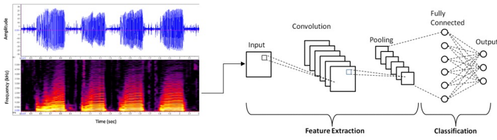

*그림 1. 파형을 스펙트로그램으로 바꾼 뒤 CNN으로 분류하는 오디오 분류 과정*

왼쪽 위는 시간에 따른 소리의 진폭(Amplitude)을 그린 **파형(waveform)** 이고, 그 아래는 같은 소리를 시간(가로축)과 주파수(세로축)의 2차원 그림으로 바꾼 **스펙트로그램(spectrogram)** 이다. 파형을 이미지처럼 생긴 스펙트로그램으로 바꾸고, 이 이미지를 합성곱(Convolution)과 풀링(Pooling) 층으로 이루어진 특징 추출부(Feature Extraction)와 완전 연결 층(Fully Connected)으로 이루어진 분류부(Classification)에 넣어 클래스를 출력한다. 스펙트로그램을 만드는 방법은 3절과 4절에서, 분류 모델은 5절에서 자세히 다룬다.

### 1.3 음성 인식

**음성 인식(speech recognition)** 은 컴퓨터가 사람이 발성한 음성을 인식하여 그 내용을 텍스트로 변환하는 기술이다. 사람의 음성 신호를 수학적 모델링과 딥러닝 알고리즘으로 분석하고 처리하여 텍스트로 변환하며, 음성 인식 소프트웨어, 음성 검색, 자동 번역, 음성으로 음악이나 영화를 찾는 서비스 등 다양한 응용 분야에서 사용된다.

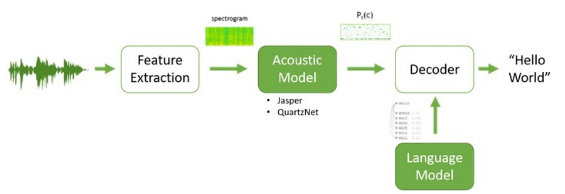

*그림 2. 특징 추출, 음향 모델, 디코더, 언어 모델로 이루어진 음성 인식 과정*

딥러닝 기반 음성 인식 시스템은 위 그림처럼 다음 단계로 이루어진다 [1].

1. **특징 추출(feature extraction):** 정규화, 스펙트로그램이나 MFCC 등의 기법으로 오디오 신호를 전처리한다.
2. **음향 모델(acoustic model):** 각 시간 단계 $t$마다 어휘 문자 $c$에 대한 확률 분포 $P_t(c)$를 예측하는 신경망이다. 그림의 Jasper [2]와 QuartzNet [3]이 이러한 음향 모델의 예이다. 어휘는 알파벳과 공백처럼 모델이 출력할 수 있는 문자의 집합이고, $c$는 그 원소이다.
3. **디코딩(decoding):** 시간 단계마다의 확률 분포를 문자열로 바꾼다.
   - **탐욕적 디코딩(greedy decoding, argmax):** 가장 간단한 전략이다. 각 시간 단계에서 가장 높은 확률을 가진 문자를 골라 내보내며, 내용의 의미는 고려하지 않는다.
   - **언어 모델(language model) 사용:** 언어 모델이 문맥을 더해 주므로 음향 모델의 오류를 수정할 수 있다. 예를 들어 음향 모델이 "apple"을 "apble"로 잘못 예측해도, 언어 모델은 "apble"이라는 단어가 거의 쓰이지 않고 "apple"이 문맥상 자연스럽다는 것을 알기 때문에 이를 바로잡는다.

Jasper와 QuartzNet 같은 모델은 **CTC(Connectionist Temporal Classification)** 방식으로 학습한다 [4]. 음성은 프레임 수가 글자 수보다 훨씬 많고 어느 프레임이 어느 글자에 해당하는지 알려 주는 정답이 없으므로, CTC는 글자가 없음을 뜻하는 빈칸(blank) 기호 `_`를 어휘에 추가하고 다음 규칙으로 프레임별 출력을 문자열로 바꾼다.

```text
t        1  2  3  4  5  6  7  8  9  10 11
(a)      h  h  _  e  e  _  l  l  _  l  o
(b)      h     _  e     _  l     _  l  o
(c)      h        e        l        l  o    ->  hello
```

*그림 3. CTC 탐욕적 디코딩의 예*

(a)는 11개의 시간 단계에서 확률이 가장 높은 기호를 고른 결과이다. (b)에서 연속으로 반복된 기호를 하나로 합치고, (c)에서 빈칸을 지우면 "hello"가 된다. 9번째 단계의 빈칸이 두 `l` 사이를 갈라 주므로, 반복 병합 뒤에도 `l`이 두 개 남는다. 탐욕적 디코딩은 이처럼 단순하지만, 단어의 철자나 문맥을 전혀 보지 않으므로 언어 모델과 결합하면 더 정확해진다.

### 1.4 음향 이벤트 탐지와 위치 추정

**음향 이벤트 탐지(SED, Sound Event Detection)** 는 녹음에서 특정 음향 사건(소리)을 감지하는 기술이다. 영상처리에서 객체 탐지가 이미지 안의 객체를 상자로 잡아냈듯이(5강), 음향 이벤트 탐지는 오디오에서 어디부터 어디까지가 어떤 소리인지를 찾는다.

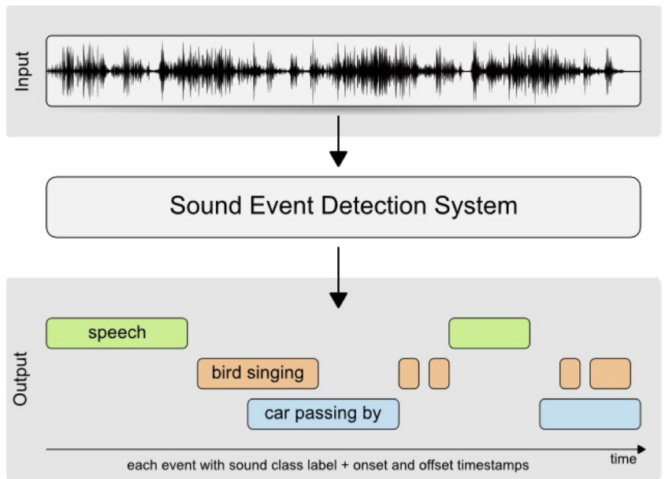

*그림 4. 음향 이벤트 탐지 시스템의 입력과 출력*

입력(Input)은 긴 오디오 파형이고, 출력(Output)은 이벤트마다 클래스 레이블과 시작 시각(onset), 끝 시각(offset)이다. 그림에서는 말소리(speech), 새 지저귐(bird singing), 자동차 지나가는 소리(car passing by)가 시간축 위의 막대로 표시되며, 여러 소리가 같은 시각에 겹치기도 한다. 이처럼 여러 이벤트가 동시에 일어날 수 있는 경우를 **다중음(polyphonic)** 음향 이벤트 탐지라 한다.

**음향 이벤트 탐지와 위치 추정(SELD, Sound Event Localization and Detection)** 은 특정 음향 사건을 감지하는 것뿐 아니라, 그 소리가 어디서 발생했는지 파악하는 것도 포함한다.

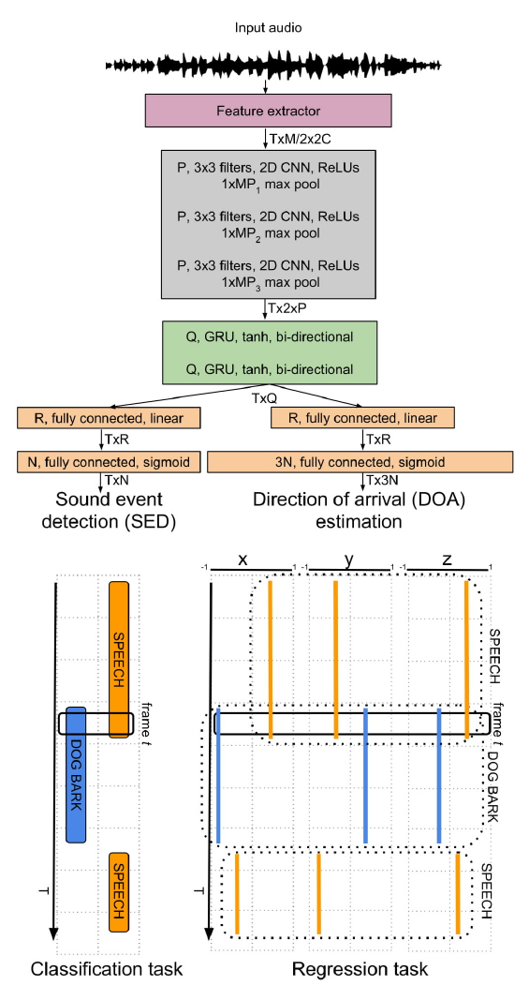

*그림 5. 음향 이벤트 탐지와 도착 방향 추정을 함께 하는 SELDnet의 구조*

위 그림은 SELDnet의 구조이다 [5].

- **특징 추출기(Feature extractor):** 여러 채널의 입력 오디오에서 채널마다 스펙트로그램의 크기와 위상을 계산하여 $T \times M/2 \times 2C$ 크기의 입력을 만든다. $T$는 프레임 수, $M/2$는 주파수 칸 수, $C$는 채널(마이크) 수이며, 크기와 위상 두 가지이므로 $2C$이다.
- **합성곱 블록 3개:** $P$개의 3×3 필터로 합성곱하고, 주파수 축으로만 최대 풀링($1 \times MP_i$)하여 시간 해상도는 유지한 채 $T \times 2 \times P$로 줄인다.
- **양방향 GRU 2층:** 시간 축의 문맥을 학습하여 $T \times Q$를 낸다.
- **두 갈래의 출력:** 두 갈래는 각각 $R$개 유닛의 선형 완전 연결 층을 거친 뒤 출력층으로 이어진다. 한 갈래는 $N$개 클래스의 프레임별 활성 여부를 시그모이드로 출력하는 음향 이벤트 탐지(SED, $T \times N$)이고, 다른 갈래는 클래스마다 소리가 온 방향을 3차원 좌표 $(x, y, z)$로 출력하는 **도착 방향(DOA, Direction of Arrival) 추정**($T \times 3N$)이다. 아래쪽 그림은 각각 분류 태스크(시간에 따른 클래스의 활성)와 회귀 태스크(시간에 따른 방향 좌표)의 정답 예이다.

> **주의:** 소리의 방향을 추정하려면 여러 개의 마이크로 녹음한 다채널 오디오가 필요하다. 같은 소리가 각 마이크에 도착하는 시간(위상)과 크기의 차이가 방향의 단서이기 때문이다. 마이크 하나로 녹음한 단일 채널 오디오에는 이러한 공간 정보가 없으므로, 음향 이벤트 탐지는 할 수 있어도 위치 추정은 할 수 없다.

### 1.5 오디오 생성과 잡음 제거

딥러닝은 소리를 인식할 뿐 아니라 새로 만들거나 고칠 수도 있다.

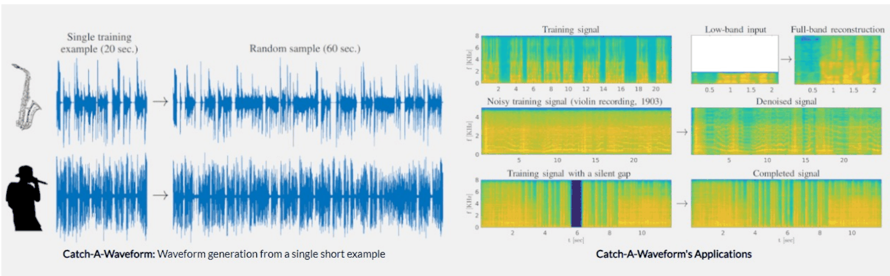

*그림 6. 하나의 짧은 예시로 학습한 Catch-A-Waveform의 생성 결과와 응용*

**Catch-A-Waveform**은 약 20초 길이의 소리 하나만으로 학습하여, 그와 비슷한 특성을 가진 새로운 소리를 생성하는 모델이다 [6]. 그림 왼쪽은 색소폰 연주와 노래 한 곡에서 각각 20초를 학습한 뒤 60초 길이의 새로운 무작위 샘플을 생성한 예이다. 오른쪽은 같은 방식의 응용으로, 위에서부터 다음과 같다.

- **대역폭 확장:** 낮은 주파수 대역만 남은 입력(Low-band input)에서 높은 주파수까지 복원한다(Full-band reconstruction).
- **잡음 제거:** 1903년에 녹음한 잡음 섞인 바이올린 연주(Noisy training signal)에서 잡음을 제거한다(Denoised signal).
- **오디오 인페인팅:** 중간에 소리가 끊긴 구간(silent gap)이 있는 신호의 빈 부분을 자연스럽게 채운다(Completed signal).

---

<br>

## 2. 소리 데이터의 디지털 표현

### 2.1 전처리가 필요한 이유

소리 데이터를 딥러닝 모델의 입력으로 사용하려면 **전처리(preprocessing)**, 즉 **특징 추출(feature extraction)** 과정이 필요하다. 그림 1처럼 파형을 그대로 쓰기보다, 주파수 정보를 드러내는 스펙트로그램 형태로 바꾸어 모델에 넣는 경우가 많다. 이 절에서는 먼저 소리가 컴퓨터 안에서 어떻게 숫자로 표현되는지를 보고, 3절과 4절에서 그 숫자를 스펙트로그램으로 바꾸는 방법을 다룬다.

### 2.2 샘플링 레이트

마이크가 받은 소리는 시간에 따라 연속적으로 변하는 공기 압력, 즉 **아날로그 신호**이다. 컴퓨터는 이를 일정한 시간 간격마다 측정한 값의 나열, 즉 **디지털 신호**로 저장한다. 이렇게 일정 간격으로 값을 측정하는 것을 **샘플링(sampling)** 이라 하고, 측정한 값 하나를 **샘플(sample)** 이라 한다.

> **용어 정의:** **샘플링 레이트(sample rate)** 는 아날로그 신호를 디지털 신호로 변환할 때 단위 시간당 샘플링한 횟수, 즉 1초 동안 얻은 샘플의 개수이다. 단위는 Hz이며, 44,100 Hz와 16,000 Hz가 흔히 쓰인다. 샘플링 레이트가 $f_s$이면 샘플 사이의 간격은 $1/f_s$초이다.

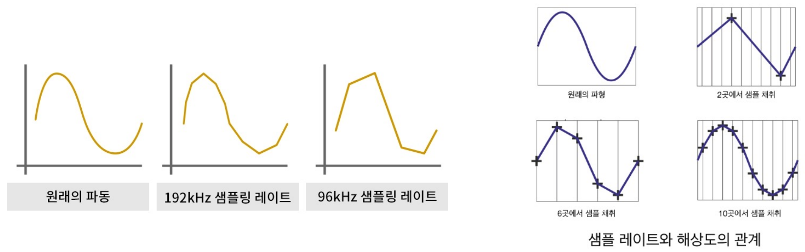

*그림 7. 샘플링 레이트가 낮을수록 원래 파형을 성기게 표현하는 모습*

왼쪽 세 그림은 원래의 파동을 192 kHz와 96 kHz로 샘플링한 뒤 점을 직선으로 이은 모습으로, 샘플링 레이트가 낮을수록 원래 곡선을 성기게 따라간다. 오른쪽 네 그림은 사인파 한 주기의 원래 파형과, 이를 2곳, 6곳, 10곳에서 샘플링한 경우로, 샘플이 많을수록 원래 모양에 가까워진다는 샘플 레이트와 해상도의 관계를 보여 준다.

샘플링 레이트 $f_s$로 $T$초 동안 녹음하면 샘플 수는 $f_s \times T$이다. 예를 들어 16,000 Hz로 3초를 녹음하면 $16000 \times 3 = 48000$개의 샘플이 생긴다. 샘플 하나의 값도 유한한 정밀도로 저장되는데, 16비트 정수로 저장하면 $2^{16} = 65536$단계로 표현된다. librosa 같은 라이브러리는 이를 $-1$부터 1 사이의 실수로 바꾸어 읽는다.

| 샘플링 레이트 | 나이퀴스트 주파수 | 주된 쓰임 |
|:-----|:-----|:-----|
| 8,000 Hz | 4,000 Hz | 유선 전화 음성 |
| 16,000 Hz | 8,000 Hz | 음성 인식, 4.4절의 예제 |
| 44,100 Hz | 22,050 Hz | 음악 CD |
| 48,000 Hz | 24,000 Hz | 영상 제작과 디지털 오디오 장비 |
| 96,000 Hz, 192,000 Hz | 48,000 Hz, 96,000 Hz | 고해상도 녹음 |

*표 2. 흔히 쓰는 샘플링 레이트와 나이퀴스트 주파수*

### 2.3 나이퀴스트 주파수와 에일리어싱

샘플링 레이트를 정하는 원리는 **샘플링 정리(sampling theorem)** 이다 [7]. 신호에 들어 있는 가장 높은 주파수가 $f_{\max}$이면, $f_s > 2 f_{\max}$인 샘플링 레이트로 샘플링할 때 원래 신호를 샘플로부터 완전히 복원할 수 있다. 샘플링 레이트의 절반 $f_s / 2$를 **나이퀴스트 주파수(Nyquist frequency)** 라 하며, 디지털 신호가 표현할 수 있는 최대 주파수이다.

나이퀴스트 주파수보다 높은 성분은 사라지는 것이 아니라 낮은 주파수로 둔갑하여 섞여 들어오는데, 이를 **에일리어싱(aliasing)** 이라 한다 [8].

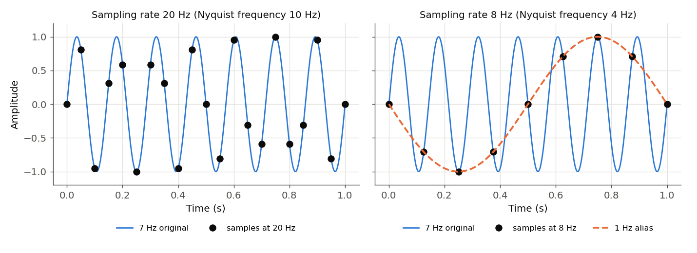

*그림 8. 7 Hz 사인파를 20 Hz와 8 Hz로 샘플링한 결과와 1 Hz로 나타나는 에일리어싱*

- **20 Hz로 샘플링(왼쪽):** 나이퀴스트 주파수가 10 Hz로 7 Hz보다 높으므로, 샘플(검은 점)이 7 Hz 사인파의 진동을 빠짐없이 따라간다.
- **8 Hz로 샘플링(오른쪽):** 나이퀴스트 주파수가 4 Hz로 7 Hz보다 낮다. 이때 샘플은 1초에 한 번만 오르내리는 1 Hz 사인파(주황색 점선) 위에 정확히 놓인다. 샘플만 보아서는 원래 신호가 7 Hz였는지 1 Hz였는지 구별할 수 없으며, 7 Hz 성분은 $\lvert 7 - 8 \rvert = 1$ Hz로 잘못 나타난다.

사람이 들을 수 있는 소리는 대략 20 Hz부터 20 kHz까지이므로, 음악 CD는 나이퀴스트 주파수가 그보다 조금 높도록 44,100 Hz를 쓴다. 사람의 말소리에서 내용을 알아듣는 데 필요한 정보는 대부분 8 kHz 아래에 있으므로 음성 인식에는 16,000 Hz가 널리 쓰인다. 실제 장비와 라이브러리는 샘플링이나 리샘플링을 하기 전에 나이퀴스트 주파수보다 높은 성분을 저역 통과 필터로 미리 걸러 에일리어싱을 막는다.

> **참고:** 그림 7에서는 샘플 사이를 직선으로 이어 해상도를 직관적으로 보여 주지만, 샘플링 정리에 따르면 $f_s > 2 f_{\max}$를 만족하는 한 원래 신호를 이론적으로 완전히 복원할 수 있다. 따라서 샘플링 레이트를 높이는 효과는 곡선을 더 매끄럽게 하는 것보다 표현할 수 있는 최대 주파수를 높이는 데 있다. 한 주기에 2곳에서만 샘플링하는 경우는 나이퀴스트 한계에 정확히 걸리므로, 샘플이 0인 지점에 떨어지면 신호를 전혀 알아볼 수 없게 된다.

---

<br>

## 3. 푸리에 변환과 스펙트로그램

### 3.1 시간 영역과 주파수 영역

소리(파형)는 주파수 영역에서 더 많은 정보를 드러낸다. 파형만 보아서는 알 수 없었던 정보, 예를 들어 어떤 높이의 음들이 섞여 있는지가 주파수 영역으로 변환하면 보이기 시작한다.

> **용어 정의:** **푸리에 변환(Fourier transform)** 은 시간 영역(time domain)의 신호를 주파수 영역(frequency domain)으로 변환하는 수학적 기법이다. 시간 영역은 시간에 따른 신호의 값을, 주파수 영역은 신호에 각 주파수 성분이 얼마나 들어 있는지를 나타낸다.

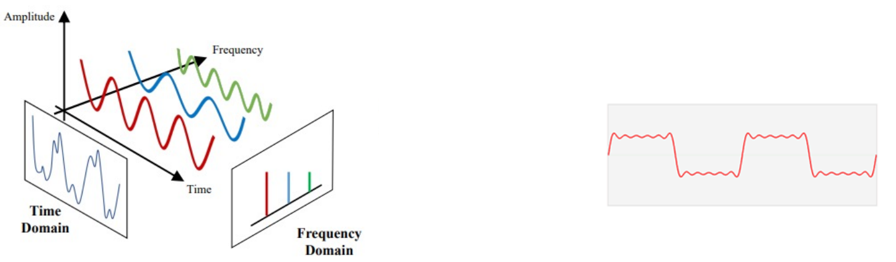

*그림 9. 시간 영역의 복잡한 신호가 여러 주파수의 사인파로 분해되어 주파수 영역의 막대로 표현되는 모습*

그림의 3차원 좌표에서 왼쪽 면(Time Domain)은 복잡하게 출렁이는 신호를 시간 축 위에 그린 것이다. 이 신호는 사실 주파수가 다른 세 사인파(빨간색, 파란색, 초록색)의 합이며, 오른쪽 면(Frequency Domain)은 각 사인파의 주파수 위치에 그 세기만큼의 막대를 세운 것이다. 푸리에 분석에 따르면 신호는 정현파(사인파와 코사인파)들의 합으로 표현할 수 있다. 오른쪽의 빨간 파형은 그 예로, 주파수가 기본 주파수의 홀수 배인 사인파를 몇 개만 더해도 네모난 파형(구형파)에 가까워짐을 보여 준다. 구형파는 다음과 같이 무한히 많은 사인파의 합이다.

$$
x(t) = \frac{4}{\pi} \left( \sin \omega t + \frac{1}{3} \sin 3\omega t + \frac{1}{5} \sin 5\omega t + \cdots \right)
$$

연속 시간 신호 $x(t)$의 푸리에 변환은 다음과 같다.

$$
X(f) = \int_{-\infty}^{\infty} x(t) \, e^{-j 2\pi f t} \, dt
$$

> **참고:** 오일러 공식 $e^{-j\theta} = \cos\theta - j\sin\theta$에 따라 $e^{-j 2\pi f t}$는 주파수 $f$로 회전하는 코사인과 사인의 쌍이다. 푸리에 변환은 신호에 이 회전을 곱해 적분함으로써, 신호가 주파수 $f$의 성분과 얼마나 닮았는지를 계산한다. $\lvert X(f) \rvert$는 그 주파수 성분의 크기, 복소수 $X(f)$의 각도는 위상을 나타낸다. 이 과정을 시각적으로 설명하는 자료로는 3Blue1Brown의 영상 [9]이 널리 알려져 있다.

### 3.2 DFT와 FFT

컴퓨터의 소리는 샘플의 유한한 나열이므로 적분 대신 합을 쓰는 **이산 푸리에 변환(DFT, Discrete Fourier Transform)** 을 쓴다 [8]. 길이 $N$인 신호 $x[0], \dots, x[N-1]$의 DFT는 다음과 같다.

$$
X[k] = \sum_{n=0}^{N-1} x[n] \, e^{-j 2\pi k n / N}, \qquad k = 0, 1, \dots, N-1
$$

- $X[k]$는 $k$번째 **주파수 칸(frequency bin)** 의 성분이며, 이 칸의 주파수는 $f_k = k f_s / N$이다. 따라서 칸 사이의 간격, 즉 **주파수 해상도**는 $f_s / N$이다.
- 실수 신호에서는 $X[N-k]$가 $X[k]$의 켤레 복소수이므로, $k = 0$부터 $N/2$까지의 $N/2 + 1$개 칸만 서로 다른 정보를 담는다.

**DFT 계산 예.** $f_s = 8$ Hz로 2 Hz 코사인을 샘플링한 $N = 4$개의 샘플 $x = [1, 0, -1, 0]$의 DFT를 계산한다. $N = 4$이면 $e^{-j 2\pi k n / 4} = (-j)^{kn}$이다.

1. $X[0] = 1 + 0 + (-1) + 0 = 0$이다. 0번 칸은 신호의 평균(직류 성분)이며, 이 신호는 평균이 0이다.
2. $X[1] = 1 \cdot 1 + (-1) \cdot (-j)^2 = 1 + (-1)(-1) = 2$이다.
3. $X[2] = 1 + (-1) \cdot (-j)^4 = 1 - 1 = 0$이다.
4. $X[3] = 1 + (-1) \cdot (-j)^6 = 1 + (-1)(-1) = 2$이다.

1번 칸의 주파수는 $1 \times 8 / 4 = 2$ Hz이므로, 신호가 2 Hz 성분만 가지고 있음을 정확히 찾아냈다. 3번 칸은 1번 칸의 거울상($-2$ Hz)이다.

**FFT(Fast Fourier Transform, 고속 푸리에 변환)** 는 DFT를 빠르게 계산하는 알고리즘이다 [10]. 위 식을 그대로 계산하면 칸 $N$개마다 $N$번의 곱셈이 필요하여 $O(N^2)$이지만, FFT는 계산을 절반 크기의 문제로 반복해서 나누어 $O(N \log N)$에 끝낸다. $N = 2048$이면 $N^2 = 4{,}194{,}304$인 반면 $N \log_2 N = 2048 \times 11 = 22{,}528$로 약 186배 적다. 오늘날 DFT는 사실상 항상 FFT 알고리즘으로 계산하므로 두 용어를 같은 뜻으로 쓰는 경우가 많다. FFT 결과의 크기 $\lvert X[k] \rvert$를 가로축이 주파수, 세로축이 크기인 그래프로 그린 것을 **스펙트럼(spectrum)** 이라 하며, 그림 10의 가운데 열이 그 예이다.

### 3.3 FFT의 한계: 시간 정보의 손실

FFT는 신호 전체에 어떤 주파수가 얼마나 들어 있는지를 알려 주지만, 그 주파수가 **언제** 나타났는지는 알려 주지 않는다. 소리는 시계열 데이터임에도 FFT를 신호 전체에 한 번 적용하면 시간에 대한 정보를 나타낼 수 없다.

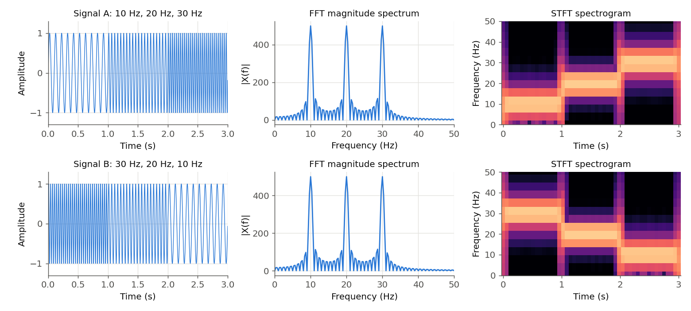

*그림 10. 주파수의 순서만 다른 두 신호의 파형, FFT 스펙트럼, STFT 스펙트로그램*

신호 A는 1초마다 10 Hz, 20 Hz, 30 Hz의 순서로, 신호 B는 30 Hz, 20 Hz, 10 Hz의 순서로 소리가 바뀐다(왼쪽). 두 신호는 분명히 다른 소리이지만, 각각 전체에 FFT를 적용한 크기 스펙트럼(가운데)은 10, 20, 30 Hz에 같은 높이의 봉우리가 있는 똑같은 모양이 되어 둘을 구분할 수 없다. 오른쪽의 STFT 스펙트로그램에서는 신호 A의 밝은 띠가 시간에 따라 위로, 신호 B의 띠가 아래로 이동하여 두 신호가 확연히 구분된다. 이 문제를 해결하기 위해 나온 방법이 3.4절의 STFT이다.

### 3.4 STFT

**STFT(Short-Time Fourier Transform, 단시간 푸리에 변환)** 는 신호를 짧은 구간으로 나누고 각 구간에 FFT를 적용하여, 구간마다의 주파수 성분을 시간 순서대로 얻는 방법이다. 분석하고 싶은 소리를 구간별로 변환한 뒤 나중에 이어 붙이는 것이다.

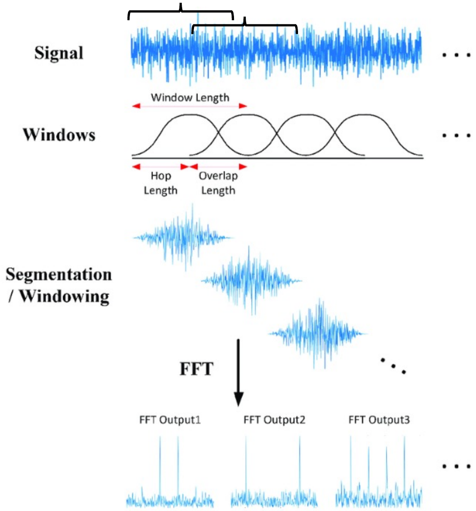

*그림 11. 신호를 겹치는 창으로 나누고 각 구간에 FFT를 적용하는 STFT 과정*

1. **창 나누기(Windows):** 신호(Signal) 위에 **창 길이(window length)** 만큼의 구간을 잡고, **홉 길이(hop length)** 만큼 옮겨 가며 다음 구간을 잡는다. 홉 길이가 창 길이보다 짧으면 이웃 구간이 **겹치는 길이(overlap length)**, 즉 창 길이 빼기 홉 길이만큼 겹친다.
2. **분할과 창 함수 적용(Segmentation, Windowing):** 각 구간을 잘라 내고 가운데가 1, 양 끝이 0에 가까운 종 모양의 **창 함수(window function)** 를 곱한다. 신호를 갑자기 잘라 내면 구간 양 끝의 불연속 때문에 실제로 없는 주파수 성분이 스펙트럼에 번져 나타나는데(스펙트럼 누설), 창 함수는 양 끝을 부드럽게 줄여 이를 완화한다. Hann 창이 흔히 쓰인다.
3. **FFT:** 각 구간에 FFT를 적용하여 구간마다 하나의 스펙트럼(FFT Output1, FFT Output2, ...)을 얻는다.

이를 식으로 쓰면, 홉 길이 $H$, 창 함수 $w[n]$, FFT 크기 $N$에 대해 $m$번째 프레임의 $k$번째 주파수 성분은 다음과 같다.

$$
X[m, k] = \sum_{n=0}^{N-1} x[n + mH] \, w[n] \, e^{-j 2\pi k n / N}
$$

**시간 해상도와 주파수 해상도의 맞바꿈.** 창이 길수록 주파수 해상도 $f_s / N$은 좋아지지만 창 하나가 덮는 시간 $N / f_s$가 길어져 언제 소리가 바뀌었는지는 흐려진다. 창이 짧으면 그 반대이다. 따라서 창 길이는 분석하려는 소리에 맞추어 정한다.

| 항목 | 계산 | 값 ($f_s$ = 16,000 Hz, $N$ = 2048, $H$ = 1024) |
|:-----|:-----|:-----|
| 창 하나의 길이 | $N / f_s$ | 2048 / 16000 = 0.128초 (128 ms) |
| 프레임 간격 | $H / f_s$ | 1024 / 16000 = 0.064초 (64 ms) |
| 이웃 창의 겹침 | $(N - H) / N$ | 50% |
| 주파수 해상도 | $f_s / N$ | 16000 / 2048 = 7.8125 Hz |
| 주파수 칸 수 | $N / 2 + 1$ | 1025개 |
| 1초 신호의 프레임 수 | $1 + \lfloor L / H \rfloor$ ($L$은 샘플 수) | $1 + \lfloor 16000 / 1024 \rfloor = 16$개 |

*표 3. 4.4절 예제의 STFT 설정에서 계산한 시간과 주파수 해상도*

프레임 수의 식은 librosa처럼 신호의 앞뒤를 창의 절반만큼 덧대어(center padding) 각 프레임이 해당 시각을 중심으로 하도록 계산하는 경우이다.

### 3.5 스펙트로그램

**스펙트로그램(spectrogram)** 은 주파수 영역에서 시간에 따른 신호의 변화를 시각화하는 방법이다. STFT 결과 $X[m, k]$의 크기 $\lvert X[m, k] \rvert$(또는 그 제곱인 파워)를 가로축이 시간(프레임 $m$), 세로축이 주파수(칸 $k$)인 2차원 배열로 늘어놓고 값의 크기를 색으로 표시한다. 사람의 귀는 소리 세기를 대략 로그 척도로 느끼고 값의 범위도 매우 넓으므로, 보통 데시벨(dB)로 바꾸어 나타낸다.

$$
\text{dB} = 20 \log_{10} \frac{\lvert X \rvert}{\text{ref}} \quad \text{(크기)}, \qquad \text{dB} = 10 \log_{10} \frac{\lvert X \rvert^2}{\text{ref}} \quad \text{(파워)}
$$

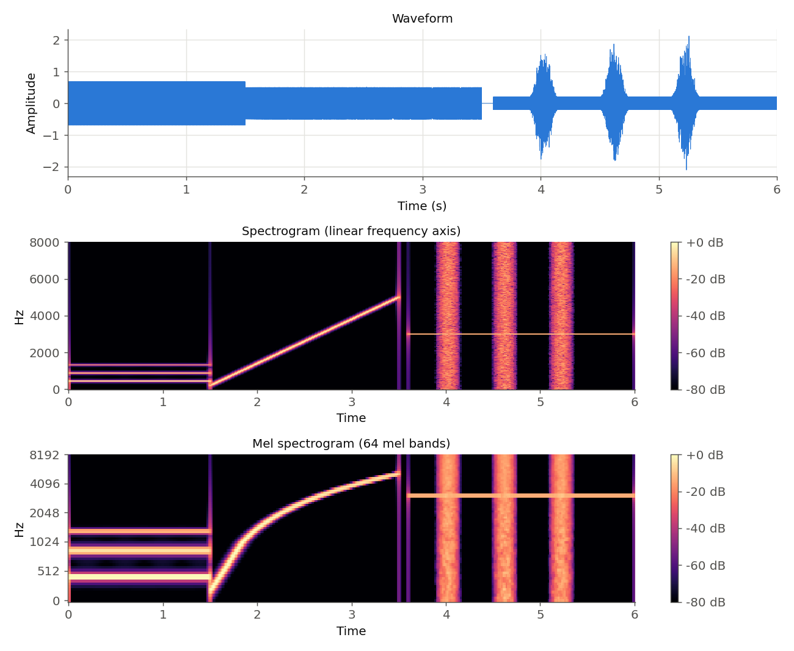

*그림 12. 합성 신호의 파형, 선형 주파수 축의 스펙트로그램, 멜 스펙트로그램*

위 그림은 16 kHz로 만든 6초 길이의 합성 신호이다. 0\~1.5초에는 440 Hz와 그 2배, 3배 음(880 Hz, 1320 Hz)이 섞인 음, 1.5\~3.5초에는 주파수가 200 Hz에서 5000 Hz까지 일정하게 올라가는 소리, 3.6\~6초에는 3000 Hz의 음과 0.25초 길이의 잡음 세 번이 들어 있다.

- **파형(위):** 소리의 세기가 언제 바뀌는지는 보이지만, 어떤 주파수의 소리인지는 알 수 없다. 특히 0\~1.5초와 1.5\~3.5초는 높이만 조금 다른 꽉 찬 띠로 보여, 각각 어떤 소리인지 구별할 수 없다.
- **스펙트로그램(가운데):** 440, 880, 1320 Hz의 음은 세 개의 가로줄, 올라가는 소리는 비스듬한 직선, 3000 Hz의 음은 한 개의 가로줄, 잡음은 모든 주파수에 걸친 세로 띠로 나타나 소리의 구성이 한눈에 보인다.
- **멜 스펙트로그램(아래):** 4.2절에서 설명하며, 세로축을 사람의 청각에 맞게 바꾼 것이다.

스펙트로그램은 2차원 배열, 즉 이미지이므로 이미지를 다루는 영상처리 방법, 특히 CNN을 그대로 적용할 수 있다. 이것이 소리처리에서 스펙트로그램을 널리 쓰는 가장 큰 이유이다(5.1절).

---

<br>

## 4. 멜 스펙트로그램과 MFCC

### 4.1 멜 스케일

> **용어 정의:** **멜 스케일(mel scale)** 은 인간의 청각 특성을 반영한 주파수 척도이다. 선형적으로 증가하는 Hz 단위의 주파수 대신, 사람이 느끼는 음 높이의 간격에 비례하도록 주파수를 다시 잰다.

멜 스케일은 사람들에게 음 높이가 같은 간격으로 느껴지도록 음을 조절하게 한 청취 실험에서 유래했다 [11]. 사람은 낮은 주파수에서는 작은 차이도 잘 구별하지만, 높은 주파수에서는 차이가 커야 구별한다. 즉 멜 스케일은 낮은 주파수에 높은 감도를, 높은 주파수에 낮은 감도를 가진다. 널리 쓰이는 변환식은 다음과 같다 [12].

$$
m = 2595 \log_{10} \left( 1 + \frac{f}{700} \right), \qquad f = 700 \left( 10^{m / 2595} - 1 \right)
$$

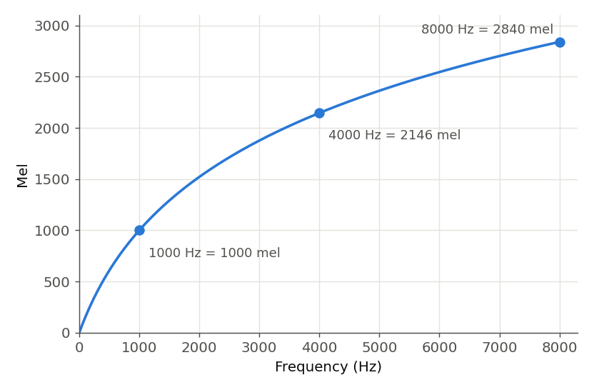

*그림 13. 주파수(Hz)와 멜 값의 관계*

곡선은 낮은 주파수에서 가파르고 높은 주파수에서 완만하다. 1000 Hz는 1000 mel, 4000 Hz는 약 2146 mel, 8000 Hz는 약 2840 mel이다. 0\~1000 Hz의 1000 Hz 구간이 1000 mel을 차지하는 반면, 1000\~8000 Hz의 7000 Hz 구간은 약 1840 mel밖에 차지하지 않는다. 같은 100 Hz 차이라도 100 Hz에서 200 Hz로 가면 약 132.7 mel, 7000 Hz에서 7100 Hz로 가면 약 14.5 mel이 늘어나므로, 낮은 주파수의 100 Hz 차이가 높은 주파수의 100 Hz 차이보다 약 9배 크게 느껴진다는 뜻이다.

> **참고:** 멜 스케일의 식은 하나가 아니다. 위 식은 HTK 방식이라고도 불리며, librosa는 기본값으로 1000 Hz 아래는 직선, 위는 로그인 Slaney 방식을 쓴다 [13]. librosa에서 위 식을 쓰려면 `htk=True` 인자를 준다. 두 방식은 멜 값의 크기는 다르지만 낮은 주파수를 촘촘하게, 높은 주파수를 성기게 나눈다는 성질은 같다.

### 4.2 멜 스펙트로그램

**멜 스펙트로그램(mel spectrogram)** 은 스펙트로그램의 주파수 축에 멜 스케일을 적용한 것이다. 그 결과 인간의 청각과 유사한 특징 추출이 가능해지며, 낮은 주파수 영역을 더 촘촘한 간격으로 나누어 더 많은 주파수 정보를 담는다.

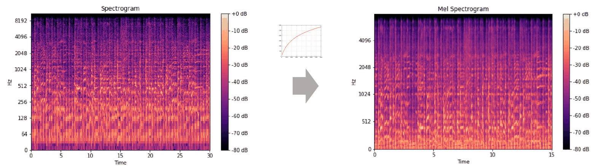

*그림 14. 스펙트로그램에 멜 스케일을 적용하여 멜 스펙트로그램을 만드는 과정*

왼쪽은 음악의 스펙트로그램, 가운데의 작은 그래프는 멜 스케일 곡선, 오른쪽은 이를 적용한 멜 스펙트로그램이다. 멜 스펙트로그램에서는 낮은 주파수 영역이 세로로 넓게 펼쳐지고 높은 주파수 영역은 좁게 압축된다.

멜 스케일의 적용은 **멜 필터 뱅크(mel filter bank)** 로 한다. 멜 축 위에서 같은 간격으로 놓인 삼각형 모양의 필터 $B$개를 만들고, 각 필터가 덮는 주파수 칸의 값을 가중합하여 그 필터의 값으로 삼는다. $b$번째 필터의 가중치를 $H_b[k]$라 하면 멜 스펙트로그램은 다음과 같다.

$$
M[m, b] = \sum_{k} H_b[k] \, \lvert X[m, k] \rvert^{p}, \qquad b = 0, 1, \dots, B - 1
$$

$p = 2$이면 파워, $p = 1$이면 크기의 멜 스펙트로그램이다. 예를 들어 0\~8000 Hz에서 필터 10개($B = 10$)를 만들려면 멜 축을 11등분한 12개의 점이 필요하다. 위의 식으로 계산하면 이 점들은 0, 180, 407, 692, 1050, 1501, 2067, 2780, 3676, 4802, 6219, 8000 Hz이며, $b$번째 필터는 $b$번째 점에서 시작하여 $b+1$번째 점에서 최댓값에 이르고 $b+2$번째 점에서 끝나는 삼각형이다(0부터 센다). 첫 필터는 0\~407 Hz의 약 400 Hz 폭이지만 마지막 필터는 4802\~8000 Hz의 약 3200 Hz 폭으로, 높은 주파수일수록 필터 하나가 넓은 대역을 하나로 묶는다. 결과적으로 1025개였던 주파수 칸이 10개의 멜 밴드로 줄어 데이터도 작아진다.

> **참고:** 멜 스펙트로그램은 주파수를 멜 스케일로 변환한 후 STFT를 적용한 결과라고 설명되기도 하지만, 실제 계산 순서는 STFT로 스펙트로그램을 먼저 구하고 그 주파수 축에 멜 필터 뱅크를 적용하는 것이다. 파형에는 아직 주파수 축이 없으므로 STFT보다 먼저 멜 스케일을 적용할 수는 없다.

### 4.3 MFCC

> **용어 정의:** **MFCC(Mel-Frequency Cepstral Coefficients, 멜 주파수 켑스트럼 계수)** 는 멜 스펙트럼을 계산한 후 로그를 취하고 DCT(Discrete Cosine Transform, 이산 코사인 변환)를 적용하여 얻은 계수이다 [14].


*그림 15. 파형에서 멜 스펙트로그램과 MFCC를 얻는 계산 과정*

멜 밴드 $B$개의 로그 값 $\log M_b$에 DCT를 적용한 $q$번째 계수는 다음과 같다.

$$
c_q = \sum_{b=0}^{B-1} \log(M_b) \cos\left[ \frac{\pi q}{B} \left( b + \frac{1}{2} \right) \right], \qquad q = 0, 1, \dots, Q - 1
$$

- **로그를 취하는 이유:** 사람은 소리의 세기를 로그 척도로 느끼며, 로그는 매우 넓은 값의 범위를 압축한다.
- **DCT를 적용하는 이유:** 이웃한 멜 밴드의 값은 서로 강하게 상관되어 있다. DCT는 이를 서로 상관이 적은 계수로 바꾸고, 스펙트럼의 전체적인 모양(포락선)을 앞쪽의 몇 개 계수에 모아 준다. 그래서 보통 앞쪽 13개 정도의 계수만 남겨 프레임 하나를 짧은 벡터로 요약한다.
- **켑스트럼(cepstrum):** 로그 스펙트럼을 다시 변환한 것으로, 스펙트럼(spectrum)의 앞 글자를 뒤집어 만든 이름이다. 낮은 차수의 계수는 성도(목과 입 안)의 모양 같은 스펙트럼 포락선을, 높은 차수는 음 높이에 따른 세밀한 구조를 담는다.

MFCC는 전통적인 음성 인식에서 표준 특징이었지만, 최근 딥러닝에서는 MFCC보다 (로그) 멜 스펙트로그램이 더 많이 쓰인다. DCT가 모든 밴드를 섞어 버리므로 MFCC에서는 주파수 축 위의 국소적인 패턴이 사라지는데, CNN은 바로 그런 국소 패턴을 학습하는 데 강하기 때문이다. 또한 신경망은 덜 가공된 입력에서도 필요한 특징을 스스로 학습할 수 있다.

### 4.4 librosa로 멜 스펙트로그램 추출하기

멜 스펙트로그램을 추출할 때는 `n_fft`, `n_mels`, `hop_length`, `win_length` 값을 조절하여 올바른 특징을 얻는다. 다음은 Python의 오디오 분석 라이브러리 librosa [13]로 16 kHz 녹음 파일의 멜 스펙트로그램을 추출하고 그리는 코드이다.

```python
import numpy as np
import librosa
import librosa.display
import matplotlib.pyplot as plt

# User set parameters
nfft = 2048
win_len = nfft
hop_len = win_len // 2
nb_mel_bands = 40
sr = 16000

audio_file = './pig_data/sample/farm01_R00001_0001_16000.wav'

y, sr = librosa.load(audio_file, sr=sr)
D = np.abs(librosa.stft(y, n_fft=nfft, win_length = win_len, hop_length=hop_len))
mel_spec = librosa.feature.melspectrogram(S=D, sr=sr, n_mels=nb_mel_bands, hop_length=hop_len,
                                          win_length=win_len).T

librosa.display.specshow(librosa.amplitude_to_db(mel_spec.T, ref=0.00002),
                         sr=sr, hop_length = hop_len, y_axis='mel', x_axis='time')
plt.colorbar(format='%2.0f dB')
plt.show()
```

- **1~4행:** 배열 계산용 numpy, 오디오 분석용 librosa와 그 시각화 모듈, 그래프용 matplotlib을 불러온다.
- **`nfft = 2048`:** 각 프레임에 적용하는 FFT의 크기이다. 16 kHz에서 2048샘플은 128 ms이고, 주파수 해상도는 7.8125 Hz, 주파수 칸은 1025개이다(표 3).
- **`win_len = nfft`:** 창 길이를 FFT 크기와 같게 둔다. 창 길이는 FFT 크기보다 클 수 없으며, 더 작으면 나머지를 0으로 채워 FFT한다.
- **`hop_len = win_len // 2`:** 홉 길이 1024샘플(64 ms)로, 이웃 창이 50% 겹친다. `//`는 몫만 구하는 정수 나눗셈 연산자이다.
- **`nb_mel_bands = 40`:** 멜 필터의 수이다. 결과의 세로축이 40칸이 된다.
- **`sr = 16000`:** 사용할 샘플링 레이트이다.
- **`audio_file`:** 돼지 농장에서 16 kHz로 녹음한 소리 파일의 경로이다.
- **`librosa.load(audio_file, sr=sr)`:** 파일을 읽어 지정한 16 kHz로 리샘플링하고, 단일 채널의 실수 배열 `y`와 샘플링 레이트 `sr`을 돌려준다.
- **`librosa.stft(...)`:** STFT를 계산하여 (주파수 칸 1025) × (프레임 수) 크기의 복소수 행렬을 돌려준다. `np.abs`로 크기만 남긴 것이 `D`이다.
- **`librosa.feature.melspectrogram(S=D, ...)`:** 이미 계산한 스펙트로그램 `D`에 40개의 멜 필터를 적용하여 (40) × (프레임 수) 행렬을 만든다. 마지막의 `.T`는 행과 열을 바꾸어 (프레임 수) × (40), 즉 시간이 먼저 오는 형태로 만든다. 딥러닝 모델에 프레임 순서대로 넣기 위한 형태이다.
- **`librosa.amplitude_to_db(mel_spec.T, ref=0.00002)`:** 다시 전치하여 (40) × (프레임 수)로 되돌린 뒤 데시벨로 바꾼다. 기준값 0.00002는 공기 중의 음압 레벨에 쓰는 기준 압력 20 μPa에 해당하는 값이다.
- **`librosa.display.specshow(...)`:** 세로축을 멜 눈금(`y_axis='mel'`), 가로축을 시간(`x_axis='time'`)으로 하여 그린다. `sr`과 `hop_length`는 프레임 번호를 초 단위로 바꾸는 데 쓰인다.
- **`plt.colorbar(format='%2.0f dB')`, `plt.show()`:** 색과 dB 값의 대응을 나타내는 막대를 붙이고 그림을 화면에 띄운다.

> **참고:** `melspectrogram`에 스펙트로그램 `S`를 직접 주면, librosa는 FFT 크기를 `S`의 행 수에서 계산하고 `hop_length`와 `win_length` 인자는 쓰지 않는다. 이 인자들은 `S` 대신 파형 `y`를 줄 때 STFT를 계산하는 데에만 쓰인다. 또한 `S`가 주어지면 제곱(`power`)을 적용하지 않으므로, 크기 스펙트로그램 `D`를 넣은 결과는 크기의 멜 스펙트로그램이다. 그래서 데시벨 변환에 크기용인 `amplitude_to_db`(20 log)를 쓰는 것이 맞으며, 파워 스펙트로그램이었다면 `power_to_db`(10 log)를 써야 한다. 한편 디지털 녹음의 값은 실제 압력으로 보정된 것이 아니므로, 기준값을 20 μPa로 두더라도 dB 값은 절대적인 음압이 아니라 상대적인 크기이다.

각 파라미터를 바꾸면 결과는 다음과 같이 달라진다.

| 파라미터 | 의미 | 예제 값 | 값을 늘리면 |
|:-----|:-----|:-----|:-----|
| `n_fft` | 각 프레임에 적용하는 FFT의 크기 | 2048 | 주파수 해상도가 좋아지고 주파수 칸이 늘어난다 |
| `win_length` | 창 함수의 길이 (`n_fft` 이하) | 2048 | 주파수 해상도는 좋아지고 시간 해상도는 나빠진다 |
| `hop_length` | 다음 프레임까지 건너뛰는 샘플 수 | 1024 | 프레임 수가 줄어 가로축이 거칠어지고(시간 해상도 저하) 계산량이 준다 |
| `n_mels` | 멜 필터의 수 | 40 | 세로축의 칸이 늘어 주파수를 더 잘게 나눈다 |

*표 4. 멜 스펙트로그램 추출 파라미터의 의미와 효과*

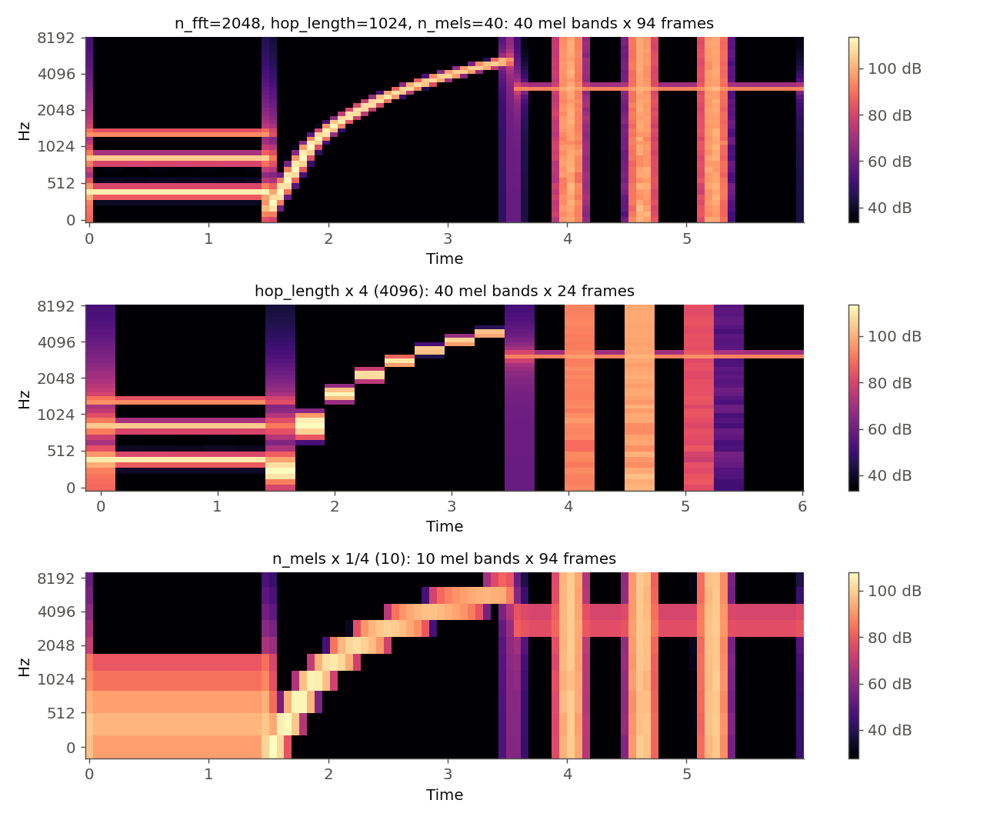

*그림 16. 기본 설정과 hop_length를 4배, n_mels를 1/4로 바꾼 멜 스펙트로그램의 비교*

위 그림은 3.5절의 합성 신호에 위 코드의 설정을 적용한 결과이다.

- **기본 설정(위):** 6초 신호에서 $1 + \lfloor 96000 / 1024 \rfloor = 94$개 프레임, 40개 멜 밴드의 40×94 배열이 된다.
- **hop_length 4배(가운데):** 홉 길이를 4096으로 늘리면 프레임이 $1 + \lfloor 96000 / 4096 \rfloor = 24$개로 약 1/4이 되어 가로 칸 수가 줄어든다. 올라가는 소리가 계단 모양으로 거칠게 보이고, 잡음의 시작과 끝도 흐려진다.
- **n_mels 1/4(아래):** 멜 밴드를 10개로 줄이면 세로 칸이 40칸에서 10칸이 된다. 440, 880, 1320 Hz의 세 음이 약 0\~1.7 kHz의 여러 칸에 걸친 하나의 넓은 덩어리로 번져 구별되지 않는다.

### 4.5 스펙트로그램이 여전히 쓰이는 이유

스펙트로그램 계열의 특징은 오래된 전통적인 소리처리 기법임에도 불구하고, 지금도 최고 성능(SOTA, State Of The Art) 모델에서 주로 사용되는 특징 추출 방식이다. 다음은 소리 인식 분야의 대표적인 국제 경진대회인 DCASE의 2024년 태스크 2(기계 소리로 이상 여부를 찾는 비지도 이상음 탐지)에서 상위에 오른 시스템이다 [15].

| 순위 | 제출 코드 | 분류기 | 시스템 복잡도 | 음향 특징 | 데이터 증강 | 결정 방식 |
|:-----|:-----|:-----|:-----|:-----|:-----|:-----|
| 1 | Lv_AITHU_task2_4 | 사전 학습 모델, 앙상블 | 700M | 스펙트로그램 | specaug | median |
| 2 | Lv_AITHU_task2_3 | 사전 학습 모델, 앙상블 | 700M | 스펙트로그램 | specaug | median |
| 3 | Lv_AITHU_task2_1 | 사전 학습 모델, 앙상블 | 360M | 스펙트로그램 | specaug | median |
| 4 | Jiang_THUEE_task2_1 | 사전 학습 모델, CNN, 앙상블 | 360M | 스펙트로그램, 원시 파형 | specaug | median |
| 5 | Lv_AITHU_task2_2 | 사전 학습 모델, 앙상블 | 360M | 스펙트로그램 | specaug | median |
| 6 | Jiang_THUEE_task2_2 | 사전 학습 모델, 흐름 모델, 앙상블 | 360M | 스펙트로그램 | specaug | median |
| 7 | Jiang_THUEE_task2_3 | 사전 학습 모델, CNN, 흐름 모델, 앙상블 | 360M | 스펙트로그램 | specaug | median |

*표 5. DCASE 2024 태스크 2 상위 시스템의 구성*

상위 시스템은 모두 스펙트로그램을 음향 특징으로 쓰며, 원시 파형은 한 시스템에서 스펙트로그램과 함께 보조로 쓰였을 뿐이다. 시스템 복잡도는 파라미터 수(700M은 7억 개)이고, 모두 대규모 데이터로 사전 학습한 모델을 여러 개 묶은 앙상블이다. 데이터 증강의 specaug는 스펙트로그램의 일부 시간 구간과 주파수 대역을 가려 학습 데이터를 늘리는 SpecAugment 기법이다 [16].

---

<br>

## 5. 오디오 분류

### 5.1 소리를 이미지처럼 분류하기

소리를 스펙트로그램이라는 이미지로 변환한 이후의 과정은 이미지 분류와 같다. 그림 1처럼 멜 스펙트로그램을 (멜 밴드 수) × (프레임 수) 크기의 흑백 이미지 한 장으로 보고, 합성곱과 풀링으로 특징을 추출한 뒤 완전 연결 층과 소프트맥스로 클래스별 확률을 낸다. 합성곱 신경망의 구조와 학습은 2~4강에서 다루었다.

왜 소리를 굳이 스펙트로그램으로 바꾸어 처리하는가? 영상처리 분야에는 이미 성능이 검증된 모델과 대규모 데이터로 사전 학습한 모델이 많지만, 소리처리 분야에는 상대적으로 적었다. 그래서 소리를 좋은 모델이 많은 형태, 즉 이미지로 가공하여 그 모델들을 활용하는 편이 효과적이었다.

> **주의:** 스펙트로그램은 이미지처럼 다룰 수 있지만 사진과 똑같지는 않다. 사진에서는 고양이가 위로 옮겨 가도 여전히 고양이이지만, 스펙트로그램에서 패턴이 주파수 축으로 옮겨 가면 음 높이가 달라져 다른 소리가 될 수 있다. 또 사진에서는 앞의 물체가 뒤의 물체를 가리지만, 소리는 여러 소리가 서로 더해져 같은 칸에 겹친다. 이런 차이 때문에 소리 전용으로 설계하거나 소리 데이터로 다시 학습한 모델이 함께 쓰인다.

### 5.2 VGGish와 전이 학습

**VGGish**는 이미지에서 사용되는 VGG 모델을 오디오에 적용한 연구이다 [17]. 이름의 "-ish"는 VGG와 비슷하다는 뜻이다. Google은 YouTube 학습 동영상 약 7,000만 개의 소리로 여러 CNN 구조를 학습하여 오디오 분류에 이미지용 CNN이 잘 작동함을 보였고, 그중 VGG를 닮은 모델을 VGGish로 공개했다. 공개된 VGGish는 0.96초 길이의 로그 멜 스펙트로그램(96 프레임 × 64 멜 밴드)을 입력받아 128차원의 특징 벡터(임베딩)를 출력한다 [18]. VGG 구조는 3강에서 다루었다.

VGGish는 주로 소리 데이터의 특징을 추출하는 데, 즉 **전이 학습(transfer learning)** 에 사용된다. 대규모 소리 데이터로 이미 학습한 앞부분을 그대로 가져와 특징 추출기로 쓰고, 풀려는 태스크에 맞는 뒷부분만 새로 학습하는 방식이다.

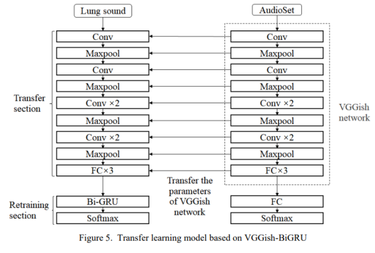

*그림 17. VGGish의 파라미터를 옮겨 와 Bi-GRU를 새로 학습하는 폐음 인식 모델*

위 그림은 VGGish를 폐음(Lung sound) 인식에 적용한 예이다 [19]. 오른쪽은 대규모 YouTube 동영상의 소리로 사전 학습한 VGGish 네트워크로(그림 위의 AudioSet은 VGGish와 같은 모델로 추출한 특징을 함께 공개한 YouTube 기반 오디오 데이터셋이다), 합성곱(Conv)과 최대 풀링(Maxpool)을 반복한 뒤 완전 연결 층 3개(FC×3)와 분류층(FC, Softmax)으로 끝난다. 왼쪽의 폐음 인식 모델은 전이 구간(Transfer section)에서 VGGish의 합성곱 층부터 FC×3까지의 파라미터를 그대로 옮겨 오고(Transfer the parameters of VGGish network), 재학습 구간(Retraining section)에서는 원래의 분류층 대신 양방향 GRU(Bi-GRU)와 소프트맥스를 붙여 폐음 데이터로 새로 학습한다. 의료 녹음처럼 데이터가 적은 분야에서도, 대규모 데이터에서 배운 일반적인 소리 특징을 재사용하여 좋은 성능을 낼 수 있다.

---

<br>

## 6. 음향 이벤트 탐지

### 6.1 SED 시스템의 구성

음향 이벤트 탐지(SED)는 1.4절에서 정의했듯이 특정 음향 사건이나 소리를 감지하고 그 시작과 끝을 찾는 기술이다. Mesaros 등의 튜토리얼 [20]은 SED 시스템을 다음과 같이 정리한다.

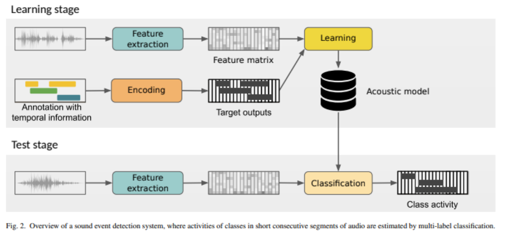

*그림 18. 학습 단계와 테스트 단계로 이루어진 음향 이벤트 탐지 시스템*

- **학습 단계(Learning stage):** 오디오에서 특징을 추출하여 특징 행렬(Feature matrix)을 만든다. 사람이 이벤트의 시작과 끝을 표시한 주석(Annotation with temporal information)은 프레임마다 각 클래스가 활성인지를 나타내는 목표 출력(Target outputs)으로 부호화(Encoding)한다. 둘을 짝지어 음향 모델(Acoustic model)을 학습한다.
- **테스트 단계(Test stage):** 새 오디오에서 같은 방식으로 특징을 추출하고, 학습한 음향 모델로 분류하여 클래스별 활성(Class activity)을 얻는다.

SED는 오디오를 짧은 구간(프레임)으로 잘게 나누고, 구간마다 각 클래스가 활성인지를 판정하는 **다중 레이블 분류(multi-label classification)** 로 볼 수 있다. 한 프레임에서 여러 클래스가 동시에 활성일 수 있으므로, 클래스 하나만 고르는 일반 분류와 다르다.

### 6.2 입력과 프레임 단위 레이블

이 절부터는 축사에서 녹음한 돼지 소리에서 두 종류의 기침, 즉 **건식 기침(dry cough)** 과 **복식 기침(abdominal cough)** 을 탐지하는 예를 따라간다.

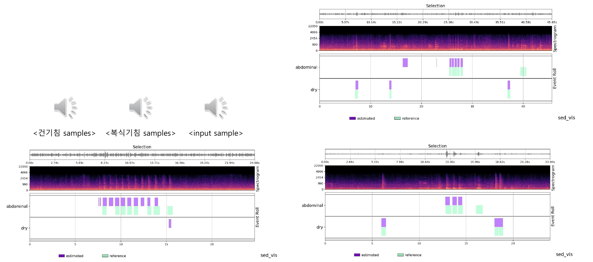

*그림 19. 건식 기침, 복식 기침, 입력 샘플에 대한 탐지 결과의 시각화*

세 패널은 각각 건식 기침 샘플, 복식 기침 샘플, 입력 샘플에 대한 결과이다. 각 패널의 위는 파형과 스펙트로그램이고, 아래의 이벤트 롤(Event Roll)은 abdominal(복식)과 dry(건식)의 두 줄에 이벤트를 막대로 표시한다. 보라색(estimated)은 모델의 예측값, 초록색(reference)은 사람이 붙인 실제 레이블 정답이다. 보라색 막대와 초록색 막대가 같은 위치에 있을수록 탐지가 정확하다.

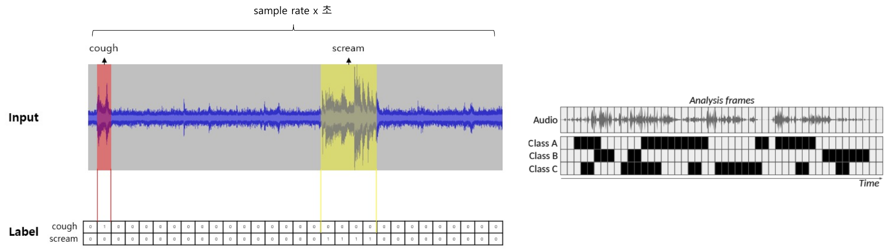

*그림 20. SED 모델의 입력 파형과 프레임 단위 레이블*

- **입력(Input):** 길이가 (샘플링 레이트) × (초)개의 샘플인 파형이다. 예를 들어 16 kHz로 10초를 녹음했으면 160,000개의 샘플이다. 그림에서는 기침(cough, 빨간색)과 비명(scream, 노란색) 이벤트가 들어 있다.
- **레이블(Label):** 입력을 일정 길이의 프레임으로 나누고, 클래스마다 프레임별로 그 클래스가 활성이면 1, 아니면 0을 적은 행렬이다. 기침 줄은 기침이 난 프레임만 1이고, 비명 줄은 비명이 이어진 여러 프레임이 1이다.
- **오른쪽 그림:** 분석 프레임(Analysis frames)마다 Class A, B, C의 활성을 검은 칸으로 표시한 것으로, 같은 프레임에서 여러 클래스가 동시에 활성일 수 있음을 보여 준다.

### 6.3 SED-CRNN 모델

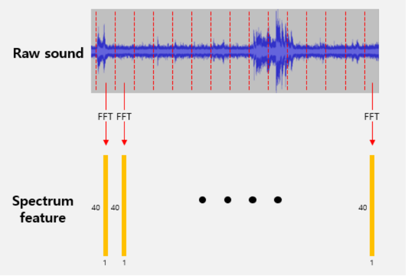

*그림 21. 원시 소리를 프레임으로 나누어 FFT하고 프레임마다 40차원 스펙트럼 특징을 만드는 과정*

먼저 원시 소리(Raw sound)를 빨간 점선으로 표시한 프레임으로 나누고, 프레임마다 FFT와 멜 필터 뱅크를 적용하여 40차원의 스펙트럼 특징(Spectrum feature) 열벡터를 만든다. 이 열벡터를 시간 순서로 이어 붙이면 세로 40칸의 멜 스펙트로그램이 된다.

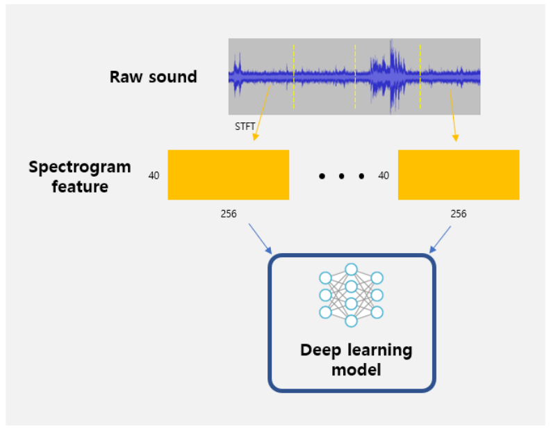

*그림 22. 원시 소리를 40×256 스펙트로그램 블록으로 나누어 딥러닝 모델에 넣는 과정*

긴 녹음은 STFT로 만든 스펙트로그램을 256프레임씩 잘라 40×256(멜 밴드 × 프레임) 크기의 블록으로 만들고, 블록마다 딥러닝 모델(Deep learning model)에 넣는다. 모델은 블록 안의 256개 프레임 각각에 대해 값을 예측한다.

기침 탐지에 쓰인 모델은 Adavanne 등이 제안한 **SED-CRNN**을 바탕으로 한다 [21]. **CRNN(Convolutional Recurrent Neural Network)** 은 합성곱 층(CNN) 뒤에 순환 층(RNN)을 이은 모델로, CNN 3층, GRU 2층, 완전 연결 층으로 이루어진 간단한 구조이다.

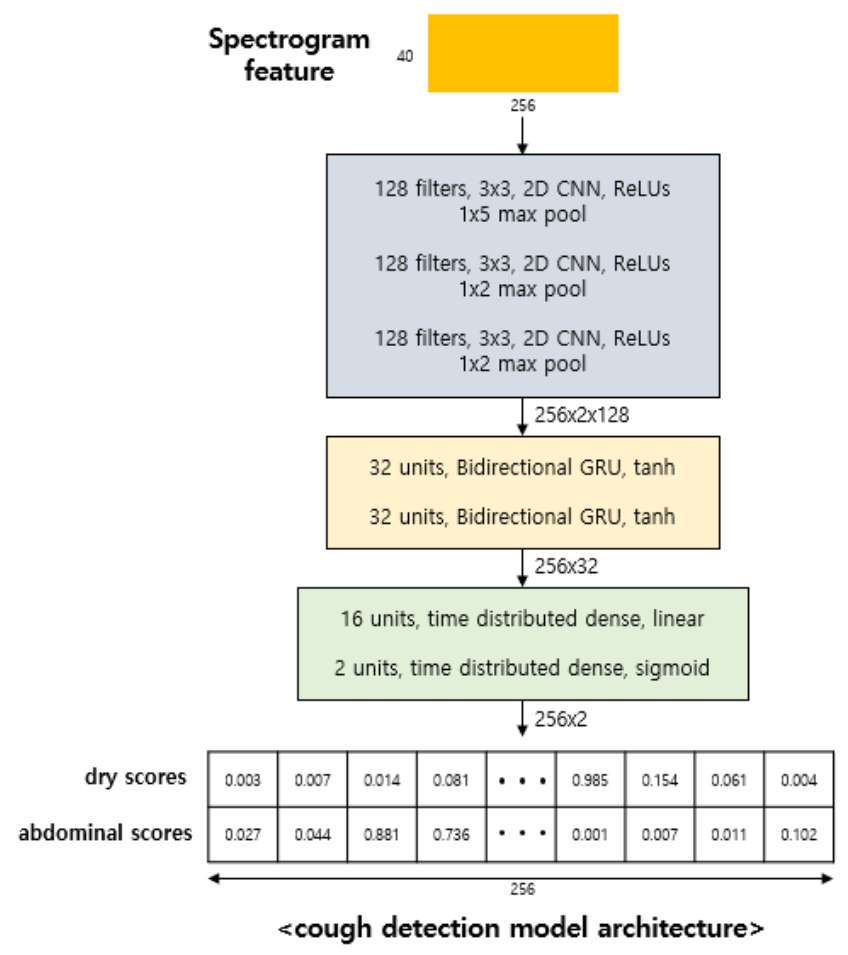

*그림 23. 기침 탐지 모델의 구조와 프레임별 출력 점수*

블록 하나가 모델을 통과하며 바뀌는 크기는 다음과 같다(크기는 시간 × 주파수 × 채널의 순서이다).

1. **입력:** 40(멜 밴드) × 256(프레임)의 스펙트로그램 특징이다.
2. **합성곱 블록 3개(회색):** 각각 128개의 3×3 필터로 합성곱하고 ReLU를 적용한 뒤, 최대 풀링을 **주파수 축으로만** 한다. 풀링 크기가 1×5, 1×2, 1×2이므로 주파수 축은 $40 \to 8 \to 4 \to 2$로 줄고 시간 축 256은 그대로이다. 출력은 256×2×128이다. 시간 축을 줄이지 않는 것은 프레임마다 이벤트의 활성을 판정해야 하기 때문이다.
3. **양방향 GRU 2층(노란색):** 각 프레임의 $2 \times 128 = 256$개 값을 한 벡터로 펴서 256개 프레임의 시퀀스로 만든 뒤, 32유닛의 양방향 GRU 두 층에 넣어 256×32를 얻는다. **GRU(Gated Recurrent Unit)** 는 LSTM을 단순화한 순환 신경망으로(2강), 기침이 얼마나 이어지는지 같은 시간적 문맥을 학습한다. **양방향(bidirectional)** 은 시퀀스를 앞에서 뒤로, 뒤에서 앞으로 모두 읽어 각 프레임의 출력이 과거와 미래의 문맥을 함께 반영하게 한다.
4. **시간 분산 완전 연결 층(초록색):** 16유닛의 선형 층과 2유닛의 시그모이드 층을 256개 프레임 각각에 똑같이 적용하여(time distributed) 256×2를 얻는다.
5. **출력:** 프레임마다 건식 기침 점수(dry scores)와 복식 기침 점수(abdominal scores)의 두 값이다. 예를 들어 그림에서 생략 부호 뒤의 첫 프레임은 건식 점수가 0.985로 높고, 앞쪽의 세 번째와 네 번째 프레임은 복식 점수가 0.881, 0.736으로 높다.

> **참고:** 양방향 GRU는 두 방향의 출력을 이어 붙이면 유닛 수의 두 배(32유닛이면 64)가 된다. 그림의 256×32는 두 방향의 출력을 원소별 곱이나 합으로 하나의 32차원 벡터로 합친 경우에 해당한다.

출력층에 소프트맥스가 아니라 **클래스마다 독립적인 시그모이드**를 쓴다는 점이 중요하다. 소프트맥스는 클래스 확률의 합을 1로 만들어 하나의 클래스만 고르게 하지만, 시그모이드는 클래스마다 0~1 사이의 확률을 따로 내므로 두 기침이 같은 프레임에서 함께 활성이라고 예측할 수 있다. 이는 6.1절의 다중 레이블 분류에 맞는 설계이다.

### 6.4 임계값으로 이벤트 결정하기

모델의 출력은 0~1 사이의 점수이므로, 일정 **임계값(threshold)** 을 기준으로 기침의 발생 여부를 판단한다. 기침 탐지 모델의 출력 점수가 임계값 이상이면 1, 아니면 0으로 판단하며, 여기서 1은 기침이 탐지되었음을 의미한다.

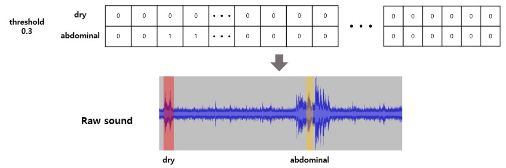

*그림 24. 임계값 0.3으로 이진화한 프레임별 출력과 원시 소리에서 탐지된 구간*

그림 23에 표시된 점수에 임계값 0.3을 적용하면 다음과 같다.

```text
dry scores        0.003  0.007  0.014  0.081  ...  0.985  0.154  0.061  0.004
dry (>= 0.3)        0      0      0      0    ...    1      0      0      0
abdominal scores  0.027  0.044  0.881  0.736  ...  0.001  0.007  0.011  0.102
abdominal (>= 0.3)  0      0      1      1    ...    0      0      0      0
```

이진화한 결과에서 1이 연속된 프레임 묶음 하나가 이벤트 하나이며, 그 첫 프레임과 마지막 프레임으로 시작과 끝 시각을 계산한다. 예를 들어 프레임 간격이 64 ms이고 0번부터 센 2번과 3번 프레임이 1이면, 복식 기침은 약 $2 \times 0.064 = 0.128$초에 시작하여 $(3 + 1) \times 0.064 = 0.256$초 무렵에 끝난 것이다. 그림 아래의 원시 소리에서 빨간 구간은 건식(dry), 노란 구간은 복식(abdominal) 기침으로 탐지된 부분이다. 실제 시스템에서는 점수가 한 프레임만 잠깐 임계값을 넘는 잡음을 없애기 위해 중앙값 필터 같은 후처리를 더하기도 한다 [20].

임계값을 낮추면 놓치는 기침은 줄지만 기침이 아닌 소리를 기침으로 판단하는 경우가 늘고, 임계값을 높이면 그 반대가 된다. 이는 5강에서 본 신뢰도 임계값과 정밀도, 재현율의 관계와 같다.

### 6.5 세그먼트 기반 평가

SED의 정확도는 **세그먼트 기반(segment-based)** 과 **이벤트 기반(event-based)** 의 두 가지로 평가한다 [22]. 세그먼트 기반 평가는 시간축을 일정 길이(예: 1초)의 세그먼트로 나누고, 세그먼트마다 각 클래스의 활성 여부를 정답과 비교한다.

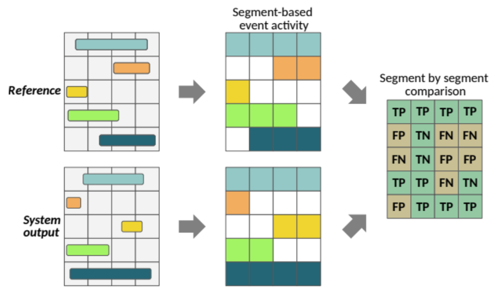

*그림 25. 세그먼트 기반 평가: 정답과 시스템 출력을 세그먼트 단위의 활성으로 바꾸어 비교하는 과정*

1. 정답(Reference)과 시스템 출력(System output)의 이벤트 막대를 4개의 세그먼트로 나누고, 이벤트가 조금이라도 걸친 세그먼트를 활성(1)으로 칠한다(Segment-based event activity).
2. 클래스와 세그먼트의 칸마다 정답과 출력을 비교하여(Segment by segment comparison) 둘 다 1이면 TP, 출력만 1이면 FP, 정답만 1이면 FN, 둘 다 0이면 TN으로 판정한다.

그림의 다섯 클래스(줄)와 네 세그먼트(열)를 표로 나타내면 다음과 같다.

| 클래스 | 정답 활성 | 시스템 출력 활성 | 판정 (세그먼트 1~4) |
|:-----|:-----|:-----|:-----|
| 1 | 1 1 1 1 | 1 1 1 1 | TP TP TP TP |
| 2 | 0 0 1 1 | 1 0 0 0 | FP TN FN FN |
| 3 | 1 0 0 0 | 0 0 1 1 | FN TN FP FP |
| 4 | 1 1 1 0 | 1 1 0 0 | TP TP FN TN |
| 5 | 0 1 1 1 | 1 1 1 1 | FP TP TP TP |

*표 6. 세그먼트 기반 평가 예의 활성과 판정*

전체를 세면 TP 9, FP 4, FN 4, TN 3이다. 정밀도, 재현율, F1 점수는 다음과 같다.

$$
P = \frac{TP}{TP + FP} = \frac{9}{13} \approx 0.692, \quad R = \frac{TP}{TP + FN} = \frac{9}{13} \approx 0.692, \quad F_1 = \frac{2PR}{P + R} = \frac{2\,TP}{2\,TP + FP + FN} = \frac{18}{26} \approx 0.692
$$

SED에서는 **오류율(ER, Error Rate)** 도 함께 쓴다. 세그먼트 $k$마다 FN과 FP가 동시에 있으면 다른 클래스로 잘못 바꾼 것으로 보아 **대체(S, substitution)**, 남는 FN은 **삭제(D, deletion)**, 남는 FP는 **삽입(I, insertion)** 으로 센다 [22].

$$
S(k) = \min(FN(k), FP(k)), \quad D(k) = \max(0, FN(k) - FP(k)), \quad I(k) = \max(0, FP(k) - FN(k))
$$

$$
\text{ER} = \frac{\sum_k S(k) + \sum_k D(k) + \sum_k I(k)}{\sum_k N(k)}
$$

$N(k)$는 세그먼트 $k$에서 정답이 활성인 클래스의 수이다. 위 예에 적용하면 다음과 같다.

| 세그먼트 | 정답 활성 수 $N$ | TP | FP | FN | S | D | I |
|:-----|-----:|-----:|-----:|-----:|-----:|-----:|-----:|
| 1 | 3 | 2 | 2 | 1 | 1 | 0 | 1 |
| 2 | 3 | 3 | 0 | 0 | 0 | 0 | 0 |
| 3 | 4 | 2 | 1 | 2 | 1 | 1 | 0 |
| 4 | 3 | 2 | 1 | 1 | 1 | 0 | 0 |
| 합계 | 13 | 9 | 4 | 4 | 3 | 1 | 1 |

*표 7. 세그먼트별 대체, 삭제, 삽입과 오류율 계산*

따라서 $\text{ER} = (3 + 1 + 1) / 13 = 5/13 \approx 0.385$이다. F1은 높을수록, ER은 낮을수록 좋다. ER은 0이 가장 좋고, 삽입이 많으면 1을 넘을 수도 있다.

### 6.6 이벤트 기반 평가

이벤트 기반 평가는 세그먼트가 아니라 이벤트 하나하나를 단위로, 탐지한 이벤트가 제대로 된 하나의 이벤트인지를 본다. 예를 들어 기침 1회처럼 들리는 소리를 시스템이 실제 기침 한 번으로 찾아냈는지를 따진다.

- **TP:** 정답 이벤트를 기준으로, 허용된 오차 안에서 겹치는 같은 클래스의 시스템 출력이 있는 경우이다.
- **FP:** 시스템 출력을 기준으로, 허용된 오차 안에서 겹치는 정답 이벤트가 없는 경우이다.
- **FN:** 정답 이벤트를 기준으로, 허용된 오차 안에서 겹치는 시스템 출력이 없는 경우이다.

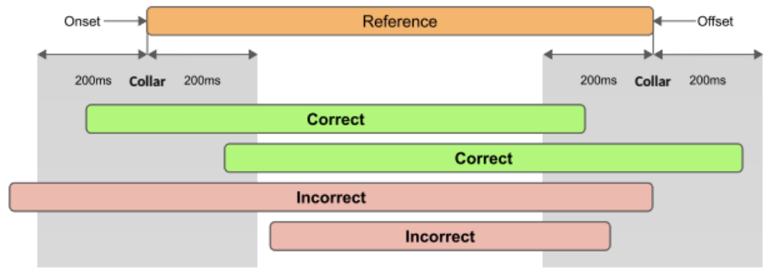

*그림 26. 이벤트 기반 평가에서 시작과 끝의 허용 구간(collar)에 따른 정답과 오답*

허용된 오차는 정답 이벤트의 시작(Onset)과 끝(Offset) 주변에 두는 **허용 구간(collar)** 이다. 그림에서는 정답(Reference)의 시작과 끝 앞뒤로 각각 200 ms의 회색 허용 구간이 있다. 위의 두 출력(Correct)은 시작과 끝이 모두 허용 구간 안에 있으므로 정답이고, 아래의 두 출력(Incorrect)은 시작이 허용 구간 밖에 있으므로 오답이다. DCASE의 평가에서는 시작의 허용 구간을 200 ms로, 끝의 허용 구간을 200 ms와 정답 이벤트 길이의 50% 중 큰 값으로 두기도 한다 [22].

**계산 예.** 정답 기침이 2.00초에 시작하여 2.40초에 끝나고, 허용 구간이 시작과 끝 모두 0.2초라 하자.

1. 출력 A가 2.15~2.50초이면 시작 차이 0.15초와 끝 차이 0.10초가 모두 0.2초 이하이므로 TP이다.
2. 출력 B가 1.70~2.35초이면 시작 차이가 0.30초로 0.2초를 넘으므로 이 정답과 짝지어지지 않는다. 출력 A 없이 출력 B만 있었다면 출력 B는 FP, 정답 기침은 FN이 된다.

두 평가 방식은 같은 결과에 대해 다른 점수를 줄 수 있다. 1초 길이의 기침 하나를 시스템이 세 조각으로 끊어 탐지했다면, 1초 세그먼트 기반 평가에서는 그 세그먼트가 활성으로 맞았으므로 TP 하나이다. 반면 이벤트 기반 평가에서는 시작이 맞는 첫 조각마저 끝이 허용 구간 밖이라 짝지어지지 않을 수 있으므로, 세 조각이 모두 FP이고 정답은 FN이 된다. 기침 횟수를 세는 응용처럼 이벤트의 개수가 중요할 때는 이벤트 기반 평가가 더 적절하다.

### 6.7 평가 결과와 응용

정확도의 예로 DCASE 2017 태스크 3(실생활 오디오의 음향 이벤트 탐지)의 결과를 본다 [23]. 이 태스크는 거리에서 녹음한 소리에서 브레이크 소리, 자동차, 아이들, 대형 차량, 사람의 말소리, 사람의 걸음 소리를 탐지하는 것으로, 1초 세그먼트 기반의 오류율(ER)로 순위를 매겼다.

| 순위 | 제출 코드 | 저자 | 소속 | ER | F1 |
|:-----|:-----|:-----|:-----|-----:|-----:|
| 1 | Adavanne_TUT_task3_1 | Sharath Adavanne | Tampere University of Technology | 0.7914 | 41.7% |
| 2 | Adavanne_TUT_task3_2 | Sharath Adavanne | Tampere University of Technology | 0.8061 | 42.9% |
| 3 | Lee_SNU_task3_3 | Kyogu Lee | Seoul National University | 0.8080 | 40.8% |
| 4 | Lu_THU_task3_1 | Rui Lu | Tsinghua University | 0.8251 | 39.6% |
| 5 | Lu_THU_task3_2 | Rui Lu | Tsinghua University | 0.8306 | 39.2% |
| 6 | Lu_THU_task3_3 | Rui Lu | Tsinghua University | 0.8361 | 38.0% |
| 7 | Lu_THU_task3_4 | Rui Lu | Tsinghua University | 0.8373 | 38.3% |

*표 8. DCASE 2017 태스크 3 상위 시스템의 세그먼트 기반 오류율과 F1 점수*

1위 시스템도 ER이 약 0.79, F1이 약 42%이다. 여러 소리가 겹치고 배경 잡음이 많은 실생활 녹음에서 음향 이벤트를 정확히 찾는 일이 어렵다는 것을 보여 준다. 또한 순위는 ER 기준이므로, F1이 더 높은 2위(42.9%)가 ER이 더 낮은 1위(0.7914)보다 아래에 있다.

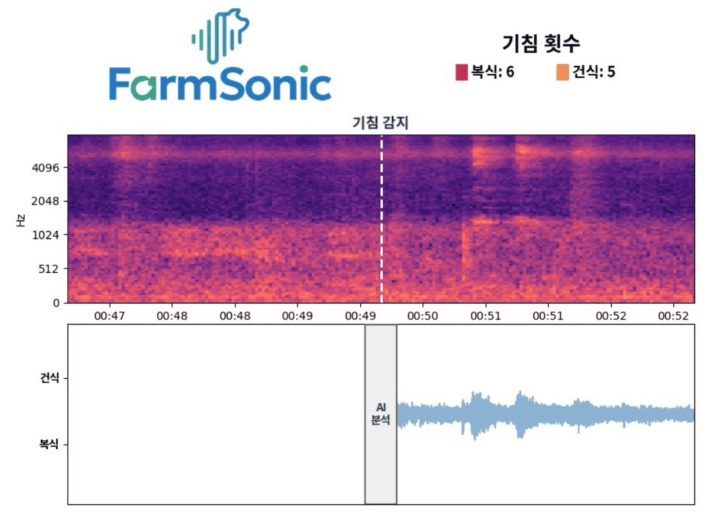

*그림 27. 축사의 기침 소리를 탐지하고 종류별로 세는 FarmSonic의 화면*

SED의 응용 예로, FarmSonic은 축사의 소리를 분석하여 가축의 기침을 탐지하고 종류별로 센다. 화면 위쪽에는 기침 횟수(복식 6회, 건식 5회)가, 가운데에는 스펙트로그램과 기침이 감지된 시각(점선)이, 아래쪽에는 AI가 분석하는 소리의 파형이 표시된다. 기침 횟수와 종류의 변화는 가축의 호흡기 질환을 일찍 알아차리는 단서가 될 수 있으므로, 사람이 하루 종일 듣지 않아도 상태를 감시할 수 있다.

---

<br>

## 개념 적용

**T/F 점검:**

| 문장 | 판단과 근거 |
|:-----|:-----|
| 16 kHz로 샘플링한 녹음에는 10 kHz 성분이 그대로 담길 수 있다. | **F.** 나이퀴스트 주파수가 8 kHz이므로 10 kHz 성분은 표현할 수 없고, 걸러지지 않았다면 $\lvert 10 - 16 \rvert = 6$ kHz로 에일리어싱된다. |
| 주파수가 나타나는 순서만 다른 두 소리의 FFT 크기 스펙트럼은 같을 수 있다. | **T.** 신호 전체에 한 번 적용한 FFT는 시간 정보를 담지 않는다. 이를 구분하려면 STFT가 필요하다. |
| hop_length를 늘리면 멜 스펙트로그램의 세로 칸 수가 줄어든다. | **F.** hop_length는 프레임 수, 즉 가로 칸 수를 줄인다. 세로 칸 수는 n_mels가 정한다. |
| 멜 스케일에서는 높은 주파수의 100 Hz 간격이 낮은 주파수의 100 Hz 간격보다 더 큰 멜 간격이 된다. | **F.** 그 반대이다. 100\~200 Hz는 약 132.7 mel, 7000\~7100 Hz는 약 14.5 mel이다. |
| MFCC는 멜 스펙트로그램에 DCT를 적용한 뒤 로그를 취하여 얻는다. | **F.** 로그를 먼저 취하고 DCT를 적용한다. |
| SED-CRNN은 출력층에 클래스별 시그모이드를 쓰므로 두 클래스가 같은 프레임에서 함께 1이 될 수 있다. | **T.** 시그모이드는 클래스마다 독립적인 확률을 내므로 다중 레이블 판정이 가능하다. |
| 기침 하나를 세 조각으로 끊어 탐지해도 세그먼트 기반 평가에서는 TP가 될 수 있다. | **T.** 세그먼트 안의 활성 여부만 보기 때문이다. 이벤트 기반 평가에서는 조각마다 FP가 될 수 있다. |

---

<br>

## 요약

| 개념 | 핵심 요약 |
|:-----|:-----|
| 소리 태스크 | 오디오 분류, 음성 인식, 음향 이벤트 탐지와 위치 추정, 오디오 생성과 잡음 제거가 대표적이다. 위치 추정에는 다채널 녹음이 필요하다. |
| 음성 인식 | 특징 추출, 시간 단계별 문자 확률을 내는 음향 모델, 탐욕적 디코딩이나 언어 모델을 쓰는 디코더로 이루어진다. CTC는 반복 병합과 빈칸 제거로 문자열을 만든다. |
| 샘플링 | 샘플링 레이트는 1초당 샘플 수이고, 표현할 수 있는 최대 주파수는 나이퀴스트 주파수 $f_s/2$이다. 그보다 높은 성분은 에일리어싱을 일으킨다. |
| 푸리에 변환과 DFT | 시간 영역의 신호를 주파수 성분으로 분해한다. DFT의 $k$번째 칸은 $k f_s / N$ Hz이고, FFT는 이를 $O(N \log N)$에 계산한다. |
| FFT의 한계와 STFT | 신호 전체의 FFT는 언제 어떤 주파수가 났는지 알려 주지 않는다. STFT는 창 길이와 홉 길이로 신호를 나누어 구간마다 FFT를 적용한다. |
| 스펙트로그램 | STFT의 크기를 시간 × 주파수 배열로 늘어놓고 dB로 표시한 것이다. 이미지이므로 CNN을 적용할 수 있다. |
| 멜 스케일과 멜 스펙트로그램 | $m = 2595 \log_{10}(1 + f/700)$로 낮은 주파수를 촘촘히 나눈다. 멜 필터 뱅크를 스펙트로그램에 적용하여 n_mels개 밴드로 줄인다. |
| MFCC | 멜 스펙트럼에 로그를 취하고 DCT를 적용한 계수이다. 딥러닝에서는 로그 멜 스펙트로그램이 더 많이 쓰인다. |
| 추출 파라미터 | n_fft와 win_length는 주파수 해상도, hop_length는 프레임 수(시간 해상도), n_mels는 멜 밴드 수를 정한다. |
| 오디오 분류와 VGGish | 스펙트로그램을 이미지처럼 CNN으로 분류한다. VGGish는 대규모 소리로 학습한 VGG형 모델로, 특징 추출과 전이 학습에 쓰인다. |
| SED와 SED-CRNN | 프레임마다 클래스별 활성을 판정하는 다중 레이블 분류이다. CNN(주파수 축 풀링), 양방향 GRU, 시간 분산 시그모이드 층으로 프레임별 점수를 내고 임계값으로 이진화한다. |
| SED 평가 | 세그먼트 기반은 세그먼트마다 활성을 비교하여 F1과 ER = (S + D + I)/N을 구하고, 이벤트 기반은 시작과 끝의 허용 구간으로 이벤트 단위의 일치를 따진다. |

---

<br>

## 점검 문제

1. **샘플 수와 나이퀴스트 주파수:** 44,100 Hz로 2.5초를 녹음하면 샘플은 몇 개이고, 표현할 수 있는 최대 주파수는 얼마인가?

   <details>
   <summary>정답</summary>

   샘플 수는 $44100 \times 2.5 = 110250$개이다. 나이퀴스트 주파수는 $44100 / 2 = 22050$ Hz이다.

   </details>

2. **에일리어싱:** 9 kHz의 사인파를 저역 통과 필터 없이 16 kHz로 샘플링하면 어떤 주파수로 나타나는가?

   <details>
   <summary>정답</summary>

   나이퀴스트 주파수가 8 kHz이므로 9 kHz는 표현할 수 없고, $\lvert 9 - 16 \rvert = 7$ kHz의 성분으로 나타난다.

   </details>

3. **DFT 주파수 칸:** $f_s$ = 16,000 Hz, $N$ = 1024인 DFT의 주파수 해상도, 서로 다른 정보를 담는 주파수 칸의 수, 1000 Hz에 해당하는 칸 번호를 구하라.

   <details>
   <summary>정답</summary>

   주파수 해상도는 $16000 / 1024 = 15.625$ Hz이다. 칸 수는 $1024 / 2 + 1 = 513$개이다. $k = 1000 / 15.625 = 64$이므로 64번 칸이다.

   </details>

4. **STFT 프레임 수:** 16 kHz로 녹음한 5초 신호에 홉 길이 512로 STFT를 적용하면, 신호의 앞뒤를 덧대는 경우 프레임은 몇 개인가?

   <details>
   <summary>정답</summary>

   샘플 수는 $16000 \times 5 = 80000$이다. 프레임 수는 $1 + \lfloor 80000 / 512 \rfloor = 1 + \lfloor 156.25 \rfloor = 157$개이다.

   </details>

5. **FFT와 STFT:** 소리 분석에서 신호 전체에 FFT를 한 번 적용하는 것만으로는 부족한 이유와, STFT가 이를 해결하는 방식을 설명하라.

   <details>
   <summary>정답</summary>

   신호 전체의 FFT는 어떤 주파수가 얼마나 들어 있는지만 알려 주고 언제 나타났는지는 알려 주지 않으므로, 순서만 다른 소리를 구분할 수 없다. STFT는 신호를 창 길이만큼의 짧은 구간으로 나누고 홉 길이만큼 옮겨 가며 구간마다 창 함수를 곱해 FFT를 적용하므로, 시간에 따른 주파수 성분의 변화를 얻는다.

   </details>

6. **멜 값:** 2000 Hz를 멜 스케일로 바꾸어라. $\log_{10} 3.857 \approx 0.5863$을 이용한다.

   <details>
   <summary>정답</summary>

   $m = 2595 \log_{10}(1 + 2000/700) = 2595 \log_{10} 3.857 \approx 2595 \times 0.5863 \approx 1521$ mel이다.

   </details>

7. **MFCC 계산 순서:** 파형에서 MFCC를 얻는 단계를 순서대로 쓰고, 로그와 DCT의 역할을 설명하라.

   <details>
   <summary>정답</summary>

   프레임 분할과 창 함수, FFT, 파워 스펙트럼, 멜 필터 뱅크(멜 스펙트로그램), 로그, DCT의 순서이다. 로그는 사람의 세기 지각처럼 넓은 값의 범위를 압축하고, DCT는 서로 상관된 멜 밴드 값을 상관이 적은 계수로 바꾸어 스펙트럼 포락선을 앞쪽 몇 개 계수에 모은다.

   </details>

8. **CRNN의 크기:** 입력이 40(멜 밴드) × 256(프레임)이고 합성곱 블록의 최대 풀링이 주파수 축으로 1×5, 1×2, 1×2일 때, 합성곱 블록 뒤의 주파수 축 크기는 얼마이며, 시간 축으로는 풀링하지 않는 이유는 무엇인가?

   <details>
   <summary>정답</summary>

   주파수 축은 $40 / 5 = 8$, $8 / 2 = 4$, $4 / 2 = 2$이므로 2이다. SED는 프레임마다 이벤트의 활성을 판정하여 시작과 끝 시각을 찾아야 하므로, 256개 프레임의 시간 해상도를 끝까지 유지하기 위해 시간 축으로는 풀링하지 않는다.

   </details>

9. **세그먼트 기반 평가:** 클래스 A의 정답 활성이 세그먼트 1~3에서 1, 1, 0, 클래스 B가 0, 1, 1이고, 시스템 출력은 A가 1, 0, 0, B가 1, 1, 1이다. F1과 ER을 구하라.

   <details>
   <summary>정답</summary>

   세그먼트 1은 A가 TP, B가 FP이다($N = 1$, S = 0, D = 0, I = 1). 세그먼트 2는 A가 FN, B가 TP이다($N = 2$, S = 0, D = 1, I = 0). 세그먼트 3은 B가 TP이다($N = 1$). 합계는 TP 3, FP 1, FN 1이므로 $F_1 = 6 / (6 + 1 + 1) = 0.75$이다. $\text{ER} = (0 + 1 + 1) / 4 = 0.5$이다.

   </details>

10. **이벤트 기반 평가:** 정답 이벤트가 1.00\~1.50초이고 시작의 허용 구간은 0.2초, 끝의 허용 구간은 0.2초와 이벤트 길이의 50% 중 큰 값이다. 출력 1.15\~1.60초와 0.70\~1.40초는 각각 TP인가?

    <details>
    <summary>정답</summary>

    이벤트 길이가 0.5초이므로 끝의 허용 구간은 max(0.2, 0.25) = 0.25초이다. 출력 1.15\~1.60초는 시작 차이 0.15초 ≤ 0.2초, 끝 차이 0.10초 ≤ 0.25초이므로 TP이다. 출력 0.70\~1.40초는 시작 차이가 0.30초로 0.2초를 넘으므로 TP가 아니다.

    </details>

---

<br>

## 참고 문헌

1. A. Flores Miranda, P. Chitale, and J. Cohen, "How to build domain specific automatic speech recognition models on GPUs," *NVIDIA Technical Blog*, 2019. https://developer.nvidia.com/blog/how-to-build-domain-specific-automatic-speech-recognition-models-on-gpus/
2. J. Li, V. Lavrukhin, B. Ginsburg, R. Leary, O. Kuchaiev, J. M. Cohen, H. Nguyen, and R. T. Gadde, "Jasper: An end-to-end convolutional neural acoustic model," in *Proc. Interspeech*, 2019, pp. 71-75.
3. S. Kriman, S. Beliaev, B. Ginsburg, J. Huang, O. Kuchaiev, V. Lavrukhin, R. Leary, J. Li, and Y. Zhang, "QuartzNet: Deep automatic speech recognition with 1D time-channel separable convolutions," in *Proc. IEEE Int. Conf. Acoustics, Speech and Signal Processing (ICASSP)*, 2020, pp. 6124-6128.
4. A. Graves, S. Fernández, F. Gomez, and J. Schmidhuber, "Connectionist temporal classification: Labelling unsegmented sequence data with recurrent neural networks," in *Proc. Int. Conf. Machine Learning (ICML)*, 2006, pp. 369-376.
5. S. Adavanne, A. Politis, J. Nikunen, and T. Virtanen, "Sound event localization and detection of overlapping sources using convolutional recurrent neural networks," *IEEE Journal of Selected Topics in Signal Processing*, vol. 13, no. 1, pp. 34-48, 2019.
6. G. Greshler, T. R. Shaham, and T. Michaeli, "Catch-A-Waveform: Learning to generate audio from a single short example," in *Advances in Neural Information Processing Systems (NeurIPS)*, vol. 34, 2021, pp. 20916-20928.
7. C. E. Shannon, "Communication in the presence of noise," *Proceedings of the IRE*, vol. 37, no. 1, pp. 10-21, 1949.
8. A. V. Oppenheim and R. W. Schafer, *Discrete-Time Signal Processing*, 3rd ed. Upper Saddle River, NJ, USA: Pearson, 2010.
9. 3Blue1Brown, "But what is the Fourier Transform? A visual introduction," YouTube, 2018. https://www.youtube.com/watch?v=spUNpyF58BY
10. J. W. Cooley and J. W. Tukey, "An algorithm for the machine calculation of complex Fourier series," *Mathematics of Computation*, vol. 19, no. 90, pp. 297-301, 1965.
11. S. S. Stevens, J. Volkmann, and E. B. Newman, "A scale for the measurement of the psychological magnitude pitch," *The Journal of the Acoustical Society of America*, vol. 8, no. 3, pp. 185-190, 1937.
12. D. O'Shaughnessy, *Speech Communication: Human and Machine*. Reading, MA, USA: Addison-Wesley, 1987.
13. B. McFee, C. Raffel, D. Liang, D. P. W. Ellis, M. McVicar, E. Battenberg, and O. Nieto, "librosa: Audio and music signal analysis in Python," in *Proc. 14th Python in Science Conf. (SciPy)*, 2015, pp. 18-25.
14. S. Davis and P. Mermelstein, "Comparison of parametric representations for monosyllabic word recognition in continuously spoken sentences," *IEEE Transactions on Acoustics, Speech, and Signal Processing*, vol. 28, no. 4, pp. 357-366, 1980.
15. DCASE Community, "DCASE2024 Challenge Task 2: First-shot unsupervised anomalous sound detection for machine condition monitoring, Results," 2024. https://dcase.community/challenge2024/task-first-shot-unsupervised-anomalous-sound-detection-for-machine-condition-monitoring-results
16. D. S. Park, W. Chan, Y. Zhang, C.-C. Chiu, B. Zoph, E. D. Cubuk, and Q. V. Le, "SpecAugment: A simple data augmentation method for automatic speech recognition," in *Proc. Interspeech*, 2019, pp. 2613-2617.
17. S. Hershey *et al.*, "CNN architectures for large-scale audio classification," in *Proc. IEEE Int. Conf. Acoustics, Speech and Signal Processing (ICASSP)*, 2017, pp. 131-135.
18. Google, "VGGish," TensorFlow Model Garden, GitHub repository. https://github.com/tensorflow/models/tree/master/research/audioset/vggish
19. L. Shi, K. Du, C. Zhang, H. Ma, and W. Yan, "Lung sound recognition algorithm based on VGGish-BiGRU," *IEEE Access*, vol. 7, pp. 139438-139449, 2019.
20. A. Mesaros, T. Heittola, T. Virtanen, and M. D. Plumbley, "Sound event detection: A tutorial," *IEEE Signal Processing Magazine*, vol. 38, no. 5, pp. 67-83, 2021.
21. S. Adavanne, P. Pertilä, and T. Virtanen, "Sound event detection using spatial features and convolutional recurrent neural network," in *Proc. IEEE Int. Conf. Acoustics, Speech and Signal Processing (ICASSP)*, 2017, pp. 771-775.
22. A. Mesaros, T. Heittola, and T. Virtanen, "Metrics for polyphonic sound event detection," *Applied Sciences*, vol. 6, no. 6, p. 162, 2016.
23. DCASE Community, "DCASE2017 Challenge Task 3: Sound event detection in real life audio, Results," 2017. https://dcase.community/challenge2017/task-sound-event-detection-in-real-life-audio#results
