# Lecture 6 — Sound Processing

[Repository Guide](../../README.md) | [English](Concepts_Lecture.md) | [한국어](Concepts_Lecture.ko.md)

> **Last Updated:** 2026-11-04

> **Learning Objectives:**
> 1. Distinguish the representative tasks performed with sound data: audio classification, speech recognition, sound event detection and localization, and audio generation and denoising
> 2. Explain the relationship between the sample rate and the Nyquist frequency, and compute the frequency resolution of the DFT and the number of STFT frames
> 3. Explain why the FFT loses time information and how the STFT and the spectrogram solve this
> 4. Explain the mel scale, the mel spectrogram, and MFCC by their computation steps, and explain how n_fft, hop_length, and n_mels affect the result
> 5. Explain the input, structure, and output of spectrogram-based audio classification and of a CRNN-based sound event detection model
> 6. Compute the F1 score and the error rate of sound event detection results with segment-based and event-based evaluation

---

## Table of Contents

- [1. Tasks with Sound Data](#1-tasks-with-sound-data)
  - [1.1 Types of Tasks](#11-types-of-tasks)
  - [1.2 Audio Classification](#12-audio-classification)
  - [1.3 Speech Recognition](#13-speech-recognition)
  - [1.4 Sound Event Detection and Localization](#14-sound-event-detection-and-localization)
  - [1.5 Audio Generation and Denoising](#15-audio-generation-and-denoising)
- [2. Digital Representation of Sound](#2-digital-representation-of-sound)
  - [2.1 Why Preprocessing Is Needed](#21-why-preprocessing-is-needed)
  - [2.2 Sample Rate](#22-sample-rate)
  - [2.3 Nyquist Frequency and Aliasing](#23-nyquist-frequency-and-aliasing)
- [3. Fourier Transform and Spectrogram](#3-fourier-transform-and-spectrogram)
  - [3.1 Time Domain and Frequency Domain](#31-time-domain-and-frequency-domain)
  - [3.2 DFT and FFT](#32-dft-and-fft)
  - [3.3 The Limitation of the FFT: Loss of Time Information](#33-the-limitation-of-the-fft-loss-of-time-information)
  - [3.4 STFT](#34-stft)
  - [3.5 Spectrogram](#35-spectrogram)
- [4. Mel Spectrogram and MFCC](#4-mel-spectrogram-and-mfcc)
  - [4.1 Mel Scale](#41-mel-scale)
  - [4.2 Mel Spectrogram](#42-mel-spectrogram)
  - [4.3 MFCC](#43-mfcc)
  - [4.4 Extracting a Mel Spectrogram with librosa](#44-extracting-a-mel-spectrogram-with-librosa)
  - [4.5 Why Spectrograms Are Still Used](#45-why-spectrograms-are-still-used)
- [5. Audio Classification](#5-audio-classification)
  - [5.1 Classifying Sound Like an Image](#51-classifying-sound-like-an-image)
  - [5.2 VGGish and Transfer Learning](#52-vggish-and-transfer-learning)
- [6. Sound Event Detection](#6-sound-event-detection)
  - [6.1 Structure of an SED System](#61-structure-of-an-sed-system)
  - [6.2 Input and Frame-Level Labels](#62-input-and-frame-level-labels)
  - [6.3 The SED-CRNN Model](#63-the-sed-crnn-model)
  - [6.4 Deciding Events with a Threshold](#64-deciding-events-with-a-threshold)
  - [6.5 Segment-Based Evaluation](#65-segment-based-evaluation)
  - [6.6 Event-Based Evaluation](#66-event-based-evaluation)
  - [6.7 Evaluation Results and Applications](#67-evaluation-results-and-applications)
- [Concept Applications](#concept-applications)
- [Summary](#summary)
- [Self-Check Questions](#self-check-questions)
- [References](#references)

---

<br>

## 1. Tasks with Sound Data

### 1.1 Types of Tasks

Deep learning is widely used not only for images (Lectures 3-5) and text (Lectures 7-8) but also for sound. Representative tasks that can be performed with sound data are as follows.

| Task | Input | Output | Example |
|:-----|:-----|:-----|:-----|
| Audio classification | One sound clip | One of the predefined classes | Distinguishing a dog bark, a siren, and a cough |
| Speech recognition | Human speech | Text | Voice assistants, caption generation |
| Sound event detection | A long recording | A class and onset and offset times for each event | Finding the intervals of a recording where coughs occur |
| Sound event localization | Sound recorded with several microphones | The direction from which each event comes | Tracking the direction of a speaker |
| Audio generation | An example sound or a condition | A new sound | Synthesizing music or sound effects |
| Audio denoising | Sound mixed with noise | Clean sound | Restoring old recordings, removing call noise |

*Table 1. Representative tasks performed with sound data*

There are many other tasks, such as speaker recognition, music genre classification, and anomalous sound detection that finds faults from machine sounds. The sections below focus on audio classification and sound event detection, together with sound preprocessing, which is their common basis.

### 1.2 Audio Classification

**Audio classification** is the task of deciding, when one sound clip (segment) comes in, which sound it is among predefined classes.

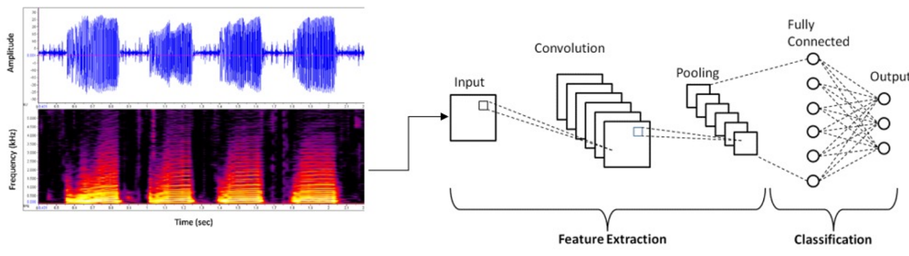

*Figure 1. Audio classification by converting a waveform into a spectrogram and classifying it with a CNN*

The top left is the **waveform**, which plots the amplitude of the sound over time, and below it is the **spectrogram**, which turns the same sound into a two-dimensional picture of time (horizontal axis) and frequency (vertical axis). The waveform is converted into a spectrogram that looks like an image, and this image is fed into a feature extractor (Feature Extraction) of convolution and pooling layers and a classifier (Classification) of fully connected layers, which outputs the class. How to make a spectrogram is covered in detail in Sections 3 and 4, and the classification model in Section 5.

### 1.3 Speech Recognition

**Speech recognition** is the technique by which a computer recognizes speech uttered by a person and converts its content into text. It analyzes and processes the human speech signal with mathematical modeling and deep-learning algorithms to convert it into text, and it is used in various applications such as speech recognition software, voice search, automatic translation, and services that search for music or movies by voice.

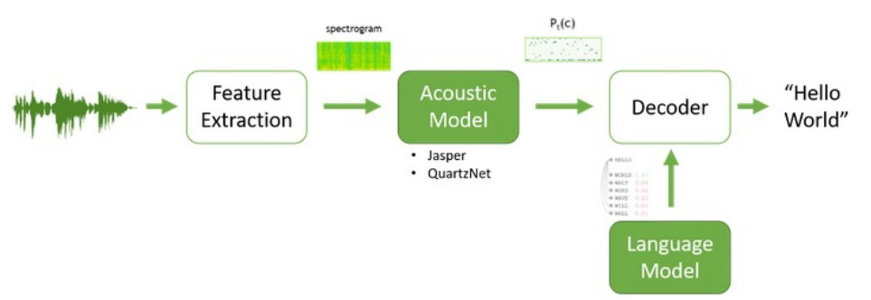

*Figure 2. The speech recognition process consisting of feature extraction, an acoustic model, a decoder, and a language model*

A deep-learning speech recognition system consists of the following steps, as in the figure above [1].

1. **Feature extraction:** The audio signal is preprocessed with techniques such as normalization and the spectrogram or MFCC.
2. **Acoustic model:** A neural network that predicts, at each time step $t$, the probability distribution $P_t(c)$ over vocabulary characters $c$. Jasper [2] and QuartzNet [3] in the figure are examples of such acoustic models. The vocabulary is the set of characters the model can output, such as the letters and the space, and $c$ is an element of it.
3. **Decoding:** The probability distribution at each time step is turned into a character string.
   - **Greedy decoding (argmax):** The simplest strategy. At each time step it emits the character with the highest probability, without regard to the meaning of the content.
   - **Using a language model:** A language model adds context, so it can correct the errors of the acoustic model. For example, even if the acoustic model mispredicts "apple" as "apble", the language model knows that the word "apble" is almost never used and that "apple" fits the context, so it corrects the error.

Models such as Jasper and QuartzNet are trained with **CTC (Connectionist Temporal Classification)** [4]. Speech has many more frames than characters, and there is no ground truth saying which frame corresponds to which character, so CTC adds a blank symbol `_`, which means no character, to the vocabulary and turns the per-frame outputs into a string by the following rules.

```text
t        1  2  3  4  5  6  7  8  9  10 11
(a)      h  h  _  e  e  _  l  l  _  l  o
(b)      h     _  e     _  l     _  l  o
(c)      h        e        l        l  o    ->  hello
```

*Figure 3. An example of CTC greedy decoding*

(a) is the result of choosing the most probable symbol at each of 11 time steps. Merging consecutively repeated symbols into one in (b) and deleting the blanks in (c) gives "hello". The blank at step 9 separates the two `l`s, so two `l`s remain even after the repeats are merged. Greedy decoding is this simple, but it does not look at spelling or context at all, so combining it with a language model makes it more accurate.

### 1.4 Sound Event Detection and Localization

**Sound event detection (SED)** is the technique of detecting specific acoustic events (sounds) in a recording. Just as object detection in image processing caught objects in an image with boxes (Lecture 5), sound event detection finds which sound runs from where to where in the audio.

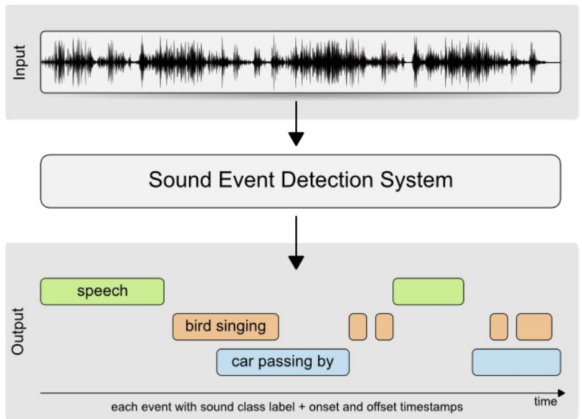

*Figure 4. Input and output of a sound event detection system*

The input is a long audio waveform, and the output is, for each event, a class label with its start time (onset) and end time (offset). In the figure, speech, bird singing, and a car passing by are shown as bars on the time axis, and several sounds sometimes overlap at the same time. Sound event detection in which several events can occur simultaneously in this way is called **polyphonic** sound event detection.

**Sound event localization and detection (SELD)** includes not only detecting specific acoustic events but also determining where the sound came from.

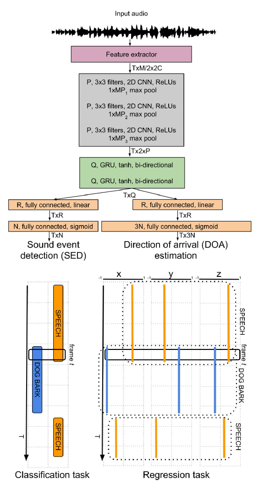

*Figure 5. The structure of SELDnet, which performs sound event detection and direction-of-arrival estimation together*

The figure above is the structure of SELDnet [5].

- **Feature extractor:** From the multichannel input audio, it computes the magnitude and phase of the spectrogram for each channel to form an input of size $T \times M/2 \times 2C$. $T$ is the number of frames, $M/2$ the number of frequency bins, and $C$ the number of channels (microphones); it is $2C$ because there are two quantities, magnitude and phase.
- **Three convolutional blocks:** They convolve with $P$ filters of size 3×3 and max-pool only along the frequency axis ($1 \times MP_i$), reducing the size to $T \times 2 \times P$ while keeping the time resolution.
- **Two bidirectional GRU layers:** They learn context along the time axis and output $T \times Q$.
- **Two output branches:** Each branch passes through a linear fully connected layer of $R$ units before its output layer. One branch is sound event detection (SED, $T \times N$), which outputs with sigmoids whether each of $N$ classes is active in each frame, and the other is **direction-of-arrival (DOA) estimation** ($T \times 3N$), which outputs for each class the direction the sound came from as a three-dimensional coordinate $(x, y, z)$. The lower figures are example ground truths for the classification task (class activity over time) and the regression task (direction coordinates over time), respectively.

> **Caution:** Estimating the direction of a sound requires multichannel audio recorded with several microphones, because the differences in arrival time (phase) and level of the same sound at each microphone are the cues to the direction. Single-channel audio recorded with one microphone has no such spatial information, so sound event detection is possible but localization is not.

### 1.5 Audio Generation and Denoising

Deep learning can not only recognize sound but also create or repair it.

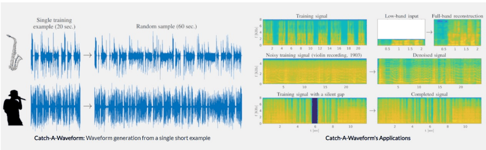

*Figure 6. Generation results and applications of Catch-A-Waveform trained on a single short example*

**Catch-A-Waveform** is a model that learns from a single sound of about 20 seconds and generates new sounds with similar characteristics [6]. The left of the figure shows examples of training on 20 seconds each of a saxophone performance and a song and then generating new random samples 60 seconds long. The right shows applications of the same approach, from top to bottom, as follows.

- **Bandwidth extension:** From an input with only the low-frequency band (Low-band input), it restores the high frequencies (Full-band reconstruction).
- **Denoising:** It removes the noise from a noisy violin performance recorded in 1903 (Noisy training signal) (Denoised signal).
- **Audio inpainting:** It naturally fills the empty part of a signal with an interval where the sound is cut off (silent gap) (Completed signal).

---

<br>

## 2. Digital Representation of Sound

### 2.1 Why Preprocessing Is Needed

Using sound data as the input of a deep-learning model requires **preprocessing**, that is, a **feature extraction** process. Rather than using the waveform as it is, as in Figure 1, the sound is often converted into the form of a spectrogram, which reveals frequency information, before being fed into the model. This section first looks at how sound is represented as numbers inside a computer, and Sections 3 and 4 cover how to turn those numbers into a spectrogram.

### 2.2 Sample Rate

Sound received by a microphone is air pressure that changes continuously over time, that is, an **analog signal**. A computer stores it as a sequence of values measured at regular time intervals, that is, a **digital signal**. Measuring values at regular intervals in this way is called **sampling**, and one measured value is called a **sample**.

> **Definition:** The **sample rate** is the number of samples taken per unit time when converting an analog signal into a digital signal, that is, the number of samples obtained in one second. Its unit is Hz, and 44,100 Hz and 16,000 Hz are commonly used. If the sample rate is $f_s$, the interval between samples is $1/f_s$ seconds.

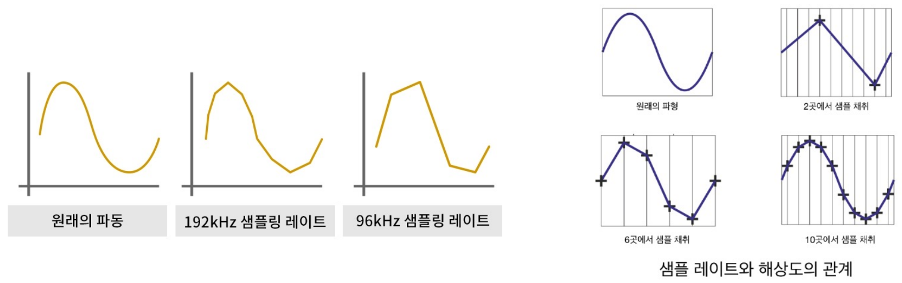

*Figure 7. The lower the sample rate, the more coarsely the original waveform is represented*

The three pictures on the left show the original wave sampled at 192 kHz and 96 kHz with the points joined by straight lines; the lower the sample rate, the more coarsely it follows the original curve. The four pictures on the right show the original waveform of one period of a sine wave and the same wave sampled at 2, 6, and 10 points, illustrating the relationship between sample rate and resolution: the more samples, the closer to the original shape.

Recording for $T$ seconds at sample rate $f_s$ gives $f_s \times T$ samples. For example, recording 3 seconds at 16,000 Hz gives $16000 \times 3 = 48000$ samples. The value of each sample is also stored with finite precision; stored as a 16-bit integer, it is represented in $2^{16} = 65536$ levels. Libraries such as librosa read it after converting it to a real number between $-1$ and 1.

| Sample rate | Nyquist frequency | Main use |
|:-----|:-----|:-----|
| 8,000 Hz | 4,000 Hz | Landline telephone speech |
| 16,000 Hz | 8,000 Hz | Speech recognition, the example of Section 4.4 |
| 44,100 Hz | 22,050 Hz | Music CDs |
| 48,000 Hz | 24,000 Hz | Video production and digital audio equipment |
| 96,000 Hz, 192,000 Hz | 48,000 Hz, 96,000 Hz | High-resolution recording |

*Table 2. Commonly used sample rates and their Nyquist frequencies*

### 2.3 Nyquist Frequency and Aliasing

The principle for choosing the sample rate is the **sampling theorem** [7]. If the highest frequency in a signal is $f_{\max}$, the original signal can be completely recovered from its samples when it is sampled at a sample rate with $f_s > 2 f_{\max}$. Half the sample rate, $f_s / 2$, is called the **Nyquist frequency**, and it is the maximum frequency a digital signal can represent.

Components above the Nyquist frequency do not disappear; they masquerade as lower frequencies and get mixed in, which is called **aliasing** [8].

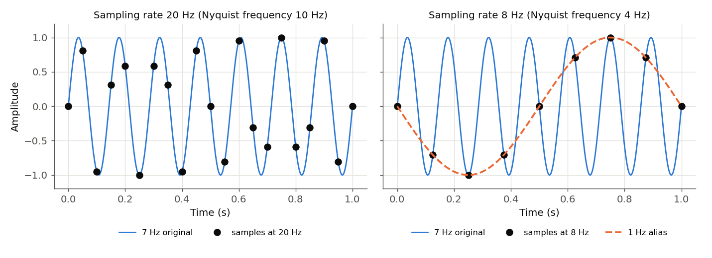

*Figure 8. A 7 Hz sine wave sampled at 20 Hz and at 8 Hz, and the aliasing that appears as 1 Hz*

- **Sampling at 20 Hz (left):** The Nyquist frequency is 10 Hz, higher than 7 Hz, so the samples (black dots) follow the oscillation of the 7 Hz sine wave without omission.
- **Sampling at 8 Hz (right):** The Nyquist frequency is 4 Hz, lower than 7 Hz. Here the samples lie exactly on a 1 Hz sine wave (orange dashed line) that goes up and down only once per second. From the samples alone it is impossible to tell whether the original signal was 7 Hz or 1 Hz, and the 7 Hz component wrongly appears as $\lvert 7 - 8 \rvert = 1$ Hz.

Humans can hear sounds from about 20 Hz to 20 kHz, so music CDs use 44,100 Hz so that the Nyquist frequency is slightly above that. Most of the information needed to understand the content of human speech lies below 8 kHz, so 16,000 Hz is widely used for speech recognition. Real equipment and libraries remove the components above the Nyquist frequency with a low-pass filter before sampling or resampling, to prevent aliasing.

> **Note:** Figure 7 joins the samples with straight lines to show resolution intuitively, but according to the sampling theorem, as long as $f_s > 2 f_{\max}$ holds, the original signal can in theory be recovered completely. Therefore the effect of raising the sample rate lies in raising the maximum representable frequency rather than in making the curve smoother. Sampling at only 2 points per period sits exactly at the Nyquist limit, so if the samples fall on the zero crossings, the signal cannot be recognized at all.

---

<br>

## 3. Fourier Transform and Spectrogram

### 3.1 Time Domain and Frequency Domain

Sound (a waveform) reveals more information in the frequency domain. Information that cannot be seen from the waveform alone, for example which pitches are mixed together, becomes visible after conversion to the frequency domain.

> **Definition:** The **Fourier transform** is a mathematical technique that converts a signal in the time domain into the frequency domain. The time domain shows the value of the signal over time, and the frequency domain shows how much of each frequency component the signal contains.

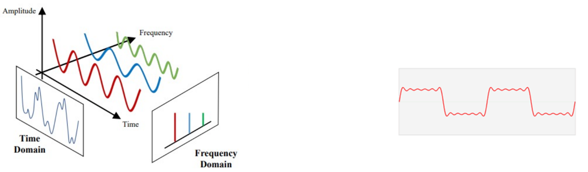

*Figure 9. A complex time-domain signal decomposed into sine waves of several frequencies and represented as bars in the frequency domain*

In the three-dimensional coordinates of the figure, the left face (Time Domain) draws a complicated, undulating signal on the time axis. This signal is actually the sum of three sine waves of different frequencies (red, blue, and green), and the right face (Frequency Domain) raises a bar, as tall as each sine wave is strong, at the frequency of that sine wave. According to Fourier analysis, a signal can be expressed as a sum of sinusoids (sine and cosine waves). The red waveform on the right is an example: adding only a few sine waves whose frequencies are odd multiples of the fundamental already approaches a square wave. A square wave is the sum of infinitely many sine waves, as follows.

$$
x(t) = \frac{4}{\pi} \left( \sin \omega t + \frac{1}{3} \sin 3\omega t + \frac{1}{5} \sin 5\omega t + \cdots \right)
$$

The Fourier transform of a continuous-time signal $x(t)$ is as follows.

$$
X(f) = \int_{-\infty}^{\infty} x(t) \, e^{-j 2\pi f t} \, dt
$$

> **Note:** By Euler's formula $e^{-j\theta} = \cos\theta - j\sin\theta$, $e^{-j 2\pi f t}$ is a pair of cosine and sine rotating at frequency $f$. The Fourier transform multiplies the signal by this rotation and integrates, computing how much the signal resembles the component at frequency $f$. $\lvert X(f) \rvert$ is the magnitude of that frequency component, and the angle of the complex number $X(f)$ is its phase. The video by 3Blue1Brown [9] is a widely known resource that explains this process visually.

### 3.2 DFT and FFT

Sound in a computer is a finite sequence of samples, so the **DFT (Discrete Fourier Transform)**, which uses a sum instead of an integral, is used [8]. The DFT of a signal $x[0], \dots, x[N-1]$ of length $N$ is as follows.

$$
X[k] = \sum_{n=0}^{N-1} x[n] \, e^{-j 2\pi k n / N}, \qquad k = 0, 1, \dots, N-1
$$

- $X[k]$ is the component of the $k$-th **frequency bin**, and the frequency of this bin is $f_k = k f_s / N$. Therefore the spacing between bins, the **frequency resolution**, is $f_s / N$.
- For a real signal, $X[N-k]$ is the complex conjugate of $X[k]$, so only the $N/2 + 1$ bins from $k = 0$ to $N/2$ carry distinct information.

**DFT computation example.** Compute the DFT of the $N = 4$ samples $x = [1, 0, -1, 0]$ obtained by sampling a 2 Hz cosine at $f_s = 8$ Hz. With $N = 4$, $e^{-j 2\pi k n / 4} = (-j)^{kn}$.

1. $X[0] = 1 + 0 + (-1) + 0 = 0$. Bin 0 is the mean of the signal (the DC component), and this signal has mean 0.
2. $X[1] = 1 \cdot 1 + (-1) \cdot (-j)^2 = 1 + (-1)(-1) = 2$.
3. $X[2] = 1 + (-1) \cdot (-j)^4 = 1 - 1 = 0$.
4. $X[3] = 1 + (-1) \cdot (-j)^6 = 1 + (-1)(-1) = 2$.

The frequency of bin 1 is $1 \times 8 / 4 = 2$ Hz, so the DFT correctly found that the signal contains only a 2 Hz component. Bin 3 is the mirror image of bin 1 ($-2$ Hz).

The **FFT (Fast Fourier Transform)** is an algorithm that computes the DFT quickly [10]. Computing the equation above directly needs $N$ multiplications for each of the $N$ bins, so it is $O(N^2)$, but the FFT repeatedly splits the computation into problems of half the size and finishes in $O(N \log N)$. For $N = 2048$, $N^2 = 4{,}194{,}304$, whereas $N \log_2 N = 2048 \times 11 = 22{,}528$, about 186 times fewer. Today the DFT is in practice always computed with the FFT algorithm, so the two terms are often used with the same meaning. The graph of the FFT magnitude $\lvert X[k] \rvert$ with frequency on the horizontal axis and magnitude on the vertical axis is called a **spectrum**, and the middle column of Figure 10 is an example.

### 3.3 The Limitation of the FFT: Loss of Time Information

The FFT tells which frequencies the whole signal contains and how much, but not **when** those frequencies appeared. Although sound is time-series data, applying the FFT once to the whole signal cannot represent information about time.

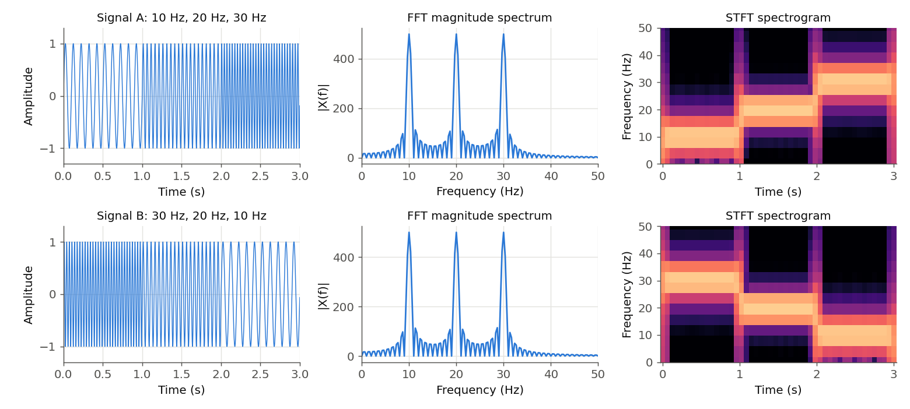

*Figure 10. Waveforms, FFT spectra, and STFT spectrograms of two signals that differ only in the order of their frequencies*

Signal A changes every second in the order 10 Hz, 20 Hz, 30 Hz, and signal B in the order 30 Hz, 20 Hz, 10 Hz (left). The two signals are clearly different sounds, but the magnitude spectra obtained by applying the FFT to each whole signal (middle) have the same shape, with peaks of the same height at 10, 20, and 30 Hz, so the two cannot be told apart. In the STFT spectrograms on the right, the bright band of signal A moves up over time and that of signal B moves down, so the two signals are clearly distinguished. The method devised to solve this problem is the STFT of Section 3.4.

### 3.4 STFT

The **STFT (Short-Time Fourier Transform)** divides a signal into short intervals and applies the FFT to each interval, obtaining the frequency components of each interval in time order. The sound to be analyzed is transformed interval by interval, and the results are joined afterwards.

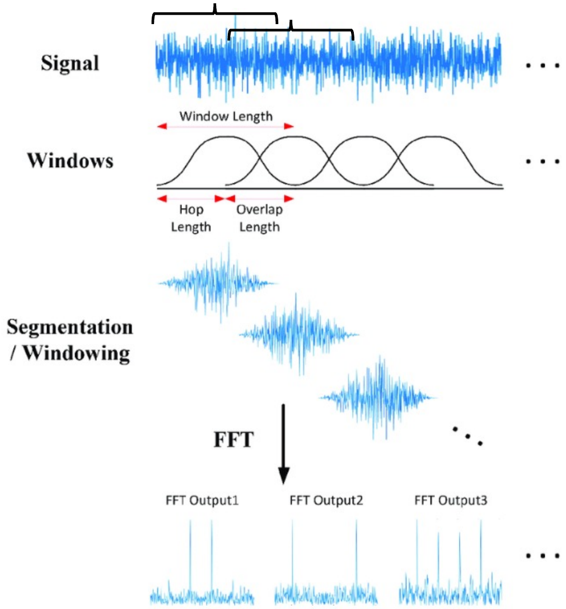

*Figure 11. The STFT process, which divides a signal with overlapping windows and applies the FFT to each interval*

1. **Windows:** An interval of the **window length** is taken on the signal, and the next interval is taken after moving by the **hop length**. If the hop length is shorter than the window length, neighboring intervals overlap by the **overlap length**, which is the window length minus the hop length.
2. **Segmentation and windowing:** Each interval is cut out and multiplied by a bell-shaped **window function** that is 1 in the middle and near 0 at both ends. Cutting a signal abruptly makes frequency components that do not actually exist smear into the spectrum because of the discontinuities at both ends of the interval (spectral leakage), and the window function mitigates this by tapering both ends smoothly. The Hann window is commonly used.
3. **FFT:** The FFT is applied to each interval, giving one spectrum per interval (FFT Output1, FFT Output2, ...).

Written as an equation, with hop length $H$, window function $w[n]$, and FFT size $N$, the $k$-th frequency component of the $m$-th frame is as follows.

$$
X[m, k] = \sum_{n=0}^{N-1} x[n + mH] \, w[n] \, e^{-j 2\pi k n / N}
$$

**The trade-off between time resolution and frequency resolution.** The longer the window, the better the frequency resolution $f_s / N$, but the longer the time $N / f_s$ covered by one window, which blurs when the sound changed. A short window does the opposite. The window length is therefore chosen to suit the sound to be analyzed.

| Item | Computation | Value ($f_s$ = 16,000 Hz, $N$ = 2048, $H$ = 1024) |
|:-----|:-----|:-----|
| Length of one window | $N / f_s$ | 2048 / 16000 = 0.128 s (128 ms) |
| Frame interval | $H / f_s$ | 1024 / 16000 = 0.064 s (64 ms) |
| Overlap of neighboring windows | $(N - H) / N$ | 50% |
| Frequency resolution | $f_s / N$ | 16000 / 2048 = 7.8125 Hz |
| Number of frequency bins | $N / 2 + 1$ | 1025 |
| Number of frames for a 1-second signal | $1 + \lfloor L / H \rfloor$ ($L$ is the number of samples) | $1 + \lfloor 16000 / 1024 \rfloor = 16$ |

*Table 3. Time and frequency resolution computed for the STFT settings of the example in Section 4.4*

The frame-count formula is for the case where, as in librosa, the signal is padded at both ends by half a window (center padding) so that each frame is centered on its time.

### 3.5 Spectrogram

A **spectrogram** is a way to visualize the change of a signal over time in the frequency domain. The magnitude $\lvert X[m, k] \rvert$ of the STFT result $X[m, k]$ (or its square, the power) is arranged as a two-dimensional array with time (frame $m$) on the horizontal axis and frequency (bin $k$) on the vertical axis, and the size of each value is shown as a color. The human ear perceives loudness roughly on a logarithmic scale, and the values span a very wide range, so they are usually expressed in decibels (dB).

$$
\text{dB} = 20 \log_{10} \frac{\lvert X \rvert}{\text{ref}} \quad \text{(magnitude)}, \qquad \text{dB} = 10 \log_{10} \frac{\lvert X \rvert^2}{\text{ref}} \quad \text{(power)}
$$

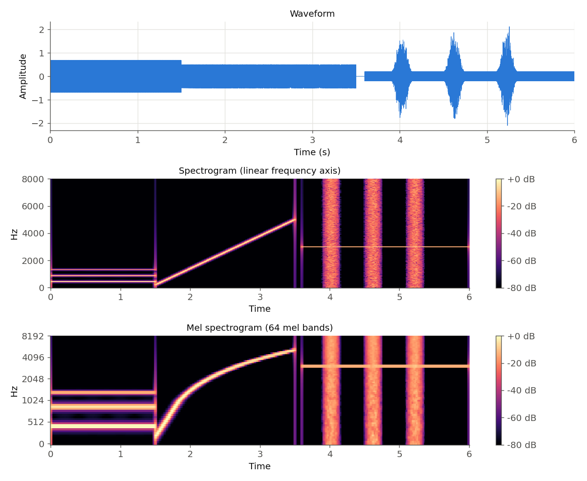

*Figure 12. Waveform, linear-frequency spectrogram, and mel spectrogram of a synthetic signal*

The figure above is a synthetic signal 6 seconds long made at 16 kHz. From 0 to 1.5 s it contains a tone mixing 440 Hz with its 2nd and 3rd harmonics (880 Hz, 1320 Hz), from 1.5 to 3.5 s a sound whose frequency rises steadily from 200 Hz to 5000 Hz, and from 3.6 to 6 s a 3000 Hz tone and three bursts of noise 0.25 s long.

- **Waveform (top):** It shows when the loudness of the sound changes, but not which frequencies the sound has. In particular, 0-1.5 s and 1.5-3.5 s appear as solid bands that differ only slightly in height, so it is impossible to tell what sound each one is.
- **Spectrogram (middle):** The 440, 880, and 1320 Hz tones appear as three horizontal lines, the rising sound as a slanted straight line, the 3000 Hz tone as one horizontal line, and the noise as vertical bands across all frequencies, so the composition of the sound is visible at a glance.
- **Mel spectrogram (bottom):** Explained in Section 4.2, it changes the vertical axis to match human hearing.

A spectrogram is a two-dimensional array, that is, an image, so image-processing methods, in particular CNNs, can be applied to it directly. This is the main reason spectrograms are widely used in sound processing (Section 5.1).

---

<br>

## 4. Mel Spectrogram and MFCC

### 4.1 Mel Scale

> **Definition:** The **mel scale** is a frequency scale that reflects the characteristics of human hearing. Instead of frequency in Hz, which increases linearly, it measures frequency again so that it is proportional to the intervals of pitch that people perceive.

The mel scale originated from listening experiments in which people adjusted tones so that they sounded equally spaced in pitch [11]. People distinguish even small differences well at low frequencies, but at high frequencies the difference must be large to be distinguished. That is, the mel scale has high sensitivity at low frequencies and low sensitivity at high frequencies. A widely used conversion formula is as follows [12].

$$
m = 2595 \log_{10} \left( 1 + \frac{f}{700} \right), \qquad f = 700 \left( 10^{m / 2595} - 1 \right)
$$

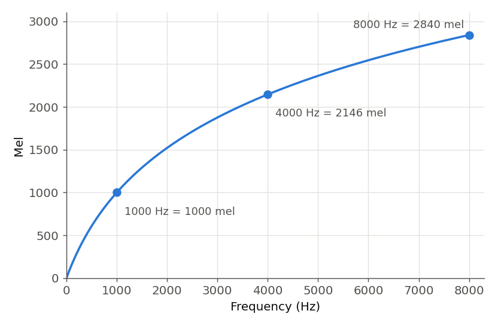

*Figure 13. Relationship between frequency (Hz) and mel value*

The curve is steep at low frequencies and gentle at high frequencies. 1000 Hz is 1000 mel, 4000 Hz is about 2146 mel, and 8000 Hz is about 2840 mel. The 1000 Hz span from 0 to 1000 Hz occupies 1000 mel, whereas the 7000 Hz span from 1000 to 8000 Hz occupies only about 1840 mel. For the same 100 Hz difference, going from 100 Hz to 200 Hz adds about 132.7 mel and going from 7000 Hz to 7100 Hz adds about 14.5 mel, which means that a 100 Hz difference at low frequencies is perceived as about 9 times larger than a 100 Hz difference at high frequencies.

> **Note:** There is more than one formula for the mel scale. The formula above is also called the HTK formula, and librosa by default uses the Slaney formula, which is linear below 1000 Hz and logarithmic above [13]. To use the formula above in librosa, pass the argument `htk=True`. The two differ in the size of the mel values but share the property of dividing low frequencies finely and high frequencies coarsely.

### 4.2 Mel Spectrogram

A **mel spectrogram** applies the mel scale to the frequency axis of a spectrogram. This makes feature extraction similar to human hearing possible, dividing the low-frequency region at finer intervals to capture more frequency information there.

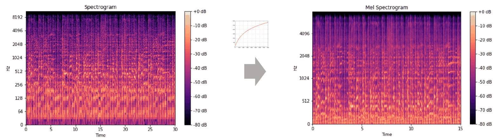

*Figure 14. Making a mel spectrogram by applying the mel scale to a spectrogram*

The left is the spectrogram of a piece of music, the small graph in the middle is the mel-scale curve, and the right is the mel spectrogram obtained by applying it. In the mel spectrogram, the low-frequency region is stretched vertically and the high-frequency region is compressed.

The mel scale is applied with a **mel filter bank**. $B$ triangular filters placed at equal intervals on the mel axis are made, and the values of the frequency bins covered by each filter are summed with weights to give the value of that filter. With $H_b[k]$ the weights of the $b$-th filter, the mel spectrogram is as follows.

$$
M[m, b] = \sum_{k} H_b[k] \, \lvert X[m, k] \rvert^{p}, \qquad b = 0, 1, \dots, B - 1
$$

With $p = 2$ it is a power mel spectrogram, and with $p = 1$ a magnitude mel spectrogram. For example, making 10 filters ($B = 10$) over 0-8000 Hz needs 12 points that divide the mel axis into 11 equal parts. Computed with the formula above, these points are 0, 180, 407, 692, 1050, 1501, 2067, 2780, 3676, 4802, 6219, and 8000 Hz, and the $b$-th filter is a triangle that starts at the $b$-th point, reaches its maximum at the $(b+1)$-th point, and ends at the $(b+2)$-th point (counting from 0). The first filter spans 0-407 Hz, about 400 Hz wide, but the last spans 4802-8000 Hz, about 3200 Hz wide, so the higher the frequency, the wider the band a single filter lumps together. As a result, the 1025 frequency bins shrink to 10 mel bands, and the data also becomes smaller.

> **Note:** The mel spectrogram is sometimes described as the result of converting frequency to the mel scale and then applying the STFT, but the actual order of computation is to obtain the spectrogram with the STFT first and then apply the mel filter bank to its frequency axis. A waveform has no frequency axis yet, so the mel scale cannot be applied before the STFT.

### 4.3 MFCC

> **Definition:** **MFCC (Mel-Frequency Cepstral Coefficients)** are the coefficients obtained by computing the mel spectrum, taking its logarithm, and applying the DCT (Discrete Cosine Transform) [14].


*Figure 15. Computation steps from a waveform to a mel spectrogram and MFCC*

Applying the DCT to the log values $\log M_b$ of $B$ mel bands, the $q$-th coefficient is as follows.

$$
c_q = \sum_{b=0}^{B-1} \log(M_b) \cos\left[ \frac{\pi q}{B} \left( b + \frac{1}{2} \right) \right], \qquad q = 0, 1, \dots, Q - 1
$$

- **Why take the logarithm:** People perceive loudness on a logarithmic scale, and the logarithm compresses a very wide range of values.
- **Why apply the DCT:** The values of neighboring mel bands are strongly correlated with each other. The DCT turns them into coefficients with little correlation and gathers the overall shape (envelope) of the spectrum into the first few coefficients. Usually only about the first 13 coefficients are kept, summarizing one frame as a short vector.
- **Cepstrum:** The transform of a log spectrum, named by reversing the first letters of "spectrum". Low-order coefficients carry the spectral envelope, such as the shape of the vocal tract (the throat and mouth), and high-order coefficients carry fine structure related to pitch.

MFCC was the standard feature in traditional speech recognition, but in recent deep learning the (log) mel spectrogram is used more than MFCC. Because the DCT mixes all bands, MFCC loses local patterns along the frequency axis, and CNNs are strong precisely at learning such local patterns. In addition, neural networks can learn the necessary features by themselves even from less processed input.

### 4.4 Extracting a Mel Spectrogram with librosa

When extracting a mel spectrogram, the values of `n_fft`, `n_mels`, `hop_length`, and `win_length` are adjusted to obtain proper features. The following code extracts and plots the mel spectrogram of a 16 kHz recording with librosa [13], a Python library for audio analysis.

```python
import numpy as np
import librosa
import librosa.display
import matplotlib.pyplot as plt

# User set parameters
nfft = 2048
win_len = nfft
hop_len = win_len // 2
nb_mel_bands = 40
sr = 16000

audio_file = './pig_data/sample/farm01_R00001_0001_16000.wav'

y, sr = librosa.load(audio_file, sr=sr)
D = np.abs(librosa.stft(y, n_fft=nfft, win_length = win_len, hop_length=hop_len))
mel_spec = librosa.feature.melspectrogram(S=D, sr=sr, n_mels=nb_mel_bands, hop_length=hop_len,
                                          win_length=win_len).T

librosa.display.specshow(librosa.amplitude_to_db(mel_spec.T, ref=0.00002),
                         sr=sr, hop_length = hop_len, y_axis='mel', x_axis='time')
plt.colorbar(format='%2.0f dB')
plt.show()
```

- **Lines 1-4:** Import numpy for array computation, librosa and its display module for audio analysis, and matplotlib for plotting.
- **`nfft = 2048`:** The size of the FFT applied to each frame. At 16 kHz, 2048 samples are 128 ms, the frequency resolution is 7.8125 Hz, and there are 1025 frequency bins (Table 3).
- **`win_len = nfft`:** The window length is set equal to the FFT size. The window length cannot exceed the FFT size, and if it is smaller, the rest is filled with zeros before the FFT.
- **`hop_len = win_len // 2`:** A hop length of 1024 samples (64 ms), so neighboring windows overlap by 50%. `//` is the integer division operator, which keeps only the quotient.
- **`nb_mel_bands = 40`:** The number of mel filters. The vertical axis of the result has 40 rows.
- **`sr = 16000`:** The sample rate to use.
- **`audio_file`:** The path of a sound file recorded at 16 kHz on a pig farm.
- **`librosa.load(audio_file, sr=sr)`:** Reads the file, resamples it to the specified 16 kHz, and returns a single-channel real array `y` and the sample rate `sr`.
- **`librosa.stft(...)`:** Computes the STFT and returns a complex matrix of size (1025 frequency bins) × (number of frames). `D` keeps only the magnitude through `np.abs`.
- **`librosa.feature.melspectrogram(S=D, ...)`:** Applies 40 mel filters to the already computed spectrogram `D` to make a (40) × (number of frames) matrix. The final `.T` swaps rows and columns to give (number of frames) × (40), a time-first form. This is the form for feeding a deep-learning model in frame order.
- **`librosa.amplitude_to_db(mel_spec.T, ref=0.00002)`:** Transposes back to (40) × (number of frames) and converts to decibels. The reference value 0.00002 corresponds to the reference pressure of 20 μPa used for sound pressure level in air.
- **`librosa.display.specshow(...)`:** Plots with the vertical axis on the mel scale (`y_axis='mel'`) and the horizontal axis in time (`x_axis='time'`). `sr` and `hop_length` are used to convert frame indices to seconds.
- **`plt.colorbar(format='%2.0f dB')`, `plt.show()`:** Attach a bar showing the mapping between colors and dB values, and display the figure on screen.

> **Note:** When a spectrogram `S` is given directly to `melspectrogram`, librosa computes the FFT size from the number of rows of `S` and does not use the `hop_length` and `win_length` arguments. These arguments are used only to compute the STFT when the waveform `y` is given instead of `S`. Also, when `S` is given, no squaring (`power`) is applied, so the result of passing the magnitude spectrogram `D` is a magnitude mel spectrogram. Hence it is correct to use `amplitude_to_db` (20 log), the conversion for magnitudes; for a power spectrogram, `power_to_db` (10 log) would be needed. Meanwhile, the values of a digital recording are not calibrated to actual pressure, so even with the reference set to 20 μPa, the dB values are relative levels rather than absolute sound pressure.

Changing each parameter changes the result as follows.

| Parameter | Meaning | Example value | Effect of increasing it |
|:-----|:-----|:-----|:-----|
| `n_fft` | Size of the FFT applied to each frame | 2048 | Frequency resolution improves and the number of frequency bins grows |
| `win_length` | Length of the window function (at most `n_fft`) | 2048 | Frequency resolution improves and time resolution worsens |
| `hop_length` | Number of samples skipped to the next frame | 1024 | The number of frames decreases, so the horizontal axis becomes coarser (lower time resolution) and computation decreases |
| `n_mels` | Number of mel filters | 40 | The vertical axis gets more rows, dividing frequency more finely |

*Table 4. Meaning and effect of the mel-spectrogram extraction parameters*

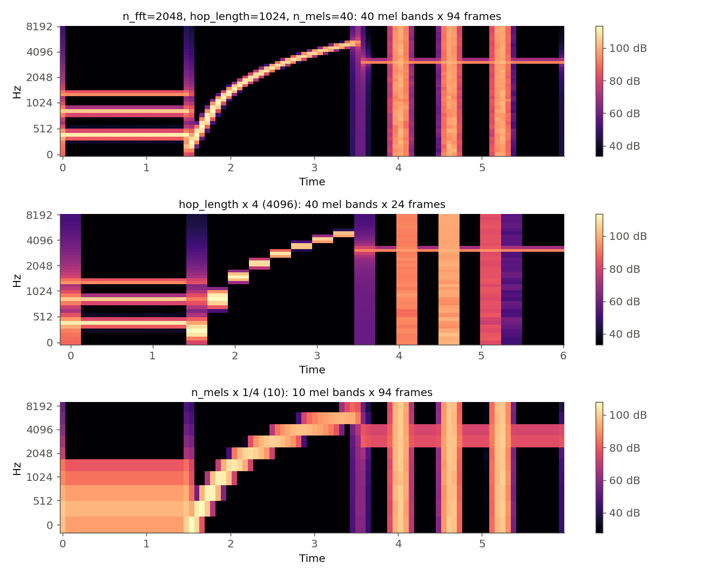

*Figure 16. Comparison of mel spectrograms with the default settings, with hop_length multiplied by 4, and with n_mels divided by 4*

The figure above applies the settings of the code above to the synthetic signal of Section 3.5.

- **Default settings (top):** The 6-second signal gives $1 + \lfloor 96000 / 1024 \rfloor = 94$ frames and 40 mel bands, a 40×94 array.
- **hop_length × 4 (middle):** Increasing the hop length to 4096 reduces the frames to $1 + \lfloor 96000 / 4096 \rfloor = 24$, about 1/4, so there are fewer columns. The rising sound looks coarse like a staircase, and the start and end of the noise also blur.
- **n_mels × 1/4 (bottom):** Reducing the mel bands to 10 reduces the rows from 40 to 10. The three tones at 440, 880, and 1320 Hz smear into one broad block spanning several low bands (about 0-1.7 kHz) and can no longer be distinguished.

### 4.5 Why Spectrograms Are Still Used

Although spectrogram features come from old, traditional sound-processing techniques, they are still the feature-extraction method mainly used in state-of-the-art (SOTA) models. The following are the top systems in Task 2 of DCASE 2024 (unsupervised anomalous sound detection, which finds whether a machine sound is anomalous), DCASE being a representative international competition in sound recognition [15].

| Rank | Submission code | Classifier | System complexity | Acoustic feature | Data augmentation | Decision making |
|:-----|:-----|:-----|:-----|:-----|:-----|:-----|
| 1 | Lv_AITHU_task2_4 | Pre-trained models, ensemble | 700M | Spectrogram | specaug | median |
| 2 | Lv_AITHU_task2_3 | Pre-trained models, ensemble | 700M | Spectrogram | specaug | median |
| 3 | Lv_AITHU_task2_1 | Pre-trained models, ensemble | 360M | Spectrogram | specaug | median |
| 4 | Jiang_THUEE_task2_1 | Pre-trained models, CNN, ensemble | 360M | Spectrogram, raw waveform | specaug | median |
| 5 | Lv_AITHU_task2_2 | Pre-trained models, ensemble | 360M | Spectrogram | specaug | median |
| 6 | Jiang_THUEE_task2_2 | Pre-trained models, flow model, ensemble | 360M | Spectrogram | specaug | median |
| 7 | Jiang_THUEE_task2_3 | Pre-trained models, CNN, flow model, ensemble | 360M | Spectrogram | specaug | median |

*Table 5. Composition of the top systems of DCASE 2024 Task 2*

All of the top systems use the spectrogram as the acoustic feature, and the raw waveform was used only in one system, as an auxiliary input alongside the spectrogram. System complexity is the number of parameters (700M is 700 million), and all of them are ensembles combining several models pre-trained on large data. In data augmentation, specaug is SpecAugment, a technique that increases training data by masking some time intervals and frequency bands of the spectrogram [16].

---

<br>

## 5. Audio Classification

### 5.1 Classifying Sound Like an Image

Once sound is converted into an image called a spectrogram, the rest of the process is the same as image classification. As in Figure 1, the mel spectrogram is regarded as a single grayscale image of size (number of mel bands) × (number of frames), features are extracted with convolution and pooling, and class probabilities are produced with fully connected layers and a softmax. The structure and training of convolutional neural networks were covered in Lectures 2-4.

Why bother converting sound into a spectrogram? The image-processing field already had many models of proven performance and many models pre-trained on large data, but the sound-processing field had relatively few. Therefore it was effective to process sound into the form for which good models abound, namely images, and to make use of those models.

> **Caution:** A spectrogram can be treated like an image, but it is not the same as a photograph. In a photograph a cat that moves up is still a cat, but in a spectrogram a pattern that moves along the frequency axis changes pitch and can become a different sound. Also, in a photograph a front object hides the one behind it, but sounds add to each other and overlap in the same cells. Because of these differences, models designed specifically for sound or retrained on sound data are used as well.

### 5.2 VGGish and Transfer Learning

**VGGish** is a study that applied the VGG model used for images to audio [17]. The suffix "-ish" in the name means that the model is similar to VGG. Google trained several CNN architectures on the sounds of about 70 million YouTube training videos and showed that image CNNs work well for audio classification, and released the VGG-like model among them as VGGish. The released VGGish takes a log mel spectrogram 0.96 seconds long (96 frames × 64 mel bands) as input and outputs a 128-dimensional feature vector (embedding) [18]. The VGG architecture was covered in Lecture 3.

VGGish is mainly used to extract features of sound data, that is, for **transfer learning**. The front part, already trained on large sound data, is taken as it is and used as a feature extractor, and only the back part suited to the target task is newly trained.

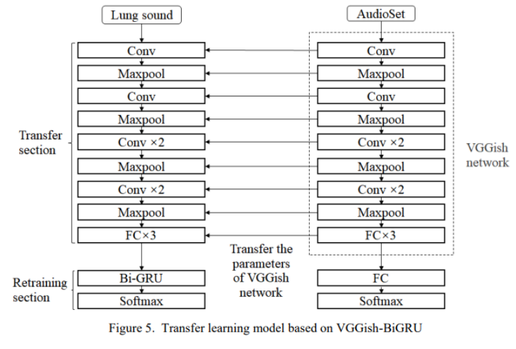

*Figure 17. A lung-sound recognition model that transfers the parameters of VGGish and newly trains a Bi-GRU*

The figure above is an example of applying VGGish to lung-sound recognition [19]. The right is the VGGish network pre-trained on the sounds of a large number of YouTube videos (the AudioSet at the top of the figure is a YouTube-based audio dataset released together with features extracted by the same model as VGGish), which repeats convolution (Conv) and max pooling (Maxpool) and ends with three fully connected layers (FC×3) and a classification layer (FC, Softmax). The lung-sound recognition model on the left transfers the parameters of VGGish from the convolutional layers through FC×3 as they are in the transfer section (Transfer the parameters of VGGish network), and in the retraining section it attaches a bidirectional GRU (Bi-GRU) and a softmax in place of the original classification layer and trains them anew on lung-sound data. Even in fields with little data, such as medical recordings, good performance can be achieved by reusing general sound features learned from large data.

---

<br>

## 6. Sound Event Detection

### 6.1 Structure of an SED System

Sound event detection (SED), as defined in Section 1.4, is the technique of detecting specific acoustic events or sounds and finding their start and end. The tutorial by Mesaros et al. [20] summarizes an SED system as follows.

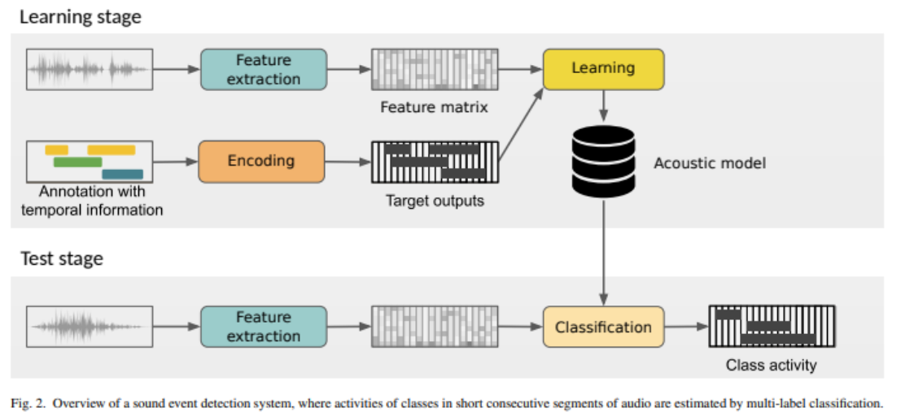

*Figure 18. A sound event detection system consisting of a learning stage and a test stage*

- **Learning stage:** Features are extracted from audio to make a feature matrix. The annotation in which a person marked the start and end of events (Annotation with temporal information) is encoded into target outputs that indicate, for each frame, whether each class is active (Encoding). The two are paired to train the acoustic model.
- **Test stage:** Features are extracted from new audio in the same way and classified with the trained acoustic model to obtain the activity of each class (Class activity).

SED can be viewed as **multi-label classification** that divides audio finely into short intervals (frames) and decides for each interval whether each class is active. Several classes can be active at the same time in one frame, so it differs from ordinary classification, which chooses only one class.

### 6.2 Input and Frame-Level Labels

From this section on, the example of detecting two kinds of coughs, the **dry cough** and the **abdominal cough**, in pig sounds recorded in a barn is followed.

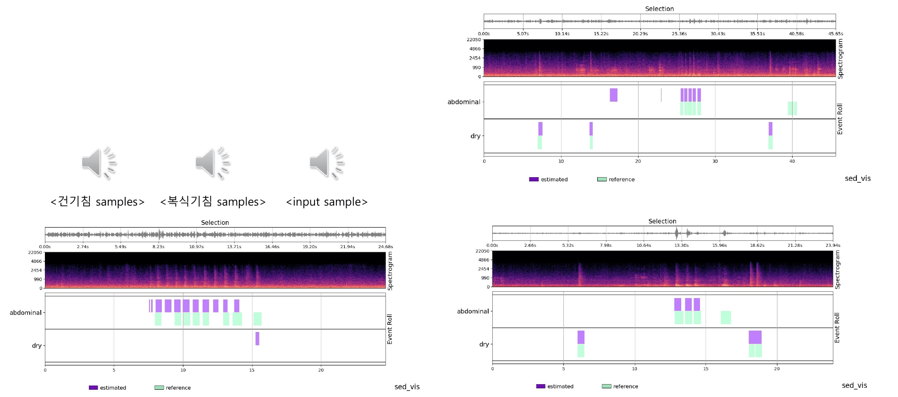

*Figure 19. Visualization of detection results for dry-cough samples, abdominal-cough samples, and an input sample*

The three panels are the results for a dry-cough sample, an abdominal-cough sample, and an input sample. The top of each panel is the waveform and spectrogram, and the event roll (Event Roll) below marks events as bars on two rows, abdominal and dry. Purple (estimated) is the model's prediction, and green (reference) is the actual ground-truth label assigned by a person. The more the purple and green bars lie in the same positions, the more accurate the detection.

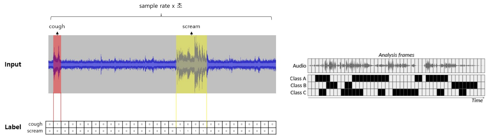

*Figure 20. Input waveform and frame-level labels of an SED model*

- **Input:** A waveform whose length is (sample rate) × (seconds) samples. For example, recording 10 seconds at 16 kHz gives 160,000 samples. The figure contains a cough event (red) and a scream event (yellow).
- **Label:** A matrix obtained by dividing the input into frames of fixed length and writing, for each class and frame, 1 if the class is active and 0 otherwise. The cough row is 1 only in the frame where the cough occurs, and the scream row is 1 in the several frames over which the scream continues.
- **Right figure:** It marks the activity of Class A, B, and C as black cells for each analysis frame, showing that several classes can be active at the same time in one frame.

### 6.3 The SED-CRNN Model

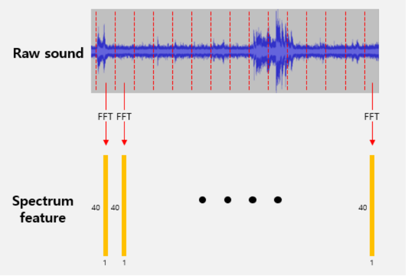

*Figure 21. Dividing raw sound into frames, applying the FFT, and making a 40-dimensional spectrum feature per frame*

First, the raw sound is divided into frames marked by red dashed lines, and the FFT and a mel filter bank are applied to each frame to make a 40-dimensional spectrum-feature column vector. Concatenating these column vectors in time order gives a mel spectrogram with 40 rows.

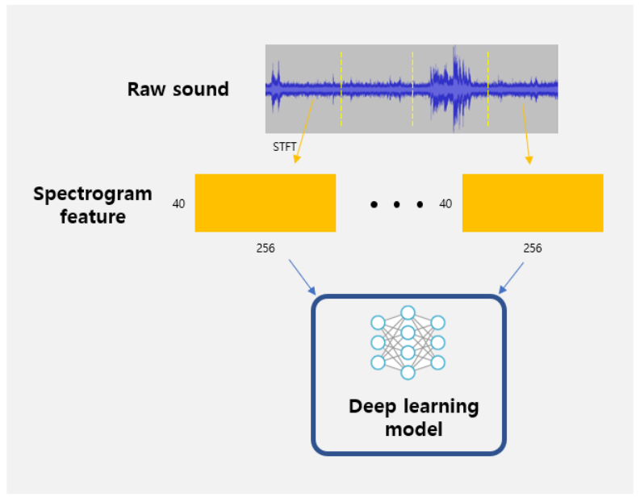

*Figure 22. Dividing raw sound into 40×256 spectrogram blocks and feeding them into a deep-learning model*

For a long recording, the spectrogram made with the STFT is cut every 256 frames into blocks of size 40×256 (mel bands × frames), and each block is fed into the deep-learning model. The model predicts a value for each of the 256 frames in the block.

The model used for cough detection is based on **SED-CRNN** proposed by Adavanne et al. [21]. A **CRNN (Convolutional Recurrent Neural Network)** is a model that follows convolutional layers (CNN) with recurrent layers (RNN), and this one has a simple structure of three CNN layers, two GRU layers, and fully connected layers.

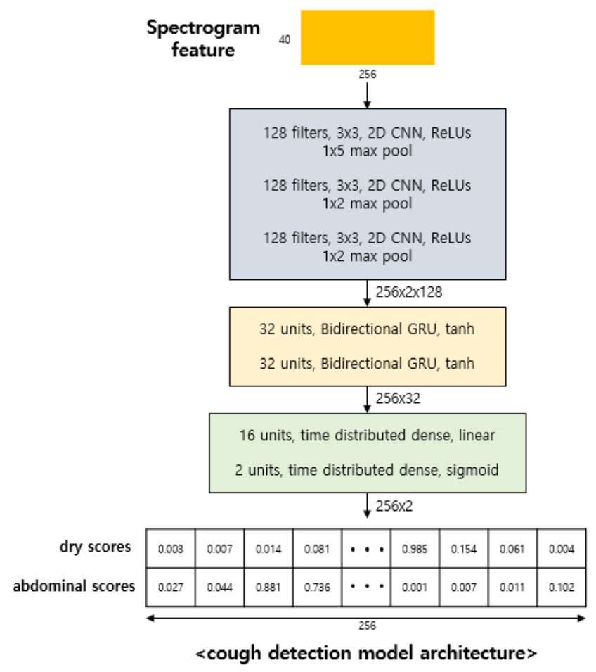

*Figure 23. Structure of the cough detection model and its per-frame output scores*

The sizes that a block takes as it passes through the model are as follows (sizes are in the order time × frequency × channels).

1. **Input:** A spectrogram feature of 40 (mel bands) × 256 (frames).
2. **Three convolutional blocks (gray):** Each convolves with 128 filters of size 3×3 and applies ReLU, then max-pools **only along the frequency axis**. The pooling sizes are 1×5, 1×2, and 1×2, so the frequency axis shrinks $40 \to 8 \to 4 \to 2$ while the time axis stays at 256. The output is 256×2×128. The time axis is not reduced because the activity of events must be decided for each frame.
3. **Two bidirectional GRU layers (yellow):** The $2 \times 128 = 256$ values of each frame are flattened into one vector to form a sequence of 256 frames, which is fed into two bidirectional GRU layers of 32 units to obtain 256×32. A **GRU (Gated Recurrent Unit)** is a recurrent neural network that simplifies the LSTM (Lecture 2), and it learns temporal context such as how long a cough lasts. **Bidirectional** means reading the sequence both forward and backward so that the output of each frame reflects both past and future context.
4. **Time-distributed fully connected layers (green):** A linear layer of 16 units and a sigmoid layer of 2 units are applied identically to each of the 256 frames (time distributed), giving 256×2.
5. **Output:** Two values per frame, the dry-cough score (dry scores) and the abdominal-cough score (abdominal scores). For example, in the figure the first frame after the ellipsis has a high dry score of 0.985, and the third and fourth frames at the front have high abdominal scores of 0.881 and 0.736.

> **Note:** A bidirectional GRU gives twice the number of units (64 for 32 units) if the outputs of the two directions are concatenated. The 256×32 in the figure corresponds to the case where the outputs of the two directions are merged into one 32-dimensional vector by element-wise multiplication or addition.

It is important that the output layer uses **an independent sigmoid for each class** rather than a softmax. A softmax makes the class probabilities sum to 1 and so chooses only one class, but a sigmoid gives a separate probability between 0 and 1 for each class, so the model can predict that both coughs are active in the same frame. This is a design suited to the multi-label classification of Section 6.1.

### 6.4 Deciding Events with a Threshold

The model's output is a score between 0 and 1, so whether a cough occurred is decided against a **threshold**. If the output score of the cough detection model is at or above the threshold it is judged 1, and otherwise 0, where 1 means that a cough was detected.

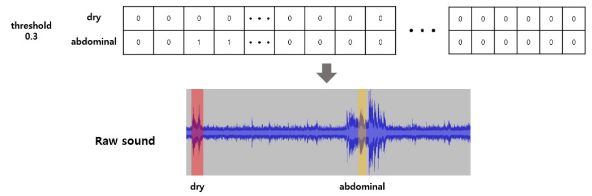

*Figure 24. Per-frame outputs binarized with threshold 0.3 and the intervals detected in the raw sound*

Applying a threshold of 0.3 to the scores shown in Figure 23 gives the following.

```text
dry scores        0.003  0.007  0.014  0.081  ...  0.985  0.154  0.061  0.004
dry (>= 0.3)        0      0      0      0    ...    1      0      0      0
abdominal scores  0.027  0.044  0.881  0.736  ...  0.001  0.007  0.011  0.102
abdominal (>= 0.3)  0      0      1      1    ...    0      0      0      0
```

In the binarized result, each run of consecutive 1s is one event, and its start and end times are computed from its first and last frames. For example, if the frame interval is 64 ms and frames 2 and 3, counting from 0, are 1, the abdominal cough started at about $2 \times 0.064 = 0.128$ s and ended around $(3 + 1) \times 0.064 = 0.256$ s. In the raw sound at the bottom of the figure, the red interval is the part detected as a dry cough and the yellow interval the part detected as an abdominal cough. Real systems sometimes add post-processing such as a median filter to remove noise where the score briefly crosses the threshold for only one frame [20].

Lowering the threshold reduces the missed coughs but increases the cases where non-cough sounds are judged as coughs, and raising the threshold does the opposite. This is the same as the relationship among the confidence threshold, precision, and recall seen in Lecture 5.

### 6.5 Segment-Based Evaluation

The accuracy of SED is evaluated in two ways, **segment-based** and **event-based** [22]. Segment-based evaluation divides the time axis into segments of fixed length (for example, 1 second) and compares the activity of each class in each segment with the ground truth.

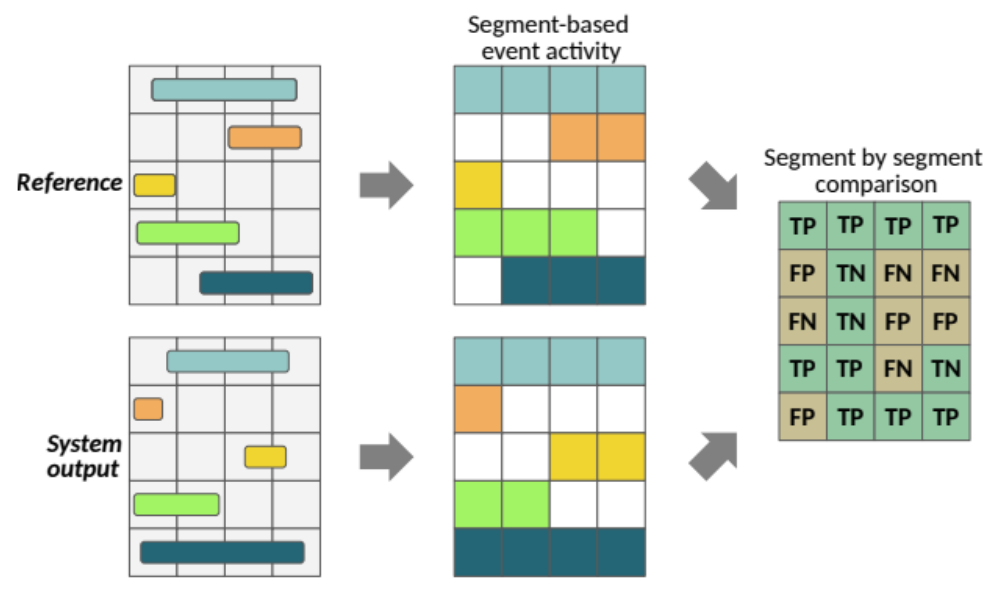

*Figure 25. Segment-based evaluation: converting the reference and the system output into segment-level activity and comparing them*

1. The event bars of the reference and the system output are divided into 4 segments, and every segment that an event touches even partially is marked active (1) (Segment-based event activity).
2. For each cell of class and segment, the reference and the output are compared (Segment by segment comparison): TP if both are 1, FP if only the output is 1, FN if only the reference is 1, and TN if both are 0.

Writing the five classes (rows) and four segments (columns) of the figure as a table gives the following.

| Class | Reference activity | System output activity | Judgment (segments 1-4) |
|:-----|:-----|:-----|:-----|
| 1 | 1 1 1 1 | 1 1 1 1 | TP TP TP TP |
| 2 | 0 0 1 1 | 1 0 0 0 | FP TN FN FN |
| 3 | 1 0 0 0 | 0 0 1 1 | FN TN FP FP |
| 4 | 1 1 1 0 | 1 1 0 0 | TP TP FN TN |
| 5 | 0 1 1 1 | 1 1 1 1 | FP TP TP TP |

*Table 6. Activity and judgments in the segment-based evaluation example*

Counting everything gives TP 9, FP 4, FN 4, and TN 3. Precision, recall, and the F1 score are as follows.

$$
P = \frac{TP}{TP + FP} = \frac{9}{13} \approx 0.692, \quad R = \frac{TP}{TP + FN} = \frac{9}{13} \approx 0.692, \quad F_1 = \frac{2PR}{P + R} = \frac{2\,TP}{2\,TP + FP + FN} = \frac{18}{26} \approx 0.692
$$

SED also uses the **error rate (ER)**. In each segment $k$, when FN and FP occur together they are regarded as replacing one class with another and counted as **substitutions (S)**, the remaining FNs as **deletions (D)**, and the remaining FPs as **insertions (I)** [22].

$$
S(k) = \min(FN(k), FP(k)), \quad D(k) = \max(0, FN(k) - FP(k)), \quad I(k) = \max(0, FP(k) - FN(k))
$$

$$
\text{ER} = \frac{\sum_k S(k) + \sum_k D(k) + \sum_k I(k)}{\sum_k N(k)}
$$

$N(k)$ is the number of classes active in the reference in segment $k$. Applying this to the example above gives the following.

| Segment | Active reference count $N$ | TP | FP | FN | S | D | I |
|:-----|-----:|-----:|-----:|-----:|-----:|-----:|-----:|
| 1 | 3 | 2 | 2 | 1 | 1 | 0 | 1 |
| 2 | 3 | 3 | 0 | 0 | 0 | 0 | 0 |
| 3 | 4 | 2 | 1 | 2 | 1 | 1 | 0 |
| 4 | 3 | 2 | 1 | 1 | 1 | 0 | 0 |
| Total | 13 | 9 | 4 | 4 | 3 | 1 | 1 |

*Table 7. Substitutions, deletions, and insertions per segment and the error-rate computation*

Therefore $\text{ER} = (3 + 1 + 1) / 13 = 5/13 \approx 0.385$. F1 is better when higher, and ER is better when lower. ER is best at 0 and can exceed 1 when there are many insertions.

### 6.6 Event-Based Evaluation

Event-based evaluation uses each individual event, rather than segments, as the unit and checks whether a detected event is a proper single event. For example, it asks whether the system found a sound that sounds like one cough as exactly one actual cough.

- **TP:** Taking the reference event as the basis, there is a system output of the same class that overlaps within the allowed tolerance.
- **FP:** Taking the system output as the basis, there is no reference event that overlaps within the allowed tolerance.
- **FN:** Taking the reference event as the basis, there is no system output that overlaps within the allowed tolerance.

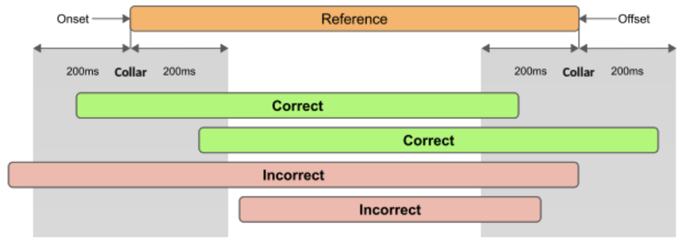

*Figure 26. Correct and incorrect outputs by the tolerance intervals (collars) around the onset and offset in event-based evaluation*

The allowed tolerance is a **collar** placed around the start (Onset) and end (Offset) of the reference event. In the figure, there is a gray collar of 200 ms before and after both the start and the end of the reference. The two outputs at the top (Correct) have both their start and end inside the collars, so they are correct, and the two outputs at the bottom (Incorrect) have their start outside the collar, so they are incorrect. DCASE evaluations sometimes set the onset collar to 200 ms and the offset collar to the larger of 200 ms and 50% of the reference event length [22].

**Computation example.** Suppose a reference cough starts at 2.00 s and ends at 2.40 s, and the collar is 0.2 s for both the start and the end.

1. If output A is 2.15-2.50 s, the start difference of 0.15 s and the end difference of 0.10 s are both at most 0.2 s, so it is TP.
2. If output B is 1.70-2.35 s, the start difference is 0.30 s, more than 0.2 s, so it is not paired with this reference. If only output B existed without output A, output B would be FP and the reference cough FN.

The two evaluation methods can give different scores to the same result. If the system detected one cough 1 second long in three fragments, segment-based evaluation with 1-second segments counts one TP because that segment is correctly active. In event-based evaluation, however, even the first fragment, whose start is correct, may fail to be paired because its end lies outside the collar, so all three fragments are FP and the reference is FN. When the number of events matters, as in applications that count coughs, event-based evaluation is more appropriate.

### 6.7 Evaluation Results and Applications

As an example of accuracy, consider the results of DCASE 2017 Task 3 (sound event detection in real-life audio) [23]. This task was to detect brakes squeaking, cars, children, large vehicles, people speaking, and people walking in sounds recorded on the street, and the ranking was based on the 1-second segment-based error rate (ER).

| Rank | Submission code | Author | Affiliation | ER | F1 |
|:-----|:-----|:-----|:-----|-----:|-----:|
| 1 | Adavanne_TUT_task3_1 | Sharath Adavanne | Tampere University of Technology | 0.7914 | 41.7% |
| 2 | Adavanne_TUT_task3_2 | Sharath Adavanne | Tampere University of Technology | 0.8061 | 42.9% |
| 3 | Lee_SNU_task3_3 | Kyogu Lee | Seoul National University | 0.8080 | 40.8% |
| 4 | Lu_THU_task3_1 | Rui Lu | Tsinghua University | 0.8251 | 39.6% |
| 5 | Lu_THU_task3_2 | Rui Lu | Tsinghua University | 0.8306 | 39.2% |
| 6 | Lu_THU_task3_3 | Rui Lu | Tsinghua University | 0.8361 | 38.0% |
| 7 | Lu_THU_task3_4 | Rui Lu | Tsinghua University | 0.8373 | 38.3% |

*Table 8. Segment-based error rates and F1 scores of the top systems of DCASE 2017 Task 3*

Even the first-ranked system has an ER of about 0.79 and an F1 of about 42%. This shows that finding acoustic events accurately in real-life recordings, where many sounds overlap and background noise is heavy, is difficult. Also, because the ranking is by ER, the second-ranked system with a higher F1 (42.9%) is below the first-ranked system with a lower ER (0.7914).

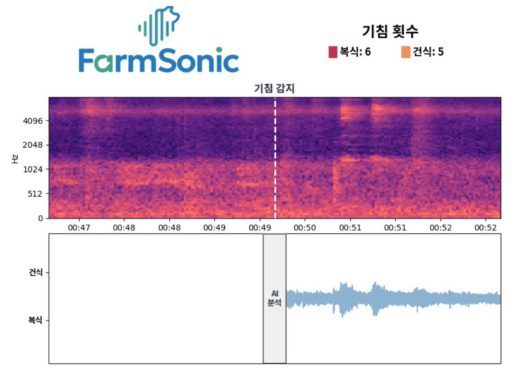

*Figure 27. The FarmSonic screen, which detects coughs in a barn and counts them by type*

As an application of SED, FarmSonic analyzes the sounds of a barn to detect livestock coughs and count them by type. The top of the screen shows the cough counts (6 abdominal, 5 dry), the middle shows the spectrogram and the time a cough was detected (dashed line), and the bottom shows the waveform of the sound being analyzed by the AI. Changes in the number and type of coughs can be an early clue to respiratory disease in livestock, so the condition of the animals can be monitored without a person listening all day.

---

<br>

## Concept Applications

**True/False Check:**

| Statement | Judgment and Reason |
|:-----|:-----|
| A recording sampled at 16 kHz can contain a 10 kHz component as it is. | **F.** The Nyquist frequency is 8 kHz, so a 10 kHz component cannot be represented; if not filtered out, it aliases to $\lvert 10 - 16 \rvert = 6$ kHz. |
| Two sounds that differ only in the order in which frequencies appear can have the same FFT magnitude spectrum. | **T.** An FFT applied once to the whole signal carries no time information. Distinguishing them requires the STFT. |
| Increasing hop_length reduces the number of rows of the mel spectrogram. | **F.** hop_length reduces the number of frames, that is, the number of columns. The number of rows is set by n_mels. |
| On the mel scale, a 100 Hz interval at high frequencies becomes a larger mel interval than a 100 Hz interval at low frequencies. | **F.** It is the opposite. 100-200 Hz is about 132.7 mel and 7000-7100 Hz is about 14.5 mel. |
| MFCC is obtained by applying the DCT to the mel spectrogram and then taking the logarithm. | **F.** The logarithm is taken first, and then the DCT is applied. |
| SED-CRNN uses a per-class sigmoid in the output layer, so two classes can both be 1 in the same frame. | **T.** A sigmoid gives an independent probability for each class, so multi-label decisions are possible. |
| Even if one cough is detected in three fragments, it can be TP in segment-based evaluation. | **T.** Only the activity within the segment is examined. In event-based evaluation, each fragment can be FP. |

---

<br>

## Summary

| Concept | Key Summary |
|:-----|:-----|
| Sound tasks | Representative tasks are audio classification, speech recognition, sound event detection and localization, and audio generation and denoising. Localization requires multichannel recording. |
| Speech recognition | Consists of feature extraction, an acoustic model that outputs character probabilities per time step, and a decoder using greedy decoding or a language model. CTC forms the string by merging repeats and removing blanks. |
| Sampling | The sample rate is the number of samples per second, and the maximum representable frequency is the Nyquist frequency $f_s/2$. Components above it cause aliasing. |
| Fourier transform and DFT | Decomposes a time-domain signal into frequency components. The $k$-th bin of the DFT is $k f_s / N$ Hz, and the FFT computes it in $O(N \log N)$. |
| Limitation of the FFT and the STFT | The FFT of a whole signal does not tell when which frequency occurred. The STFT divides the signal by the window length and hop length and applies the FFT to each interval. |
| Spectrogram | The magnitude of the STFT arranged as a time × frequency array and shown in dB. Being an image, it can be processed with CNNs. |
| Mel scale and mel spectrogram | $m = 2595 \log_{10}(1 + f/700)$ divides low frequencies finely. A mel filter bank applied to the spectrogram reduces it to n_mels bands. |
| MFCC | Coefficients obtained by taking the logarithm of the mel spectrum and applying the DCT. In deep learning the log mel spectrogram is used more. |
| Extraction parameters | n_fft and win_length set the frequency resolution, hop_length the number of frames (time resolution), and n_mels the number of mel bands. |
| Audio classification and VGGish | Classifies a spectrogram with a CNN like an image. VGGish is a VGG-like model trained on large sound data and is used for feature extraction and transfer learning. |
| SED and SED-CRNN | Multi-label classification that decides the activity of each class per frame. A CNN (pooling along frequency), bidirectional GRUs, and time-distributed sigmoid layers produce per-frame scores, which are binarized with a threshold. |
| SED evaluation | Segment-based evaluation compares activity per segment to obtain F1 and ER = (S + D + I)/N, and event-based evaluation judges matches per event with collars around the onset and offset. |

---

<br>

## Self-Check Questions

1. **Number of samples and Nyquist frequency:** Recording 2.5 seconds at 44,100 Hz gives how many samples, and what is the maximum representable frequency?

   <details>
   <summary>Answer</summary>

   The number of samples is $44100 \times 2.5 = 110250$. The Nyquist frequency is $44100 / 2 = 22050$ Hz.

   </details>

2. **Aliasing:** If a 9 kHz sine wave is sampled at 16 kHz without a low-pass filter, at what frequency does it appear?

   <details>
   <summary>Answer</summary>

   The Nyquist frequency is 8 kHz, so 9 kHz cannot be represented, and it appears as a component at $\lvert 9 - 16 \rvert = 7$ kHz.

   </details>

3. **DFT frequency bins:** For a DFT with $f_s$ = 16,000 Hz and $N$ = 1024, find the frequency resolution, the number of frequency bins carrying distinct information, and the bin index corresponding to 1000 Hz.

   <details>
   <summary>Answer</summary>

   The frequency resolution is $16000 / 1024 = 15.625$ Hz. The number of bins is $1024 / 2 + 1 = 513$. $k = 1000 / 15.625 = 64$, so it is bin 64.

   </details>

4. **Number of STFT frames:** Applying the STFT with hop length 512 to a 5-second signal recorded at 16 kHz, how many frames are there when the signal is padded at both ends?

   <details>
   <summary>Answer</summary>

   The number of samples is $16000 \times 5 = 80000$. The number of frames is $1 + \lfloor 80000 / 512 \rfloor = 1 + \lfloor 156.25 \rfloor = 157$.

   </details>

5. **FFT and STFT:** Explain why applying the FFT once to the whole signal is not enough for sound analysis, and how the STFT solves this.

   <details>
   <summary>Answer</summary>

   The FFT of the whole signal tells only which frequencies it contains and how much, not when they appeared, so it cannot distinguish sounds that differ only in order. The STFT divides the signal into short intervals of the window length, moves by the hop length, multiplies each interval by a window function, and applies the FFT, so it obtains the change of the frequency components over time.

   </details>

6. **Mel value:** Convert 2000 Hz to the mel scale, using $\log_{10} 3.857 \approx 0.5863$.

   <details>
   <summary>Answer</summary>

   $m = 2595 \log_{10}(1 + 2000/700) = 2595 \log_{10} 3.857 \approx 2595 \times 0.5863 \approx 1521$ mel.

   </details>

7. **Order of MFCC computation:** Write in order the steps for obtaining MFCC from a waveform, and explain the roles of the logarithm and the DCT.

   <details>
   <summary>Answer</summary>

   The order is framing and windowing, FFT, power spectrum, mel filter bank (mel spectrogram), logarithm, and DCT. The logarithm compresses a wide range of values, like human perception of loudness, and the DCT turns the correlated mel-band values into coefficients with little correlation, gathering the spectral envelope into the first few coefficients.

   </details>

8. **CRNN sizes:** If the input is 40 (mel bands) × 256 (frames) and the max pooling of the convolutional blocks is 1×5, 1×2, and 1×2 along the frequency axis, what is the size of the frequency axis after the convolutional blocks, and why is there no pooling along the time axis?

   <details>
   <summary>Answer</summary>

   The frequency axis goes $40 / 5 = 8$, $8 / 2 = 4$, $4 / 2 = 2$, so it is 2. SED must decide the activity of events per frame to find onset and offset times, so there is no pooling along the time axis in order to keep the time resolution of 256 frames to the end.

   </details>

9. **Segment-based evaluation:** The reference activity of class A in segments 1-3 is 1, 1, 0 and that of class B is 0, 1, 1, while the system output is 1, 0, 0 for A and 1, 1, 1 for B. Find F1 and ER.

   <details>
   <summary>Answer</summary>

   In segment 1, A is TP and B is FP ($N = 1$, S = 0, D = 0, I = 1). In segment 2, A is FN and B is TP ($N = 2$, S = 0, D = 1, I = 0). In segment 3, B is TP ($N = 1$). The totals are TP 3, FP 1, FN 1, so $F_1 = 6 / (6 + 1 + 1) = 0.75$. $\text{ER} = (0 + 1 + 1) / 4 = 0.5$.

   </details>

10. **Event-based evaluation:** A reference event spans 1.00-1.50 s, the onset collar is 0.2 s, and the offset collar is the larger of 0.2 s and 50% of the event length. Are the outputs 1.15-1.60 s and 0.70-1.40 s each TP?

    <details>
    <summary>Answer</summary>

    The event length is 0.5 s, so the offset collar is max(0.2, 0.25) = 0.25 s. The output 1.15-1.60 s has a start difference of 0.15 s ≤ 0.2 s and an end difference of 0.10 s ≤ 0.25 s, so it is TP. The output 0.70-1.40 s has a start difference of 0.30 s, more than 0.2 s, so it is not TP.

    </details>

---

<br>

## References

1. A. Flores Miranda, P. Chitale, and J. Cohen, "How to build domain specific automatic speech recognition models on GPUs," *NVIDIA Technical Blog*, 2019. https://developer.nvidia.com/blog/how-to-build-domain-specific-automatic-speech-recognition-models-on-gpus/
2. J. Li, V. Lavrukhin, B. Ginsburg, R. Leary, O. Kuchaiev, J. M. Cohen, H. Nguyen, and R. T. Gadde, "Jasper: An end-to-end convolutional neural acoustic model," in *Proc. Interspeech*, 2019, pp. 71-75.
3. S. Kriman, S. Beliaev, B. Ginsburg, J. Huang, O. Kuchaiev, V. Lavrukhin, R. Leary, J. Li, and Y. Zhang, "QuartzNet: Deep automatic speech recognition with 1D time-channel separable convolutions," in *Proc. IEEE Int. Conf. Acoustics, Speech and Signal Processing (ICASSP)*, 2020, pp. 6124-6128.
4. A. Graves, S. Fernández, F. Gomez, and J. Schmidhuber, "Connectionist temporal classification: Labelling unsegmented sequence data with recurrent neural networks," in *Proc. Int. Conf. Machine Learning (ICML)*, 2006, pp. 369-376.
5. S. Adavanne, A. Politis, J. Nikunen, and T. Virtanen, "Sound event localization and detection of overlapping sources using convolutional recurrent neural networks," *IEEE Journal of Selected Topics in Signal Processing*, vol. 13, no. 1, pp. 34-48, 2019.
6. G. Greshler, T. R. Shaham, and T. Michaeli, "Catch-A-Waveform: Learning to generate audio from a single short example," in *Advances in Neural Information Processing Systems (NeurIPS)*, vol. 34, 2021, pp. 20916-20928.
7. C. E. Shannon, "Communication in the presence of noise," *Proceedings of the IRE*, vol. 37, no. 1, pp. 10-21, 1949.
8. A. V. Oppenheim and R. W. Schafer, *Discrete-Time Signal Processing*, 3rd ed. Upper Saddle River, NJ, USA: Pearson, 2010.
9. 3Blue1Brown, "But what is the Fourier Transform? A visual introduction," YouTube, 2018. https://www.youtube.com/watch?v=spUNpyF58BY
10. J. W. Cooley and J. W. Tukey, "An algorithm for the machine calculation of complex Fourier series," *Mathematics of Computation*, vol. 19, no. 90, pp. 297-301, 1965.
11. S. S. Stevens, J. Volkmann, and E. B. Newman, "A scale for the measurement of the psychological magnitude pitch," *The Journal of the Acoustical Society of America*, vol. 8, no. 3, pp. 185-190, 1937.
12. D. O'Shaughnessy, *Speech Communication: Human and Machine*. Reading, MA, USA: Addison-Wesley, 1987.
13. B. McFee, C. Raffel, D. Liang, D. P. W. Ellis, M. McVicar, E. Battenberg, and O. Nieto, "librosa: Audio and music signal analysis in Python," in *Proc. 14th Python in Science Conf. (SciPy)*, 2015, pp. 18-25.
14. S. Davis and P. Mermelstein, "Comparison of parametric representations for monosyllabic word recognition in continuously spoken sentences," *IEEE Transactions on Acoustics, Speech, and Signal Processing*, vol. 28, no. 4, pp. 357-366, 1980.
15. DCASE Community, "DCASE2024 Challenge Task 2: First-shot unsupervised anomalous sound detection for machine condition monitoring, Results," 2024. https://dcase.community/challenge2024/task-first-shot-unsupervised-anomalous-sound-detection-for-machine-condition-monitoring-results
16. D. S. Park, W. Chan, Y. Zhang, C.-C. Chiu, B. Zoph, E. D. Cubuk, and Q. V. Le, "SpecAugment: A simple data augmentation method for automatic speech recognition," in *Proc. Interspeech*, 2019, pp. 2613-2617.
17. S. Hershey *et al.*, "CNN architectures for large-scale audio classification," in *Proc. IEEE Int. Conf. Acoustics, Speech and Signal Processing (ICASSP)*, 2017, pp. 131-135.
18. Google, "VGGish," TensorFlow Model Garden, GitHub repository. https://github.com/tensorflow/models/tree/master/research/audioset/vggish
19. L. Shi, K. Du, C. Zhang, H. Ma, and W. Yan, "Lung sound recognition algorithm based on VGGish-BiGRU," *IEEE Access*, vol. 7, pp. 139438-139449, 2019.
20. A. Mesaros, T. Heittola, T. Virtanen, and M. D. Plumbley, "Sound event detection: A tutorial," *IEEE Signal Processing Magazine*, vol. 38, no. 5, pp. 67-83, 2021.
21. S. Adavanne, P. Pertilä, and T. Virtanen, "Sound event detection using spatial features and convolutional recurrent neural network," in *Proc. IEEE Int. Conf. Acoustics, Speech and Signal Processing (ICASSP)*, 2017, pp. 771-775.
22. A. Mesaros, T. Heittola, and T. Virtanen, "Metrics for polyphonic sound event detection," *Applied Sciences*, vol. 6, no. 6, p. 162, 2016.
23. DCASE Community, "DCASE2017 Challenge Task 3: Sound event detection in real life audio, Results," 2017. https://dcase.community/challenge2017/task-sound-event-detection-in-real-life-audio#results
