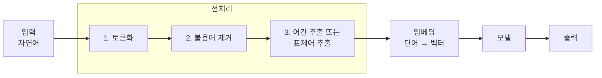
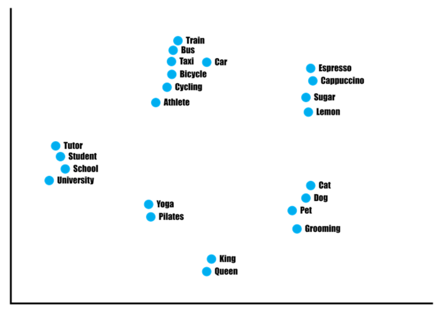
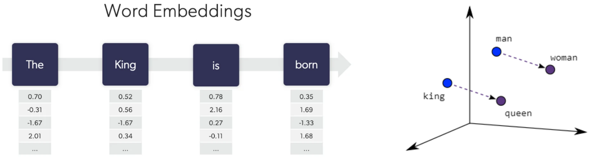
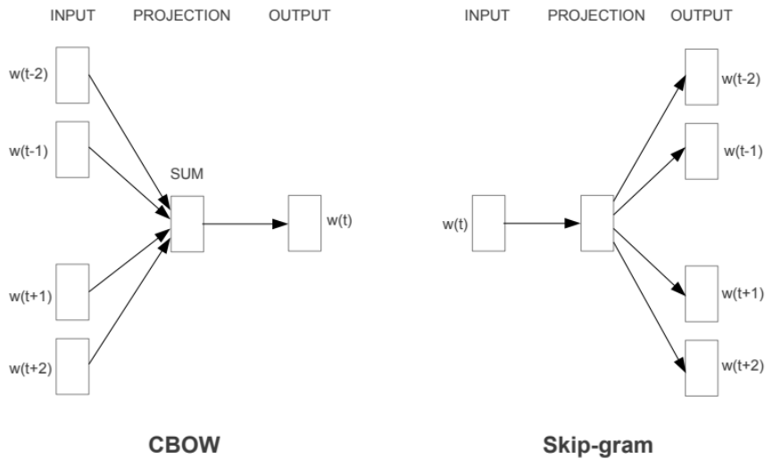
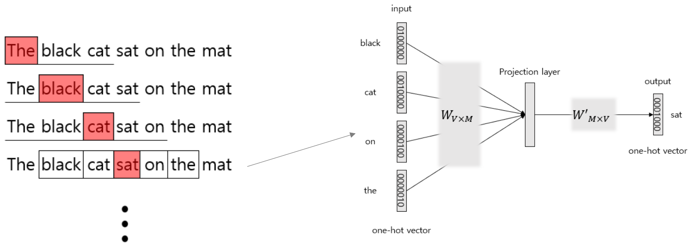
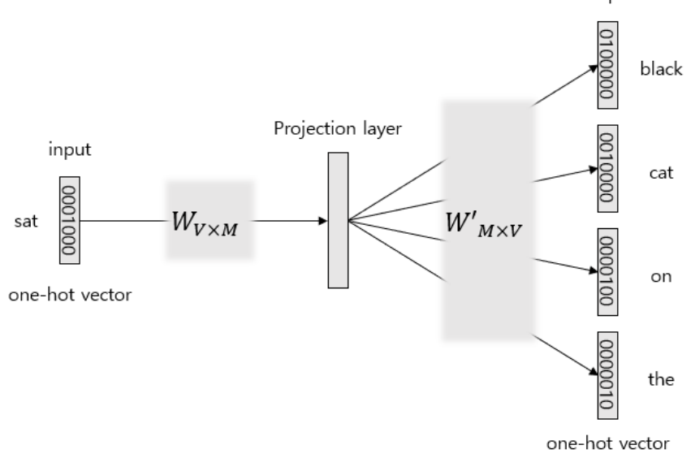
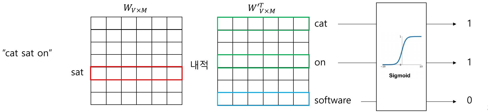
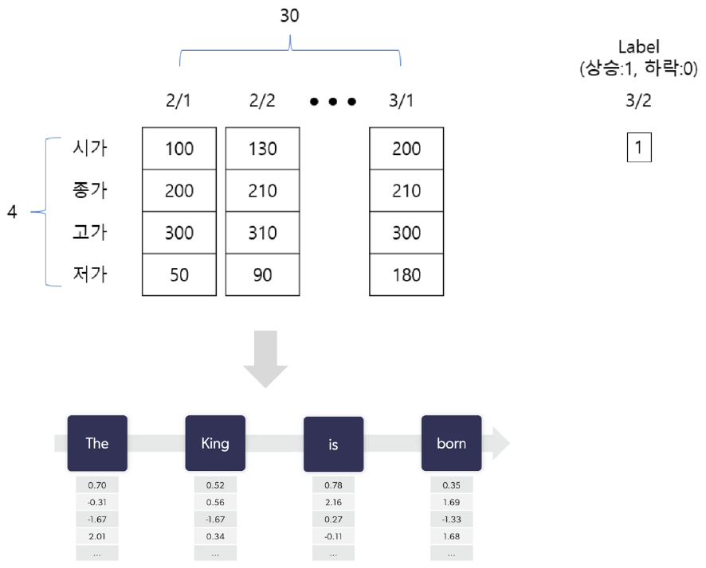
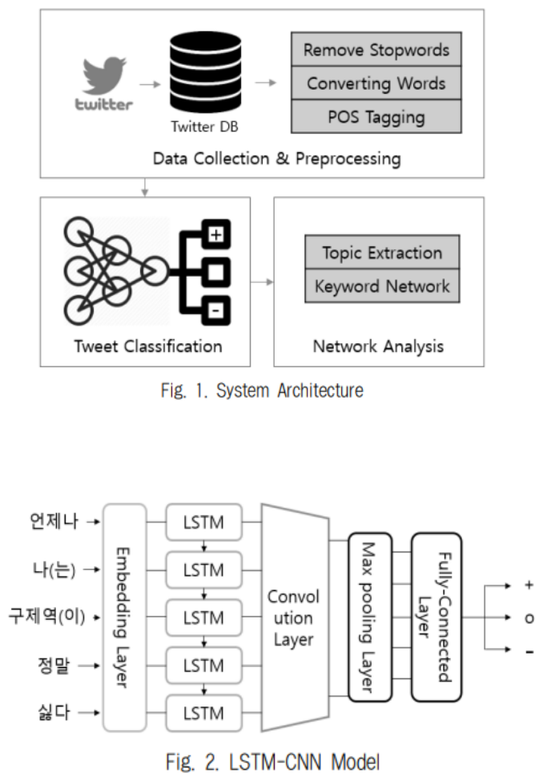
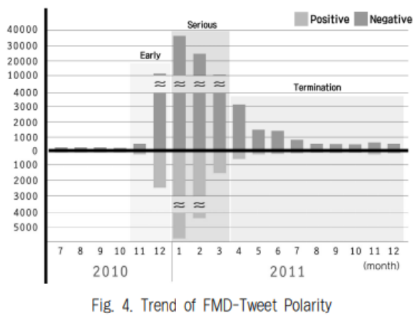

# 7강 — 자연어 처리 1

[레포지토리 안내](../../README.ko.md) | [English](Concepts_Lecture.md) | [한국어](Concepts_Lecture.ko.md)

> **최종 수정일:** 2026-11-04

> **학습 목표:**
> 1. 자연어 처리의 정의와 어려움을 설명하고, 코퍼스, 토큰, 토큰화, 형태소, 불용어, 어간 추출, 표제어 추출을 구분할 수 있다
> 2. 원-핫 인코딩으로 단어를 벡터로 나타내고, 그 표현이 단어 사이의 관계를 담지 못하는 이유를 설명할 수 있다
> 3. 작은 문서 집합에서 TF, IDF, TF-IDF를 직접 계산하고 결과를 해석할 수 있다
> 4. Word2Vec의 CBOW와 skip-gram의 구조, 학습 과정, 네거티브 샘플링의 아이디어를 설명할 수 있다
> 5. FastText가 문자 n-gram으로 OOV 단어와 희귀 단어에 대응하는 원리를 설명할 수 있다
> 6. 단어 임베딩의 시퀀스를 LSTM에 넣어 문장의 감성을 분류하는 과정을 설명할 수 있다

---

## 목차

- [1. 자연어 처리와 기본 용어](#1-자연어-처리와-기본-용어)
  - [1.1 자연어 처리란](#11-자연어-처리란)
  - [1.2 코퍼스, 토큰, 토큰화](#12-코퍼스-토큰-토큰화)
  - [1.3 한국어 토큰화와 형태소 분석](#13-한국어-토큰화와-형태소-분석)
  - [1.4 불용어](#14-불용어)
  - [1.5 어간 추출과 표제어 추출](#15-어간-추출과-표제어-추출)
  - [1.6 자연어 처리 과정](#16-자연어-처리-과정)
- [2. 자연어 처리의 응용](#2-자연어-처리의-응용)
- [3. 단어 임베딩](#3-단어-임베딩)
  - [3.1 임베딩의 개념](#31-임베딩의-개념)
  - [3.2 원-핫 인코딩](#32-원-핫-인코딩)
  - [3.3 TF-IDF](#33-tf-idf)
  - [3.4 TF-IDF 계산 예제](#34-tf-idf-계산-예제)
  - [3.5 Word2Vec과 밀집 표현](#35-word2vec과-밀집-표현)
  - [3.6 CBOW](#36-cbow)
  - [3.7 Skip-gram](#37-skip-gram)
  - [3.8 네거티브 샘플링](#38-네거티브-샘플링)
  - [3.9 FastText](#39-fasttext)
  - [3.10 표현 방법의 비교](#310-표현-방법의-비교)
- [4. 감성 분석](#4-감성-분석)
  - [4.1 감성 분석이란](#41-감성-분석이란)
  - [4.2 임베딩 시퀀스를 LSTM으로 분류하기](#42-임베딩-시퀀스를-lstm으로-분류하기)
  - [4.3 연구 사례](#43-연구-사례)
- [개념 적용](#개념-적용)
- [요약](#요약)
- [점검 문제](#점검-문제)
- [참고 문헌](#참고-문헌)

---

<br>

## 1. 자연어 처리와 기본 용어

### 1.1 자연어 처리란

**자연어(natural language)** 는 한국어, 영어, 중국어처럼 사람이 일상생활에서 의사소통에 쓰는 언어이다. 프로그래밍 언어처럼 문법이 엄밀하게 정의된 인공 언어와 달리, 자연어는 같은 문장이 여러 뜻으로 읽힐 수 있고 문맥에 따라 의미가 달라진다.

> **용어 정의:** **자연어 처리(natural language processing, NLP)** 는 사람이 일상생활에서 사용하는 언어의 의미를 분석하여 컴퓨터가 처리할 수 있도록 하는 과정이다.

자연어 처리가 어려운 이유는 크게 두 가지이다.

- **인간 언어에 대한 이해가 필요하다.** 한국어의 "배"는 과일, 탈것, 신체 부위 가운데 무엇인지 문맥을 보아야 알 수 있다. 컴퓨터가 이러한 중의성을 해소하려면 단어의 뜻과 문맥을 함께 다루어야 한다.
- **언어마다 구조와 형태가 다양하다.** 영어는 단어 사이를 띄어 쓰므로 공백으로 단어를 나누기 쉽지만, 중국어는 띄어쓰기가 없어서 단어의 경계를 찾는 일부터 어렵다. 한국어는 띄어쓰기가 있지만 "나는"처럼 명사 "나"에 조사 "는"이 붙어 한 어절을 이루는 교착어이므로, 공백으로 나눈 단위가 곧 의미의 단위가 되지는 않는다.

### 1.2 코퍼스, 토큰, 토큰화

> **용어 정의:** **코퍼스(corpus, 말뭉치)** 는 자연어 처리 연구를 위해 특정한 목적에서 표본을 추출한 자연어의 집합이다. 뉴스 기사 모음, 상품 리뷰 모음, 대화 기록처럼 분석 목적에 맞게 모은 텍스트가 코퍼스가 되며, 한국에서는 공공데이터포털(data.go.kr) 같은 곳에서 공개 코퍼스를 내려받을 수 있다.

자연어 처리를 하려면 문서를 작은 단위로 나누어야 한다. 이때 문서나 문장을 나누는 단위를 **토큰(token)** 이라 하고, 텍스트를 문장이나 단어 같은 토큰으로 분리하는 작업을 **토큰화(tokenization)** 라고 한다. 토큰의 단위는 목적에 따라 정한다. 문장을 단어 단위로 나눌 수도 있고, 단어를 음절이나 문자 단위로 다시 나눌 수도 있다.

같은 문장이라도 어떤 규칙으로 토큰화하느냐에 따라 결과가 달라진다. 다음은 영어 문장 `Let's tokenize! Isn't this easy?`를 세 가지 규칙으로 나눈 결과이다.

| 규칙 | 토큰화 결과 |
|:-----|:-----|
| 공백 기준(white spaces) | `Let's`, `tokenize!`, `Isn't`, `this`, `easy?` |
| 구두점 기준(punctuation) | `Let`, `'`, `s`, `tokenize`, `!`, `Isn`, `'`, `t`, `this`, `easy`, `?` |
| 규칙 기반(rules) | `Let`, `'s`, `tokenize`, `!`, `Is`, `n't`, `this`, `easy`, `?` |

*표 1. 같은 영어 문장에 세 가지 규칙을 적용한 토큰화 결과*

공백 기준은 구현이 가장 간단하지만 느낌표나 물음표가 단어에 붙어 남는다. 구두점 기준은 기호를 떼어 내지만 `Isn't`를 `Isn`과 `t`처럼 의미 없는 조각으로 자른다. 규칙 기반 토큰화는 `'s`(이 문장에서는 Let us의 us, 다른 문장에서는 소유격이나 is의 축약)와 `n't`(not의 축약)처럼 영어 문법에서 의미를 가진 단위를 따로 떼어 내므로, 이후의 분석에 더 적합한 토큰을 만든다.

### 1.3 한국어 토큰화와 형태소 분석

한국어의 토큰화는 주로 **형태소 분석(morphological analysis)** 으로 진행한다. **형태소(morpheme)** 는 언어를 쪼갤 때 의미를 가지는 가장 작은 단위이다. 예를 들어 "수업이"는 명사 "수업"과 조사 "이"라는 두 형태소로 이루어진다. 형태소 분석기는 문장을 형태소로 나누고 각 형태소에 **품사(part of speech, POS)** 를 붙인다.

Python에서는 KoNLPy 패키지가 여러 한국어 형태소 분석기를 같은 방식으로 호출할 수 있게 묶어 제공한다 [1]. KoNLPy는 내부적으로 Java로 작성된 분석기를 사용하므로, `pip install konlpy`로 설치하기 전에 Java 개발 도구(JDK)가 설치되어 있어야 한다. KoNLPy가 제공하는 분석기 가운데 네 가지는 다음과 같다.

| 분석기 | 개발 주체 |
|:-----|:-----|
| Hannanum | KAIST에서 개발한 형태소 분석기 |
| Kkma(꼬꼬마) | 서울대학교에서 개발한 형태소 분석기 |
| Komoran | Shineware에서 개발한 형태소 분석기 |
| Okt(Open Korean Text) | 트위터에서 만든 형태소 분석기(이전 이름은 Twitter) |

*표 2. KoNLPy가 제공하는 주요 한국어 형태소 분석기*

다음 코드는 같은 문장을 네 분석기로 분석한다. 각 분석기 객체의 `pos()` 메서드는 문장을 받아 `(형태소, 품사 태그)` 쌍의 리스트를 반환한다.

```python
from konlpy.tag import Hannanum, Kkma, Komoran, Okt

text = "나는 1교시 수업이 재밌다."

tokenizer = Hannanum()
pos = tokenizer.pos(text)  # POS(part of speech): 품사
print("Hannanum:", pos)

tokenizer = Kkma()
pos = tokenizer.pos(text)
print("Kkma:", pos)

tokenizer = Komoran()
pos = tokenizer.pos(text)
print("Komoran:", pos)

tokenizer = Okt()
pos = tokenizer.pos(text)
print("Okt:", pos)
```

```text
Hannanum: [('나', 'N'), ('는', 'J'), ('1교시', 'N'), ('수업', 'N'), ('이', 'J'), ('재밌다', 'N'), ('.', 'S')]
Kkma: [('나', 'NP'), ('는', 'JX'), ('1', 'NR'), ('교시', 'NNM'), ('수업', 'NNG'), ('이', 'JKS'), ('재밌', 'VA'), ('다', 'EFN'), ('.', 'SF')]
Komoran: [('나', 'NP'), ('는', 'JX'), ('1', 'SN'), ('교시', 'NNB'), ('수업', 'NNG'), ('이', 'JKS'), ('재밌', 'VA'), ('다', 'EF'), ('.', 'SF')]
Okt: [('나', 'Noun'), ('는', 'Josa'), ('1', 'Number'), ('교시', 'Noun'), ('수업', 'Noun'), ('이', 'Josa'), ('재밌다', 'Adjective'), ('.', 'Punctuation')]
```

문장 `"나는 어제 게임을 했다."`를 같은 코드로 분석하면 다음과 같다.

```text
Hannanum: [('나', 'N'), ('는', 'J'), ('어제', 'N'), ('게임', 'N'), ('을', 'J'), ('하', 'P'), ('었다', 'E'), ('.', 'S')]
Kkma: [('나', 'NP'), ('는', 'JX'), ('어제', 'NNG'), ('게임', 'NNG'), ('을', 'JKO'), ('하', 'VV'), ('었', 'EPT'), ('다', 'EFN'), ('.', 'SF')]
Komoran: [('나', 'NP'), ('는', 'JX'), ('어제', 'MAG'), ('게임', 'NNG'), ('을', 'JKO'), ('하', 'VV'), ('았', 'EP'), ('다', 'EF'), ('.', 'SF')]
Okt: [('나', 'Noun'), ('는', 'Josa'), ('어제', 'Noun'), ('게임', 'Noun'), ('을', 'Josa'), ('했다', 'Verb'), ('.', 'Punctuation')]
```

출력에 나온 품사 태그의 뜻은 다음과 같다.

| 태그 | 의미 | 사용하는 분석기 |
|:-----|:-----|:-----|
| N, J, P, E, S | 체언, 관계언(조사), 용언, 어미, 기호 | Hannanum |
| NP, NR | 대명사, 수사 | Kkma, NP는 Komoran도 사용 |
| NNG, NNB, NNM | 일반 명사, 의존 명사, 단위 의존 명사 | NNG는 Kkma와 Komoran, NNB는 Komoran, NNM은 Kkma |
| JX, JKS, JKO | 보조사, 주격 조사, 목적격 조사 | Kkma, Komoran |
| VV, VA | 동사, 형용사 | Kkma, Komoran |
| EP, EPT | 선어말 어미, 시제 선어말 어미 | EP는 Komoran, EPT는 Kkma |
| EF, EFN | 종결 어미, 평서형 종결 어미 | EF는 Komoran, EFN은 Kkma |
| SN, SF, MAG | 숫자, 마침표류 기호, 일반 부사 | Komoran, SF는 Kkma도 사용 |
| Noun, Josa, Number, Verb, Adjective, Punctuation | 명사, 조사, 숫자, 동사, 형용사, 구두점 | Okt |

*표 3. 형태소 분석 결과에 나온 품사 태그의 의미*

두 결과에서 다음을 알 수 있다.

- **분석의 세밀함이 다르다.** Kkma와 Komoran은 "재밌다"를 어간 "재밌"과 어미 "다"로, "했다"를 "하", "었/았", "다"로 나누지만, Okt는 "재밌다", "했다"를 한 덩어리로 둔다. Hannanum은 "1교시"를 하나의 명사로 본다.
- **태그 체계가 다르다.** Hannanum은 N, J처럼 큰 범주만 쓰고, Kkma와 Komoran은 세종 품사 태그 계열의 세분된 태그를 쓰며, Okt는 영어 단어로 된 태그를 쓴다.
- **같은 형태소도 다르게 판단한다.** "어제"를 Kkma는 일반 명사(NNG)로, Komoran은 부사(MAG)로 분석한다. "했다"의 과거 시제 어미를 Kkma는 "었"으로, Komoran은 "았"으로 복원한다.

따라서 분석기는 태스크에 맞게 고른다. 형태소 단위의 세밀한 분석이 필요하면 Kkma나 Komoran을, 빠른 처리와 단순한 토큰이 필요하면 Okt를 쓰는 식이다.

### 1.4 불용어

> **용어 정의:** **불용어(stop word)** 는 문장에 자주 등장하지만 분석에는 의미가 없는 단어이다. 한국어의 조사와 접미사, 영어의 관사(the, a), 대명사(I, you), be동사 같은 단어가 대표적이다.

불용어는 거의 모든 문서에 나타나므로 문서를 구별하는 데 도움이 되지 않고, 남겨 두면 계산량만 늘린다. 그래서 전처리 단계에서 미리 정한 불용어 목록에 있는 토큰을 지운다. 영어는 NLTK(Natural Language Toolkit) 패키지가 불용어 목록을 제공한다.

```python
import nltk
from nltk.corpus import stopwords

nltk.download('stopwords', quiet=True)            # 불용어 목록을 처음 한 번 내려받는다
print(stopwords.words('english')[:10])

stop = set(stopwords.words('english'))
tokens = "the cat is sitting on the mat".split()
print([t for t in tokens if t not in stop])
```

```text
['a', 'about', 'above', 'after', 'again', 'against', 'ain', 'all', 'am', 'an']
['cat', 'sitting', 'mat']
```

`stopwords.words('english')`는 영어 불용어의 리스트이고, `[:10]`은 그 가운데 앞의 10개를 뜻한다. 두 번째 부분은 문장을 공백으로 토큰화한 뒤 불용어 집합에 없는 토큰만 남긴다. "the", "is", "on"이 지워지고 내용어인 "cat", "sitting", "mat"만 남는다.

> **참고:** NLTK 불용어 목록의 순서와 길이는 내려받은 데이터의 버전에 따라 다르다. 이전 버전의 목록은 `['i', 'me', 'my', 'myself', 'we', 'our', 'ours', 'ourselves', 'you', "you're"]`처럼 대명사부터 시작했고, 최근 버전은 위 출력처럼 알파벳순으로 정렬되어 있다. 한국어는 NLTK가 불용어 목록을 제공하지 않으므로 분석 목적에 맞게 조사, 접미사, 자주 나오는 무의미한 단어로 목록을 직접 만든다.

### 1.5 어간 추출과 표제어 추출

같은 단어가 문법적 역할에 따라 여러 형태로 나타나면(run, runs, running) 컴퓨터는 이들을 서로 다른 토큰으로 센다. 이 형태들을 하나로 모으면 어휘의 수가 줄고 같은 의미의 단어를 함께 셀 수 있다. 그 방법이 어간 추출과 표제어 추출이다.

**어간 추출(stemming)** 은 단어에서 **어간(stem)** 을 추출하는 작업이다. 형태학적 분석을 단순화한 방법으로, 정해진 규칙에 따라 단어의 접미사나 어미를 잘라 내어 원형을 찾는다. 규칙만으로 자르기 때문에 결과가 사전에 없는 단어일 수 있다. 예를 들어 'flies'는 'fli'가 된다.

**표제어 추출(lemmatization)** 은 단어의 사전 기본형인 **표제어(lemma)** 를 찾는 작업이다. 어간 추출과 달리 결과가 실제 단어의 형태를 유지한다. 'am', 'are', 'is'는 모두 'be'가 되고 'flies'는 'fly'가 된다. 표제어를 정확히 찾으려면 사전과 품사 정보가 필요하다. 'saw'가 명사(톱)이면 기본형이 'saw'이지만 동사 see의 과거형이면 'see'인 것처럼, 품사에 따라 기본형이 달라질 수 있기 때문이다.

```python
from nltk.stem import PorterStemmer, LancasterStemmer, WordNetLemmatizer

words = ['running', 'runs', 'runner', 'flies']
porter, lancaster = PorterStemmer(), LancasterStemmer()
print([porter.stem(w) for w in words])
print([lancaster.stem(w) for w in words])

lemmatizer = WordNetLemmatizer()                  # nltk.download('wordnet')이 먼저 필요하다
print([lemmatizer.lemmatize(w, pos='v') for w in ['am', 'are', 'is']])
print(lemmatizer.lemmatize('flies'))
```

```text
['run', 'run', 'runner', 'fli']
['run', 'run', 'run', 'fli']
['be', 'be', 'be']
fly
```

Porter 어간 추출기 [2]는 'runner'를 그대로 두지만, 더 공격적으로 접미사를 자르는 Lancaster 어간 추출기 [3]는 'runner'까지 'run'으로 만든다. 이처럼 어간 추출의 결과는 알고리즘의 규칙에 따라 다르다. `WordNetLemmatizer`는 WordNet 사전을 찾아 표제어를 반환하며, `pos='v'`는 단어를 동사로 보라는 뜻이다.

| 구분 | 어간 추출 | 표제어 추출 |
|:-----|:-----|:-----|
| 방법 | 규칙에 따라 접미사나 어미를 잘라 낸다 | 사전과 품사 정보로 기본형을 찾는다 |
| 결과 | 사전에 없는 형태일 수 있다('flies' → 'fli') | 실제 단어이다('flies' → 'fly') |
| 불규칙 변화 | 처리하지 못한다('am', 'is'는 'be'가 되지 않는다) | 처리한다('am', 'are', 'is' → 'be') |
| 속도 | 빠르다 | 사전 조회 때문에 상대적으로 느리다 |

*표 4. 어간 추출과 표제어 추출의 비교*

한국어 형태소 분석기도 원형 복원 기능을 제공한다. 예를 들어 `Okt().pos("나는 어제 게임을 했다.", stem=True)`는 "했다"를 기본형 "하다"로 바꾸어 `('하다', 'Verb')`를 반환한다.

### 1.6 자연어 처리 과정

자연어를 입력으로 받아 딥러닝 모델로 결과를 얻는 전체 과정은 다음과 같다. 입력 문장은 전처리 단계에서 토큰화, 불용어 제거, 어간 추출이나 표제어 추출을 거쳐 토큰의 리스트가 되고, 임베딩 단계에서 각 단어가 숫자 벡터로 바뀐 뒤 모델에 들어간다.



*그림 1. 전처리, 임베딩, 모델로 이어지는 자연어 처리 과정*

---

<br>

## 2. 자연어 처리의 응용

자연어 처리는 이미 일상의 많은 서비스에 쓰이고 있다. 스팸 메일을 걸러 내는 **이메일 필터**, 음성 명령을 이해하고 답하는 **스마트 어시스턴트**, 질의에 맞는 문서를 찾아 주는 **검색 결과**, 다음에 올 단어를 제안하는 **자동 완성**, 문장을 다른 언어로 옮기는 **번역**, 사람과 대화하며 글을 생성하는 **ChatGPT**가 대표적이다. 이 서비스들은 다음과 같은 자연어 처리 태스크를 조합하여 만든다.

| 태스크 | 내용 | 관련 서비스 |
|:-----|:-----|:-----|
| 문서 분류(document classification) | 문서를 미리 정한 범주로 분류한다 | 이메일 필터(스팸과 정상 메일) |
| 대화 시스템(dialog systems) | 사용자와 여러 차례 말을 주고받으며 응답한다 | 스마트 어시스턴트, ChatGPT |
| 단어 의미 중의성 해소(word sense disambiguation) | 여러 뜻을 가진 단어가 문맥에서 어떤 뜻으로 쓰였는지 판별한다 | 검색, 번역 |
| 기계 번역(machine translation) | 한 언어의 문장을 다른 언어로 옮긴다 | 번역 |
| 요약과 생성(summarization and generation) | 긴 글을 짧게 요약하거나 새 문장을 만든다 | 자동 완성, ChatGPT |
| 질의응답(question answering) | 질문에 대한 답을 문서에서 찾거나 생성한다 | 검색 결과, 스마트 어시스턴트 |
| 감성 분석(sentiment analysis) | 텍스트에 담긴 긍정, 부정 같은 감성을 판별한다 | 리뷰 분석, 여론 분석 |
| 상호 참조 해결(coreference resolution) | 문장 속의 "그", "이것" 같은 표현이 가리키는 대상을 찾는다 | 요약, 질의응답 |

*표 5. 대표적인 자연어 처리 태스크와 관련 서비스*

아래 3절에서는 텍스트를 숫자로 바꾸는 임베딩을, 4절에서는 감성 분석을 다루며, 번역과 생성의 기반이 되는 seq2seq, 어텐션, Transformer는 8강에서 다룬다.

---

<br>

## 3. 단어 임베딩

### 3.1 임베딩의 개념

신경망은 숫자만 계산할 수 있으므로, 자연어를 딥러닝 모델의 입력으로 쓰려면 먼저 텍스트를 숫자로 바꾸어야 한다.

> **용어 정의:** 자연어 처리에서 **임베딩(embedding)** 은 사람이 사용하는 언어(자연어)를 컴퓨터가 이해할 수 있는 숫자의 **벡터(vector)** 로 변환한 결과, 또는 그 변환 과정을 뜻한다. 단어 하나를 벡터 하나로 바꾸면 **단어 임베딩(word embedding)**, 문장이나 문서 전체를 벡터 하나로 바꾸면 **문서 임베딩(document embedding)** 이라 한다.

좋은 단어 임베딩에서는 의미가 비슷한 단어의 벡터가 서로 가까이 놓인다. 다음 그림은 여러 단어의 임베딩을 2차원 평면에 나타낸 것이다. Train, Bus, Taxi, Car, Bicycle 같은 교통수단(그 옆에 Cycling, Athlete), Espresso, Cappuccino, Sugar, Lemon 같은 음료와 재료, Tutor, Student, School, University 같은 교육 관련 단어, Yoga, Pilates 같은 운동, Cat, Dog, Pet, Grooming 같은 반려동물 관련 단어가 각각 무리를 이루고, King과 Queen이 가까이 있다.



*그림 2. 의미가 비슷한 단어끼리 모여 있는 단어 임베딩의 2차원 시각화*

실제 임베딩 벡터는 보통 수십에서 수백 차원이므로, 이러한 그림은 주성분 분석(PCA)이나 t-SNE 같은 차원 축소 기법으로 2차원에 투영하여 그린다. 투영 과정에서 정보가 일부 사라지므로 그림의 거리는 실제 거리의 근사이다.

벡터 사이의 가까움은 흔히 **코사인 유사도(cosine similarity)** 로 잰다. 두 벡터 $\mathbf{u}$, $\mathbf{v}$의 코사인 유사도는 두 벡터가 이루는 각의 코사인이다.

$$
\cos(\mathbf{u}, \mathbf{v}) = \frac{\mathbf{u} \cdot \mathbf{v}}{\lVert \mathbf{u} \rVert \, \lVert \mathbf{v} \rVert}
$$

값은 $-1$부터 $1$ 사이이며, 두 벡터의 방향이 같을수록 1에 가깝고 서로 수직이면 0이다.

> **[선형대수학]** 두 벡터의 내적은 $\mathbf{u} \cdot \mathbf{v} = \sum_i u_i v_i = \lVert \mathbf{u} \rVert \lVert \mathbf{v} \rVert \cos\theta$이다. 따라서 내적을 두 벡터의 길이로 나누면 각 $\theta$의 코사인만 남고, 이 값은 벡터의 길이와 무관하게 방향의 유사성만 나타낸다. 내적이 0인 두 벡터는 서로 직교한다.

대표적인 임베딩 기법으로는 단어와 문서의 행렬을 특이값 분해(SVD)로 압축하는 LSA(Latent Semantic Analysis) [4], 신경망으로 주변 단어를 예측하며 벡터를 학습하는 Word2Vec, 코퍼스 전체의 단어 동시 출현 통계로 벡터를 학습하는 GloVe [5], 단어를 문자 n-gram으로 나누어 학습하는 FastText가 있다. 이 절에서는 가장 단순한 원-핫 인코딩과 TF-IDF부터 Word2Vec, FastText까지 차례로 살펴본다.

### 3.2 원-핫 인코딩

**원-핫 인코딩(one-hot encoding)** 은 단어 $N$개를 각각 $N$차원의 벡터로 표현하는 방식이다. 각 단어에 0부터 $N-1$까지의 고유한 번호(인덱스)를 붙이고, 그 단어의 벡터는 자기 인덱스 위치만 1이고 나머지는 모두 0이다. 대부분의 원소가 0이므로 이러한 표현을 **희소 표현(sparse representation)** 이라 한다.

다음 코드는 문장 "1교시 수업은 다른 수업보다 좋다"를 형태소로 나눈 뒤 각 형태소를 원-핫 벡터로 바꾼다.

```python
from konlpy.tag import Okt
import numpy as np

okt = Okt()
text = "1교시 수업은 다른 수업보다 좋다"
token = okt.morphs(text)
print("형태소 분석 결과:", token)

word2index = {}
for voca in token:
    if voca not in word2index.keys():
        word2index[voca] = len(word2index)
print("word to index:", word2index)

def one_hot_encoding(word, word2index):
    one_hot_vector = [0]*(len(word2index))
    index = word2index[word]
    one_hot_vector[index] = 1
    return one_hot_vector

print("\ndictionary 출력")
for i in word2index:
    token_vector = one_hot_encoding(i, word2index)
    print(i, '\t', token_vector)

word_list = []
for w in token:
    word_list.append(one_hot_encoding(w, word2index))

print("\n"+text, "\n<one-hot vector 변환 결과>")
print(np.array(word_list))  # full sentence one-hot encoding
```

코드의 각 부분이 하는 일은 다음과 같다.

- `okt.morphs(text)`는 품사 태그 없이 형태소만 리스트로 반환한다. 결과는 8개의 토큰이다.
- `word2index`는 단어를 키로, 인덱스를 값으로 저장하는 딕셔너리이다. 토큰을 차례로 보며 처음 나온 단어에만 `len(word2index)`, 즉 지금까지 등록된 단어 수를 새 인덱스로 준다. "수업"은 두 번 나오지만 인덱스는 처음의 2 하나뿐이므로 어휘는 7개가 된다.
- `one_hot_encoding()`은 길이가 어휘 수인 0 벡터를 만든 뒤 단어의 인덱스 위치만 1로 바꾸어 반환한다.
- 첫 번째 `for` 문은 어휘의 각 단어와 그 원-핫 벡터를 출력하고, 두 번째 `for` 문은 문장의 토큰을 순서대로 원-핫 벡터로 바꾸어 문장 전체를 8×7 행렬로 만든다.

```text
형태소 분석 결과: ['1', '교시', '수업', '은', '다른', '수업', '보다', '좋다']
word to index: {'1': 0, '교시': 1, '수업': 2, '은': 3, '다른': 4, '보다': 5, '좋다': 6}

dictionary 출력
1 	 [1, 0, 0, 0, 0, 0, 0]
교시 	 [0, 1, 0, 0, 0, 0, 0]
수업 	 [0, 0, 1, 0, 0, 0, 0]
은 	 [0, 0, 0, 1, 0, 0, 0]
다른 	 [0, 0, 0, 0, 1, 0, 0]
보다 	 [0, 0, 0, 0, 0, 1, 0]
좋다 	 [0, 0, 0, 0, 0, 0, 1]

1교시 수업은 다른 수업보다 좋다 
<one-hot vector 변환 결과>
[[1 0 0 0 0 0 0]
 [0 1 0 0 0 0 0]
 [0 0 1 0 0 0 0]
 [0 0 0 1 0 0 0]
 [0 0 0 0 1 0 0]
 [0 0 1 0 0 0 0]
 [0 0 0 0 0 1 0]
 [0 0 0 0 0 0 1]]
```

문장 행렬의 3번째 행과 6번째 행이 같은 것은 두 위치에 같은 단어 "수업"이 있기 때문이다.

원-핫 인코딩은 단순하지만 두 가지 문제가 있다.

- **단어 사이의 관계를 표현하지 못한다.** 서로 다른 두 원-핫 벡터는 1의 위치가 겹치지 않으므로 내적이 항상 0이고, 코사인 유사도도 항상 0이다. "수업"과 "교시"의 유사도와 "수업"과 "좋다"의 유사도가 똑같이 0이므로 유의어나 반의어 같은 관계가 드러나지 않고, 모든 단어가 서로 독립적인 관계가 된다.
- **차원이 어휘 수만큼 커진다.** 단어 하나를 표현하는 데 코퍼스에 있는 단어 수만큼의 차원이 필요하다. 단어 10만 개를 포함한 데이터셋에서는 단어마다 10만 차원의 벡터가 필요하고, 그 가운데 99,999개의 원소가 0이므로 메모리와 계산이 낭비된다.

### 3.3 TF-IDF

**TF-IDF(Term Frequency-Inverse Document Frequency)** 는 정보 검색에서 자주 쓰이는, 문서 안의 각 단어에 빈도에 따른 가중치를 주는 방법이다. 문서마다 각 단어의 TF-IDF 값을 계산하여 늘어놓으면 문서를 하나의 벡터로 나타낼 수 있고, 두 문서 벡터의 코사인 유사도로 문서의 유사성을 측정할 수 있다. TF-IDF는 단어 하나에 의미를 담은 벡터를 학습하는 단어 임베딩과는 다른, 텍스트 데이터를 수치화하는 기법이다.

TF-IDF 값은 특정 문서에서 특정 단어가 나타나는 빈도(TF)와, 전체 문서 수를 그 단어가 나타나는 문서 수로 나눈 값의 로그(IDF)를 곱한 값이다. 즉 **특정 문서에서 자주 나타나는 단어에는 높은 가중치를 주고, 모든 문서에 공통으로 자주 나타나는 단어에는 낮은 가중치를 준다.** 예를 들어 한 문서에 "machine learning"이 자주 나오면 그 단어는 그 문서에서 중요한 역할을 한다고 판단한다. 반면 "the" 같은 단어는 모든 문서에 자주 나오므로 TF-IDF 값이 낮다.

문서의 집합을 $D$, 문서의 수를 $N$, 단어를 $t$, 문서를 $d$라 하면 각 값은 다음과 같다.

$$
\mathrm{TF}(t, d) = \text{문서 } d \text{에서 단어 } t \text{가 등장한 횟수}
$$

$$
\mathrm{IDF}(t, D) = \log \frac{N}{\mathrm{DF}(t)}, \qquad \mathrm{DF}(t) = \text{단어 } t \text{를 포함하는 문서의 수}
$$

$$
\text{TF-IDF}(t, d, D) = \mathrm{TF}(t, d) \times \mathrm{IDF}(t, D)
$$

IDF의 성질은 다음과 같다. 모든 문서에 나오는 단어는 $\mathrm{DF}(t) = N$이므로 $\log 1 = 0$이 되어 TF-IDF가 0이 된다. 한 문서에만 나오는 단어는 $\mathrm{DF}(t) = 1$이므로 IDF가 $\log N$으로 가장 크다. 로그를 쓰는 이유는 문서 수가 많을 때 IDF가 지나치게 커지는 것을 막기 위해서이며, 로그의 밑(10이나 $e$)은 값의 척도만 바꿀 뿐 단어 사이의 순위는 바꾸지 않는다. IDF의 아이디어는 Spärck Jones의 단어 특이성 연구에서 비롯되었다 [6].

같은 아이디어를 조금 바꾼 변형도 널리 쓰인다.

- **문서 길이로 나눈 TF:** $\mathrm{TF}(t, d) = \dfrac{\text{문서 } d \text{에서 단어 } t \text{가 등장한 횟수}}{\text{문서 } d \text{에 등장한 모든 단어의 수}}$. 긴 문서일수록 횟수가 커지는 효과를 없앤다.
- **분모에 1을 더한 IDF:** $\mathrm{IDF}(t, D) = \log \dfrac{N}{1 + \mathrm{DF}(t)}$. 어떤 문서에도 나오지 않는 단어에서 0으로 나누는 일을 막는다.

> **주의:** 분모에 1을 더한 IDF에서는 모든 문서에 나오는 단어의 IDF가 $\log \frac{N}{N+1} < 0$으로 음수가 된다. 예를 들어 $N = 3$이면 $\log_{10} \frac{3}{4} \approx -0.125$이다. 이 때문에 라이브러리마다 다른 평활화를 쓴다. scikit-learn의 `TfidfVectorizer`는 기본값으로 $\log \frac{1+N}{1+\mathrm{DF}(t)} + 1$을 사용하고, 결과 벡터를 길이 1로 정규화한다 [7]. 같은 데이터라도 라이브러리의 결과가 손으로 계산한 값과 다를 수 있다.

### 3.4 TF-IDF 계산 예제

다음 세 문서로 TF-IDF를 계산한다. 대소문자를 구분하지 않고(The와 the를 같은 단어로 본다) 공백으로 토큰화한다.

- D1: The quick brown fox jumped over the lazy dog
- D2: The brown fox is quick and the dog is lazy
- D3: The brown dog is quick and the fox is brown

**1단계: TF.** 각 문서에서 10개 단어의 등장 횟수를 센다.

| TF | quick | brown | fox | jumped | over | the | lazy | dog | is | and |
|:---|:---:|:---:|:---:|:---:|:---:|:---:|:---:|:---:|:---:|:---:|
| D1 | 1 | 1 | 1 | 1 | 1 | 2 | 1 | 1 | 0 | 0 |
| D2 | 1 | 1 | 1 | 0 | 0 | 2 | 1 | 1 | 2 | 1 |
| D3 | 1 | 2 | 1 | 0 | 0 | 2 | 0 | 1 | 2 | 1 |

*표 6. 세 문서에서 각 단어의 등장 횟수(TF)*

**2단계: DF와 IDF.** 각 단어가 몇 개의 문서에 나오는지 세고, 밑이 10인 로그로 IDF를 구한다. quick은 세 문서 모두에 나오므로 $\log(3/3) = 0$, jumped는 D1에만 나오므로 $\log(3/1) = 0.477$, lazy는 D1과 D2에 나오므로 $\log(3/2) = 0.176$이다.

| 단어 | quick | brown | fox | jumped | over | the | lazy | dog | is | and |
|:---|:---:|:---:|:---:|:---:|:---:|:---:|:---:|:---:|:---:|:---:|
| DF | 3 | 3 | 3 | 1 | 1 | 3 | 2 | 3 | 2 | 2 |
| IDF | 0 | 0 | 0 | 0.477 | 0.477 | 0 | 0.176 | 0 | 0.176 | 0.176 |

*표 7. 각 단어의 문서 빈도(DF)와 역문서 빈도(IDF)*

**3단계: TF-IDF.** 표 6의 각 칸에 그 열의 IDF를 곱한다. 예를 들어 D2의 is는 $2 \times 0.176 = 0.352$이다.

| TF-IDF | quick | brown | fox | jumped | over | the | lazy | dog | is | and |
|:---|:---:|:---:|:---:|:---:|:---:|:---:|:---:|:---:|:---:|:---:|
| D1 | 0 | 0 | 0 | 0.477 | 0.477 | 0 | 0.176 | 0 | 0 | 0 |
| D2 | 0 | 0 | 0 | 0 | 0 | 0 | 0.176 | 0 | 0.352 | 0.176 |
| D3 | 0 | 0 | 0 | 0 | 0 | 0 | 0 | 0 | 0.352 | 0.176 |

*표 8. 세 문서의 TF-IDF 행렬*

결과를 해석하면 다음과 같다.

- "the"는 모든 문서에 두 번씩 나오지만 모든 문서에 있으므로 TF-IDF가 0이다. 자주 나오는 것만으로는 중요한 단어가 되지 않는다.
- D1은 다른 문서에 없는 jumped와 over(0.477)로 특징지어진다. D2와 D3는 둘 다 is(0.352)와 and(0.176)를 가지며, lazy의 유무로만 구별된다.
- D3에는 brown이 두 번 나오지만 brown이 모든 문서에 있으므로 0이 된다. IDF는 단어가 몇 개의 문서에 나오는지만 보므로, 문서마다 등장 횟수가 크게 다른 단어도 모든 문서에 한 번 이상 나오면 IDF가 0이 되어 구별에 쓰이지 않는다.

다음 코드는 같은 계산을 NumPy로 수행한다.

```python
import numpy as np

docs = ["The quick brown fox jumped over the lazy dog",
        "The brown fox is quick and the dog is lazy",
        "The brown dog is quick and the fox is brown"]
vocab = ["quick", "brown", "fox", "jumped", "over", "the", "lazy", "dog", "is", "and"]

tokens = [d.lower().split() for d in docs]          # 소문자로 바꾸고 공백으로 토큰화한다
tf = np.array([[t.count(w) for w in vocab] for t in tokens])
df = (tf > 0).sum(axis=0)                            # 단어를 포함하는 문서의 수
idf = np.log10(len(docs) / df)                       # 밑이 10인 로그
tfidf = tf * idf                                     # 브로드캐스팅으로 열마다 IDF를 곱한다

np.set_printoptions(precision=3, suppress=True)
print("TF\n", tf)
print("DF ", df)
print("IDF", idf)
print("TF-IDF\n", tfidf)
```

```text
TF
 [[1 1 1 1 1 2 1 1 0 0]
 [1 1 1 0 0 2 1 1 2 1]
 [1 2 1 0 0 2 0 1 2 1]]
DF  [3 3 3 1 1 3 2 3 2 2]
IDF [0.    0.    0.    0.477 0.477 0.    0.176 0.    0.176 0.176]
TF-IDF
 [[0.    0.    0.    0.477 0.477 0.    0.176 0.    0.    0.   ]
 [0.    0.    0.    0.    0.    0.    0.176 0.    0.352 0.176]
 [0.    0.    0.    0.    0.    0.    0.    0.    0.352 0.176]]
```

`tf > 0`은 각 칸이 0보다 큰지를 나타내는 불리언 행렬이고, `sum(axis=0)`은 열마다(단어마다) True의 수, 즉 그 단어를 포함하는 문서의 수를 센다. `tf * idf`에서 크기 (3, 10)의 행렬과 크기 (10,)의 벡터를 곱하면 NumPy가 벡터를 각 행에 맞추어 원소별로 곱한다.

TF-IDF에는 다음과 같은 한계가 있다.

- **단어의 의미를 고려하지 않는다.** TF-IDF는 각 단어의 빈도로 중요도를 계산하므로 단어의 의미나 문맥을 고려하지 않는다. 그래서 동음이의어나 유의어를 구분하지 못하고, 문맥에 맞지 않는 결과를 낼 수 있다. "car"와 "automobile"은 같은 뜻이지만 서로 다른 차원이 된다.
- **희소성 문제(sparsity problem):** 대부분의 문서에는 전체 어휘 가운데 일부 단어만 나오고 나머지는 나오지 않으므로, 문서 벡터의 대부분이 0인 희소 벡터가 된다. 차원이 어휘 수만큼 크므로 계산 복잡도가 높아지고 정확도가 낮아질 수 있다.
- **단어의 중요도가 과대평가될 수 있다.** 빈도가 높으면 중요하다고 판단하므로, 어떤 단어가 일부 문서에 우연히 자주 나오면 그 단어가 문서 전체에서 중요한 역할을 한다고 결론 내려 정확도를 낮출 수 있다.

### 3.5 Word2Vec과 밀집 표현

**Word2Vec**은 2013년 Google의 Mikolov 등이 발표한 단어 임베딩 기법이다 [8]. 원-핫 벡터와 달리 단어를 수십에서 수백 차원의 실수 벡터로 나타내며, 대부분의 원소가 0이 아니므로 **밀집 표현(dense representation)** 이라 한다. 예를 들어 The, King, is, born이라는 단어가 각각 $[0.70, -0.31, -1.67, 2.01, \dots]$, $[0.52, 0.56, -1.67, 0.34, \dots]$, $[0.78, 2.16, 0.27, -0.11, \dots]$, $[0.35, 1.69, -1.33, 1.68, \dots]$ 같은 벡터를 갖는다.



*그림 3. 단어마다 대응하는 실수 벡터(왼쪽)와 man에서 woman으로의 차이가 king에서 queen으로의 차이와 비슷한 벡터 공간(오른쪽)*

Word2Vec의 바탕에는 **분포 가설(distributional hypothesis)**, 곧 비슷한 문맥에 나타나는 단어는 비슷한 의미를 가진다는 생각이 있다 [9]. Word2Vec은 단어가 주변에 어떤 단어와 함께 나타나는지를 예측하도록 신경망을 학습시키고, 그 과정에서 얻은 가중치를 단어 벡터로 쓴다. 이렇게 학습한 벡터에서는 의미 관계가 벡터의 차이로 나타난다. 그림 3의 오른쪽처럼 $\mathbf{v}_{\text{woman}} - \mathbf{v}_{\text{man}}$과 $\mathbf{v}_{\text{queen}} - \mathbf{v}_{\text{king}}$이 비슷한 방향을 가리키므로, $\mathbf{v}_{\text{king}} - \mathbf{v}_{\text{man}} + \mathbf{v}_{\text{woman}}$을 계산하면 $\mathbf{v}_{\text{queen}}$에 가까운 벡터가 나온다 [10]. 한국어 위키백과와 나무위키로 학습한 한국어 Word2Vec 벡터로 이러한 단어의 덧셈과 뺄셈을 직접 해 볼 수 있는 웹 데모도 공개되어 있다 [11].

Word2Vec에는 학습 방식이 다른 두 모델, CBOW와 skip-gram이 있다.



*그림 4. 주변 단어로 중심 단어를 예측하는 CBOW와 중심 단어로 주변 단어를 예측하는 skip-gram의 구조*

그림 4에서 $w(t)$는 문장의 $t$번째 단어이고, $w(t-2), w(t-1), w(t+1), w(t+2)$는 그 앞뒤 두 단어이다. 왼쪽의 CBOW는 주변 단어 네 개를 입력받아 가운데 단어 $w(t)$를 출력하고, 오른쪽의 skip-gram은 반대로 가운데 단어를 입력받아 주변 단어 네 개를 출력한다.

### 3.6 CBOW

**CBOW(Continuous Bag of Words)** 는 주변에 있는 단어들을 입력으로 가운데에 있는 단어를 예측하는 방법이다. 예측의 대상인 가운데 단어를 **중심 단어(center word)**, 입력으로 쓰는 앞뒤 단어를 **주변 단어(context word)** 라 한다.

직관은 빈칸 채우기이다. "나는 [ ]을(를) 마신다"의 빈칸에는 물, 음료수, 술이 어울리고 전공책, 가방, 자동차는 어울리지 않는다. 같은 빈칸에 들어갈 수 있는 단어들은 비슷한 문맥에 나타나므로, 빈칸을 맞히도록 학습한 모델은 물, 음료수, 술에 서로 비슷한 벡터를 주게 된다.

중심 단어를 예측하기 위해 앞뒤로 몇 개의 단어를 볼지 정해야 하며, 이 범위를 **윈도(window)** 라고 한다. 앞뒤 $n$개를 보면 윈도 크기가 $n$이다. 다음은 윈도 크기가 2일 때 문장 "The black cat sat on the mat"에서 중심 단어를 한 칸씩 옮기며 학습 데이터를 만드는 과정이다. 이처럼 윈도를 미끄러지듯 옮기는 방법을 **슬라이딩 윈도(sliding window)** 라 한다.

| 중심 단어 | 주변 단어 |
|:-----|:-----|
| The | black, cat |
| black | The, cat, sat |
| cat | The, black, sat, on |
| sat | black, cat, on, the |
| on | cat, sat, the, mat |
| the | sat, on, mat |
| mat | on, the |

*표 9. 윈도 크기 2로 만든 (중심 단어, 주변 단어) 학습 데이터*



*그림 5. 슬라이딩 윈도로 중심 단어를 옮기는 과정과 주변 단어 black, cat, on, the로 sat을 예측하는 CBOW 신경망*

CBOW는 은닉층이 하나인 **얕은 신경망(shallow neural network)** 이다. 어휘의 수를 $V$, 임베딩 벡터의 차원을 $M$이라 하자. 이 예에서는 대소문자를 구분하여 The와 the를 서로 다른 단어로 보므로 $V = 7$이고, $M = 5$로 둔다. 각 단어의 인덱스는 The 0, black 1, cat 2, sat 3, on 4, the 5, mat 6이다. 신경망의 가중치는 입력 쪽의 $V \times M$ 행렬 $W$와 출력 쪽의 $M \times V$ 행렬 $W'$ 두 개이다. 중심 단어 sat을 예측하는 한 번의 계산은 다음 네 단계로 이루어진다.

**1단계: 원-핫 벡터와 $W$의 곱.** 주변 단어 cat의 원-핫 벡터 $\mathbf{x}_{\text{cat}} = [0, 0, 1, 0, 0, 0, 0]$($1 \times V$)에 $W$($V \times M$)를 곱하면 $1 \times M$ 벡터 $\mathbf{v}_{\text{cat}}$이 나온다. $\mathbf{x}_{\text{cat}}$은 인덱스 2만 1이므로, 곱의 결과는 $W$의 인덱스 2 행을 그대로 꺼낸 것과 같다.

| 인덱스 | 단어 | $W$의 행 |
|:---:|:-----|:-----|
| 0 | The | 1.11, 0.93, 0.42, 0.29, 0.13 |
| 1 | black | 0.62, 3.66, 0.72, 2.80, 0.24 |
| 2 | cat | **0.41, 0.73, 0.24, 0.15, 0.82** |
| 3 | sat | 0.31, 0.34, 0.32, 0.45, 0.88 |
| 4 | on | 0.52, 0.45, 0.56, 0.17, 0.14 |
| 5 | the | 0.70, 0.27, 1.22, 0.92, 1.63 |
| 6 | mat | 3.48, 0.32, 0.48, 0.53, 2.69 |

*표 10. 학습 중인 입력 가중치 행렬 $W$($V = 7$, $M = 5$)*

$$
\mathbf{v}_{\text{cat}} = \mathbf{x}_{\text{cat}} W = [0.41, 0.73, 0.24, 0.15, 0.82]
$$

주변 단어 black, on, the에도 같은 계산을 하여 $\mathbf{v}_{\text{black}}$, $\mathbf{v}_{\text{on}}$, $\mathbf{v}_{\text{the}}$를 얻는다.

**2단계: 투사층에서 벡터를 합친다.** **투사층(projection layer)** 은 주변 단어 $2n$개의 벡터를 하나로 합친다. 예를 들어 $\mathbf{v}_{\text{cat}}$과 $\mathbf{v}_{\text{on}} = [0.52, 0.45, 0.56, 0.17, 0.14]$을 더하면 $[0.93, 1.18, 0.80, 0.32, 0.96]$이다. 여기에 $\mathbf{v}_{\text{black}}$과 $\mathbf{v}_{\text{the}}$까지 네 벡터를 모두 더하면 다음과 같다.

$$
\mathbf{v}_{\text{black}} + \mathbf{v}_{\text{cat}} + \mathbf{v}_{\text{on}} + \mathbf{v}_{\text{the}} = [2.25, 5.11, 2.74, 4.04, 2.83]
$$

원 논문의 CBOW는 이 합을 주변 단어의 수로 나눈 **평균**을 투사층의 값으로 쓴다 [8].

$$
\mathbf{h} = \frac{1}{4}[2.25, 5.11, 2.74, 4.04, 2.83] = [0.5625, 1.2775, 0.685, 1.01, 0.7075]
$$

그림 4가 투사층을 SUM으로 표시하듯 합으로 설명하기도 하는데, 합과 평균은 상수 배($1/2n$)만 다르다. 투사층에는 활성화 함수가 없어서 입력을 선형으로 합치기만 한다는 점이 일반적인 은닉층과 다르다.

**3단계: $W'$와 softmax로 확률을 구한다.** 투사층의 벡터 $\mathbf{h}$($1 \times M$)에 $W'$($M \times V$)를 곱하면 어휘의 각 단어에 대한 점수 $\mathbf{z}$($1 \times V$)가 나온다. 이 점수에 softmax를 적용하면 합이 1인 확률 분포 $\hat{\mathbf{y}}$가 된다.

$$
\mathbf{z} = \mathbf{h} W', \qquad \hat{y}_j = \mathrm{softmax}(\mathbf{z})_j = \frac{e^{z_j}}{\sum_{k=1}^{V} e^{z_k}}
$$

예를 들어 $\hat{\mathbf{y}} = [0.1, 0.03, 0.02, 0.7, 0.01, 0.05, 0.09]$가 나왔다면, 모델은 인덱스 3인 sat이 중심 단어일 확률을 0.7로 예측한 것이다.

**4단계: 손실을 계산하고 가중치를 갱신한다.** 정답 $\mathbf{y}$는 sat의 원-핫 벡터 $[0, 0, 0, 1, 0, 0, 0]$이다. 예측과 정답의 차이는 **교차 엔트로피(cross entropy)** 손실로 잰다.

$$
L = -\sum_{j=1}^{V} y_j \log \hat{y}_j = -\log \hat{y}_{\text{sat}} = -\ln 0.7 \approx 0.357
$$

정답 위치만 $y_j = 1$이므로 합에서 정답 단어의 항만 남는다. 예측 확률이 1에 가까울수록 손실은 0에 가까워진다. 오류 역전파로 이 손실의 기울기를 구하고 경사하강법으로 $W$와 $W'$를 갱신하며, 코퍼스의 모든 (중심 단어, 주변 단어) 쌍에 이 과정을 반복한다. softmax, 교차 엔트로피, 역전파는 1강에서 다룬 신경망 학습과 같다.

학습이 끝나면 $W$의 각 행이 그 단어의 임베딩 벡터가 된다. 단어의 인덱스로 $W$의 행을 찾으면 곧바로 벡터를 얻을 수 있으므로, 학습된 $W$를 **룩업 테이블(lookup table)** 이라 부른다. 룩업 테이블은 데이터베이스나 표처럼 키(key)와 값(value)을 저장하는 데이터 구조로, 여기서는 단어(인덱스)가 키, 임베딩 벡터가 값이다.

> **핵심:** 원-핫 벡터와 행렬의 곱 $\mathbf{x}W$는 $W$의 한 행을 고르는 것과 같다. 그래서 실제 구현은 $V \times M$번의 곱셈 대신 인덱스로 행을 바로 읽어 온다. PyTorch의 `nn.Embedding` 같은 임베딩 층이 이 방식으로 동작하며, 8강의 Transformer도 같은 룩업 테이블을 함께 학습한다.

### 3.7 Skip-gram

**Skip-gram**은 CBOW와 반대로 중심 단어를 기준으로 주변 단어를 예측한다. "[ ] 물을 [ ]"에서 가운데 단어 "물을"이 주어지면, 앞에는 뜨거운, 맛있는 같은 단어가, 뒤에는 먹는다, 마신다 같은 단어가 올 가능성이 높고, 전공책, CCTV, 재밌다, 자동차는 올 가능성이 낮다. Skip-gram은 이러한 예측을 하도록 학습한다.



*그림 6. 중심 단어 sat의 원-핫 벡터로 주변 단어 black, cat, on, the를 예측하는 skip-gram 신경망*

계산 과정은 CBOW와 같은 부품을 쓴다. 중심 단어 sat의 원-핫 벡터에 $W$를 곱해 $\mathbf{v}_{\text{sat}}$을 얻고(투사층은 이 벡터 하나이므로 평균이 필요 없다), $W'$와 softmax로 어휘 전체의 확률 분포를 구한다. 이 분포가 주변 단어 black, cat, on, the 각각에 높은 확률을 주도록 네 개의 교차 엔트로피 손실을 더해 학습한다.

전반적으로 skip-gram이 CBOW보다 성능이 좋다고 알려져 있다. 중심 단어 하나가 여러 주변 단어를 예측하는 신호를 받으므로, 중심 단어의 벡터가 주변 단어들의 뜻을 포괄하게 되기 때문이다. 원 논문의 실험에서도 skip-gram은 의미 관계를 묻는 유추 태스크에서 CBOW보다 정확도가 크게 높았고, CBOW는 문법 관계 태스크에서 조금 앞서며 학습이 더 빨랐다 [8].

| 구분 | CBOW | Skip-gram |
|:-----|:-----|:-----|
| 입력 | 주변 단어 $2n$개 | 중심 단어 1개 |
| 출력 | 중심 단어 1개 | 주변 단어 $2n$개 |
| 학습 속도 | 빠르다 | 상대적으로 느리다 |
| 성능 | 자주 나오는 단어와 문법 관계에 강하다 | 희귀 단어와 의미 관계에 강하며 대체로 더 좋다 |

*표 11. CBOW와 skip-gram의 비교*

### 3.8 네거티브 샘플링

CBOW와 skip-gram의 출력층은 softmax로 어휘 전체 $V$개 단어의 확률을 계산한다. softmax의 분모 $\sum_k e^{z_k}$를 구하려면 학습 한 번마다 $V$개의 점수를 모두 계산해야 하므로, 어휘가 수십만 개이면 학습이 매우 느리다.

**네거티브 샘플링(negative sampling)** 은 일부 단어만 뽑아 이진 분류로 학습하는 Word2Vec의 최적화 기법이다 [12]. "어휘 전체 가운데 어느 단어가 주변 단어인가"라는 $V$개 범주의 분류를, "이 두 단어가 실제로 함께 나타난 쌍인가"라는 **이진 분류(binary classification)** 문제로 바꾼다.

- 실제로 주변에 나타난 단어(**positive**)는 정답을 1로 둔다.
- 코퍼스에서 무작위로 뽑은 다른 단어(**negative**)는 정답을 0으로 둔다.



*그림 7. "cat sat on"에서 중심 단어 sat의 벡터와 cat, on(positive), software(negative)의 벡터를 내적하고 sigmoid로 1과 0을 예측하는 네거티브 샘플링*

그림 7의 예에서 중심 단어 sat의 벡터 $\mathbf{v}_{\text{sat}}$(입력 행렬 $W$의 빨간 행)과 출력 쪽 벡터들(전치한 $W'^T$의 행) 가운데 cat, on, software의 벡터만 골라 각각 내적한다. 내적 값에 **sigmoid** 함수 $\sigma(x) = 1/(1 + e^{-x})$를 적용하면 0과 1 사이의 확률이 되고, cat과 on은 1에, 무작위로 뽑은 software는 0에 가까워지도록 학습한다. 중심 벡터를 $\mathbf{v}_c$, 실제 주변 단어의 출력 벡터를 $\mathbf{u}_o$, 무작위로 뽑은 $k$개 단어의 출력 벡터를 $\mathbf{u}_1, \dots, \mathbf{u}_k$라 하면 손실은 다음과 같다.

$$
L = -\log \sigma(\mathbf{u}_o \cdot \mathbf{v}_c) - \sum_{i=1}^{k} \log \sigma(-\mathbf{u}_i \cdot \mathbf{v}_c)
$$

첫 항은 positive 쌍의 내적을 크게, 둘째 항은 negative 쌍의 내적을 작게 만든다($\sigma(-x) = 1 - \sigma(x)$이므로 negative 쌍이 0으로 분류될 확률을 높인다). 한 번의 학습에서 계산하는 내적은 $V$개가 아니라 $k + 1$개뿐이므로 속도가 크게 빨라진다. 원 논문은 작은 데이터셋에서 $k$를 5\~20, 큰 데이터셋에서 2\~5로 쓰고, negative 단어를 단어 빈도의 $3/4$제곱에 비례하는 확률로 뽑을 때 성능이 가장 좋았다고 보고한다 [12].

### 3.9 FastText

**FastText**는 2016년 Facebook(현재 Meta)의 연구진이 발표한, 텍스트를 단어 단위가 아니라 단어 안의 작은 단위인 **서브워드(subword)** 단위로 표현하는 단어 임베딩 방법이다 [13]. 특히 희소한 단어나 이모티콘, 철자 오류처럼 다양한 텍스트 상황에서 강력한 성능을 보인다.

FastText는 각 단어를 문자 **n-gram**(연속한 $n$개 문자의 조각)의 모임으로 취급한다. 단어의 시작과 끝을 알리는 기호 `<`, `>`를 붙인 뒤 길이 $n$의 조각을 한 글자씩 밀며 잘라 내고, 단어 전체 `<apple>`도 하나의 단위로 추가한다. 'apple'에 $n = 3$을 적용하면 다음과 같다.

```python
def char_ngrams(word, n=3):
    w = "<" + word + ">"                                # 시작과 끝 기호를 붙인다
    grams = [w[i:i + n] for i in range(len(w) - n + 1)] # 길이 n의 조각을 한 글자씩 밀며 자른다
    return grams + [w]                                  # 단어 전체도 하나의 단위로 추가한다

print(char_ngrams("apple"))
print(char_ngrams("birthday"))
```

```text
['<ap', 'app', 'ppl', 'ple', 'le>', '<apple>']
['<bi', 'bir', 'irt', 'rth', 'thd', 'hda', 'day', 'ay>', '<birthday>']
```

`<apple>`을 7글자 문자열로 보고 `range(len(w) - n + 1)`, 즉 0부터 4까지의 시작 위치에서 3글자씩 자르므로 5개의 n-gram이 나온다. 경계 기호는 단어 안의 조각과 단어 자체를 구별해 준다. 예를 들어 단어 "where" 안의 조각 `her`와 단어 "her"를 나타내는 `<her>`는 서로 다른 단위가 된다 [13]. 원 논문은 $n = 3$인 조각만이 아니라 $3 \le n \le 6$인 모든 조각을 사용한다.

단어 apple의 벡터는 이렇게 나눈 세부 단어들의 벡터의 합이다.

$$
\mathbf{v}_{\text{apple}} = \mathbf{z}_{\lt\text{ap}} + \mathbf{z}_{\text{app}} + \mathbf{z}_{\text{ppl}} + \mathbf{z}_{\text{ple}} + \mathbf{z}_{\text{le}\gt} + \mathbf{z}_{\lt\text{apple}\gt}
$$

나머지 학습 과정은 Word2Vec(skip-gram과 네거티브 샘플링)과 거의 같다. 다만 학습되는 대상이 단어 벡터가 아니라 각 n-gram의 벡터 $\mathbf{z}$이다. FastText의 장점은 다음과 같다.

- **OOV(Out Of Vocabulary)에 대응한다.** 학습 데이터에 없던 단어를 OOV 단어라 한다. Word2Vec은 OOV 단어의 벡터를 만들 수 없지만, FastText는 그 단어의 n-gram 가운데 학습된 것들의 벡터를 더해 벡터를 만든다. 예를 들어 "birthday"가 학습 데이터에 없더라도 위 출력의 `<bi`, `bir`, `irt`, `rth`는 "birth"와, `day`, `ay>`는 "day"와 공유되므로 birth와 day의 정보를 합친 벡터를 얻는다.
- **빈도가 낮은 단어에 대응한다.** Word2Vec에서는 등장 빈도가 적은 단어의 임베딩 정확도가 높지 않았다. FastText에서는 희귀 단어라도 그 n-gram이 다른 단어의 n-gram과 겹치면 학습 신호를 공유하므로, 상대적으로 정확한 임베딩 벡터를 얻을 수 있다.
- **철자 오류에 강하다.** "appple"처럼 철자가 틀린 단어도 대부분의 n-gram이 "apple"과 같으므로 비슷한 벡터를 얻는다.

### 3.10 표현 방법의 비교

| 방법 | 단위 | 표현 | 차원 | 의미 유사성 | OOV 단어 |
|:-----|:-----|:-----|:-----|:-----|:-----|
| 원-핫 인코딩 | 단어 | 희소 | 어휘 수 | 담지 못한다(모든 쌍의 유사도가 0) | 표현할 수 없다 |
| TF-IDF | 문서(단어별 가중치) | 희소 | 어휘 수 | 담지 못한다 | 무시된다 |
| Word2Vec | 단어 | 밀집 | 수십\~수백(직접 정한다) | 주변 단어 예측으로 학습한다 | 표현할 수 없다 |
| FastText | 문자 n-gram의 합 | 밀집 | 수십\~수백(직접 정한다) | 학습하며, 형태가 비슷한 단어끼리 정보를 공유한다 | n-gram의 합으로 표현한다 |

*표 12. 원-핫 인코딩, TF-IDF, Word2Vec, FastText의 비교*

이렇게 얻은 단어 벡터는 그림 1의 임베딩 단계의 출력으로서 모델의 입력이 된다. 4절에서는 이 벡터의 시퀀스를 순환 신경망에 넣어 문장의 감성을 분류한다.

---

<br>

## 4. 감성 분석

### 4.1 감성 분석이란

> **용어 정의:** **감성 분석(sentiment analysis)** 은 텍스트에 담긴 감성과 긍정, 부정, 중립 같은 감정 상태를 자동으로 감지하고 분류하는 자연어 처리 기술이다.

| 텍스트 | 감성 |
|:-----|:-----|
| My experience so far has been fantastic! | 긍정(positive) |
| The product is ok I guess | 중립(neutral) |
| Your support team is useless | 부정(negative) |

*표 13. 감성 분석의 입력과 출력의 예*

감성 분석은 온라인 평론, 제품과 서비스 리뷰, 소셜 미디어 게시물, 전자 상거래에서 고객의 반응과 의견을 이해하는 데 유용하다. 예를 들어 수천 개의 리뷰를 자동으로 긍정과 부정으로 나누면 제품의 어떤 점이 불만을 사는지 빠르게 파악할 수 있다.

### 4.2 임베딩 시퀀스를 LSTM으로 분류하기

문장은 단어의 시퀀스이므로, 각 단어를 임베딩 벡터로 바꾸면 문장은 벡터의 시퀀스가 된다. 이는 여러 특성을 가진 시계열 데이터와 같은 모양이므로, 2강에서 다룬 RNN과 LSTM에 그대로 넣을 수 있다. 시계열 모델에서 출력 부분만 조절하면 감성 분류기가 된다.



*그림 8. 30일 동안의 주가 특성 4개(시가, 종가, 고가, 저가)로 다음 날의 상승(1)과 하락(0)을 맞히는 시계열 데이터와, 같은 모양의 단어 임베딩 시퀀스*

그림 8의 위쪽은 주가 예측의 입력이다. 하루마다 시가, 종가, 고가, 저가의 4개 특성이 있고 이것이 30일 이어지므로, 한 표본은 (30, 4) 크기의 시퀀스이며, 정답은 다음 날(3/2) 주가가 오르면 1, 내리면 0이다. 아래쪽처럼 하루의 4개 특성 자리에 단어 하나의 임베딩 벡터를 놓으면 문장도 같은 모양이 된다. 이때 시퀀스 길이는 토큰의 수, 특성의 수는 임베딩 차원이고, 정답은 긍정이면 1, 부정이면 0이다.

다음 코드는 (32, 30, 4) 크기의 입력을 받아 각 표본이 1일 확률을 출력하는 LSTM 분류기이다. 입력은 무작위 값이지만, 실제로는 30개 토큰의 4차원 임베딩(또는 30일의 주가 특성 4개) 32개 표본이 들어간다.

```python
import torch
import torch.nn as nn
import torch.nn.functional as F


class LSTM1(nn.Module):
    def __init__(self):
        super().__init__()
        self.lstm = nn.LSTM(input_size=4,
                            hidden_size=64,
                            bidirectional=False,
                            batch_first=True
                            )
        self.sigmoid = torch.nn.Sigmoid()
        self.fc = nn.Linear(64*1, 1)  # (hidden_size * bidirectional(True->2), 원하는 output 크기)

    def forward(self, x):
        h_0 = torch.zeros(1*1, 32, 64)  # (bidirectional(True->2)*num_layers, batch, hidden_size)
        c_0 = torch.zeros(1*1, 32, 64)

        print("연산 전", x.size())
        out, (h, c) = self.lstm(x, (h_0, c_0))
        print("최종층 출력", out.shape)
        o = out[:, -1, :]
        print("마지막 hidden unit 출력", o.shape)
        o = self.sigmoid(self.fc(o))

        return o


lstm = LSTM1()
output = lstm(torch.randn(32, 30, 4))  # Input Size: (32, 30, 4)
print(output)
```

```text
연산 전 torch.Size([32, 30, 4])
최종층 출력 torch.Size([32, 30, 64])
마지막 hidden unit 출력 torch.Size([32, 64])
```

코드의 각 부분이 하는 일은 다음과 같다.

- `nn.LSTM(input_size=4, hidden_size=64, ...)`은 시점마다 4차원 벡터를 받아 64차원의 은닉 상태를 만드는 LSTM 층이다. `batch_first=True`이면 입력의 모양이 (배치 크기, 시퀀스 길이, 특성 수) = (32, 30, 4)이다. `bidirectional=False`는 시퀀스를 앞에서 뒤로 한 방향으로만 읽는다는 뜻이다.
- `nn.Linear(64*1, 1)`은 64차원 은닉 상태를 하나의 점수로 바꾸는 완전 연결 층이고, `nn.Sigmoid()`는 그 점수를 0과 1 사이의 확률로 바꾼다. 주석의 `*1`은 단방향이라는 뜻이며, 양방향이면 앞뒤 두 방향의 은닉 상태를 이어 붙이므로 `64*2`가 된다.
- `h_0`과 `c_0`은 LSTM의 은닉 상태와 셀 상태의 초깃값으로, 모양은 (방향 수 × 층 수, 배치 크기, 은닉 크기) = (1, 32, 64)이다.
- `self.lstm(x, (h_0, c_0))`은 모든 시점의 은닉 상태 `out`(32, 30, 64)과 마지막 시점의 상태 `(h, c)`를 반환한다.
- `out[:, -1, :]`은 각 표본의 마지막 시점의 은닉 상태(32, 64)이다. 마지막 시점의 은닉 상태는 시퀀스 전체를 읽은 결과를 요약하므로 이것으로 분류한다.
- 마지막 `print(output)`은 표본마다 0과 1 사이의 확률 하나씩, 크기 (32, 1)의 텐서를 출력한다. 가중치가 무작위로 초기화되어 있으므로 값은 실행할 때마다 다르다.

학습할 때는 이 확률과 정답(1 또는 0) 사이의 이진 교차 엔트로피 손실(`nn.BCELoss`)을 최소화한다. 출력이 0.5보다 크면 긍정, 작으면 부정으로 분류한다.

> **주의:** 이 코드는 `h_0`과 `c_0`의 배치 크기를 32로 고정했으므로 다른 크기의 배치가 들어오면 오류가 난다. `torch.zeros(1, x.size(0), 64)`처럼 입력에서 배치 크기를 읽거나, 초기 상태를 생략하면(`self.lstm(x)`) PyTorch가 0으로 채운 초기 상태를 자동으로 만든다.

### 4.3 연구 사례

딥러닝을 이용한 감성 분석은 활발히 연구되어 왔다. Zhang 등의 서베이 논문 [14]은 문서 수준 감성 분류에 쓰인 딥러닝 방법을 다음과 같이 정리한다.

| 연구 | 문서 표현 | 신경망 모델 | 어텐션 사용 | 감성과 함께 모델링한 정보 |
|:-----|:-----|:-----|:-----|:-----|
| Moraes 등 | BoW | 인공 신경망(ANN) | 아니요 | - |
| Le와 Mikolov | 문장, 단락, 문서 수준의 밀집 벡터 학습 | Paragraph Vector | 아니요 | - |
| Glorot 등 | BoW를 밀집 문서 벡터로 | SDA(Stacked Denoising Autoencoder) | 아니요 | 목표 도메인의 비지도 표현(전이 학습 설정) |
| Zhai와 Zhang | BoW를 밀집 문서 벡터로 | DAE(Denoising Autoencoder) | 아니요 | - |
| Johnson과 Zhang | BoW를 밀집 문서 벡터로 | BoW-CNN, Seq-CNN | 아니요 | - |
| Tang 등 | 단어 임베딩을 밀집 문서 벡터로 | CNN/LSTM(문장 표현) + GRU(문서 표현) | 아니요 | - |
| Tang 등 | 단어 임베딩을 밀집 문서 벡터로 | CNN 기반 UPNN(User Product Neural Network) | 아니요 | 사용자와 상품 정보 |
| Chen 등 | 단어 임베딩을 밀집 문서 벡터로 | LSTM 기반 UPA(User Product Attention) | 예 | 사용자와 상품 정보 |
| Dou | 단어 임베딩을 밀집 문서 벡터로 | 메모리 네트워크 | 예 | 사용자와 상품 정보 |
| Xu 등 | 단어 임베딩을 밀집 문서 벡터로 | LSTM | 아니요 | - |
| Yang 등 | 단어 임베딩을 밀집 문서 벡터로 | GRU 기반 시퀀스 인코더 | 계층적 어텐션 | - |
| Yin 등 | 단어 임베딩을 밀집 문서 벡터로 | 입력 인코더와 LSTM | 계층적 어텐션 | 측면(aspect)과 대상 정보 |
| Zhou 등 | 단어 임베딩을 밀집 문서 벡터로 | LSTM | 계층적 어텐션 | 다국어(cross-lingual) 정보 |
| Li 등 | 단어 임베딩을 밀집 문서 벡터로 | 메모리 네트워크 | 예 | 교차 도메인(cross-domain) 정보 |

*표 14. 문서 수준 감성 분류에 쓰인 딥러닝 방법*

표 14에서 연구의 흐름을 읽을 수 있다. 초기에는 BoW(Bag of Words, 단어의 등장 횟수 벡터)를 얕은 신경망이나 오토인코더에 넣었고, 이후 단어 임베딩을 CNN, LSTM, GRU로 조합하는 방식이 주류가 되었다. 더 나아가 문장과 문서에서 중요한 부분에 가중치를 주는 어텐션(8강)을 쓰고, 사용자와 상품, 측면, 언어, 도메인 같은 부가 정보를 함께 모델링하는 방향으로 발전하였다.

국내 사례로는 트위터의 구제역(foot-and-mouth disease, FMD) 관련 글을 분석한 연구가 있다 [15]. 이 연구는 2010년 7월부터 2011년 12월까지 구제역 관련 트윗을 수집하여 불용어 제거, 단어 변환, 품사 태깅으로 전처리하고, 딥러닝 모델로 각 트윗의 극성(긍정과 부정)을 분류한 뒤, 극성별로 토픽과 키워드를 추출하여 키워드 네트워크를 분석하였다.



*그림 9. 데이터 수집과 전처리, 트윗 분류, 네트워크 분석으로 이루어진 시스템 구조(위)와 임베딩, LSTM, 합성곱, 최대 풀링, 완전 연결 층으로 이루어진 LSTM-CNN 모델(아래)*

분류 모델인 LSTM-CNN은 토큰("언제나", "나(는)", "구제역(이)", "정말", "싫다")을 임베딩 층에서 벡터로 바꾸고, LSTM으로 단어 사이의 순서 정보를 반영한 뒤, 합성곱 층과 최대 풀링 층으로 중요한 지역 특징을 뽑고, 완전 연결 층에서 극성을 출력한다. 4.2절의 LSTM 분류기에 2강의 CNN 층을 덧붙인 구조이다.



*그림 10. 구제역 발생 초기, 심각기, 종료기에 걸친 긍정 트윗과 부정 트윗 수의 월별 추이*

그림 10은 분류 결과를 월별로 집계한 것이다. 구제역이 퍼진 초기(Early)와 심각기(Serious)인 2010년 말부터 2011년 초까지 트윗 수가 급증하고, 종료기(Termination)에 들어서며 줄어든다. 연구는 이와 함께 종료기의 긍정 트윗과 부정 트윗 각각에서 "구제역"과 함께 나타나는 키워드의 네트워크를 그려, 시기와 극성에 따라 사람들이 어떤 주제를 이야기했는지 분석하였다. 감성 분석이 단순한 분류를 넘어 사회적 사건의 여론 변화를 추적하는 도구가 될 수 있음을 보여 준다.

---

<br>

## 개념 적용

**T/F 점검:**

| 문장 | 판단과 근거 |
|:-----|:-----|
| 어간 추출의 결과는 항상 사전에 있는 단어이다. | **F.** 어간 추출은 규칙에 따라 접미사를 잘라 내므로 'flies' → 'fli'처럼 사전에 없는 형태가 나올 수 있다. 사전의 기본형을 돌려주는 것은 표제어 추출이다. |
| 서로 다른 두 단어의 원-핫 벡터는 코사인 유사도가 항상 0이다. | **T.** 1의 위치가 서로 달라 내적이 0이므로 유사도도 0이다. 그래서 원-핫 인코딩은 단어 사이의 관계를 담지 못한다. |
| 모든 문서에 등장하는 단어는 TF-IDF($\mathrm{IDF} = \log(N/\mathrm{DF})$)가 0이다. | **T.** $\mathrm{DF} = N$이므로 $\mathrm{IDF} = \log 1 = 0$이고, TF가 아무리 커도 곱은 0이다. |
| CBOW의 투사층은 ReLU 같은 비선형 활성화 함수를 쓴다. | **F.** 투사층은 주변 단어 벡터의 평균(또는 합)을 구할 뿐 활성화 함수가 없는 선형 층이다. |
| 네거티브 샘플링을 쓰면 한 번의 학습에서 어휘 전체에 대한 softmax를 계산하지 않아도 된다. | **T.** positive 단어 하나와 negative 단어 $k$개에 대해서만 내적과 sigmoid를 계산하는 이진 분류로 바꾸기 때문이다. |
| FastText는 학습 데이터에 없던 단어의 벡터를 만들 수 없다. | **F.** 그 단어의 문자 n-gram 가운데 학습된 n-gram 벡터를 더해 벡터를 만들 수 있다. 이것이 Word2Vec과 다른 점이다. |

---

<br>

## 요약

| 개념 | 핵심 요약 |
|:-----|:-----|
| 자연어 처리 | 사람의 언어를 컴퓨터가 처리할 수 있게 분석하는 과정이다. 중의성과 언어마다 다른 구조 때문에 어렵다. |
| 코퍼스, 토큰, 토큰화 | 코퍼스는 목적에 맞게 모은 텍스트 집합이고, 토큰은 텍스트를 나누는 단위이며, 토큰화는 텍스트를 토큰으로 나누는 작업이다. 같은 문장도 규칙에 따라 토큰이 달라진다. |
| 형태소 분석 | 한국어는 의미를 가진 최소 단위인 형태소로 토큰화한다. KoNLPy의 Hannanum, Kkma, Komoran, Okt는 분석의 세밀함과 태그 체계가 서로 다르다. |
| 불용어, 어간 추출, 표제어 추출 | 불용어는 자주 나오지만 의미가 없어 지우는 단어이다. 어간 추출은 규칙으로 접미사를 자르고, 표제어 추출은 사전으로 기본형을 찾는다. |
| 자연어 처리 과정 | 입력 문장을 전처리(토큰화, 불용어 제거, 어간 추출이나 표제어 추출)하고, 임베딩으로 벡터로 바꾸어 모델에 넣는다. |
| 임베딩 | 자연어를 숫자 벡터로 바꾼 결과나 과정이다. 좋은 임베딩에서는 의미가 비슷한 단어가 가까이 놓인다. |
| 원-핫 인코딩 | 단어 $N$개를 $N$차원 벡터로 나타내는 희소 표현이다. 모든 단어 쌍의 유사도가 0이고 차원이 어휘 수만큼 크다. |
| TF-IDF | 문서 안의 빈도(TF)와 문서 빈도의 역수의 로그(IDF)를 곱한 가중치이다. 특정 문서에 자주 나오는 단어를 높이고 모든 문서에 나오는 단어를 0으로 만든다. 의미를 고려하지 못하고 희소하다. |
| Word2Vec | 주변 단어 예측으로 밀집 벡터를 학습하며, 학습된 입력 가중치 행렬이 룩업 테이블이 된다. 의미 관계가 벡터의 차이로 나타난다. |
| CBOW와 skip-gram | CBOW는 주변 단어의 평균 벡터로 중심 단어를, skip-gram은 중심 단어로 주변 단어를 예측한다. Skip-gram이 대체로 성능이 좋고 CBOW가 빠르다. |
| 네거티브 샘플링 | $V$개 범주의 softmax를 positive 1개와 negative $k$개의 이진 분류로 바꾸어 학습을 빠르게 한다. |
| FastText | 단어를 경계 기호를 붙인 문자 n-gram의 합으로 나타낸다. OOV 단어, 희귀 단어, 철자 오류에 강하다. |
| 감성 분석 | 텍스트의 긍정, 부정, 중립을 분류한다. 단어 임베딩 시퀀스를 LSTM에 넣고 마지막 은닉 상태를 sigmoid로 확률로 바꾸어 분류할 수 있다. |

---

<br>

## 점검 문제

1. **토큰화:** 문장 `Isn't it fun?`을 공백 기준, 구두점 기준, 규칙 기반(`n't`를 분리)으로 토큰화한 결과를 각각 쓰라.

   <details>
   <summary>정답</summary>

   공백 기준은 `Isn't`, `it`, `fun?`이다. 구두점 기준은 `Isn`, `'`, `t`, `it`, `fun`, `?`이다. 규칙 기반은 `Is`, `n't`, `it`, `fun`, `?`이다. 규칙 기반만이 `n't`(not)처럼 문법적으로 의미 있는 단위를 보존한다.

   </details>

2. **어간 추출과 표제어 추출:** 'studies'를 Porter 어간 추출기와 WordNet 표제어 추출기로 처리하면 각각 어떤 결과가 예상되며, 두 결과의 차이는 무엇 때문인가?

   <details>
   <summary>정답</summary>

   Porter 어간 추출기는 규칙에 따라 접미사를 잘라 'studi'를 반환하고, 표제어 추출기는 사전을 찾아 기본형 'study'를 반환한다. 어간 추출은 사전을 보지 않고 규칙만 적용하므로 사전에 없는 형태가 나올 수 있고, 표제어 추출은 사전과 품사 정보로 실제 단어를 찾기 때문이다.

   </details>

3. **원-핫 인코딩:** 어휘가 {나, 는, 학생, 이다} 네 단어이고 인덱스가 이 순서일 때 "학생"의 원-핫 벡터를 쓰고, "나"와 "학생"의 코사인 유사도를 구하라.

   <details>
   <summary>정답</summary>

   "학생"의 인덱스는 2이므로 $[0, 0, 1, 0]$이다. "나"는 $[1, 0, 0, 0]$이므로 내적이 0이고 코사인 유사도는 $0 / (1 \times 1) = 0$이다. 서로 다른 단어의 원-핫 벡터는 항상 직교한다.

   </details>

4. **TF-IDF 계산:** 4개의 문서 가운데 단어 "deep"이 1개의 문서에만 3번 나온다. 밑이 10인 로그를 쓸 때 그 문서에서 "deep"의 TF-IDF를 구하라.

   <details>
   <summary>정답</summary>

   $\mathrm{TF} = 3$, $\mathrm{DF} = 1$이므로 $\mathrm{IDF} = \log_{10}(4/1) = 0.602$이다. TF-IDF는 $3 \times 0.602 = 1.806$이다.

   </details>

5. **TF-IDF 해석:** 3.4절의 예에서 D3에 brown이 두 번이나 나오는데도 TF-IDF가 0인 이유는 무엇이며, 이것은 TF-IDF의 어떤 성질을 보여 주는가?

   <details>
   <summary>정답</summary>

   brown은 세 문서 모두에 나오므로 $\mathrm{DF} = 3 = N$이고 $\mathrm{IDF} = \log(3/3) = 0$이기 때문이다. IDF는 단어가 몇 개의 문서에 나오는지만 보고 문서 사이의 등장 횟수 차이는 보지 않으므로, 모든 문서에 한 번이라도 나오는 단어는 TF가 아무리 커도 문서를 구별하는 데 쓰이지 않는다.

   </details>

6. **CBOW 계산:** 윈도 크기가 1이고 주변 단어 벡터가 $\mathbf{v}_a = [1, 2]$, $\mathbf{v}_b = [3, 0]$일 때 투사층의 값(평균)을 구하라. 또 softmax 출력에서 정답 단어의 확률이 0.25이면 교차 엔트로피 손실(자연로그)은 얼마인가?

   <details>
   <summary>정답</summary>

   투사층은 $([1, 2] + [3, 0]) / 2 = [2, 1]$이다. 손실은 $-\ln 0.25 = \ln 4 \approx 1.386$이다. 정답 확률이 0.7이었던 3.6절의 예(0.357)보다 손실이 크다.

   </details>

7. **룩업 테이블:** Word2Vec 학습이 끝난 뒤 단어의 임베딩 벡터는 어디에서 얻으며, 원-핫 벡터와 그 행렬의 곱을 실제로 계산하지 않아도 되는 이유는 무엇인가?

   <details>
   <summary>정답</summary>

   입력 쪽 가중치 행렬 $W$($V \times M$)의 각 행이 그 단어의 임베딩 벡터이다. 원-핫 벡터는 한 위치만 1이므로 $\mathbf{x}W$는 $W$의 그 행을 꺼낸 것과 같고, 따라서 인덱스로 행을 바로 읽으면 된다. 이 행렬을 룩업 테이블이라 한다.

   </details>

8. **네거티브 샘플링:** 어휘가 100,000개이고 negative 단어를 5개 뽑을 때, 한 번의 학습에서 출력층이 계산하는 내적의 수를 softmax 방식과 비교하라.

   <details>
   <summary>정답</summary>

   softmax 방식은 어휘 전체에 대한 점수가 필요하므로 100,000개의 내적을 계산한다. 네거티브 샘플링은 positive 1개와 negative 5개, 모두 6개의 내적만 계산한다.

   </details>

9. **FastText:** 단어 'cat'을 경계 기호를 붙여 $n = 3$의 n-gram으로 나누고, 단어 전체 단위까지 포함한 목록을 쓰라.

   <details>
   <summary>정답</summary>

   `<cat>`은 5글자이므로 시작 위치 0, 1, 2에서 `<ca`, `cat`, `at>`이 나오고, 단어 전체 `<cat>`을 더해 `<ca`, `cat`, `at>`, `<cat>`이다. 'cat'의 벡터는 이 네 단위의 벡터의 합이다.

   </details>

10. **감성 분석 모델:** 4.2절의 LSTM 분류기에 배치 크기 32, 토큰 50개, 임베딩 차원 100인 문장들을 넣으려면 어떤 인자를 바꾸어야 하며, `out`과 최종 출력의 모양은 무엇인가?

    <details>
    <summary>정답</summary>

    `input_size`를 100으로 바꾸어야 한다(배치 크기가 32이므로 `h_0`, `c_0`은 그대로 쓸 수 있다). `out`의 모양은 (32, 50, 64)이고, `out[:, -1, :]`은 (32, 64), 최종 출력은 (32, 1)이다.

    </details>

---

<br>

## 참고 문헌

1. E. L. Park and S. Cho, "KoNLPy: Korean natural language processing in Python," in *Proc. 26th Annual Conference on Human and Cognitive Language Technology*, Chuncheon, Korea, 2014.
2. M. F. Porter, "An algorithm for suffix stripping," *Program*, vol. 14, no. 3, pp. 130-137, 1980.
3. C. D. Paice, "Another stemmer," *ACM SIGIR Forum*, vol. 24, no. 3, pp. 56-61, 1990.
4. S. Deerwester, S. T. Dumais, G. W. Furnas, T. K. Landauer, and R. Harshman, "Indexing by latent semantic analysis," *Journal of the American Society for Information Science*, vol. 41, no. 6, pp. 391-407, 1990.
5. J. Pennington, R. Socher, and C. D. Manning, "GloVe: Global vectors for word representation," in *Proc. Conference on Empirical Methods in Natural Language Processing (EMNLP)*, pp. 1532-1543, 2014.
6. K. Spärck Jones, "A statistical interpretation of term specificity and its application in retrieval," *Journal of Documentation*, vol. 28, no. 1, pp. 11-21, 1972.
7. scikit-learn developers, "TfidfTransformer," *scikit-learn documentation*, accessed Nov. 4, 2026. https://scikit-learn.org/stable/modules/generated/sklearn.feature_extraction.text.TfidfTransformer.html
8. T. Mikolov, K. Chen, G. Corrado, and J. Dean, "Efficient estimation of word representations in vector space," arXiv:1301.3781, 2013.
9. Z. S. Harris, "Distributional structure," *Word*, vol. 10, no. 2-3, pp. 146-162, 1954.
10. T. Mikolov, W. Yih, and G. Zweig, "Linguistic regularities in continuous space word representations," in *Proc. NAACL-HLT*, pp. 746-751, 2013.
11. "Korean Word2Vec," web demo, accessed Nov. 4, 2026. https://word2vec.kr/search/
12. T. Mikolov, I. Sutskever, K. Chen, G. Corrado, and J. Dean, "Distributed representations of words and phrases and their compositionality," in *Advances in Neural Information Processing Systems (NIPS)*, vol. 26, pp. 3111-3119, 2013.
13. P. Bojanowski, E. Grave, A. Joulin, and T. Mikolov, "Enriching word vectors with subword information," *Transactions of the Association for Computational Linguistics*, vol. 5, pp. 135-146, 2017.
14. L. Zhang, S. Wang, and B. Liu, "Deep learning for sentiment analysis: A survey," *Wiley Interdisciplinary Reviews: Data Mining and Knowledge Discovery*, vol. 8, no. 4, e1253, 2018.
15. H. Chae, J. Lee, Y. Choi, D. Park, and Y. Chung, "Sentiment analysis of foot-and-mouth disease using tweet text-mining technique," *KIPS Transactions on Software and Data Engineering*, vol. 7, no. 11, pp. 419-426, 2018.
