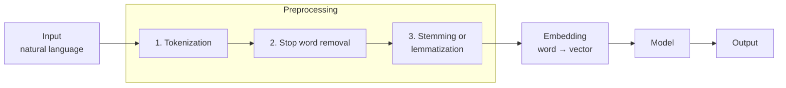
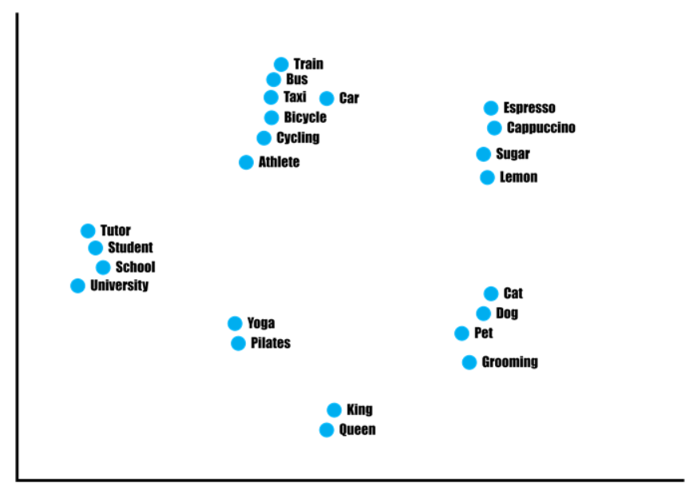
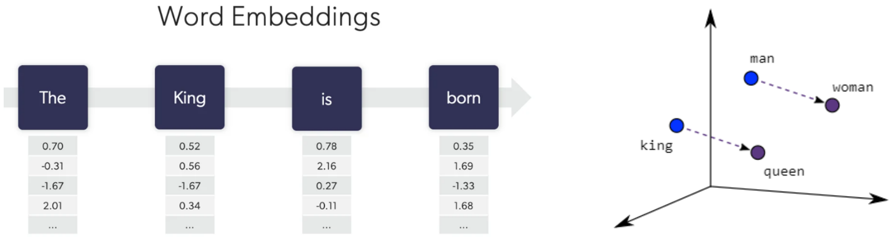
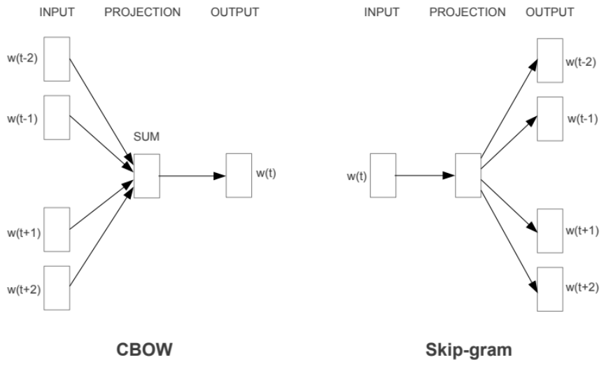
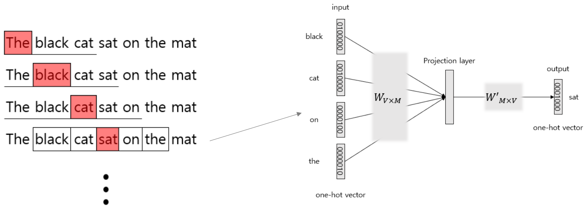
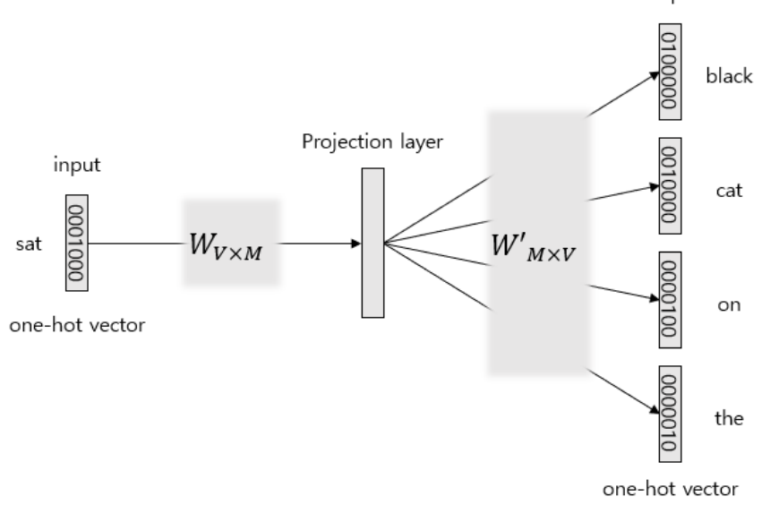
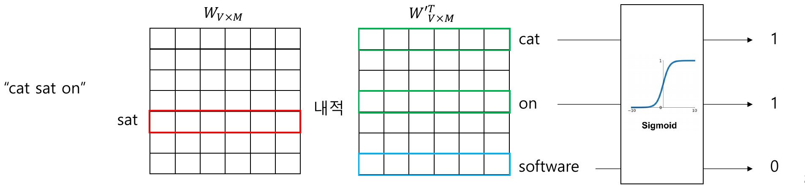
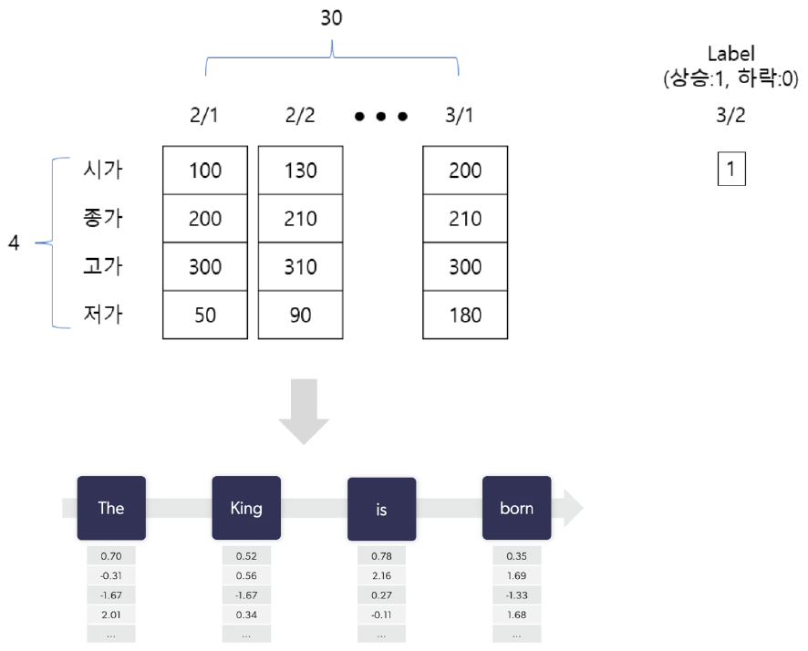
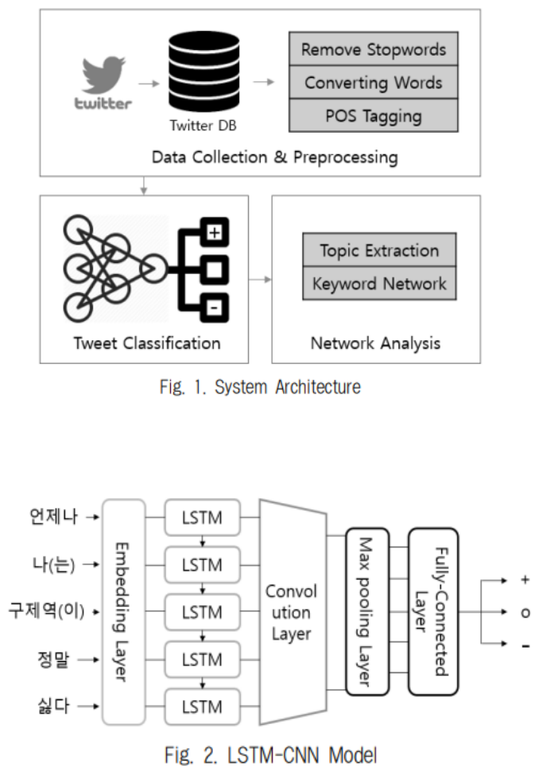
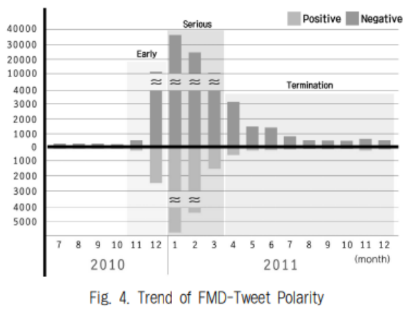

# Lecture 7 — Natural Language Processing 1

[Repository Guide](../../README.md) | [English](Concepts_Lecture.md) | [한국어](Concepts_Lecture.ko.md)

> **Last Updated:** 2026-11-04

> **Learning Objectives:**
> 1. Explain the definition and difficulties of natural language processing, and distinguish corpus, token, tokenization, morpheme, stop word, stemming, and lemmatization
> 2. Represent words as vectors with one-hot encoding, and explain why this representation cannot capture relations between words
> 3. Compute TF, IDF, and TF-IDF by hand on a small document collection and interpret the result
> 4. Explain the structure and training of Word2Vec's CBOW and skip-gram, and the idea of negative sampling
> 5. Explain how FastText handles OOV words and rare words with character n-grams
> 6. Explain how a sequence of word embeddings is fed to an LSTM to classify the sentiment of a sentence

---

## Table of Contents

- [1. Natural Language Processing and Basic Terms](#1-natural-language-processing-and-basic-terms)
  - [1.1 What Is Natural Language Processing](#11-what-is-natural-language-processing)
  - [1.2 Corpus, Token, and Tokenization](#12-corpus-token-and-tokenization)
  - [1.3 Korean Tokenization and Morphological Analysis](#13-korean-tokenization-and-morphological-analysis)
  - [1.4 Stop Words](#14-stop-words)
  - [1.5 Stemming and Lemmatization](#15-stemming-and-lemmatization)
  - [1.6 The NLP Pipeline](#16-the-nlp-pipeline)
- [2. Applications of Natural Language Processing](#2-applications-of-natural-language-processing)
- [3. Word Embedding](#3-word-embedding)
  - [3.1 The Concept of Embedding](#31-the-concept-of-embedding)
  - [3.2 One-Hot Encoding](#32-one-hot-encoding)
  - [3.3 TF-IDF](#33-tf-idf)
  - [3.4 A Worked TF-IDF Example](#34-a-worked-tf-idf-example)
  - [3.5 Word2Vec and Dense Representations](#35-word2vec-and-dense-representations)
  - [3.6 CBOW](#36-cbow)
  - [3.7 Skip-gram](#37-skip-gram)
  - [3.8 Negative Sampling](#38-negative-sampling)
  - [3.9 FastText](#39-fasttext)
  - [3.10 Comparing the Representations](#310-comparing-the-representations)
- [4. Sentiment Analysis](#4-sentiment-analysis)
  - [4.1 What Is Sentiment Analysis](#41-what-is-sentiment-analysis)
  - [4.2 Classifying an Embedding Sequence with an LSTM](#42-classifying-an-embedding-sequence-with-an-lstm)
  - [4.3 Research Cases](#43-research-cases)
- [Concept Applications](#concept-applications)
- [Summary](#summary)
- [Self-Check Questions](#self-check-questions)
- [References](#references)

---

<br>

## 1. Natural Language Processing and Basic Terms

### 1.1 What Is Natural Language Processing

A **natural language** is a language people use to communicate in everyday life, such as Korean, English, or Chinese. Unlike artificial languages with rigorously defined grammars, such as programming languages, a natural language allows the same sentence to be read in several ways, and meaning changes with context.

> **Definition:** **Natural language processing (NLP)** is the process of analyzing the meaning of the language people use in everyday life so that computers can process it.

Natural language processing is hard for two main reasons.

- **It requires an understanding of human language.** Whether the Korean word "배" means a pear (fruit), a boat (vehicle), or the belly (body part) can only be decided from context. To resolve such ambiguity, a computer must handle the meanings of words together with their context.
- **Languages vary widely in structure and form.** English separates words with spaces, so splitting words on whitespace is easy, but Chinese has no spaces, so even finding word boundaries is difficult. Korean uses spaces, but it is an agglutinative language in which a particle attaches to a noun to form one spacing unit, as in "나는" (noun "나" plus particle "는"), so a whitespace-separated unit is not necessarily a unit of meaning.

### 1.2 Corpus, Token, and Tokenization

> **Definition:** A **corpus** is a collection of natural language text sampled for a specific purpose for natural language processing research. Collections of news articles, product reviews, or conversation logs gathered for an analysis goal are corpora, and in Korea, public corpora can be downloaded from portals such as the Public Data Portal (data.go.kr).

To process natural language, documents must be split into small units. The unit into which a document or sentence is split is called a **token**, and the task of separating text into tokens such as sentences or words is called **tokenization**. The token unit depends on the purpose. A sentence may be split into words, and a word may be split further into syllables or characters.

Even the same sentence yields different tokens depending on the tokenization rule. The following table shows the English sentence `Let's tokenize! Isn't this easy?` split by three rules.

| Rule | Tokenization result |
|:-----|:-----|
| On white spaces | `Let's`, `tokenize!`, `Isn't`, `this`, `easy?` |
| On punctuation | `Let`, `'`, `s`, `tokenize`, `!`, `Isn`, `'`, `t`, `this`, `easy`, `?` |
| On rules | `Let`, `'s`, `tokenize`, `!`, `Is`, `n't`, `this`, `easy`, `?` |

*Table 1. Tokenization of the same English sentence under three rules*

Splitting on white spaces is the simplest to implement, but exclamation and question marks stay attached to words. Splitting on punctuation removes the symbols but cuts `Isn't` into meaningless pieces such as `Isn` and `t`. Rule-based tokenization separates units that carry meaning in English grammar, such as `'s` (here the us of Let us; elsewhere a possessive or a contraction of is) and `n't` (a contraction of not), and therefore produces tokens better suited to later analysis.

### 1.3 Korean Tokenization and Morphological Analysis

Korean tokenization is mainly performed by **morphological analysis**. A **morpheme** is the smallest unit of a language that carries meaning. For example, "수업이" ("the class" as a subject) consists of two morphemes, the noun "수업" (class) and the particle "이". A morphological analyzer splits a sentence into morphemes and attaches a **part of speech (POS)** tag to each.

In Python, the KoNLPy package bundles several Korean morphological analyzers so that they can be called in the same way [1]. KoNLPy uses analyzers written in Java internally, so a Java Development Kit (JDK) must be installed before running `pip install konlpy`. Four of the analyzers provided by KoNLPy are listed below.

| Analyzer | Developer |
|:-----|:-----|
| Hannanum | A morphological analyzer developed at KAIST |
| Kkma | A morphological analyzer developed at Seoul National University |
| Komoran | A morphological analyzer developed by Shineware |
| Okt (Open Korean Text) | A morphological analyzer created at Twitter (formerly named Twitter) |

*Table 2. Major Korean morphological analyzers provided by KoNLPy*

The following code analyzes the same sentence with the four analyzers. The `pos()` method of each analyzer object takes a sentence and returns a list of `(morpheme, POS tag)` pairs. The sentence means "My first-period class is fun."

```python
from konlpy.tag import Hannanum, Kkma, Komoran, Okt

text = "나는 1교시 수업이 재밌다."

tokenizer = Hannanum()
pos = tokenizer.pos(text)  # POS(part of speech): 품사
print("Hannanum:", pos)

tokenizer = Kkma()
pos = tokenizer.pos(text)
print("Kkma:", pos)

tokenizer = Komoran()
pos = tokenizer.pos(text)
print("Komoran:", pos)

tokenizer = Okt()
pos = tokenizer.pos(text)
print("Okt:", pos)
```

```text
Hannanum: [('나', 'N'), ('는', 'J'), ('1교시', 'N'), ('수업', 'N'), ('이', 'J'), ('재밌다', 'N'), ('.', 'S')]
Kkma: [('나', 'NP'), ('는', 'JX'), ('1', 'NR'), ('교시', 'NNM'), ('수업', 'NNG'), ('이', 'JKS'), ('재밌', 'VA'), ('다', 'EFN'), ('.', 'SF')]
Komoran: [('나', 'NP'), ('는', 'JX'), ('1', 'SN'), ('교시', 'NNB'), ('수업', 'NNG'), ('이', 'JKS'), ('재밌', 'VA'), ('다', 'EF'), ('.', 'SF')]
Okt: [('나', 'Noun'), ('는', 'Josa'), ('1', 'Number'), ('교시', 'Noun'), ('수업', 'Noun'), ('이', 'Josa'), ('재밌다', 'Adjective'), ('.', 'Punctuation')]
```

Analyzing the sentence `"나는 어제 게임을 했다."` ("I played a game yesterday.") with the same code gives the following.

```text
Hannanum: [('나', 'N'), ('는', 'J'), ('어제', 'N'), ('게임', 'N'), ('을', 'J'), ('하', 'P'), ('었다', 'E'), ('.', 'S')]
Kkma: [('나', 'NP'), ('는', 'JX'), ('어제', 'NNG'), ('게임', 'NNG'), ('을', 'JKO'), ('하', 'VV'), ('었', 'EPT'), ('다', 'EFN'), ('.', 'SF')]
Komoran: [('나', 'NP'), ('는', 'JX'), ('어제', 'MAG'), ('게임', 'NNG'), ('을', 'JKO'), ('하', 'VV'), ('았', 'EP'), ('다', 'EF'), ('.', 'SF')]
Okt: [('나', 'Noun'), ('는', 'Josa'), ('어제', 'Noun'), ('게임', 'Noun'), ('을', 'Josa'), ('했다', 'Verb'), ('.', 'Punctuation')]
```

The POS tags in the output mean the following.

| Tag | Meaning | Analyzer |
|:-----|:-----|:-----|
| N, J, P, E, S | Substantive, relational word (particle), predicate, ending, symbol | Hannanum |
| NP, NR | Pronoun, numeral | Kkma; NP is also used by Komoran |
| NNG, NNB, NNM | Common noun, dependent noun, unit dependent noun | NNG by Kkma and Komoran, NNB by Komoran, NNM by Kkma |
| JX, JKS, JKO | Auxiliary particle, subject case particle, object case particle | Kkma, Komoran |
| VV, VA | Verb, adjective | Kkma, Komoran |
| EP, EPT | Pre-final ending, tense pre-final ending | EP by Komoran, EPT by Kkma |
| EF, EFN | Final ending, declarative final ending | EF by Komoran, EFN by Kkma |
| SN, SF, MAG | Number, sentence-final punctuation, general adverb | Komoran; SF is also used by Kkma |
| Noun, Josa, Number, Verb, Adjective, Punctuation | Noun, particle, number, verb, adjective, punctuation | Okt |

*Table 3. Meanings of the POS tags in the morphological analysis results*

The two results show the following.

- **The granularity of analysis differs.** Kkma and Komoran split "재밌다" into the stem "재밌" and the ending "다", and "했다" into "하", "었/았", and "다", while Okt keeps "재밌다" and "했다" as single units. Hannanum treats "1교시" as one noun.
- **The tag sets differ.** Hannanum uses only broad categories such as N and J, Kkma and Komoran use fine-grained tags derived from the Sejong tag set, and Okt uses tags written as English words.
- **The same morpheme can be judged differently.** Kkma analyzes "어제" (yesterday) as a common noun (NNG), while Komoran analyzes it as an adverb (MAG). Kkma restores the past-tense ending of "했다" as "었", while Komoran restores it as "았".

An analyzer is therefore chosen to suit the task. Kkma or Komoran fits when fine-grained morpheme-level analysis is needed, and Okt fits when fast processing and simple tokens are needed.

### 1.4 Stop Words

> **Definition:** A **stop word** is a word that appears frequently in sentences but carries no meaning for analysis. Typical examples are Korean particles and suffixes, and English articles (the, a), pronouns (I, you), and forms of the verb be.

Because stop words appear in almost every document, they do not help distinguish documents and only increase computation if kept. They are therefore removed during preprocessing by deleting every token that appears in a predefined stop word list. For English, the NLTK (Natural Language Toolkit) package provides a stop word list.

```python
import nltk
from nltk.corpus import stopwords

nltk.download('stopwords', quiet=True)            # download the stop word list once
print(stopwords.words('english')[:10])

stop = set(stopwords.words('english'))
tokens = "the cat is sitting on the mat".split()
print([t for t in tokens if t not in stop])
```

```text
['a', 'about', 'above', 'after', 'again', 'against', 'ain', 'all', 'am', 'an']
['cat', 'sitting', 'mat']
```

`stopwords.words('english')` is the list of English stop words, and `[:10]` takes its first 10 entries. The second part tokenizes a sentence on white spaces and keeps only the tokens that are not in the stop word set. "the", "is", and "on" are removed, and only the content words "cat", "sitting", and "mat" remain.

> **Note:** The order and length of the NLTK stop word list depend on the version of the downloaded data. Older versions of the list began with pronouns, as in `['i', 'me', 'my', 'myself', 'we', 'our', 'ours', 'ourselves', 'you', "you're"]`, while recent versions are sorted alphabetically as in the output above. NLTK provides no Korean stop word list, so for Korean a list of particles, suffixes, and frequent meaningless words is built by hand to suit the analysis.

### 1.5 Stemming and Lemmatization

When the same word appears in several forms depending on its grammatical role (run, runs, running), a computer counts them as different tokens. Merging these forms reduces the vocabulary size and lets words with the same meaning be counted together. Stemming and lemmatization are the two ways to do this.

**Stemming** is the task of extracting the **stem** of a word. It is a simplified form of morphological analysis that finds the base form by cutting off suffixes or endings according to fixed rules. Because it cuts by rules alone, the result may not be a dictionary word. For example, 'flies' becomes 'fli'.

**Lemmatization** is the task of finding the **lemma**, the dictionary base form of a word. Unlike stemming, the result keeps the form of a real word. 'am', 'are', and 'is' all become 'be', and 'flies' becomes 'fly'. Finding the lemma correctly requires a dictionary and POS information, because the base form can differ by part of speech: 'saw' stays 'saw' as a noun (a cutting tool) but becomes 'see' as the past tense of the verb.

```python
from nltk.stem import PorterStemmer, LancasterStemmer, WordNetLemmatizer

words = ['running', 'runs', 'runner', 'flies']
porter, lancaster = PorterStemmer(), LancasterStemmer()
print([porter.stem(w) for w in words])
print([lancaster.stem(w) for w in words])

lemmatizer = WordNetLemmatizer()                  # requires nltk.download('wordnet') first
print([lemmatizer.lemmatize(w, pos='v') for w in ['am', 'are', 'is']])
print(lemmatizer.lemmatize('flies'))
```

```text
['run', 'run', 'runner', 'fli']
['run', 'run', 'run', 'fli']
['be', 'be', 'be']
fly
```

The Porter stemmer [2] leaves 'runner' unchanged, while the Lancaster stemmer [3], which cuts suffixes more aggressively, reduces even 'runner' to 'run'. Stemming results thus depend on the rules of the algorithm. `WordNetLemmatizer` looks up the WordNet dictionary to return a lemma, and `pos='v'` tells it to treat the word as a verb.

| Aspect | Stemming | Lemmatization |
|:-----|:-----|:-----|
| Method | Cuts off suffixes or endings by rules | Finds the base form with a dictionary and POS information |
| Result | May not be a dictionary form ('flies' → 'fli') | A real word ('flies' → 'fly') |
| Irregular forms | Not handled ('am' and 'is' do not become 'be') | Handled ('am', 'are', 'is' → 'be') |
| Speed | Fast | Relatively slow because of dictionary lookups |

*Table 4. Comparison of stemming and lemmatization*

Korean morphological analyzers also offer base-form restoration. For example, `Okt().pos("나는 어제 게임을 했다.", stem=True)` turns "했다" (did) into the base form "하다" (to do) and returns `('하다', 'Verb')`.

### 1.6 The NLP Pipeline

The whole process of taking natural language as input and obtaining a result with a deep learning model is as follows. In the preprocessing stage, an input sentence goes through tokenization, stop word removal, and stemming or lemmatization to become a list of tokens, and in the embedding stage each word is turned into a numeric vector before entering the model.



*Figure 1. The NLP pipeline from preprocessing through embedding to the model*

---

<br>

## 2. Applications of Natural Language Processing

Natural language processing is already used in many everyday services. Typical examples are the **email filter** that removes spam, the **smart assistant** that understands and answers voice commands, **search results** that find documents matching a query, **autocomplete** that suggests the next word, **translation** that renders a sentence in another language, and **ChatGPT**, which converses with people and generates text. These services are built by combining the following NLP tasks.

| Task | Description | Related services |
|:-----|:-----|:-----|
| Document classification | Assigns a document to predefined categories | Email filter (spam versus normal mail) |
| Dialog systems | Responds over several turns of exchange with a user | Smart assistant, ChatGPT |
| Word sense disambiguation | Determines which sense of a polysemous word is used in context | Search, translation |
| Machine translation | Translates a sentence from one language into another | Translation |
| Summarization and generation | Shortens a long text or produces new sentences | Autocomplete, ChatGPT |
| Question answering | Finds or generates the answer to a question from documents | Search results, smart assistant |
| Sentiment analysis | Determines the sentiment, such as positive or negative, in a text | Review analysis, public opinion analysis |
| Coreference resolution | Finds the entity that expressions such as "he" or "this" refer to | Summarization, question answering |

*Table 5. Representative NLP tasks and related services*

Section 3 below covers embedding, which turns text into numbers, and Section 4 covers sentiment analysis; seq2seq, attention, and the Transformer, which underlie translation and generation, are covered in Lecture 8.

---

<br>

## 3. Word Embedding

### 3.1 The Concept of Embedding

A neural network can only compute with numbers, so to use natural language as input to a deep learning model, text must first be converted into numbers.

> **Definition:** In natural language processing, an **embedding** is the result, or the process, of converting the language people use (natural language) into a numeric **vector** that a computer can understand. Turning one word into one vector is a **word embedding**, and turning a whole sentence or document into one vector is a **document embedding**.

In a good word embedding, the vectors of words with similar meanings lie close together. The following figure shows the embeddings of several words on a two-dimensional plane. Means of transport such as Train, Bus, Taxi, Car, and Bicycle (with Cycling and Athlete next to them), drinks and ingredients such as Espresso, Cappuccino, Sugar, and Lemon, education words such as Tutor, Student, School, and University, exercise words such as Yoga and Pilates, and pet words such as Cat, Dog, Pet, and Grooming each form a cluster, and King and Queen lie close together.



*Figure 2. A two-dimensional visualization of word embeddings in which words with similar meanings cluster*

Real embedding vectors usually have tens to hundreds of dimensions, so such pictures are drawn by projecting them onto two dimensions with a dimensionality reduction technique such as principal component analysis (PCA) or t-SNE. Some information is lost in the projection, so distances in the picture approximate the true distances.

Closeness between vectors is commonly measured by **cosine similarity**. The cosine similarity of two vectors $\mathbf{u}$ and $\mathbf{v}$ is the cosine of the angle between them.

$$
\cos(\mathbf{u}, \mathbf{v}) = \frac{\mathbf{u} \cdot \mathbf{v}}{\lVert \mathbf{u} \rVert \, \lVert \mathbf{v} \rVert}
$$

Its value lies between $-1$ and $1$; it is close to 1 when the two vectors point in the same direction and 0 when they are perpendicular.

> **[Linear Algebra]** The dot product of two vectors is $\mathbf{u} \cdot \mathbf{v} = \sum_i u_i v_i = \lVert \mathbf{u} \rVert \lVert \mathbf{v} \rVert \cos\theta$. Dividing the dot product by the lengths of the two vectors therefore leaves only the cosine of the angle $\theta$, which expresses the similarity of directions regardless of vector length. Two vectors whose dot product is 0 are orthogonal.

Representative embedding techniques are LSA (Latent Semantic Analysis), which compresses a word-document matrix with singular value decomposition (SVD) [4]; Word2Vec, which learns vectors by predicting surrounding words with a neural network; GloVe, which learns vectors from word co-occurrence statistics over the whole corpus [5]; and FastText, which learns by splitting words into character n-grams. This section proceeds from the simplest methods, one-hot encoding and TF-IDF, to Word2Vec and FastText.

### 3.2 One-Hot Encoding

**One-hot encoding** represents each of $N$ words as an $N$-dimensional vector. Each word receives a unique number (index) from 0 to $N-1$, and its vector has 1 only at its own index and 0 everywhere else. Because most elements are 0, this is called a **sparse representation**.

The following code splits the sentence "1교시 수업은 다른 수업보다 좋다" ("The first-period class is better than other classes") into morphemes and turns each morpheme into a one-hot vector.

```python
from konlpy.tag import Okt
import numpy as np

okt = Okt()
text = "1교시 수업은 다른 수업보다 좋다"
token = okt.morphs(text)
print("형태소 분석 결과:", token)

word2index = {}
for voca in token:
    if voca not in word2index.keys():
        word2index[voca] = len(word2index)
print("word to index:", word2index)

def one_hot_encoding(word, word2index):
    one_hot_vector = [0]*(len(word2index))
    index = word2index[word]
    one_hot_vector[index] = 1
    return one_hot_vector

print("\ndictionary 출력")
for i in word2index:
    token_vector = one_hot_encoding(i, word2index)
    print(i, '\t', token_vector)

word_list = []
for w in token:
    word_list.append(one_hot_encoding(w, word2index))

print("\n"+text, "\n<one-hot vector 변환 결과>")
print(np.array(word_list))  # full sentence one-hot encoding
```

Each part of the code does the following. (The printed labels "형태소 분석 결과", "출력", and "변환 결과" mean "morphological analysis result", "output", and "conversion result".)

- `okt.morphs(text)` returns only the morphemes as a list, without POS tags. The result has 8 tokens.
- `word2index` is a dictionary with words as keys and indices as values. Going through the tokens in order, it gives a new index `len(word2index)`, the number of words registered so far, only to words seen for the first time. "수업" (class) appears twice but keeps its first index 2, so the vocabulary has 7 words.
- `one_hot_encoding()` creates a zero vector whose length is the vocabulary size, sets only the word's index position to 1, and returns it.
- The first `for` loop prints each vocabulary word and its one-hot vector, and the second `for` loop converts the sentence's tokens in order into one-hot vectors, forming the whole sentence as an 8×7 matrix.

```text
형태소 분석 결과: ['1', '교시', '수업', '은', '다른', '수업', '보다', '좋다']
word to index: {'1': 0, '교시': 1, '수업': 2, '은': 3, '다른': 4, '보다': 5, '좋다': 6}

dictionary 출력
1 	 [1, 0, 0, 0, 0, 0, 0]
교시 	 [0, 1, 0, 0, 0, 0, 0]
수업 	 [0, 0, 1, 0, 0, 0, 0]
은 	 [0, 0, 0, 1, 0, 0, 0]
다른 	 [0, 0, 0, 0, 1, 0, 0]
보다 	 [0, 0, 0, 0, 0, 1, 0]
좋다 	 [0, 0, 0, 0, 0, 0, 1]

1교시 수업은 다른 수업보다 좋다 
<one-hot vector 변환 결과>
[[1 0 0 0 0 0 0]
 [0 1 0 0 0 0 0]
 [0 0 1 0 0 0 0]
 [0 0 0 1 0 0 0]
 [0 0 0 0 1 0 0]
 [0 0 1 0 0 0 0]
 [0 0 0 0 0 1 0]
 [0 0 0 0 0 0 1]]
```

The third and sixth rows of the sentence matrix are identical because both positions hold the same word "수업".

One-hot encoding is simple but has two problems.

- **It cannot express relations between words.** Two different one-hot vectors never share the position of their 1, so their dot product is always 0 and their cosine similarity is always 0. The similarity of "수업" (class) and "교시" (period) is the same 0 as that of "수업" and "좋다" (good), so relations such as synonymy or antonymy do not show, and all words become mutually independent.
- **The dimension grows with the vocabulary.** Representing one word requires as many dimensions as there are words in the corpus. In a dataset containing 100,000 words, every word needs a 100,000-dimensional vector, of which 99,999 elements are 0, wasting memory and computation.

### 3.3 TF-IDF

**TF-IDF (Term Frequency-Inverse Document Frequency)** is a method, widely used in information retrieval, that weights each word in a document according to frequencies. Listing the TF-IDF value of every word for a document represents the document as one vector, and the cosine similarity of two document vectors measures the similarity of the documents. TF-IDF is a technique for quantifying text data that differs from word embedding, which learns a vector carrying the meaning of each word.

The TF-IDF value is the product of the frequency of a word in a specific document (TF) and the logarithm of the total number of documents divided by the number of documents that contain the word (IDF). In other words, **a word that appears often in a specific document gets a high weight, and a word that appears often in all documents gets a low weight.** For example, if "machine learning" appears often in one document, the word is judged to play an important role in that document. A word such as "the", on the other hand, appears often in every document, so its TF-IDF value is low.

Let $D$ be the document collection, $N$ the number of documents, $t$ a word, and $d$ a document. Each value is defined as follows.

$$
\mathrm{TF}(t, d) = \text{number of times word } t \text{ appears in document } d
$$

$$
\mathrm{IDF}(t, D) = \log \frac{N}{\mathrm{DF}(t)}, \qquad \mathrm{DF}(t) = \text{number of documents containing word } t
$$

$$
\text{TF-IDF}(t, d, D) = \mathrm{TF}(t, d) \times \mathrm{IDF}(t, D)
$$

IDF has the following properties. A word that appears in every document has $\mathrm{DF}(t) = N$, so its IDF is $\log 1 = 0$ and its TF-IDF is 0. A word that appears in only one document has $\mathrm{DF}(t) = 1$, so its IDF is the largest value, $\log N$. The logarithm keeps IDF from growing too large when there are many documents, and the base of the logarithm (10 or $e$) only changes the scale of the values, not the ranking among words. The idea of IDF originates in Spärck Jones's study of term specificity [6].

Slightly modified variants of the same idea are also widely used.

- **TF divided by document length:** $\mathrm{TF}(t, d) = \dfrac{\text{number of times word } t \text{ appears in document } d}{\text{number of all words in document } d}$. This removes the effect that longer documents have larger counts.
- **IDF with 1 added to the denominator:** $\mathrm{IDF}(t, D) = \log \dfrac{N}{1 + \mathrm{DF}(t)}$. This prevents division by zero for a word that appears in no document.

> **Caution:** With 1 added to the denominator, the IDF of a word that appears in every document becomes negative, $\log \frac{N}{N+1} < 0$. For example, with $N = 3$ it is $\log_{10} \frac{3}{4} \approx -0.125$. For this reason, libraries use different smoothing. scikit-learn's `TfidfVectorizer` uses $\log \frac{1+N}{1+\mathrm{DF}(t)} + 1$ by default and normalizes each resulting vector to length 1 [7]. Even on the same data, a library's result can differ from values computed by hand.

### 3.4 A Worked TF-IDF Example

TF-IDF is computed for the following three documents. Case is ignored (The and the count as the same word), and text is tokenized on white spaces.

- D1: The quick brown fox jumped over the lazy dog
- D2: The brown fox is quick and the dog is lazy
- D3: The brown dog is quick and the fox is brown

**Step 1: TF.** Count the occurrences of the 10 words in each document.

| TF | quick | brown | fox | jumped | over | the | lazy | dog | is | and |
|:---|:---:|:---:|:---:|:---:|:---:|:---:|:---:|:---:|:---:|:---:|
| D1 | 1 | 1 | 1 | 1 | 1 | 2 | 1 | 1 | 0 | 0 |
| D2 | 1 | 1 | 1 | 0 | 0 | 2 | 1 | 1 | 2 | 1 |
| D3 | 1 | 2 | 1 | 0 | 0 | 2 | 0 | 1 | 2 | 1 |

*Table 6. Occurrence counts (TF) of each word in the three documents*

**Step 2: DF and IDF.** Count the number of documents in which each word appears, and compute IDF with a base-10 logarithm. quick appears in all three documents, so $\log(3/3) = 0$; jumped appears only in D1, so $\log(3/1) = 0.477$; lazy appears in D1 and D2, so $\log(3/2) = 0.176$.

| Word | quick | brown | fox | jumped | over | the | lazy | dog | is | and |
|:---|:---:|:---:|:---:|:---:|:---:|:---:|:---:|:---:|:---:|:---:|
| DF | 3 | 3 | 3 | 1 | 1 | 3 | 2 | 3 | 2 | 2 |
| IDF | 0 | 0 | 0 | 0.477 | 0.477 | 0 | 0.176 | 0 | 0.176 | 0.176 |

*Table 7. Document frequency (DF) and inverse document frequency (IDF) of each word*

**Step 3: TF-IDF.** Multiply each cell of Table 6 by the IDF of its column. For example, is in D2 gives $2 \times 0.176 = 0.352$.

| TF-IDF | quick | brown | fox | jumped | over | the | lazy | dog | is | and |
|:---|:---:|:---:|:---:|:---:|:---:|:---:|:---:|:---:|:---:|:---:|
| D1 | 0 | 0 | 0 | 0.477 | 0.477 | 0 | 0.176 | 0 | 0 | 0 |
| D2 | 0 | 0 | 0 | 0 | 0 | 0 | 0.176 | 0 | 0.352 | 0.176 |
| D3 | 0 | 0 | 0 | 0 | 0 | 0 | 0 | 0 | 0.352 | 0.176 |

*Table 8. TF-IDF matrix of the three documents*

The result can be interpreted as follows.

- "the" appears twice in every document, but because it is in every document its TF-IDF is 0. Frequent occurrence alone does not make a word important.
- D1 is characterized by jumped and over (0.477), which no other document contains. D2 and D3 both have is (0.352) and and (0.176), and they differ only in whether lazy is present.
- brown appears twice in D3, but because brown is in every document it becomes 0. IDF looks only at how many documents a word appears in, so a word whose count differs greatly between documents gets an IDF of 0 and is not used to distinguish them if it appears at least once in every document.

The following code performs the same computation with NumPy.

```python
import numpy as np

docs = ["The quick brown fox jumped over the lazy dog",
        "The brown fox is quick and the dog is lazy",
        "The brown dog is quick and the fox is brown"]
vocab = ["quick", "brown", "fox", "jumped", "over", "the", "lazy", "dog", "is", "and"]

tokens = [d.lower().split() for d in docs]          # lowercase, then tokenize on white spaces
tf = np.array([[t.count(w) for w in vocab] for t in tokens])
df = (tf > 0).sum(axis=0)                            # number of documents containing each word
idf = np.log10(len(docs) / df)                       # base-10 logarithm
tfidf = tf * idf                                     # broadcasting multiplies each column by its IDF

np.set_printoptions(precision=3, suppress=True)
print("TF\n", tf)
print("DF ", df)
print("IDF", idf)
print("TF-IDF\n", tfidf)
```

```text
TF
 [[1 1 1 1 1 2 1 1 0 0]
 [1 1 1 0 0 2 1 1 2 1]
 [1 2 1 0 0 2 0 1 2 1]]
DF  [3 3 3 1 1 3 2 3 2 2]
IDF [0.    0.    0.    0.477 0.477 0.    0.176 0.    0.176 0.176]
TF-IDF
 [[0.    0.    0.    0.477 0.477 0.    0.176 0.    0.    0.   ]
 [0.    0.    0.    0.    0.    0.    0.176 0.    0.352 0.176]
 [0.    0.    0.    0.    0.    0.    0.    0.    0.352 0.176]]
```

`tf > 0` is a Boolean matrix that marks whether each cell is greater than 0, and `sum(axis=0)` counts the True values per column (per word), that is, the number of documents containing the word. In `tf * idf`, multiplying a matrix of shape (3, 10) by a vector of shape (10,) makes NumPy align the vector with each row and multiply element by element.

TF-IDF has the following limitations.

- **It does not consider the meaning of words.** TF-IDF computes importance from the frequency of each word, so it ignores the meaning and context of words. It therefore cannot tell homonyms or synonyms apart and may produce results that do not fit the context. "car" and "automobile" mean the same thing but occupy different dimensions.
- **Sparsity problem:** Most documents contain only some of the words in the whole vocabulary, so most of a document vector is 0, making it a sparse vector. The dimension is as large as the vocabulary, which raises computational complexity and can lower accuracy.
- **The importance of a word can be overestimated.** Because high frequency is taken as importance, a word that happens to appear often in a few documents can be judged to play an important role across the documents, lowering accuracy.

### 3.5 Word2Vec and Dense Representations

**Word2Vec** is a word embedding technique published in 2013 by Mikolov et al. at Google [8]. Unlike one-hot vectors, it represents words as real-valued vectors of tens to hundreds of dimensions, most of whose elements are nonzero, so it is called a **dense representation**. For example, the words The, King, is, and born have vectors such as $[0.70, -0.31, -1.67, 2.01, \dots]$, $[0.52, 0.56, -1.67, 0.34, \dots]$, $[0.78, 2.16, 0.27, -0.11, \dots]$, and $[0.35, 1.69, -1.33, 1.68, \dots]$.



*Figure 3. A real-valued vector for each word (left) and a vector space in which the difference from man to woman resembles the difference from king to queen (right)*

Word2Vec rests on the **distributional hypothesis**, the idea that words appearing in similar contexts have similar meanings [9]. Word2Vec trains a neural network to predict which words appear around a word and uses the weights obtained in the process as word vectors. In vectors trained this way, semantic relations appear as vector differences. As on the right of Figure 3, $\mathbf{v}_{\text{woman}} - \mathbf{v}_{\text{man}}$ and $\mathbf{v}_{\text{queen}} - \mathbf{v}_{\text{king}}$ point in similar directions, so computing $\mathbf{v}_{\text{king}} - \mathbf{v}_{\text{man}} + \mathbf{v}_{\text{woman}}$ yields a vector close to $\mathbf{v}_{\text{queen}}$ [10]. A public web demo lets one try such addition and subtraction of words directly with Korean Word2Vec vectors trained on Korean Wikipedia and Namu Wiki [11].

Word2Vec has two models with different training schemes, CBOW and skip-gram.



*Figure 4. Structures of CBOW, which predicts the center word from the surrounding words, and skip-gram, which predicts the surrounding words from the center word*

In Figure 4, $w(t)$ is the $t$-th word of the sentence, and $w(t-2), w(t-1), w(t+1), w(t+2)$ are the two words before and after it. CBOW on the left takes the four surrounding words as input and outputs the middle word $w(t)$, and skip-gram on the right conversely takes the middle word as input and outputs the four surrounding words.

### 3.6 CBOW

**CBOW (Continuous Bag of Words)** predicts the word in the middle from the words around it. The middle word to be predicted is the **center word**, and the words before and after it used as input are the **context words**.

The intuition is filling in a blank. The blank in "나는 [ ]을(를) 마신다" ("I drink [ ]") fits water, beverage, or liquor, but not textbook, bag, or car. Words that can fill the same blank appear in similar contexts, so a model trained to fill blanks gives water, beverage, and liquor similar vectors.

To predict the center word, one must decide how many words before and after to look at; this range is called the **window**. Looking at $n$ words on each side gives a window size of $n$. The following shows how training data is created from the sentence "The black cat sat on the mat" with a window size of 2 by moving the center word one position at a time. Moving the window in this way is called a **sliding window**.

| Center word | Context words |
|:-----|:-----|
| The | black, cat |
| black | The, cat, sat |
| cat | The, black, sat, on |
| sat | black, cat, on, the |
| on | cat, sat, the, mat |
| the | sat, on, mat |
| mat | on, the |

*Table 9. (Center word, context words) training data made with window size 2*



*Figure 5. Moving the center word with a sliding window, and the CBOW network that predicts sat from the context words black, cat, on, and the*

CBOW is a **shallow neural network** with a single hidden layer. Let $V$ be the vocabulary size and $M$ the dimension of the embedding vectors. This example distinguishes case, treating The and the as different words, so $V = 7$, and $M = 5$. The word indices are The 0, black 1, cat 2, sat 3, on 4, the 5, mat 6. The network has two weight matrices, the $V \times M$ matrix $W$ on the input side and the $M \times V$ matrix $W'$ on the output side. One computation that predicts the center word sat consists of the following four steps.

**Step 1: Multiply a one-hot vector by $W$.** Multiplying the one-hot vector of the context word cat, $\mathbf{x}_{\text{cat}} = [0, 0, 1, 0, 0, 0, 0]$ ($1 \times V$), by $W$ ($V \times M$) gives the $1 \times M$ vector $\mathbf{v}_{\text{cat}}$. Since $\mathbf{x}_{\text{cat}}$ is 1 only at index 2, the product equals row 2 of $W$ taken out as is.

| Index | Word | Row of $W$ |
|:---:|:-----|:-----|
| 0 | The | 1.11, 0.93, 0.42, 0.29, 0.13 |
| 1 | black | 0.62, 3.66, 0.72, 2.80, 0.24 |
| 2 | cat | **0.41, 0.73, 0.24, 0.15, 0.82** |
| 3 | sat | 0.31, 0.34, 0.32, 0.45, 0.88 |
| 4 | on | 0.52, 0.45, 0.56, 0.17, 0.14 |
| 5 | the | 0.70, 0.27, 1.22, 0.92, 1.63 |
| 6 | mat | 3.48, 0.32, 0.48, 0.53, 2.69 |

*Table 10. The input weight matrix $W$ during training ($V = 7$, $M = 5$)*

$$
\mathbf{v}_{\text{cat}} = \mathbf{x}_{\text{cat}} W = [0.41, 0.73, 0.24, 0.15, 0.82]
$$

The same computation for the context words black, on, and the gives $\mathbf{v}_{\text{black}}$, $\mathbf{v}_{\text{on}}$, and $\mathbf{v}_{\text{the}}$.

**Step 2: Combine the vectors in the projection layer.** The **projection layer** combines the vectors of the $2n$ context words into one. For example, adding $\mathbf{v}_{\text{cat}}$ and $\mathbf{v}_{\text{on}} = [0.52, 0.45, 0.56, 0.17, 0.14]$ gives $[0.93, 1.18, 0.80, 0.32, 0.96]$. Adding all four vectors, including $\mathbf{v}_{\text{black}}$ and $\mathbf{v}_{\text{the}}$, gives the following.

$$
\mathbf{v}_{\text{black}} + \mathbf{v}_{\text{cat}} + \mathbf{v}_{\text{on}} + \mathbf{v}_{\text{the}} = [2.25, 5.11, 2.74, 4.04, 2.83]
$$

The CBOW of the original paper uses the **average**, this sum divided by the number of context words, as the value of the projection layer [8].

$$
\mathbf{h} = \frac{1}{4}[2.25, 5.11, 2.74, 4.04, 2.83] = [0.5625, 1.2775, 0.685, 1.01, 0.7075]
$$

Some explanations use the sum, as Figure 4 labels the projection SUM, but the sum and the average differ only by a constant factor ($1/2n$). The projection layer differs from an ordinary hidden layer in that it has no activation function and only combines its inputs linearly.

**Step 3: Obtain probabilities with $W'$ and softmax.** Multiplying the projection vector $\mathbf{h}$ ($1 \times M$) by $W'$ ($M \times V$) gives a score $\mathbf{z}$ ($1 \times V$) for each word in the vocabulary. Applying softmax to the scores gives a probability distribution $\hat{\mathbf{y}}$ that sums to 1.

$$
\mathbf{z} = \mathbf{h} W', \qquad \hat{y}_j = \mathrm{softmax}(\mathbf{z})_j = \frac{e^{z_j}}{\sum_{k=1}^{V} e^{z_k}}
$$

For example, if $\hat{\mathbf{y}} = [0.1, 0.03, 0.02, 0.7, 0.01, 0.05, 0.09]$, the model predicts with probability 0.7 that the center word is sat, at index 3.

**Step 4: Compute the loss and update the weights.** The target $\mathbf{y}$ is the one-hot vector of sat, $[0, 0, 0, 1, 0, 0, 0]$. The difference between prediction and target is measured by the **cross entropy** loss.

$$
L = -\sum_{j=1}^{V} y_j \log \hat{y}_j = -\log \hat{y}_{\text{sat}} = -\ln 0.7 \approx 0.357
$$

Only the target position has $y_j = 1$, so only the term of the target word remains in the sum. The closer the predicted probability is to 1, the closer the loss is to 0. Backpropagation computes the gradient of this loss, gradient descent updates $W$ and $W'$, and the process is repeated for every (center word, context words) pair in the corpus. Softmax, cross entropy, and backpropagation are the same as in the neural network training covered in Lecture 1.

After training, each row of $W$ becomes the embedding vector of its word. Looking up a row of $W$ by the word's index gives the vector directly, so the trained $W$ is called a **lookup table**. A lookup table is a data structure, like a database or a table, that stores keys and values; here the word (index) is the key and the embedding vector is the value.

> **Key Point:** The product $\mathbf{x}W$ of a one-hot vector and a matrix equals selecting one row of $W$. Practical implementations therefore read the row directly by index instead of performing $V \times M$ multiplications. Embedding layers such as PyTorch's `nn.Embedding` work this way, and the Transformer in Lecture 8 also learns such a lookup table jointly.

### 3.7 Skip-gram

**Skip-gram**, the reverse of CBOW, predicts the surrounding words from the center word. Given the middle word "물을" ("water" as an object) in "[ ] 물을 [ ]", words such as "hot" or "tasty" are likely before it and words such as "eat" or "drink" after it, while "textbook", "CCTV", "fun", and "car" are unlikely. Skip-gram is trained to make such predictions.



*Figure 6. The skip-gram network that predicts the context words black, cat, on, and the from the one-hot vector of the center word sat*

The computation uses the same parts as CBOW. Multiplying the one-hot vector of the center word sat by $W$ gives $\mathbf{v}_{\text{sat}}$ (the projection layer holds just this one vector, so no averaging is needed), and $W'$ and softmax give a probability distribution over the whole vocabulary. Training sums four cross entropy losses so that this distribution assigns high probability to each of the context words black, cat, on, and the.

Skip-gram is generally known to perform better than CBOW. Because one center word receives prediction signals for several context words, the center word's vector comes to encompass the meanings of its surrounding words. In the experiments of the original paper, skip-gram was far more accurate than CBOW on analogy tasks about semantic relations, while CBOW was slightly ahead on syntactic relations and faster to train [8].

| Aspect | CBOW | Skip-gram |
|:-----|:-----|:-----|
| Input | $2n$ context words | 1 center word |
| Output | 1 center word | $2n$ context words |
| Training speed | Fast | Relatively slow |
| Performance | Strong on frequent words and syntactic relations | Strong on rare words and semantic relations, generally better |

*Table 11. Comparison of CBOW and skip-gram*

### 3.8 Negative Sampling

The output layer of CBOW and skip-gram uses softmax to compute probabilities for all $V$ words of the vocabulary. Computing the softmax denominator $\sum_k e^{z_k}$ requires all $V$ scores at every training step, so training becomes very slow when the vocabulary has hundreds of thousands of words.

**Negative sampling** is a Word2Vec optimization technique that trains by binary classification on only a few sampled words [12]. It replaces the $V$-way classification "which word in the whole vocabulary is a context word" with the **binary classification** problem "is this pair of words a pair that actually occurred together".

- A word that actually appeared nearby (**positive**) gets the target 1.
- Another word sampled at random from the corpus (**negative**) gets the target 0.



*Figure 7. Negative sampling for "cat sat on", which takes dot products of the center word sat's vector with the vectors of cat and on (positive) and software (negative) and predicts 1 and 0 with a sigmoid*

In the example of Figure 7, the vector of the center word sat, $\mathbf{v}_{\text{sat}}$ (the red row of the input matrix $W$), is dotted only with the vectors of cat, on, and software among the output-side vectors (rows of the transposed $W'^T$). Applying the **sigmoid** function $\sigma(x) = 1/(1 + e^{-x})$ to each dot product gives a probability between 0 and 1, and training pushes cat and on toward 1 and the randomly sampled software toward 0 (the Korean label 내적 in the figure means "dot product"). With the center vector $\mathbf{v}_c$, the output vector of the actual context word $\mathbf{u}_o$, and the output vectors of $k$ randomly sampled words $\mathbf{u}_1, \dots, \mathbf{u}_k$, the loss is the following.

$$
L = -\log \sigma(\mathbf{u}_o \cdot \mathbf{v}_c) - \sum_{i=1}^{k} \log \sigma(-\mathbf{u}_i \cdot \mathbf{v}_c)
$$

The first term makes the dot product of the positive pair large, and the second term makes the dot products of the negative pairs small (since $\sigma(-x) = 1 - \sigma(x)$, it raises the probability that a negative pair is classified as 0). Each training step computes only $k + 1$ dot products instead of $V$, which greatly speeds up training. The original paper reports using $k$ of 5-20 for small datasets and 2-5 for large datasets, and that sampling negative words with probability proportional to word frequency raised to the $3/4$ power worked best [12].

### 3.9 FastText

**FastText** is a word embedding method, published in 2016 by researchers at Facebook (now Meta), that represents text in units of **subwords**, small units inside words, rather than whole words [13]. It performs strongly in diverse text situations such as rare words, emoticons, and spelling errors.

FastText treats each word as a collection of character **n-grams** (pieces of $n$ consecutive characters). It adds the symbols `<` and `>` marking the start and end of the word, cuts pieces of length $n$ while sliding one character at a time, and also adds the whole word `<apple>` as one unit. Applying $n = 3$ to 'apple' gives the following.

```python
def char_ngrams(word, n=3):
    w = "<" + word + ">"                                # add the start and end symbols
    grams = [w[i:i + n] for i in range(len(w) - n + 1)] # cut length-n pieces, sliding one character
    return grams + [w]                                  # also add the whole word as one unit

print(char_ngrams("apple"))
print(char_ngrams("birthday"))
```

```text
['<ap', 'app', 'ppl', 'ple', 'le>', '<apple>']
['<bi', 'bir', 'irt', 'rth', 'thd', 'hda', 'day', 'ay>', '<birthday>']
```

`<apple>` is a 7-character string, and cutting 3 characters at each start position in `range(len(w) - n + 1)`, that is, 0 through 4, yields 5 n-grams. The boundary symbols distinguish a piece inside a word from a word itself. For example, the piece `her` inside the word "where" and `<her>`, which represents the word "her", become different units [13]. The original paper uses not only pieces with $n = 3$ but all pieces with $3 \le n \le 6$.

The vector of the word apple is the sum of the vectors of the pieces obtained in this way.

$$
\mathbf{v}_{\text{apple}} = \mathbf{z}_{\lt\text{ap}} + \mathbf{z}_{\text{app}} + \mathbf{z}_{\text{ppl}} + \mathbf{z}_{\text{ple}} + \mathbf{z}_{\text{le}\gt} + \mathbf{z}_{\lt\text{apple}\gt}
$$

The rest of the training is almost the same as Word2Vec (skip-gram with negative sampling). What is learned, however, is not a vector per word but the vector $\mathbf{z}$ of each n-gram. FastText has the following advantages.

- **It handles OOV (Out Of Vocabulary) words.** A word that did not appear in the training data is an OOV word. Word2Vec cannot produce a vector for an OOV word, but FastText builds one by adding the vectors of the word's n-grams that were learned. For example, even if "birthday" never appeared in the training data, `<bi`, `bir`, `irt`, and `rth` in the output above are shared with "birth", and `day` and `ay>` with "day", so a vector combining the information of birth and day is obtained.
- **It handles low-frequency words.** In Word2Vec, the embeddings of rarely occurring words were not very accurate. In FastText, even a rare word shares training signal when its n-grams overlap with those of other words, so a relatively accurate embedding vector can be obtained.
- **It is robust to spelling errors.** A misspelled word such as "appple" shares most of its n-grams with "apple", so it receives a similar vector.

### 3.10 Comparing the Representations

| Method | Unit | Representation | Dimension | Semantic similarity | OOV words |
|:-----|:-----|:-----|:-----|:-----|:-----|
| One-hot encoding | Word | Sparse | Vocabulary size | Not captured (similarity of every pair is 0) | Cannot be represented |
| TF-IDF | Document (weight per word) | Sparse | Vocabulary size | Not captured | Ignored |
| Word2Vec | Word | Dense | Tens to hundreds (chosen by the user) | Learned by predicting context words | Cannot be represented |
| FastText | Sum of character n-grams | Dense | Tens to hundreds (chosen by the user) | Learned, and words of similar form share information | Represented as a sum of n-grams |

*Table 12. Comparison of one-hot encoding, TF-IDF, Word2Vec, and FastText*

Word vectors obtained this way are the output of the embedding stage in Figure 1 and become the input of the model. Section 4 feeds a sequence of these vectors to a recurrent neural network to classify the sentiment of a sentence.

---

<br>

## 4. Sentiment Analysis

### 4.1 What Is Sentiment Analysis

> **Definition:** **Sentiment analysis** is an NLP technique that automatically detects and classifies the sentiment and emotional state, such as positive, negative, or neutral, expressed in a text.

| Text | Sentiment |
|:-----|:-----|
| My experience so far has been fantastic! | Positive |
| The product is ok I guess | Neutral |
| Your support team is useless | Negative |

*Table 13. Examples of the input and output of sentiment analysis*

Sentiment analysis is useful for understanding customer reactions and opinions in online critiques, product and service reviews, social media posts, and e-commerce. For example, automatically splitting thousands of reviews into positive and negative ones quickly reveals which aspects of a product draw complaints.

### 4.2 Classifying an Embedding Sequence with an LSTM

A sentence is a sequence of words, so turning each word into an embedding vector makes the sentence a sequence of vectors. This has the same shape as time-series data with several features, so it can be fed directly to the RNN and LSTM covered in Lecture 2. Adjusting only the output part of a time-series model turns it into a sentiment classifier.



*Figure 8. Time-series data that predicts the next day's rise (1) or fall (0) from 4 stock features (open, close, high, low) over 30 days, and a word embedding sequence of the same shape*

The upper part of Figure 8 is the input of stock prediction. Each day has 4 features, the opening (시가), closing (종가), high (고가), and low (저가) prices, over 30 days, so one sample is a sequence of shape (30, 4), and the target is 1 if the price rises on the next day (3/2) and 0 if it falls. Placing the embedding vector of one word where a day's 4 features were, as in the lower part, gives a sentence the same shape. The sequence length is then the number of tokens, the number of features is the embedding dimension, and the target is 1 for positive and 0 for negative.

The following code is an LSTM classifier that takes input of shape (32, 30, 4) and outputs the probability that each sample is 1. The input here is random, but in practice it holds 32 samples, each with 4-dimensional embeddings of 30 tokens (or 4 stock features over 30 days).

```python
import torch
import torch.nn as nn
import torch.nn.functional as F


class LSTM1(nn.Module):
    def __init__(self):
        super().__init__()
        self.lstm = nn.LSTM(input_size=4,
                            hidden_size=64,
                            bidirectional=False,
                            batch_first=True
                            )
        self.sigmoid = torch.nn.Sigmoid()
        self.fc = nn.Linear(64*1, 1)  # (hidden_size * bidirectional(True->2), desired output size)

    def forward(self, x):
        h_0 = torch.zeros(1*1, 32, 64)  # (bidirectional(True->2)*num_layers, batch, hidden_size)
        c_0 = torch.zeros(1*1, 32, 64)

        print("연산 전", x.size())
        out, (h, c) = self.lstm(x, (h_0, c_0))
        print("최종층 출력", out.shape)
        o = out[:, -1, :]
        print("마지막 hidden unit 출력", o.shape)
        o = self.sigmoid(self.fc(o))

        return o


lstm = LSTM1()
output = lstm(torch.randn(32, 30, 4))  # Input Size: (32, 30, 4)
print(output)
```

```text
연산 전 torch.Size([32, 30, 4])
최종층 출력 torch.Size([32, 30, 64])
마지막 hidden unit 출력 torch.Size([32, 64])
```

Each part of the code does the following. (The printed labels "연산 전", "최종층 출력", and "마지막 hidden unit 출력" mean "before computation", "final layer output", and "last hidden unit output".)

- `nn.LSTM(input_size=4, hidden_size=64, ...)` is an LSTM layer that takes a 4-dimensional vector at each time step and produces a 64-dimensional hidden state. With `batch_first=True`, the input shape is (batch size, sequence length, number of features) = (32, 30, 4). `bidirectional=False` means the sequence is read in one direction only, from front to back.
- `nn.Linear(64*1, 1)` is a fully connected layer that turns the 64-dimensional hidden state into a single score, and `nn.Sigmoid()` turns that score into a probability between 0 and 1. The `*1` in the comment means unidirectional; with bidirectional reading, the hidden states of both directions are concatenated, so it becomes `64*2`.
- `h_0` and `c_0` are the initial values of the LSTM's hidden state and cell state, with shape (number of directions × number of layers, batch size, hidden size) = (1, 32, 64).
- `self.lstm(x, (h_0, c_0))` returns the hidden states of all time steps, `out` (32, 30, 64), and the state of the last time step, `(h, c)`.
- `out[:, -1, :]` is each sample's hidden state at the last time step (32, 64). The hidden state at the last step summarizes the result of reading the whole sequence, so it is used for classification.
- The final `print(output)` prints a tensor of shape (32, 1) holding one probability between 0 and 1 per sample. The weights are randomly initialized, so the values differ on every run.

Training minimizes the binary cross entropy loss (`nn.BCELoss`) between this probability and the target (1 or 0). An output greater than 0.5 is classified as positive, and a smaller one as negative.

> **Caution:** This code fixes the batch size of `h_0` and `c_0` at 32, so a batch of another size causes an error. Reading the batch size from the input, as in `torch.zeros(1, x.size(0), 64)`, or omitting the initial state (`self.lstm(x)`) makes PyTorch create zero-filled initial states automatically.

### 4.3 Research Cases

Sentiment analysis with deep learning has been studied actively. The survey by Zhang et al. [14] summarizes the deep learning methods used for document-level sentiment classification as follows.

| Research work | Document representation | Neural network model | Attention used | Information modeled jointly with sentiment |
|:-----|:-----|:-----|:-----|:-----|
| Moraes et al. | BoW | Artificial neural network (ANN) | No | - |
| Le and Mikolov | Learning dense vectors at sentence, paragraph, and document level | Paragraph Vector | No | - |
| Glorot et al. | BoW to dense document vector | SDA (Stacked Denoising Autoencoder) | No | Unsupervised data representation from target domains (transfer learning setting) |
| Zhai and Zhang | BoW to dense document vector | DAE (Denoising Autoencoder) | No | - |
| Johnson and Zhang | BoW to dense document vector | BoW-CNN, Seq-CNN | No | - |
| Tang et al. | Word embeddings to dense document vector | CNN/LSTM (sentence representation) + GRU (document representation) | No | - |
| Tang et al. | Word embeddings to dense document vector | UPNN (User Product Neural Network) based on CNN | No | User and product information |
| Chen et al. | Word embeddings to dense document vector | UPA (User Product Attention) based on LSTM | Yes | User and product information |
| Dou | Word embeddings to dense document vector | Memory network | Yes | User and product information |
| Xu et al. | Word embeddings to dense document vector | LSTM | No | - |
| Yang et al. | Word embeddings to dense document vector | GRU-based sequence encoder | Hierarchical attention | - |
| Yin et al. | Word embeddings to dense document vector | Input encoder and LSTM | Hierarchical attention | Aspect and target information |
| Zhou et al. | Word embeddings to dense document vector | LSTM | Hierarchical attention | Cross-lingual information |
| Li et al. | Word embeddings to dense document vector | Memory network | Yes | Cross-domain information |

*Table 14. Deep learning methods used for document-level sentiment classification*

Table 14 shows how the research evolved. Early work fed BoW (Bag of Words, a vector of word counts) to shallow neural networks or autoencoders, after which combining word embeddings with CNNs, LSTMs, and GRUs became mainstream. Research then moved on to attention (Lecture 8), which weights the important parts of sentences and documents, and to jointly modeling additional information such as users and products, aspects, languages, and domains.

A Korean case is a study that analyzed Twitter posts about foot-and-mouth disease (FMD) [15]. The study collected FMD-related tweets from July 2010 to December 2011, preprocessed them by stop word removal, word conversion, and POS tagging, classified the polarity (positive or negative) of each tweet with a deep learning model, and then extracted topics and keywords for each polarity to analyze keyword networks.



*Figure 9. The system architecture of data collection and preprocessing, tweet classification, and network analysis (top), and the LSTM-CNN model of embedding, LSTM, convolution, max pooling, and fully connected layers (bottom)*

The classification model, LSTM-CNN, turns the tokens ("언제나" always, "나(는)" I, "구제역(이)" FMD, "정말" truly, "싫다" hate) into vectors in an embedding layer, reflects the order between words with an LSTM, extracts important local features with a convolution layer and a max pooling layer, and outputs the polarity in a fully connected layer. It is the LSTM classifier of Section 4.2 with the CNN layers of Lecture 2 added.



*Figure 10. Monthly trend of the numbers of positive and negative tweets across the early, serious, and termination periods of the FMD outbreak*

Figure 10 aggregates the classification results by month. The number of tweets surges in the early (Early) and serious (Serious) periods of the outbreak, from late 2010 to early 2011, and falls as the termination period (Termination) begins. The study also drew networks of the keywords that co-occur with "구제역" (FMD) in the positive and negative tweets of the termination period, analyzing what topics people discussed by period and polarity. It shows that sentiment analysis can go beyond simple classification to become a tool for tracking shifts in public opinion about social events.

---

<br>

## Concept Applications

**True/False Check:**

| Statement | Judgment and Reason |
|:-----|:-----|
| The result of stemming is always a dictionary word. | **F.** Stemming cuts suffixes by rules, so forms not in the dictionary can appear, such as 'flies' → 'fli'. Lemmatization is the method that returns the dictionary base form. |
| The cosine similarity of the one-hot vectors of two different words is always 0. | **T.** The positions of their 1s differ, so the dot product is 0 and so is the similarity. This is why one-hot encoding cannot capture relations between words. |
| A word that appears in every document has TF-IDF 0 (with $\mathrm{IDF} = \log(N/\mathrm{DF})$). | **T.** $\mathrm{DF} = N$, so $\mathrm{IDF} = \log 1 = 0$, and the product is 0 however large TF is. |
| The projection layer of CBOW uses a nonlinear activation function such as ReLU. | **F.** The projection layer only computes the average (or sum) of the context word vectors; it is a linear layer without an activation function. |
| With negative sampling, a training step does not need to compute a softmax over the whole vocabulary. | **T.** The task becomes binary classification that computes dot products and sigmoids only for one positive word and $k$ negative words. |
| FastText cannot produce a vector for a word that did not appear in the training data. | **F.** It can build a vector by adding the learned vectors of the word's character n-grams. This is how it differs from Word2Vec. |

---

<br>

## Summary

| Concept | Key Summary |
|:-----|:-----|
| Natural language processing | The process of analyzing human language so that computers can process it. It is hard because of ambiguity and structures that differ by language. |
| Corpus, token, tokenization | A corpus is a text collection gathered for a purpose, a token is the unit into which text is split, and tokenization is the task of splitting text into tokens. The same sentence yields different tokens under different rules. |
| Morphological analysis | Korean is tokenized into morphemes, the smallest units with meaning. KoNLPy's Hannanum, Kkma, Komoran, and Okt differ in granularity and tag sets. |
| Stop words, stemming, lemmatization | Stop words are frequent but meaningless words that are removed. Stemming cuts suffixes by rules, and lemmatization finds base forms with a dictionary. |
| NLP pipeline | An input sentence is preprocessed (tokenization, stop word removal, stemming or lemmatization), turned into vectors by embedding, and fed to a model. |
| Embedding | The result or process of turning natural language into numeric vectors. In a good embedding, words with similar meanings lie close together. |
| One-hot encoding | A sparse representation of $N$ words as $N$-dimensional vectors. The similarity of every word pair is 0, and the dimension is as large as the vocabulary. |
| TF-IDF | A weight that multiplies the in-document frequency (TF) by the log of the inverse document frequency (IDF). It raises words frequent in a specific document and sets words found in every document to 0. It ignores meaning and is sparse. |
| Word2Vec | Learns dense vectors by predicting context words, and the trained input weight matrix becomes the lookup table. Semantic relations appear as vector differences. |
| CBOW and skip-gram | CBOW predicts the center word from the average of context vectors, and skip-gram predicts the context words from the center word. Skip-gram generally performs better, and CBOW is faster. |
| Negative sampling | Speeds up training by replacing the $V$-way softmax with binary classification of 1 positive and $k$ negative words. |
| FastText | Represents a word as the sum of its character n-grams with boundary symbols. It is robust to OOV words, rare words, and spelling errors. |
| Sentiment analysis | Classifies a text as positive, negative, or neutral. A sequence of word embeddings can be fed to an LSTM, and its last hidden state turned into a probability with a sigmoid for classification. |

---

<br>

## Self-Check Questions

1. **Tokenization:** Write the result of tokenizing the sentence `Isn't it fun?` on white spaces, on punctuation, and by rules (separating `n't`).

   <details>
   <summary>Answer</summary>

   On white spaces: `Isn't`, `it`, `fun?`. On punctuation: `Isn`, `'`, `t`, `it`, `fun`, `?`. By rules: `Is`, `n't`, `it`, `fun`, `?`. Only the rule-based method preserves grammatically meaningful units such as `n't` (not).

   </details>

2. **Stemming and lemmatization:** What results are expected when 'studies' is processed by the Porter stemmer and by the WordNet lemmatizer, and what causes the difference?

   <details>
   <summary>Answer</summary>

   The Porter stemmer cuts the suffix by rule and returns 'studi', while the lemmatizer looks up the dictionary and returns the base form 'study'. Stemming applies rules without consulting a dictionary, so non-dictionary forms can result, while lemmatization finds a real word with a dictionary and POS information.

   </details>

3. **One-hot encoding:** With the vocabulary {나, 는, 학생, 이다} ("I", topic particle, "student", "am") indexed in this order, write the one-hot vector of "학생" and compute the cosine similarity of "나" and "학생".

   <details>
   <summary>Answer</summary>

   The index of "학생" is 2, so its vector is $[0, 0, 1, 0]$. "나" is $[1, 0, 0, 0]$, so the dot product is 0 and the cosine similarity is $0 / (1 \times 1) = 0$. The one-hot vectors of different words are always orthogonal.

   </details>

4. **Computing TF-IDF:** Among 4 documents, the word "deep" appears 3 times in only 1 document. Using a base-10 logarithm, compute the TF-IDF of "deep" in that document.

   <details>
   <summary>Answer</summary>

   $\mathrm{TF} = 3$ and $\mathrm{DF} = 1$, so $\mathrm{IDF} = \log_{10}(4/1) = 0.602$. The TF-IDF is $3 \times 0.602 = 1.806$.

   </details>

5. **Interpreting TF-IDF:** In the example of Section 3.4, why is the TF-IDF of brown 0 in D3 even though it appears twice there, and what property of TF-IDF does this show?

   <details>
   <summary>Answer</summary>

   brown appears in all three documents, so $\mathrm{DF} = 3 = N$ and $\mathrm{IDF} = \log(3/3) = 0$. IDF looks only at how many documents a word appears in, not at differences in counts between documents, so a word that appears at least once in every document is not used to distinguish documents however large its TF is.

   </details>

6. **CBOW computation:** With a window size of 1 and context vectors $\mathbf{v}_a = [1, 2]$ and $\mathbf{v}_b = [3, 0]$, compute the value of the projection layer (average). If the softmax output gives the target word probability 0.25, what is the cross entropy loss (natural logarithm)?

   <details>
   <summary>Answer</summary>

   The projection layer is $([1, 2] + [3, 0]) / 2 = [2, 1]$. The loss is $-\ln 0.25 = \ln 4 \approx 1.386$. It is larger than the loss in the example of Section 3.6 (0.357), where the target probability was 0.7.

   </details>

7. **Lookup table:** After Word2Vec training, where is a word's embedding vector obtained from, and why is it unnecessary to actually compute the product of a one-hot vector and that matrix?

   <details>
   <summary>Answer</summary>

   Each row of the input-side weight matrix $W$ ($V \times M$) is the embedding vector of its word. A one-hot vector is 1 at only one position, so $\mathbf{x}W$ equals taking out that row of $W$, and the row can be read directly by index. This matrix is called the lookup table.

   </details>

8. **Negative sampling:** With a vocabulary of 100,000 words and 5 sampled negative words, compare the number of dot products computed by the output layer in one training step with that of the softmax approach.

   <details>
   <summary>Answer</summary>

   The softmax approach needs scores for the whole vocabulary, so it computes 100,000 dot products. Negative sampling computes only 6 dot products, for 1 positive and 5 negative words.

   </details>

9. **FastText:** Split the word 'cat' into n-grams with $n = 3$ after adding the boundary symbols, and write the list including the whole-word unit.

   <details>
   <summary>Answer</summary>

   `<cat>` has 5 characters, so start positions 0, 1, and 2 give `<ca`, `cat`, and `at>`, and adding the whole word `<cat>` gives `<ca`, `cat`, `at>`, `<cat>`. The vector of 'cat' is the sum of the vectors of these four units.

   </details>

10. **Sentiment analysis model:** To feed sentences with batch size 32, 50 tokens, and embedding dimension 100 to the LSTM classifier of Section 4.2, which argument must change, and what are the shapes of `out` and the final output?

    <details>
    <summary>Answer</summary>

    `input_size` must change to 100 (the batch size is 32, so `h_0` and `c_0` can be used as is). The shape of `out` is (32, 50, 64), `out[:, -1, :]` is (32, 64), and the final output is (32, 1).

    </details>

---

<br>

## References

1. E. L. Park and S. Cho, "KoNLPy: Korean natural language processing in Python," in *Proc. 26th Annual Conference on Human and Cognitive Language Technology*, Chuncheon, Korea, 2014.
2. M. F. Porter, "An algorithm for suffix stripping," *Program*, vol. 14, no. 3, pp. 130-137, 1980.
3. C. D. Paice, "Another stemmer," *ACM SIGIR Forum*, vol. 24, no. 3, pp. 56-61, 1990.
4. S. Deerwester, S. T. Dumais, G. W. Furnas, T. K. Landauer, and R. Harshman, "Indexing by latent semantic analysis," *Journal of the American Society for Information Science*, vol. 41, no. 6, pp. 391-407, 1990.
5. J. Pennington, R. Socher, and C. D. Manning, "GloVe: Global vectors for word representation," in *Proc. Conference on Empirical Methods in Natural Language Processing (EMNLP)*, pp. 1532-1543, 2014.
6. K. Spärck Jones, "A statistical interpretation of term specificity and its application in retrieval," *Journal of Documentation*, vol. 28, no. 1, pp. 11-21, 1972.
7. scikit-learn developers, "TfidfTransformer," *scikit-learn documentation*, accessed Nov. 4, 2026. https://scikit-learn.org/stable/modules/generated/sklearn.feature_extraction.text.TfidfTransformer.html
8. T. Mikolov, K. Chen, G. Corrado, and J. Dean, "Efficient estimation of word representations in vector space," arXiv:1301.3781, 2013.
9. Z. S. Harris, "Distributional structure," *Word*, vol. 10, no. 2-3, pp. 146-162, 1954.
10. T. Mikolov, W. Yih, and G. Zweig, "Linguistic regularities in continuous space word representations," in *Proc. NAACL-HLT*, pp. 746-751, 2013.
11. "Korean Word2Vec," web demo, accessed Nov. 4, 2026. https://word2vec.kr/search/
12. T. Mikolov, I. Sutskever, K. Chen, G. Corrado, and J. Dean, "Distributed representations of words and phrases and their compositionality," in *Advances in Neural Information Processing Systems (NIPS)*, vol. 26, pp. 3111-3119, 2013.
13. P. Bojanowski, E. Grave, A. Joulin, and T. Mikolov, "Enriching word vectors with subword information," *Transactions of the Association for Computational Linguistics*, vol. 5, pp. 135-146, 2017.
14. L. Zhang, S. Wang, and B. Liu, "Deep learning for sentiment analysis: A survey," *Wiley Interdisciplinary Reviews: Data Mining and Knowledge Discovery*, vol. 8, no. 4, e1253, 2018.
15. H. Chae, J. Lee, Y. Choi, D. Park, and Y. Chung, "Sentiment analysis of foot-and-mouth disease using tweet text-mining technique," *KIPS Transactions on Software and Data Engineering*, vol. 7, no. 11, pp. 419-426, 2018.
