# 8강 — 자연어 처리 2

[레포지토리 안내](../../README.ko.md) | [English](Concepts_Lecture.md) | [한국어](Concepts_Lecture.ko.md)

> **최종 수정일:** 2026-11-04

> **학습 목표:**
> 1. seq2seq 인코더-디코더 구조와 고정 크기 컨텍스트 벡터의 한계를 설명하고, 어텐션이 이를 해결하는 원리를 설명할 수 있다
> 2. Transformer를 이루는 구성 요소(임베딩 층, 위치 인코딩, 멀티 헤드 어텐션, 피드 포워드 신경망, 잔차 연결과 층 정규화)의 역할을 설명할 수 있다
> 3. 쿼리, 키, 밸류로 스케일드 닷-프로덕트 셀프 어텐션을 작은 예제에서 직접 계산할 수 있다
> 4. BPE로 서브워드 어휘를 만드는 과정을 수행하고, 사인과 코사인 위치 인코딩이 만족하는 조건을 설명할 수 있다
> 5. 디코더의 마스크드 멀티 헤드 어텐션이 교사 강요 학습에서 필요한 이유를 설명할 수 있다
> 6. BERT와 GPT의 구조와 학습 방식의 차이, ViT가 이미지를 Transformer로 처리하는 방법을 설명할 수 있다

---

## 목차

- [1. Seq2seq와 어텐션](#1-seq2seq와-어텐션)
  - [1.1 Seq2seq 모델](#11-seq2seq-모델)
  - [1.2 Seq2seq의 한계](#12-seq2seq의-한계)
  - [1.3 어텐션](#13-어텐션)
- [2. Transformer](#2-transformer)
  - [2.1 전체 구조](#21-전체-구조)
  - [2.2 셀프 어텐션과 쿼리, 키, 밸류](#22-셀프-어텐션과-쿼리-키-밸류)
  - [2.3 스케일드 닷-프로덕트 어텐션](#23-스케일드-닷-프로덕트-어텐션)
  - [2.4 셀프 어텐션 계산 예제](#24-셀프-어텐션-계산-예제)
  - [2.5 멀티 헤드 어텐션](#25-멀티-헤드-어텐션)
  - [2.6 잔차 연결, 층 정규화, 피드 포워드 신경망](#26-잔차-연결-층-정규화-피드-포워드-신경망)
  - [2.7 임베딩 층](#27-임베딩-층)
  - [2.8 Byte Pair Encoding(BPE)](#28-byte-pair-encodingbpe)
  - [2.9 위치 인코딩](#29-위치-인코딩)
  - [2.10 마스크드 멀티 헤드 어텐션](#210-마스크드-멀티-헤드-어텐션)
- [3. BERT와 GPT](#3-bert와-gpt)
  - [3.1 GPT](#31-gpt)
  - [3.2 BERT](#32-bert)
  - [3.3 활용 방식과 모델 규모](#33-활용-방식과-모델-규모)
- [4. ViT](#4-vit)
- [개념 적용](#개념-적용)
- [요약](#요약)
- [점검 문제](#점검-문제)
- [참고 문헌](#참고-문헌)

---

<br>

## 1. Seq2seq와 어텐션

### 1.1 Seq2seq 모델

번역처럼 입력도 시퀀스이고 출력도 시퀀스이며 두 시퀀스의 길이가 다를 수 있는 문제를 푸는 대표적인 구조가 **seq2seq(sequence to sequence)** 모델이다 [1]. Seq2seq는 두 부분으로 이루어진다.

- **인코더(encoder):** 입력 문장의 단어를 하나씩 읽는 RNN(주로 LSTM)이다. 마지막 시점의 은닉 상태가 문장 전체의 정보를 압축한 **컨텍스트 벡터(context vector)** 가 된다.
- **디코더(decoder):** 컨텍스트 벡터를 초기 상태로 받아 출력 문장의 단어를 하나씩 생성하는 RNN이다.

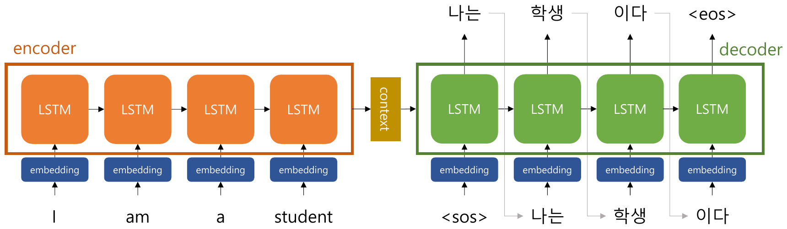

*그림 1. 영어 문장 I am a student를 읽는 LSTM 인코더와 컨텍스트 벡터를 받아 나는 학생 이다를 생성하는 LSTM 디코더*

그림 1에서 인코더는 I, am, a, student의 임베딩을 차례로 LSTM에 넣는다. 디코더는 문장의 시작을 뜻하는 특수 토큰 `<sos>`(start of sequence)를 첫 입력으로 받아 "나는"을 출력하고, 그 출력을 다음 시점의 입력으로 받아 "학생"을 출력하는 식으로 진행하다가, 문장의 끝을 뜻하는 `<eos>`(end of sequence)를 출력하면 멈춘다.

### 1.2 Seq2seq의 한계

Seq2seq에는 크게 두 가지 문제가 있다.

- **정보 손실:** 입력 문장의 길이와 상관없이 모든 정보를 고정된 크기의 컨텍스트 벡터 하나에 압축해야 하므로, 문장이 길어질수록 정보 손실이 발생한다.
- **기울기 소실(gradient vanishing):** 입력이 길면 앞쪽 단어의 정보와 기울기가 많은 시점을 거쳐 전달되어야 하므로 점점 약해진다 [2]. LSTM이 이를 완화하지만 완전히 없애지는 못한다.

### 1.3 어텐션

> **용어 정의:** **어텐션(attention)** 은 출력을 만들 때마다 입력 시퀀스의 특정 부분에 더 많은 가중치를 부여하여 모델이 더 정확한 예측을 하도록 하는 기법이다.

입력 시퀀스의 모든 정보를 고정된 크기의 벡터에 담을 수 없기 때문에, 디코더가 단어를 하나 출력할 때마다 인코더의 모든 시점의 은닉 상태를 다시 보고 지금 필요한 부분에 더 큰 가중치를 주어 더 많은 정보를 반영한다는 아이디어에서 어텐션이 등장하였다 [3].

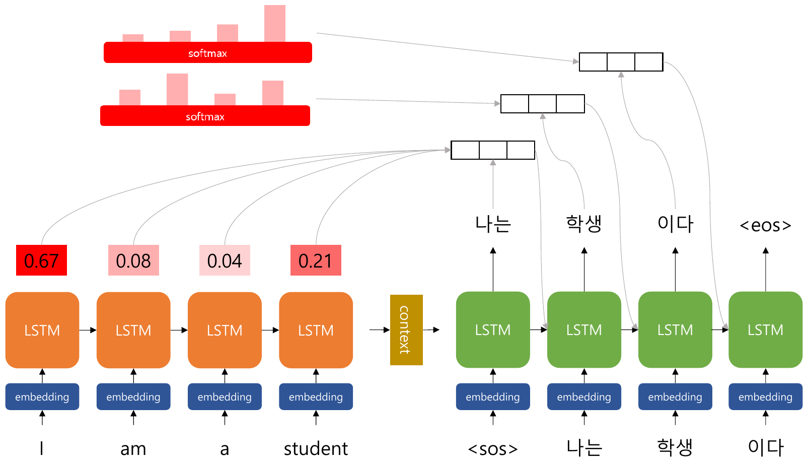

*그림 2. 디코더가 "나는"을 출력할 때 인코더의 각 시점에 준 어텐션 가중치(I 0.67, am 0.08, a 0.04, student 0.21)와 시점마다 다시 계산되는 softmax 분포*

디코더의 $t$번째 출력을 만드는 과정은 다음과 같다. 인코더의 각 시점의 은닉 상태를 $\mathbf{h}_1, \dots, \mathbf{h}_n$, 디코더의 현재 상태를 $\mathbf{s}_t$라 하자.

1. **어텐션 스코어:** 디코더 상태와 각 인코더 은닉 상태가 얼마나 관련 있는지 점수 $e_{t,i} = \mathrm{score}(\mathbf{s}_t, \mathbf{h}_i)$를 구한다. 점수 함수로는 내적이나 작은 신경망을 쓴다.
2. **어텐션 분포:** 점수에 softmax를 적용하여 합이 1인 가중치 $\alpha_{t,i} = \mathrm{softmax}(e_{t,\cdot})_i$를 얻는다.
3. **어텐션 값:** 가중치로 인코더 은닉 상태의 가중합 $\mathbf{c}_t = \sum_i \alpha_{t,i} \mathbf{h}_i$를 구한다. 이 벡터가 $t$번째 출력을 위한 컨텍스트 벡터이며, 디코더 상태와 함께 다음 단어를 예측하는 데 쓰인다.

그림 2의 예에서 "나는"을 출력할 때의 가중치는 I가 0.67로 가장 크고, student 0.21, am 0.08, a 0.04 순이다. 디코더는 이 시점에 주로 I의 정보를 참고하여 "나는"을 만든다. 그림 위쪽의 여러 softmax 막대처럼 가중치는 출력 시점마다 새로 계산되므로, "학생"을 출력할 때는 student에 큰 가중치를 줄 수 있다. 컨텍스트 벡터가 시점마다 달라지므로 고정 크기 벡터 하나에 모든 정보를 담을 필요가 없고, 출력에서 입력까지의 경로가 짧아져 기울기도 잘 전달된다.

---

<br>

## 2. Transformer

### 2.1 전체 구조

**Transformer**는 2017년 Google의 연구진이 발표한 논문 "Attention is all you need"에서 나온 모델이다 [4]. 기존 seq2seq의 인코더-디코더 구조를 따르면서도, 논문의 제목처럼 RNN 없이 **어텐션만으로** 구현하였다. 이후 BERT, GPT, ViT 같은 대부분의 대형 모델이 Transformer를 바탕으로 만들어져, 이 모델은 분야의 흐름을 바꾼 게임 체인저(game changer)로 평가받는다.

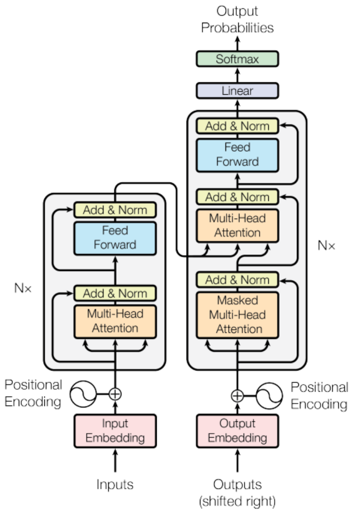

*그림 3. 왼쪽의 인코더와 오른쪽의 디코더가 각각 N번 쌓인 Transformer의 전체 구조*

그림 3의 구성 요소를 아래에서 위로 정리하면 다음과 같다. 원 논문은 인코더와 디코더를 각각 $N = 6$개 쌓고, 모든 층의 벡터 차원을 $d_{\text{model}} = 512$로 통일한다.

| 구성 요소 | 위치 | 역할 | 다루는 절 |
|:-----|:-----|:-----|:-----|
| Input Embedding, Output Embedding | 인코더와 디코더의 입력 | 토큰을 $d_{\text{model}}$차원 벡터로 바꾼다 | 2.7절 |
| Positional Encoding | 임베딩 직후 | 단어의 순서 정보를 더한다 | 2.9절 |
| Multi-Head Attention | 인코더 | 입력 문장 안에서 단어끼리 관련도를 계산한다(셀프 어텐션) | 2.2\~2.5절 |
| Masked Multi-Head Attention | 디코더 | 이미 생성한 단어끼리만 셀프 어텐션을 한다 | 2.10절 |
| Multi-Head Attention | 디코더의 중간 | 디코더가 인코더의 출력을 참고한다(인코더-디코더 어텐션) | 2.6절 |
| Feed Forward | 인코더와 디코더 | 위치마다 같은 2층 신경망을 적용한다 | 2.6절 |
| Add & Norm | 모든 하위 층 뒤 | 잔차 연결과 층 정규화 | 2.6절 |
| Linear, Softmax | 디코더의 출력 | 다음 단어의 확률 분포를 만든다 | 2.6절 |

*표 1. Transformer의 구성 요소와 역할*

디코더의 입력 "Outputs (shifted right)"는 정답 문장을 한 칸 오른쪽으로 민 것, 즉 맨 앞에 `<sos>`를 붙인 시퀀스이다. 각 위치에서 바로 다음 단어를 예측하게 하기 위해서이다.

### 2.2 셀프 어텐션과 쿼리, 키, 밸류

> **용어 정의:** **셀프 어텐션(self-attention)** 은 주어진 **입력 시퀀스 내에서** 각 위치의 원소들 사이의 상대적인 중요도를 계산하는 메커니즘이다. 이를 통해 입력 시퀀스의 각 위치가 다른 위치들과 얼마나 관련되어 있는지를 나타낼 수 있다.

1.3절의 어텐션은 디코더가 인코더를 바라보는 것이었다면, 셀프 어텐션은 한 문장이 자기 자신을 바라본다. 예를 들어 "The animal did not cross the street because it was too tired"에서 "it"을 처리할 때 셀프 어텐션은 "animal"에 큰 가중치를 주어 "it"이 무엇을 가리키는지를 벡터에 반영할 수 있다. 그림 3에서 인코더의 Multi-Head Attention이 셀프 어텐션이다.

셀프 어텐션은 각 단어의 벡터로부터 세 가지 벡터를 만든다.

- **쿼리(Query, Q):** 현재 위치의 단어에서 만든 벡터로, 다른 위치의 키 벡터들과의 관련성을 측정하는 데 사용된다. 특정 위치의 단어가 다른 위치의 어떤 정보에 관심이 있는지를 나타낸다.
- **키(Key, K):** 입력 시퀀스의 각 위치의 단어에서 만든 벡터로, 쿼리 벡터와의 관련성을 계산하는 데 사용된다. 쿼리와 키의 내적이 관련성 점수가 된다.
- **밸류(Value, V):** 각 위치의 단어가 가진 정보를 나타내는 벡터로, 어텐션 스코어를 바탕으로 가중 평균을 계산하는 데 사용된다. 각 위치의 정보를 얼마나 반영할지는 그 위치의 가중치가 정한다.

도서관 검색에 비유하면, 쿼리는 찾고 싶은 내용을 적은 검색어, 키는 각 책에 붙은 색인어, 밸류는 책의 실제 내용이다. 검색어와 색인어가 잘 맞는 책일수록 그 내용을 많이 가져온다.

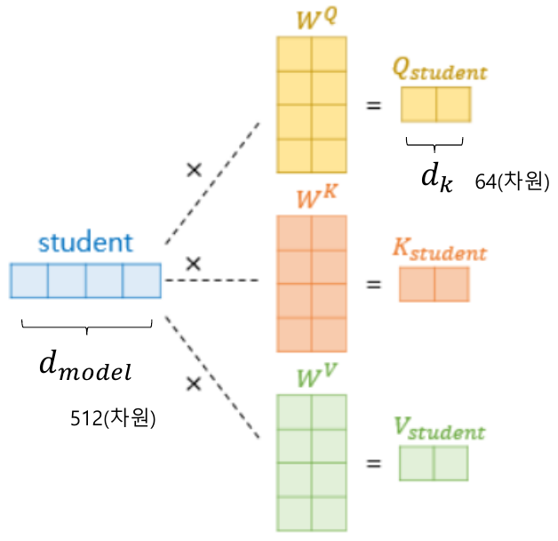

*그림 4. 512차원 단어 벡터 student에 가중치 행렬 W^Q, W^K, W^V를 곱해 64차원의 Q, K, V 벡터를 만드는 과정*

그림 4처럼 Q, K, V 벡터는 단어 벡터 $\mathbf{x}$에 학습되는 가중치 행렬 $W^Q$, $W^K$, $W^V$를 곱해 얻는다. 원 논문에서 단어 벡터는 $d_{\text{model}} = 512$차원이고, 가중치 행렬은 $512 \times 64$이므로 Q, K, V는 $d_k = 64$차원이다.

$$
\mathbf{q} = \mathbf{x} W^Q, \qquad \mathbf{k} = \mathbf{x} W^K, \qquad \mathbf{v} = \mathbf{x} W^V
$$

### 2.3 스케일드 닷-프로덕트 어텐션

Transformer가 쓰는 어텐션 함수는 **스케일드 닷-프로덕트 어텐션(scaled dot-product attention)** 이다.

$$
\mathrm{Attention}(Q, K, V) = \mathrm{softmax}\left(\frac{Q K^T}{\sqrt{d_k}}\right) V
$$

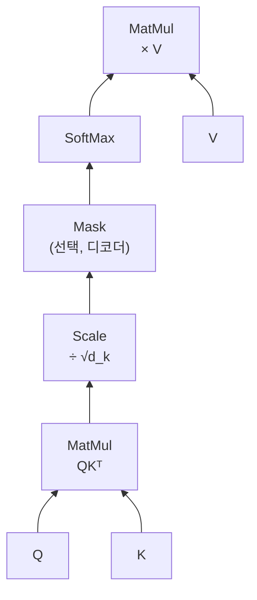

*그림 5. 스케일드 닷-프로덕트 어텐션의 계산 순서*

단어 'I'에 대한 계산을 단계별로 보면 다음과 같다. 문장은 "I am a student"이다.

1. **어텐션 스코어:** 'I'의 쿼리 벡터 $\mathbf{q}_I$가 모든 단어의 키 벡터와 내적한다. 예를 들어 $\mathbf{q}_I \cdot \mathbf{k}_I = 128$, $\mathbf{q}_I \cdot \mathbf{k}_{am} = 32$, $\mathbf{q}_I \cdot \mathbf{k}_a = 32$, $\mathbf{q}_I \cdot \mathbf{k}_{student} = 128$이라 하자.
2. **스케일링:** 내적의 분산은 벡터의 차원 $d_k$에 비례해 커지므로(아래 설명), 학습의 안정성을 위해 $\sqrt{d_k}$로 나눈다. $d_k = 64$이면 $\sqrt{d_k} = 8$이므로 점수는 $128/8 = 16$, $32/8 = 4$, $4$, $16$이 된다. 이렇게 크기를 조절하므로 "scaled" dot-product attention이라 부른다.
3. **어텐션 분포:** 점수에 softmax를 적용하여 합이 1인 **어텐션 분포(attention distribution)** 를 구한다.
4. **어텐션 값:** 각 단어의 밸류 벡터를 어텐션 분포로 가중합하여 **어텐션 값(attention value)** 을 구한다. 이것을 단어 'I'에 대한 컨텍스트 벡터라고도 한다.

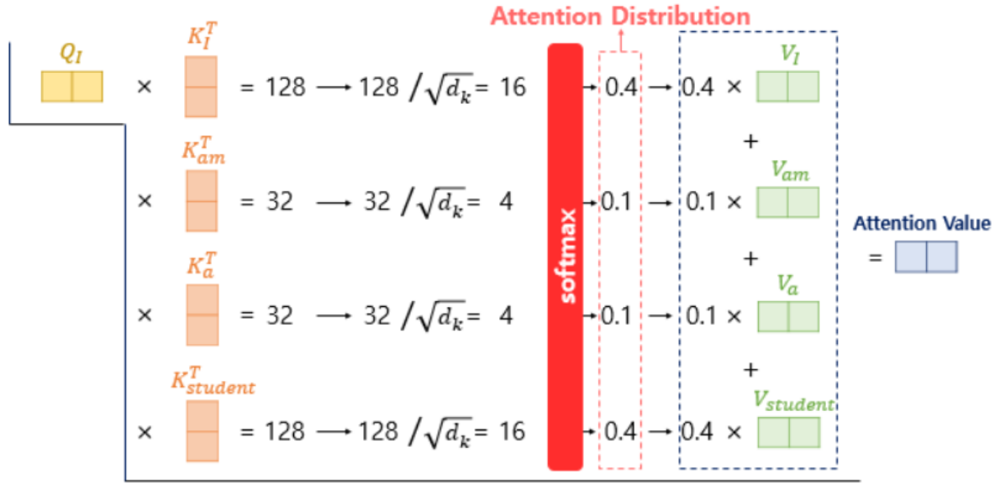

*그림 6. 단어 I의 쿼리로 네 키와의 점수(16, 4, 4, 16)를 구하고 softmax로 얻은 분포(0.4, 0.1, 0.1, 0.4)로 밸류를 가중합하는 과정*

그림 6에서 어텐션 값은 $0.4\,\mathbf{v}_I + 0.1\,\mathbf{v}_{am} + 0.1\,\mathbf{v}_a + 0.4\,\mathbf{v}_{student}$이다. 'I'와 관련이 큰 I와 student의 정보가 주로 반영된다.

> **참고:** 그림 6의 분포(0.4, 0.1, 0.1, 0.4)는 경향을 보이기 위한 값이다. 점수 $[16, 4, 4, 16]$에 softmax를 실제로 적용하면 $e^{16}$이 $e^{4}$보다 약 16만 배 크므로 분포는 약 $[0.5, 0.000003, 0.000003, 0.5]$가 된다. 이미 $\sqrt{d_k}$로 나눈 점수인데도 차이가 12이면 softmax가 가장 큰 점수에 가중치를 거의 모두 몰아주며, 나누기 전처럼 차이가 96이었다면 훨씬 더 극단적이다. 점수 차이가 커질수록 softmax가 포화된다는 이 성질이 바로 다음에 설명할 스케일링의 이유이다.

**$\sqrt{d_k}$로 나누는 이유.** 쿼리와 키의 각 성분이 평균 0, 분산 1인 독립 확률 변수라면 내적 $\mathbf{q} \cdot \mathbf{k} = \sum_{i=1}^{d_k} q_i k_i$의 분산은 $d_k$이다 [4]. $d_k = 64$이면 내적의 표준편차가 8이므로 점수 사이의 차이가 커지고, softmax 출력이 하나의 위치에 거의 1을 주는 포화 상태가 된다. 포화된 softmax는 기울기가 0에 가까워 학습이 잘 되지 않는다. $\sqrt{d_k}$로 나누면 점수의 분산이 1로 돌아와 softmax가 적당히 퍼진 분포를 유지한다.

> **[확률및통계]** 서로 독립이고 평균이 0인 확률 변수 $q$, $k$의 곱의 분산은 $\mathrm{Var}(qk) = E[q^2]E[k^2] = \mathrm{Var}(q)\mathrm{Var}(k)$이다. 독립인 확률 변수의 합의 분산은 각 분산의 합이므로, 분산이 1인 성분 $d_k$개의 곱을 더한 내적의 분산은 $d_k$이다. 확률 변수를 상수 $c$로 나누면 분산은 $c^2$로 나누어지므로, $\sqrt{d_k}$로 나눈 점수의 분산은 1이 된다.

**행렬 연산과 병렬 처리.** 실제로는 단어마다 따로 계산하지 않고, 문장의 모든 단어 벡터를 행으로 쌓은 행렬 $X$($\text{seq\_len} \times d_{\text{model}}$)로 한 번에 계산한다. $Q = XW^Q$, $K = XW^K$, $V = XW^V$는 각각 $\text{seq\_len} \times d_k$ 행렬이고, $QK^T$는 모든 단어 쌍의 점수를 담은 $\text{seq\_len} \times \text{seq\_len}$ 행렬이다. softmax를 행마다 적용하고 $V$를 곱하면 모든 단어의 어텐션 값을 담은 **어텐션 값 행렬**이 나온다.

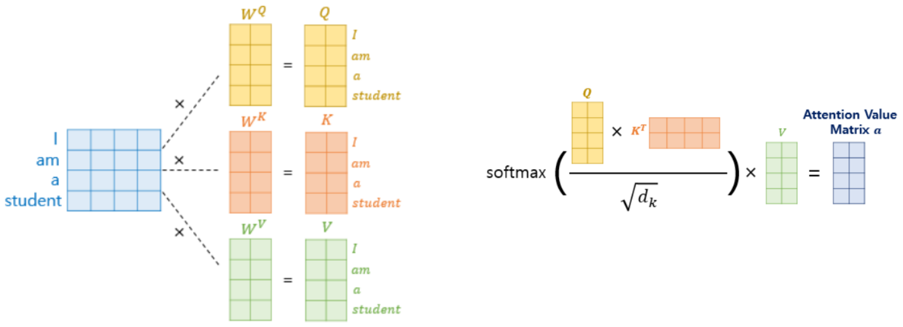

*그림 7. 문장 행렬에 W^Q, W^K, W^V를 곱해 Q, K, V 행렬을 만들고 softmax(QK^T/√d_k)V로 어텐션 값 행렬을 한 번에 구하는 행렬 연산*

RNN은 앞 시점의 은닉 상태가 있어야 다음 시점을 계산할 수 있어 단어를 하나씩 순서대로 처리해야 했다. 셀프 어텐션은 모든 위치를 행렬 곱 한 번으로 동시에 계산하므로 GPU에서 **병렬 처리가 가능하다**는 것이 큰 이점이다.

### 2.4 셀프 어텐션 계산 예제

작은 숫자로 셀프 어텐션 전체를 직접 계산한다. 문장은 "I am a student", $d_{\text{model}} = 4$, $d_k = 2$이다. 단어 벡터를 행으로 쌓은 행렬 $X$와 가중치 행렬은 다음과 같다(실제로는 학습되는 값이지만 계산을 따라가기 쉽게 정수로 둔다).

$$
X = \begin{bmatrix} 1 & 0 & 1 & 0 \\ 0 & 2 & 0 & 0 \\ 0 & 0 & 0 & 1 \\ 1 & 0 & 2 & 0 \end{bmatrix}
\begin{matrix} \leftarrow \text{I} \\ \leftarrow \text{am} \\ \leftarrow \text{a} \\ \leftarrow \text{student} \end{matrix}, \quad
W^Q = \begin{bmatrix} 1 & 0 \\ 0 & 1 \\ 1 & 0 \\ 0 & 1 \end{bmatrix}, \quad
W^K = \begin{bmatrix} 1 & 0 \\ 0 & 1 \\ 1 & 0 \\ 0 & 0 \end{bmatrix}, \quad
W^V = \begin{bmatrix} 1 & 0 \\ 0 & 1 \\ 0 & 1 \\ 1 & 0 \end{bmatrix}
$$

**1단계: Q, K, V.** 예를 들어 I의 쿼리는 $[1, 0, 1, 0] W^Q = [1 + 1, 0 + 0] = [2, 0]$이다. 같은 방식으로 계산한 결과는 다음과 같다.

| 단어 | $\mathbf{q}$ | $\mathbf{k}$ | $\mathbf{v}$ |
|:-----|:-----|:-----|:-----|
| I | [2, 0] | [2, 0] | [1, 1] |
| am | [0, 2] | [0, 2] | [0, 2] |
| a | [0, 1] | [0, 0] | [1, 0] |
| student | [3, 0] | [3, 0] | [1, 2] |

*표 2. 예제 문장의 쿼리, 키, 밸류 벡터*

**2단계: 점수와 스케일링.** I의 쿼리 $[2, 0]$과 각 키의 내적은 $[2, 0] \cdot [2, 0] = 4$, $[2, 0] \cdot [0, 2] = 0$, $[2, 0] \cdot [0, 0] = 0$, $[2, 0] \cdot [3, 0] = 6$이다. 이를 $\sqrt{2} \approx 1.414$로 나누면 $[2.828, 0, 0, 4.243]$이다.

**3단계: softmax.** $e^{2.828} \approx 16.919$, $e^{0} = 1$, $e^{0} = 1$, $e^{4.243} \approx 69.591$이고 합은 $88.510$이다. 각 값을 합으로 나누면 I의 어텐션 분포는 $[0.191, 0.011, 0.011, 0.786]$이다.

**4단계: 어텐션 값.** $0.191 \times [1, 1] + 0.011 \times [0, 2] + 0.011 \times [1, 0] + 0.786 \times [1, 2] \approx [0.989, 1.786]$이다. I의 새 벡터는 student의 밸류를 가장 많이 담는다.

네 단어 모두에 대해 같은 계산을 한 결과는 다음과 같다. 각 행이 한 단어(쿼리)의 어텐션 분포이며 행의 합은 1이다.

| 쿼리 \ 키 | I | am | a | student | 어텐션 값 |
|:-----|:---:|:---:|:---:|:---:|:-----|
| I | 0.191 | 0.011 | 0.011 | 0.786 | [0.989, 1.786] |
| am | 0.050 | 0.849 | 0.050 | 0.050 | [0.151, 1.849] |
| a | 0.141 | 0.578 | 0.141 | 0.141 | [0.422, 1.578] |
| student | 0.107 | 0.002 | 0.002 | 0.890 | [0.998, 1.890] |

*표 3. 예제 문장의 어텐션 분포 행렬과 어텐션 값*

다음 코드는 같은 계산을 NumPy로 수행한다.

```python
import numpy as np

X = np.array([[1, 0, 1, 0],    # I
              [0, 2, 0, 0],    # am
              [0, 0, 0, 1],    # a
              [1, 0, 2, 0]])   # student
W_Q = np.array([[1, 0], [0, 1], [1, 0], [0, 1]])
W_K = np.array([[1, 0], [0, 1], [1, 0], [0, 0]])
W_V = np.array([[1, 0], [0, 1], [0, 1], [1, 0]])

Q, K, V = X @ W_Q, X @ W_K, X @ W_V            # (4, 2) 행렬 세 개
d_k = K.shape[1]
scores = Q @ K.T / np.sqrt(d_k)                 # (4, 4) 스케일드 점수
weights = np.exp(scores) / np.exp(scores).sum(axis=1, keepdims=True)  # 행마다 softmax
out = weights @ V                               # (4, 2) 어텐션 값

np.set_printoptions(precision=3, suppress=True)
print(weights)
print(out)
```

```text
[[0.191 0.011 0.011 0.786]
 [0.05  0.849 0.05  0.05 ]
 [0.141 0.578 0.141 0.141]
 [0.107 0.002 0.002 0.89 ]]
[[0.989 1.786]
 [0.151 1.849]
 [0.422 1.578]
 [0.998 1.89 ]]
```

`@`는 행렬 곱이다. `sum(axis=1, keepdims=True)`는 행마다 합을 구하되 (4, 1) 모양을 유지하여, 나눗셈이 각 행을 자기 행의 합으로 나누도록 한다. 코드 전체가 수식 $\mathrm{softmax}(QK^T/\sqrt{d_k})V$를 그대로 옮긴 것이다.

### 2.5 멀티 헤드 어텐션

**멀티 헤드 어텐션(multi-head attention)** 은 한 번의 어텐션보다 여러 번의 어텐션을 병렬로 사용하는 것이 더 효과적이라는 생각에서 나온 구조이다. $d_{\text{model}}$차원 전체로 어텐션을 한 번 하는 대신, $d_k = d_{\text{model}} / h$차원으로 줄인 어텐션을 $h$번 따로 수행한다. 각각을 **헤드(head)** 라 하며, 원 논문은 $h = 8$, $d_k = 512 / 8 = 64$를 쓴다.

$$
d_{\text{model}} = d_k \times \text{num\_heads}, \qquad 512 = 64 \times 8
$$

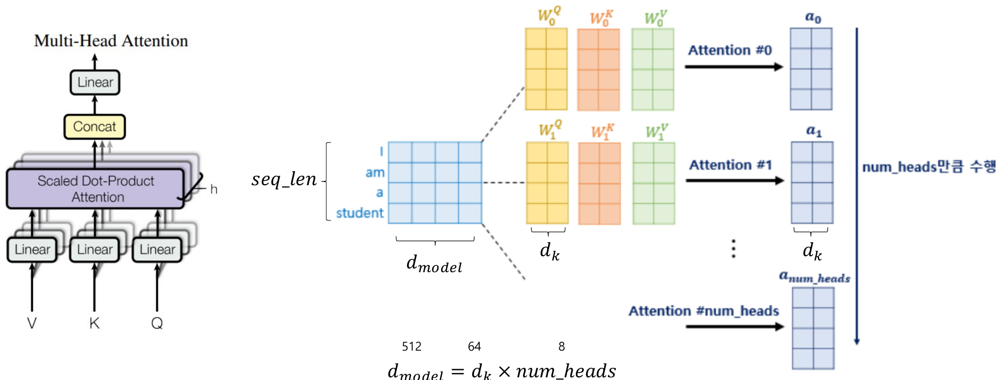

*그림 8. 헤드마다 다른 가중치 W_i^Q, W_i^K, W_i^V로 어텐션을 num_heads번 수행하는 멀티 헤드 어텐션*

계산 과정은 다음과 같다.

1. 헤드 $i$마다 자기만의 가중치 $W_i^Q$, $W_i^K$, $W_i^V$($d_{\text{model}} \times d_k$)로 Q, K, V를 만들고 스케일드 닷-프로덕트 어텐션을 수행하여 어텐션 값 행렬 $\mathbf{a}_i$($\text{seq\_len} \times d_k$)를 얻는다.
2. 헤드 $h$개의 결과 $\mathbf{a}_0, \dots, \mathbf{a}_{h-1}$을 옆으로 이어 붙이면(concatenate) $\text{seq\_len} \times (h \cdot d_k) = \text{seq\_len} \times d_{\text{model}}$ 행렬이 된다.
3. 이어 붙인 행렬에 가중치 $W^O$($d_{\text{model}} \times d_{\text{model}}$)를 곱해 최종 출력을 만든다.

$$
\mathrm{MultiHead}(Q, K, V) = \mathrm{Concat}(\mathrm{head}_1, \dots, \mathrm{head}_h) W^O, \qquad \mathrm{head}_i = \mathrm{Attention}(Q W_i^Q, K W_i^K, V W_i^V)
$$

여러 헤드가 효과적인 이유는 헤드마다 서로 다른 관계에 주목할 수 있기 때문이다. 어떤 헤드는 멀리 떨어진 단어 사이의 의존 관계를, 다른 헤드는 대명사와 그것이 가리키는 명사의 관계를 학습할 수 있다 [4]. 헤드 하나의 차원이 작아지므로 전체 계산량은 차원 전체로 어텐션을 한 번 하는 것과 비슷하다.

멀티 헤드 어텐션은 **입력과 출력의 크기가 같다.** 입력이 $\text{seq\_len} \times d_{\text{model}}$이면 출력도 $\text{seq\_len} \times d_{\text{model}}$이다. 크기가 같아야 같은 구조를 $N$번 반복하여 쌓을 수 있다. 한 멀티 헤드 어텐션 층의 파라미터는 $W^Q, W^K, W^V$(헤드 8개를 합치면 각각 $512 \times 512$)와 $W^O$($512 \times 512$)이므로 가중치만 $4 \times 512 \times 512 = 1{,}048{,}576$개이고, 편향 $4 \times 512 = 2{,}048$개를 더하면 1,050,624개이다.

### 2.6 잔차 연결, 층 정규화, 피드 포워드 신경망

Transformer의 인코더 층 하나는 멀티 헤드 셀프 어텐션과 피드 포워드 신경망이라는 두 하위 층으로 이루어지고, 각 하위 층 뒤에 Add & Norm이 있다.

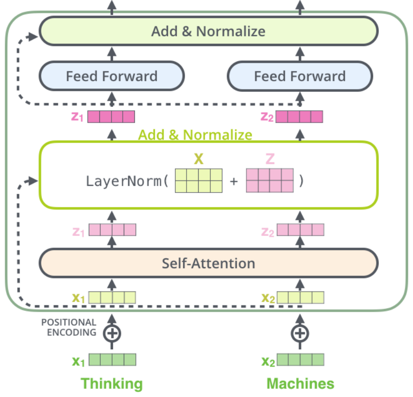

*그림 9. 두 단어 Thinking, Machines의 벡터가 위치 인코딩, 셀프 어텐션, Add & Normalize, 위치별 피드 포워드, Add & Normalize를 차례로 거치는 인코더 층*

- **잔차 연결(residual connection):** 하위 층의 입력 $\mathbf{x}$를 출력에 그대로 더한다(Add). 3강의 ResNet에서 배운 **스킵 연결(skip connection)** 과 같은 구조로 [5], 층을 깊이 쌓아도 정보와 기울기가 지름길로 전달된다. 그림 9에서 점선 화살표가 이 연결이다. 더하려면 입력과 출력의 크기가 같아야 하므로 모든 하위 층의 출력이 $d_{\text{model}}$차원이다.
- **층 정규화(layer normalization):** 각 단어 벡터의 성분들을 평균 0, 분산 1이 되도록 정규화한 뒤 학습되는 배율과 이동을 적용한다(Norm) [6]. 배치 안의 여러 표본을 함께 보는 배치 정규화와 달리 표본 하나의 벡터 안에서 정규화하므로 문장 길이나 배치 크기와 무관하게 동작한다. 하위 층의 출력은 $\mathrm{LayerNorm}(\mathbf{x} + \mathrm{Sublayer}(\mathbf{x}))$이다.
- **피드 포워드 신경망(feed-forward network):** 각 위치의 벡터에 같은 2층 신경망을 따로 적용한다. 원 논문의 은닉 차원은 $d_{ff} = 2048$이다.

$$
\mathrm{FFN}(\mathbf{x}) = \max(0, \mathbf{x} W_1 + \mathbf{b}_1) W_2 + \mathbf{b}_2
$$

셀프 어텐션이 단어 사이의 정보를 섞는다면, 피드 포워드 신경망은 섞인 정보를 단어마다 비선형으로 가공한다.

디코더 층에는 하위 층이 하나 더 있다. 디코더 중간의 멀티 헤드 어텐션에서 **쿼리는 디코더의 행렬**(마스크드 셀프 어텐션의 출력)이고, **키와 밸류는 인코더의 행렬**(인코더 마지막 층의 출력)이다. 이것을 **인코더-디코더 어텐션**이라 하며, 1.3절의 seq2seq 어텐션처럼 디코더가 출력할 단어에 맞추어 입력 문장의 필요한 부분을 참고하게 한다. 디코더의 마지막 출력은 선형 층(Linear)으로 어휘 크기의 점수가 되고, softmax로 다음 단어의 확률 분포가 된다.

### 2.7 임베딩 층

Transformer의 입력은 단어를 정수 인덱스로 바꾸고, 그 인덱스로 룩업 테이블의 행을 읽어 임베딩 벡터를 얻는 **임베딩 층(embedding layer)** 을 거친다. 7강의 Word2Vec은 룩업 테이블을 따로 학습한 뒤 가져다 썼지만, Transformer에서는 **전체 학습 과정에서 룩업 테이블도 함께 학습된다.** 처음에는 무작위 값으로 시작하여 번역 같은 최종 태스크의 손실을 줄이는 방향으로 갱신된다.

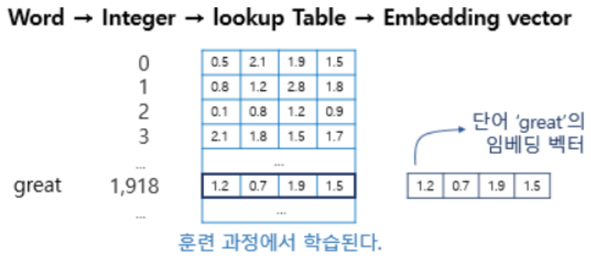

*그림 10. 단어 great가 정수 1,918로 바뀌고 룩업 테이블의 1,918번째 행이 great의 임베딩 벡터가 되는 과정*

그림 10에서 단어 great는 어휘 사전에서 정수 1,918로 바뀌고, 룩업 테이블의 1,918번째 행 $[1.2, 0.7, 1.9, 1.5]$가 great의 임베딩 벡터가 된다. PyTorch에서는 `nn.Embedding(어휘 수, 임베딩 차원)`이 이 층이다.

### 2.8 Byte Pair Encoding(BPE)

임베딩 층은 어휘에 있는 단어만 표현할 수 있으므로, 단어 단위 어휘에서는 학습 때 보지 못한 단어(OOV)를 처리할 수 없다. 이를 해결하는 대표적인 서브워드 토큰화 방법이 **BPE(Byte Pair Encoding)** 이다. BPE는 원래 데이터 압축 알고리즘으로 제안되었고 [7], 신경망 기계 번역의 서브워드 분리에 도입되었다 [8].

BPE는 기본적으로 **연속으로 가장 많이 등장한 글자의 쌍을 찾아서 하나의 글자로 병합**하는 과정을 반복한다. 알고리즘은 다음과 같다.

1. 학습 데이터의 각 단어를 글자 단위로 분리한 상태로 시작한다. 어휘(vocabulary)는 등장한 모든 글자이다.
2. 이웃한 두 기호의 쌍마다, 그 쌍이 들어 있는 단어의 빈도를 더해 등장 횟수를 센다.
3. 가장 많이 등장한 쌍을 하나의 새 기호로 병합하고, 새 기호를 어휘에 추가한다.
4. 정해진 횟수만큼 2\~3단계를 반복한다.

예를 들어 학습 데이터의 단어 빈도가 low 5번, lower 2번, newest 6번, widest 3번이라 하자. 초기 상태는 다음과 같다.

```text
# dictionary
l o w : 5,  l o w e r : 2,  n e w e s t : 6,  w i d e s t : 3

# vocabulary
l, o, w, e, r, n, s, t, i, d
```

첫 단계에서 쌍의 등장 횟수를 세면 (e, s)는 newest에서 6번, widest에서 3번이므로 9번이다. (s, t)도 9번으로 같지만 먼저 센 (e, s)를 고른다. (e, s)를 es로 통합하면 딕셔너리와 어휘는 다음과 같이 바뀐다.

```text
# dictionary update!
l o w : 5,  l o w e r : 2,  n e w es t : 6,  w i d es t : 3

# vocabulary update!
l, o, w, e, r, n, s, t, i, d, es
```

같은 과정을 10회 반복할 때 각 단계에서 병합되는 쌍은 다음과 같다.

| 단계 | 병합한 쌍 | 등장 횟수 | 새 기호 |
|:---:|:-----|:---:|:-----|
| 1 | (e, s) | 9 | es |
| 2 | (es, t) | 9 | est |
| 3 | (l, o) | 7 | lo |
| 4 | (lo, w) | 7 | low |
| 5 | (n, e) | 6 | ne |
| 6 | (ne, w) | 6 | new |
| 7 | (new, est) | 6 | newest |
| 8 | (w, i) | 3 | wi |
| 9 | (wi, d) | 3 | wid |
| 10 | (wid, est) | 3 | widest |

*표 4. 10회의 BPE 병합 과정*

```text
# dictionary update!
low : 5,  low e r : 2,  newest : 6,  widest : 3

# vocabulary update!
l, o, w, e, r, n, s, t, i, d, es, est, lo, low, ne, new, newest, wi, wid, widest
```

다음 코드는 이 과정을 구현한다.

```python
from collections import Counter

def count_pairs(dictionary):
    pairs = Counter()
    for symbols, freq in dictionary.items():
        for pair in zip(symbols, symbols[1:]):     # 이웃한 두 기호의 쌍
            pairs[pair] += freq                     # 단어의 빈도만큼 센다
    return pairs

def merge(symbols, pair):
    out, i = [], 0
    while i < len(symbols):
        if i < len(symbols) - 1 and (symbols[i], symbols[i + 1]) == pair:
            out.append(symbols[i] + symbols[i + 1])  # 쌍을 하나의 기호로 합친다
            i += 2
        else:
            out.append(symbols[i])
            i += 1
    return tuple(out)

dictionary = {tuple("low"): 5, tuple("lower"): 2, tuple("newest"): 6, tuple("widest"): 3}
vocabulary = ["l", "o", "w", "e", "r", "n", "s", "t", "i", "d"]
merges = []

for step in range(1, 11):
    pairs = count_pairs(dictionary)
    best = max(pairs, key=pairs.get)                # 가장 빈도가 높은 쌍(동률이면 먼저 센 쌍)
    print(step, best, pairs[best])
    dictionary = {merge(s, best): f for s, f in dictionary.items()}
    vocabulary.append(best[0] + best[1])
    merges.append(best)

print({" ".join(s): f for s, f in dictionary.items()})
print(vocabulary)

word = tuple("lowest")                              # 학습 데이터에 없던 단어
for pair in merges:                                 # 학습한 순서대로 병합을 적용한다
    word = merge(word, pair)
print(word)
```

```text
1 ('e', 's') 9
2 ('es', 't') 9
3 ('l', 'o') 7
4 ('lo', 'w') 7
5 ('n', 'e') 6
6 ('ne', 'w') 6
7 ('new', 'est') 6
8 ('w', 'i') 3
9 ('wi', 'd') 3
10 ('wid', 'est') 3
{'low': 5, 'low e r': 2, 'newest': 6, 'widest': 3}
['l', 'o', 'w', 'e', 'r', 'n', 's', 't', 'i', 'd', 'es', 'est', 'lo', 'low', 'ne', 'new', 'newest', 'wi', 'wid', 'widest']
('low', 'est')
```

- `count_pairs()`는 각 단어(기호의 튜플)에서 `zip(symbols, symbols[1:])`으로 이웃한 쌍을 만들고, 그 단어의 빈도만큼 센다. `Counter`는 없는 키를 0으로 시작하는 딕셔너리이다.
- `merge()`는 기호 열을 왼쪽부터 보며 지정한 쌍을 만나면 하나로 합친다.
- `max(pairs, key=pairs.get)`은 등장 횟수가 가장 큰 쌍을 고른다. 동률이면 먼저 센 쌍이 선택되므로 1단계에서 (s, t)가 아니라 (e, s)가 선택된다.

**BPE는 새로운 단어가 등장해도 대응할 수 있다.** 학습 데이터에 없던 lowest가 들어오면 먼저 글자 l, o, w, e, s, t로 나눈 뒤, 학습한 병합 규칙을 학습한 순서대로 적용한다. (e, s) → es, (es, t) → est, (l, o) → lo, (lo, w) → low를 적용하면 lowest는 low와 est 두 서브워드가 되고, 둘 다 어휘에 있으므로 표현할 수 있다.

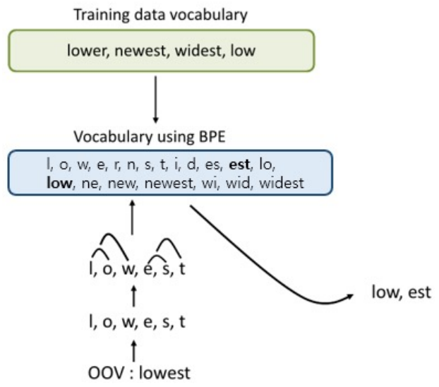

*그림 11. 학습 데이터 어휘로 만든 BPE 어휘와 OOV 단어 lowest가 병합 규칙에 따라 low와 est로 분리되는 과정*

병합 횟수가 어휘의 크기를 정한다. 병합을 많이 하면 자주 쓰는 단어는 통째로 하나의 토큰이 되고, 드문 단어는 여러 서브워드로 나뉜다. GPT-2는 글자 대신 바이트를 기본 단위로 삼는 바이트 수준 BPE를 써서 어떤 문자열도 OOV 없이 표현한다 [9].

### 2.9 위치 인코딩

**왜 필요한가.** Transformer는 입력된 데이터를 한 번에 병렬로 처리해서 속도가 빠르다. 그러나 셀프 어텐션은 단어의 순서와 무관하게 모든 쌍의 관련도를 계산하므로, 입력 순서에 대한 정보를 보장하지 않는다. 문장에서 단어의 순서는 중요한 정보이다. "The cat chased the dog."와 "The dog chased the cat."은 같은 단어로 이루어졌지만 뜻이 반대이다. 그래서 단어의 순서를 나타내기 위해 **위치 인코딩(positional encoding)** 을 쓴다. 위치마다 정해진 벡터를 만들어 같은 위치의 단어 임베딩에 더한다.

**만족해야 할 조건.** 단어의 위치를 나타내는 방법은 다양하지만, 다음 조건이 지켜져야 한다.

1. 각 위치값은 데이터의 길이나 입력값과 관계없이 같은 위치이면 같은 값을 가져야 한다.
2. 각 위치에 대해 고유한 인코딩 값을 가져야 한다. 즉 위치가 다르면 인코딩 값도 달라야 한다.
3. 모든 위치값은 입력값에 비해 너무 크면 안 된다. 너무 크면 더해진 단어 임베딩의 의미가 상대적으로 작아진다.
4. 위치 차이에 의한 인코딩 값의 차이를 거리로 쓸 수 있어야 한다. 간격이 같다면 위치와 관계없이 거리가 같아야 한다: $\mathrm{distance}(x, x + t) = \mathrm{distance}(y, y + t)$.

**단순한 시도와 문제점.** 다음 세 가지 방법은 각각 조건 하나 이상을 어긴다.

- **정수 인덱스:** "I am a student"의 위치를 0, 1, 2, 3으로 둔다. 문장이 길어지면 숫자가 과도하게 커져(조건 3 위반) 학습에 악영향을 준다.
- **0\~1로 정규화:** 숫자가 커지지 않게 첫 단어를 0, 마지막 단어를 1로 둔다. "I am a student"는 0, 0.33, 0.67, 1이고 "The cat chased the dog"는 0, 0.25, 0.50, 0.75, 1이므로, 같은 두 번째 위치가 문장 길이에 따라 0.33과 0.25로 달라진다(조건 1 위반).
- **이진수:** 위치를 이진수 벡터로 나타낸다. 값은 0과 1로 제한되지만 위치 사이의 거리가 일정하지 않다(조건 4 위반).

| 위치 | 0 | 1 | 2 | 3 | 4 |
|:-----|:---:|:---:|:---:|:---:|:---:|
| 비트 2 | 0 | 0 | 0 | 0 | 1 |
| 비트 1 | 0 | 0 | 1 | 1 | 0 |
| 비트 0 | 0 | 1 | 0 | 1 | 0 |

*표 5. 위치 0\~4의 이진수 인코딩*

표 5에서 위치 0과 1의 벡터 $[0, 0, 0]$, $[0, 0, 1]$ 사이의 유클리드 거리는 1이지만, 위치 3과 4의 벡터 $[0, 1, 1]$, $[1, 0, 0]$ 사이의 거리는 $\sqrt{3} \approx 1.732$이다. 같은 1만큼의 위치 차이인데 거리가 다르게 계산된다.

**사인 함수.** 사인 함수는 값의 범위가 $-1$\~$1$로 제한되고(조건 3), 주기 함수이므로 문장 길이에 제약을 받지 않는다. 그러나 주기 함수이므로 문장이 길어지면 같은 인코딩 값이 다시 나타날 수 있다(조건 2 위반).

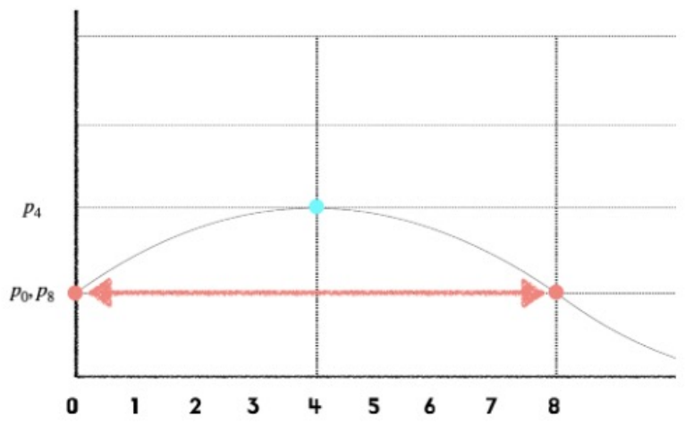

*그림 12. 사인 곡선에서 위치 0과 위치 8의 값이 같아지는 예*

그림 12의 곡선에서 위치 4는 최댓값이지만 위치 0과 위치 8은 같은 값을 가지므로 두 위치를 구별할 수 없다.

**사인과 코사인을 여러 주파수로 쓰기.** Transformer는 주파수가 서로 다른 여러 개의 사인과 코사인 함수를 함께 쓴다 [4]. 위치 $pos$의 인코딩 벡터에서 짝수 번째 차원 $2i$와 홀수 번째 차원 $2i+1$은 다음과 같다.

$$
PE_{(pos, 2i)} = \sin\left(\frac{pos}{10000^{2i/d_{\text{model}}}}\right), \qquad PE_{(pos, 2i+1)} = \cos\left(\frac{pos}{10000^{2i/d_{\text{model}}}}\right)
$$

차원 쌍 $(2i, 2i+1)$마다 각속도 $\omega_i = 1/10000^{2i/d_{\text{model}}}$가 다르다. 앞쪽 차원($i$가 작음)은 위치에 따라 빠르게 변하고, 뒤쪽 차원은 천천히 변한다. 시계의 초침, 분침, 시침이 함께 시각을 나타내듯, 빠른 성분과 느린 성분을 합치면 실용적인 길이 안에서 위치마다 고유한 벡터가 된다(조건 2). 모든 값이 $-1$\~$1$이고(조건 3), 같은 위치는 문장과 무관하게 같은 벡터를 갖는다(조건 1). 위치 인코딩 벡터는 단어 임베딩과 같은 $d_{\text{model}}$차원이므로 원소별로 더할 수 있다.

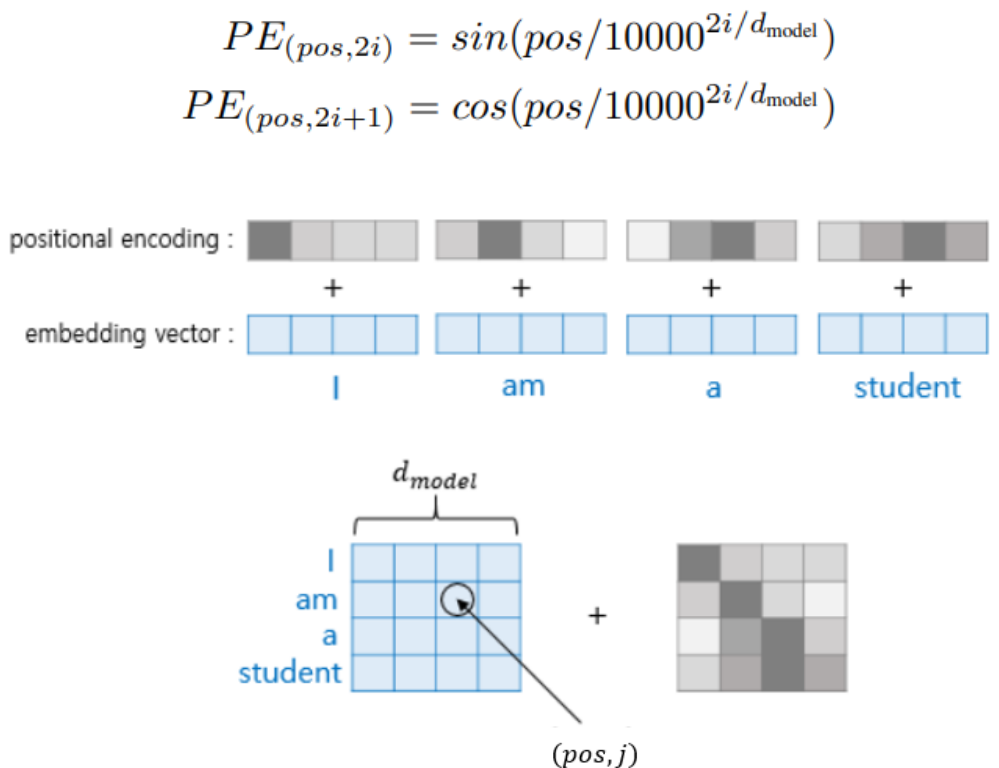

*그림 13. 사인과 코사인 위치 인코딩 공식과, 문장 I am a student의 각 단어 임베딩에 같은 위치의 인코딩 벡터를 더하는 과정*

$d_{\text{model}} = 4$인 작은 예를 계산하면, $i = 0$인 쌍은 $\omega_0 = 1$이므로 $\sin(pos)$, $\cos(pos)$이고, $i = 1$인 쌍은 $\omega_1 = 1/10000^{2/4} = 1/100$이므로 $\sin(pos/100)$, $\cos(pos/100)$이다.

| 위치 | $\sin(pos)$ | $\cos(pos)$ | $\sin(pos/100)$ | $\cos(pos/100)$ |
|:---:|:---:|:---:|:---:|:---:|
| 0 (I) | 0.000 | 1.000 | 0.000 | 1.000 |
| 1 (am) | 0.841 | 0.540 | 0.010 | 1.000 |
| 2 (a) | 0.909 | -0.416 | 0.020 | 1.000 |
| 3 (student) | 0.141 | -0.990 | 0.030 | 1.000 |

*표 6. $d_{\text{model}} = 4$일 때 위치 0\~3의 위치 인코딩 벡터*

첫 두 차원은 위치마다 크게 변하고, 뒤의 두 차원은 매우 느리게 변한다. 각 행을 같은 위치의 단어 임베딩에 더하면 Transformer의 입력이 된다.

**거리 조건과 회전 행렬.** 위치의 상대적 변화는 삼각함수의 회전 행렬(rotation matrix)로 나타낼 수 있다. 한 차원 쌍에서 $\theta = \omega\, pos$, $\phi = \omega\, t$라 하면 덧셈 정리로부터

$$
\begin{pmatrix} \cos(\theta + \phi) \\ \sin(\theta + \phi) \end{pmatrix} = \begin{pmatrix} \cos\phi & -\sin\phi \\ \sin\phi & \cos\phi \end{pmatrix} \begin{pmatrix} \cos\theta \\ \sin\theta \end{pmatrix}
$$

이다. 위치 $pos + t$의 인코딩은 위치 $pos$의 인코딩을 $\phi = \omega t$만큼 회전시킨 것이고, 회전 각은 위치 차이 $t$에만 의존한다. 회전은 벡터의 길이를 바꾸지 않으므로, 두 인코딩 사이의 거리의 제곱은 차원 쌍마다 $\lVert R(\phi)\mathbf{p} - \mathbf{p} \rVert^2 = 2 - 2\cos(\omega_i t)$이고 전체 거리의 제곱은 다음과 같다.

$$
\lVert PE(pos + t) - PE(pos) \rVert^2 = \sum_{i} \left(2 - 2\cos(\omega_i t)\right)
$$

이 값에는 $pos$가 없으므로 $\mathrm{distance}(x, x + t) = \mathrm{distance}(y, y + t)$가 성립한다(조건 4). 즉 위치 x와 y의 인코딩을 각 차원 쌍에서 같은 각 $\omega_i t$만큼 회전시키면 원래 인코딩에서 같은 거리만큼 떨어진다. 예를 들어 $d_{\text{model}} = 512$에서 위치 0과 1, 3과 4, 40과 41 사이의 거리는 모두 약 3.714이다.

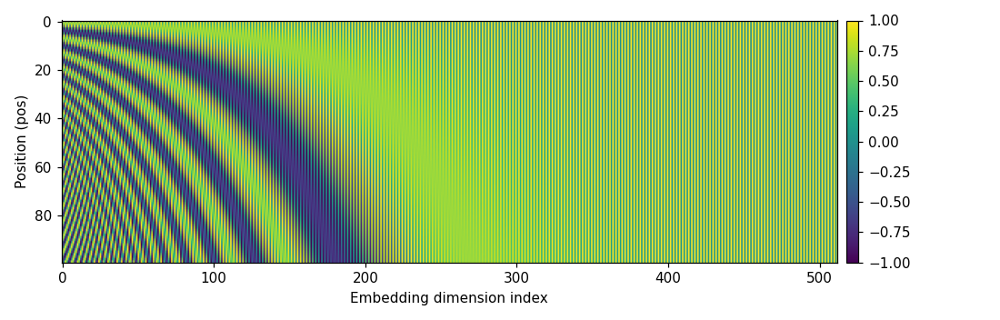

*그림 14. 문장 길이 100, 임베딩 차원 512인 위치 인코딩 행렬의 시각화*

그림 14의 가로축은 차원, 세로축은 위치이다. 왼쪽의 차원은 위치에 따라 빠르게 진동하여 촘촘한 줄무늬를 만들고, 오른쪽으로 갈수록 진동이 느려져 위치 100까지도 값이 거의 변하지 않는다(짝수 차원 sin은 0 근처, 홀수 차원 cos는 1 근처에 머문다). 이 그림은 다음 코드로 만든 위치 인코딩 행렬을 그린 것이다.

```python
import numpy as np

def positional_encoding(max_len, d_model):
    pos = np.arange(max_len)[:, None]                  # (max_len, 1) 위치 번호
    i = np.arange(d_model // 2)[None, :]               # (1, d_model/2) 차원 쌍의 번호
    angle = pos / np.power(10000, 2 * i / d_model)     # pos / 10000^(2i/d_model)
    pe = np.zeros((max_len, d_model))
    pe[:, 0::2] = np.sin(angle)                        # 짝수 차원에 sin
    pe[:, 1::2] = np.cos(angle)                        # 홀수 차원에 cos
    return pe

pe = positional_encoding(100, 512)
d = lambda a, b: np.linalg.norm(a - b)
print(round(d(pe[0], pe[1]), 3), round(d(pe[3], pe[4]), 3), round(d(pe[40], pe[41]), 3))
```

```text
3.714 3.714 3.714
```

`pos`는 (100, 1), `i`는 (1, 256) 모양이므로 나눗셈이 브로드캐스팅되어 `angle`은 (100, 256) 행렬이 된다. `pe[:, 0::2]`는 0, 2, 4, ...번째 열, `pe[:, 1::2]`는 1, 3, 5, ...번째 열을 뜻한다. 마지막 줄은 간격이 1인 세 쌍의 거리가 위치와 무관하게 같음을 보인다.

### 2.10 마스크드 멀티 헤드 어텐션

**마스크드 멀티 헤드 어텐션(masked multi-head attention)** 은 디코더에만 쓰이는 기법이다. 필요한 이유는 학습 방식에 있다.

> **용어 정의:** **교사 강요(teacher forcing)** 는 디코더를 학습할 때 이전 시점에 모델이 예측한 단어 대신 정답 단어를 다음 시점의 입력으로 넣는 방법이다. 앞에서 한 번 틀린 예측이 뒤로 계속 전파되는 것을 막아 학습을 빠르고 안정적으로 만든다.

Transformer는 seq2seq와 마찬가지로 교사 강요를 사용하여 훈련된다. 그런데 RNN 디코더는 단어를 한 시점씩 받으므로 미래의 정답을 볼 수 없었지만, Transformer의 디코더는 정답 문장 행렬 전체를 한 번에 받는다. 이대로 셀프 어텐션을 하면 "suis"를 예측해야 하는 위치가 이미 입력 행렬 안에 있는 "suis"와 "étudiant"를 참고하게 되어, 정답을 알고 예측하는 꼴이 된다. 따라서 **현재 시점 이후의 단어는 가린다(masking).**

구체적으로는 어텐션 스코어 행렬에서 각 쿼리보다 뒤에 있는 키의 칸을 $-\infty$(구현에서는 매우 큰 음수)로 바꾼 뒤 softmax를 적용한다. $e^{-\infty} = 0$이므로 가린 칸의 가중치는 0이 된다. 다음은 프랑스어 문장 `<sos> je suis étudiant`의 어텐션 스코어 행렬에서 가려지는 칸(■)을 나타낸 것이다.

```text
              키:  <sos>   je    suis  étudiant
쿼리 <sos>          □      ■      ■      ■
쿼리 je             □      □      ■      ■
쿼리 suis           □      □      □      ■
쿼리 étudiant       □      □      □      □
```

*그림 15. 디코더의 어텐션 스코어 행렬에서 미래 위치를 가리는 마스크(■는 $-\infty$로 가리는 칸)*

2.4절의 예제에 마스크를 적용하면 어텐션 분포는 다음과 같이 바뀐다. 첫 단어 I는 자기 자신만 볼 수 있으므로 가중치 1을 받고, am은 I와 am만, a는 I, am, a만 본다. 마지막 단어 student는 모든 단어를 볼 수 있으므로 표 3과 같다.

| 쿼리 \ 키 | I | am | a | student |
|:-----|:---:|:---:|:---:|:---:|
| I | 1.000 | 0 | 0 | 0 |
| am | 0.056 | 0.944 | 0 | 0 |
| a | 0.164 | 0.673 | 0.164 | 0 |
| student | 0.107 | 0.002 | 0.002 | 0.890 |

*표 7. 2.4절의 예제에 마스크를 적용한 어텐션 분포*

예를 들어 am 행의 점수는 $[0, 2.828]$만 남으므로 softmax는 $[1, 16.919] / 17.919 = [0.056, 0.944]$이다. 마스크 덕분에 학습할 때는 모든 위치를 병렬로 계산하면서도, 각 위치는 추론할 때처럼 자기 앞의 단어만 보고 다음 단어를 예측한다.

---

<br>

## 3. BERT와 GPT

Transformer의 인코더와 디코더는 따로 떼어서도 강력한 언어 모델이 된다. 디코더만 쓴 것이 GPT, 인코더만 쓴 것이 BERT이다. 두 모델 모두 레이블이 없는 대량의 텍스트로 먼저 **사전 학습(pre-training)** 을 하고, 구체적인 태스크의 데이터로 **미세 조정(fine-tuning)** 을 하는 방식을 널리 퍼뜨렸다.

### 3.1 GPT

**GPT(Generative Pre-trained Transformer)** 는 OpenAI가 2018년에 발표한 모델이다 [10]. 특징은 다음과 같다.

- **문장을 순차적으로 학습한다.** 왼쪽에서 오른쪽으로 단어를 읽는다.
- **이전 단어들을 기반으로 다음 단어를 예측한다.** "나는 어제 밥을 [ ]"에서 빈칸에 올 단어(예: "먹었다")를 맞히는 것이 학습 목표이다. 이러한 모델을 **자기회귀(autoregressive) 언어 모델**이라 한다.
- **인코더 없이 디코더만 활용한다.** 앞의 단어만 보아야 하므로 마스크드 셀프 어텐션을 쓰는 디코더가 알맞다. 인코더가 없으므로 인코더-디코더 어텐션도 없다.

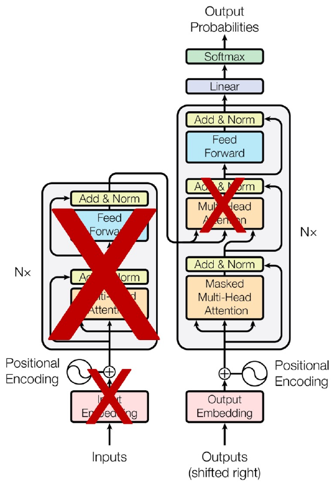

*그림 16. 인코더와 인코더-디코더 어텐션을 지우고 마스크드 멀티 헤드 어텐션을 쓰는 디코더만 남긴 GPT의 구조*

학습할 때의 손실은 각 위치에서 실제 다음 단어의 확률에 대한 교차 엔트로피, 즉 $-\sum_t \log P(w_t \mid w_1, \dots, w_{t-1})$이다. 사전 학습으로 언어의 일반적인 지식을 익힌 뒤, 분류나 함의 판단 같은 태스크에 맞게 입력 형식을 바꾸고 출력층을 붙여 미세 조정한다 [10].

### 3.2 BERT

**BERT(Bidirectional Encoder Representations from Transformers)** 는 Google이 2018년에 발표한 모델이다 [11]. **양방향으로 단어를 보고 빈칸을 예측한다.** "나는 어제 [ ] 먹었다."에서 빈칸의 앞("나는 어제")과 뒤("먹었다")를 모두 보고 "밥을" 같은 단어를 맞힌다. 앞뒤를 동시에 보아야 하므로 마스크 없는 셀프 어텐션을 쓰는 인코더만 쓴다.

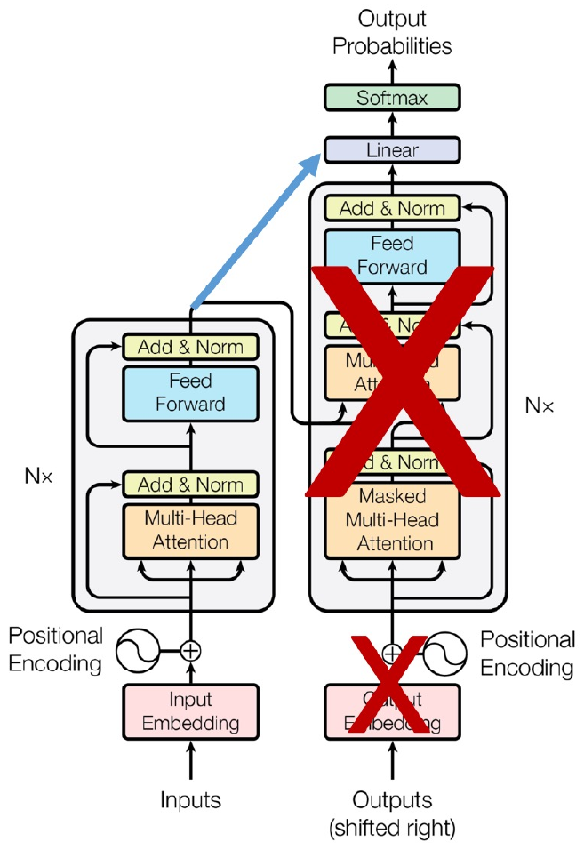

*그림 17. 디코더를 지우고 인코더만 남겨 그 출력을 바로 선형 층과 softmax로 보내는 BERT의 구조*

BERT의 사전 학습 태스크는 두 가지이다 [11].

- **마스크드 언어 모델(masked language model, MLM):** 입력 토큰의 15%를 골라 그 가운데 80%는 `[MASK]` 토큰으로, 10%는 무작위 토큰으로 바꾸고, 10%는 그대로 둔 뒤 원래 토큰을 맞힌다.
- **다음 문장 예측(next sentence prediction, NSP):** 두 문장을 이어 넣고 두 번째 문장이 실제로 첫 문장 다음에 오는 문장인지를 맞힌다.

GPT는 생성에 강하고, BERT는 문장 전체의 앞뒤 문맥을 보므로 분류, 개체명 인식, 질의응답 같은 이해 태스크에 강하다.

### 3.3 활용 방식과 모델 규모

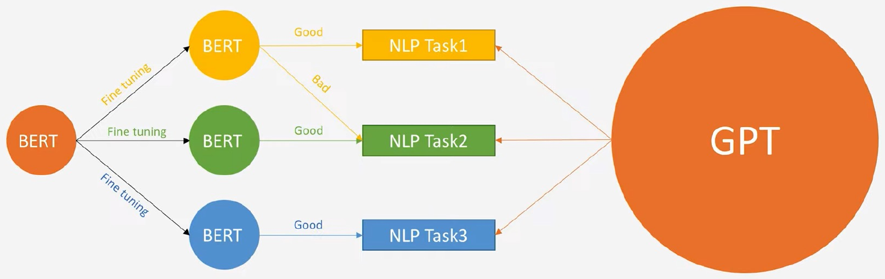

*그림 18. 사전 학습된 BERT를 태스크마다 따로 미세 조정해 쓰는 방식과 하나의 거대한 GPT로 여러 태스크를 처리하는 방식*

그림 18의 왼쪽처럼 BERT는 사전 학습된 모델 하나를 태스크마다 따로 미세 조정하여 태스크별 모델을 만든다. NLP Task1에 맞게 미세 조정한 BERT는 Task1에는 좋은 성능(Good)을 내지만 Task2에는 나쁜 성능(Bad)을 낸다. 오른쪽의 GPT는 모델을 매우 크게 키워, 하나의 모델이 여러 태스크를 함께 처리하는 방향으로 발전하였다. GPT-3는 미세 조정 없이 입력 문장 안에 태스크 설명과 몇 개의 예시만 넣어도 새 태스크를 수행할 수 있음을 보였다 [12].

GPT 계열의 규모는 세대마다 크게 늘었다 [10], [9], [12].

| 항목 | GPT-1 | GPT-2 | GPT-3 |
|:-----|:-----|:-----|:-----|
| 파라미터 수 | 1억 1,700만(117M) | 15억(1.5B) | 1,750억(175B) |
| 디코더 층 수 | 12 | 48 | 96 |
| 문맥 토큰 수 | 512 | 1,024 | 2,048 |
| 은닉 차원 | 768 | 1,600 | 12,288 |
| 배치 크기 | 64 | 512 | 3.2M |

*표 8. GPT-1, GPT-2, GPT-3의 규모 비교*

GPT-1과 GPT-2의 배치 크기는 시퀀스의 수(각각 512토큰, 1,024토큰 길이)이고, GPT-3의 3.2M은 한 번에 처리하는 토큰의 수이다. 비교를 위해 영상의 객체 탐지 모델(5강)의 파라미터 수를 보면 다음과 같다.

| 모델 | 파라미터 수(백만) |
|:-----|:---:|
| YOLOv5-M | 21.2 |
| YOLOv7 | 36.9 |
| YOLOv8-M | 25.9 |
| YOLOv9-M | 20.0 |

*표 9. YOLO 계열 모델의 파라미터 수*

YOLO 모델이 수천만 개 수준인 데 비해 GPT-3는 1,750억 개로 수천 배 크다. 이처럼 거대한 모델은 학습과 추론에 막대한 자원이 필요하며, 이 문제는 9강의 경량 모델로 이어진다.

---

<br>

## 4. ViT

**ViT(Vision Transformer)** 는 Transformer의 인코더를 이미지 분류에 그대로 적용한 모델이다 [13]. 핵심 아이디어는 이미지를 작은 조각(패치)으로 잘라 각 조각을 문장의 단어처럼 다루는 것이다. 논문의 제목 "An image is worth 16x16 words"가 이 생각을 나타낸다.

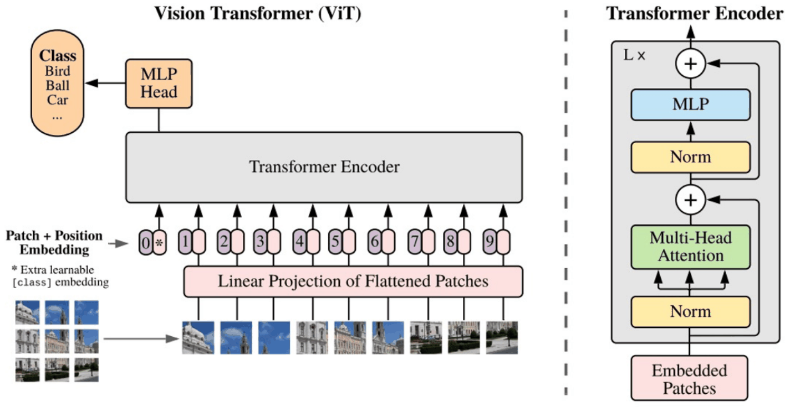

*그림 19. 이미지를 패치로 나누어 선형 투영과 위치 임베딩을 거쳐 Transformer 인코더에 넣고 클래스 토큰의 출력을 MLP 헤드로 분류하는 ViT의 구조*

처리 과정은 다음과 같다.

1. **패치 분할:** $224 \times 224$ 크기의 RGB 이미지를 $16 \times 16$ 크기의 패치로 자르면 $(224/16)^2 = 14 \times 14 = 196$개의 패치가 나온다.
2. **평탄화와 선형 투영(Linear Projection of Flattened Patches):** 각 패치의 화소 $16 \times 16 \times 3 = 768$개를 한 줄로 펴고, 학습되는 선형 층으로 $D$차원 벡터로 바꾼다. 이것이 단어 임베딩에 해당한다.
3. **클래스 토큰과 위치 임베딩(Patch + Position Embedding):** 맨 앞에 학습되는 특수 벡터 `[class]` 토큰(그림의 0*)을 붙이고, 패치의 위치 정보를 담은 위치 임베딩을 더한다. ViT의 위치 임베딩은 사인 함수가 아니라 학습되는 벡터이다.
4. **Transformer 인코더:** Norm, Multi-Head Attention, 잔차 연결(+), Norm, MLP, 잔차 연결로 이루어진 블록을 $L$번 쌓는다. 원래 Transformer와 달리 정규화가 하위 층 앞에 온다.
5. **MLP 헤드:** 인코더를 거친 `[class]` 토큰의 출력을 MLP 헤드에 넣어 Bird, Ball, Car 같은 클래스를 예측한다. 셀프 어텐션 덕분에 `[class]` 토큰은 모든 패치의 정보를 모아 이미지 전체를 요약한다.

ViT-Base는 층 12개, 은닉 차원 768, 헤드 12개로 약 8,600만 개의 파라미터를 갖는다 [13]. CNN은 이웃한 화소가 관련 있다는 가정(지역성)이 구조에 들어 있지만 ViT에는 그런 가정이 적으므로, ImageNet 정도의 데이터로만 학습하면 비슷한 크기의 ResNet보다 조금 낮은 성능을 보인다. 그러나 수억 장 규모의 데이터로 사전 학습하면 최고 수준의 CNN과 같거나 더 나은 성능을 더 적은 학습 자원으로 얻는다 [13].

---

<br>

## 개념 적용

**T/F 점검:**

| 문장 | 판단과 근거 |
|:-----|:-----|
| 어텐션을 쓰는 seq2seq의 디코더는 출력 시점마다 같은 컨텍스트 벡터를 쓴다. | **F.** 어텐션 가중치를 시점마다 다시 계산하므로 컨텍스트 벡터도 출력 시점마다 달라진다. 고정된 하나의 컨텍스트 벡터를 쓰는 것은 어텐션이 없는 seq2seq이다. |
| 스케일드 닷-프로덕트 어텐션에서 $\sqrt{d_k}$로 나누는 것은 softmax가 포화되어 기울기가 작아지는 것을 막기 위해서이다. | **T.** 차원이 클수록 내적의 분산이 $d_k$로 커져 softmax가 한 위치에 쏠리므로, $\sqrt{d_k}$로 나누어 분산을 1로 맞춘다. |
| 멀티 헤드 어텐션의 출력 크기는 헤드 수에 비례하여 커진다. | **F.** 헤드마다 $d_k = d_{\text{model}}/h$차원의 결과를 내고 이어 붙이므로 출력은 다시 $d_{\text{model}}$차원이다. 입력과 출력의 크기가 같아 층을 $N$번 쌓을 수 있다. |
| 사인과 코사인 위치 인코딩에서 위치 $x$와 $x + t$ 사이의 거리는 $x$에 따라 달라진다. | **F.** 위치 차이 $t$는 각 차원 쌍에서 각 $\omega_i t$의 회전에 해당하므로 거리 $\sqrt{\sum_i (2 - 2\cos\omega_i t)}$는 $x$와 무관하다. |
| BPE는 학습 데이터에 없던 단어도 학습한 병합 규칙을 적용해 서브워드로 나눌 수 있다. | **T.** 단어를 글자로 나눈 뒤 학습한 병합을 순서대로 적용하면 된다. lowest는 low와 est로 나뉜다. |
| BERT는 디코더만, GPT는 인코더만 사용한다. | **F.** 반대이다. BERT는 양방향 문맥을 보는 인코더만, GPT는 앞의 단어만 보는 마스크드 셀프 어텐션의 디코더만 사용한다. |

---

<br>

## 요약

| 개념 | 핵심 요약 |
|:-----|:-----|
| Seq2seq | 인코더 RNN이 입력을 컨텍스트 벡터로 압축하고 디코더 RNN이 `<sos>`부터 `<eos>`까지 출력을 생성한다. 고정 크기 벡터로 인한 정보 손실과 기울기 소실이 문제이다. |
| 어텐션 | 출력 시점마다 디코더 상태와 모든 인코더 은닉 상태의 점수를 softmax로 가중치로 바꾸고, 가중합으로 그 시점의 컨텍스트 벡터를 만든다. |
| Transformer | RNN 없이 어텐션만으로 만든 인코더-디코더 모델이다. 임베딩과 위치 인코딩 위에 멀티 헤드 어텐션, 피드 포워드, Add & Norm으로 이루어진 층을 $N$번 쌓는다. |
| 셀프 어텐션 | 한 시퀀스 안에서 단어마다 쿼리, 키, 밸류를 만들어 모든 단어 쌍의 관련도를 계산한다. 행렬 연산으로 모든 위치를 병렬 처리한다. |
| 스케일드 닷-프로덕트 어텐션 | $\mathrm{softmax}(QK^T/\sqrt{d_k})V$이다. $\sqrt{d_k}$로 나누어 내적의 분산을 1로 맞추고 softmax의 포화를 막는다. |
| 멀티 헤드 어텐션 | $d_k = d_{\text{model}}/h$차원의 어텐션을 $h$번 수행하고 이어 붙여 $W^O$를 곱한다. 헤드마다 다른 관계에 주목하며, 입력과 출력의 크기가 같다. |
| 잔차 연결과 층 정규화 | 하위 층마다 $\mathrm{LayerNorm}(\mathbf{x} + \mathrm{Sublayer}(\mathbf{x}))$를 계산한다. 디코더 중간의 어텐션은 쿼리를 디코더에서, 키와 밸류를 인코더에서 가져온다. |
| 임베딩 층 | 단어를 정수로 바꾸고 룩업 테이블의 행을 읽는다. 룩업 테이블은 전체 모델과 함께 학습된다. |
| BPE | 가장 자주 이웃하는 기호 쌍을 반복해서 병합해 서브워드 어휘를 만든다. OOV 단어도 학습한 병합으로 서브워드로 나눈다. |
| 위치 인코딩 | 주파수가 다른 사인과 코사인을 임베딩에 더한다. 값이 제한되고 위치마다 고유하며, 위치 차이에 따른 거리가 위치와 무관하다. |
| 마스크드 멀티 헤드 어텐션 | 교사 강요로 정답 문장 전체를 받는 디코더가 미래 단어를 보지 못하도록 스코어 행렬의 위쪽 삼각 부분을 $-\infty$로 가린다. |
| BERT와 GPT | GPT는 디코더만 써서 이전 단어로 다음 단어를 예측하고, BERT는 인코더만 써서 양방향 문맥으로 가린 단어를 예측한다. GPT는 규모를 키워 하나의 모델로 여러 태스크를 처리한다. |
| ViT | 이미지를 $16 \times 16$ 패치로 잘라 단어처럼 임베딩하고, 클래스 토큰과 위치 임베딩을 더해 Transformer 인코더로 분류한다. |

---

<br>

## 점검 문제

1. **Seq2seq의 한계:** 어텐션이 없는 seq2seq에서 입력 문장이 길어질수록 번역 품질이 떨어지는 이유를 두 가지 쓰라.

   <details>
   <summary>정답</summary>

   첫째, 입력 전체를 고정된 크기의 컨텍스트 벡터 하나에 압축해야 하므로 문장이 길수록 정보가 손실된다. 둘째, 앞쪽 단어의 정보와 기울기가 많은 시점을 거쳐 전달되면서 약해지는 기울기 소실이 일어난다.

   </details>

2. **어텐션 값:** 인코더 은닉 상태가 $\mathbf{h}_1 = [1, 0]$, $\mathbf{h}_2 = [0, 1]$이고 어텐션 가중치가 $0.8$, $0.2$일 때 컨텍스트 벡터를 구하라.

   <details>
   <summary>정답</summary>

   $0.8 \times [1, 0] + 0.2 \times [0, 1] = [0.8, 0.2]$이다. 가중치가 큰 첫 시점의 정보가 주로 반영된다.

   </details>

3. **스케일링:** $d_k = 16$이고 쿼리와 두 키의 내적이 $[8, 0]$일 때, 스케일링한 점수와 softmax 분포를 구하라.

   <details>
   <summary>정답</summary>

   $\sqrt{16} = 4$로 나누면 점수는 $[2, 0]$이다. softmax는 $[e^2, e^0] / (e^2 + 1) = [7.389, 1] / 8.389 \approx [0.881, 0.119]$이다. 나누지 않았다면 $[e^8, 1] / (e^8 + 1) \approx [0.9997, 0.0003]$으로 거의 포화되었을 것이다.

   </details>

4. **셀프 어텐션 계산:** 2.4절의 예제에서 단어 am의 어텐션 분포 $[0.050, 0.849, 0.050, 0.050]$이 나오는 과정을 보여라.

   <details>
   <summary>정답</summary>

   am의 쿼리 $[0, 2]$와 키 $[2, 0]$, $[0, 2]$, $[0, 0]$, $[3, 0]$의 내적은 $[0, 4, 0, 0]$이고, $\sqrt{2}$로 나누면 $[0, 2.828, 0, 0]$이다. 지수는 $[1, 16.919, 1, 1]$, 합은 $19.919$이므로 분포는 $[0.050, 0.849, 0.050, 0.050]$이다.

   </details>

5. **멀티 헤드 어텐션의 크기:** $d_{\text{model}} = 768$, 헤드 12개일 때 헤드 하나의 $d_k$와, 길이 10인 문장에서 이어 붙인 행렬의 크기를 구하라.

   <details>
   <summary>정답</summary>

   $d_k = 768 / 12 = 64$이다. 헤드마다 $10 \times 64$ 행렬이 나오고, 12개를 이어 붙이면 $10 \times 768$로 입력과 같은 크기가 된다.

   </details>

6. **BPE:** 단어 빈도가 {hug: 10, pug: 5, hugs: 5}이고 글자 단위로 시작할 때, 첫 병합에서 선택되는 쌍과 그 등장 횟수를 구하라.

   <details>
   <summary>정답</summary>

   (h, u)는 hug 10 + hugs 5 = 15, (u, g)는 hug 10 + pug 5 + hugs 5 = 20, (p, u)는 5, (g, s)는 5이다. 가장 많은 (u, g)가 20번으로 선택되어 ug가 된다.

   </details>

7. **위치 인코딩:** 0\~1로 정규화하는 위치 표현과 이진수 위치 표현은 각각 위치 인코딩의 어떤 조건을 어기는가?

   <details>
   <summary>정답</summary>

   0\~1 정규화는 같은 위치라도 문장 길이에 따라 값이 달라지므로(4개 단어에서 두 번째 위치는 0.33, 5개 단어에서는 0.25) "같은 위치는 같은 값" 조건을 어긴다. 이진수는 위치 0과 1의 거리가 1, 위치 3과 4의 거리가 $\sqrt{3}$으로 달라 "같은 간격은 같은 거리" 조건을 어긴다.

   </details>

8. **마스크:** 디코더 입력이 `<sos>`, A, B일 때 마스크를 적용한 어텐션에서 B 위치의 쿼리가 볼 수 있는 키와, A 위치의 점수가 $[1, 1, 5]$일 때의 분포를 구하라.

   <details>
   <summary>정답</summary>

   B 위치는 `<sos>`, A, B를 모두 볼 수 있다. A 위치는 B를 볼 수 없으므로 점수의 세 번째 칸이 $-\infty$가 되어 남은 $[1, 1]$에 softmax를 적용하면 $[0.5, 0.5, 0]$이다.

   </details>

9. **BERT와 GPT:** "나는 어제 [ ] 먹었다."의 빈칸을 맞히는 태스크와 "나는 어제 밥을 [ ]"의 빈칸을 맞히는 태스크는 각각 어느 모델의 사전 학습 방식에 해당하며, 그 차이는 구조에 어떻게 반영되는가?

   <details>
   <summary>정답</summary>

   앞뒤 문맥을 모두 쓰는 첫 번째 태스크는 BERT의 마스크드 언어 모델이고, 앞의 단어만 쓰는 두 번째 태스크는 GPT의 다음 단어 예측이다. 그래서 BERT는 마스크 없이 양방향으로 보는 인코더를, GPT는 미래 단어를 가리는 마스크드 셀프 어텐션의 디코더를 쓴다.

   </details>

10. **ViT:** $384 \times 384$ RGB 이미지를 $16 \times 16$ 패치로 나누면 패치는 몇 개이며, 클래스 토큰을 포함한 Transformer 입력 시퀀스의 길이는 얼마인가?

    <details>
    <summary>정답</summary>

    $384 / 16 = 24$이므로 패치는 $24 \times 24 = 576$개이고, 클래스 토큰 1개를 더하면 시퀀스 길이는 577이다. 각 패치를 펼친 벡터는 $16 \times 16 \times 3 = 768$차원이다.

    </details>

---

<br>

## 참고 문헌

1. I. Sutskever, O. Vinyals, and Q. V. Le, "Sequence to sequence learning with neural networks," in *Advances in Neural Information Processing Systems (NIPS)*, vol. 27, pp. 3104-3112, 2014.
2. Y. Bengio, P. Simard, and P. Frasconi, "Learning long-term dependencies with gradient descent is difficult," *IEEE Transactions on Neural Networks*, vol. 5, no. 2, pp. 157-166, 1994.
3. D. Bahdanau, K. Cho, and Y. Bengio, "Neural machine translation by jointly learning to align and translate," in *Proc. International Conference on Learning Representations (ICLR)*, 2015.
4. A. Vaswani, N. Shazeer, N. Parmar, J. Uszkoreit, L. Jones, A. N. Gomez, Ł. Kaiser, and I. Polosukhin, "Attention is all you need," in *Advances in Neural Information Processing Systems (NIPS)*, vol. 30, pp. 5998-6008, 2017.
5. K. He, X. Zhang, S. Ren, and J. Sun, "Deep residual learning for image recognition," in *Proc. IEEE Conference on Computer Vision and Pattern Recognition (CVPR)*, pp. 770-778, 2016.
6. J. L. Ba, J. R. Kiros, and G. E. Hinton, "Layer normalization," arXiv:1607.06450, 2016.
7. P. Gage, "A new algorithm for data compression," *The C Users Journal*, vol. 12, no. 2, pp. 23-38, 1994.
8. R. Sennrich, B. Haddow, and A. Birch, "Neural machine translation of rare words with subword units," in *Proc. 54th Annual Meeting of the Association for Computational Linguistics (ACL)*, pp. 1715-1725, 2016.
9. A. Radford, J. Wu, R. Child, D. Luan, D. Amodei, and I. Sutskever, "Language models are unsupervised multitask learners," OpenAI Technical Report, 2019.
10. A. Radford, K. Narasimhan, T. Salimans, and I. Sutskever, "Improving language understanding by generative pre-training," OpenAI Technical Report, 2018.
11. J. Devlin, M.-W. Chang, K. Lee, and K. Toutanova, "BERT: Pre-training of deep bidirectional transformers for language understanding," in *Proc. NAACL-HLT*, pp. 4171-4186, 2019.
12. T. B. Brown et al., "Language models are few-shot learners," in *Advances in Neural Information Processing Systems (NeurIPS)*, vol. 33, pp. 1877-1901, 2020.
13. A. Dosovitskiy et al., "An image is worth 16x16 words: Transformers for image recognition at scale," in *Proc. International Conference on Learning Representations (ICLR)*, 2021.
