# Lecture 8 — Natural Language Processing 2

[Repository Guide](../../README.md) | [English](Concepts_Lecture.md) | [한국어](Concepts_Lecture.ko.md)

> **Last Updated:** 2026-11-04

> **Learning Objectives:**
> 1. Explain the seq2seq encoder-decoder structure and the limitation of a fixed-size context vector, and explain how attention resolves it
> 2. Explain the roles of the components of the Transformer (embedding layer, positional encoding, multi-head attention, feed-forward network, residual connection and layer normalization)
> 3. Compute scaled dot-product self-attention with queries, keys, and values by hand on a small example
> 4. Carry out the construction of a subword vocabulary with BPE, and explain the conditions satisfied by sine and cosine positional encoding
> 5. Explain why the decoder's masked multi-head attention is needed in teacher-forcing training
> 6. Explain the differences in structure and training between BERT and GPT, and how ViT processes images with a Transformer

---

## Table of Contents

- [1. Seq2seq and Attention](#1-seq2seq-and-attention)
  - [1.1 The Seq2seq Model](#11-the-seq2seq-model)
  - [1.2 Limitations of Seq2seq](#12-limitations-of-seq2seq)
  - [1.3 Attention](#13-attention)
- [2. Transformer](#2-transformer)
  - [2.1 Overall Architecture](#21-overall-architecture)
  - [2.2 Self-Attention and Query, Key, Value](#22-self-attention-and-query-key-value)
  - [2.3 Scaled Dot-Product Attention](#23-scaled-dot-product-attention)
  - [2.4 A Worked Self-Attention Example](#24-a-worked-self-attention-example)
  - [2.5 Multi-Head Attention](#25-multi-head-attention)
  - [2.6 Residual Connection, Layer Normalization, and the Feed-Forward Network](#26-residual-connection-layer-normalization-and-the-feed-forward-network)
  - [2.7 Embedding Layer](#27-embedding-layer)
  - [2.8 Byte Pair Encoding (BPE)](#28-byte-pair-encoding-bpe)
  - [2.9 Positional Encoding](#29-positional-encoding)
  - [2.10 Masked Multi-Head Attention](#210-masked-multi-head-attention)
- [3. BERT and GPT](#3-bert-and-gpt)
  - [3.1 GPT](#31-gpt)
  - [3.2 BERT](#32-bert)
  - [3.3 Usage and Model Scale](#33-usage-and-model-scale)
- [4. ViT](#4-vit)
- [Concept Applications](#concept-applications)
- [Summary](#summary)
- [Self-Check Questions](#self-check-questions)
- [References](#references)

---

<br>

## 1. Seq2seq and Attention

### 1.1 The Seq2seq Model

The representative architecture for problems such as translation, where both the input and the output are sequences whose lengths may differ, is the **seq2seq (sequence to sequence)** model [1]. Seq2seq consists of two parts.

- **Encoder:** An RNN (usually an LSTM) that reads the words of the input sentence one at a time. Its hidden state at the last time step becomes the **context vector**, which compresses the information of the whole sentence.
- **Decoder:** An RNN that receives the context vector as its initial state and generates the words of the output sentence one at a time.

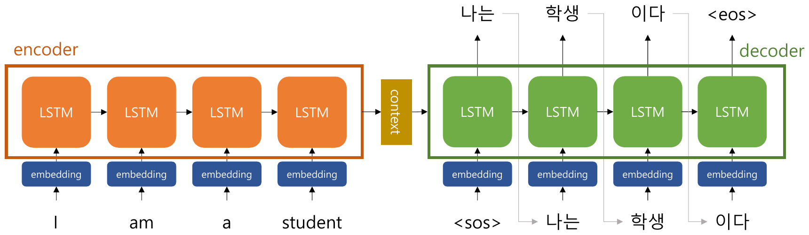

*Figure 1. An LSTM encoder that reads the English sentence I am a student and an LSTM decoder that receives the context vector and generates 나는 학생 이다*

In Figure 1, the encoder feeds the embeddings of I, am, a, and student into the LSTM in order. The decoder receives the special token `<sos>` (start of sequence), which marks the start of a sentence, as its first input and outputs "나는" (I), then receives that output as the next input and outputs "학생" (student), and so on, stopping when it outputs `<eos>` (end of sequence), which marks the end of a sentence. The Korean output "나는 학생 이다" is the translation of "I am a student".

### 1.2 Limitations of Seq2seq

Seq2seq has two main problems.

- **Information loss:** All information must be compressed into one fixed-size context vector regardless of the input length, so information is lost as sentences grow longer.
- **Vanishing gradient:** For a long input, the information and gradients of early words must pass through many time steps and weaken along the way [2]. LSTMs mitigate this but do not eliminate it.

### 1.3 Attention

> **Definition:** **Attention** is a technique that, each time an output is produced, gives more weight to specific parts of the input sequence so that the model makes more accurate predictions.

Because all information of the input sequence cannot be held in a fixed-size vector, attention arose from the idea that each time the decoder outputs a word, it should look again at the encoder's hidden states at all time steps and give larger weight to the parts needed now, reflecting more information [3].

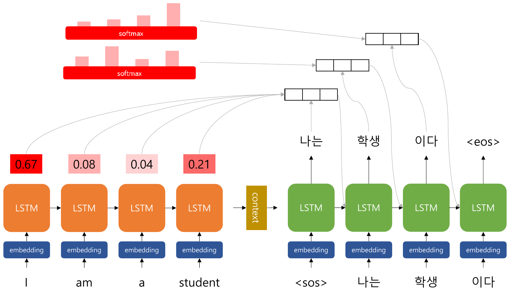

*Figure 2. The attention weights the decoder gives to each encoder time step when outputting "나는" (I 0.67, am 0.08, a 0.04, student 0.21), and the softmax distributions recomputed at every time step*

The decoder produces its $t$-th output as follows. Let $`\mathbf{h}_1, \dots, \mathbf{h}_n`$ be the encoder's hidden states at each time step and $`\mathbf{s}_t`$ the decoder's current state.

1. **Attention score:** Compute a score $`e_{t,i} = \mathrm{score}(\mathbf{s}_t, \mathbf{h}_i)`$ for how related the decoder state is to each encoder hidden state. A dot product or a small neural network serves as the score function.
2. **Attention distribution:** Apply softmax to the scores to obtain weights that sum to 1, $`\alpha_{t,i} = \mathrm{softmax}(e_{t,\cdot})_i`$.
3. **Attention value:** Compute the weighted sum of the encoder hidden states, $`\mathbf{c}_t = \sum_i \alpha_{t,i} \mathbf{h}_i`$. This vector is the context vector for the $t$-th output and is used together with the decoder state to predict the next word.

In the example of Figure 2, when outputting "나는" (I), the weight on I is the largest at 0.67, followed by student 0.21, am 0.08, and a 0.04. At this step the decoder mostly consults the information of I to produce "나는". As the several softmax bars at the top of the figure show, the weights are recomputed at every output step, so when outputting "학생" (student) the decoder can give a large weight to student. Because the context vector differs at every step, there is no need to fit all information into one fixed-size vector, and the shorter path from output to input also lets gradients flow well.

---

<br>

## 2. Transformer

### 2.1 Overall Architecture

The **Transformer** is the model introduced in the paper "Attention is all you need" published by Google researchers in 2017 [4]. It follows the encoder-decoder structure of seq2seq but, as the title of the paper says, is built **with attention alone**, without RNNs. Most large models since, such as BERT, GPT, and ViT, are built on the Transformer, and the model is regarded as a game changer that shifted the course of the field.

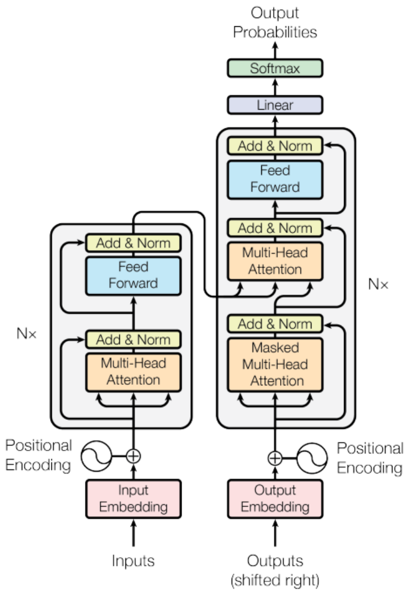

*Figure 3. The overall architecture of the Transformer, with the encoder on the left and the decoder on the right, each stacked N times*

The components of Figure 3, from bottom to top, are summarized below. The original paper stacks $N = 6$ encoder layers and $N = 6$ decoder layers and uses the same vector dimension $d_{\text{model}} = 512$ in every layer.

| Component | Location | Role | Section |
|:-----|:-----|:-----|:-----|
| Input Embedding, Output Embedding | Inputs of the encoder and decoder | Turns tokens into $d_{\text{model}}$-dimensional vectors | Section 2.7 |
| Positional Encoding | Right after the embedding | Adds word order information | Section 2.9 |
| Multi-Head Attention | Encoder | Computes the relatedness among words within the input sentence (self-attention) | Sections 2.2-2.5 |
| Masked Multi-Head Attention | Decoder | Performs self-attention only among words already generated | Section 2.10 |
| Multi-Head Attention | Middle of the decoder | Lets the decoder consult the encoder output (encoder-decoder attention) | Section 2.6 |
| Feed Forward | Encoder and decoder | Applies the same two-layer network at each position | Section 2.6 |
| Add & Norm | After every sublayer | Residual connection and layer normalization | Section 2.6 |
| Linear, Softmax | Output of the decoder | Produces the probability distribution of the next word | Section 2.6 |

*Table 1. Components of the Transformer and their roles*

The decoder input "Outputs (shifted right)" is the target sentence shifted one position to the right, that is, the sequence with `<sos>` prepended. This makes each position predict the word that immediately follows it.

### 2.2 Self-Attention and Query, Key, Value

> **Definition:** **Self-attention** is a mechanism that computes the relative importance among the elements at each position **within a given input sequence**. Through it, one can express how much each position of the input sequence is related to the other positions.

Whereas the attention of Section 1.3 has the decoder look at the encoder, self-attention has a sentence look at itself. For example, when processing "it" in "The animal did not cross the street because it was too tired", self-attention can give a large weight to "animal" and thereby reflect in the vector what "it" refers to. The Multi-Head Attention of the encoder in Figure 3 is self-attention.

Self-attention creates three vectors from each word's vector.

- **Query (Q):** A vector made from the word at the current position, used to measure relevance against the key vectors of other positions. It expresses which information at other positions the word at a given position is interested in.
- **Key (K):** A vector made from the word at each position of the input sequence, used to compute relevance against the query vector. The dot product of a query and a key becomes the relevance score.
- **Value (V):** A vector representing the information held by the word at each position, used to compute the weighted average based on the attention scores. How much of each position's information is reflected is determined by that position's weight.

In a library-search analogy, the query is the search phrase describing what one wants to find, the key is the index term attached to each book, and the value is the actual content of the book. The better a book's index term matches the search phrase, the more of its content is retrieved.

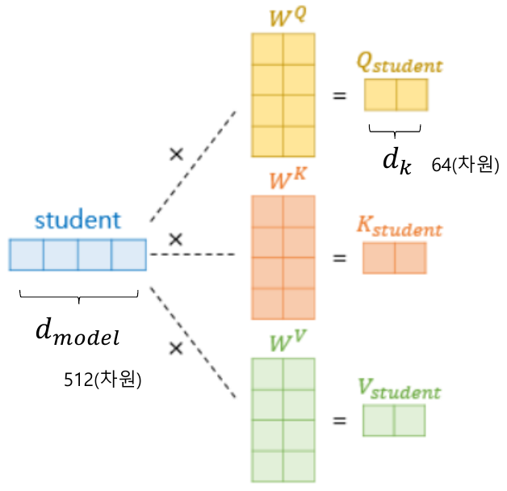

*Figure 4. Multiplying the 512-dimensional word vector student by the weight matrices W^Q, W^K, W^V to make 64-dimensional Q, K, V vectors*

As in Figure 4, the Q, K, and V vectors are obtained by multiplying the word vector $\mathbf{x}$ by learned weight matrices $W^Q$, $W^K$, and $W^V$. In the original paper, word vectors have $d_{\text{model}} = 512$ dimensions and the weight matrices are $512 \times 64$, so Q, K, and V have $d_k = 64$ dimensions (the label 차원 in the figure means "dimensions").

```math
\mathbf{q} = \mathbf{x} W^Q, \qquad \mathbf{k} = \mathbf{x} W^K, \qquad \mathbf{v} = \mathbf{x} W^V
```

### 2.3 Scaled Dot-Product Attention

The attention function used by the Transformer is **scaled dot-product attention**.

```math
\mathrm{Attention}(Q, K, V) = \mathrm{softmax}\left(\frac{Q K^T}{\sqrt{d_k}}\right) V
```

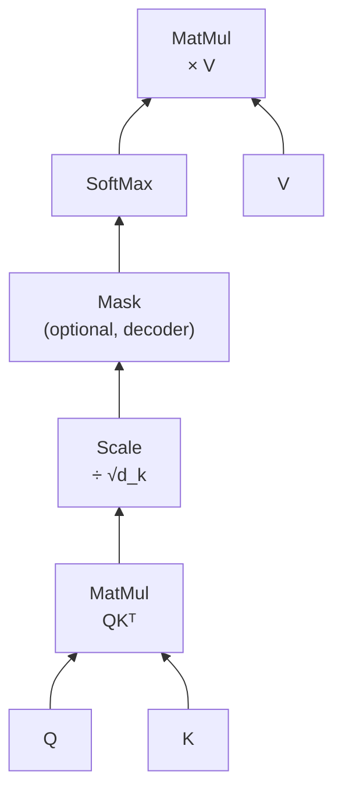

*Figure 5. The order of computation in scaled dot-product attention*

The computation for the word 'I' proceeds step by step as follows. The sentence is "I am a student".

1. **Attention score:** The query vector of 'I', $`\mathbf{q}_I`$, takes the dot product with the key vectors of all words. For example, let $`\mathbf{q}_I \cdot \mathbf{k}_I = 128`$, $`\mathbf{q}_I \cdot \mathbf{k}_{am} = 32`$, $`\mathbf{q}_I \cdot \mathbf{k}_a = 32`$, and $`\mathbf{q}_I \cdot \mathbf{k}_{student} = 128`$.
2. **Scaling:** The variance of dot products grows in proportion to the vector dimension $d_k$ (explained below), so for stable training they are divided by $\sqrt{d_k}$. With $d_k = 64$, $\sqrt{d_k} = 8$, so the scores become $128/8 = 16$, $32/8 = 4$, $4$, and $16$. Because of this rescaling, it is called "scaled" dot-product attention.
3. **Attention distribution:** Apply softmax to the scores to obtain the **attention distribution**, which sums to 1.
4. **Attention value:** Take the weighted sum of each word's value vector with the attention distribution to obtain the **attention value**. It is also called the context vector for the word 'I'.

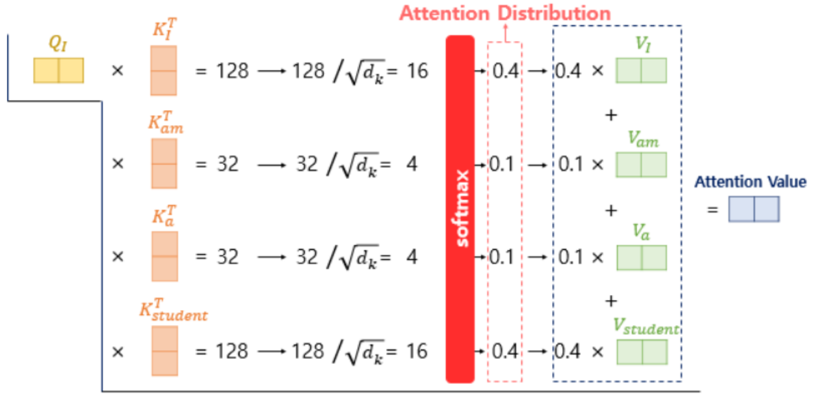

*Figure 6. Computing the scores of the query of I against the four keys (16, 4, 4, 16) and taking the weighted sum of the values with the softmax distribution (0.4, 0.1, 0.1, 0.4)*

In Figure 6, the attention value is $`0.4\,\mathbf{v}_I + 0.1\,\mathbf{v}_{am} + 0.1\,\mathbf{v}_a + 0.4\,\mathbf{v}_{student}`$. The information of I and student, which are strongly related to 'I', is mainly reflected.

> **Note:** The distribution in Figure 6 (0.4, 0.1, 0.1, 0.4) is illustrative, showing the tendency. Actually applying softmax to the scores $[16, 4, 4, 16]$ gives about $[0.5, 0.000003, 0.000003, 0.5]$, because $e^{16}$ is about 160,000 times larger than $e^{4}$. Even after division by $\sqrt{d_k}$, a score gap of 12 makes softmax put almost all the weight on the largest scores, and the unscaled gap of 96 would be far more extreme. This saturation of softmax as score gaps grow is exactly the reason for the scaling explained next.

**Why divide by $\sqrt{d_k}$.** If each component of the query and the key is an independent random variable with mean 0 and variance 1, the dot product $\mathbf{q} \cdot \mathbf{k} = \sum_{i=1}^{d_k} q_i k_i$ has variance $d_k$ [4]. With $d_k = 64$, the standard deviation of the dot product is 8, so differences among scores become large and the softmax output saturates, giving almost 1 to a single position. A saturated softmax has gradients near 0, which hampers training. Dividing by $\sqrt{d_k}$ brings the variance of the scores back to 1, so softmax keeps a reasonably spread distribution.

> **[Probability and Statistics]** For independent random variables $q$ and $k$ with mean 0, the variance of their product is $\mathrm{Var}(qk) = E[q^2]E[k^2] = \mathrm{Var}(q)\mathrm{Var}(k)$. The variance of a sum of independent random variables is the sum of their variances, so the dot product, a sum of $d_k$ products of variance-1 components, has variance $d_k$. Dividing a random variable by a constant $c$ divides its variance by $c^2$, so the score divided by $\sqrt{d_k}$ has variance 1.

**Matrix operations and parallel processing.** In practice, the computation is not done word by word but at once with the matrix $X$ ($`\text{seq\_len} \times d_{\text{model}}`$) whose rows are the word vectors of the sentence. $Q = XW^Q$, $K = XW^K$, and $V = XW^V$ are each $`\text{seq\_len} \times d_k`$ matrices, and $QK^T$ is a $`\text{seq\_len} \times \text{seq\_len}`$ matrix holding the scores of all word pairs. Applying softmax row by row and multiplying by $V$ yields the **attention value matrix**, which holds the attention values of all words.

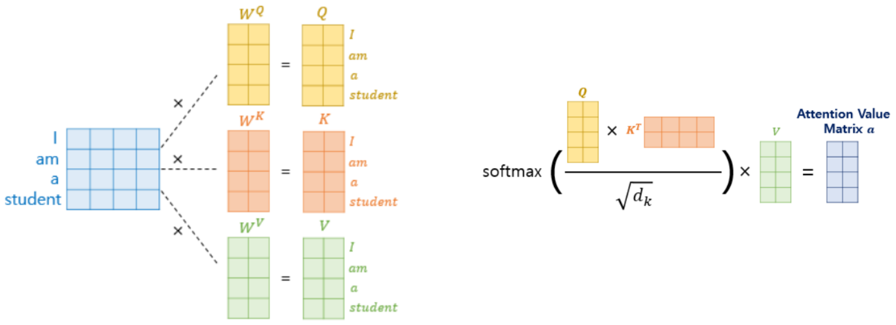

*Figure 7. The matrix computation that multiplies the sentence matrix by W^Q, W^K, W^V to make the Q, K, V matrices and obtains the attention value matrix at once as softmax(QK^T/√d_k)V*

An RNN needs the hidden state of the previous time step to compute the next one, so it had to process words one at a time in order. Self-attention computes all positions simultaneously with a single matrix multiplication, so a major advantage is that **parallel processing is possible** on a GPU.

### 2.4 A Worked Self-Attention Example

The whole of self-attention is computed by hand with small numbers. The sentence is "I am a student", with $d_{\text{model}} = 4$ and $d_k = 2$. The matrix $X$, whose rows are the word vectors, and the weight matrices are as follows (in reality these are learned values, but integers are used here so that the computation is easy to follow).

```math
X = \begin{bmatrix} 1 & 0 & 1 & 0 \\ 0 & 2 & 0 & 0 \\ 0 & 0 & 0 & 1 \\ 1 & 0 & 2 & 0 \end{bmatrix}
\begin{matrix} \leftarrow \text{I} \\ \leftarrow \text{am} \\ \leftarrow \text{a} \\ \leftarrow \text{student} \end{matrix}, \quad
W^Q = \begin{bmatrix} 1 & 0 \\ 0 & 1 \\ 1 & 0 \\ 0 & 1 \end{bmatrix}, \quad
W^K = \begin{bmatrix} 1 & 0 \\ 0 & 1 \\ 1 & 0 \\ 0 & 0 \end{bmatrix}, \quad
W^V = \begin{bmatrix} 1 & 0 \\ 0 & 1 \\ 0 & 1 \\ 1 & 0 \end{bmatrix}
```

**Step 1: Q, K, V.** For example, the query of I is $[1, 0, 1, 0] W^Q = [1 + 1, 0 + 0] = [2, 0]$. Computing the rest in the same way gives the following.

| Word | $\mathbf{q}$ | $\mathbf{k}$ | $\mathbf{v}$ |
|:-----|:-----|:-----|:-----|
| I | [2, 0] | [2, 0] | [1, 1] |
| am | [0, 2] | [0, 2] | [0, 2] |
| a | [0, 1] | [0, 0] | [1, 0] |
| student | [3, 0] | [3, 0] | [1, 2] |

*Table 2. Query, key, and value vectors of the example sentence*

**Step 2: Scores and scaling.** The dot products of the query of I, $[2, 0]$, with each key are $[2, 0] \cdot [2, 0] = 4$, $[2, 0] \cdot [0, 2] = 0$, $[2, 0] \cdot [0, 0] = 0$, and $[2, 0] \cdot [3, 0] = 6$. Dividing by $\sqrt{2} \approx 1.414$ gives $[2.828, 0, 0, 4.243]$.

**Step 3: Softmax.** $e^{2.828} \approx 16.919$, $e^{0} = 1$, $e^{0} = 1$, and $e^{4.243} \approx 69.591$, whose sum is $88.510$. Dividing each value by the sum gives the attention distribution of I, $[0.191, 0.011, 0.011, 0.786]$.

**Step 4: Attention value.** $0.191 \times [1, 1] + 0.011 \times [0, 2] + 0.011 \times [1, 0] + 0.786 \times [1, 2] \approx [0.989, 1.786]$. The new vector of I holds mostly the value of student.

The results of the same computation for all four words are as follows. Each row is the attention distribution of one word (query), and each row sums to 1.

| Query \ Key | I | am | a | student | Attention value |
|:-----|:---:|:---:|:---:|:---:|:-----|
| I | 0.191 | 0.011 | 0.011 | 0.786 | [0.989, 1.786] |
| am | 0.050 | 0.849 | 0.050 | 0.050 | [0.151, 1.849] |
| a | 0.141 | 0.578 | 0.141 | 0.141 | [0.422, 1.578] |
| student | 0.107 | 0.002 | 0.002 | 0.890 | [0.998, 1.890] |

*Table 3. The attention distribution matrix and attention values of the example sentence*

The following code performs the same computation with NumPy.

```python
import numpy as np

X = np.array([[1, 0, 1, 0],    # I
              [0, 2, 0, 0],    # am
              [0, 0, 0, 1],    # a
              [1, 0, 2, 0]])   # student
W_Q = np.array([[1, 0], [0, 1], [1, 0], [0, 1]])
W_K = np.array([[1, 0], [0, 1], [1, 0], [0, 0]])
W_V = np.array([[1, 0], [0, 1], [0, 1], [1, 0]])

Q, K, V = X @ W_Q, X @ W_K, X @ W_V            # three (4, 2) matrices
d_k = K.shape[1]
scores = Q @ K.T / np.sqrt(d_k)                 # (4, 4) scaled scores
weights = np.exp(scores) / np.exp(scores).sum(axis=1, keepdims=True)  # softmax per row
out = weights @ V                               # (4, 2) attention values

np.set_printoptions(precision=3, suppress=True)
print(weights)
print(out)
```

```text
[[0.191 0.011 0.011 0.786]
 [0.05  0.849 0.05  0.05 ]
 [0.141 0.578 0.141 0.141]
 [0.107 0.002 0.002 0.89 ]]
[[0.989 1.786]
 [0.151 1.849]
 [0.422 1.578]
 [0.998 1.89 ]]
```

`@` is matrix multiplication. `sum(axis=1, keepdims=True)` sums each row while keeping the shape (4, 1), so the division divides each row by its own sum. The whole code is a direct transcription of the formula $\mathrm{softmax}(QK^T/\sqrt{d_k})V$.

### 2.5 Multi-Head Attention

**Multi-head attention** is an architecture based on the idea that using several attentions in parallel is more effective than a single attention. Instead of performing attention once over all $d_{\text{model}}$ dimensions, it performs attention $h$ separate times in reduced $d_k = d_{\text{model}} / h$ dimensions. Each of these is called a **head**, and the original paper uses $h = 8$ and $d_k = 512 / 8 = 64$.

```math
d_{\text{model}} = d_k \times \text{num\_heads}, \qquad 512 = 64 \times 8
```

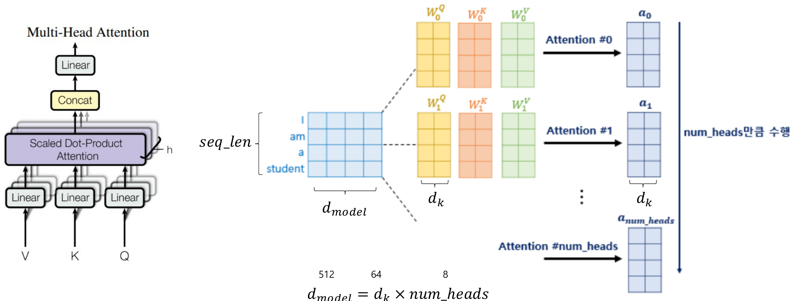

*Figure 8. Multi-head attention, which performs attention num_heads times with different weights W_i^Q, W_i^K, W_i^V for each head*

The computation proceeds as follows.

1. Each head $i$ makes Q, K, and V with its own weights $W_i^Q$, $W_i^K$, and $W_i^V$ ($`d_{\text{model}} \times d_k`$) and performs scaled dot-product attention to obtain the attention value matrix $`\mathbf{a}_i`$ ($`\text{seq\_len} \times d_k`$).
2. Concatenating the results of the $h$ heads, $`\mathbf{a}_0, \dots, \mathbf{a}_{h-1}`$, side by side gives a $`\text{seq\_len} \times (h \cdot d_k) = \text{seq\_len} \times d_{\text{model}}`$ matrix.
3. Multiplying the concatenated matrix by the weight $W^O$ ($`d_{\text{model}} \times d_{\text{model}}`$) produces the final output.

```math
\mathrm{MultiHead}(Q, K, V) = \mathrm{Concat}(\mathrm{head}_1, \dots, \mathrm{head}_h) W^O, \qquad \mathrm{head}_i = \mathrm{Attention}(Q W_i^Q, K W_i^K, V W_i^V)
```

Several heads are effective because each head can attend to a different relation. One head can learn long-distance dependencies between words, and another the relation between a pronoun and the noun it refers to [4]. Because each head's dimension is smaller, the total computation is similar to that of a single attention over all dimensions.

Multi-head attention **has the same input and output size.** If the input is $`\text{seq\_len} \times d_{\text{model}}`$, the output is also $`\text{seq\_len} \times d_{\text{model}}`$. The sizes must match so that the same structure can be repeated and stacked $N$ times. The parameters of one multi-head attention layer are $W^Q, W^K, W^V$ (each $512 \times 512$ when the 8 heads are combined) and $W^O$ ($`512 \times 512`$), so the weights alone number $4 \times 512 \times 512 = 1{,}048{,}576$, and adding $4 \times 512 = 2{,}048$ biases gives 1,050,624.

### 2.6 Residual Connection, Layer Normalization, and the Feed-Forward Network

One encoder layer of the Transformer consists of two sublayers, multi-head self-attention and a feed-forward network, each followed by Add & Norm.

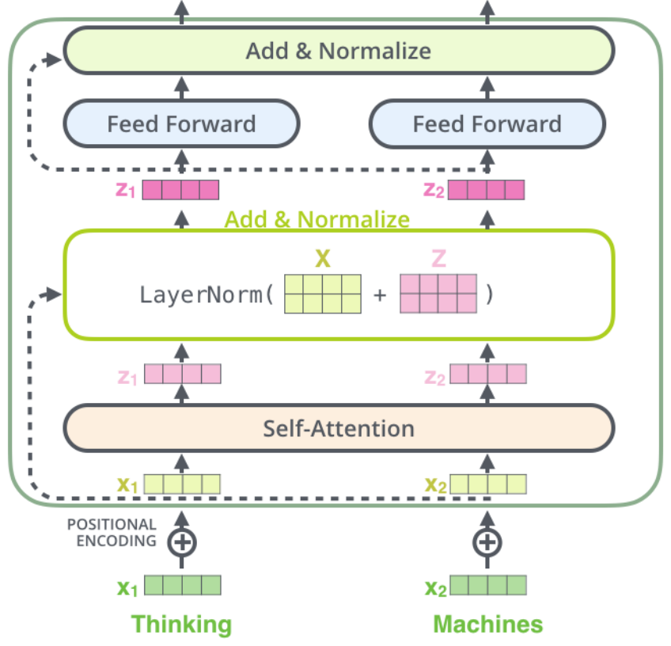

*Figure 9. An encoder layer in which the vectors of the two words Thinking and Machines pass through positional encoding, self-attention, Add & Normalize, position-wise feed forward, and Add & Normalize in order*

- **Residual connection:** The input $\mathbf{x}$ of a sublayer is added to its output as is (Add). It is the same structure as the **skip connection** learned with ResNet in Lecture 3 [5], and it lets information and gradients take a shortcut even when layers are stacked deep. The dashed arrows in Figure 9 are these connections. Addition requires the input and output to have the same size, so the outputs of all sublayers are $d_{\text{model}}$-dimensional.
- **Layer normalization:** The components of each word vector are normalized to mean 0 and variance 1, and then a learned scale and shift are applied (Norm) [6]. Unlike batch normalization, which looks at several samples in a batch together, it normalizes within the vector of a single sample, so it works regardless of sentence length or batch size. The output of a sublayer is $\mathrm{LayerNorm}(\mathbf{x} + \mathrm{Sublayer}(\mathbf{x}))$.
- **Feed-forward network:** The same two-layer network is applied separately to the vector at each position. The hidden dimension in the original paper is $d_{ff} = 2048$.

```math
\mathrm{FFN}(\mathbf{x}) = \max(0, \mathbf{x} W_1 + \mathbf{b}_1) W_2 + \mathbf{b}_2
```

If self-attention mixes information among words, the feed-forward network processes the mixed information nonlinearly for each word.

A decoder layer has one more sublayer. In the multi-head attention in the middle of the decoder, **the query is the decoder matrix** (the output of the masked self-attention), and **the key and value are the encoder matrix** (the output of the last encoder layer). This is called **encoder-decoder attention**, and like the seq2seq attention of Section 1.3, it lets the decoder consult the needed parts of the input sentence for the word it is about to output. The decoder's final output becomes vocabulary-sized scores through a linear layer (Linear) and the probability distribution of the next word through softmax.

### 2.7 Embedding Layer

The input of the Transformer goes through an **embedding layer**, which turns each word into an integer index and reads the corresponding row of a lookup table to obtain the embedding vector. Word2Vec in Lecture 7 trained the lookup table separately and then used it, but in the Transformer **the lookup table is also learned during the whole training process.** It starts from random values and is updated in the direction that reduces the loss of the final task, such as translation.

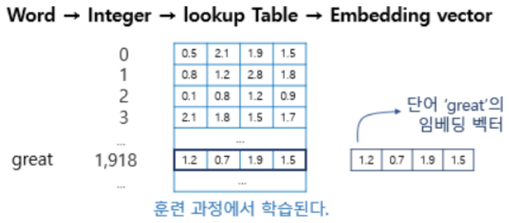

*Figure 10. The word great is mapped to the integer 1,918, and row 1,918 of the lookup table becomes the embedding vector of great*

In Figure 10, the word great is mapped to the integer 1,918 by the vocabulary, and row 1,918 of the lookup table, $[1.2, 0.7, 1.9, 1.5]$, becomes the embedding vector of great (the Korean labels in the figure read "embedding vector of the word 'great'" and "learned during training"). In PyTorch, `nn.Embedding(vocabulary size, embedding dimension)` is this layer.

### 2.8 Byte Pair Encoding (BPE)

An embedding layer can only represent words in its vocabulary, so a word-level vocabulary cannot handle words not seen during training (OOV). The representative subword tokenization method that solves this is **BPE (Byte Pair Encoding)**. BPE was originally proposed as a data compression algorithm [7] and was adopted for subword segmentation in neural machine translation [8].

BPE basically repeats the process of **finding the pair of characters that appears consecutively most often and merging it into a single character**. The algorithm is as follows.

1. Start with each word of the training data split into characters. The vocabulary is the set of all characters that appear.
2. For each pair of adjacent symbols, count its occurrences by adding the frequencies of the words that contain the pair.
3. Merge the most frequent pair into one new symbol, and add the new symbol to the vocabulary.
4. Repeat steps 2-3 a set number of times.

For example, let the word frequencies of the training data be low 5, lower 2, newest 6, and widest 3. The initial state is as follows.

```text
# dictionary
l o w : 5,  l o w e r : 2,  n e w e s t : 6,  w i d e s t : 3

# vocabulary
l, o, w, e, r, n, s, t, i, d
```

Counting pair occurrences in the first step, (e, s) appears 6 times in newest and 3 times in widest, 9 times in total. (s, t) also appears 9 times, but (e, s), counted first, is chosen. Merging (e, s) into es changes the dictionary and vocabulary as follows.

```text
# dictionary update!
l o w : 5,  l o w e r : 2,  n e w es t : 6,  w i d es t : 3

# vocabulary update!
l, o, w, e, r, n, s, t, i, d, es
```

Repeating the same process 10 times merges the following pair at each step.

| Step | Merged pair | Occurrences | New symbol |
|:---:|:-----|:---:|:-----|
| 1 | (e, s) | 9 | es |
| 2 | (es, t) | 9 | est |
| 3 | (l, o) | 7 | lo |
| 4 | (lo, w) | 7 | low |
| 5 | (n, e) | 6 | ne |
| 6 | (ne, w) | 6 | new |
| 7 | (new, est) | 6 | newest |
| 8 | (w, i) | 3 | wi |
| 9 | (wi, d) | 3 | wid |
| 10 | (wid, est) | 3 | widest |

*Table 4. Ten BPE merge steps*

```text
# dictionary update!
low : 5,  low e r : 2,  newest : 6,  widest : 3

# vocabulary update!
l, o, w, e, r, n, s, t, i, d, es, est, lo, low, ne, new, newest, wi, wid, widest
```

The following code implements this process.

```python
from collections import Counter

def count_pairs(dictionary):
    pairs = Counter()
    for symbols, freq in dictionary.items():
        for pair in zip(symbols, symbols[1:]):     # pairs of adjacent symbols
            pairs[pair] += freq                     # count by the word's frequency
    return pairs

def merge(symbols, pair):
    out, i = [], 0
    while i < len(symbols):
        if i < len(symbols) - 1 and (symbols[i], symbols[i + 1]) == pair:
            out.append(symbols[i] + symbols[i + 1])  # merge the pair into one symbol
            i += 2
        else:
            out.append(symbols[i])
            i += 1
    return tuple(out)

dictionary = {tuple("low"): 5, tuple("lower"): 2, tuple("newest"): 6, tuple("widest"): 3}
vocabulary = ["l", "o", "w", "e", "r", "n", "s", "t", "i", "d"]
merges = []

for step in range(1, 11):
    pairs = count_pairs(dictionary)
    best = max(pairs, key=pairs.get)                # most frequent pair (on a tie, the one counted first)
    print(step, best, pairs[best])
    dictionary = {merge(s, best): f for s, f in dictionary.items()}
    vocabulary.append(best[0] + best[1])
    merges.append(best)

print({" ".join(s): f for s, f in dictionary.items()})
print(vocabulary)

word = tuple("lowest")                              # a word not in the training data
for pair in merges:                                 # apply the merges in the learned order
    word = merge(word, pair)
print(word)
```

```text
1 ('e', 's') 9
2 ('es', 't') 9
3 ('l', 'o') 7
4 ('lo', 'w') 7
5 ('n', 'e') 6
6 ('ne', 'w') 6
7 ('new', 'est') 6
8 ('w', 'i') 3
9 ('wi', 'd') 3
10 ('wid', 'est') 3
{'low': 5, 'low e r': 2, 'newest': 6, 'widest': 3}
['l', 'o', 'w', 'e', 'r', 'n', 's', 't', 'i', 'd', 'es', 'est', 'lo', 'low', 'ne', 'new', 'newest', 'wi', 'wid', 'widest']
('low', 'est')
```

- `count_pairs()` forms adjacent pairs in each word (a tuple of symbols) with `zip(symbols, symbols[1:])` and counts them by the word's frequency. `Counter` is a dictionary whose missing keys start at 0.
- `merge()` scans a symbol sequence from the left and merges the given pair whenever it is met.
- `max(pairs, key=pairs.get)` picks the pair with the largest count. On a tie, the pair counted first is chosen, so step 1 selects (e, s) rather than (s, t).

**BPE can handle new words.** When lowest, absent from the training data, arrives, it is first split into the characters l, o, w, e, s, t, and the learned merge rules are applied in the learned order. Applying (e, s) → es, (es, t) → est, (l, o) → lo, and (lo, w) → low turns lowest into the two subwords low and est, both of which are in the vocabulary, so it can be represented.

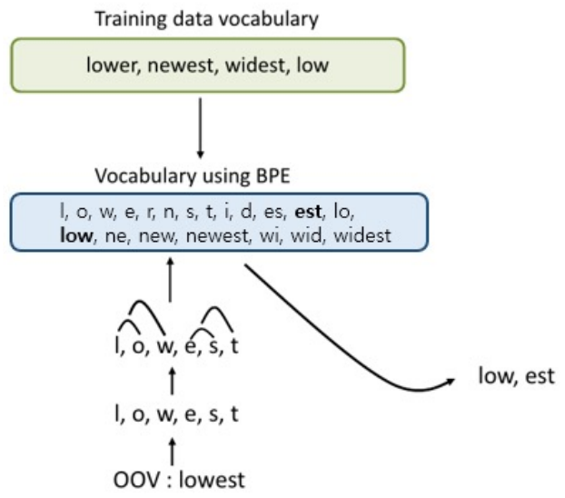

*Figure 11. The BPE vocabulary built from the training-data vocabulary, and the OOV word lowest split into low and est by the merge rules*

The number of merges determines the vocabulary size. With many merges, frequent words become single tokens, and rare words are split into several subwords. GPT-2 uses byte-level BPE, which takes bytes rather than characters as the base units, so it can represent any string without OOV [9].

### 2.9 Positional Encoding

**Why it is needed.** The Transformer processes its input all at once in parallel, which makes it fast. Self-attention, however, computes the relatedness of every pair regardless of word order, so it does not preserve information about the input order. Word order carries important information in a sentence. "The cat chased the dog." and "The dog chased the cat." consist of the same words but have opposite meanings. **Positional encoding** is therefore used to represent word order: a fixed vector is made for each position and added to the word embedding at that position.

**Conditions to satisfy.** There are many ways to represent the position of a word, but the following conditions must hold.

1. Each position value must be the same for the same position regardless of data length or input values.
2. Each position must have a unique encoding value. That is, different positions must have different encoding values.
3. No position value may be too large compared with the input values. If it is too large, the meaning of the word embedding it is added to becomes relatively small.
4. The difference of encoding values caused by a difference in position must be usable as a distance. For equal intervals, the distance must be the same regardless of position: $\mathrm{distance}(x, x + t) = \mathrm{distance}(y, y + t)$.

**Simple attempts and their problems.** Each of the following three methods violates at least one condition.

- **Integer index:** The positions of "I am a student" are set to 0, 1, 2, 3. As sentences grow longer, the numbers become excessively large (violating condition 3), which harms training.
- **Normalizing to 0-1:** To keep numbers small, the first word is 0 and the last word is 1. "I am a student" gets 0, 0.33, 0.67, 1 and "The cat chased the dog" gets 0, 0.25, 0.50, 0.75, 1, so the same second position takes 0.33 or 0.25 depending on sentence length (violating condition 1).
- **Binary numbers:** Positions are represented as binary vectors. Values are limited to 0 and 1, but the distance between positions is not uniform (violating condition 4).

| Position | 0 | 1 | 2 | 3 | 4 |
|:-----|:---:|:---:|:---:|:---:|:---:|
| Bit 2 | 0 | 0 | 0 | 0 | 1 |
| Bit 1 | 0 | 0 | 1 | 1 | 0 |
| Bit 0 | 0 | 1 | 0 | 1 | 0 |

*Table 5. Binary encoding of positions 0-4*

In Table 5, the Euclidean distance between the vectors of positions 0 and 1, $[0, 0, 0]$ and $[0, 0, 1]$, is 1, but the distance between the vectors of positions 3 and 4, $[0, 1, 1]$ and $[1, 0, 0]$, is $\sqrt{3} \approx 1.732$. The position difference is the same 1, but the computed distances differ.

**The sine function.** The sine function has values limited to the range $-1$ to $1$ (condition 3), and being periodic, it is not constrained by sentence length. Because it is periodic, however, the same encoding value can reappear as sentences grow longer (violating condition 2).

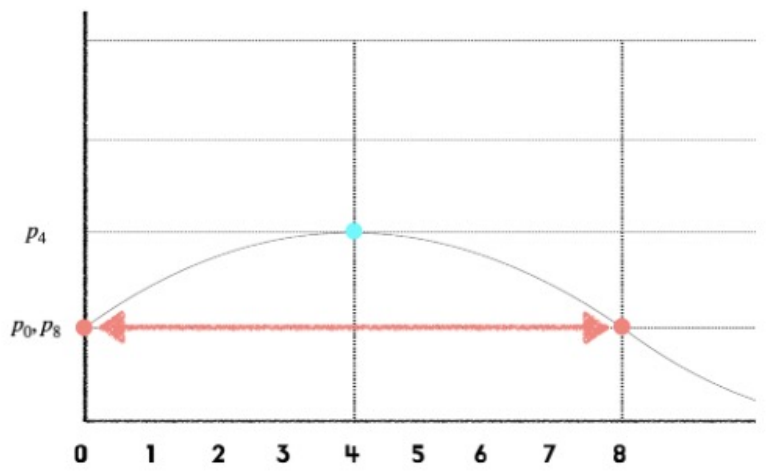

*Figure 12. An example in which positions 0 and 8 take the same value on a sine curve*

On the curve in Figure 12, position 4 is at the maximum, but positions 0 and 8 have the same value, so the two positions cannot be distinguished.

**Using sines and cosines at several frequencies.** The Transformer uses several sine and cosine functions with different frequencies together [4]. In the encoding vector of position $pos$, the even dimension $2i$ and the odd dimension $2i+1$ are as follows.

```math
PE_{(pos, 2i)} = \sin\left(\frac{pos}{10000^{2i/d_{\text{model}}}}\right), \qquad PE_{(pos, 2i+1)} = \cos\left(\frac{pos}{10000^{2i/d_{\text{model}}}}\right)
```

Each dimension pair $(2i, 2i+1)$ has a different angular frequency $\omega_i = 1/10000^{2i/d_{\text{model}}}$. The early dimensions (small $`i`$) change quickly with position, and the later dimensions change slowly. Just as the second, minute, and hour hands of a clock together indicate a time, combining fast and slow components gives each position a unique vector within any practical length (condition 2). All values lie between $-1$ and $1$ (condition 3), and the same position has the same vector regardless of the sentence (condition 1). The positional encoding vector has the same $d_{\text{model}}$ dimensions as the word embedding, so the two can be added element by element.

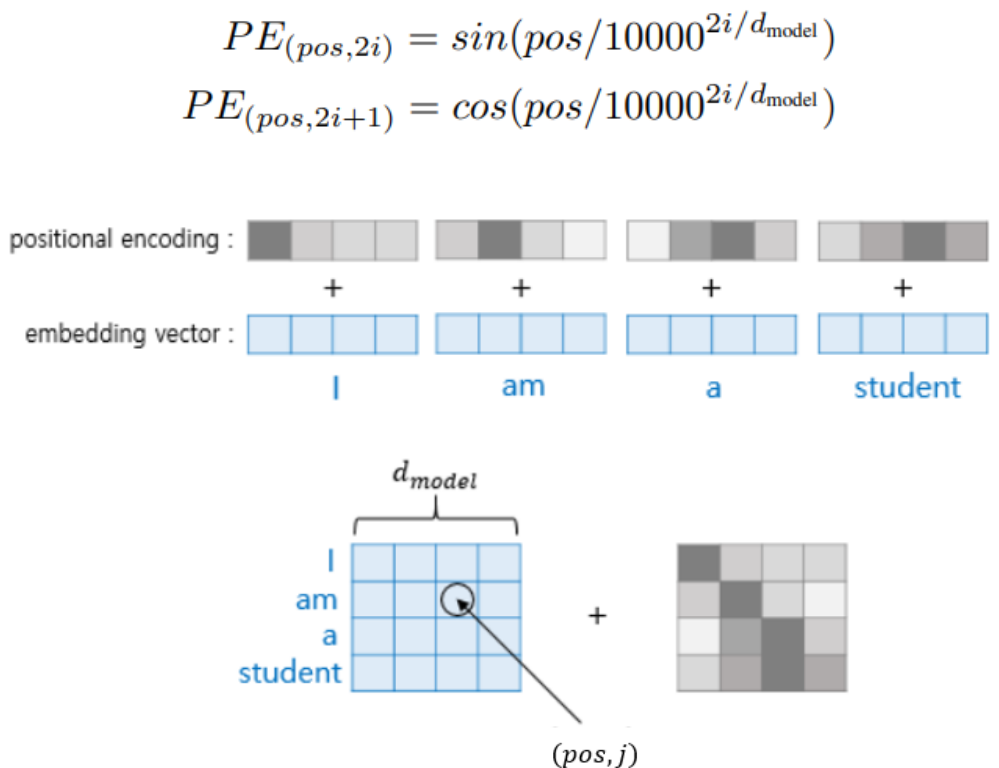

*Figure 13. The sine and cosine positional encoding formulas, and adding the encoding vector of each position to the word embedding at that position in the sentence I am a student*

Computing a small example with $d_{\text{model}} = 4$: the pair $i = 0$ has $\omega_0 = 1$, giving $\sin(pos)$ and $\cos(pos)$, and the pair $i = 1$ has $\omega_1 = 1/10000^{2/4} = 1/100$, giving $\sin(pos/100)$ and $\cos(pos/100)$.

| Position | $\sin(pos)$ | $\cos(pos)$ | $\sin(pos/100)$ | $\cos(pos/100)$ |
|:---:|:---:|:---:|:---:|:---:|
| 0 (I) | 0.000 | 1.000 | 0.000 | 1.000 |
| 1 (am) | 0.841 | 0.540 | 0.010 | 1.000 |
| 2 (a) | 0.909 | -0.416 | 0.020 | 1.000 |
| 3 (student) | 0.141 | -0.990 | 0.030 | 1.000 |

*Table 6. For $`d_{\text{model}} = 4`$, positional encoding vectors of positions 0-3*

The first two dimensions change greatly from position to position, and the last two change very slowly. Adding each row to the word embedding at the same position gives the input of the Transformer.

**The distance condition and the rotation matrix.** A relative change in position can be expressed by a trigonometric rotation matrix. In one dimension pair, let $`\theta = \omega\, pos`$ and $`\phi = \omega\, t`$; the angle addition formulas give

```math
\begin{pmatrix} \cos(\theta + \phi) \\ \sin(\theta + \phi) \end{pmatrix} = \begin{pmatrix} \cos\phi & -\sin\phi \\ \sin\phi & \cos\phi \end{pmatrix} \begin{pmatrix} \cos\theta \\ \sin\theta \end{pmatrix}
```

The encoding of position $pos + t$ is the encoding of position $pos$ rotated by $\phi = \omega t$, and the rotation angle depends only on the position difference $t$. Rotation does not change the length of a vector, so the squared distance between the two encodings in each dimension pair is $\lVert R(\phi)\mathbf{p} - \mathbf{p} \rVert^2 = 2 - 2\cos(\omega_i t)$, and the squared total distance is as follows.

```math
\lVert PE(pos + t) - PE(pos) \rVert^2 = \sum_{i} \left(2 - 2\cos(\omega_i t)\right)
```

This value does not contain $pos$, so $\mathrm{distance}(x, x + t) = \mathrm{distance}(y, y + t)$ holds (condition 4). In other words, rotating the encodings of positions x and y by the same angle $\omega_i t$ in each dimension pair moves them by the same distance. For example, with $d_{\text{model}} = 512$, the distances between positions 0 and 1, 3 and 4, and 40 and 41 are all about 3.714.

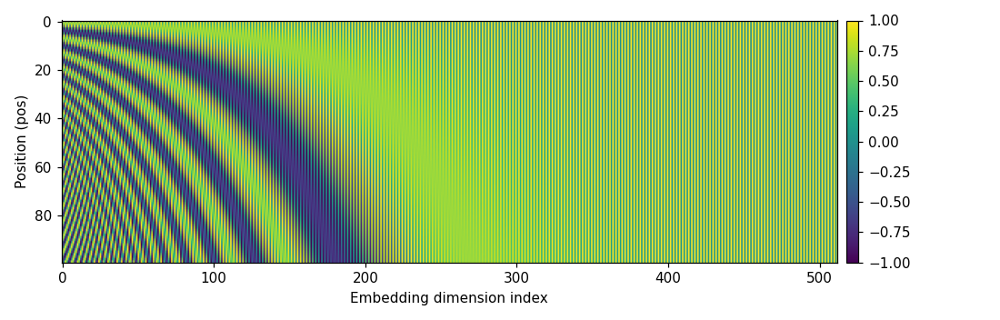

*Figure 14. Visualization of the positional encoding matrix with sentence length 100 and embedding dimension 512*

The horizontal axis of Figure 14 is the dimension and the vertical axis the position. Dimensions on the left oscillate quickly with position, forming dense stripes, and toward the right the oscillation slows until values barely change even up to position 100 (even sine dimensions stay near 0 and odd cosine dimensions near 1). The figure plots the positional encoding matrix produced by the following code.

```python
import numpy as np

def positional_encoding(max_len, d_model):
    pos = np.arange(max_len)[:, None]                  # (max_len, 1) position numbers
    i = np.arange(d_model // 2)[None, :]               # (1, d_model/2) dimension pair numbers
    angle = pos / np.power(10000, 2 * i / d_model)     # pos / 10000^(2i/d_model)
    pe = np.zeros((max_len, d_model))
    pe[:, 0::2] = np.sin(angle)                        # sin in even dimensions
    pe[:, 1::2] = np.cos(angle)                        # cos in odd dimensions
    return pe

pe = positional_encoding(100, 512)
d = lambda a, b: np.linalg.norm(a - b)
print(round(d(pe[0], pe[1]), 3), round(d(pe[3], pe[4]), 3), round(d(pe[40], pe[41]), 3))
```

```text
3.714 3.714 3.714
```

`pos` has shape (100, 1) and `i` has shape (1, 256), so the division broadcasts and `angle` becomes a (100, 256) matrix. `pe[:, 0::2]` means columns 0, 2, 4, ..., and `pe[:, 1::2]` means columns 1, 3, 5, .... The last line shows that the distances of three pairs with interval 1 are equal regardless of position.

### 2.10 Masked Multi-Head Attention

**Masked multi-head attention** is a technique used only in the decoder. The reason it is needed lies in the training method.

> **Definition:** **Teacher forcing** is a method of training a decoder that feeds the correct word, instead of the word the model predicted at the previous step, as the input of the next step. It keeps one wrong prediction from propagating to later steps, making training faster and more stable.

Like seq2seq, the Transformer is trained with teacher forcing. An RNN decoder receives words one step at a time, so it could not see future answers, but the Transformer decoder receives the whole target sentence matrix at once. Performing self-attention as is would let the position that must predict "suis" consult "suis" and "étudiant", which are already in the input matrix, amounting to predicting with the answer known. Therefore, **words after the current step are masked.**

Concretely, in the attention score matrix the cells of keys that come after each query are replaced with $-\infty$ (a very large negative number in implementations) before softmax is applied. Since $e^{-\infty} = 0$, the masked cells get weight 0. The following shows the masked cells (■) in the attention score matrix of the French sentence `<sos> je suis étudiant` ("I am a student").

```text
              keys: <sos>   je    suis  étudiant
query <sos>          □      ■      ■      ■
query je             □      □      ■      ■
query suis           □      □      □      ■
query étudiant       □      □      □      □
```

*Figure 15. The mask that hides future positions in the decoder's attention score matrix (■ marks cells masked with $`-\infty`$)*

Applying the mask to the example of Section 2.4 changes the attention distributions as follows. The first word I can see only itself, so it receives weight 1; am sees only I and am, and a sees only I, am, and a. The last word student can see all words, so its row is the same as in Table 3.

| Query \ Key | I | am | a | student |
|:-----|:---:|:---:|:---:|:---:|
| I | 1.000 | 0 | 0 | 0 |
| am | 0.056 | 0.944 | 0 | 0 |
| a | 0.164 | 0.673 | 0.164 | 0 |
| student | 0.107 | 0.002 | 0.002 | 0.890 |

*Table 7. Attention distributions with the mask applied to the example of Section 2.4*

For example, only the scores $[0, 2.828]$ remain in the row of am, so softmax gives $[1, 16.919] / 17.919 = [0.056, 0.944]$. Thanks to the mask, training computes all positions in parallel while each position predicts the next word from only the words before it, just as in inference.

---

<br>

## 3. BERT and GPT

The Transformer's encoder and decoder each become powerful language models on their own. Using only the decoder gives GPT, and using only the encoder gives BERT. Both models popularized the approach of first **pre-training** on large amounts of unlabeled text and then **fine-tuning** on the data of a specific task.

### 3.1 GPT

**GPT (Generative Pre-trained Transformer)** is a model published by OpenAI in 2018 [10]. Its characteristics are as follows.

- **It learns sentences sequentially.** It reads words from left to right.
- **It predicts the next word from the previous words.** The training objective is to fill the blank in "나는 어제 밥을 [ ]" ("Yesterday I [ ] rice"), for example with "먹었다" (ate). Such a model is called an **autoregressive language model**.
- **It uses only the decoder, without an encoder.** Because it must see only the preceding words, a decoder with masked self-attention fits. Having no encoder, it also has no encoder-decoder attention.

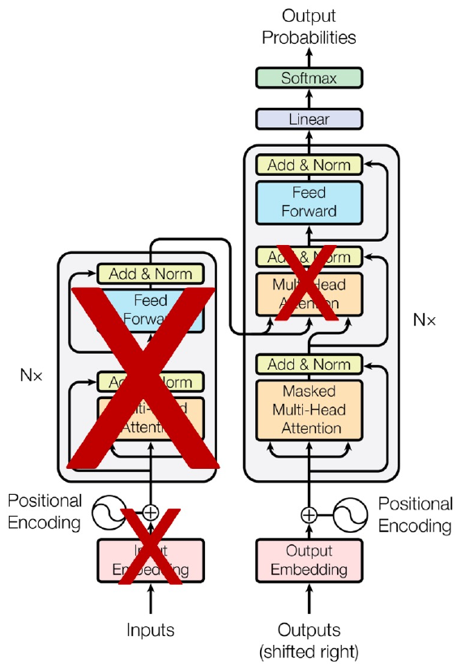

*Figure 16. The structure of GPT, which removes the encoder and the encoder-decoder attention and keeps only a decoder with masked multi-head attention*

The training loss is the cross entropy of the probability of the actual next word at each position, that is, $-\sum_t \log P(w_t \mid w_1, \dots, w_{t-1})$. After pre-training acquires general knowledge of language, the model is fine-tuned for tasks such as classification or entailment by changing the input format and attaching an output layer [10].

### 3.2 BERT

**BERT (Bidirectional Encoder Representations from Transformers)** is a model published by Google in 2018 [11]. **It looks at words in both directions to predict a blank.** In "나는 어제 [ ] 먹었다." ("Yesterday I ate [ ]."), it fills the blank with a word such as "밥을" (rice) by seeing both what comes before ("나는 어제", "yesterday I") and after ("먹었다", "ate"). Because it must see both sides at once, it uses only the encoder, whose self-attention has no mask.

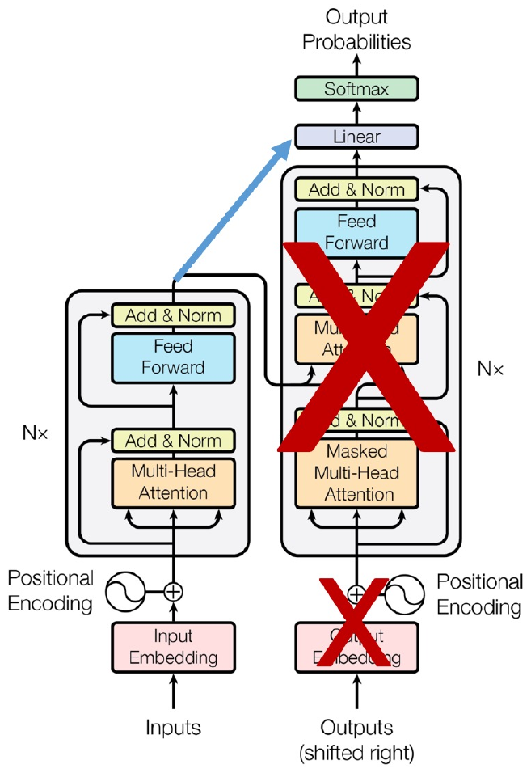

*Figure 17. The structure of BERT, which removes the decoder and keeps only the encoder, sending its output directly to the linear layer and softmax*

BERT has two pre-training tasks [11].

- **Masked language model (MLM):** It selects 15% of the input tokens, replaces 80% of them with the `[MASK]` token and 10% with random tokens, leaves 10% unchanged, and then predicts the original tokens.
- **Next sentence prediction (NSP):** It takes two sentences in sequence and predicts whether the second sentence actually follows the first.

GPT is strong at generation, while BERT, which sees the context on both sides of the whole sentence, is strong at understanding tasks such as classification, named entity recognition, and question answering.

### 3.3 Usage and Model Scale

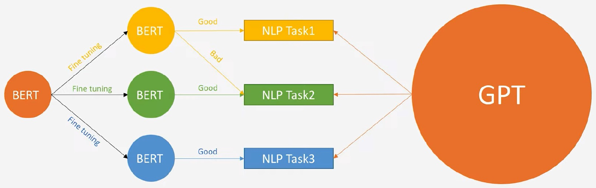

*Figure 18. Fine-tuning a pre-trained BERT separately for each task versus handling several tasks with one huge GPT*

As on the left of Figure 18, BERT makes a task-specific model by fine-tuning one pre-trained model separately for each task. A BERT fine-tuned for NLP Task1 performs well on Task1 (Good) but poorly on Task2 (Bad). GPT on the right developed in the direction of making the model very large so that one model handles several tasks together. GPT-3 showed that it can perform new tasks without fine-tuning, given only a task description and a few examples within the input text [12].

The scale of the GPT series grew greatly with each generation [10], [9], [12].

| Item | GPT-1 | GPT-2 | GPT-3 |
|:-----|:-----|:-----|:-----|
| Parameters | 117 million (117M) | 1.5 billion (1.5B) | 175 billion (175B) |
| Decoder layers | 12 | 48 | 96 |
| Context tokens | 512 | 1,024 | 2,048 |
| Hidden dimension | 768 | 1,600 | 12,288 |
| Batch size | 64 | 512 | 3.2M |

*Table 8. Scale comparison of GPT-1, GPT-2, and GPT-3*

The batch sizes of GPT-1 and GPT-2 count sequences (of 512 and 1,024 tokens), whereas the 3.2M of GPT-3 counts tokens processed at once. For comparison, the parameter counts of object detection models for images (Lecture 5) are as follows.

| Model | Parameters (millions) |
|:-----|:---:|
| YOLOv5-M | 21.2 |
| YOLOv7 | 36.9 |
| YOLOv8-M | 25.9 |
| YOLOv9-M | 20.0 |

*Table 9. Parameter counts of YOLO-family models*

While YOLO models have tens of millions of parameters, GPT-3 has 175 billion, thousands of times more. Such huge models require enormous resources for training and inference, and this problem leads to the lightweight models of Lecture 9.

---

<br>

## 4. ViT

**ViT (Vision Transformer)** is a model that applies the Transformer encoder directly to image classification [13]. The key idea is to cut an image into small pieces (patches) and treat each piece like a word in a sentence. The title of the paper, "An image is worth 16x16 words", expresses this idea.

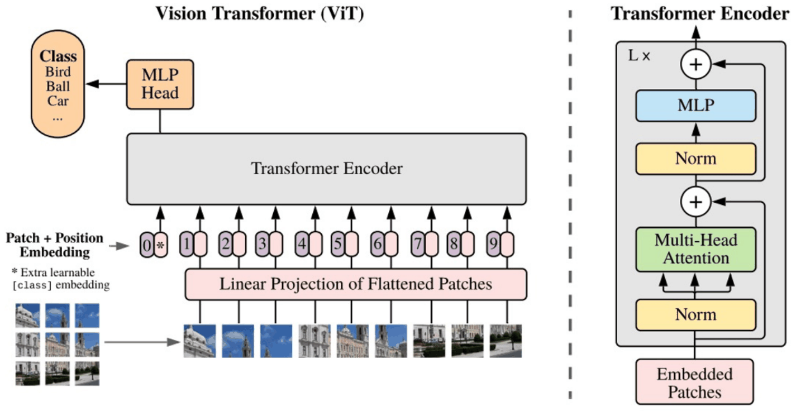

*Figure 19. The structure of ViT, which splits an image into patches, passes them through linear projection and position embedding into a Transformer encoder, and classifies with an MLP head on the output of the class token*

The processing steps are as follows.

1. **Patch splitting:** Cutting a $224 \times 224$ RGB image into $16 \times 16$ patches yields $(224/16)^2 = 14 \times 14 = 196$ patches.
2. **Flattening and linear projection (Linear Projection of Flattened Patches):** The $16 \times 16 \times 3 = 768$ pixel values of each patch are laid out in one row and turned into a $D$-dimensional vector by a learned linear layer. This corresponds to a word embedding.
3. **Class token and position embedding (Patch + Position Embedding):** A learned special vector, the `[class]` token (0* in the figure), is prepended, and a position embedding carrying the position information of the patches is added. ViT's position embedding is a learned vector rather than a sine function.
4. **Transformer encoder:** Blocks of Norm, Multi-Head Attention, residual connection (+), Norm, MLP, and residual connection are stacked $L$ times. Unlike the original Transformer, normalization comes before each sublayer.
5. **MLP head:** The output of the `[class]` token after the encoder is fed to the MLP head to predict a class such as Bird, Ball, or Car. Thanks to self-attention, the `[class]` token gathers the information of all patches and summarizes the whole image.

ViT-Base has 12 layers, hidden dimension 768, and 12 heads, about 86 million parameters [13]. A CNN builds in the assumption that neighboring pixels are related (locality), but ViT has few such assumptions, so when trained only on data of ImageNet's size, it performs slightly below a ResNet of similar size. When pre-trained on data with hundreds of millions of images, however, it matches or exceeds the best CNNs while using fewer training resources [13].

---

<br>

## Concept Applications

**True/False Check:**

| Statement | Judgment and Reason |
|:-----|:-----|
| The decoder of a seq2seq model with attention uses the same context vector at every output step. | **F.** The attention weights are recomputed at every step, so the context vector also differs at every output step. A single fixed context vector is used by seq2seq without attention. |
| In scaled dot-product attention, dividing by $\sqrt{d_k}$ prevents softmax from saturating and its gradients from becoming small. | **T.** The larger the dimension, the larger the variance of the dot product ($`d_k`$), which concentrates softmax on one position, so dividing by $\sqrt{d_k}$ brings the variance back to 1. |
| The output size of multi-head attention grows in proportion to the number of heads. | **F.** Each head produces a result of $d_k = d_{\text{model}}/h$ dimensions and the results are concatenated, so the output is again $d_{\text{model}}$-dimensional. Input and output sizes match, so layers can be stacked $N$ times. |
| With sine and cosine positional encoding, the distance between positions $x$ and $x + t$ depends on $x$. | **F.** The position difference $t$ corresponds to a rotation by angle $\omega_i t$ in each dimension pair, so the distance $\sqrt{\sum_i (2 - 2\cos\omega_i t)}$ does not depend on $x$. |
| BPE can split a word not in the training data into subwords by applying the learned merge rules. | **T.** The word is split into characters and the learned merges are applied in order. lowest is split into low and est. |
| BERT uses only the decoder, and GPT uses only the encoder. | **F.** It is the opposite. BERT uses only the encoder, which sees bidirectional context, and GPT uses only the decoder with masked self-attention, which sees only preceding words. |

---

<br>

## Summary

| Concept | Key Summary |
|:-----|:-----|
| Seq2seq | An encoder RNN compresses the input into a context vector, and a decoder RNN generates the output from `<sos>` to `<eos>`. Information loss from the fixed-size vector and vanishing gradients are its problems. |
| Attention | At every output step, the scores between the decoder state and all encoder hidden states are turned into weights by softmax, and their weighted sum forms the context vector for that step. |
| Transformer | An encoder-decoder model built with attention alone, without RNNs. On top of the embedding and positional encoding, it stacks layers of multi-head attention, feed forward, and Add & Norm $N$ times. |
| Self-attention | Within one sequence, each word gets a query, key, and value, and the relatedness of every word pair is computed. Matrix operations process all positions in parallel. |
| Scaled dot-product attention | $\mathrm{softmax}(QK^T/\sqrt{d_k})V$. Dividing by $\sqrt{d_k}$ brings the variance of the dot products to 1 and prevents softmax saturation. |
| Multi-head attention | Performs attention $h$ times in $d_k = d_{\text{model}}/h$ dimensions, concatenates the results, and multiplies by $W^O$. Each head attends to a different relation, and input and output sizes match. |
| Residual connection and layer normalization | Every sublayer computes $\mathrm{LayerNorm}(\mathbf{x} + \mathrm{Sublayer}(\mathbf{x}))$. The attention in the middle of the decoder takes its query from the decoder and its key and value from the encoder. |
| Embedding layer | Maps a word to an integer and reads a row of the lookup table. The lookup table is learned together with the whole model. |
| BPE | Builds a subword vocabulary by repeatedly merging the most frequent adjacent symbol pair. OOV words are also split into subwords with the learned merges. |
| Positional encoding | Adds sines and cosines of different frequencies to the embeddings. Values are bounded and unique per position, and the distance for a given position difference does not depend on position. |
| Masked multi-head attention | Masks the upper triangle of the score matrix with $-\infty$ so that a decoder receiving the whole target sentence under teacher forcing cannot see future words. |
| BERT and GPT | GPT uses only the decoder to predict the next word from previous words, and BERT uses only the encoder to predict masked words from bidirectional context. GPT grew in scale so that one model handles several tasks. |
| ViT | Cuts an image into $16 \times 16$ patches, embeds them like words, adds a class token and position embeddings, and classifies with a Transformer encoder. |

---

<br>

## Self-Check Questions

1. **Limitations of seq2seq:** Give two reasons why translation quality drops as the input sentence grows longer in seq2seq without attention.

   <details>
   <summary>Answer</summary>

   First, the whole input must be compressed into one fixed-size context vector, so information is lost as the sentence grows longer. Second, the information and gradients of early words weaken while passing through many time steps, which is the vanishing gradient problem.

   </details>

2. **Attention value:** With encoder hidden states $`\mathbf{h}_1 = [1, 0]`$ and $`\mathbf{h}_2 = [0, 1]`$ and attention weights $0.8$ and $0.2$, compute the context vector.

   <details>
   <summary>Answer</summary>

   $0.8 \times [1, 0] + 0.2 \times [0, 1] = [0.8, 0.2]$. The information of the first time step, with the larger weight, is mainly reflected.

   </details>

3. **Scaling:** With $d_k = 16$ and dot products $[8, 0]$ between a query and two keys, compute the scaled scores and the softmax distribution.

   <details>
   <summary>Answer</summary>

   Dividing by $\sqrt{16} = 4$ gives scores $[2, 0]$. Softmax gives $[e^2, e^0] / (e^2 + 1) = [7.389, 1] / 8.389 \approx [0.881, 0.119]$. Without the division, it would have been $[e^8, 1] / (e^8 + 1) \approx [0.9997, 0.0003]$, almost saturated.

   </details>

4. **Self-attention computation:** In the example of Section 2.4, show how the attention distribution of the word am, $[0.050, 0.849, 0.050, 0.050]$, is obtained.

   <details>
   <summary>Answer</summary>

   The dot products of am's query $[0, 2]$ with the keys $[2, 0]$, $[0, 2]$, $[0, 0]$, and $[3, 0]$ are $[0, 4, 0, 0]$, and dividing by $\sqrt{2}$ gives $[0, 2.828, 0, 0]$. The exponentials are $[1, 16.919, 1, 1]$ with sum $19.919$, so the distribution is $[0.050, 0.849, 0.050, 0.050]$.

   </details>

5. **Sizes in multi-head attention:** With $d_{\text{model}} = 768$ and 12 heads, compute $d_k$ of one head and the size of the concatenated matrix for a sentence of length 10.

   <details>
   <summary>Answer</summary>

   $d_k = 768 / 12 = 64$. Each head produces a $10 \times 64$ matrix, and concatenating the 12 gives $10 \times 768$, the same size as the input.

   </details>

6. **BPE:** With word frequencies {hug: 10, pug: 5, hugs: 5} and starting from characters, find the pair selected in the first merge and its count.

   <details>
   <summary>Answer</summary>

   (h, u) occurs 10 in hug + 5 in hugs = 15, (u, g) occurs 10 in hug + 5 in pug + 5 in hugs = 20, (p, u) occurs 5, and (g, s) occurs 5. The most frequent, (u, g) with 20, is selected and becomes ug.

   </details>

7. **Positional encoding:** Which condition of positional encoding does normalizing positions to 0-1 violate, and which does the binary representation violate?

   <details>
   <summary>Answer</summary>

   Normalizing to 0-1 gives the same position different values depending on sentence length (the second position is 0.33 in a 4-word sentence and 0.25 in a 5-word sentence), violating the condition "same position, same value". The binary representation gives distance 1 between positions 0 and 1 but $\sqrt{3}$ between positions 3 and 4, violating the condition "same interval, same distance".

   </details>

8. **Mask:** With decoder input `<sos>`, A, B, which keys can the query at position B see in masked attention, and what is the distribution at position A if its scores are $[1, 1, 5]$?

   <details>
   <summary>Answer</summary>

   Position B can see `<sos>`, A, and B. Position A cannot see B, so the third score becomes $-\infty$, and applying softmax to the remaining $[1, 1]$ gives $[0.5, 0.5, 0]$.

   </details>

9. **BERT and GPT:** Which model's pre-training corresponds to filling the blank in "나는 어제 [ ] 먹었다." ("Yesterday I ate [ ].") and which to filling the blank in "나는 어제 밥을 [ ]" ("Yesterday I [ ] rice"), and how is the difference reflected in the architecture?

   <details>
   <summary>Answer</summary>

   The first task, which uses context on both sides, is BERT's masked language model, and the second task, which uses only preceding words, is GPT's next-word prediction. BERT therefore uses an encoder that sees both directions without a mask, and GPT uses a decoder with masked self-attention that hides future words.

   </details>

10. **ViT:** How many patches result from splitting a $384 \times 384$ RGB image into $16 \times 16$ patches, and what is the length of the Transformer input sequence including the class token?

    <details>
    <summary>Answer</summary>

    $384 / 16 = 24$, so there are $24 \times 24 = 576$ patches, and adding one class token gives a sequence length of 577. Each flattened patch vector has $16 \times 16 \times 3 = 768$ dimensions.

    </details>

---

<br>

## References

1. I. Sutskever, O. Vinyals, and Q. V. Le, "Sequence to sequence learning with neural networks," in *Advances in Neural Information Processing Systems (NIPS)*, vol. 27, pp. 3104-3112, 2014.
2. Y. Bengio, P. Simard, and P. Frasconi, "Learning long-term dependencies with gradient descent is difficult," *IEEE Transactions on Neural Networks*, vol. 5, no. 2, pp. 157-166, 1994.
3. D. Bahdanau, K. Cho, and Y. Bengio, "Neural machine translation by jointly learning to align and translate," in *Proc. International Conference on Learning Representations (ICLR)*, 2015.
4. A. Vaswani, N. Shazeer, N. Parmar, J. Uszkoreit, L. Jones, A. N. Gomez, Ł. Kaiser, and I. Polosukhin, "Attention is all you need," in *Advances in Neural Information Processing Systems (NIPS)*, vol. 30, pp. 5998-6008, 2017.
5. K. He, X. Zhang, S. Ren, and J. Sun, "Deep residual learning for image recognition," in *Proc. IEEE Conference on Computer Vision and Pattern Recognition (CVPR)*, pp. 770-778, 2016.
6. J. L. Ba, J. R. Kiros, and G. E. Hinton, "Layer normalization," arXiv:1607.06450, 2016.
7. P. Gage, "A new algorithm for data compression," *The C Users Journal*, vol. 12, no. 2, pp. 23-38, 1994.
8. R. Sennrich, B. Haddow, and A. Birch, "Neural machine translation of rare words with subword units," in *Proc. 54th Annual Meeting of the Association for Computational Linguistics (ACL)*, pp. 1715-1725, 2016.
9. A. Radford, J. Wu, R. Child, D. Luan, D. Amodei, and I. Sutskever, "Language models are unsupervised multitask learners," OpenAI Technical Report, 2019.
10. A. Radford, K. Narasimhan, T. Salimans, and I. Sutskever, "Improving language understanding by generative pre-training," OpenAI Technical Report, 2018.
11. J. Devlin, M.-W. Chang, K. Lee, and K. Toutanova, "BERT: Pre-training of deep bidirectional transformers for language understanding," in *Proc. NAACL-HLT*, pp. 4171-4186, 2019.
12. T. B. Brown et al., "Language models are few-shot learners," in *Advances in Neural Information Processing Systems (NeurIPS)*, vol. 33, pp. 1877-1901, 2020.
13. A. Dosovitskiy et al., "An image is worth 16x16 words: Transformers for image recognition at scale," in *Proc. International Conference on Learning Representations (ICLR)*, 2021.
