# 9강 — 경량 모델

[레포지토리 안내](../../README.ko.md) | [English](Concepts_Lecture.md) | [한국어](Concepts_Lecture.ko.md)

> **최종 수정일:** 2026-11-04

> **학습 목표:**
> 1. 딥러닝 모델 경량화가 필요한 이유와 AI 엣지 컴퓨팅의 장점을 설명할 수 있다
> 2. 가지치기와 양자화 같은 알고리즘 경량화와 효율적인 네트워크 구조 설계를 구분하고, 양자화를 간단한 예에 적용할 수 있다
> 3. 1×1 합성곱과 ResNet의 병목 블록이 파라미터를 줄이는 원리를 파라미터 수 계산으로 설명할 수 있다
> 4. SqueezeNet의 Fire 모듈의 구조와 설계 전략을 설명하고 파라미터 수를 계산할 수 있다
> 5. MobileNet의 깊이별 분리 합성곱의 연산량과 파라미터 수를 표준 합성곱과 비교하여 계산할 수 있다
> 6. ShuffleNet의 점별 그룹 합성곱과 채널 셔플이 연산량을 줄이면서 그룹 사이의 정보 교환을 유지하는 원리를 설명할 수 있다

---

## 목차

- [1. 모델 경량화](#1-모델-경량화)
  - [1.1 경량화의 필요성](#11-경량화의-필요성)
  - [1.2 AI 엣지 컴퓨팅](#12-ai-엣지-컴퓨팅)
  - [1.3 엣지 디바이스와 적용 사례](#13-엣지-디바이스와-적용-사례)
  - [1.4 경량화 방법의 분류](#14-경량화-방법의-분류)
- [2. ResNet과 1×1 합성곱](#2-resnet과-11-합성곱)
  - [2.1 잔차 블록](#21-잔차-블록)
  - [2.2 병목 블록](#22-병목-블록)
  - [2.3 1×1 합성곱](#23-11-합성곱)
- [3. SqueezeNet](#3-squeezenet)
  - [3.1 기여](#31-기여)
  - [3.2 Fire 모듈](#32-fire-모듈)
  - [3.3 전체 구조](#33-전체-구조)
  - [3.4 결과](#34-결과)
- [4. MobileNet](#4-mobilenet)
  - [4.1 기여](#41-기여)
  - [4.2 표준 합성곱의 연산량](#42-표준-합성곱의-연산량)
  - [4.3 깊이별 분리 합성곱](#43-깊이별-분리-합성곱)
  - [4.4 연산량과 파라미터 수의 비교](#44-연산량과-파라미터-수의-비교)
  - [4.5 전체 구조](#45-전체-구조)
  - [4.6 폭 배수와 해상도 배수](#46-폭-배수와-해상도-배수)
  - [4.7 결과](#47-결과)
- [5. ShuffleNet](#5-shufflenet)
  - [5.1 기여](#51-기여)
  - [5.2 아이디어: 1×1 합성곱에 그룹 합성곱 적용](#52-아이디어-11-합성곱에-그룹-합성곱-적용)
  - [5.3 채널 셔플](#53-채널-셔플)
  - [5.4 ShuffleNet 유닛](#54-shufflenet-유닛)
  - [5.5 연산량 비교](#55-연산량-비교)
  - [5.6 전체 구조와 결과](#56-전체-구조와-결과)
- [6. 경량 모델의 비교](#6-경량-모델의-비교)
- [개념 적용](#개념-적용)
- [요약](#요약)
- [점검 문제](#점검-문제)
- [참고 문헌](#참고-문헌)

---

<br>

## 1. 모델 경량화

### 1.1 경량화의 필요성

딥러닝 모델은 영상, 소리, 텍스트 등 다양한 분야에서 좋은 성능을 보여 주고 있다. 하지만 크고 복잡한 구조의 모델은 훈련과 추론에 많은 계산 자원(연산 장치, 메모리, 전력)이 필요하다는 한계가 있다. 특히 이러한 모델은 스마트폰, 카메라, 임베디드 보드처럼 연산 능력과 메모리, 배터리가 제한된 디바이스 환경에서 사용하기 어렵다. 8강에서 본 GPT-3의 파라미터는 1,750억 개에 이른다.

이러한 제약 때문에 딥러닝 모델을 **경량화**할 필요성이 커지고 있다. 경량화의 목표는 정확도를 가능한 한 유지하면서 다음 세 가지를 줄이는 것이다.

- **파라미터 수(모델 크기):** 모델을 저장하고 전송하는 데 드는 메모리와 저장 공간을 정한다.
- **연산량:** 추론 한 번에 필요한 곱셈과 덧셈의 수로, 흔히 곱셈-덧셈 연산 수(Mult-Adds)나 FLOPs(부동소수점 연산 수)로 센다. 추론 속도와 전력 소비를 좌우한다.
- **메모리 사용량과 지연 시간:** 실제 장치에서 중간 결과를 담는 메모리와 응답 시간이다.

### 1.2 AI 엣지 컴퓨팅

**클라우드 컴퓨팅**에서는 디바이스가 데이터를 모두 클라우드 서버로 보내고 서버가 AI 모델을 실행해 결과를 돌려준다. **엣지 컴퓨팅(edge computing)** 에서는 데이터가 생기는 곳 가까이에 있는 디바이스나 엣지 플랫폼이 직접 데이터를 처리하고, 필요한 결과만 클라우드로 보낸다.

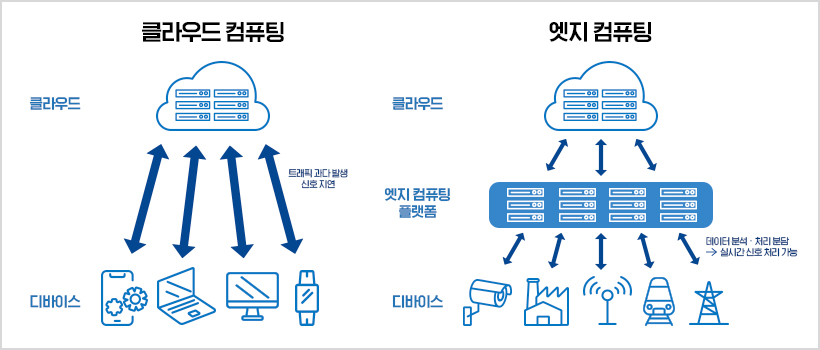

*그림 1. 모든 디바이스가 클라우드와 직접 통신하는 클라우드 컴퓨팅과 엣지 컴퓨팅 플랫폼이 중간에서 데이터를 처리하는 엣지 컴퓨팅의 비교*

그림 1의 왼쪽에서는 스마트폰, 노트북, 모니터, 스마트워치가 모두 클라우드와 직접 통신하므로 트래픽이 과다하게 발생하고 신호가 지연된다. 오른쪽에서는 CCTV, 공장, 통신탑, 열차, 송전탑 같은 디바이스의 데이터를 엣지 컴퓨팅 플랫폼이 분석하고 처리를 분담하므로 실시간 신호 처리가 가능하다. 엣지에서 AI 모델을 실행하는 **AI 엣지 컴퓨팅**의 장점은 다음과 같다.

- **낮은 대역폭 요구:** 엣지 디바이스에서 모델을 실행하면 클라우드로 가는 데이터 트래픽이 감소한다. 특히 영상처럼 대규모 데이터를 전송해야 하는 경우 필요한 대역폭이 줄어 네트워크 비용을 절감하고 네트워크 혼잡을 피할 수 있다.
- **실시간 응답:** 데이터를 왕복 전송하는 시간이 없으므로 실시간 응답이 가능해진다. 자율 주행 차량, 산업 자동화, 의료처럼 실시간 응용이 필요한 분야에서 중요한 요소이다.
- **향상된 개인 정보 보호:** 사용자 데이터가 로컬에서 처리되므로 민감한 정보의 전송이 최소화된다. 이는 개인 정보 보호와 규정 준수에 도움이 되며 사용자의 신뢰를 유지할 수 있다.
- **오프라인 기능:** 네트워크 연결이 불안정한 상황에서도 작동할 수 있다. 현장이나 원격 지역에서의 응용, 이동성이 필요한 경우에 유용하다.

엣지 디바이스는 클라우드 서버보다 연산 능력과 메모리가 훨씬 작으므로, AI 엣지 컴퓨팅을 하려면 모델을 경량화해야 한다.

### 1.3 엣지 디바이스와 적용 사례

대표적인 엣지 AI 하드웨어로 NVIDIA의 임베디드 보드 시리즈인 **Jetson**이 있다. 손바닥만 한 보드에 GPU가 들어 있어 딥러닝 모델의 추론을 현장에서 실행할 수 있다. 모듈 형태의 제품과 입출력 단자를 갖춘 개발자 키트가 있으며, 성능과 전력 소비에 따라 여러 등급으로 나뉜다.

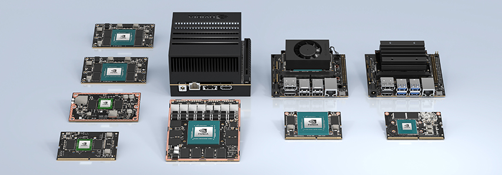

*그림 2. NVIDIA Jetson 계열의 여러 임베디드 모듈과 개발자 키트*

다음은 경량 모델을 엣지 디바이스로 현장에 적용한 사례이다. 카메라 하우징 안에 CCTV 모듈, 임베디드 보드(Jetson Nano), LTE 통신 모듈을 함께 넣은 기구물을 만들어 시설의 출입구에 설치하였다.

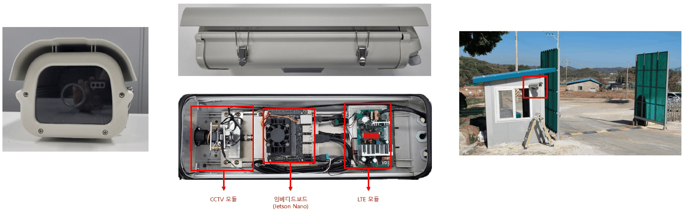

*그림 3. CCTV 모듈, 임베디드 보드(Jetson Nano), LTE 모듈을 넣은 카메라 기구물과 출입구에 설치한 모습*

이 장치는 출입하는 차량을 현장에서 인식하고, 인식 결과(출입 일시, 차량 정보, 촬영 사진)만 LTE로 서버에 보낸다. 관리자는 웹 화면의 출입 차량 목록에서 각 기록의 일시와 사진을 확인한다. 영상 전체를 서버로 보내지 않으므로 통신량이 적고, 통신이 끊겨도 현장에서 인식을 계속할 수 있다. 1.2절의 장점이 그대로 드러나는 구성이다.

### 1.4 경량화 방법의 분류

경량화 방법은 크게 세 가지로 나눌 수 있다.

1. **알고리즘 경량화:** 이미 학습된 모델이나 학습 과정에 기법을 적용하여 모델을 줄인다. 가지치기(pruning), 양자화(quantization) 등이 있다.
2. **효율적인 딥러닝 네트워크 구조 설계:** 처음부터 파라미터와 연산이 적은 구조를 설계한다. SqueezeNet(3절), MobileNet(4절), ShuffleNet(5절) 등이 있다.
3. **하드웨어 가속화:** 딥러닝 연산에 특화된 칩(GPU, NPU 등)과 그에 맞춘 소프트웨어로 같은 모델을 더 빠르게 실행한다. 아래에서는 앞의 두 가지를 다룬다.

**가지치기(pruning)** 는 학습된 신경망에서 중요도가 낮은 연결(가중치)이나 뉴런을 제거하는 방법이다. 크기가 매우 작은 가중치는 출력에 거의 영향을 주지 않으므로 0으로 만들어 없애고(**pruning synapses**), 들어오거나 나가는 연결이 모두 사라진 뉴런은 통째로 제거한다(**pruning neurons**). 가지치기 뒤에는 남은 가중치를 다시 학습(미세 조정)하여 정확도를 회복한다. Han 등은 이 방법으로 AlexNet의 파라미터를 6,100만 개에서 670만 개로 9배 줄이면서도 정확도를 유지하였다 [1].

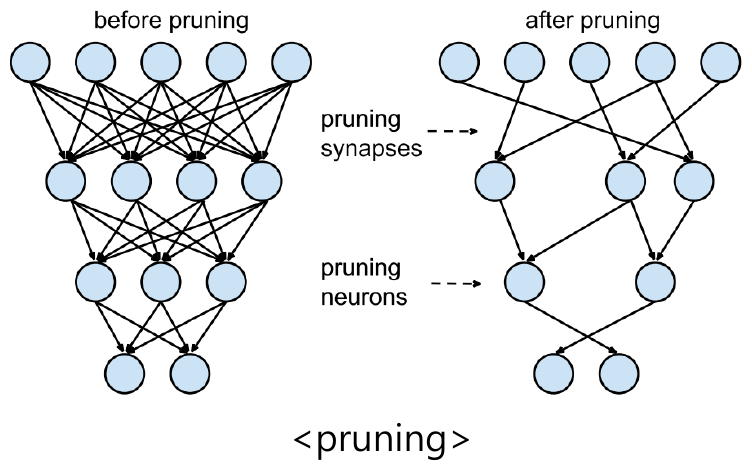

*그림 4. 가지치기 전의 완전 연결 신경망과, 시냅스(연결)와 뉴런을 제거한 가지치기 후의 신경망*

**양자화(quantization)** 는 가중치와 활성값을 표현하는 비트 수를 줄이는 방법이다. 보통 학습은 32비트 부동소수점(FP32)으로 하지만, 추론할 때는 8비트 정수(INT8)로 바꾸어도 정확도가 크게 떨어지지 않는 경우가 많다. 32비트를 8비트로 바꾸면 모델 크기가 1/4이 되고, 정수 연산은 부동소수점 연산보다 빠르고 전력을 적게 쓴다.

실수 $r$을 정수 $q$로 바꾸는 가장 기본적인 방법은 실수 범위를 정수 범위에 선형으로 대응시키는 것이다. **스케일(scale)** $S$와 **영점(zero point)** $Z$를 정하면 다음 관계가 성립한다 [2].

```math
r \approx S\,(q - Z), \qquad q = \mathrm{round}\left(\frac{r}{S}\right) + Z
```

실수 범위의 최솟값과 최댓값을 정수 범위의 양 끝(예: 0\~255)에 대응시키면 비대칭 양자화이고, $Z = 0$으로 두고 가장 큰 절댓값을 정수 범위의 끝(예: $-127$\~$`127`$)에 대응시키면 대칭 양자화이다. 대칭 양자화의 예를 계산하면 다음과 같다.

1. FP32 가중치 $w = [-1.234, 0.456, 2.54]$에서 가장 큰 절댓값은 2.54이므로 스케일은 $S = 2.54 / 127 = 0.02$이다.
2. 각 값을 $S$로 나누어 반올림하면 $[-61.7, 22.8, 127] \to q = [-62, 23, 127]$이다. 이 정수들이 8비트로 저장된다.
3. 추론할 때 $S$를 곱해 복원하면 $\hat{w} = [-1.24, 0.46, 2.54]$이다. 원래 값과의 오차는 최대 0.006으로, 스케일의 절반($`0.01`$)을 넘지 않는다.

```python
import numpy as np

w = np.array([-1.234, 0.456, 2.54], dtype=np.float32)   # FP32 가중치
s = np.abs(w).max() / 127                                # 스케일: 가장 큰 절댓값을 127에 대응
q = np.clip(np.round(w / s), -127, 127).astype(np.int8)  # INT8로 양자화
w_hat = q.astype(np.float32) * s                         # 역양자화(근삿값 복원)

print(round(float(s), 4), q, w_hat.round(3), np.abs(w - w_hat).max().round(4))
```

```text
0.02 [-62  23 127] [-1.24  0.46  2.54] 0.006
```

`np.clip`은 반올림한 값이 정수 범위를 벗어나지 않도록 자르고, `astype(np.int8)`은 8비트 정수로 저장한다. 실제 모델에서는 같은 원리로 가중치 행렬 전체(또는 출력 채널마다)에 스케일 하나를 정해 FP32 행렬을 8비트 정수 행렬로 바꾼다.

가지치기, 양자화, 허프만 부호화를 함께 쓰는 Deep Compression은 AlexNet의 저장 공간을 240MB에서 6.9MB로 35배 줄였다 [3]. 3절의 SqueezeNet은 이러한 알고리즘 경량화와 효율적인 구조 설계를 결합하면 얼마나 작아질 수 있는지를 보여 준다.

---

<br>

## 2. ResNet과 1×1 합성곱

경량 모델의 핵심 부품인 1×1 합성곱과 병목 구조를 3강의 ResNet에서 다시 살펴본다.

### 2.1 잔차 블록

ResNet은 **스킵 연결(skip connection)** 을 이용한 **잔차 학습(residual learning)** 으로, 층이 깊어질수록 학습이 어려워지는 **성능 저하(degradation)** 문제를 해결하였다 [4]. 일반적인 CNN은 쌓인 층이 원하는 함수 $H(\mathbf{x})$를 직접 학습하지만, 잔차 블록은 입력과의 차이인 잔차 $\mathcal{F}(\mathbf{x}) = H(\mathbf{x}) - \mathbf{x}$만 학습하고 입력 $\mathbf{x}$를 출력에 그대로 더한다.

```math
\text{출력} = \mathcal{F}(\mathbf{x}) + \mathbf{x}
```

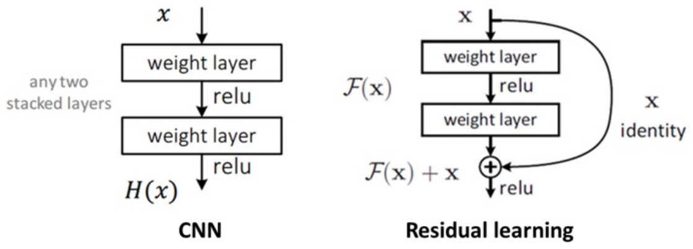

*그림 5. 쌓인 두 층이 H(x)를 직접 학습하는 일반 CNN과 F(x)를 학습하고 스킵 연결로 x를 더하는 잔차 학습의 비교*

최적의 함수가 항등 함수에 가깝다면 $\mathcal{F}(\mathbf{x})$를 0에 가깝게 만들기만 하면 되므로 학습이 쉽고, 더하기 경로를 통해 기울기가 앞쪽 층까지 잘 전달된다.

> **주의:** ResNet은 흔히 기울기 소실 문제를 해결한 모델로 소개되지만, 원 논문은 깊은 일반 신경망의 성능 저하가 배치 정규화를 써서 순전파 신호와 역전파 기울기가 소실되지 않는 상태에서도 나타나므로 기울기 소실 때문일 가능성은 낮고, 깊은 신경망을 최적화하기 어려운 문제라고 설명한다 [4]. 잔차 학습은 이 최적화의 어려움을 줄이며, 더하기 경로로 기울기가 잘 전달되는 것은 이를 돕는 보완적인 효과이다(3강 4.3절).

### 2.2 병목 블록

**병목 블록(bottleneck block)** 은 모델을 깊게 쌓으면서 동시에 파라미터를 줄이는 전략이다. 3×3 합성곱 두 개로 이루어진 기본 블록 대신, 1×1, 3×3, 1×1 합성곱 세 개를 쓴다.

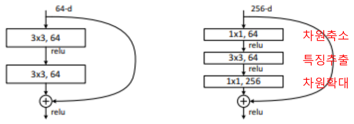

*그림 6. 3×3 합성곱 두 개로 이루어진 기본 블록(64차원)과 1×1로 차원 축소, 3×3으로 특징 추출, 1×1로 차원 확대를 하는 병목 블록(256차원)*

1. **차원 축소:** 1×1 합성곱이 256채널 입력을 64채널로 줄인다.
2. **특징 추출:** 줄어든 64채널에서 3×3 합성곱으로 공간적 특징을 추출한다.
3. **차원 확대:** 1×1 합성곱이 다시 256채널로 늘린다.

파라미터 수(편향 제외)를 비교하면 다음과 같다. 합성곱 층의 파라미터 수는 (커널 높이 × 커널 너비 × 입력 채널 × 출력 채널)이다.

| 블록 | 계산 | 파라미터 수 |
|:-----|:-----|:-----|
| 기본 블록(64채널) | $2 \times (3 \times 3 \times 64 \times 64)$ | 73,728 |
| 병목 블록(256채널) | $1 \times 1 \times 256 \times 64 + 3 \times 3 \times 64 \times 64 + 1 \times 1 \times 64 \times 256$ | 69,632 |
| 256채널에 3×3 두 개를 그대로 쓸 때 | $2 \times (3 \times 3 \times 256 \times 256)$ | 1,179,648 |

*표 1. 기본 블록과 병목 블록의 파라미터 수 비교*

병목 블록은 4배 넓은 256채널을 다루면서도 64채널 기본 블록보다 파라미터가 적다. ResNet-50, 101, 152는 이 병목 블록을 쌓아 만든다. 다음 표에서 대괄호는 블록을 이루는 합성곱(커널 크기, 출력 채널)이고, 그 뒤의 ×는 블록의 반복 횟수이다.

| 층 | 출력 크기 | 18층 | 34층 | 50층 | 101층 | 152층 |
|:-----|:-----|:-----|:-----|:-----|:-----|:-----|
| conv1 | 112×112 | 7×7, 64, 스트라이드 2 | 같음 | 같음 | 같음 | 같음 |
| conv2_x (3×3 최대 풀링, 스트라이드 2 뒤) | 56×56 | [3×3, 64; 3×3, 64] ×2 | [3×3, 64; 3×3, 64] ×3 | [1×1, 64; 3×3, 64; 1×1, 256] ×3 | [1×1, 64; 3×3, 64; 1×1, 256] ×3 | [1×1, 64; 3×3, 64; 1×1, 256] ×3 |
| conv3_x | 28×28 | [3×3, 128; 3×3, 128] ×2 | [3×3, 128; 3×3, 128] ×4 | [1×1, 128; 3×3, 128; 1×1, 512] ×4 | [1×1, 128; 3×3, 128; 1×1, 512] ×4 | [1×1, 128; 3×3, 128; 1×1, 512] ×8 |
| conv4_x | 14×14 | [3×3, 256; 3×3, 256] ×2 | [3×3, 256; 3×3, 256] ×6 | [1×1, 256; 3×3, 256; 1×1, 1024] ×6 | [1×1, 256; 3×3, 256; 1×1, 1024] ×23 | [1×1, 256; 3×3, 256; 1×1, 1024] ×36 |
| conv5_x | 7×7 | [3×3, 512; 3×3, 512] ×2 | [3×3, 512; 3×3, 512] ×3 | [1×1, 512; 3×3, 512; 1×1, 2048] ×3 | [1×1, 512; 3×3, 512; 1×1, 2048] ×3 | [1×1, 512; 3×3, 512; 1×1, 2048] ×3 |
| 출력 | 1×1 | 평균 풀링, 1000차원 완전 연결, softmax | 같음 | 같음 | 같음 | 같음 |
| FLOPs | | 1.8×10⁹ | 3.6×10⁹ | 3.8×10⁹ | 7.6×10⁹ | 11.3×10⁹ |

*표 2. ImageNet용 ResNet의 깊이별 구조*

34층과 50층은 연산량이 3.6×10⁹와 3.8×10⁹로 비슷하지만, 50층은 병목 블록을 써서 같은 계산량으로 층을 더 깊게 쌓는다.

### 2.3 1×1 합성곱

**1×1 합성곱(1×1 convolution)** 은 커널의 크기가 1×1인 합성곱이다. 공간 방향으로는 한 화소만 보지만 채널 방향으로는 모든 입력 채널을 본다. 즉 각 위치에서 입력 채널 값들의 가중합을 계산하므로, 위치마다 같은 완전 연결 층을 적용하는 것과 같다 [5].

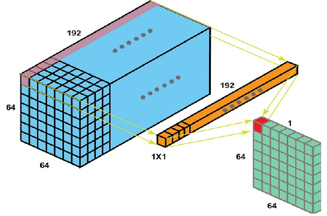

*그림 7. 64×64×192 입력의 각 위치에서 1×1×192 필터가 192개 채널의 가중합을 계산하여 64×64×1 출력을 만드는 1×1 합성곱*

1×1 합성곱의 역할은 다음과 같다.

- **차원 축소:** 1×1 합성곱은 입력 텐서의 채널 차원에 대해 연산하므로, 출력 채널 수를 적절히 정하면 공간 차원은 그대로 두고 채널 수만 줄일 수 있다. 이는 모델의 복잡성을 줄이고 계산 비용을 절감하는 효과적인 차원 축소이다.
- **비선형성 도입:** 1×1 합성곱을 많이 쓰면 그 수에 비례해 비선형 활성화 함수도 많이 쓰게 된다. 이를 통해 더 복잡하고 풍부한 패턴을 인식할 수 있다.
- **정보 융합:** 채널 사이의 상호 작용을 가능하게 하여, 각 위치의 특징이 서로 다른 채널끼리 조합되고 모델이 더 많은 정보를 학습하도록 돕는다.
- **연산 비용 감소:** 1×1 합성곱은 입력과 출력 사이의 연산이 단순하여 계산 비용이 낮다. 따라서 모델을 더 효율적으로 학습하고 추론할 수 있다.

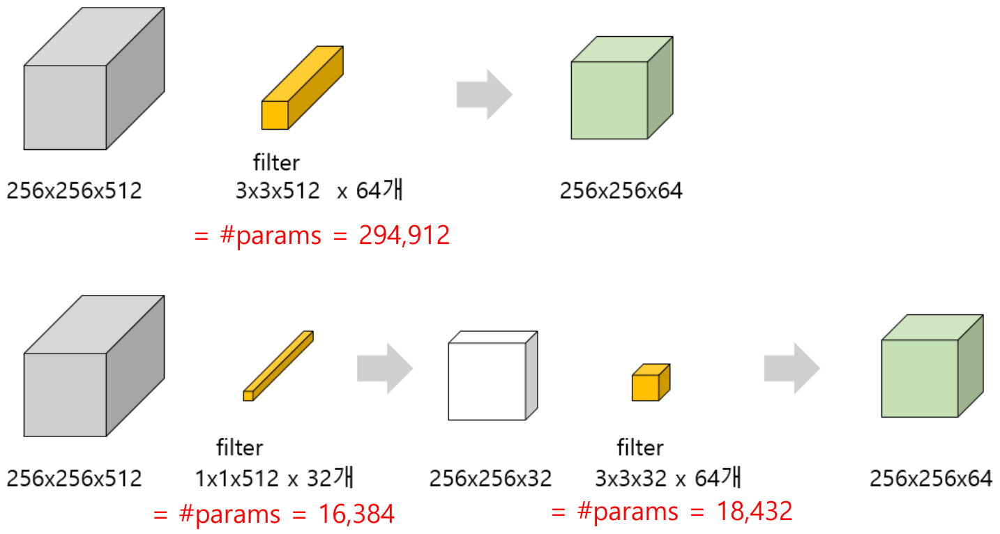

*그림 8. 3×3 합성곱 하나로 채널을 줄이는 경우(파라미터 294,912개)와 1×1 합성곱으로 먼저 32채널로 줄인 뒤 3×3 합성곱을 쓰는 경우(16,384 + 18,432개)의 비교*

그림 8은 256×256×512 입력을 256×256×64 출력으로 바꾸는 두 방법이다.

- **3×3 합성곱 하나:** 3×3×512 필터 64개를 쓰므로 파라미터는 $3 \times 3 \times 512 \times 64 = 294{,}912$개이다.
- **1×1 합성곱으로 줄인 뒤 3×3 합성곱:** 1×1×512 필터 32개로 256×256×32를 만들고($1 \times 1 \times 512 \times 32 = 16{,}384$개), 3×3×32 필터 64개로 256×256×64를 만든다($3 \times 3 \times 32 \times 64 = 18{,}432$개). 합계는 34,816개이다.

두 번째 방법의 파라미터는 첫 번째의 약 1/8.5이다. 출력 위치마다 각 가중치가 한 번씩 곱해지므로 곱셈 수도 같은 비율로 줄어, 약 193억 번($`256 \times 256 \times 294{,}912`$)이 약 22.8억 번($`256 \times 256 \times 34{,}816`$)이 된다.

---

<br>

## 3. SqueezeNet

### 3.1 기여

**SqueezeNet**은 2016년에 발표된 모델로, AlexNet [6] 수준의 정확도를 50배 적은 파라미터로 달성하고 모델 크기를 0.5MB 미만으로 줄였다 [7]. 주요 기여는 다음과 같다.

1. **Fire 모듈: 파라미터 효율성을 극대화한 설계.** 1×1 합성곱(squeeze 단계)으로 채널 수를 줄이고, 1×1과 3×3 합성곱(expand 단계)으로 정보 표현력을 보존한다. 이 구조로 계산량을 줄이면서도 높은 정확도를 유지하여, 경량화 네트워크의 새로운 접근법을 제안하였다.
2. **소형화된 모델 크기: AlexNet 대비 50배 작은 네트워크.** 기존 대형 모델과 비슷한 성능을 내면서 파라미터 수를 대폭 줄여 메모리와 저장 공간을 절감하였다. 모델이 작으므로 메모리가 제한된 모바일, IoT 장치, FPGA에도 올릴 수 있다(연산량은 AlexNet과 비슷한 수준이다).
3. **모델 압축과 배포의 용이성.** 가지치기, 양자화 같은 압축 기법과의 결합을 염두에 둔 설계로 추가적인 크기 감소와 배포 효율성을 극대화하였다. 경량화된 구조이므로 네트워크 전송과 임베디드 응용에서 실용성이 높다.

### 3.2 Fire 모듈

SqueezeNet의 설계는 세 가지 전략에 바탕을 둔다 [7].

1. **3×3 필터를 1×1 필터로 바꾼다.** 1×1 필터는 3×3 필터보다 파라미터가 9배 적다.
2. **3×3 필터에 들어가는 입력 채널 수를 줄인다.** 3×3 합성곱의 파라미터는 (입력 채널 × 출력 채널 × 9)이므로, 입력 채널을 먼저 줄이면 파라미터가 줄어든다.
3. **다운샘플링을 신경망의 뒤쪽에서 한다.** 앞쪽 층들이 큰 활성화 맵을 다루게 하여 정확도를 높인다.

전략 1과 2를 구현한 부품이 **Fire 모듈(fire module)** 이다.

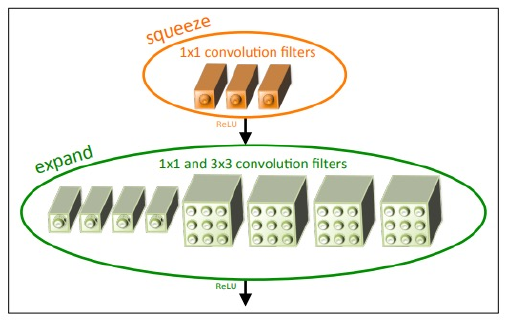

*그림 9. 1×1 필터로 이루어진 squeeze 층과 1×1, 3×3 필터로 이루어진 expand 층으로 구성된 Fire 모듈(squeeze 필터 3개, expand 1×1 필터 4개, 3×3 필터 4개의 예)*

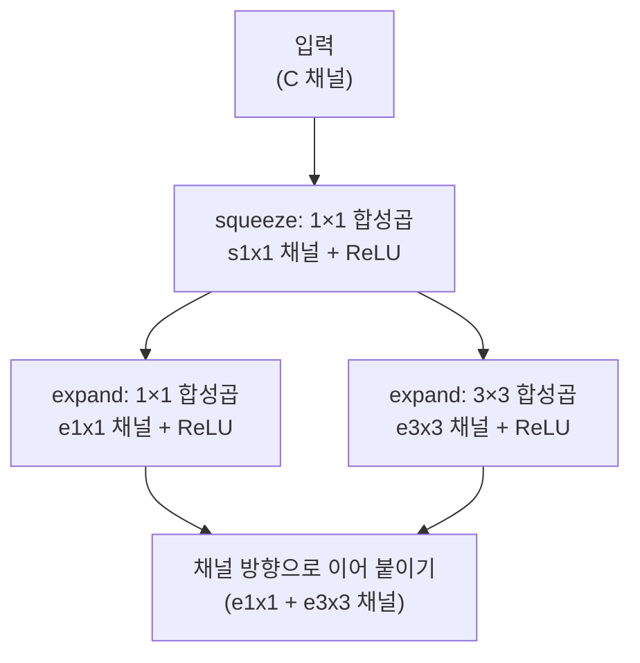

*그림 10. Fire 모듈의 데이터 흐름*

Fire 모듈은 다음과 같이 동작한다.

- **squeeze 층:** $s_{1\times1}$개의 1×1 필터로 입력 채널을 줄인다(전략 2).
- **expand 층:** 줄어든 입력에 $e_{1\times1}$개의 1×1 필터와 $e_{3\times3}$개의 3×3 필터를 나란히 적용하고(전략 1), 두 결과를 채널 방향으로 이어 붙인다. 출력 채널은 $e_{1\times1} + e_{3\times3}$개이다.
- $s_{1\times1} < e_{1\times1} + e_{3\times3}$이 되도록 설정하여, 3×3 필터에 들어가는 채널 수를 제한한다.

**파라미터 계산 예: fire2.** 입력이 55×55×96이고 $s_{1\times1} = 16$, $e_{1\times1} = 64$, $e_{3\times3} = 64$인 fire2의 파라미터는 다음과 같다(편향 포함).

```math
\underbrace{96 \times 16 + 16}_{\text{squeeze}} + \underbrace{16 \times 64 + 64}_{\text{expand 1×1}} + \underbrace{9 \times 16 \times 64 + 64}_{\text{expand 3×3}} = 1{,}552 + 1{,}088 + 9{,}280 = 11{,}920
```

같은 입력에서 같은 128채널을 3×3 합성곱 하나로 만들면 $9 \times 96 \times 128 + 128 = 110{,}720$개가 필요하므로, Fire 모듈은 파라미터를 약 1/9로 줄인다. 다음 코드는 Fire 모듈을 PyTorch로 구현하고 이 값을 확인한다.

```python
import torch
import torch.nn as nn

class Fire(nn.Module):
    def __init__(self, in_ch, s1x1, e1x1, e3x3):
        super().__init__()
        self.squeeze = nn.Conv2d(in_ch, s1x1, kernel_size=1)                 # 채널 축소
        self.expand1x1 = nn.Conv2d(s1x1, e1x1, kernel_size=1)               # 1x1 확장
        self.expand3x3 = nn.Conv2d(s1x1, e3x3, kernel_size=3, padding=1)    # 3x3 확장
        self.relu = nn.ReLU(inplace=True)

    def forward(self, x):
        x = self.relu(self.squeeze(x))
        return torch.cat([self.relu(self.expand1x1(x)),
                          self.relu(self.expand3x3(x))], dim=1)             # 채널 방향으로 이어 붙임

fire2 = Fire(in_ch=96, s1x1=16, e1x1=64, e3x3=64)
x = torch.randn(1, 96, 55, 55)
print(fire2(x).shape)
print(sum(p.numel() for p in fire2.parameters()))
print(sum(p.numel() for p in nn.Conv2d(96, 128, kernel_size=3, padding=1).parameters()))
```

```text
torch.Size([1, 128, 55, 55])
11920
110720
```

`padding=1`은 3×3 합성곱의 출력 크기를 입력과 같은 55×55로 유지하여 1×1 확장의 출력과 이어 붙일 수 있게 한다. `torch.cat(..., dim=1)`은 (배치, 채널, 높이, 너비)의 두 번째 축인 채널 방향으로 64채널 두 개를 이어 128채널을 만든다.

### 3.3 전체 구조

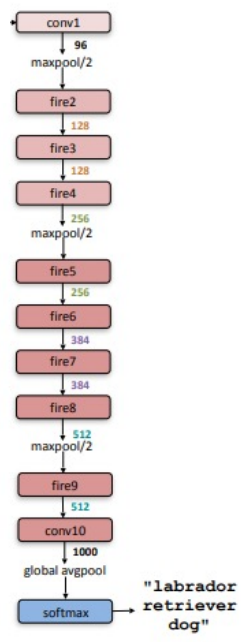

*그림 11. conv1, fire2~fire9, conv10, 전역 평균 풀링, softmax로 이루어진 SqueezeNet의 전체 구조와 각 모듈 사이의 채널 수*

SqueezeNet은 합성곱 층(conv1)으로 시작하여 Fire 모듈 8개(fire2\~fire9)를 거치고, 마지막 합성곱 층(conv10)과 전역 평균 풀링으로 끝난다. Fire 모듈의 채널 수는 뒤로 갈수록 점차 늘어나고, 최대 풀링(스트라이드 2)은 conv1, fire4, fire8 뒤에만 두어 다운샘플링을 늦춘다(전략 3). 완전 연결 층 대신 1000채널의 1×1 합성곱(conv10)과 전역 평균 풀링을 써서 파라미터를 더 줄인다.

| 층 | 출력 크기 | 필터 크기 / 스트라이드 | $s_{1\times1}$ | $e_{1\times1}$ | $e_{3\times3}$ | 파라미터 수 |
|:-----|:-----|:-----|:---:|:---:|:---:|:---:|
| 입력 이미지 | 224×224×3 | | | | | |
| conv1 | 111×111×96 | 7×7/2 (×96) | | | | 14,208 |
| maxpool1 | 55×55×96 | 3×3/2 | | | | |
| fire2 | 55×55×128 | | 16 | 64 | 64 | 11,920 |
| fire3 | 55×55×128 | | 16 | 64 | 64 | 12,432 |
| fire4 | 55×55×256 | | 32 | 128 | 128 | 45,344 |
| maxpool4 | 27×27×256 | 3×3/2 | | | | |
| fire5 | 27×27×256 | | 32 | 128 | 128 | 49,440 |
| fire6 | 27×27×384 | | 48 | 192 | 192 | 104,880 |
| fire7 | 27×27×384 | | 48 | 192 | 192 | 111,024 |
| fire8 | 27×27×512 | | 64 | 256 | 256 | 188,992 |
| maxpool8 | 13×13×512 | 3×3/2 | | | | |
| fire9 | 13×13×512 | | 64 | 256 | 256 | 197,184 |
| conv10 | 13×13×1000 | 1×1/1 (×1000) | | | | 513,000 |
| avgpool10 | 1×1×1000 | 13×13/1 | | | | |
| 합계 | | | | | | 1,248,424 |

*표 3. SqueezeNet의 층별 크기와 파라미터 수*

원 논문의 표는 가지치기와 6비트 양자화를 적용한 뒤의 정보도 함께 싣는다. 각 층의 일부 가중치를 가지치기하여 남긴 파라미터는 모두 421,098개이다.

### 3.4 결과

SqueezeNet의 목표는 AlexNet을 경량화(압축)하는 것이었다. 다음 표는 AlexNet을 여러 압축 기법으로 줄인 결과와 SqueezeNet을 비교한다. 모델 크기는 학습된 모델의 모든 파라미터를 저장하는 데 필요한 바이트 수이다.

| CNN 구조 | 압축 방법 | 데이터 형식 | 원래 크기 → 압축 후 크기 | AlexNet 대비 크기 감소 | Top-1 정확도 | Top-5 정확도 |
|:-----|:-----|:-----|:-----|:---:|:---:|:---:|
| AlexNet | 없음(기준) | 32비트 | 240MB | 1배 | 57.2% | 80.3% |
| AlexNet | SVD | 32비트 | 240MB → 48MB | 5배 | 56.0% | 79.4% |
| AlexNet | 네트워크 가지치기 | 32비트 | 240MB → 27MB | 9배 | 57.2% | 80.3% |
| AlexNet | Deep Compression | 5\~8비트 | 240MB → 6.9MB | 35배 | 57.2% | 80.3% |
| SqueezeNet | 없음 | 32비트 | 4.8MB | 50배 | 57.5% | 80.3% |
| SqueezeNet | Deep Compression | 8비트 | 4.8MB → 0.66MB | 363배 | 57.5% | 80.3% |
| SqueezeNet | Deep Compression | 6비트 | 4.8MB → 0.47MB | 510배 | 57.5% | 80.3% |

*표 4. SqueezeNet과 AlexNet 압축 기법의 비교*

압축하지 않은 SqueezeNet만으로도 AlexNet보다 50배 작으면서 Top-1 정확도는 오히려 조금 높다. 여기에 Deep Compression을 적용하면 정확도를 유지한 채 510배 작은 0.47MB까지 줄어든다. 효율적인 구조 설계와 알고리즘 경량화가 서로 겹치지 않고 함께 효과를 낸다는 뜻이다.

---

<br>

## 4. MobileNet

### 4.1 기여

**MobileNet**은 2017년 Google이 발표한 모바일과 임베디드 비전용 경량 모델이다 [8]. 주요 기여는 다음과 같다.

1. **깊이별 분리 합성곱(depthwise separable convolution) 도입.** 표준 합성곱을 깊이별 분리 합성곱으로 대체하여 계산량과 파라미터 수를 획기적으로 줄였다. 연산 효율을 극대화하면서도 성능 손실을 최소화하여, 모바일과 임베디드 환경에서 딥러닝 모델을 실행할 수 있게 하였다.
2. **유연한 네트워크 크기 조정.** 폭 배수(width multiplier)와 해상도 배수(resolution multiplier)라는 하이퍼파라미터를 도입하여 네트워크 크기와 연산량을 응용의 요구에 맞게 조정한다. 다양한 성능과 효율의 트레이드오프를 지원해 실용성과 적응성을 높였다.
3. **모바일과 자원 제한 환경에 최적화된 설계.** 메모리 사용량 감소와 추론 속도 향상을 달성하였고, 실제 배포를 염두에 둔 설계로 모바일과 IoT 기기의 실시간 응용에 적합하다.

SqueezeNet까지는 주로 모델 크기(메모리)에 집중했다면, 깊이별 분리 합성곱은 **연산량(속도)까지 고려한** 구조이다.

### 4.2 표준 합성곱의 연산량

기호를 다음과 같이 정한다.

| 기호 | 뜻 |
|:-----|:-----|
| $D_K$ | 커널(필터)의 가로와 세로 크기 |
| $M$ | 입력 채널 수 |
| $N$ | 출력 채널 수(필터의 개수) |
| $D_F$ | 입력 특징 맵의 가로와 세로 크기 |
| $D_G$ | 출력 특징 맵의 가로와 세로 크기(스트라이드 1과 적절한 패딩이면 $`D_G = D_F`$) |

*표 5. 합성곱 연산량 계산에 쓰는 기호*

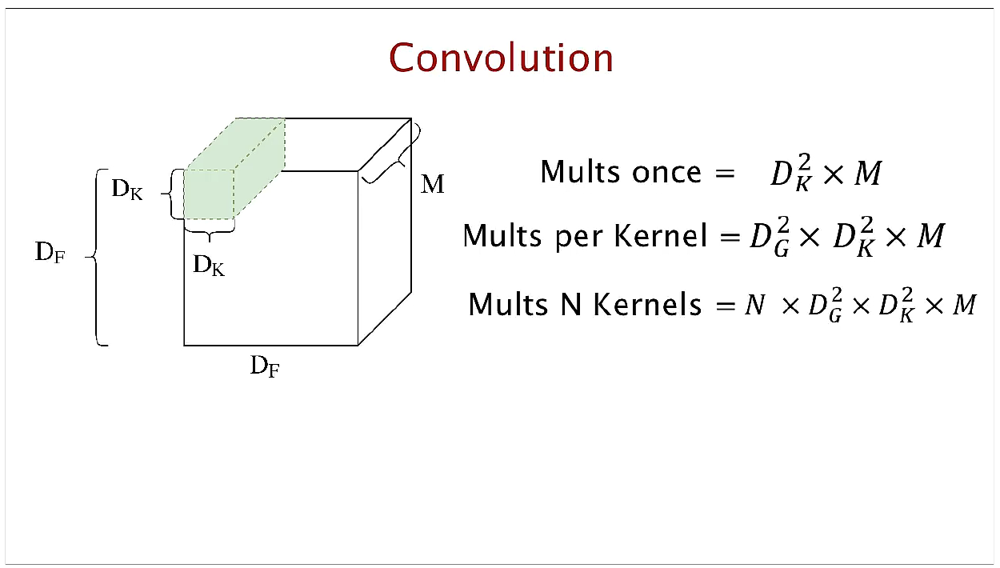

*그림 12. D_F×D_F×M 입력에 D_K×D_K×M 커널을 적용하는 표준 합성곱과 곱셈 수의 계산*

표준 합성곱에서 커널 하나는 $D_K \times D_K \times M$ 크기이며 모든 입력 채널을 한꺼번에 본다. 곱셈 수는 단계별로 다음과 같다.

```math
\text{한 위치에서 한 번(Mults once)} = D_K^2 \times M
```

```math
\text{커널 하나(Mults per Kernel)} = D_G^2 \times D_K^2 \times M
```

```math
\text{커널 } N\text{개(Mults N Kernels)} = N \times D_G^2 \times D_K^2 \times M
```

출력의 한 위치를 계산할 때 커널의 $D_K^2 M$개 가중치가 각각 한 번씩 곱해지고, 이것을 출력 위치 $D_G^2$개와 커널 $N$개에 대해 반복하기 때문이다. 표준 합성곱은 공간 방향의 특징 추출(필터링)과 채널의 결합을 한 번에 수행한다.

### 4.3 깊이별 분리 합성곱

**깊이별 분리 합성곱(depthwise separable convolution)** 은 표준 합성곱을 두 단계로 나눈다.

1. **깊이별 합성곱(depthwise convolution):** 입력의 채널을 분리하고, 각 채널에 $D_K \times D_K$ 필터를 하나씩 따로 적용한다. 공간 방향의 필터링만 하고 채널은 섞지 않는다. 출력 채널 수는 입력과 같은 $M$이다.
2. **점별 합성곱(pointwise convolution):** 깊이별 합성곱의 결과에 $1 \times 1 \times M$ 필터 $N$개를 적용하여 각 위치에서 채널들을 결합한다. 채널의 정보를 융합하는 기능을 한다.

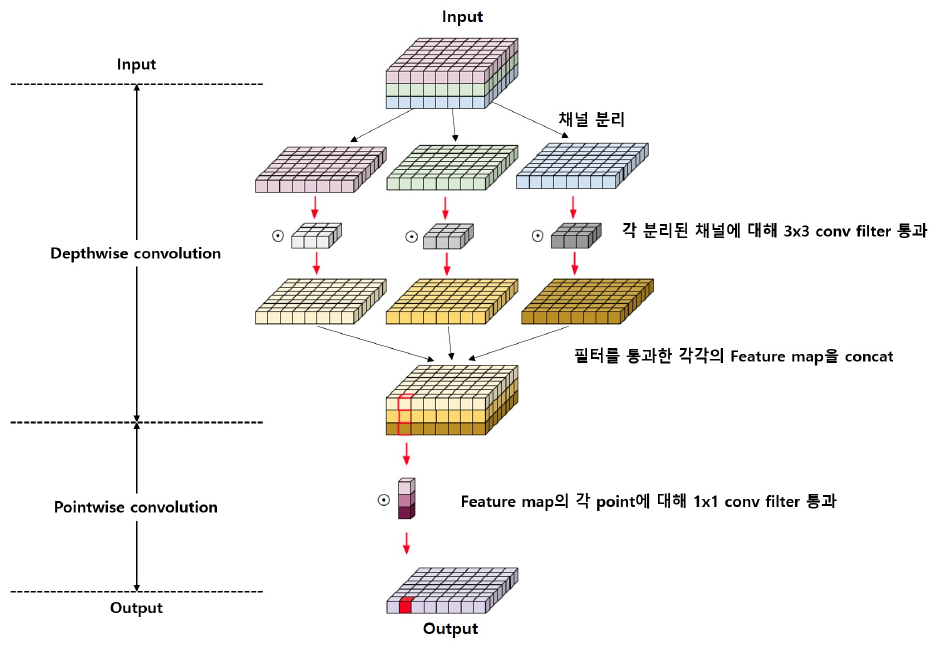

*그림 13. 입력의 채널을 분리해 채널마다 3×3 필터를 적용하고(깊이별 합성곱) 결과를 이어 붙인 뒤 각 위치에 1×1 필터를 적용하는(점별 합성곱) 깊이별 분리 합성곱*

그림 13의 위쪽에서 입력은 채널별로 분리되고(채널 분리), 분리된 각 채널이 자기만의 3×3 필터를 통과한 뒤 다시 이어 붙여진다. 아래쪽에서는 그 특징 맵의 각 위치(point)에 1×1 필터가 적용되어 출력의 한 칸이 만들어진다.

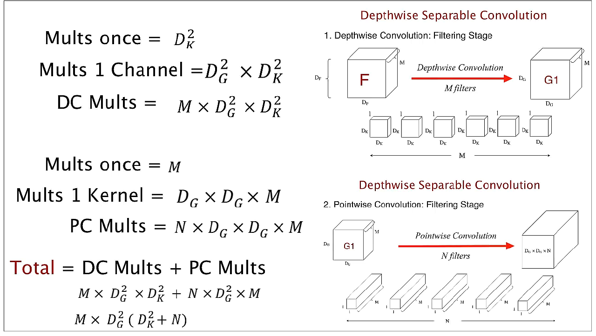

*그림 14. 깊이별 합성곱(필터링 단계, 필터 M개)과 점별 합성곱(결합 단계, 필터 N개)의 곱셈 수 계산*

**깊이별 합성곱(DC)의 곱셈 수.** 필터는 $D_K \times D_K \times 1$이므로 한 위치에서 $D_K^2$번 곱하고, 한 채널의 출력 전체에 $D_G^2 \times D_K^2$번, 채널 $M$개에 대해 다음과 같다.

```math
\text{DC Mults} = M \times D_G^2 \times D_K^2
```

**점별 합성곱(PC)의 곱셈 수.** 필터는 $1 \times 1 \times M$이므로 한 위치에서 $M$번 곱하고, 커널 하나에 $D_G \times D_G \times M$번, 커널 $N$개에 대해 다음과 같다.

```math
\text{PC Mults} = N \times D_G^2 \times M
```

**합계.**

```math
\text{Total} = \text{DC Mults} + \text{PC Mults} = M \times D_G^2 \times D_K^2 + N \times D_G^2 \times M = M \times D_G^2 \, (D_K^2 + N)
```

### 4.4 연산량과 파라미터 수의 비교

깊이별 분리 합성곱과 표준 합성곱의 곱셈 수의 비는 다음과 같다.

```math
\frac{\text{깊이별 분리 합성곱의 곱셈 수}}{\text{표준 합성곱의 곱셈 수}} = \frac{M \times D_G^2 \, (D_K^2 + N)}{N \times D_G^2 \times D_K^2 \times M} = \frac{D_K^2 + N}{D_K^2 \times N} = \frac{1}{N} + \frac{1}{D_K^2}
```

예를 들어 $N = 1{,}024$, $D_K = 3$이면 비는 $\frac{1}{1024} + \frac{1}{3^2} \approx 0.001 + 0.111 = 0.112$이다. 출력 채널 수 $N$은 보통 크므로 $1/N$은 무시할 만하고, 비는 대략 $1/D_K^2$이 된다. 3×3 커널을 쓰면 연산량이 약 8\~9배 줄어든다.

파라미터 수도 같은 방식으로 비교할 수 있다. 표준 합성곱은 $D_K^2 \times M \times N$개, 깊이별 분리 합성곱은 $D_K^2 \times M + M \times N$개이다.

**계산 예.** MobileNet 내부의 한 층($D_K = 3$, $M = N = 512$, $`D_F = D_G = 14`$)을 계산하면 다음과 같다.

| 층 | 곱셈-덧셈 수 | 파라미터 수 |
|:-----|:-----|:-----|
| 표준 합성곱 | $3^2 \times 512 \times 512 \times 14^2 = 462{,}422{,}016$ (약 462M) | $3^2 \times 512 \times 512 = 2{,}359{,}296$ (약 2.36M) |
| 깊이별 분리 합성곱 | $3^2 \times 512 \times 14^2 + 512 \times 512 \times 14^2 = 903{,}168 + 51{,}380{,}224 = 52{,}283{,}392$ (약 52.3M) | $3^2 \times 512 + 512 \times 512 = 4{,}608 + 262{,}144 = 266{,}752$ (약 0.27M) |

*표 6. $`D_K = 3`$, $`M = N = 512`$, $`D_F = 14`$인 층의 표준 합성곱과 깊이별 분리 합성곱 비교*

곱셈 수의 비는 $52.3 / 462 \approx 0.113 = 1/512 + 1/9$로, 위 공식과 일치한다. 깊이별 분리 합성곱의 연산과 파라미터는 대부분 점별 합성곱(1×1)에서 나온다는 점도 눈여겨볼 필요가 있다. 이 사실이 5절 ShuffleNet의 출발점이다.

PyTorch에서는 `nn.Conv2d`의 `groups` 인자를 입력 채널 수와 같게 두면 깊이별 합성곱이 된다.

```python
import torch.nn as nn

def n_params(m):
    return sum(p.numel() for p in m.parameters())

M, N = 512, 512
standard = nn.Conv2d(M, N, kernel_size=3, padding=1, bias=False)
depthwise = nn.Conv2d(M, M, kernel_size=3, padding=1, groups=M, bias=False)  # 채널마다 따로
pointwise = nn.Conv2d(M, N, kernel_size=1, bias=False)                      # 1x1로 채널 결합

print(n_params(standard), n_params(depthwise), n_params(pointwise),
      n_params(depthwise) + n_params(pointwise))
print(depthwise.weight.shape, pointwise.weight.shape)
```

```text
2359296 4608 262144 266752
torch.Size([512, 1, 3, 3]) torch.Size([512, 512, 1, 1])
```

`groups=M`이면 입력 채널 $M$개를 $M$개의 그룹으로 나누어 그룹마다 따로 합성곱하므로, 깊이별 합성곱의 가중치 모양이 (출력 채널, 그룹당 입력 채널, 높이, 너비) = (512, 1, 3, 3)이 된다. 결과는 표 6의 파라미터 수와 같다.

### 4.5 전체 구조

MobileNet의 기본 층은 깊이별 합성곱과 점별 합성곱 뒤에 각각 **배치 정규화(batch normalization, BN)** 와 ReLU를 둔다. 배치 정규화는 미니배치의 평균과 분산으로 각 채널의 값을 정규화하여 학습을 안정시키는 층이다 [9].

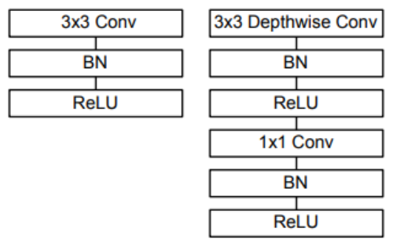

*그림 15. 3×3 합성곱, BN, ReLU로 이루어진 표준 합성곱 층과 3×3 깊이별 합성곱, BN, ReLU, 1×1 합성곱, BN, ReLU로 이루어진 깊이별 분리 합성곱 층*

전체 구조는 첫 층만 표준 합성곱이고 나머지는 깊이별 분리 합성곱이다. 깊이별 합성곱과 점별 합성곱을 각각 한 층으로 세면 28개 층이다. 다운샘플링은 일부 깊이별 합성곱의 스트라이드를 2로 두어 처리한다. 표에서 dw는 깊이별 합성곱, s1과 s2는 스트라이드 1과 2이고, 5×는 깊이별 합성곱과 점별 합성곱의 쌍을 5번 반복한다는 뜻이다.

| 종류 / 스트라이드 | 필터 모양 | 입력 크기 |
|:-----|:-----|:-----|
| Conv / s2 | 3×3×3×32 | 224×224×3 |
| Conv dw / s1 | 3×3×32 dw | 112×112×32 |
| Conv / s1 | 1×1×32×64 | 112×112×32 |
| Conv dw / s2 | 3×3×64 dw | 112×112×64 |
| Conv / s1 | 1×1×64×128 | 56×56×64 |
| Conv dw / s1 | 3×3×128 dw | 56×56×128 |
| Conv / s1 | 1×1×128×128 | 56×56×128 |
| Conv dw / s2 | 3×3×128 dw | 56×56×128 |
| Conv / s1 | 1×1×128×256 | 28×28×128 |
| Conv dw / s1 | 3×3×256 dw | 28×28×256 |
| Conv / s1 | 1×1×256×256 | 28×28×256 |
| Conv dw / s2 | 3×3×256 dw | 28×28×256 |
| Conv / s1 | 1×1×256×512 | 14×14×256 |
| 5× Conv dw / s1 | 3×3×512 dw | 14×14×512 |
| 5× Conv / s1 | 1×1×512×512 | 14×14×512 |
| Conv dw / s2 | 3×3×512 dw | 14×14×512 |
| Conv / s1 | 1×1×512×1024 | 7×7×512 |
| Conv dw / s1 | 3×3×1024 dw | 7×7×1024 |
| Conv / s1 | 1×1×1024×1024 | 7×7×1024 |
| Avg Pool / s1 | Pool 7×7 | 7×7×1024 |
| FC / s1 | 1024×1000 | 1×1×1024 |
| Softmax / s1 | 분류기 | 1×1×1000 |

*표 7. MobileNet의 본체 구조*

층 종류별로 연산과 파라미터가 어디에 몰려 있는지 보면 다음과 같다.

| 종류 | 곱셈-덧셈 비율 | 파라미터 비율 |
|:-----|:---:|:---:|
| 1×1 합성곱 | 94.86% | 74.59% |
| 3×3 깊이별 합성곱 | 3.06% | 1.06% |
| 3×3 합성곱(첫 층) | 1.19% | 0.02% |
| 완전 연결 | 0.18% | 24.33% |

*표 8. MobileNet의 층 종류별 자원 사용 비율*

연산의 약 95%와 파라미터의 약 75%가 1×1 합성곱에 있다. 1×1 합성곱은 메모리 재배열 없이 고도로 최적화된 행렬 곱(GEMM)으로 바로 계산할 수 있어 실제 실행 속도도 빠르다 [8].

### 4.6 폭 배수와 해상도 배수

MobileNet은 두 하이퍼파라미터로 모델의 크기와 연산량을 조절한다.

- **폭 배수(width multiplier) $\alpha$:** 모든 층의 입력 채널 수 $M$과 출력 채널 수 $N$을 각각 $\alpha M$, $\alpha N$으로 줄여 신경망을 균일하게 얇게 만든다. $\alpha \in (0, 1]$이며 보통 1, 0.75, 0.5, 0.25를 쓴다.
- **해상도 배수(resolution multiplier) $\rho$:** 입력 이미지의 해상도를 줄여 모든 특징 맵의 크기 $D_F$를 $\rho D_F$로 만든다. $\rho \in (0, 1]$이며, 실제로는 입력 해상도를 224, 192, 160, 128로 정해 간접적으로 설정한다. $\rho = 1$이 기본 MobileNet이다.

두 배수를 적용한 깊이별 분리 합성곱 층의 곱셈 수는 다음과 같다.

```math
D_K \cdot D_K \cdot \alpha M \cdot \rho D_F \cdot \rho D_F + \alpha M \cdot \alpha N \cdot \rho D_F \cdot \rho D_F
```

두 번째 항이 대부분을 차지하므로 연산량은 대략 $\alpha^2$에, 그리고 정확히 $\rho^2$에 비례하여 줄어든다. 파라미터 수는 $\alpha^2$에 대략 비례하여 줄고 $\rho$와는 무관하다. 4.4절의 층($D_K = 3$, $M = N = 512$, $`D_F = 14`$)에 차례로 적용하면 다음과 같다. 각 행은 윗 행에 누적하여 적용한 결과이다.

| 층 / 변경 | 곱셈-덧셈(백만) | 파라미터(백만) |
|:-----|:---:|:---:|
| 표준 합성곱 | 462 | 2.36 |
| 깊이별 분리 합성곱 | 52.3 | 0.27 |
| $\alpha = 0.75$ | 29.6 | 0.15 |
| $\rho = 0.714$ | 15.1 | 0.15 |

*표 9. 표준 합성곱에 깊이별 분리 합성곱, 폭 배수, 해상도 배수를 차례로 적용한 자원 사용량*

$\alpha = 0.75$이면 $M = N = 384$이므로 $9 \times 384 \times 14^2 + 384 \times 384 \times 14^2 = 29{,}578{,}752$이고, 여기에 $\rho = 0.714$를 적용하면 $D_F = 10$이 되어 $9 \times 384 \times 10^2 + 384 \times 384 \times 10^2 = 15{,}091{,}200$이다.

### 4.7 결과

| 모델 | ImageNet 정확도 | 곱셈-덧셈(백만) | 파라미터(백만) |
|:-----|:---:|:---:|:---:|
| 표준 합성곱으로 만든 MobileNet | 71.7% | 4,866 | 29.3 |
| MobileNet | 70.6% | 569 | 4.2 |

*표 10. 깊이별 분리 합성곱과 표준 합성곱으로 만든 MobileNet의 비교*

같은 구조를 표준 합성곱으로 만들면 정확도는 1.1%p 높지만, 깊이별 분리 합성곱을 쓴 MobileNet은 곱셈-덧셈을 약 8.6배, 파라미터를 약 7배 줄인다.

---

<br>

## 5. ShuffleNet

### 5.1 기여

**ShuffleNet**은 2018년 발표된, 연산 능력이 매우 제한된(10\~150 MFLOPs 수준) 모바일 기기를 위한 모델이다 [10]. 주요 기여는 다음과 같다.

1. **채널 셔플(channel shuffle) 메커니즘 도입.** 채널 사이의 정보 교환을 강화하는 기법으로, 네트워크의 효율성을 높이면서도 성능 손실을 최소화한다.
2. **점별 그룹 합성곱(pointwise group convolution) 활용.** 기존의 점별 합성곱(1×1 합성곱)은 계산량이 많았다. 이를 그룹으로 나누어 계산하여 연산량과 파라미터 수를 크게 줄이고, 그룹 수를 조정하여 성능과 효율의 트레이드오프를 유연하게 설정한다.
3. **모바일과 저자원 환경에 최적화된 설계.** 깊이별 합성곱, 점별 그룹 합성곱, 채널 셔플을 조합하여 FLOPs를 크게 줄이면서도 높은 정확도를 유지하고, 모바일 기기와 IoT 장치에 적합한 추론 속도와 메모리 사용량을 제공한다.

### 5.2 아이디어: 1×1 합성곱에 그룹 합성곱 적용

표 8에서 보았듯 MobileNet의 연산은 약 95%가 1×1 합성곱에서 나온다. 깊이별 합성곱은 이미 가벼우므로, 더 줄이려면 1×1 합성곱을 가볍게 해야 한다. ShuffleNet의 아이디어는 **1×1 합성곱에 그룹 합성곱을 적용하는 것**이다.

> **용어 정의:** **그룹 합성곱(group convolution)** 은 입력 채널을 $g$개의 그룹으로 나누고, 각 그룹의 출력 채널이 같은 그룹의 입력 채널만 보도록 합성곱하는 방법이다. 입력 채널 $c$개, 출력 채널 $m$개인 $k \times k$ 합성곱의 파라미터와 연산량은 $k^2 c m$에서 $g \times k^2 \frac{c}{g} \frac{m}{g} = \frac{k^2 c m}{g}$으로 $1/g$이 된다. 깊이별 합성곱은 $g$가 채널 수와 같은 극단적인 그룹 합성곱이다.

그룹 합성곱은 AlexNet [6]에서 처음 쓰였다. 당시 GPU의 메모리가 부족하여 모델을 두 GPU에 나누어 올렸고, 일부 층에서는 각 GPU의 특징 맵끼리만 합성곱하였다.

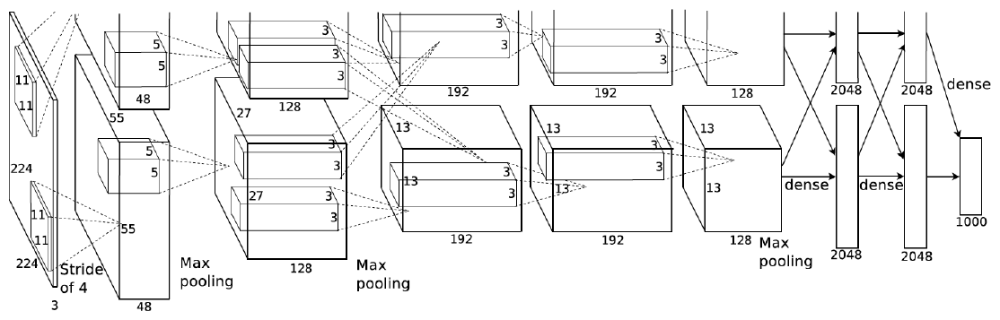

*그림 16. 두 GPU에 나뉘어 위아래 두 갈래로 계산되는 AlexNet의 구조*

예를 들어 입력 240채널, 출력 60채널인 1×1 합성곱에 그룹 3개를 쓰면 파라미터가 $240 \times 60 = 14{,}400$개에서 $240 \times 60 / 3 = 4{,}800$개로 줄어든다.

### 5.3 채널 셔플

그룹 합성곱을 그대로 쌓으면 문제가 생긴다. 어떤 그룹의 출력 채널은 같은 그룹의 입력 채널에서만 오므로, 그룹 사이의 교류(정보 교환)가 없어 성능에 악영향을 끼친다. 그룹들이 서로 다른 신경망처럼 따로 흘러가기 때문이다.

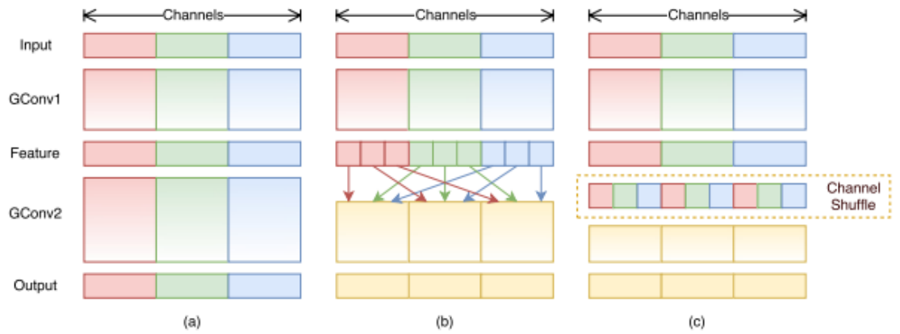

*그림 17. 그룹 합성곱 두 개를 그대로 쌓은 경우(a), 다음 그룹 합성곱이 여러 그룹의 채널을 받도록 섞은 경우(b), 이를 채널 셔플로 구현한 경우(c)*

그림 17의 (a)에서는 빨강, 초록, 파랑 그룹이 끝까지 섞이지 않는다. (b)처럼 첫 그룹 합성곱(GConv1)의 출력을 그룹마다 다시 여러 부분으로 나누어, 다음 그룹 합성곱(GConv2)의 각 그룹이 모든 그룹의 채널을 조금씩 받게 하면 정보가 섞인다. (c)는 이것을 **채널 셔플(channel shuffle)** 이라는 간단한 연산으로 구현한 것이다.

채널 셔플은 다음 세 단계로 구현한다. 채널 수가 $g \times n$일 때,

1. 채널 축을 $(g, n)$ 모양으로 바꾼다. 행이 그룹이다.
2. 두 축을 전치하여 $(n, g)$로 만든다.
3. 다시 한 줄로 편다.

```python
import torch

def channel_shuffle(x, groups):
    n, c, h, w = x.shape
    x = x.view(n, groups, c // groups, h, w)   # (그룹, 그룹당 채널)로 나눈다
    x = x.transpose(1, 2).contiguous()         # 두 축을 바꾼다
    return x.view(n, c, h, w)                  # 다시 한 줄로 편다

x = torch.arange(9).float().view(1, 9, 1, 1)   # 채널 번호 0~8을 값으로 가진 텐서
print(channel_shuffle(x, groups=3).flatten().int().tolist())
```

```text
[0, 3, 6, 1, 4, 7, 2, 5, 8]
```

채널 0\~8이 그룹 3개 [0, 1, 2], [3, 4, 5], [6, 7, 8]에 있을 때, 셔플 후의 순서는 [0, 3, 6, 1, 4, 7, 2, 5, 8]이다. 다음 그룹 합성곱이 이를 다시 세 그룹 [0, 3, 6], [1, 4, 7], [2, 5, 8]로 나누면 각 그룹이 이전의 세 그룹에서 채널을 하나씩 받는다. `contiguous()`는 전치로 바뀐 메모리 배치를 연속적으로 다시 저장하여 `view`를 쓸 수 있게 한다. 채널 셔플은 순서만 바꾸므로 파라미터가 없고 미분도 가능하여 신경망 안에 그대로 넣을 수 있다.

### 5.4 ShuffleNet 유닛

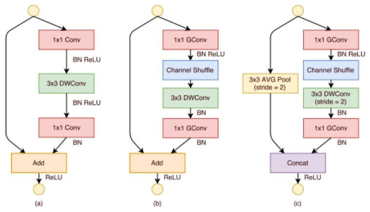

*그림 18. 깊이별 합성곱을 쓰는 병목 유닛(a), 점별 그룹 합성곱과 채널 셔플을 쓰는 ShuffleNet 유닛(b), 스트라이드 2의 ShuffleNet 유닛(c)*

- **(a) 기준 유닛:** ResNet의 병목 블록에서 가운데 3×3 합성곱을 3×3 깊이별 합성곱(DWConv)으로 바꾼 것이다.
- **(b) ShuffleNet 유닛:** 1×1 합성곱 두 개를 1×1 그룹 합성곱(GConv)으로 바꾸고, 첫 그룹 합성곱 뒤에 채널 셔플을 넣는다. 순서는 1×1 GConv, BN, ReLU, 채널 셔플, 3×3 DWConv, BN, 1×1 GConv, BN이고, 입력을 더한(Add) 뒤 ReLU를 적용한다. 깊이별 합성곱 뒤에는 ReLU를 두지 않는다.
- **(c) 다운샘플링 유닛:** 공간 크기를 절반으로 줄이는 유닛이다. 깊이별 합성곱의 스트라이드를 2로 하고, 지름길 경로에는 3×3 평균 풀링(스트라이드 2)을 둔다. 일반적으로 다운샘플링할 때는 채널 수를 늘리는데, 이 과정을 연산량을 늘리지 않고 하기 위해 두 경로를 더하는(Add) 대신 이어 붙인다(Concat). 지름길 경로의 채널이 그대로 출력에 추가되므로 거의 추가 비용 없이 채널 수가 늘어난다.

ShuffleNet에서 실제로 쓰는 구조는 (b)와 (c)이다.

### 5.5 연산량 비교

입력 크기가 $h \times w$, 입력 채널이 $c$, 병목 채널이 $m$, 그룹 수가 $g$일 때 ResNet의 병목 유닛과 ShuffleNet 유닛의 FLOPs(곱셈-덧셈 수)를 비교한다.

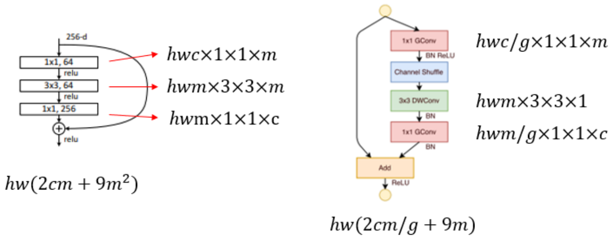

*그림 19. ResNet 병목 유닛과 ShuffleNet 유닛의 각 층의 연산량과 합계*

**ResNet 병목 유닛.** 1×1 합성곱($`c \to m`$)은 $hw \cdot c \cdot m$, 3×3 합성곱($`m \to m`$)은 $hw \cdot 9 m^2$, 1×1 합성곱($`m \to c`$)은 $hw \cdot m \cdot c$이므로 다음과 같다.

```math
hw(2cm + 9m^2)
```

**ShuffleNet 유닛.** 1×1 그룹 합성곱($`c \to m`$)은 $hw \cdot c \cdot m / g$, 3×3 깊이별 합성곱은 채널마다 $9$번이므로 $hw \cdot 9m$, 1×1 그룹 합성곱($`m \to c`$)은 $hw \cdot m \cdot c / g$이므로 다음과 같다.

```math
hw\left(\frac{2cm}{g} + 9m\right)
```

ShuffleNet은 1×1 층의 비용을 $1/g$로, 3×3 층의 비용을 $9m^2$에서 $9m$으로 줄인다. 예를 들어 $h = w = 28$, $c = 240$, $m = 60$, $g = 3$이면 다음과 같다.

```math
\text{ResNet: } 784 \times (2 \cdot 240 \cdot 60 + 9 \cdot 60^2) = 784 \times 61{,}200 = 47{,}980{,}800
```

```math
\text{ShuffleNet: } 784 \times \left(\frac{2 \cdot 240 \cdot 60}{3} + 9 \cdot 60\right) = 784 \times 10{,}140 = 7{,}949{,}760
```

ShuffleNet 유닛의 연산량은 ResNet 병목 유닛의 약 1/6이다. 같은 연산 예산이라면 ShuffleNet은 더 넓은(채널이 많은) 특징 맵을 쓸 수 있고, 이것이 작은 모델에서 정확도를 높인다.

### 5.6 전체 구조와 결과

ShuffleNet은 ShuffleNet 유닛을 세 단계(Stage)로 쌓는다. 각 단계의 첫 유닛은 스트라이드 2(그림 18의 (c))이고, 나머지는 스트라이드 1(그림 18의 (b))이다. 병목 채널 수는 각 유닛 출력 채널의 1/4이다. 그룹 수 $g$를 늘리면 같은 연산량으로 더 많은 채널을 쓸 수 있다.

| 층 | 출력 크기 | 커널 | 스트라이드 | 반복 | $g = 1$ | $g = 2$ | $g = 3$ | $g = 4$ | $g = 8$ |
|:-----|:-----|:-----|:-----|:-----|:---:|:---:|:---:|:---:|:---:|
| 이미지 | 224×224 | | | | 3 | 3 | 3 | 3 | 3 |
| Conv1 | 112×112 | 3×3 | 2 | 1 | 24 | 24 | 24 | 24 | 24 |
| MaxPool | 56×56 | 3×3 | 2 | | | | | | |
| Stage2 | 28×28 | | 2, 1 | 1, 3 | 144 | 200 | 240 | 272 | 384 |
| Stage3 | 14×14 | | 2, 1 | 1, 7 | 288 | 400 | 480 | 544 | 768 |
| Stage4 | 7×7 | | 2, 1 | 1, 3 | 576 | 800 | 960 | 1088 | 1536 |
| GlobalPool | 1×1 | 7×7 | | | | | | | |
| FC | | | | | 1000 | 1000 | 1000 | 1000 | 1000 |
| 연산량(FLOPs) | | | | | 143M | 140M | 137M | 133M | 137M |

*표 11. ShuffleNet의 구조와 그룹 수별 출력 채널 수*

Stage 행의 스트라이드 2, 1과 반복 1, 3은 스트라이드 2 유닛 1개 뒤에 스트라이드 1 유닛 3개가 온다는 뜻이다. Stage2의 첫 점별 층은 입력 채널(24개)이 적으므로 그룹 합성곱을 쓰지 않는다. 다음은 비슷한 연산량의 MobileNet과 ShuffleNet의 ImageNet 분류 오류율을 비교한 것이다. "1.0 MobileNet-224"의 1.0은 폭 배수, 224는 입력 해상도이고, "ShuffleNet 2×"의 2×는 표 11의 채널 수에 곱하는 배율이다.

| 모델 | 연산량(MFLOPs) | 분류 오류율(%) | 오류율 차이(%p) |
|:-----|:---:|:---:|:---:|
| 1.0 MobileNet-224 | 569 | 29.4 | - |
| ShuffleNet 2× ($`g = 3`$) | 524 | **26.3** | 3.1 |
| ShuffleNet 2× (SE 적용, $`g = 3`$) | 527 | **24.7** | 4.7 |
| 0.75 MobileNet-224 | 325 | 31.6 | - |
| ShuffleNet 1.5× ($`g = 3`$) | 292 | **28.5** | 3.1 |
| 0.5 MobileNet-224 | 149 | 36.3 | - |
| ShuffleNet 1× ($`g = 8`$) | 140 | **32.4** | 3.9 |
| 0.25 MobileNet-224 | 41 | 49.4 | - |
| ShuffleNet 0.5× ($`g = 4`$) | 38 | **41.6** | 7.8 |
| ShuffleNet 0.5× (얕은 구조, $`g = 3`$) | 40 | **42.8** | 6.6 |

*표 12. 비슷한 연산량에서 MobileNet과 ShuffleNet의 ImageNet 분류 오류율 비교*

모든 연산량 수준에서 ShuffleNet의 오류율이 MobileNet보다 3.1\~7.8%p 낮고, 모델이 작을수록 차이가 크다. SE는 채널마다 중요도를 학습해 곱하는 Squeeze-and-Excitation 모듈 [11]이며, 이를 더하면 오류율이 더 내려간다.

---

<br>

## 6. 경량 모델의 비교

| 모델 | 핵심 부품 | 주로 줄이는 것 | 아이디어 |
|:-----|:-----|:-----|:-----|
| ResNet(병목 블록) | 1×1, 3×3, 1×1 합성곱 | 파라미터와 연산 | 1×1로 채널을 줄인 뒤 3×3을 적용하고 다시 늘린다 |
| SqueezeNet | Fire 모듈 | 파라미터(모델 크기) | 3×3을 1×1로 바꾸고 3×3의 입력 채널을 squeeze로 줄인다 |
| MobileNet | 깊이별 분리 합성곱 | 연산과 파라미터 | 공간 필터링(깊이별)과 채널 결합(점별)을 분리한다 |
| ShuffleNet | 점별 그룹 합성곱, 채널 셔플 | 연산(1×1 합성곱의 비용) | 1×1을 그룹으로 나누고, 셔플로 그룹 사이의 정보를 섞는다 |

*표 13. 효율적인 구조 설계의 핵심 아이디어 비교*

네 모델 모두 비싼 3×3 표준 합성곱을 더 싼 연산의 조합으로 바꾼다는 공통점이 있다. ResNet과 SqueezeNet은 1×1 합성곱으로 3×3 합성곱에 들어가는 채널을 줄이고, MobileNet은 3×3 합성곱을 채널마다 따로 하는 깊이별 합성곱으로 바꾸며, ShuffleNet은 그 결과 남은 1×1 합성곱의 비용까지 그룹 합성곱으로 줄인다.

---

<br>

## 개념 적용

**T/F 점검:**

| 문장 | 판단과 근거 |
|:-----|:-----|
| 엣지 컴퓨팅에서는 원본 데이터를 모두 클라우드로 보내야 하므로 대역폭 요구가 커진다. | **F.** 엣지 디바이스에서 직접 처리하고 결과만 보내므로 클라우드로 가는 트래픽과 대역폭 요구가 줄어든다. |
| FP32 가중치를 INT8로 양자화하면 가중치 저장 공간이 1/4이 된다. | **T.** 32비트를 8비트로 표현하므로 같은 수의 가중치를 저장하는 데 필요한 비트가 1/4이 된다. |
| 1×1 합성곱은 공간 방향의 정보를 섞지 않고 각 위치에서 채널만 결합한다. | **T.** 커널이 한 화소만 보므로 공간 크기는 그대로이고, 각 위치에서 입력 채널의 가중합을 계산한다. |
| Fire 모듈의 출력 채널 수는 squeeze 층의 필터 수 $s_{1\times1}$과 같다. | **F.** 출력은 expand 층의 1×1 결과와 3×3 결과를 이어 붙인 것이므로 $e_{1\times1} + e_{3\times3}$채널이다. squeeze 층은 채널을 줄이는 중간 단계이다. |
| 깊이별 분리 합성곱의 곱셈 수와 표준 합성곱의 곱셈 수의 비는 $1/N + 1/D_K^2$이다. | **T.** $M D_G^2 (D_K^2 + N) / (N D_G^2 D_K^2 M)$를 정리하면 $1/N + 1/D_K^2$이다. |
| 채널 셔플은 학습되는 파라미터를 추가한다. | **F.** 채널 셔플은 채널의 순서만 바꾸는 재배열(reshape, 전치, 평탄화)이므로 파라미터가 없다. |

---

<br>

## 요약

| 개념 | 핵심 요약 |
|:-----|:-----|
| 경량화의 필요성 | 큰 모델은 훈련과 추론에 많은 자원이 필요해 제한된 디바이스에서 쓰기 어렵다. 정확도를 유지하며 파라미터, 연산량, 메모리를 줄인다. |
| AI 엣지 컴퓨팅 | 데이터가 생기는 곳에서 모델을 실행한다. 낮은 대역폭 요구, 실시간 응답, 개인 정보 보호, 오프라인 기능이 장점이며 Jetson 같은 임베디드 보드를 쓴다. |
| 가지치기와 양자화 | 가지치기는 중요도가 낮은 연결과 뉴런을 제거하고 미세 조정한다. 양자화는 스케일과 영점으로 실수를 적은 비트의 정수에 대응시킨다. |
| 병목 블록 | 1×1로 차원을 축소하고 3×3으로 특징을 추출한 뒤 1×1로 다시 확대한다. 256채널을 다루면서도 64채널 기본 블록보다 파라미터가 적다. |
| 1×1 합성곱 | 각 위치에서 채널의 가중합을 계산한다. 차원 축소, 비선형성 도입, 채널 정보 융합, 연산 비용 감소의 역할을 한다. |
| SqueezeNet | Fire 모듈(1×1 squeeze, 1×1과 3×3 expand)과 늦은 다운샘플링으로 AlexNet 수준의 정확도를 50배 적은 파라미터로 얻는다. Deep Compression과 결합하면 510배 작아진다. |
| 깊이별 분리 합성곱 | 채널마다 따로 하는 깊이별 합성곱과 1×1 점별 합성곱으로 나눈다. 곱셈 수의 비는 $1/N + 1/D_K^2$로 3×3에서 약 8\~9배 적다. |
| MobileNet | 깊이별 분리 합성곱을 쌓은 28층 모델이다. 폭 배수 $\alpha$와 해상도 배수 $\rho$로 연산량을 대략 $\alpha^2$, $\rho^2$에 비례하여 조절한다. 연산의 약 95%가 1×1 합성곱에 있다. |
| 그룹 합성곱 | 채널을 $g$개 그룹으로 나누어 그룹 안에서만 합성곱하므로 파라미터와 연산이 $1/g$이 된다. |
| 채널 셔플 | 그룹 합성곱을 쌓을 때 그룹 사이의 정보 교환이 없어지는 문제를, 채널을 (그룹, 그룹당 채널)로 바꾸고 전치하여 섞는 재배열로 해결한다. |
| ShuffleNet | 점별 그룹 합성곱, 채널 셔플, 깊이별 합성곱으로 만든 유닛을 쓴다. 유닛의 연산량은 $hw(2cm/g + 9m)$로 ResNet 병목 유닛 $hw(2cm + 9m^2)$보다 훨씬 작고, 같은 연산량에서 MobileNet보다 오류율이 낮다. |

---

<br>

## 점검 문제

1. **엣지 컴퓨팅:** 공장 설비의 이상을 카메라 영상으로 감지하는 시스템을 클라우드 대신 엣지에서 실행할 때의 장점 세 가지와, 이를 위해 모델 경량화가 필요한 이유를 쓰라.

   <details>
   <summary>정답</summary>

   영상을 클라우드로 보내지 않으므로 대역폭과 네트워크 비용이 줄고, 왕복 전송 시간이 없어 실시간으로 이상에 대응할 수 있으며, 네트워크가 끊겨도 감지를 계속할 수 있다(현장 영상이 외부로 나가지 않는 보안상의 이점도 있다). 엣지 디바이스는 서버보다 연산 능력과 메모리, 전력이 훨씬 작으므로 모델을 경량화해야 실시간으로 실행할 수 있다.

   </details>

2. **양자화:** 가중치 $[-0.5, 1.0, 2.0]$을 대칭 INT8 양자화($-127$\~$`127`$)할 때 스케일과 양자화된 정수를 구하라.

   <details>
   <summary>정답</summary>

   가장 큰 절댓값이 2.0이므로 $S = 2.0 / 127 \approx 0.01575$이다. $q = \mathrm{round}(w / S) = \mathrm{round}([-31.75, 63.5, 127])$이므로 $[-32, 64, 127]$이다(63.5는 반올림하면 64). 역양자화하면 약 $[-0.504, 1.008, 2.0]$이다.

   </details>

3. **1×1 합성곱:** 28×28×256 입력을 28×28×128 출력으로 바꿀 때, 3×3 합성곱 하나를 쓰는 경우와 1×1 합성곱으로 64채널로 줄인 뒤 3×3 합성곱을 쓰는 경우의 파라미터 수(편향 제외)를 비교하라.

   <details>
   <summary>정답</summary>

   3×3 하나는 $3 \times 3 \times 256 \times 128 = 294{,}912$개이다. 두 번째 방법은 $1 \times 1 \times 256 \times 64 = 16{,}384$개와 $3 \times 3 \times 64 \times 128 = 73{,}728$개를 더해 90,112개로, 약 1/3.3이다.

   </details>

4. **Fire 모듈:** 입력 채널 128, $s_{1\times1} = 32$, $e_{1\times1} = 128$, $e_{3\times3} = 128$인 Fire 모듈(fire4)의 파라미터 수를 편향을 포함하여 구하라.

   <details>
   <summary>정답</summary>

   squeeze는 $128 \times 32 + 32 = 4{,}128$, expand 1×1은 $32 \times 128 + 128 = 4{,}224$, expand 3×3은 $9 \times 32 \times 128 + 128 = 36{,}992$이다. 합계는 45,344개로 표 3과 같다.

   </details>

5. **깊이별 분리 합성곱:** $D_K = 3$, $M = 32$, $N = 64$, $D_G = 112$일 때 표준 합성곱과 깊이별 분리 합성곱의 곱셈 수를 구하고 비를 공식과 비교하라.

   <details>
   <summary>정답</summary>

   표준은 $64 \times 112^2 \times 9 \times 32 = 231{,}211{,}008$이다. 깊이별 분리는 $32 \times 112^2 \times 9 + 64 \times 112^2 \times 32 = 3{,}612{,}672 + 25{,}690{,}112 = 29{,}302{,}784$이다. 비는 약 0.127이고, 공식 $1/64 + 1/9 = 0.0156 + 0.1111 \approx 0.127$과 같다.

   </details>

6. **폭 배수와 해상도 배수:** MobileNet에서 $\alpha = 0.5$, 입력 해상도 224를 160으로 바꾸면 연산량은 대략 몇 배가 되는가?

   <details>
   <summary>정답</summary>

   연산량은 대략 $\alpha^2$에 비례하므로 0.25배, $\rho = 160/224 \approx 0.714$이므로 $\rho^2 \approx 0.51$배이다. 둘을 곱하면 약 0.13배, 즉 약 1/8이 된다.

   </details>

7. **그룹 합성곱:** 입력 채널 256, 출력 채널 256인 1×1 합성곱을 그룹 4개의 그룹 합성곱으로 바꾸면 파라미터 수는 어떻게 되며, 채널 셔플 없이 이런 층을 쌓으면 어떤 문제가 생기는가?

   <details>
   <summary>정답</summary>

   파라미터는 $256 \times 256 = 65{,}536$개에서 $65{,}536 / 4 = 16{,}384$개로 줄어든다. 채널 셔플 없이 쌓으면 각 그룹의 출력이 같은 그룹의 입력에서만 오므로, 네 그룹이 서로 정보를 교환하지 못하고 독립된 네 신경망처럼 동작하여 표현력이 떨어진다.

   </details>

8. **채널 셔플:** 채널 6개(0\~5)에 그룹 2개로 채널 셔플을 적용한 결과의 순서를 쓰라.

   <details>
   <summary>정답</summary>

   (2, 3) 모양 [[0, 1, 2], [3, 4, 5]]을 전치하면 [[0, 3], [1, 4], [2, 5]]이고, 펴면 [0, 3, 1, 4, 2, 5]이다. 다음 그룹 합성곱이 [0, 3, 1]과 [4, 2, 5]로 나누면 두 그룹 모두 이전의 두 그룹에서 채널을 받는다.

   </details>

9. **ShuffleNet의 연산량:** $h = w = 14$, $c = 480$, $m = 120$, $g = 3$일 때 ResNet 병목 유닛과 ShuffleNet 유닛의 FLOPs를 구하라.

   <details>
   <summary>정답</summary>

   ResNet은 $196 \times (2 \cdot 480 \cdot 120 + 9 \cdot 120^2) = 196 \times (115{,}200 + 129{,}600) = 196 \times 244{,}800 = 47{,}980{,}800$이다. ShuffleNet은 $196 \times (115{,}200 / 3 + 1{,}080) = 196 \times 39{,}480 = 7{,}738{,}080$으로 약 1/6.2이다.

   </details>

10. **다운샘플링 유닛:** ShuffleNet의 스트라이드 2 유닛이 두 경로를 더하지 않고 이어 붙이는 이유는 무엇인가?

    <details>
    <summary>정답</summary>

    다운샘플링할 때는 보통 채널 수를 늘린다. 이어 붙이면 평균 풀링을 거친 지름길 경로의 채널이 주 경로의 채널에 그대로 추가되므로, 주 경로의 계산을 늘리지 않고도 출력 채널 수가 늘어난다. 더하기를 쓰면 두 경로의 채널 수가 같아야 하고 채널을 늘리려면 주 경로의 계산이 커진다.

    </details>

---

<br>

## 참고 문헌

1. S. Han, J. Pool, J. Tran, and W. J. Dally, "Learning both weights and connections for efficient neural networks," in *Advances in Neural Information Processing Systems (NIPS)*, vol. 28, pp. 1135-1143, 2015.
2. B. Jacob, S. Kligys, B. Chen, M. Zhu, M. Tang, A. Howard, H. Adam, and D. Kalenichenko, "Quantization and training of neural networks for efficient integer-arithmetic-only inference," in *Proc. IEEE Conference on Computer Vision and Pattern Recognition (CVPR)*, pp. 2704-2713, 2018.
3. S. Han, H. Mao, and W. J. Dally, "Deep compression: Compressing deep neural networks with pruning, trained quantization and Huffman coding," in *Proc. International Conference on Learning Representations (ICLR)*, 2016.
4. K. He, X. Zhang, S. Ren, and J. Sun, "Deep residual learning for image recognition," in *Proc. IEEE Conference on Computer Vision and Pattern Recognition (CVPR)*, pp. 770-778, 2016.
5. M. Lin, Q. Chen, and S. Yan, "Network in network," in *Proc. International Conference on Learning Representations (ICLR)*, 2014.
6. A. Krizhevsky, I. Sutskever, and G. E. Hinton, "ImageNet classification with deep convolutional neural networks," in *Advances in Neural Information Processing Systems (NIPS)*, vol. 25, pp. 1097-1105, 2012.
7. F. N. Iandola, S. Han, M. W. Moskewicz, K. Ashraf, W. J. Dally, and K. Keutzer, "SqueezeNet: AlexNet-level accuracy with 50x fewer parameters and <0.5MB model size," arXiv:1602.07360, 2016.
8. A. G. Howard, M. Zhu, B. Chen, D. Kalenichenko, W. Wang, T. Weyand, M. Andreetto, and H. Adam, "MobileNets: Efficient convolutional neural networks for mobile vision applications," arXiv:1704.04861, 2017.
9. S. Ioffe and C. Szegedy, "Batch normalization: Accelerating deep network training by reducing internal covariate shift," in *Proc. International Conference on Machine Learning (ICML)*, pp. 448-456, 2015.
10. X. Zhang, X. Zhou, M. Lin, and J. Sun, "ShuffleNet: An extremely efficient convolutional neural network for mobile devices," in *Proc. IEEE Conference on Computer Vision and Pattern Recognition (CVPR)*, pp. 6848-6856, 2018.
11. J. Hu, L. Shen, and G. Sun, "Squeeze-and-excitation networks," in *Proc. IEEE Conference on Computer Vision and Pattern Recognition (CVPR)*, pp. 7132-7141, 2018.
