# Lecture 9 — Lightweight Models

[Repository Guide](../../README.md) | [English](Concepts_Lecture.md) | [한국어](Concepts_Lecture.ko.md)

> **Last Updated:** 2026-11-04

> **Learning Objectives:**
> 1. Explain why deep learning models need to be made lightweight and the advantages of AI edge computing
> 2. Distinguish algorithmic lightweighting such as pruning and quantization from efficient network architecture design, and apply quantization to a simple example
> 3. Explain how 1×1 convolution and ResNet's bottleneck block reduce parameters by computing parameter counts
> 4. Explain the structure and design strategies of SqueezeNet's Fire module and compute its parameter count
> 5. Compute and compare the computation and parameter counts of MobileNet's depthwise separable convolution with those of standard convolution
> 6. Explain how ShuffleNet's pointwise group convolution and channel shuffle reduce computation while preserving information exchange between groups

---

## Table of Contents

- [1. Model Lightweighting](#1-model-lightweighting)
  - [1.1 Why Lightweighting Is Needed](#11-why-lightweighting-is-needed)
  - [1.2 AI Edge Computing](#12-ai-edge-computing)
  - [1.3 Edge Devices and an Application Case](#13-edge-devices-and-an-application-case)
  - [1.4 Classifying Lightweighting Methods](#14-classifying-lightweighting-methods)
- [2. ResNet and 1×1 Convolution](#2-resnet-and-11-convolution)
  - [2.1 Residual Block](#21-residual-block)
  - [2.2 Bottleneck Block](#22-bottleneck-block)
  - [2.3 1×1 Convolution](#23-11-convolution)
- [3. SqueezeNet](#3-squeezenet)
  - [3.1 Contributions](#31-contributions)
  - [3.2 Fire Module](#32-fire-module)
  - [3.3 Overall Architecture](#33-overall-architecture)
  - [3.4 Results](#34-results)
- [4. MobileNet](#4-mobilenet)
  - [4.1 Contributions](#41-contributions)
  - [4.2 Computation of Standard Convolution](#42-computation-of-standard-convolution)
  - [4.3 Depthwise Separable Convolution](#43-depthwise-separable-convolution)
  - [4.4 Comparing Computation and Parameter Counts](#44-comparing-computation-and-parameter-counts)
  - [4.5 Overall Architecture](#45-overall-architecture)
  - [4.6 Width and Resolution Multipliers](#46-width-and-resolution-multipliers)
  - [4.7 Results](#47-results)
- [5. ShuffleNet](#5-shufflenet)
  - [5.1 Contributions](#51-contributions)
  - [5.2 Idea: Group Convolution for 1×1 Convolutions](#52-idea-group-convolution-for-11-convolutions)
  - [5.3 Channel Shuffle](#53-channel-shuffle)
  - [5.4 ShuffleNet Units](#54-shufflenet-units)
  - [5.5 Computation Comparison](#55-computation-comparison)
  - [5.6 Overall Architecture and Results](#56-overall-architecture-and-results)
- [6. Comparing the Lightweight Models](#6-comparing-the-lightweight-models)
- [Concept Applications](#concept-applications)
- [Summary](#summary)
- [Self-Check Questions](#self-check-questions)
- [References](#references)

---

<br>

## 1. Model Lightweighting

### 1.1 Why Lightweighting Is Needed

Deep learning models perform well in many fields such as images, sound, and text. Large and complex models, however, have the limitation that training and inference require many computational resources (processors, memory, power). In particular, such models are hard to use in device environments with limited computing power, memory, and battery, such as smartphones, cameras, and embedded boards. GPT-3, seen in Lecture 8, has as many as 175 billion parameters.

These constraints raise the need to make deep learning models **lightweight**. The goal of lightweighting is to reduce the following three quantities while keeping accuracy as high as possible.

- **Parameter count (model size):** Determines the memory and storage needed to store and transmit the model.
- **Computation:** The number of multiplications and additions needed for one inference, commonly counted as multiply-adds (Mult-Adds) or FLOPs (floating-point operations). It governs inference speed and power consumption.
- **Memory usage and latency:** The memory that holds intermediate results on a real device and the response time.

### 1.2 AI Edge Computing

In **cloud computing**, devices send all their data to a cloud server, which runs the AI model and returns the results. In **edge computing**, a device or edge platform near where the data is produced processes the data directly and sends only the necessary results to the cloud.

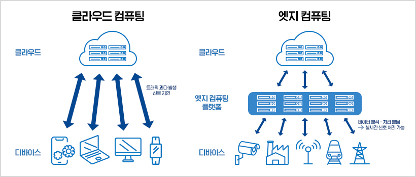

*Figure 1. Comparison of cloud computing, in which every device communicates with the cloud directly, and edge computing, in which an edge computing platform processes data in between*

On the left of Figure 1, a smartphone, laptop, monitor, and smartwatch all communicate with the cloud directly, causing excessive traffic and signal delay. On the right, an edge computing platform analyzes and shares the processing of data from devices such as CCTV cameras, factories, communication towers, trains, and power pylons, enabling real-time signal processing (the Korean labels read cloud, device, edge computing platform, "excessive traffic, signal delay", and "data analysis and shared processing, real-time signal processing possible"). The advantages of **AI edge computing**, which runs AI models at the edge, are as follows.

- **Low bandwidth requirement:** Running the model on the edge device reduces data traffic to the cloud. Especially when large data such as video must be transmitted, the required bandwidth drops, saving network costs and avoiding network congestion.
- **Real-time response:** There is no round-trip transmission time, so real-time responses become possible. This is important in fields that need real-time applications, such as autonomous vehicles, industrial automation, and medicine.
- **Improved privacy:** User data is processed locally, so the transmission of sensitive information is minimized. This helps privacy protection and regulatory compliance and maintains user trust.
- **Offline capability:** The system can work even when the network connection is unstable. This is useful for applications in the field or remote areas and when mobility is needed.

Edge devices have far less computing power and memory than cloud servers, so AI edge computing requires lightweight models.

### 1.3 Edge Devices and an Application Case

A representative piece of edge AI hardware is NVIDIA's embedded board series, **Jetson**. A palm-sized board contains a GPU, so deep learning inference can run on site. There are module products and developer kits with input/output ports, divided into several grades by performance and power consumption.

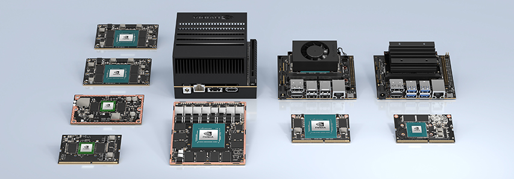

*Figure 2. Several embedded modules and developer kits of the NVIDIA Jetson family*

The following is a case of deploying a lightweight model on site with an edge device. An enclosure was built by placing a CCTV module, an embedded board (Jetson Nano), and an LTE communication module together inside a camera housing, and it was installed at the entrance of a facility.

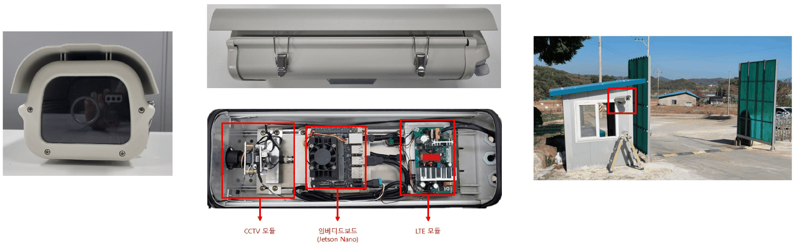

*Figure 3. A camera enclosure holding a CCTV module, an embedded board (Jetson Nano), and an LTE module, and its installation at an entrance*

The device recognizes entering vehicles on site and sends only the recognition results (entry time, vehicle information, captured photo) to the server over LTE. An administrator checks the time and photo of each record in the list of entering vehicles on a web page. Because the whole video is not sent to the server, communication volume is small, and recognition continues on site even if communication is lost. The advantages of Section 1.2 appear directly in this setup.

### 1.4 Classifying Lightweighting Methods

Lightweighting methods can be broadly divided into three kinds.

1. **Algorithmic lightweighting:** Techniques applied to an already trained model or to the training process to shrink the model. Examples are pruning and quantization.
2. **Efficient deep learning network architecture design:** Designing from the start an architecture with few parameters and little computation. Examples are SqueezeNet (Section 3), MobileNet (Section 4), and ShuffleNet (Section 5).
3. **Hardware acceleration:** Running the same model faster with chips specialized for deep learning (GPUs, NPUs, and so on) and matching software. The sections below cover the first two.

**Pruning** removes connections (weights) or neurons of low importance from a trained neural network. Very small weights barely affect the output, so they are set to 0 and removed (**pruning synapses**), and neurons whose incoming or outgoing connections have all disappeared are removed entirely (**pruning neurons**). After pruning, the remaining weights are retrained (fine-tuned) to recover accuracy. Han et al. used this method to reduce the parameters of AlexNet ninefold, from 61 million to 6.7 million, while keeping its accuracy [1].

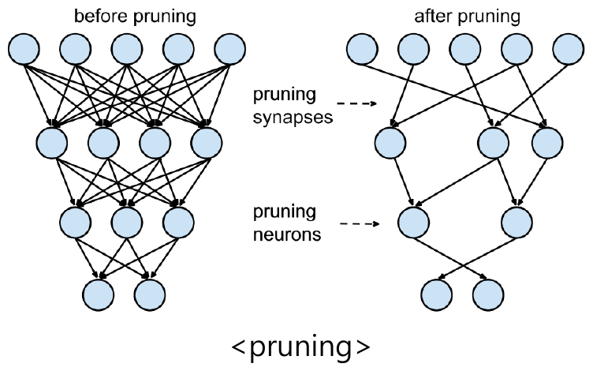

*Figure 4. A fully connected neural network before pruning and the network after pruning with synapses (connections) and neurons removed*

**Quantization** reduces the number of bits that represent weights and activations. Training usually uses 32-bit floating point (FP32), but for inference, converting to 8-bit integers (INT8) often does not reduce accuracy much. Changing 32 bits to 8 bits makes the model a quarter of the size, and integer arithmetic is faster and uses less power than floating-point arithmetic.

The most basic way to convert a real number $r$ into an integer $q$ is to map the real range linearly onto the integer range. Choosing a **scale** $S$ and a **zero point** $Z$ gives the following relation [2].

$$
r \approx S\,(q - Z), \qquad q = \mathrm{round}\left(\frac{r}{S}\right) + Z
$$

Mapping the minimum and maximum of the real range to the two ends of the integer range (for example, 0-255) is asymmetric quantization, and setting $Z = 0$ and mapping the largest absolute value to the end of the integer range (for example, $-127$ to $127$) is symmetric quantization. An example of symmetric quantization is computed as follows.

1. In the FP32 weights $w = [-1.234, 0.456, 2.54]$, the largest absolute value is 2.54, so the scale is $S = 2.54 / 127 = 0.02$.
2. Dividing each value by $S$ and rounding gives $[-61.7, 22.8, 127] \to q = [-62, 23, 127]$. These integers are stored in 8 bits.
3. At inference, multiplying by $S$ restores $\hat{w} = [-1.24, 0.46, 2.54]$. The error from the original values is at most 0.006, no more than half the scale ($0.01$).

```python
import numpy as np

w = np.array([-1.234, 0.456, 2.54], dtype=np.float32)   # FP32 weights
s = np.abs(w).max() / 127                                # scale: map the largest absolute value to 127
q = np.clip(np.round(w / s), -127, 127).astype(np.int8)  # quantize to INT8
w_hat = q.astype(np.float32) * s                         # dequantize (restore an approximation)

print(round(float(s), 4), q, w_hat.round(3), np.abs(w - w_hat).max().round(4))
```

```text
0.02 [-62  23 127] [-1.24  0.46  2.54] 0.006
```

`np.clip` cuts rounded values so that they stay within the integer range, and `astype(np.int8)` stores them as 8-bit integers. In a real model, the same principle sets one scale for a whole weight matrix (or for each output channel) and turns the FP32 matrix into an 8-bit integer matrix.

Deep Compression, which combines pruning, quantization, and Huffman coding, reduced the storage of AlexNet 35-fold, from 240MB to 6.9MB [3]. SqueezeNet in Section 3 shows how small a model can become when such algorithmic lightweighting is combined with efficient architecture design.

---

<br>

## 2. ResNet and 1×1 Convolution

The 1×1 convolution and the bottleneck structure, key components of lightweight models, are revisited here with the ResNet of Lecture 3.

### 2.1 Residual Block

ResNet used **residual learning** with **skip connections** to solve the **degradation** problem, in which training becomes harder as layers get deeper [4]. In an ordinary CNN, the stacked layers learn the desired function $H(\mathbf{x})$ directly, but a residual block learns only the residual $\mathcal{F}(\mathbf{x}) = H(\mathbf{x}) - \mathbf{x}$, the difference from the input, and adds the input $\mathbf{x}$ to the output as is.

$$
\text{output} = \mathcal{F}(\mathbf{x}) + \mathbf{x}
$$

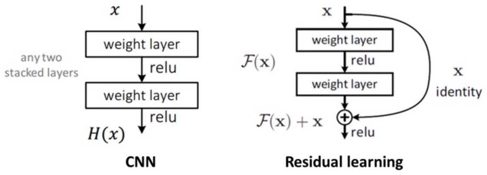

*Figure 5. Comparison of an ordinary CNN, in which two stacked layers learn H(x) directly, and residual learning, which learns F(x) and adds x through a skip connection*

If the optimal function is close to the identity, it suffices to push $\mathcal{F}(\mathbf{x})$ toward 0, which makes training easy, and gradients reach the early layers well through the addition path.

> **Caution:** ResNet is often introduced as the model that solved the vanishing gradient problem, but the original paper explains that the degradation of deep plain networks appears even with batch normalization, when neither the forward signals nor the backward gradients vanish, so it is unlikely to be caused by vanishing gradients, and describes it as a difficulty of optimizing deep networks [4]. Residual learning eases this optimization difficulty, and the good gradient flow through the addition path is a complementary effect that helps it (Section 4.3 of Lecture 3).

### 2.2 Bottleneck Block

The **bottleneck block** is a strategy for stacking a model deep while reducing parameters at the same time. Instead of the basic block of two 3×3 convolutions, it uses three convolutions: 1×1, 3×3, and 1×1.

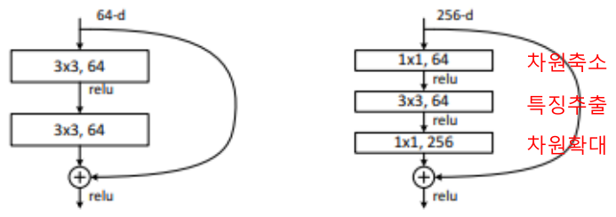

*Figure 6. The basic block of two 3×3 convolutions (64-d) and the bottleneck block (256-d), which reduces dimensions with 1×1, extracts features with 3×3, and expands dimensions with 1×1*

1. **Dimension reduction:** A 1×1 convolution reduces the 256-channel input to 64 channels.
2. **Feature extraction:** A 3×3 convolution extracts spatial features from the reduced 64 channels.
3. **Dimension expansion:** A 1×1 convolution increases the channels back to 256.

The parameter counts (excluding biases) compare as follows. The parameter count of a convolution layer is (kernel height × kernel width × input channels × output channels).

| Block | Computation | Parameters |
|:-----|:-----|:-----|
| Basic block (64 channels) | $2 \times (3 \times 3 \times 64 \times 64)$ | 73,728 |
| Bottleneck block (256 channels) | $1 \times 1 \times 256 \times 64 + 3 \times 3 \times 64 \times 64 + 1 \times 1 \times 64 \times 256$ | 69,632 |
| Two 3×3 convolutions directly on 256 channels | $2 \times (3 \times 3 \times 256 \times 256)$ | 1,179,648 |

*Table 1. Parameter counts of the basic block and the bottleneck block*

The bottleneck block handles four times wider 256 channels yet has fewer parameters than the 64-channel basic block. ResNet-50, 101, and 152 are built by stacking these bottleneck blocks. In the following table, brackets list the convolutions of a block (kernel size, output channels), and the × after them is the number of times the block is repeated.

| Layer | Output size | 18-layer | 34-layer | 50-layer | 101-layer | 152-layer |
|:-----|:-----|:-----|:-----|:-----|:-----|:-----|
| conv1 | 112×112 | 7×7, 64, stride 2 | Same | Same | Same | Same |
| conv2_x (after 3×3 max pooling, stride 2) | 56×56 | [3×3, 64; 3×3, 64] ×2 | [3×3, 64; 3×3, 64] ×3 | [1×1, 64; 3×3, 64; 1×1, 256] ×3 | [1×1, 64; 3×3, 64; 1×1, 256] ×3 | [1×1, 64; 3×3, 64; 1×1, 256] ×3 |
| conv3_x | 28×28 | [3×3, 128; 3×3, 128] ×2 | [3×3, 128; 3×3, 128] ×4 | [1×1, 128; 3×3, 128; 1×1, 512] ×4 | [1×1, 128; 3×3, 128; 1×1, 512] ×4 | [1×1, 128; 3×3, 128; 1×1, 512] ×8 |
| conv4_x | 14×14 | [3×3, 256; 3×3, 256] ×2 | [3×3, 256; 3×3, 256] ×6 | [1×1, 256; 3×3, 256; 1×1, 1024] ×6 | [1×1, 256; 3×3, 256; 1×1, 1024] ×23 | [1×1, 256; 3×3, 256; 1×1, 1024] ×36 |
| conv5_x | 7×7 | [3×3, 512; 3×3, 512] ×2 | [3×3, 512; 3×3, 512] ×3 | [1×1, 512; 3×3, 512; 1×1, 2048] ×3 | [1×1, 512; 3×3, 512; 1×1, 2048] ×3 | [1×1, 512; 3×3, 512; 1×1, 2048] ×3 |
| Output | 1×1 | Average pooling, 1000-d fully connected, softmax | Same | Same | Same | Same |
| FLOPs | | 1.8×10⁹ | 3.6×10⁹ | 3.8×10⁹ | 7.6×10⁹ | 11.3×10⁹ |

*Table 2. ResNet architectures for ImageNet by depth*

The 34-layer and 50-layer networks have similar computation, 3.6×10⁹ and 3.8×10⁹, but the 50-layer network uses bottleneck blocks to stack more layers for the same amount of computation.

### 2.3 1×1 Convolution

A **1×1 convolution** is a convolution with a 1×1 kernel. In the spatial direction it sees only one pixel, but in the channel direction it sees all input channels. That is, it computes a weighted sum of the input channel values at each position, which is the same as applying the same fully connected layer at every position [5].

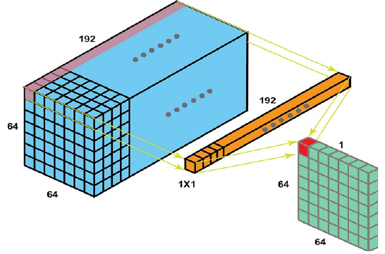

*Figure 7. A 1×1 convolution in which a 1×1×192 filter computes the weighted sum of the 192 channels at each position of a 64×64×192 input to produce a 64×64×1 output*

The roles of 1×1 convolution are as follows.

- **Dimension reduction:** A 1×1 convolution operates on the channel dimension of the input tensor, so by choosing the number of output channels appropriately, it can reduce only the number of channels while keeping the spatial dimensions. This is an effective dimension reduction that lowers model complexity and computational cost.
- **Introducing nonlinearity:** Using many 1×1 convolutions means using proportionally many nonlinear activation functions. This lets the model recognize more complex and richer patterns.
- **Information fusion:** It enables interaction between channels, so features at each position are combined across different channels and the model learns more information.
- **Reduced computational cost:** A 1×1 convolution involves simple operations between input and output and has a low computational cost. The model can therefore be trained and run more efficiently.

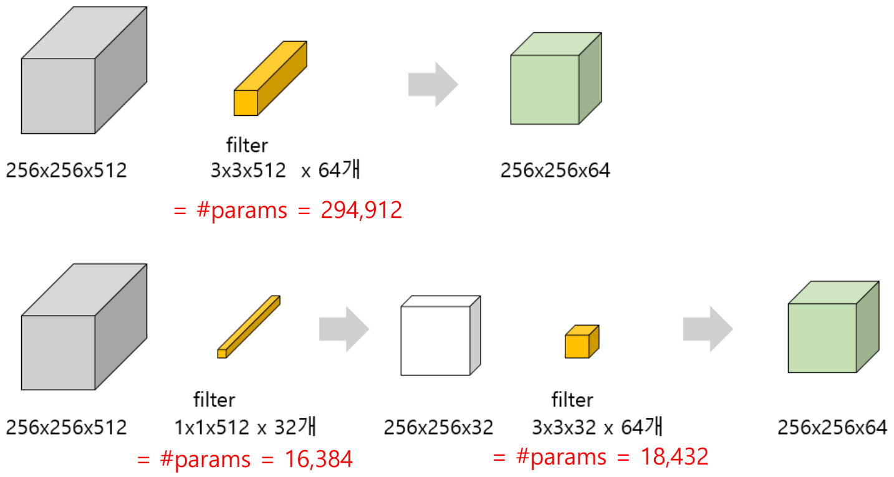

*Figure 8. Comparison of reducing channels with one 3×3 convolution (294,912 parameters) and first reducing to 32 channels with a 1×1 convolution before a 3×3 convolution (16,384 + 18,432 parameters)*

Figure 8 shows two ways to turn a 256×256×512 input into a 256×256×64 output (개 in the figure means "pieces", the number of filters).

- **One 3×3 convolution:** It uses 64 filters of size 3×3×512, so it has $3 \times 3 \times 512 \times 64 = 294{,}912$ parameters.
- **A 1×1 convolution to reduce, then a 3×3 convolution:** 32 filters of size 1×1×512 make 256×256×32 ($1 \times 1 \times 512 \times 32 = 16{,}384$ parameters), and 64 filters of size 3×3×32 make 256×256×64 ($3 \times 3 \times 32 \times 64 = 18{,}432$ parameters). The total is 34,816.

The second way has about 1/8.5 of the parameters of the first. Each weight is multiplied once per output position, so the number of multiplications drops by the same ratio, from about 19.3 billion ($256 \times 256 \times 294{,}912$) to about 2.28 billion ($256 \times 256 \times 34{,}816$).

---

<br>

## 3. SqueezeNet

### 3.1 Contributions

**SqueezeNet** is a model published in 2016 that achieves the accuracy of AlexNet [6] with 50 times fewer parameters and reduces the model size to under 0.5MB [7]. Its main contributions are as follows.

1. **The Fire module: a design that maximizes parameter efficiency.** 1×1 convolutions (the squeeze stage) reduce the number of channels, and 1×1 and 3×3 convolutions (the expand stage) preserve representational power. This structure reduces computation while maintaining high accuracy, proposing a new approach to lightweight networks.
2. **Small model size: a network 50 times smaller than AlexNet.** It offers performance similar to existing large models while greatly reducing the parameter count, saving memory and storage. The small model fits on mobile and IoT devices and FPGAs with limited memory (its computation is on the same level as AlexNet's).
3. **Ease of model compression and deployment.** Designed with combination with compression techniques such as pruning and quantization in mind, it maximizes further size reduction and deployment efficiency. Its lightweight architecture is highly practical for network transmission and embedded applications.

### 3.2 Fire Module

SqueezeNet's design rests on three strategies [7].

1. **Replace 3×3 filters with 1×1 filters.** A 1×1 filter has 9 times fewer parameters than a 3×3 filter.
2. **Decrease the number of input channels to 3×3 filters.** The parameters of a 3×3 convolution are (input channels × output channels × 9), so reducing the input channels first reduces the parameters.
3. **Downsample late in the network.** Letting the early layers work on large activation maps raises accuracy.

The component that implements strategies 1 and 2 is the **Fire module**.

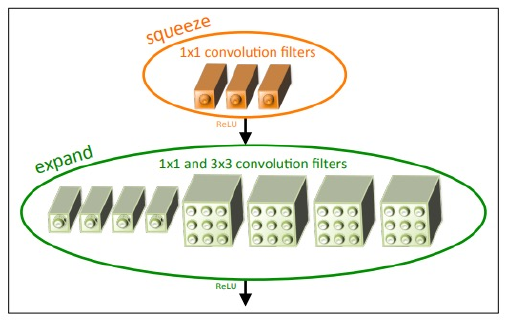

*Figure 9. A Fire module consisting of a squeeze layer of 1×1 filters and an expand layer of 1×1 and 3×3 filters (an example with 3 squeeze filters, 4 expand 1×1 filters, and 4 expand 3×3 filters)*

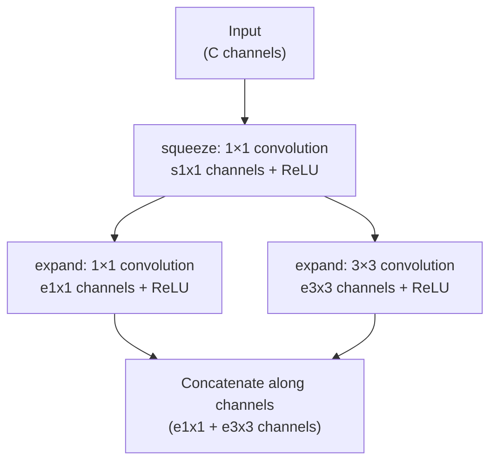

*Figure 10. Data flow of the Fire module*

The Fire module works as follows.

- **Squeeze layer:** $s_{1\times1}$ 1×1 filters reduce the input channels (strategy 2).
- **Expand layer:** $e_{1\times1}$ 1×1 filters and $e_{3\times3}$ 3×3 filters are applied side by side to the reduced input (strategy 1), and the two results are concatenated along the channel axis. The output has $e_{1\times1} + e_{3\times3}$ channels.
- The setting $s_{1\times1} < e_{1\times1} + e_{3\times3}$ limits the number of channels entering the 3×3 filters.

**Parameter count example: fire2.** With a 55×55×96 input and $s_{1\times1} = 16$, $e_{1\times1} = 64$, $e_{3\times3} = 64$, the parameters of fire2 are as follows (including biases).

$$
\underbrace{96 \times 16 + 16}_{\text{squeeze}} + \underbrace{16 \times 64 + 64}_{\text{expand 1×1}} + \underbrace{9 \times 16 \times 64 + 64}_{\text{expand 3×3}} = 1{,}552 + 1{,}088 + 9{,}280 = 11{,}920
$$

Producing the same 128 channels from the same input with one 3×3 convolution would need $9 \times 96 \times 128 + 128 = 110{,}720$ parameters, so the Fire module cuts the parameters to about 1/9. The following code implements the Fire module in PyTorch and confirms these values.

```python
import torch
import torch.nn as nn

class Fire(nn.Module):
    def __init__(self, in_ch, s1x1, e1x1, e3x3):
        super().__init__()
        self.squeeze = nn.Conv2d(in_ch, s1x1, kernel_size=1)                 # reduce channels
        self.expand1x1 = nn.Conv2d(s1x1, e1x1, kernel_size=1)               # 1x1 expand
        self.expand3x3 = nn.Conv2d(s1x1, e3x3, kernel_size=3, padding=1)    # 3x3 expand
        self.relu = nn.ReLU(inplace=True)

    def forward(self, x):
        x = self.relu(self.squeeze(x))
        return torch.cat([self.relu(self.expand1x1(x)),
                          self.relu(self.expand3x3(x))], dim=1)             # concatenate along channels

fire2 = Fire(in_ch=96, s1x1=16, e1x1=64, e3x3=64)
x = torch.randn(1, 96, 55, 55)
print(fire2(x).shape)
print(sum(p.numel() for p in fire2.parameters()))
print(sum(p.numel() for p in nn.Conv2d(96, 128, kernel_size=3, padding=1).parameters()))
```

```text
torch.Size([1, 128, 55, 55])
11920
110720
```

`padding=1` keeps the output of the 3×3 convolution at the same 55×55 size as the input so that it can be concatenated with the output of the 1×1 expand. `torch.cat(..., dim=1)` concatenates two 64-channel tensors along the channel axis, the second axis of (batch, channel, height, width), to make 128 channels.

### 3.3 Overall Architecture

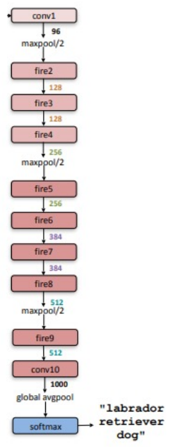

*Figure 11. The overall architecture of SqueezeNet, consisting of conv1, fire2~fire9, conv10, global average pooling, and softmax, with the number of channels between modules*

SqueezeNet starts with a convolution layer (conv1), passes through eight Fire modules (fire2-fire9), and ends with a final convolution layer (conv10) and global average pooling. The number of channels of the Fire modules grows gradually toward the end, and max pooling (stride 2) is placed only after conv1, fire4, and fire8 to delay downsampling (strategy 3). Instead of a fully connected layer, a 1×1 convolution with 1000 channels (conv10) and global average pooling further reduce the parameters.

| Layer | Output size | Filter size / stride | $s_{1\times1}$ | $e_{1\times1}$ | $e_{3\times3}$ | Parameters |
|:-----|:-----|:-----|:---:|:---:|:---:|:---:|
| Input image | 224×224×3 | | | | | |
| conv1 | 111×111×96 | 7×7/2 (×96) | | | | 14,208 |
| maxpool1 | 55×55×96 | 3×3/2 | | | | |
| fire2 | 55×55×128 | | 16 | 64 | 64 | 11,920 |
| fire3 | 55×55×128 | | 16 | 64 | 64 | 12,432 |
| fire4 | 55×55×256 | | 32 | 128 | 128 | 45,344 |
| maxpool4 | 27×27×256 | 3×3/2 | | | | |
| fire5 | 27×27×256 | | 32 | 128 | 128 | 49,440 |
| fire6 | 27×27×384 | | 48 | 192 | 192 | 104,880 |
| fire7 | 27×27×384 | | 48 | 192 | 192 | 111,024 |
| fire8 | 27×27×512 | | 64 | 256 | 256 | 188,992 |
| maxpool8 | 13×13×512 | 3×3/2 | | | | |
| fire9 | 13×13×512 | | 64 | 256 | 256 | 197,184 |
| conv10 | 13×13×1000 | 1×1/1 (×1000) | | | | 513,000 |
| avgpool10 | 1×1×1000 | 13×13/1 | | | | |
| Total | | | | | | 1,248,424 |

*Table 3. Layer sizes and parameter counts of SqueezeNet*

The table in the original paper also lists information after applying pruning and 6-bit quantization. The parameters remaining after pruning part of the weights of each layer total 421,098.

### 3.4 Results

SqueezeNet aimed to make AlexNet lightweight (compressed). The following table compares SqueezeNet with the results of shrinking AlexNet by several compression techniques. The model size is the number of bytes needed to store all parameters of the trained model.

| CNN architecture | Compression approach | Data type | Original → compressed size | Size reduction vs. AlexNet | Top-1 accuracy | Top-5 accuracy |
|:-----|:-----|:-----|:-----|:---:|:---:|:---:|
| AlexNet | None (baseline) | 32-bit | 240MB | 1x | 57.2% | 80.3% |
| AlexNet | SVD | 32-bit | 240MB → 48MB | 5x | 56.0% | 79.4% |
| AlexNet | Network pruning | 32-bit | 240MB → 27MB | 9x | 57.2% | 80.3% |
| AlexNet | Deep Compression | 5-8 bit | 240MB → 6.9MB | 35x | 57.2% | 80.3% |
| SqueezeNet | None | 32-bit | 4.8MB | 50x | 57.5% | 80.3% |
| SqueezeNet | Deep Compression | 8-bit | 4.8MB → 0.66MB | 363x | 57.5% | 80.3% |
| SqueezeNet | Deep Compression | 6-bit | 4.8MB → 0.47MB | 510x | 57.5% | 80.3% |

*Table 4. Comparison of SqueezeNet and AlexNet compression approaches*

SqueezeNet alone, without compression, is 50 times smaller than AlexNet, with a slightly higher Top-1 accuracy. Applying Deep Compression on top shrinks it to 0.47MB, 510 times smaller, while keeping the accuracy. This means that efficient architecture design and algorithmic lightweighting do not overlap but take effect together.

---

<br>

## 4. MobileNet

### 4.1 Contributions

**MobileNet** is a lightweight model for mobile and embedded vision published by Google in 2017 [8]. Its main contributions are as follows.

1. **Introduction of depthwise separable convolution.** Replacing standard convolutions with depthwise separable convolutions drastically reduces computation and parameter counts. It maximizes computational efficiency while minimizing performance loss, enabling deep learning models to run in mobile and embedded environments.
2. **Flexible network size adjustment.** The hyperparameters width multiplier and resolution multiplier adjust the network size and computation to the requirements of an application. Supporting various trade-offs between performance and efficiency increases practicality and adaptability.
3. **Design optimized for mobile and resource-limited environments.** It achieves reduced memory usage and faster inference, and its design, made with real deployment in mind, suits real-time applications on mobile and IoT devices.

Whereas the models up to SqueezeNet focused mainly on model size (memory), depthwise separable convolution is an architecture that **also considers computation (speed)**.

### 4.2 Computation of Standard Convolution

The symbols are defined as follows.

| Symbol | Meaning |
|:-----|:-----|
| $D_K$ | Width and height of the kernel (filter) |
| $M$ | Number of input channels |
| $N$ | Number of output channels (number of filters) |
| $D_F$ | Width and height of the input feature map |
| $D_G$ | Width and height of the output feature map ($D_G = D_F$ with stride 1 and suitable padding) |

*Table 5. Symbols used to count convolution operations*

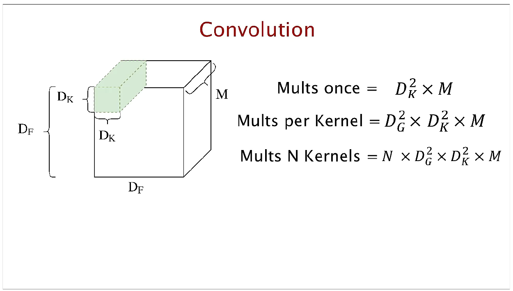

*Figure 12. Standard convolution applying a D_K×D_K×M kernel to a D_F×D_F×M input, and the count of its multiplications*

In standard convolution, one kernel has size $D_K \times D_K \times M$ and sees all input channels at once. The number of multiplications, step by step, is as follows.

$$
\text{once at one position (Mults once)} = D_K^2 \times M
$$

$$
\text{one kernel (Mults per Kernel)} = D_G^2 \times D_K^2 \times M
$$

$$
N \text{ kernels (Mults N Kernels)} = N \times D_G^2 \times D_K^2 \times M
$$

Computing one output position multiplies each of the kernel's $D_K^2 M$ weights once, and this repeats for $D_G^2$ output positions and $N$ kernels. Standard convolution performs spatial feature extraction (filtering) and channel combination in one step.

### 4.3 Depthwise Separable Convolution

**Depthwise separable convolution** splits standard convolution into two steps.

1. **Depthwise convolution:** Separates the channels of the input and applies one $D_K \times D_K$ filter to each channel separately. It only filters spatially and does not mix channels. The number of output channels is $M$, the same as the input.
2. **Pointwise convolution:** Applies $N$ filters of size $1 \times 1 \times M$ to the result of the depthwise convolution, combining channels at each position. It serves to fuse channel information.

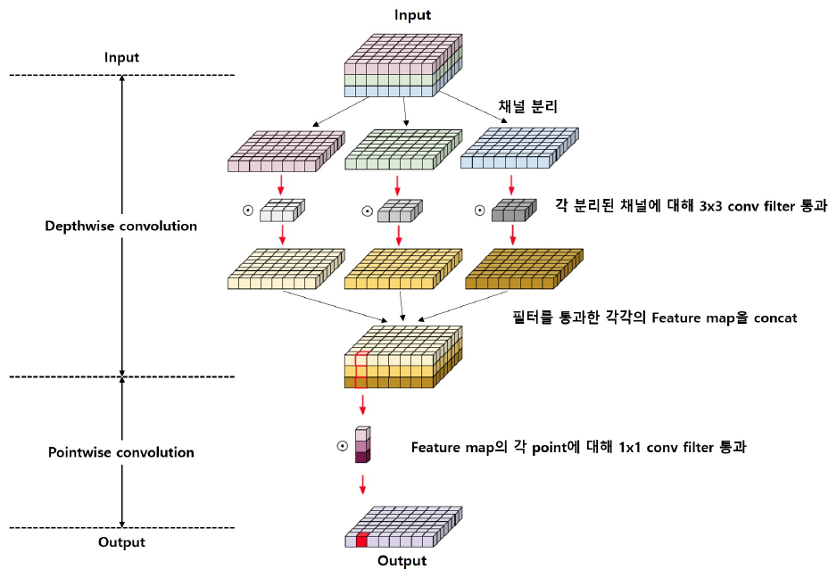

*Figure 13. Depthwise separable convolution, which separates the input channels and applies a 3×3 filter to each channel (depthwise convolution), concatenates the results, and applies a 1×1 filter at each position (pointwise convolution)*

In the upper part of Figure 13, the input is split by channel (채널 분리, "channel separation"), and each separated channel passes through its own 3×3 filter before being concatenated again. In the lower part, a 1×1 filter is applied at each position (point) of that feature map to produce one cell of the output.

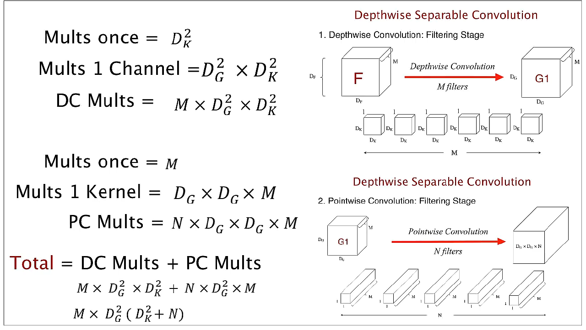

*Figure 14. Counting the multiplications of depthwise convolution (filtering stage, M filters) and pointwise convolution (combining stage, N filters)*

**Multiplications of depthwise convolution (DC).** The filter is $D_K \times D_K \times 1$, so it multiplies $D_K^2$ times at one position and $D_G^2 \times D_K^2$ times for the whole output of one channel; for $M$ channels it is the following.

$$
\text{DC Mults} = M \times D_G^2 \times D_K^2
$$

**Multiplications of pointwise convolution (PC).** The filter is $1 \times 1 \times M$, so it multiplies $M$ times at one position and $D_G \times D_G \times M$ times for one kernel; for $N$ kernels it is the following.

$$
\text{PC Mults} = N \times D_G^2 \times M
$$

**Total.**

$$
\text{Total} = \text{DC Mults} + \text{PC Mults} = M \times D_G^2 \times D_K^2 + N \times D_G^2 \times M = M \times D_G^2 \, (D_K^2 + N)
$$

### 4.4 Comparing Computation and Parameter Counts

The ratio of the multiplications of depthwise separable convolution to those of standard convolution is as follows.

$$
\frac{\text{multiplications of depthwise separable convolution}}{\text{multiplications of standard convolution}} = \frac{M \times D_G^2 \, (D_K^2 + N)}{N \times D_G^2 \times D_K^2 \times M} = \frac{D_K^2 + N}{D_K^2 \times N} = \frac{1}{N} + \frac{1}{D_K^2}
$$

For example, with $N = 1{,}024$ and $D_K = 3$, the ratio is $\frac{1}{1024} + \frac{1}{3^2} \approx 0.001 + 0.111 = 0.112$. The number of output channels $N$ is usually large, so $1/N$ is negligible and the ratio is roughly $1/D_K^2$. With 3×3 kernels, computation drops by about 8-9 times.

Parameter counts can be compared in the same way. Standard convolution has $D_K^2 \times M \times N$ parameters, and depthwise separable convolution has $D_K^2 \times M + M \times N$.

**Worked example.** One layer inside MobileNet ($D_K = 3$, $M = N = 512$, $D_F = D_G = 14$) gives the following.

| Layer | Mult-Adds | Parameters |
|:-----|:-----|:-----|
| Standard convolution | $3^2 \times 512 \times 512 \times 14^2 = 462{,}422{,}016$ (about 462M) | $3^2 \times 512 \times 512 = 2{,}359{,}296$ (about 2.36M) |
| Depthwise separable convolution | $3^2 \times 512 \times 14^2 + 512 \times 512 \times 14^2 = 903{,}168 + 51{,}380{,}224 = 52{,}283{,}392$ (about 52.3M) | $3^2 \times 512 + 512 \times 512 = 4{,}608 + 262{,}144 = 266{,}752$ (about 0.27M) |

*Table 6. Standard convolution versus depthwise separable convolution for a layer with $D_K = 3$, $M = N = 512$, $D_F = 14$*

The ratio of multiplications is $52.3 / 462 \approx 0.113 = 1/512 + 1/9$, matching the formula above. It is also worth noting that most of the computation and parameters of depthwise separable convolution come from the pointwise (1×1) convolution. This fact is the starting point of ShuffleNet in Section 5.

In PyTorch, setting the `groups` argument of `nn.Conv2d` equal to the number of input channels gives a depthwise convolution.

```python
import torch.nn as nn

def n_params(m):
    return sum(p.numel() for p in m.parameters())

M, N = 512, 512
standard = nn.Conv2d(M, N, kernel_size=3, padding=1, bias=False)
depthwise = nn.Conv2d(M, M, kernel_size=3, padding=1, groups=M, bias=False)  # each channel separately
pointwise = nn.Conv2d(M, N, kernel_size=1, bias=False)                      # combine channels with 1x1

print(n_params(standard), n_params(depthwise), n_params(pointwise),
      n_params(depthwise) + n_params(pointwise))
print(depthwise.weight.shape, pointwise.weight.shape)
```

```text
2359296 4608 262144 266752
torch.Size([512, 1, 3, 3]) torch.Size([512, 512, 1, 1])
```

With `groups=M`, the $M$ input channels are divided into $M$ groups, each convolved separately, so the weight of the depthwise convolution has shape (output channels, input channels per group, height, width) = (512, 1, 3, 3). The results match the parameter counts in Table 6.

### 4.5 Overall Architecture

MobileNet's basic layer places **batch normalization (BN)** and ReLU after both the depthwise convolution and the pointwise convolution. Batch normalization is a layer that normalizes the values of each channel with the mean and variance of the mini-batch to stabilize training [9].

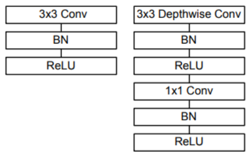

*Figure 15. A standard convolution layer of 3×3 convolution, BN, and ReLU, and a depthwise separable convolution layer of 3×3 depthwise convolution, BN, ReLU, 1×1 convolution, BN, and ReLU*

In the overall architecture, only the first layer is a standard convolution and the rest are depthwise separable convolutions. Counting depthwise and pointwise convolutions as separate layers, there are 28 layers. Downsampling is handled by setting the stride of some depthwise convolutions to 2. In the table, dw denotes depthwise convolution, s1 and s2 denote strides 1 and 2, and 5× means the pair of depthwise and pointwise convolutions is repeated 5 times.

| Type / stride | Filter shape | Input size |
|:-----|:-----|:-----|
| Conv / s2 | 3×3×3×32 | 224×224×3 |
| Conv dw / s1 | 3×3×32 dw | 112×112×32 |
| Conv / s1 | 1×1×32×64 | 112×112×32 |
| Conv dw / s2 | 3×3×64 dw | 112×112×64 |
| Conv / s1 | 1×1×64×128 | 56×56×64 |
| Conv dw / s1 | 3×3×128 dw | 56×56×128 |
| Conv / s1 | 1×1×128×128 | 56×56×128 |
| Conv dw / s2 | 3×3×128 dw | 56×56×128 |
| Conv / s1 | 1×1×128×256 | 28×28×128 |
| Conv dw / s1 | 3×3×256 dw | 28×28×256 |
| Conv / s1 | 1×1×256×256 | 28×28×256 |
| Conv dw / s2 | 3×3×256 dw | 28×28×256 |
| Conv / s1 | 1×1×256×512 | 14×14×256 |
| 5× Conv dw / s1 | 3×3×512 dw | 14×14×512 |
| 5× Conv / s1 | 1×1×512×512 | 14×14×512 |
| Conv dw / s2 | 3×3×512 dw | 14×14×512 |
| Conv / s1 | 1×1×512×1024 | 7×7×512 |
| Conv dw / s1 | 3×3×1024 dw | 7×7×1024 |
| Conv / s1 | 1×1×1024×1024 | 7×7×1024 |
| Avg Pool / s1 | Pool 7×7 | 7×7×1024 |
| FC / s1 | 1024×1000 | 1×1×1024 |
| Softmax / s1 | Classifier | 1×1×1000 |

*Table 7. MobileNet body architecture*

Where the computation and parameters concentrate, by layer type, is as follows.

| Type | Share of Mult-Adds | Share of parameters |
|:-----|:---:|:---:|
| 1×1 convolution | 94.86% | 74.59% |
| 3×3 depthwise convolution | 3.06% | 1.06% |
| 3×3 convolution (first layer) | 1.19% | 0.02% |
| Fully connected | 0.18% | 24.33% |

*Table 8. Resource usage of MobileNet by layer type*

About 95% of the computation and about 75% of the parameters are in the 1×1 convolutions. A 1×1 convolution can be computed directly with highly optimized matrix multiplication (GEMM) without memory reordering, so it also runs fast in practice [8].

### 4.6 Width and Resolution Multipliers

MobileNet adjusts model size and computation with two hyperparameters.

- **Width multiplier $\alpha$:** Reduces the number of input channels $M$ and output channels $N$ of every layer to $\alpha M$ and $\alpha N$, thinning the network uniformly. $\alpha \in (0, 1]$, with 1, 0.75, 0.5, and 0.25 commonly used.
- **Resolution multiplier $\rho$:** Reduces the resolution of the input image so that the size $D_F$ of every feature map becomes $\rho D_F$. $\rho \in (0, 1]$, and in practice it is set implicitly by choosing an input resolution of 224, 192, 160, or 128. $\rho = 1$ is the baseline MobileNet.

The multiplications of a depthwise separable convolution layer with both multipliers applied are as follows.

$$
D_K \cdot D_K \cdot \alpha M \cdot \rho D_F \cdot \rho D_F + \alpha M \cdot \alpha N \cdot \rho D_F \cdot \rho D_F
$$

The second term dominates, so computation decreases roughly in proportion to $\alpha^2$ and exactly in proportion to $\rho^2$. The parameter count decreases roughly in proportion to $\alpha^2$ and does not depend on $\rho$. Applying them in turn to the layer of Section 4.4 ($D_K = 3$, $M = N = 512$, $D_F = 14$) gives the following. Each row is cumulative on top of the row above.

| Layer / modification | Mult-Adds (millions) | Parameters (millions) |
|:-----|:---:|:---:|
| Standard convolution | 462 | 2.36 |
| Depthwise separable convolution | 52.3 | 0.27 |
| $\alpha = 0.75$ | 29.6 | 0.15 |
| $\rho = 0.714$ | 15.1 | 0.15 |

*Table 9. Resource usage after applying depthwise separable convolution, the width multiplier, and the resolution multiplier in turn to a standard convolution*

With $\alpha = 0.75$, $M = N = 384$, so the count is $9 \times 384 \times 14^2 + 384 \times 384 \times 14^2 = 29{,}578{,}752$, and applying $\rho = 0.714$ on top gives $D_F = 10$ and $9 \times 384 \times 10^2 + 384 \times 384 \times 10^2 = 15{,}091{,}200$.

### 4.7 Results

| Model | ImageNet accuracy | Mult-Adds (millions) | Parameters (millions) |
|:-----|:---:|:---:|:---:|
| MobileNet built with standard convolutions | 71.7% | 4,866 | 29.3 |
| MobileNet | 70.6% | 569 | 4.2 |

*Table 10. MobileNet built with depthwise separable convolutions versus standard convolutions*

Building the same architecture with standard convolutions gives 1.1 percentage points higher accuracy, but MobileNet with depthwise separable convolutions uses about 8.6 times fewer Mult-Adds and about 7 times fewer parameters.

---

<br>

## 5. ShuffleNet

### 5.1 Contributions

**ShuffleNet** is a model published in 2018 for mobile devices with very limited computing power (on the order of 10-150 MFLOPs) [10]. Its main contributions are as follows.

1. **Introduction of the channel shuffle mechanism.** A technique that strengthens information exchange between channels, raising network efficiency while minimizing performance loss.
2. **Use of pointwise group convolution.** Existing pointwise convolutions (1×1 convolutions) were computationally heavy. Computing them in groups greatly reduces computation and parameter counts, and adjusting the number of groups sets the trade-off between performance and efficiency flexibly.
3. **Design optimized for mobile and low-resource environments.** Combining depthwise convolution, pointwise group convolution, and channel shuffle greatly reduces FLOPs while maintaining high accuracy, providing inference speed and memory usage suitable for mobile and IoT devices.

### 5.2 Idea: Group Convolution for 1×1 Convolutions

As Table 8 showed, about 95% of MobileNet's computation comes from 1×1 convolutions. Depthwise convolutions are already light, so further reduction requires making the 1×1 convolutions lighter. ShuffleNet's idea is **to apply group convolution to the 1×1 convolutions**.

> **Definition:** **Group convolution** divides the input channels into $g$ groups and convolves so that the output channels of each group see only the input channels of the same group. For a $k \times k$ convolution with $c$ input channels and $m$ output channels, the parameters and computation shrink from $k^2 c m$ to $g \times k^2 \frac{c}{g} \frac{m}{g} = \frac{k^2 c m}{g}$, that is, to $1/g$. Depthwise convolution is the extreme case of group convolution with $g$ equal to the number of channels.

Group convolution was first used in AlexNet [6]. GPU memory was insufficient at the time, so the model was split across two GPUs, and in some layers each GPU convolved only its own feature maps.

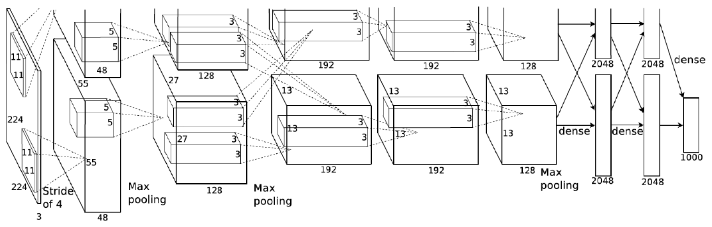

*Figure 16. The architecture of AlexNet, split across two GPUs and computed in two upper and lower branches*

For example, using 3 groups in a 1×1 convolution with 240 input channels and 60 output channels reduces the parameters from $240 \times 60 = 14{,}400$ to $240 \times 60 / 3 = 4{,}800$.

### 5.3 Channel Shuffle

Stacking group convolutions as is creates a problem. The output channels of a group come only from the input channels of the same group, so there is no exchange (information flow) between groups, which harms performance. The groups proceed separately as if they were different networks.

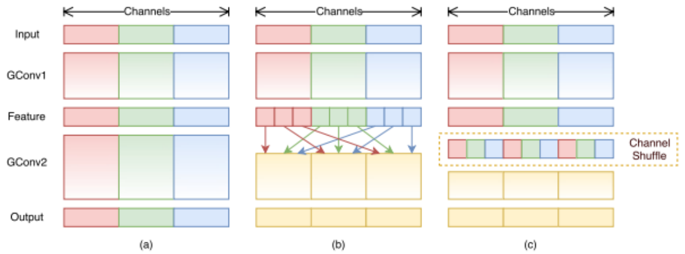

*Figure 17. Two group convolutions stacked as is (a), mixing so that the next group convolution receives channels from several groups (b), and the same implemented with channel shuffle (c)*

In (a) of Figure 17, the red, green, and blue groups never mix. As in (b), dividing the output of each group of the first group convolution (GConv1) into several parts so that each group of the next group convolution (GConv2) receives some channels from every group mixes the information. (c) implements this with a simple operation called **channel shuffle**.

Channel shuffle is implemented in the following three steps. With $g \times n$ channels,

1. Reshape the channel axis into shape $(g, n)$. The rows are the groups.
2. Transpose the two axes to get $(n, g)$.
3. Flatten back into one row.

```python
import torch

def channel_shuffle(x, groups):
    n, c, h, w = x.shape
    x = x.view(n, groups, c // groups, h, w)   # split into (groups, channels per group)
    x = x.transpose(1, 2).contiguous()         # swap the two axes
    return x.view(n, c, h, w)                  # flatten back into one row

x = torch.arange(9).float().view(1, 9, 1, 1)   # a tensor whose values are channel numbers 0-8
print(channel_shuffle(x, groups=3).flatten().int().tolist())
```

```text
[0, 3, 6, 1, 4, 7, 2, 5, 8]
```

With channels 0-8 in three groups [0, 1, 2], [3, 4, 5], and [6, 7, 8], the order after shuffling is [0, 3, 6, 1, 4, 7, 2, 5, 8]. When the next group convolution splits this again into three groups [0, 3, 6], [1, 4, 7], and [2, 5, 8], each group receives one channel from each of the previous three groups. `contiguous()` stores the memory layout changed by the transpose contiguously again so that `view` can be used. Channel shuffle only changes order, so it has no parameters and is differentiable, and it can be inserted into a network as is.

### 5.4 ShuffleNet Units

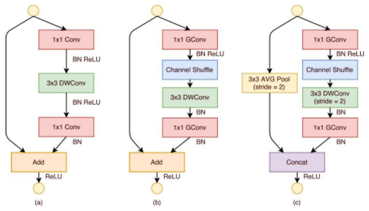

*Figure 18. A bottleneck unit with depthwise convolution (a), a ShuffleNet unit with pointwise group convolution and channel shuffle (b), and a ShuffleNet unit with stride 2 (c)*

- **(a) Baseline unit:** ResNet's bottleneck block with the middle 3×3 convolution replaced by a 3×3 depthwise convolution (DWConv).
- **(b) ShuffleNet unit:** The two 1×1 convolutions are replaced by 1×1 group convolutions (GConv), and a channel shuffle is inserted after the first group convolution. The order is 1×1 GConv, BN, ReLU, channel shuffle, 3×3 DWConv, BN, 1×1 GConv, BN, and ReLU is applied after adding the input (Add). There is no ReLU after the depthwise convolution.
- **(c) Downsampling unit:** A unit that halves the spatial size. The depthwise convolution has stride 2, and the shortcut path has 3×3 average pooling (stride 2). Downsampling usually increases the number of channels, and to do so without increasing computation, the two paths are concatenated (Concat) instead of added (Add). The channels of the shortcut path are added to the output as is, so the number of channels grows at almost no extra cost.

The structures actually used in ShuffleNet are (b) and (c).

### 5.5 Computation Comparison

The FLOPs (multiply-adds) of ResNet's bottleneck unit and the ShuffleNet unit are compared for an input of size $h \times w$, $c$ input channels, $m$ bottleneck channels, and $g$ groups.

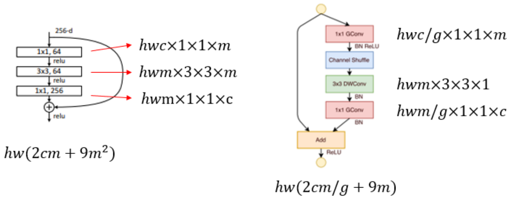

*Figure 19. The computation of each layer and the totals for the ResNet bottleneck unit and the ShuffleNet unit*

**ResNet bottleneck unit.** The 1×1 convolution ($c \to m$) costs $hw \cdot c \cdot m$, the 3×3 convolution ($m \to m$) costs $hw \cdot 9 m^2$, and the 1×1 convolution ($m \to c$) costs $hw \cdot m \cdot c$, giving the following.

$$
hw(2cm + 9m^2)
$$

**ShuffleNet unit.** The 1×1 group convolution ($c \to m$) costs $hw \cdot c \cdot m / g$, the 3×3 depthwise convolution costs $9$ per channel, $hw \cdot 9m$, and the 1×1 group convolution ($m \to c$) costs $hw \cdot m \cdot c / g$, giving the following.

$$
hw\left(\frac{2cm}{g} + 9m\right)
$$

ShuffleNet reduces the cost of the 1×1 layers to $1/g$ and the cost of the 3×3 layer from $9m^2$ to $9m$. For example, with $h = w = 28$, $c = 240$, $m = 60$, and $g = 3$:

$$
\text{ResNet: } 784 \times (2 \cdot 240 \cdot 60 + 9 \cdot 60^2) = 784 \times 61{,}200 = 47{,}980{,}800
$$

$$
\text{ShuffleNet: } 784 \times \left(\frac{2 \cdot 240 \cdot 60}{3} + 9 \cdot 60\right) = 784 \times 10{,}140 = 7{,}949{,}760
$$

The computation of the ShuffleNet unit is about 1/6 of the ResNet bottleneck unit. For the same computation budget, ShuffleNet can use wider feature maps (more channels), which raises accuracy in small models.

### 5.6 Overall Architecture and Results

ShuffleNet stacks ShuffleNet units in three stages. The first unit of each stage has stride 2 ((c) of Figure 18), and the rest have stride 1 ((b) of Figure 18). The number of bottleneck channels is 1/4 of each unit's output channels. Increasing the number of groups $g$ allows more channels for the same computation.

| Layer | Output size | Kernel | Stride | Repeat | $g = 1$ | $g = 2$ | $g = 3$ | $g = 4$ | $g = 8$ |
|:-----|:-----|:-----|:-----|:-----|:---:|:---:|:---:|:---:|:---:|
| Image | 224×224 | | | | 3 | 3 | 3 | 3 | 3 |
| Conv1 | 112×112 | 3×3 | 2 | 1 | 24 | 24 | 24 | 24 | 24 |
| MaxPool | 56×56 | 3×3 | 2 | | | | | | |
| Stage2 | 28×28 | | 2, 1 | 1, 3 | 144 | 200 | 240 | 272 | 384 |
| Stage3 | 14×14 | | 2, 1 | 1, 7 | 288 | 400 | 480 | 544 | 768 |
| Stage4 | 7×7 | | 2, 1 | 1, 3 | 576 | 800 | 960 | 1088 | 1536 |
| GlobalPool | 1×1 | 7×7 | | | | | | | |
| FC | | | | | 1000 | 1000 | 1000 | 1000 | 1000 |
| Complexity (FLOPs) | | | | | 143M | 140M | 137M | 133M | 137M |

*Table 11. ShuffleNet architecture and output channels by number of groups*

In the Stage rows, stride 2, 1 and repeat 1, 3 mean one stride-2 unit followed by three stride-1 units. The first pointwise layer of Stage2 does not use group convolution because its input channels (24) are few. The following compares the ImageNet classification error of MobileNet and ShuffleNet at similar computation. In "1.0 MobileNet-224", 1.0 is the width multiplier and 224 the input resolution, and the 2× in "ShuffleNet 2×" is the factor applied to the channel counts of Table 11.

| Model | Complexity (MFLOPs) | Classification error (%) | Error difference (points) |
|:-----|:---:|:---:|:---:|
| 1.0 MobileNet-224 | 569 | 29.4 | - |
| ShuffleNet 2× ($g = 3$) | 524 | **26.3** | 3.1 |
| ShuffleNet 2× (with SE, $g = 3$) | 527 | **24.7** | 4.7 |
| 0.75 MobileNet-224 | 325 | 31.6 | - |
| ShuffleNet 1.5× ($g = 3$) | 292 | **28.5** | 3.1 |
| 0.5 MobileNet-224 | 149 | 36.3 | - |
| ShuffleNet 1× ($g = 8$) | 140 | **32.4** | 3.9 |
| 0.25 MobileNet-224 | 41 | 49.4 | - |
| ShuffleNet 0.5× ($g = 4$) | 38 | **41.6** | 7.8 |
| ShuffleNet 0.5× (shallow, $g = 3$) | 40 | **42.8** | 6.6 |

*Table 12. ImageNet classification error of MobileNet and ShuffleNet at similar computation*

At every level of computation, ShuffleNet's error is 3.1-7.8 points lower than MobileNet's, and the gap grows as the model gets smaller. SE is the Squeeze-and-Excitation module [11], which learns an importance for each channel and multiplies it in, and adding it lowers the error further.

---

<br>

## 6. Comparing the Lightweight Models

| Model | Key component | Mainly reduces | Idea |
|:-----|:-----|:-----|:-----|
| ResNet (bottleneck block) | 1×1, 3×3, 1×1 convolutions | Parameters and computation | Reduce channels with 1×1, apply 3×3, then expand again |
| SqueezeNet | Fire module | Parameters (model size) | Replace 3×3 with 1×1, and reduce the input channels of 3×3 with squeeze |
| MobileNet | Depthwise separable convolution | Computation and parameters | Separate spatial filtering (depthwise) from channel combination (pointwise) |
| ShuffleNet | Pointwise group convolution, channel shuffle | Computation (cost of 1×1 convolutions) | Split 1×1 into groups, and mix information between groups with shuffling |

*Table 13. Comparison of the key ideas of efficient architecture design*

All four models share the approach of replacing the expensive 3×3 standard convolution with a combination of cheaper operations. ResNet and SqueezeNet use 1×1 convolutions to reduce the channels entering 3×3 convolutions, MobileNet replaces the 3×3 convolution with a depthwise convolution performed per channel, and ShuffleNet then reduces even the cost of the remaining 1×1 convolutions with group convolution.

---

<br>

## Concept Applications

**True/False Check:**

| Statement | Judgment and Reason |
|:-----|:-----|
| In edge computing, all raw data must be sent to the cloud, so the bandwidth requirement grows. | **F.** The edge device processes data directly and sends only results, so traffic to the cloud and the bandwidth requirement decrease. |
| Quantizing FP32 weights to INT8 reduces the storage of the weights to a quarter. | **T.** Representing 32 bits with 8 bits makes the bits needed to store the same number of weights a quarter. |
| A 1×1 convolution does not mix spatial information and only combines channels at each position. | **T.** The kernel sees only one pixel, so the spatial size stays the same, and it computes a weighted sum of the input channels at each position. |
| The number of output channels of a Fire module equals the number of squeeze filters $s_{1\times1}$. | **F.** The output concatenates the 1×1 and 3×3 results of the expand layer, so it has $e_{1\times1} + e_{3\times3}$ channels. The squeeze layer is an intermediate step that reduces channels. |
| The ratio of the multiplications of depthwise separable convolution to those of standard convolution is $1/N + 1/D_K^2$. | **T.** Simplifying $M D_G^2 (D_K^2 + N) / (N D_G^2 D_K^2 M)$ gives $1/N + 1/D_K^2$. |
| Channel shuffle adds learnable parameters. | **F.** Channel shuffle is a rearrangement (reshape, transpose, flatten) that only changes the order of channels, so it has no parameters. |

---

<br>

## Summary

| Concept | Key Summary |
|:-----|:-----|
| Need for lightweighting | Large models need many resources for training and inference and are hard to use on limited devices. Lightweighting reduces parameters, computation, and memory while keeping accuracy. |
| AI edge computing | Runs models where data is produced. Its advantages are low bandwidth requirements, real-time response, privacy protection, and offline capability, and it uses embedded boards such as Jetson. |
| Pruning and quantization | Pruning removes low-importance connections and neurons and then fine-tunes. Quantization maps real numbers to integers with fewer bits using a scale and a zero point. |
| Bottleneck block | Reduces dimensions with 1×1, extracts features with 3×3, and expands again with 1×1. It handles 256 channels with fewer parameters than a 64-channel basic block. |
| 1×1 convolution | Computes a weighted sum of channels at each position. It serves dimension reduction, introducing nonlinearity, fusing channel information, and reducing computational cost. |
| SqueezeNet | Achieves AlexNet-level accuracy with 50 times fewer parameters using Fire modules (1×1 squeeze, 1×1 and 3×3 expand) and late downsampling. Combined with Deep Compression, it becomes 510 times smaller. |
| Depthwise separable convolution | Splits into a depthwise convolution performed per channel and a 1×1 pointwise convolution. The ratio of multiplications is $1/N + 1/D_K^2$, about 8-9 times fewer for 3×3. |
| MobileNet | A 28-layer model stacking depthwise separable convolutions. The width multiplier $\alpha$ and resolution multiplier $\rho$ scale computation roughly with $\alpha^2$ and $\rho^2$. About 95% of the computation is in 1×1 convolutions. |
| Group convolution | Divides channels into $g$ groups and convolves only within each group, so parameters and computation become $1/g$. |
| Channel shuffle | Solves the loss of information exchange between groups when stacking group convolutions by a rearrangement that reshapes channels into (groups, channels per group) and transposes them to mix. |
| ShuffleNet | Uses units built from pointwise group convolution, channel shuffle, and depthwise convolution. A unit costs $hw(2cm/g + 9m)$, much less than the ResNet bottleneck unit's $hw(2cm + 9m^2)$, and it has lower error than MobileNet at the same computation. |

---

<br>

## Self-Check Questions

1. **Edge computing:** Give three advantages of running a system that detects anomalies in factory equipment from camera video at the edge instead of in the cloud, and explain why model lightweighting is needed for it.

   <details>
   <summary>Answer</summary>

   Video is not sent to the cloud, so bandwidth and network costs fall; there is no round-trip transmission time, so anomalies can be handled in real time; and detection continues even if the network goes down (there is also a security benefit in that on-site video does not leave the site). Edge devices have far less computing power, memory, and power than servers, so the model must be made lightweight to run in real time.

   </details>

2. **Quantization:** Compute the scale and the quantized integers when the weights $[-0.5, 1.0, 2.0]$ are quantized to symmetric INT8 ($-127$ to $127$).

   <details>
   <summary>Answer</summary>

   The largest absolute value is 2.0, so $S = 2.0 / 127 \approx 0.01575$. $q = \mathrm{round}(w / S) = \mathrm{round}([-31.75, 63.5, 127])$, giving $[-32, 64, 127]$ (63.5 rounds to 64). Dequantizing gives about $[-0.504, 1.008, 2.0]$.

   </details>

3. **1×1 convolution:** When turning a 28×28×256 input into a 28×28×128 output, compare the parameter counts (excluding biases) of using one 3×3 convolution and of first reducing to 64 channels with a 1×1 convolution and then using a 3×3 convolution.

   <details>
   <summary>Answer</summary>

   One 3×3 convolution has $3 \times 3 \times 256 \times 128 = 294{,}912$ parameters. The second way has $1 \times 1 \times 256 \times 64 = 16{,}384$ plus $3 \times 3 \times 64 \times 128 = 73{,}728$, for 90,112, about 1/3.3.

   </details>

4. **Fire module:** Compute the parameter count, including biases, of a Fire module (fire4) with 128 input channels, $s_{1\times1} = 32$, $e_{1\times1} = 128$, and $e_{3\times3} = 128$.

   <details>
   <summary>Answer</summary>

   The squeeze is $128 \times 32 + 32 = 4{,}128$, the expand 1×1 is $32 \times 128 + 128 = 4{,}224$, and the expand 3×3 is $9 \times 32 \times 128 + 128 = 36{,}992$. The total is 45,344, matching Table 3.

   </details>

5. **Depthwise separable convolution:** With $D_K = 3$, $M = 32$, $N = 64$, and $D_G = 112$, compute the multiplications of standard convolution and of depthwise separable convolution, and compare the ratio with the formula.

   <details>
   <summary>Answer</summary>

   Standard convolution needs $64 \times 112^2 \times 9 \times 32 = 231{,}211{,}008$. Depthwise separable convolution needs $32 \times 112^2 \times 9 + 64 \times 112^2 \times 32 = 3{,}612{,}672 + 25{,}690{,}112 = 29{,}302{,}784$. The ratio is about 0.127, equal to the formula $1/64 + 1/9 = 0.0156 + 0.1111 \approx 0.127$.

   </details>

6. **Width and resolution multipliers:** In MobileNet, by roughly what factor does computation change with $\alpha = 0.5$ and the input resolution changed from 224 to 160?

   <details>
   <summary>Answer</summary>

   Computation is roughly proportional to $\alpha^2$, giving 0.25 times, and $\rho = 160/224 \approx 0.714$, giving $\rho^2 \approx 0.51$ times. Multiplying the two gives about 0.13 times, or about 1/8.

   </details>

7. **Group convolution:** What happens to the parameter count when a 1×1 convolution with 256 input and 256 output channels is replaced by a group convolution with 4 groups, and what problem arises when such layers are stacked without channel shuffle?

   <details>
   <summary>Answer</summary>

   The parameters fall from $256 \times 256 = 65{,}536$ to $65{,}536 / 4 = 16{,}384$. Stacked without channel shuffle, each group's output comes only from the same group's input, so the four groups cannot exchange information and act like four independent networks, weakening the representational power.

   </details>

8. **Channel shuffle:** Write the order that results from applying channel shuffle with 2 groups to 6 channels (0-5).

   <details>
   <summary>Answer</summary>

   Transposing the (2, 3) shape [[0, 1, 2], [3, 4, 5]] gives [[0, 3], [1, 4], [2, 5]], and flattening gives [0, 3, 1, 4, 2, 5]. When the next group convolution splits this into [0, 3, 1] and [4, 2, 5], both groups receive channels from both previous groups.

   </details>

9. **ShuffleNet computation:** With $h = w = 14$, $c = 480$, $m = 120$, and $g = 3$, compute the FLOPs of the ResNet bottleneck unit and the ShuffleNet unit.

   <details>
   <summary>Answer</summary>

   ResNet needs $196 \times (2 \cdot 480 \cdot 120 + 9 \cdot 120^2) = 196 \times (115{,}200 + 129{,}600) = 196 \times 244{,}800 = 47{,}980{,}800$. ShuffleNet needs $196 \times (115{,}200 / 3 + 1{,}080) = 196 \times 39{,}480 = 7{,}738{,}080$, about 1/6.2.

   </details>

10. **Downsampling unit:** Why does ShuffleNet's stride-2 unit concatenate the two paths instead of adding them?

    <details>
    <summary>Answer</summary>

    Downsampling usually increases the number of channels. With concatenation, the channels of the shortcut path that passed through average pooling are added to the channels of the main path as is, so the number of output channels grows without increasing the computation of the main path. Addition would require both paths to have the same number of channels, and increasing channels would enlarge the computation of the main path.

    </details>

---

<br>

## References

1. S. Han, J. Pool, J. Tran, and W. J. Dally, "Learning both weights and connections for efficient neural networks," in *Advances in Neural Information Processing Systems (NIPS)*, vol. 28, pp. 1135-1143, 2015.
2. B. Jacob, S. Kligys, B. Chen, M. Zhu, M. Tang, A. Howard, H. Adam, and D. Kalenichenko, "Quantization and training of neural networks for efficient integer-arithmetic-only inference," in *Proc. IEEE Conference on Computer Vision and Pattern Recognition (CVPR)*, pp. 2704-2713, 2018.
3. S. Han, H. Mao, and W. J. Dally, "Deep compression: Compressing deep neural networks with pruning, trained quantization and Huffman coding," in *Proc. International Conference on Learning Representations (ICLR)*, 2016.
4. K. He, X. Zhang, S. Ren, and J. Sun, "Deep residual learning for image recognition," in *Proc. IEEE Conference on Computer Vision and Pattern Recognition (CVPR)*, pp. 770-778, 2016.
5. M. Lin, Q. Chen, and S. Yan, "Network in network," in *Proc. International Conference on Learning Representations (ICLR)*, 2014.
6. A. Krizhevsky, I. Sutskever, and G. E. Hinton, "ImageNet classification with deep convolutional neural networks," in *Advances in Neural Information Processing Systems (NIPS)*, vol. 25, pp. 1097-1105, 2012.
7. F. N. Iandola, S. Han, M. W. Moskewicz, K. Ashraf, W. J. Dally, and K. Keutzer, "SqueezeNet: AlexNet-level accuracy with 50x fewer parameters and <0.5MB model size," arXiv:1602.07360, 2016.
8. A. G. Howard, M. Zhu, B. Chen, D. Kalenichenko, W. Wang, T. Weyand, M. Andreetto, and H. Adam, "MobileNets: Efficient convolutional neural networks for mobile vision applications," arXiv:1704.04861, 2017.
9. S. Ioffe and C. Szegedy, "Batch normalization: Accelerating deep network training by reducing internal covariate shift," in *Proc. International Conference on Machine Learning (ICML)*, pp. 448-456, 2015.
10. X. Zhang, X. Zhou, M. Lin, and J. Sun, "ShuffleNet: An extremely efficient convolutional neural network for mobile devices," in *Proc. IEEE Conference on Computer Vision and Pattern Recognition (CVPR)*, pp. 6848-6856, 2018.
11. J. Hu, L. Shen, and G. Sun, "Squeeze-and-excitation networks," in *Proc. IEEE Conference on Computer Vision and Pattern Recognition (CVPR)*, pp. 7132-7141, 2018.
